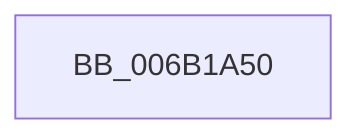

# KeSaveStateForHibernate

- RVA: `0x006B1A50`–`0x006B1B78` (길이 `296` bytes)
- VA: `0x00000001406B1A50`
- 실행 섹션: `.text`
- PDB 이름 있음: `예`; PDB Function 태그: `아니요`
- unwind 정보 RVA: `0x000C16AC`
- 디코드: `65`개 명령, `296/296` bytes 표시
- 미해석 바이트: `0` (있으면 어셈블리에 `.byte`로 보존)

> 이 문서는 커널 이미지의 기계어와 PDB 기호를 분석해 생성했습니다. 4번과 5번은 함수 원형과 자료형을 바이너리 사용 방식에서 추정한 C 해석이며 원본 소스 복구 결과는 아닙니다.

## 1. Dependencies

- 직접 호출 지점: **2**; 고유 호출 대상: **2**
- 직접 호출자로 확인된 함수: **4**
- RIP 상대 이미지 참조: **0**

### Outgoing calls
- `0x006B1A60` → [RtlCaptureContext](../4F/RtlCaptureContext_function_004FE570.md) (function, `0x004FE570`)
- `0x006B1B3A` → [KiSaveProcessorControlState](KiSaveProcessorControlState_function_006B0EF0.md) (function, `0x006B0EF0`)

### Direct callers
- [HalpSaveProcessorState](../6A/HalpSaveProcessorState_function_006ACBD0.md) at `0x006ACBDE`
- [HalpSetupRealModeResume](../6A/HalpSetupRealModeResume_function_006ACC60.md) at `0x006ACC94`
- [PopSaveHiberContextWrapper](PopSaveHiberContextWrapper_function_006BA360.md) at `0x006BA390`
- [HalpDpOfflineProcessorForReplace](../../pagelk/B5/HalpDpOfflineProcessorForReplace_function_00B5FC20.md) at `0x00B5FC6A`

### Static image references
- 디코드된 RIP-relative 메모리 참조가 없습니다.

## 2. Other-region calls and transfers

- 다른 실행 섹션으로 향하는 call: **0**
- 별도 외부 분기/꼬리 이동을 확인하지 못했습니다.

## 3. Assembly (complete function range)

```asm
006B1A50  48 83 EC 28                     sub rsp, 0x28
006B1A54  48 89 4C 24 20                  mov qword ptr [rsp + 0x20], rcx
006B1A59  48 81 C1 F0 00 00 00            add rcx, 0xf0
006B1A60  E8 0B CB E4 FF                  call 0x1404fe570
006B1A65  48 8B 4C 24 20                  mov rcx, qword ptr [rsp + 0x20]
006B1A6A  48 81 C1 F0 00 00 00            add rcx, 0xf0
006B1A71  66 41 B8 2B 00                  mov r8w, 0x2b
006B1A76  66 44 89 41 40                  mov word ptr [rcx + 0x40], r8w
006B1A7B  66 41 B8 53 00                  mov r8w, 0x53
006B1A80  66 44 89 41 3E                  mov word ptr [rcx + 0x3e], r8w
006B1A85  4C 8D 81 10 FF FF FF            lea r8, [rcx - 0xf0]
006B1A8C  B9 00 01 00 C0                  mov ecx, 0xc0000100
006B1A91  0F 32                           rdmsr
006B1A93  48 C1 E2 20                     shl rdx, 0x20
006B1A97  48 0B C2                        or rax, rdx
006B1A9A  49 89 80 E0 00 00 00            mov qword ptr [r8 + 0xe0], rax
006B1AA1  B9 01 01 00 C0                  mov ecx, 0xc0000101
006B1AA6  0F 32                           rdmsr
006B1AA8  48 C1 E2 20                     shl rdx, 0x20
006B1AAC  48 0B C2                        or rax, rdx
006B1AAF  49 89 80 A8 00 00 00            mov qword ptr [r8 + 0xa8], rax
006B1AB6  B9 02 01 00 C0                  mov ecx, 0xc0000102
006B1ABB  0F 32                           rdmsr
006B1ABD  48 C1 E2 20                     shl rdx, 0x20
006B1AC1  48 0B C2                        or rax, rdx
006B1AC4  49 89 80 B0 00 00 00            mov qword ptr [r8 + 0xb0], rax
006B1ACB  B9 81 00 00 C0                  mov ecx, 0xc0000081
006B1AD0  0F 32                           rdmsr
006B1AD2  48 C1 E2 20                     shl rdx, 0x20
006B1AD6  48 0B C2                        or rax, rdx
006B1AD9  49 89 80 B8 00 00 00            mov qword ptr [r8 + 0xb8], rax
006B1AE0  B9 82 00 00 C0                  mov ecx, 0xc0000082
006B1AE5  0F 32                           rdmsr
006B1AE7  48 C1 E2 20                     shl rdx, 0x20
006B1AEB  48 0B C2                        or rax, rdx
006B1AEE  49 89 80 C0 00 00 00            mov qword ptr [r8 + 0xc0], rax
006B1AF5  B9 83 00 00 C0                  mov ecx, 0xc0000083
006B1AFA  0F 32                           rdmsr
006B1AFC  48 C1 E2 20                     shl rdx, 0x20
006B1B00  48 0B C2                        or rax, rdx
006B1B03  49 89 80 C8 00 00 00            mov qword ptr [r8 + 0xc8], rax
006B1B0A  B9 84 00 00 C0                  mov ecx, 0xc0000084
006B1B0F  0F 32                           rdmsr
006B1B11  48 C1 E2 20                     shl rdx, 0x20
006B1B15  48 0B C2                        or rax, rdx
006B1B18  49 89 80 D0 00 00 00            mov qword ptr [r8 + 0xd0], rax
006B1B1F  48 8B 44 24 28                  mov rax, qword ptr [rsp + 0x28]
006B1B24  49 89 80 E8 01 00 00            mov qword ptr [r8 + 0x1e8], rax
006B1B2B  48 8D 44 24 30                  lea rax, [rsp + 0x30]
006B1B30  49 89 80 88 01 00 00            mov qword ptr [r8 + 0x188], rax
006B1B37  49 8B C8                        mov rcx, r8
006B1B3A  E8 B1 F3 FF FF                  call 0x1406b0ef0
006B1B3F  48 8B 4C 24 20                  mov rcx, qword ptr [rsp + 0x20]
006B1B44  4C 8B 41 10                     mov r8, qword ptr [rcx + 0x10]
006B1B48  49 83 E0 FC                     and r8, 0xfffffffffffffffc
006B1B4C  4C 89 41 10                     mov qword ptr [rcx + 0x10], r8
006B1B50  48 8B 4C 24 20                  mov rcx, qword ptr [rsp + 0x20]
006B1B55  4C 8B 41 18                     mov r8, qword ptr [rcx + 0x18]
006B1B59  49 81 E0 FF FF 7F FF            and r8, 0xffffffffff7fffff
006B1B60  4C 89 41 18                     mov qword ptr [rcx + 0x18], r8
006B1B64  48 8B 4C 24 20                  mov rcx, qword ptr [rsp + 0x20]
006B1B69  48 81 C1 F0 01 00 00            add rcx, 0x1f0
006B1B70  0F AE 01                        fxsave [rcx]
006B1B73  48 83 C4 28                     add rsp, 0x28
006B1B77  C3                              ret
```

## 4. C-style interpretation (structured pseudocode)

```c
__int64 __fastcall KeSaveStateForHibernate(__int64 a1, __int64 a2)
{
    __int64 result;
    __int64 v_rsp;
    unsigned __int64 v_stack_m8;
    unsigned __int64 v_stack_p0;
    unsigned __int64 v_stack_p8;

    v_rsp = (v_rsp) - (40);
    v_stack_m8 = a1;
    a1 = (a1) + (240);
    result = RtlCaptureContext(a1, a2, a3, a4);
    a1 = (v_stack_m8) + (240);
    *(unsigned __int16 *)(a1 + 64) = 43;
    *(unsigned __int16 *)(a1 + 62) = 83;
    a2 = (a2) << (32);
    result = (result) | (a2);
    *(unsigned __int64 *)(a1 - 240 + 224) = result;
    a2 = (a2) << (32);
    result = (result) | (a2);
    *(unsigned __int64 *)(a1 - 240 + 168) = result;
    a2 = (a2) << (32);
    result = (result) | (a2);
    *(unsigned __int64 *)(a1 - 240 + 176) = result;
    a2 = (a2) << (32);
    result = (result) | (a2);
    *(unsigned __int64 *)(a1 - 240 + 184) = result;
    a2 = (a2) << (32);
    result = (result) | (a2);
    *(unsigned __int64 *)(a1 - 240 + 192) = result;
    a2 = (a2) << (32);
    result = (result) | (a2);
    *(unsigned __int64 *)(a1 - 240 + 200) = result;
    a2 = (a2) << (32);
    result = (result) | (a2);
    *(unsigned __int64 *)(a1 - 240 + 208) = result;
    *(unsigned __int64 *)(a1 - 240 + 488) = v_stack_p0;
    *(unsigned __int64 *)(a1 - 240 + 392) = v_stack_p8;
    result = KiSaveProcessorControlState(a1 - 240, a2, a1 - 240, a4);
    a3 = (*(unsigned __int64 *)(v_stack_m8 + 16)) & (-4);
    *(unsigned __int64 *)(v_stack_m8 + 16) = a3;
    a3 = (*(unsigned __int64 *)(v_stack_m8 + 24)) & (0xFFFFFFFFFF7FFFFFULL);
    *(unsigned __int64 *)(v_stack_m8 + 24) = a3;
    a1 = (v_stack_m8) + (496);
    v_rsp = (v_rsp) + (40);
    return result;
}
```

## 5. (Beta) C Style

```c
int64_t KeSaveStateForHibernate(int64_t Arg1, int64_t Arg2)
{
    int64_t result;
    int64_t local_rsp;
    uint64_t v_stack_m8;
    uint64_t v_stack_p0;
    uint64_t v_stack_p8;

    local_rsp = (local_rsp) - (40);
    v_stack_m8 = Arg1;
    Arg1 = (Arg1) + (240);
    result = RtlCaptureContext(Arg1, Arg2, a3, a4);
    Arg1 = (v_stack_m8) + (240);
    *(uint16_t *)(Arg1 + 0x40) = 43;
    *(uint16_t *)(Arg1 + 0x3E) = 83;
    Arg2 = (Arg2) << (32);
    result = (result) | (Arg2);
    *(uint64_t *)(Arg1 - 0xF0 + 0xE0) = result;
    Arg2 = (Arg2) << (32);
    result = (result) | (Arg2);
    *(uint64_t *)(Arg1 - 0xF0 + 0xA8) = result;
    Arg2 = (Arg2) << (32);
    result = (result) | (Arg2);
    *(uint64_t *)(Arg1 - 0xF0 + 0xB0) = result;
    Arg2 = (Arg2) << (32);
    result = (result) | (Arg2);
    *(uint64_t *)(Arg1 - 0xF0 + 0xB8) = result;
    Arg2 = (Arg2) << (32);
    result = (result) | (Arg2);
    *(uint64_t *)(Arg1 - 0xF0 + 0xC0) = result;
    Arg2 = (Arg2) << (32);
    result = (result) | (Arg2);
    *(uint64_t *)(Arg1 - 0xF0 + 0xC8) = result;
    Arg2 = (Arg2) << (32);
    result = (result) | (Arg2);
    *(uint64_t *)(Arg1 - 0xF0 + 0xD0) = result;
    *(uint64_t *)(Arg1 - 0xF0 + 0x1E8) = v_stack_p0;
    *(uint64_t *)(Arg1 - 0xF0 + 0x188) = v_stack_p8;
    result = KiSaveProcessorControlState(Arg1 - 240, Arg2, Arg1 - 240, a4);
    a3 = (*(uint64_t *)(v_stack_m8 + 0x10)) & (-4);
    *(uint64_t *)(v_stack_m8 + 0x10) = a3;
    a3 = (*(uint64_t *)(v_stack_m8 + 0x18)) & (0xFFFFFFFFFF7FFFFFULL);
    *(uint64_t *)(v_stack_m8 + 0x18) = a3;
    Arg1 = (v_stack_m8) + (496);
    local_rsp = (local_rsp) + (40);
    return result;
}
```

## 6. Execution-region graph

[열기: 2D/3D 그래프와 함수 탐색 컨트롤 패널](../../../control-panel.html?section=text&rva=0x006B1A50&view=graph)

- 2D 그래프는 위에서 아래로 흐르고, 3D 그래프는 빈 공간을 드래그해 회전합니다. Shift+드래그는 이동, 휠은 확대·축소, 함수 노드 선택은 대상 보고서 이동입니다.

### Static fallback


