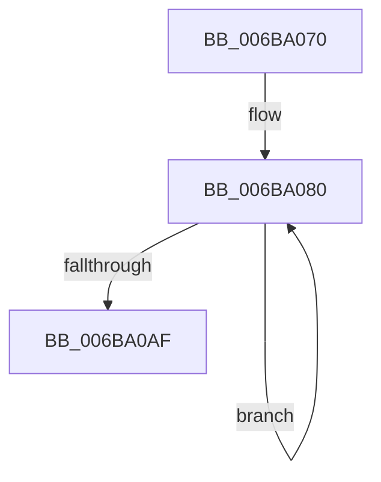

# KeZeroPages

- RVA: `0x006BA070`–`0x006BA0B3` (길이 `67` bytes)
- VA: `0x00000001406BA070`
- 실행 섹션: `.text`
- PDB 이름 있음: `예`; PDB Function 태그: `아니요`
- unwind 정보 RVA: `0x000BFAC8`
- 디코드: `17`개 명령, `67/67` bytes 표시
- 미해석 바이트: `0` (있으면 어셈블리에 `.byte`로 보존)

> 이 문서는 커널 이미지의 기계어와 PDB 기호를 분석해 생성했습니다. 4번과 5번은 함수 원형과 자료형을 바이너리 사용 방식에서 추정한 C 해석이며 원본 소스 복구 결과는 아닙니다.

## 1. Dependencies

- 직접 호출 지점: **0**; 고유 호출 대상: **0**
- 직접 호출자로 확인된 함수: **9**
- RIP 상대 이미지 참조: **0**

### Outgoing calls
- 직접 디코드된 call 명령이 없습니다.

### Direct callers
- [MiZeroLargePage](../2C/MiZeroLargePage_function_002C6914.md) at `0x002C6BF6`
- [MiZeroWithUltraSpace](../2C/MiZeroWithUltraSpace_function_002C6C9C.md) at `0x002C6D73`
- [MiFillMemory](../2C/MiFillMemory_function_002C7BD0.md) at `0x002C7C0D`
- [MiTryZeroMemory](../31/MiTryZeroMemory_function_0031E720.md) at `0x0031E808`
- [sub_003326B2](../33/Unknown_function_003326B2.md) at `0x00332701`
- [sub_00332923](../33/Unknown_function_00332923.md) at `0x0033299C`
- [MiDoGangAssignment](../4D/MiDoGangAssignment_function_004DE270.md) at `0x004DE34B`
- [MiPageNotZero](../67/MiPageNotZero_function_00679DAC.md) at `0x00679F2D`
- [MxMapVa](../../init/C6/MxMapVa_function_00C63EC4.md) at `0x00C6408F`

### Static image references
- 디코드된 RIP-relative 메모리 참조가 없습니다.

## 2. Other-region calls and transfers

- 다른 실행 섹션으로 향하는 call: **0**
- 별도 외부 분기/꼬리 이동을 확인하지 못했습니다.

## 3. Assembly (complete function range)

```asm
006BA070  66 0F EF C0                     pxor xmm0, xmm0
006BA074  B8 80 00 00 00                  mov eax, 0x80
006BA079  48 C1 EA 07                     shr rdx, 7
006BA07D  0F 1F 00                        nop dword ptr [rax]
006BA080  66 0F E7 01                     movntdq xmmword ptr [rcx], xmm0
006BA084  66 0F E7 41 10                  movntdq xmmword ptr [rcx + 0x10], xmm0
006BA089  66 0F E7 41 20                  movntdq xmmword ptr [rcx + 0x20], xmm0
006BA08E  66 0F E7 41 30                  movntdq xmmword ptr [rcx + 0x30], xmm0
006BA093  48 03 C8                        add rcx, rax
006BA096  66 0F E7 41 C0                  movntdq xmmword ptr [rcx - 0x40], xmm0
006BA09B  66 0F E7 41 D0                  movntdq xmmword ptr [rcx - 0x30], xmm0
006BA0A0  48 FF CA                        dec rdx
006BA0A3  66 0F E7 41 E0                  movntdq xmmword ptr [rcx - 0x20], xmm0
006BA0A8  66 0F E7 41 F0                  movntdq xmmword ptr [rcx - 0x10], xmm0
006BA0AD  75 D1                           jne 0x1406ba080
006BA0AF  0F AE F8                        sfence
006BA0B2  C3                              ret
```

## 4. C-style interpretation (structured pseudocode)

```c
__int64 __fastcall KeZeroPages(__int64 a1, __int64 a2)
{
    a2 = (a2) >> (7);
loc_006BA080:
    *(unsigned __int64 *)(a1) = v_xmm0;
    *(unsigned __int64 *)(a1 + 16) = v_xmm0;
    *(unsigned __int64 *)(a1 + 32) = v_xmm0;
    *(unsigned __int64 *)(a1 + 48) = v_xmm0;
    a1 = (a1) + (128);
    *(unsigned __int64 *)(a1 - 64) = v_xmm0;
    *(unsigned __int64 *)(a1 - 48) = v_xmm0;
    a2 = (a2) - 1;
    *(unsigned __int64 *)(a1 - 32) = v_xmm0;
    *(unsigned __int64 *)(a1 - 16) = v_xmm0;
    if (condition_is_not_equal) goto loc_006BA080;
    return 128;
}
```

## 5. (Beta) C Style

```c
int64_t KeZeroPages(void *Arg1, int64_t Arg2)
{
    uint8_t *arg1 = (uint8_t *)Arg1;

    Arg2 = (Arg2) >> (7);
loc_006BA080:
    *(uint64_t *)(arg1) = v_xmm0;
    *(uint64_t *)(arg1 + 0x10) = v_xmm0;
    *(uint64_t *)(arg1 + 0x20) = v_xmm0;
    *(uint64_t *)(arg1 + 0x30) = v_xmm0;
    Arg1 = (Arg1) + (128);
    *(uint64_t *)(arg1 - 0x40) = v_xmm0;
    *(uint64_t *)(arg1 - 0x30) = v_xmm0;
    Arg2 = (Arg2) - 1;
    *(uint64_t *)(arg1 - 0x20) = v_xmm0;
    *(uint64_t *)(arg1 - 0x10) = v_xmm0;
    if (condition_is_not_equal) goto loc_006BA080;
    return 128;
}
```

### 관측된 메모리 오프셋

구조체 형식이 확인되지 않은 접근은 인자 기준의 오프셋으로만 기록했습니다.

| 기준 인자 | 오프셋 표현 | 폭 (bit) | 접근 |
|---|---:|---:|---|
| `Arg1` | `- 0x40` | `128` | `R` |
| `Arg1` | `- 0x30` | `128` | `R` |
| `Arg1` | `- 0x20` | `128` | `R` |
| `Arg1` | `- 0x10` | `128` | `R` |
| `Arg1` | `+ 0x0` | `128` | `R` |
| `Arg1` | `+ 0x10` | `128` | `R` |
| `Arg1` | `+ 0x20` | `128` | `R` |
| `Arg1` | `+ 0x30` | `128` | `R` |

## 6. Execution-region graph

[열기: 2D/3D 그래프와 함수 탐색 컨트롤 패널](../../../control-panel.html?section=text&rva=0x006BA070&view=graph)

- 2D 그래프는 위에서 아래로 흐르고, 3D 그래프는 빈 공간을 드래그해 회전합니다. Shift+드래그는 이동, 휠은 확대·축소, 함수 노드 선택은 대상 보고서 이동입니다.

### Static fallback


