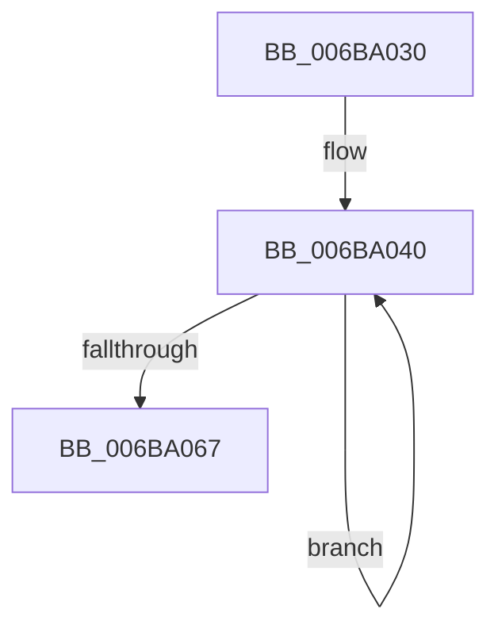

# KeZeroSinglePage

- RVA: `0x006BA030`–`0x006BA068` (길이 `56` bytes)
- VA: `0x00000001406BA030`
- 실행 섹션: `.text`
- PDB 이름 있음: `예`; PDB Function 태그: `아니요`
- unwind 정보 RVA: `0x000BFAC8`
- 디코드: `16`개 명령, `56/56` bytes 표시
- 미해석 바이트: `0` (있으면 어셈블리에 `.byte`로 보존)

> 이 문서는 커널 이미지의 기계어와 PDB 기호를 분석해 생성했습니다. 4번과 5번은 함수 원형과 자료형을 바이너리 사용 방식에서 추정한 C 해석이며 원본 소스 복구 결과는 아닙니다.

## 1. Dependencies

- 직접 호출 지점: **0**; 고유 호출 대상: **0**
- 직접 호출자로 확인된 함수: **4**
- RIP 상대 이미지 참조: **0**

### Outgoing calls
- 직접 디코드된 call 명령이 없습니다.

### Direct callers
- [MiZeroCfgSystemWideBitmapWorker](../36/MiZeroCfgSystemWideBitmapWorker_function_00367060.md) at `0x003674B6`
- [ViGrowPoolAllocation](../61/ViGrowPoolAllocation_function_00614290.md) at `0x006142D0`
- [MiValidateSectionCreate](../../page/94/MiValidateSectionCreate_function_00940190.md) at `0x00940619`
- [MxMarkActiveDriverBits](../../init/C6/MxMarkActiveDriverBits_function_00C6C998.md) at `0x00C6CA86`

### Static image references
- 디코드된 RIP-relative 메모리 참조가 없습니다.

## 2. Other-region calls and transfers

- 다른 실행 섹션으로 향하는 call: **0**
- 별도 외부 분기/꼬리 이동을 확인하지 못했습니다.

## 3. Assembly (complete function range)

```asm
006BA030  66 0F EF C0                     pxor xmm0, xmm0
006BA034  B8 80 00 00 00                  mov eax, 0x80
006BA039  BA 20 00 00 00                  mov edx, 0x20
006BA03E  66 90                           nop
006BA040  0F 29 01                        movaps xmmword ptr [rcx], xmm0
006BA043  0F 29 41 10                     movaps xmmword ptr [rcx + 0x10], xmm0
006BA047  0F 29 41 20                     movaps xmmword ptr [rcx + 0x20], xmm0
006BA04B  0F 29 41 30                     movaps xmmword ptr [rcx + 0x30], xmm0
006BA04F  48 03 C8                        add rcx, rax
006BA052  0F 29 41 C0                     movaps xmmword ptr [rcx - 0x40], xmm0
006BA056  0F 29 41 D0                     movaps xmmword ptr [rcx - 0x30], xmm0
006BA05A  48 FF CA                        dec rdx
006BA05D  0F 29 41 E0                     movaps xmmword ptr [rcx - 0x20], xmm0
006BA061  0F 29 41 F0                     movaps xmmword ptr [rcx - 0x10], xmm0
006BA065  75 D9                           jne 0x1406ba040
006BA067  C3                              ret
```

## 4. C-style interpretation (structured pseudocode)

```c
__int64 __fastcall KeZeroSinglePage(__int64 a1)
{
loc_006BA040:
    *(unsigned __int64 *)(a1) = v_xmm0;
    *(unsigned __int64 *)(a1 + 16) = v_xmm0;
    *(unsigned __int64 *)(a1 + 32) = v_xmm0;
    *(unsigned __int64 *)(a1 + 48) = v_xmm0;
    a1 = (a1) + (128);
    *(unsigned __int64 *)(a1 - 64) = v_xmm0;
    *(unsigned __int64 *)(a1 - 48) = v_xmm0;
    a2 = (32) - 1;
    *(unsigned __int64 *)(a1 - 32) = v_xmm0;
    *(unsigned __int64 *)(a1 - 16) = v_xmm0;
    if (condition_is_not_equal) goto loc_006BA040;
    return 128;
}
```

## 5. (Beta) C Style

```c
int64_t KeZeroSinglePage(void *Arg1)
{
    uint8_t *arg1 = (uint8_t *)Arg1;

loc_006BA040:
    *(uint64_t *)(arg1) = v_xmm0;
    *(uint64_t *)(arg1 + 0x10) = v_xmm0;
    *(uint64_t *)(arg1 + 0x20) = v_xmm0;
    *(uint64_t *)(arg1 + 0x30) = v_xmm0;
    Arg1 = (Arg1) + (128);
    *(uint64_t *)(arg1 - 0x40) = v_xmm0;
    *(uint64_t *)(arg1 - 0x30) = v_xmm0;
    a2 = (32) - 1;
    *(uint64_t *)(arg1 - 0x20) = v_xmm0;
    *(uint64_t *)(arg1 - 0x10) = v_xmm0;
    if (condition_is_not_equal) goto loc_006BA040;
    return 128;
}
```

### 관측된 메모리 오프셋

구조체 형식이 확인되지 않은 접근은 인자 기준의 오프셋으로만 기록했습니다.

| 기준 인자 | 오프셋 표현 | 폭 (bit) | 접근 |
|---|---:|---:|---|
| `Arg1` | `- 0x40` | `128` | `W` |
| `Arg1` | `- 0x30` | `128` | `W` |
| `Arg1` | `- 0x20` | `128` | `W` |
| `Arg1` | `- 0x10` | `128` | `W` |
| `Arg1` | `+ 0x0` | `128` | `W` |
| `Arg1` | `+ 0x10` | `128` | `W` |
| `Arg1` | `+ 0x20` | `128` | `W` |
| `Arg1` | `+ 0x30` | `128` | `W` |

## 6. Execution-region graph

[열기: 2D/3D 그래프와 함수 탐색 컨트롤 패널](../../../control-panel.html?section=text&rva=0x006BA030&view=graph)

- 2D 그래프는 위에서 아래로 흐르고, 3D 그래프는 빈 공간을 드래그해 회전합니다. Shift+드래그는 이동, 휠은 확대·축소, 함수 노드 선택은 대상 보고서 이동입니다.

### Static fallback


