# KiBreakpointTrap

- RVA: `0x006BD940`–`0x006BDC9D` (길이 `861` bytes)
- VA: `0x00000001406BD940`
- 실행 섹션: `.text`
- PDB 이름 있음: `예`; PDB Function 태그: `아니요`
- unwind 정보 RVA: `0x000C1B98`
- 디코드: `186`개 명령, `861/861` bytes 표시
- 미해석 바이트: `0` (있으면 어셈블리에 `.byte`로 보존)

> 이 문서는 커널 이미지의 기계어와 PDB 기호를 분석해 생성했습니다. 4번과 5번은 함수 원형과 자료형을 바이너리 사용 방식에서 추정한 C 해석이며 원본 소스 복구 결과는 아닙니다.

## 1. Dependencies

- 직접 호출 지점: **36**; 고유 호출 대상: **36**
- 직접 호출자로 확인된 함수: **1**
- RIP 상대 이미지 참조: **3**

### Outgoing calls
- `0x006BDA96` → [KiBreakpointTrap + 0x269](KiBreakpointTrap_function_006BD940.md) (inside-function, `0x006BDBA9`)
- `0x006BDA9F` → [KiBreakpointTrap + 0x272](KiBreakpointTrap_function_006BD940.md) (inside-function, `0x006BDBB2`)
- `0x006BDAA8` → [KiBreakpointTrap + 0x15B](KiBreakpointTrap_function_006BD940.md) (inside-function, `0x006BDA9B`)
- `0x006BDAB1` → [KiBreakpointTrap + 0x164](KiBreakpointTrap_function_006BD940.md) (inside-function, `0x006BDAA4`)
- `0x006BDABA` → [KiBreakpointTrap + 0x16D](KiBreakpointTrap_function_006BD940.md) (inside-function, `0x006BDAAD`)
- `0x006BDAC3` → [KiBreakpointTrap + 0x176](KiBreakpointTrap_function_006BD940.md) (inside-function, `0x006BDAB6`)
- `0x006BDACC` → [KiBreakpointTrap + 0x17F](KiBreakpointTrap_function_006BD940.md) (inside-function, `0x006BDABF`)
- `0x006BDAD5` → [KiBreakpointTrap + 0x188](KiBreakpointTrap_function_006BD940.md) (inside-function, `0x006BDAC8`)
- `0x006BDADE` → [KiBreakpointTrap + 0x191](KiBreakpointTrap_function_006BD940.md) (inside-function, `0x006BDAD1`)
- `0x006BDAE7` → [KiBreakpointTrap + 0x19A](KiBreakpointTrap_function_006BD940.md) (inside-function, `0x006BDADA`)
- `0x006BDAF0` → [KiBreakpointTrap + 0x1A3](KiBreakpointTrap_function_006BD940.md) (inside-function, `0x006BDAE3`)
- `0x006BDAF9` → [KiBreakpointTrap + 0x1AC](KiBreakpointTrap_function_006BD940.md) (inside-function, `0x006BDAEC`)
- `0x006BDB02` → [KiBreakpointTrap + 0x1B5](KiBreakpointTrap_function_006BD940.md) (inside-function, `0x006BDAF5`)
- `0x006BDB0B` → [KiBreakpointTrap + 0x1BE](KiBreakpointTrap_function_006BD940.md) (inside-function, `0x006BDAFE`)
- `0x006BDB14` → [KiBreakpointTrap + 0x1C7](KiBreakpointTrap_function_006BD940.md) (inside-function, `0x006BDB07`)
- `0x006BDB1D` → [KiBreakpointTrap + 0x1D0](KiBreakpointTrap_function_006BD940.md) (inside-function, `0x006BDB10`)
- `0x006BDB26` → [KiBreakpointTrap + 0x1D9](KiBreakpointTrap_function_006BD940.md) (inside-function, `0x006BDB19`)
- `0x006BDB2F` → [KiBreakpointTrap + 0x1E2](KiBreakpointTrap_function_006BD940.md) (inside-function, `0x006BDB22`)
- `0x006BDB38` → [KiBreakpointTrap + 0x1EB](KiBreakpointTrap_function_006BD940.md) (inside-function, `0x006BDB2B`)
- `0x006BDB41` → [KiBreakpointTrap + 0x1F4](KiBreakpointTrap_function_006BD940.md) (inside-function, `0x006BDB34`)
- `0x006BDB4A` → [KiBreakpointTrap + 0x1FD](KiBreakpointTrap_function_006BD940.md) (inside-function, `0x006BDB3D`)
- `0x006BDB53` → [KiBreakpointTrap + 0x206](KiBreakpointTrap_function_006BD940.md) (inside-function, `0x006BDB46`)
- `0x006BDB5C` → [KiBreakpointTrap + 0x20F](KiBreakpointTrap_function_006BD940.md) (inside-function, `0x006BDB4F`)
- `0x006BDB65` → [KiBreakpointTrap + 0x218](KiBreakpointTrap_function_006BD940.md) (inside-function, `0x006BDB58`)
- `0x006BDB6E` → [KiBreakpointTrap + 0x221](KiBreakpointTrap_function_006BD940.md) (inside-function, `0x006BDB61`)
- `0x006BDB77` → [KiBreakpointTrap + 0x22A](KiBreakpointTrap_function_006BD940.md) (inside-function, `0x006BDB6A`)
- `0x006BDB80` → [KiBreakpointTrap + 0x233](KiBreakpointTrap_function_006BD940.md) (inside-function, `0x006BDB73`)
- `0x006BDB89` → [KiBreakpointTrap + 0x23C](KiBreakpointTrap_function_006BD940.md) (inside-function, `0x006BDB7C`)
- `0x006BDB92` → [KiBreakpointTrap + 0x245](KiBreakpointTrap_function_006BD940.md) (inside-function, `0x006BDB85`)
- `0x006BDB9B` → [KiBreakpointTrap + 0x24E](KiBreakpointTrap_function_006BD940.md) (inside-function, `0x006BDB8E`)
- `0x006BDBA4` → [KiBreakpointTrap + 0x257](KiBreakpointTrap_function_006BD940.md) (inside-function, `0x006BDB97`)
- `0x006BDBAD` → [KiBreakpointTrap + 0x260](KiBreakpointTrap_function_006BD940.md) (inside-function, `0x006BDBA0`)
- `0x006BDBD8` → [KiFlushBhbDuringTrapEntryOrExit](../6C/KiFlushBhbDuringTrapEntryOrExit_function_006C6340.md) (function, `0x006C6340`)
- `0x006BDC21` → [KiSaveDebugRegisterState](../4F/KiSaveDebugRegisterState_function_004FD960.md) (function, `0x004FD960`)
- `0x006BDC55` → [KiSynchronizeUserIsolationDomainExit](../41/KiSynchronizeUserIsolationDomainExit_function_0041BFA0.md) (function, `0x0041BFA0`)
- `0x006BDC96` → [KiExceptionDispatch](../6C/KiExceptionDispatch_function_006C5900.md) (function, `0x006C5900`)

### Direct callers
- [KiBreakpointTrap](KiBreakpointTrap_function_006BD940.md) at `0x006BDA96`
- [KiBreakpointTrap](KiBreakpointTrap_function_006BD940.md) at `0x006BDA9F`
- [KiBreakpointTrap](KiBreakpointTrap_function_006BD940.md) at `0x006BDAA8`
- [KiBreakpointTrap](KiBreakpointTrap_function_006BD940.md) at `0x006BDAB1`
- [KiBreakpointTrap](KiBreakpointTrap_function_006BD940.md) at `0x006BDABA`
- [KiBreakpointTrap](KiBreakpointTrap_function_006BD940.md) at `0x006BDAC3`
- [KiBreakpointTrap](KiBreakpointTrap_function_006BD940.md) at `0x006BDACC`
- [KiBreakpointTrap](KiBreakpointTrap_function_006BD940.md) at `0x006BDAD5`
- [KiBreakpointTrap](KiBreakpointTrap_function_006BD940.md) at `0x006BDADE`
- [KiBreakpointTrap](KiBreakpointTrap_function_006BD940.md) at `0x006BDAE7`
- [KiBreakpointTrap](KiBreakpointTrap_function_006BD940.md) at `0x006BDAF0`
- [KiBreakpointTrap](KiBreakpointTrap_function_006BD940.md) at `0x006BDAF9`
- [KiBreakpointTrap](KiBreakpointTrap_function_006BD940.md) at `0x006BDB02`
- [KiBreakpointTrap](KiBreakpointTrap_function_006BD940.md) at `0x006BDB0B`
- [KiBreakpointTrap](KiBreakpointTrap_function_006BD940.md) at `0x006BDB14`
- [KiBreakpointTrap](KiBreakpointTrap_function_006BD940.md) at `0x006BDB1D`
- [KiBreakpointTrap](KiBreakpointTrap_function_006BD940.md) at `0x006BDB26`
- [KiBreakpointTrap](KiBreakpointTrap_function_006BD940.md) at `0x006BDB2F`
- [KiBreakpointTrap](KiBreakpointTrap_function_006BD940.md) at `0x006BDB38`
- [KiBreakpointTrap](KiBreakpointTrap_function_006BD940.md) at `0x006BDB41`
- [KiBreakpointTrap](KiBreakpointTrap_function_006BD940.md) at `0x006BDB4A`
- [KiBreakpointTrap](KiBreakpointTrap_function_006BD940.md) at `0x006BDB53`
- [KiBreakpointTrap](KiBreakpointTrap_function_006BD940.md) at `0x006BDB5C`
- [KiBreakpointTrap](KiBreakpointTrap_function_006BD940.md) at `0x006BDB65`
- [KiBreakpointTrap](KiBreakpointTrap_function_006BD940.md) at `0x006BDB6E`
- [KiBreakpointTrap](KiBreakpointTrap_function_006BD940.md) at `0x006BDB77`
- [KiBreakpointTrap](KiBreakpointTrap_function_006BD940.md) at `0x006BDB80`
- [KiBreakpointTrap](KiBreakpointTrap_function_006BD940.md) at `0x006BDB89`
- [KiBreakpointTrap](KiBreakpointTrap_function_006BD940.md) at `0x006BDB92`
- [KiBreakpointTrap](KiBreakpointTrap_function_006BD940.md) at `0x006BDB9B`
- [KiBreakpointTrap](KiBreakpointTrap_function_006BD940.md) at `0x006BDBA4`
- [KiBreakpointTrap](KiBreakpointTrap_function_006BD940.md) at `0x006BDBAD`

### Static image references
- `0x006BD9B5` → RVA `0x01201840` (`CFGRO`; read)
- `0x006BDBE9` → RVA `0x00FC7264` (`ALMOSTRO`; read)
- `0x006BDC5A` → RVA `0x00FC6BF0` (`ALMOSTRO`; read)

## 2. Other-region calls and transfers

- 다른 실행 섹션으로 향하는 call: **0**
- 별도 외부 분기/꼬리 이동을 확인하지 못했습니다.

## 3. Assembly (complete function range)

```asm
006BD940  48 83 EC 08                     sub rsp, 8
006BD944  55                              push rbp
006BD945  48 81 EC 58 01 00 00            sub rsp, 0x158
006BD94C  48 8D AC 24 80 00 00 00         lea rbp, [rsp + 0x80]
006BD954  C6 45 AB 01                     mov byte ptr [rbp - 0x55], 1
006BD958  48 89 45 B0                     mov qword ptr [rbp - 0x50], rax
006BD95C  48 89 4D B8                     mov qword ptr [rbp - 0x48], rcx
006BD960  48 89 55 C0                     mov qword ptr [rbp - 0x40], rdx
006BD964  4C 89 45 C8                     mov qword ptr [rbp - 0x38], r8
006BD968  4C 89 4D D0                     mov qword ptr [rbp - 0x30], r9
006BD96C  4C 89 55 D8                     mov qword ptr [rbp - 0x28], r10
006BD970  4C 89 5D E0                     mov qword ptr [rbp - 0x20], r11
006BD974  F6 85 F0 00 00 00 01            test byte ptr [rbp + 0xf0], 1
006BD97B  75 38                           jne 0x1406bd9b5
006BD97D  33 D2                           xor edx, edx
006BD97F  F3 48 0F 1E CA                  rdsspq rdx
006BD984  48 89 55 58                     mov qword ptr [rbp + 0x58], rdx
006BD988  0F AE E8                        lfence
006BD98B  65 F6 04 25 58 08 00 00 01      test byte ptr gs:[0x858], 1
006BD994  75 08                           jne 0x1406bd99e
006BD996  0F AE E8                        lfence
006BD999  E9 88 02 00 00                  jmp 0x1406bdc26
006BD99E  65 0F B7 04 25 66 08 00 00      movzx eax, word ptr gs:[0x866]
006BD9A7  B9 48 00 00 00                  mov ecx, 0x48
006BD9AC  33 D2                           xor edx, edx
006BD9AE  0F 30                           wrmsr
006BD9B0  E9 71 02 00 00                  jmp 0x1406bdc26
006BD9B5  F6 05 84 3E B4 00 01            test byte ptr [rip + 0xb43e84], 1
006BD9BC  75 03                           jne 0x1406bd9c1
006BD9BE  0F 01 F8                        swapgs
006BD9C1  0F AE E8                        lfence
006BD9C4  65 48 8B 0C 25 28 9D 00 00      mov rcx, qword ptr gs:[0x9d28]
006BD9CD  48 85 C9                        test rcx, rcx
006BD9D0  74 1F                           je 0x1406bd9f1
006BD9D2  F3 48 0F 1E CA                  rdsspq rdx
006BD9D7  65 4C 8B 14 25 20 9D 00 00      mov r10, qword ptr gs:[0x9d20]
006BD9E0  49 83 C2 08                     add r10, 8
006BD9E4  49 3B D2                        cmp rdx, r10
006BD9E7  75 08                           jne 0x1406bd9f1
006BD9E9  F3 0F 01 29                     rstorssp dword ptr [rcx]
006BD9ED  F3 0F 01 EA                     saveprevssp
006BD9F1  65 4C 8B 14 25 88 01 00 00      mov r10, qword ptr gs:[0x188]
006BD9FA  65 48 8B 0C 25 88 01 00 00      mov rcx, qword ptr gs:[0x188]
006BDA03  48 8B 89 20 02 00 00            mov rcx, qword ptr [rcx + 0x220]
006BDA0A  48 8B 89 60 07 00 00            mov rcx, qword ptr [rcx + 0x760]
006BDA11  65 48 89 0C 25 50 08 00 00      mov qword ptr gs:[0x850], rcx
006BDA1A  66 65 8B 0C 25 62 08 00 00      mov cx, word ptr gs:[0x862]
006BDA23  66 65 89 0C 25 64 08 00 00      mov word ptr gs:[0x864], cx
006BDA2C  65 8A 0C 25 58 08 00 00         mov cl, byte ptr gs:[0x858]
006BDA34  65 88 0C 25 5A 08 00 00         mov byte ptr gs:[0x85a], cl
006BDA3C  65 0F B7 04 25 68 08 00 00      movzx eax, word ptr gs:[0x868]
006BDA45  66 65 39 04 25 66 08 00 00      cmp word ptr gs:[0x866], ax
006BDA4E  74 12                           je 0x1406bda62
006BDA50  66 65 89 04 25 66 08 00 00      mov word ptr gs:[0x866], ax
006BDA59  B9 48 00 00 00                  mov ecx, 0x48
006BDA5E  33 D2                           xor edx, edx
006BDA60  0F 30                           wrmsr
006BDA62  65 0F B6 14 25 58 08 00 00      movzx edx, byte ptr gs:[0x858]
006BDA6B  F7 C2 08 00 00 00               test edx, 8
006BDA71  74 17                           je 0x1406bda8a
006BDA73  B8 01 00 00 00                  mov eax, 1
006BDA78  33 D2                           xor edx, edx
006BDA7A  B9 49 00 00 00                  mov ecx, 0x49
006BDA7F  0F 30                           wrmsr
006BDA81  65 0F B6 14 25 58 08 00 00      movzx edx, byte ptr gs:[0x858]
006BDA8A  F7 C2 02 00 00 00               test edx, 2
006BDA90  0F 84 37 01 00 00               je 0x1406bdbcd
006BDA96  E8 0E 01 00 00                  call 0x1406bdba9
006BDA9B  48 83 C4 08                     add rsp, 8
006BDA9F  E8 0E 01 00 00                  call 0x1406bdbb2
006BDAA4  48 83 C4 08                     add rsp, 8
006BDAA8  E8 EE FF FF FF                  call 0x1406bda9b
006BDAAD  48 83 C4 08                     add rsp, 8
006BDAB1  E8 EE FF FF FF                  call 0x1406bdaa4
006BDAB6  48 83 C4 08                     add rsp, 8
006BDABA  E8 EE FF FF FF                  call 0x1406bdaad
006BDABF  48 83 C4 08                     add rsp, 8
006BDAC3  E8 EE FF FF FF                  call 0x1406bdab6
006BDAC8  48 83 C4 08                     add rsp, 8
006BDACC  E8 EE FF FF FF                  call 0x1406bdabf
006BDAD1  48 83 C4 08                     add rsp, 8
006BDAD5  E8 EE FF FF FF                  call 0x1406bdac8
006BDADA  48 83 C4 08                     add rsp, 8
006BDADE  E8 EE FF FF FF                  call 0x1406bdad1
006BDAE3  48 83 C4 08                     add rsp, 8
006BDAE7  E8 EE FF FF FF                  call 0x1406bdada
006BDAEC  48 83 C4 08                     add rsp, 8
006BDAF0  E8 EE FF FF FF                  call 0x1406bdae3
006BDAF5  48 83 C4 08                     add rsp, 8
006BDAF9  E8 EE FF FF FF                  call 0x1406bdaec
006BDAFE  48 83 C4 08                     add rsp, 8
006BDB02  E8 EE FF FF FF                  call 0x1406bdaf5
006BDB07  48 83 C4 08                     add rsp, 8
006BDB0B  E8 EE FF FF FF                  call 0x1406bdafe
006BDB10  48 83 C4 08                     add rsp, 8
006BDB14  E8 EE FF FF FF                  call 0x1406bdb07
006BDB19  48 83 C4 08                     add rsp, 8
006BDB1D  E8 EE FF FF FF                  call 0x1406bdb10
006BDB22  48 83 C4 08                     add rsp, 8
006BDB26  E8 EE FF FF FF                  call 0x1406bdb19
006BDB2B  48 83 C4 08                     add rsp, 8
006BDB2F  E8 EE FF FF FF                  call 0x1406bdb22
006BDB34  48 83 C4 08                     add rsp, 8
006BDB38  E8 EE FF FF FF                  call 0x1406bdb2b
006BDB3D  48 83 C4 08                     add rsp, 8
006BDB41  E8 EE FF FF FF                  call 0x1406bdb34
006BDB46  48 83 C4 08                     add rsp, 8
006BDB4A  E8 EE FF FF FF                  call 0x1406bdb3d
006BDB4F  48 83 C4 08                     add rsp, 8
006BDB53  E8 EE FF FF FF                  call 0x1406bdb46
006BDB58  48 83 C4 08                     add rsp, 8
006BDB5C  E8 EE FF FF FF                  call 0x1406bdb4f
006BDB61  48 83 C4 08                     add rsp, 8
006BDB65  E8 EE FF FF FF                  call 0x1406bdb58
006BDB6A  48 83 C4 08                     add rsp, 8
006BDB6E  E8 EE FF FF FF                  call 0x1406bdb61
006BDB73  48 83 C4 08                     add rsp, 8
006BDB77  E8 EE FF FF FF                  call 0x1406bdb6a
006BDB7C  48 83 C4 08                     add rsp, 8
006BDB80  E8 EE FF FF FF                  call 0x1406bdb73
006BDB85  48 83 C4 08                     add rsp, 8
006BDB89  E8 EE FF FF FF                  call 0x1406bdb7c
006BDB8E  48 83 C4 08                     add rsp, 8
006BDB92  E8 EE FF FF FF                  call 0x1406bdb85
006BDB97  48 83 C4 08                     add rsp, 8
006BDB9B  E8 EE FF FF FF                  call 0x1406bdb8e
006BDBA0  48 83 C4 08                     add rsp, 8
006BDBA4  E8 EE FF FF FF                  call 0x1406bdb97
006BDBA9  48 83 C4 08                     add rsp, 8
006BDBAD  E8 EE FF FF FF                  call 0x1406bdba0
006BDBB2  48 83 C4 08                     add rsp, 8
006BDBB6  B8 DA DA 00 00                  mov eax, 0xdada
006BDBBB  65 F6 04 25 5C 08 00 00 08      test byte ptr gs:[0x85c], 8
006BDBC4  74 07                           je 0x1406bdbcd
006BDBC6  B0 20                           mov al, 0x20
006BDBC8  F3 48 0F AE E8                  incsspq rax
006BDBCD  F7 C2 80 00 00 00               test edx, 0x80
006BDBD3  74 08                           je 0x1406bdbdd
006BDBD5  0F AE E8                        lfence
006BDBD8  E8 63 87 00 00                  call 0x1406c6340
006BDBDD  0F AE E8                        lfence
006BDBE0  65 C6 04 25 5E 08 00 00 00      mov byte ptr gs:[0x85e], 0
006BDBE9  83 3D 74 96 90 00 00            cmp dword ptr [rip + 0x909674], 0
006BDBF0  74 1F                           je 0x1406bdc11
006BDBF2  B9 A7 06 00 00                  mov ecx, 0x6a7
006BDBF7  0F 32                           rdmsr
006BDBF9  83 FA 00                        cmp edx, 0
006BDBFC  74 13                           je 0x1406bdc11
006BDBFE  8B CA                           mov ecx, edx
006BDC00  23 15 5E 96 90 00               and edx, dword ptr [rip + 0x90965e]
006BDC06  3B D1                           cmp edx, ecx
006BDC08  74 07                           je 0x1406bdc11
006BDC0A  B9 A7 06 00 00                  mov ecx, 0x6a7
006BDC0F  0F 30                           wrmsr
006BDC11  41 F6 42 03 03                  test byte ptr [r10 + 3], 3
006BDC16  66 C7 85 80 00 00 00 00 00      mov word ptr [rbp + 0x80], 0
006BDC1F  74 05                           je 0x1406bdc26
006BDC21  E8 3A FD E3 FF                  call 0x1404fd960
006BDC26  FC                              cld
006BDC27  0F AE 5D AC                     stmxcsr dword ptr [rbp - 0x54]
006BDC2B  65 0F AE 14 25 80 01 00 00      ldmxcsr dword ptr gs:[0x180]
006BDC34  0F 29 45 F0                     movaps xmmword ptr [rbp - 0x10], xmm0
006BDC38  0F 29 4D 00                     movaps xmmword ptr [rbp], xmm1
006BDC3C  0F 29 55 10                     movaps xmmword ptr [rbp + 0x10], xmm2
006BDC40  0F 29 5D 20                     movaps xmmword ptr [rbp + 0x20], xmm3
006BDC44  0F 29 65 30                     movaps xmmword ptr [rbp + 0x30], xmm4
006BDC48  0F 29 6D 40                     movaps xmmword ptr [rbp + 0x40], xmm5
006BDC4C  F6 85 F0 00 00 00 01            test byte ptr [rbp + 0xf0], 1
006BDC53  74 05                           je 0x1406bdc5a
006BDC55  E8 46 E3 D5 FF                  call 0x14041bfa0
006BDC5A  F6 05 8F 8F 90 00 FF            test byte ptr [rip + 0x908f8f], 0xff
006BDC61  74 0C                           je 0x1406bdc6f
006BDC63  F6 85 F0 00 00 00 01            test byte ptr [rbp + 0xf0], 1
006BDC6A  74 03                           je 0x1406bdc6f
006BDC6C  0F 01 CB                        stac
006BDC6F  F7 85 F8 00 00 00 00 02 00 00   test dword ptr [rbp + 0xf8], 0x200
006BDC79  74 01                           je 0x1406bdc7c
006BDC7B  FB                              sti
006BDC7C  B9 03 00 00 80                  mov ecx, 0x80000003
006BDC81  BA 01 00 00 00                  mov edx, 1
006BDC86  4C 8B 85 E8 00 00 00            mov r8, qword ptr [rbp + 0xe8]
006BDC8D  49 FF C8                        dec r8
006BDC90  41 B9 00 00 00 00               mov r9d, 0
006BDC96  E8 65 7C 00 00                  call 0x1406c5900
006BDC9B  90                              nop
006BDC9C  C3                              ret
```

## 4. C-style interpretation (structured pseudocode)

```c
__int64 __fastcall KiBreakpointTrap(__int64 a1, __int64 a2, __int64 a3, __int64 a4)
{
    __int64 result;
    __int64 v_r10;
    __int64 v_rsp;
    unsigned __int64 v_stack_m108;
    unsigned __int64 v_stack_m110;
    unsigned __int64 v_stack_m118;
    unsigned __int64 v_stack_m120;
    unsigned __int64 v_stack_m128;
    unsigned __int64 v_stack_m130;
    unsigned __int64 v_stack_m138;
    unsigned int v_stack_m13C;
    unsigned __int8 v_stack_m13D;
    unsigned __int16 v_stack_m68;
    unsigned __int64 v_stack_m90;
    unsigned __int64 v_stack_mA8;
    unsigned __int64 v_stack_mB8;
    unsigned __int64 v_stack_mC8;
    unsigned __int64 v_stack_mD8;
    unsigned __int64 v_stack_mE8;
    unsigned __int64 v_stack_mF8;
    unsigned __int64 v_stack_p0;
    unsigned int v_stack_p10;
    unsigned __int8 v_stack_p8;

    v_rsp = (v_rsp) - (8);
    v_rsp = (v_rsp) - (344);
    v_stack_m13D = 1;
    v_stack_m138 = result;
    v_stack_m130 = a1;
    v_stack_m128 = a2;
    v_stack_m120 = a3;
    v_stack_m118 = a4;
    v_stack_m110 = v_r10;
    v_stack_m108 = v_r11;
    if (((v_stack_p8) & (1)) != 0) goto loc_006BD9B5;
    a2 = 0;
    v_stack_m90 = 0;
    if (((*(unsigned __int8 *)(gs_base + (0 + 2136))) & (1)) != 0) goto loc_006BD99E;
    goto loc_006BDC26;
loc_006BD99E:
    a2 = 0;
    goto loc_006BDC26;
loc_006BD9B5:
    if (((*(unsigned __int8 *)(v_rip + 11812484)) & (1)) == 0) {
    }
    if (*(unsigned __int64 *)(gs_base + (0 + 40232)) == 0) goto loc_006BD9F1;
    v_r10 = (*(unsigned __int64 *)(gs_base + (0 + 40224))) + (8);
    if (0 == v_r10) {
    }
    *(unsigned __int64 *)(gs_base + (0 + 2128)) = *(unsigned __int64 *)(*(unsigned __int64 *)(*(unsigned __int64 *)(gs_base + (0 + 392)) + 544) + 1888);
    *(unsigned __int16 *)(gs_base + (0 + 2148)) = (unsigned __int16)(*(unsigned __int16 *)(gs_base + (0 + 2146)));
    *(unsigned __int8 *)(gs_base + (0 + 2138)) = (unsigned __int8)(*(unsigned __int8 *)(gs_base + (0 + 2136)));
    if ((*(unsigned __int16 *)(gs_base + (0 + 2150))) != ((unsigned __int16)(*(unsigned __int16 *)(gs_base + (0 + 2152))))) {
        *(unsigned __int16 *)(gs_base + (0 + 2150)) = (unsigned __int16)(*(unsigned __int16 *)(gs_base + (0 + 2152)));
        a1 = 72;
        a2 = 0;
    }
    result = *(unsigned __int16 *)(gs_base + (0 + 2152));
    if ((((unsigned int)(*(unsigned __int8 *)(gs_base + (0 + 2136)))) & (8)) != 0) {
        result = 1;
        a2 = 0;
        a1 = 73;
        a2 = *(unsigned __int8 *)(gs_base + (0 + 2136));
    }
    if ((((unsigned int)(a2)) & (2)) == 0) goto loc_006BDBCD;
    result = KiBreakpointTrap___0x269(a1, a2, a3, a4);
    v_rsp = (v_rsp) + (8);
    result = KiBreakpointTrap___0x272(a1, a2, a3, a4);
    v_rsp = (v_rsp) + (8);
    result = KiBreakpointTrap___0x15B(a1, a2, a3, a4);
    v_rsp = (v_rsp) + (8);
    result = KiBreakpointTrap___0x164(a1, a2, a3, a4);
    v_rsp = (v_rsp) + (8);
    result = KiBreakpointTrap___0x16D(a1, a2, a3, a4);
    v_rsp = (v_rsp) + (8);
    result = KiBreakpointTrap___0x176(a1, a2, a3, a4);
    v_rsp = (v_rsp) + (8);
    result = KiBreakpointTrap___0x17F(a1, a2, a3, a4);
    v_rsp = (v_rsp) + (8);
    result = KiBreakpointTrap___0x188(a1, a2, a3, a4);
    v_rsp = (v_rsp) + (8);
    result = KiBreakpointTrap___0x191(a1, a2, a3, a4);
    v_rsp = (v_rsp) + (8);
    result = KiBreakpointTrap___0x19A(a1, a2, a3, a4);
    v_rsp = (v_rsp) + (8);
    result = KiBreakpointTrap___0x1A3(a1, a2, a3, a4);
    v_rsp = (v_rsp) + (8);
    result = KiBreakpointTrap___0x1AC(a1, a2, a3, a4);
    v_rsp = (v_rsp) + (8);
    result = KiBreakpointTrap___0x1B5(a1, a2, a3, a4);
    v_rsp = (v_rsp) + (8);
    result = KiBreakpointTrap___0x1BE(a1, a2, a3, a4);
    v_rsp = (v_rsp) + (8);
    result = KiBreakpointTrap___0x1C7(a1, a2, a3, a4);
    v_rsp = (v_rsp) + (8);
    result = KiBreakpointTrap___0x1D0(a1, a2, a3, a4);
    v_rsp = (v_rsp) + (8);
    result = KiBreakpointTrap___0x1D9(a1, a2, a3, a4);
    v_rsp = (v_rsp) + (8);
    result = KiBreakpointTrap___0x1E2(a1, a2, a3, a4);
    v_rsp = (v_rsp) + (8);
    result = KiBreakpointTrap___0x1EB(a1, a2, a3, a4);
    v_rsp = (v_rsp) + (8);
    result = KiBreakpointTrap___0x1F4(a1, a2, a3, a4);
    v_rsp = (v_rsp) + (8);
    result = KiBreakpointTrap___0x1FD(a1, a2, a3, a4);
    v_rsp = (v_rsp) + (8);
    result = KiBreakpointTrap___0x206(a1, a2, a3, a4);
    v_rsp = (v_rsp) + (8);
    result = KiBreakpointTrap___0x20F(a1, a2, a3, a4);
    v_rsp = (v_rsp) + (8);
    result = KiBreakpointTrap___0x218(a1, a2, a3, a4);
    v_rsp = (v_rsp) + (8);
    result = KiBreakpointTrap___0x221(a1, a2, a3, a4);
    v_rsp = (v_rsp) + (8);
    result = KiBreakpointTrap___0x22A(a1, a2, a3, a4);
    v_rsp = (v_rsp) + (8);
    result = KiBreakpointTrap___0x233(a1, a2, a3, a4);
    v_rsp = (v_rsp) + (8);
    result = KiBreakpointTrap___0x23C(a1, a2, a3, a4);
    v_rsp = (v_rsp) + (8);
    result = KiBreakpointTrap___0x245(a1, a2, a3, a4);
    v_rsp = (v_rsp) + (8);
    result = KiBreakpointTrap___0x24E(a1, a2, a3, a4);
    v_rsp = (v_rsp) + (8);
    result = KiBreakpointTrap___0x257(a1, a2, a3, a4);
    v_rsp = (v_rsp) + (8);
    result = KiBreakpointTrap___0x260(a1, a2, a3, a4);
    v_rsp = (v_rsp) + (8);
    result = (unsigned int)(0xDADAULL);
    if (((*(unsigned __int8 *)(gs_base + (0 + 2140))) & (8)) != 0) {
        result = 32;
    }
    if ((((unsigned int)(a2)) & (128)) != 0) {
        result = KiFlushBhbDuringTrapEntryOrExit(a1, a2, a3, a4);
    }
    *(unsigned __int8 *)(gs_base + (0 + 2142)) = 0;
    if ((*(unsigned int *)(v_rip + 9475700)) == 0) goto loc_006BDC11;
    if (((unsigned int)(a2)) == 0) goto loc_006BDC11;
    a2 = (unsigned int)((a2) & (*(unsigned int *)(v_rip + 9475678)));
    if (((unsigned int)(a2)) != ((unsigned int)((unsigned int)((unsigned int)(a2))))) {
        a1 = 0x6A7ULL;
    }
    v_stack_m68 = 0;
    if (((*(unsigned __int8 *)(*(unsigned __int64 *)(gs_base + (0 + 392)) + 3)) & (3)) != 0) {
        result = KiSaveDebugRegisterState(a1, a2, a3, a4);
    }
    v_stack_mF8 = v_xmm0;
    v_stack_mE8 = v_xmm1;
    v_stack_mD8 = v_xmm2;
    v_stack_mC8 = v_xmm3;
    v_stack_mB8 = v_xmm4;
    v_stack_mA8 = v_xmm5;
    if (((v_stack_p8) & (1)) != 0) {
        result = KiSynchronizeUserIsolationDomainExit(a1, a2, a3, a4);
    }
    if (((*(unsigned __int8 *)(v_rip + 9473935)) & (255)) == 0) goto loc_006BDC6F;
    if (((v_stack_p8) & (1)) != 0) {
    }
    if (((v_stack_p10) & (512)) != 0) {
    }
    a3 = (v_stack_p0) - 1;
    result = KiExceptionDispatch((unsigned int)(0x80000003ULL), 1, a3, 0);
    return result;
}
```

## 5. (Beta) C Style

```c
int64_t KiBreakpointTrap(int64_t Arg1, int64_t Arg2, int64_t Arg3, int64_t Arg4)
{
    int64_t result;
    int64_t local_r10;
    int64_t local_rsp;
    uint64_t v_stack_m108;
    uint64_t v_stack_m110;
    uint64_t v_stack_m118;
    uint64_t v_stack_m120;
    uint64_t v_stack_m128;
    uint64_t v_stack_m130;
    uint64_t v_stack_m138;
    uint32_t v_stack_m13C;
    uint8_t v_stack_m13D;
    uint16_t v_stack_m68;
    uint64_t v_stack_m90;
    uint64_t v_stack_mA8;
    uint64_t v_stack_mB8;
    uint64_t v_stack_mC8;
    uint64_t v_stack_mD8;
    uint64_t v_stack_mE8;
    uint64_t v_stack_mF8;
    uint64_t v_stack_p0;
    uint32_t v_stack_p10;
    uint8_t v_stack_p8;

    local_rsp = (local_rsp) - (8);
    local_rsp = (local_rsp) - (344);
    v_stack_m13D = 1;
    v_stack_m138 = result;
    v_stack_m130 = Arg1;
    v_stack_m128 = Arg2;
    v_stack_m120 = Arg3;
    v_stack_m118 = Arg4;
    v_stack_m110 = local_r10;
    v_stack_m108 = local_r11;
    if (((v_stack_p8) & (1)) != 0) goto loc_006BD9B5;
    Arg2 = 0;
    v_stack_m90 = 0;
    if (((*(uint8_t *)(gs_base + (0 + 0x858))) & (1)) != 0) goto loc_006BD99E;
    goto loc_006BDC26;
loc_006BD99E:
    Arg2 = 0;
    goto loc_006BDC26;
loc_006BD9B5:
    if (((*(uint8_t *)(v_rip + 0xB43E84)) & (1)) == 0) {
    }
    if (*(uint64_t *)(gs_base + (0 + 0x9D28)) == 0) goto loc_006BD9F1;
    local_r10 = (*(uint64_t *)(gs_base + (0 + 0x9D20))) + (8);
    if (0 == local_r10) {
    }
    *(uint64_t *)(gs_base + (0 + 0x850)) = *(uint64_t *)(*(uint64_t *)(*(uint64_t *)(gs_base + (0 + 0x188)) + 0x220) + 0x760);
    *(uint16_t *)(gs_base + (0 + 0x864)) = (uint16_t)(*(uint16_t *)(gs_base + (0 + 0x862)));
    *(uint8_t *)(gs_base + (0 + 0x85A)) = (uint8_t)(*(uint8_t *)(gs_base + (0 + 0x858)));
    if ((*(uint16_t *)(gs_base + (0 + 0x866))) != ((uint16_t)(*(uint16_t *)(gs_base + (0 + 0x868))))) {
        *(uint16_t *)(gs_base + (0 + 0x866)) = (uint16_t)(*(uint16_t *)(gs_base + (0 + 0x868)));
        Arg1 = 72;
        Arg2 = 0;
    }
    result = *(uint16_t *)(gs_base + (0 + 0x868));
    if ((((uint32_t)(*(uint8_t *)(gs_base + (0 + 0x858)))) & (8)) != 0) {
        result = 1;
        Arg2 = 0;
        Arg1 = 73;
        Arg2 = *(uint8_t *)(gs_base + (0 + 0x858));
    }
    if ((((uint32_t)(Arg2)) & (2)) == 0) goto loc_006BDBCD;
    result = KiBreakpointTrap___0x269(Arg1, Arg2, Arg3, Arg4);
    local_rsp = (local_rsp) + (8);
    result = KiBreakpointTrap___0x272(Arg1, Arg2, Arg3, Arg4);
    local_rsp = (local_rsp) + (8);
    result = KiBreakpointTrap___0x15B(Arg1, Arg2, Arg3, Arg4);
    local_rsp = (local_rsp) + (8);
    result = KiBreakpointTrap___0x164(Arg1, Arg2, Arg3, Arg4);
    local_rsp = (local_rsp) + (8);
    result = KiBreakpointTrap___0x16D(Arg1, Arg2, Arg3, Arg4);
    local_rsp = (local_rsp) + (8);
    result = KiBreakpointTrap___0x176(Arg1, Arg2, Arg3, Arg4);
    local_rsp = (local_rsp) + (8);
    result = KiBreakpointTrap___0x17F(Arg1, Arg2, Arg3, Arg4);
    local_rsp = (local_rsp) + (8);
    result = KiBreakpointTrap___0x188(Arg1, Arg2, Arg3, Arg4);
    local_rsp = (local_rsp) + (8);
    result = KiBreakpointTrap___0x191(Arg1, Arg2, Arg3, Arg4);
    local_rsp = (local_rsp) + (8);
    result = KiBreakpointTrap___0x19A(Arg1, Arg2, Arg3, Arg4);
    local_rsp = (local_rsp) + (8);
    result = KiBreakpointTrap___0x1A3(Arg1, Arg2, Arg3, Arg4);
    local_rsp = (local_rsp) + (8);
    result = KiBreakpointTrap___0x1AC(Arg1, Arg2, Arg3, Arg4);
    local_rsp = (local_rsp) + (8);
    result = KiBreakpointTrap___0x1B5(Arg1, Arg2, Arg3, Arg4);
    local_rsp = (local_rsp) + (8);
    result = KiBreakpointTrap___0x1BE(Arg1, Arg2, Arg3, Arg4);
    local_rsp = (local_rsp) + (8);
    result = KiBreakpointTrap___0x1C7(Arg1, Arg2, Arg3, Arg4);
    local_rsp = (local_rsp) + (8);
    result = KiBreakpointTrap___0x1D0(Arg1, Arg2, Arg3, Arg4);
    local_rsp = (local_rsp) + (8);
    result = KiBreakpointTrap___0x1D9(Arg1, Arg2, Arg3, Arg4);
    local_rsp = (local_rsp) + (8);
    result = KiBreakpointTrap___0x1E2(Arg1, Arg2, Arg3, Arg4);
    local_rsp = (local_rsp) + (8);
    result = KiBreakpointTrap___0x1EB(Arg1, Arg2, Arg3, Arg4);
    local_rsp = (local_rsp) + (8);
    result = KiBreakpointTrap___0x1F4(Arg1, Arg2, Arg3, Arg4);
    local_rsp = (local_rsp) + (8);
    result = KiBreakpointTrap___0x1FD(Arg1, Arg2, Arg3, Arg4);
    local_rsp = (local_rsp) + (8);
    result = KiBreakpointTrap___0x206(Arg1, Arg2, Arg3, Arg4);
    local_rsp = (local_rsp) + (8);
    result = KiBreakpointTrap___0x20F(Arg1, Arg2, Arg3, Arg4);
    local_rsp = (local_rsp) + (8);
    result = KiBreakpointTrap___0x218(Arg1, Arg2, Arg3, Arg4);
    local_rsp = (local_rsp) + (8);
    result = KiBreakpointTrap___0x221(Arg1, Arg2, Arg3, Arg4);
    local_rsp = (local_rsp) + (8);
    result = KiBreakpointTrap___0x22A(Arg1, Arg2, Arg3, Arg4);
    local_rsp = (local_rsp) + (8);
    result = KiBreakpointTrap___0x233(Arg1, Arg2, Arg3, Arg4);
    local_rsp = (local_rsp) + (8);
    result = KiBreakpointTrap___0x23C(Arg1, Arg2, Arg3, Arg4);
    local_rsp = (local_rsp) + (8);
    result = KiBreakpointTrap___0x245(Arg1, Arg2, Arg3, Arg4);
    local_rsp = (local_rsp) + (8);
    result = KiBreakpointTrap___0x24E(Arg1, Arg2, Arg3, Arg4);
    local_rsp = (local_rsp) + (8);
    result = KiBreakpointTrap___0x257(Arg1, Arg2, Arg3, Arg4);
    local_rsp = (local_rsp) + (8);
    result = KiBreakpointTrap___0x260(Arg1, Arg2, Arg3, Arg4);
    local_rsp = (local_rsp) + (8);
    result = (uint32_t)(0xDADAULL);
    if (((*(uint8_t *)(gs_base + (0 + 0x85C))) & (8)) != 0) {
        result = 32;
    }
    if ((((uint32_t)(Arg2)) & (128)) != 0) {
        result = KiFlushBhbDuringTrapEntryOrExit(Arg1, Arg2, Arg3, Arg4);
    }
    *(uint8_t *)(gs_base + (0 + 0x85E)) = 0;
    if ((*(uint32_t *)(v_rip + 0x909674)) == 0) goto loc_006BDC11;
    if (((uint32_t)(Arg2)) == 0) goto loc_006BDC11;
    Arg2 = (uint32_t)((Arg2) & (*(uint32_t *)(v_rip + 0x90965E)));
    if (((uint32_t)(Arg2)) != ((uint32_t)((uint32_t)((uint32_t)(Arg2))))) {
        Arg1 = 0x6A7ULL;
    }
    v_stack_m68 = 0;
    if (((*(uint8_t *)(*(uint64_t *)(gs_base + (0 + 0x188)) + 0x3)) & (3)) != 0) {
        result = KiSaveDebugRegisterState(Arg1, Arg2, Arg3, Arg4);
    }
    v_stack_mF8 = v_xmm0;
    v_stack_mE8 = v_xmm1;
    v_stack_mD8 = v_xmm2;
    v_stack_mC8 = v_xmm3;
    v_stack_mB8 = v_xmm4;
    v_stack_mA8 = v_xmm5;
    if (((v_stack_p8) & (1)) != 0) {
        result = KiSynchronizeUserIsolationDomainExit(Arg1, Arg2, Arg3, Arg4);
    }
    if (((*(uint8_t *)(v_rip + 0x908F8F)) & (255)) == 0) goto loc_006BDC6F;
    if (((v_stack_p8) & (1)) != 0) {
    }
    if (((v_stack_p10) & (512)) != 0) {
    }
    Arg3 = (v_stack_p0) - 1;
    result = KiExceptionDispatch((uint32_t)(0x80000003ULL), 1, Arg3, 0);
    return result;
}
```

## 6. Execution-region graph

[열기: 2D/3D 그래프와 함수 탐색 컨트롤 패널](../../../control-panel.html?section=text&rva=0x006BD940&view=graph)

- 2D 그래프는 위에서 아래로 흐르고, 3D 그래프는 빈 공간을 드래그해 회전합니다. Shift+드래그는 이동, 휠은 확대·축소, 함수 노드 선택은 대상 보고서 이동입니다.

### Static fallback

```mermaid
flowchart TD
  bb_006BD940[BB_006BD940]
  bb_006BD97D[BB_006BD97D]
  bb_006BD996[BB_006BD996]
  bb_006BD99E[BB_006BD99E]
  bb_006BD9B5[BB_006BD9B5]
  bb_006BD9BE[BB_006BD9BE]
  bb_006BD9C1[BB_006BD9C1]
  bb_006BD9D2[BB_006BD9D2]
  bb_006BD9E9[BB_006BD9E9]
  bb_006BD9F1[BB_006BD9F1]
  bb_006BDA50[BB_006BDA50]
  bb_006BDA62[BB_006BDA62]
  bb_006BDA73[BB_006BDA73]
  bb_006BDA8A[BB_006BDA8A]
  bb_006BDA96[BB_006BDA96]
  bb_006BDBC6[BB_006BDBC6]
  bb_006BDBCD[BB_006BDBCD]
  bb_006BDBD5[BB_006BDBD5]
  bb_006BDBDD[BB_006BDBDD]
  bb_006BDBF2[BB_006BDBF2]
  bb_006BDBFE[BB_006BDBFE]
  bb_006BDC0A[BB_006BDC0A]
  bb_006BDC11[BB_006BDC11]
  bb_006BDC21[BB_006BDC21]
  bb_006BDC26[BB_006BDC26]
  bb_006BDC55[BB_006BDC55]
  bb_006BDC5A[BB_006BDC5A]
  bb_006BDC63[BB_006BDC63]
  bb_006BDC6C[BB_006BDC6C]
  bb_006BDC6F[BB_006BDC6F]
  bb_006BDC7B[BB_006BDC7B]
  bb_006BDC7C[BB_006BDC7C]
  bb_006BD940 -->|branch| bb_006BD9B5
  bb_006BD940 -->|fallthrough| bb_006BD97D
  bb_006BD97D -->|branch| bb_006BD99E
  bb_006BD97D -->|fallthrough| bb_006BD996
  bb_006BD996 -->|branch| bb_006BDC26
  bb_006BD99E -->|branch| bb_006BDC26
  bb_006BD9B5 -->|branch| bb_006BD9C1
  bb_006BD9B5 -->|fallthrough| bb_006BD9BE
  bb_006BD9BE -->|flow| bb_006BD9C1
  bb_006BD9C1 -->|branch| bb_006BD9F1
  bb_006BD9C1 -->|fallthrough| bb_006BD9D2
  bb_006BD9D2 -->|branch| bb_006BD9F1
  bb_006BD9D2 -->|fallthrough| bb_006BD9E9
  bb_006BD9E9 -->|flow| bb_006BD9F1
  bb_006BD9F1 -->|branch| bb_006BDA62
  bb_006BD9F1 -->|fallthrough| bb_006BDA50
  bb_006BDA50 -->|flow| bb_006BDA62
  bb_006BDA62 -->|branch| bb_006BDA8A
  bb_006BDA62 -->|fallthrough| bb_006BDA73
  bb_006BDA73 -->|flow| bb_006BDA8A
  bb_006BDA8A -->|branch| bb_006BDBCD
  bb_006BDA8A -->|fallthrough| bb_006BDA96
  bb_006BDA96 -->|branch| bb_006BDBCD
  bb_006BDA96 -->|fallthrough| bb_006BDBC6
  bb_006BDBC6 -->|flow| bb_006BDBCD
  bb_006BDBCD -->|branch| bb_006BDBDD
  bb_006BDBCD -->|fallthrough| bb_006BDBD5
  bb_006BDBD5 -->|flow| bb_006BDBDD
  bb_006BDBDD -->|branch| bb_006BDC11
  bb_006BDBDD -->|fallthrough| bb_006BDBF2
  bb_006BDBF2 -->|branch| bb_006BDC11
  bb_006BDBF2 -->|fallthrough| bb_006BDBFE
  bb_006BDBFE -->|branch| bb_006BDC11
  bb_006BDBFE -->|fallthrough| bb_006BDC0A
  bb_006BDC0A -->|flow| bb_006BDC11
  bb_006BDC11 -->|branch| bb_006BDC26
  bb_006BDC11 -->|fallthrough| bb_006BDC21
  bb_006BDC21 -->|flow| bb_006BDC26
  bb_006BDC26 -->|branch| bb_006BDC5A
  bb_006BDC26 -->|fallthrough| bb_006BDC55
  bb_006BDC55 -->|flow| bb_006BDC5A
  bb_006BDC5A -->|branch| bb_006BDC6F
  bb_006BDC5A -->|fallthrough| bb_006BDC63
  bb_006BDC63 -->|branch| bb_006BDC6F
  bb_006BDC63 -->|fallthrough| bb_006BDC6C
  bb_006BDC6C -->|flow| bb_006BDC6F
  bb_006BDC6F -->|branch| bb_006BDC7C
  bb_006BDC6F -->|fallthrough| bb_006BDC7B
  bb_006BDC7B -->|flow| bb_006BDC7C
```


