# KiCallUserMode

- RVA: `0x006B2180`–`0x006B2603` (길이 `1,155` bytes)
- VA: `0x00000001406B2180`
- 실행 섹션: `.text`
- PDB 이름 있음: `예`; PDB Function 태그: `아니요`
- unwind 정보 RVA: `0x000C1768`
- 디코드: `240`개 명령, `1,155/1,155` bytes 표시
- 미해석 바이트: `0` (있으면 어셈블리에 `.byte`로 보존)

> 이 문서는 커널 이미지의 기계어와 PDB 기호를 분석해 생성했습니다. 4번과 5번은 함수 원형과 자료형을 바이너리 사용 방식에서 추정한 C 해석이며 원본 소스 복구 결과는 아닙니다.

## 1. Dependencies

- 직접 호출 지점: **34**; 고유 호출 대상: **34**
- 직접 호출자로 확인된 함수: **2**
- RIP 상대 이미지 참조: **4**

### Outgoing calls
- `0x006B2321` → [KiSynchronizeUserIsolationDomainEntry](../26/KiSynchronizeUserIsolationDomainEntry_function_00263F60.md) (function, `0x00263F60`)
- `0x006B23E1` → [KiCallUserMode + 0x374](KiCallUserMode_function_006B2180.md) (inside-function, `0x006B24F4`)
- `0x006B23EA` → [KiCallUserMode + 0x37D](KiCallUserMode_function_006B2180.md) (inside-function, `0x006B24FD`)
- `0x006B23F3` → [KiCallUserMode + 0x266](KiCallUserMode_function_006B2180.md) (inside-function, `0x006B23E6`)
- `0x006B23FC` → [KiCallUserMode + 0x26F](KiCallUserMode_function_006B2180.md) (inside-function, `0x006B23EF`)
- `0x006B2405` → [KiCallUserMode + 0x278](KiCallUserMode_function_006B2180.md) (inside-function, `0x006B23F8`)
- `0x006B240E` → [KiCallUserMode + 0x281](KiCallUserMode_function_006B2180.md) (inside-function, `0x006B2401`)
- `0x006B2417` → [KiCallUserMode + 0x28A](KiCallUserMode_function_006B2180.md) (inside-function, `0x006B240A`)
- `0x006B2420` → [KiCallUserMode + 0x293](KiCallUserMode_function_006B2180.md) (inside-function, `0x006B2413`)
- `0x006B2429` → [KiCallUserMode + 0x29C](KiCallUserMode_function_006B2180.md) (inside-function, `0x006B241C`)
- `0x006B2432` → [KiCallUserMode + 0x2A5](KiCallUserMode_function_006B2180.md) (inside-function, `0x006B2425`)
- `0x006B243B` → [KiCallUserMode + 0x2AE](KiCallUserMode_function_006B2180.md) (inside-function, `0x006B242E`)
- `0x006B2444` → [KiCallUserMode + 0x2B7](KiCallUserMode_function_006B2180.md) (inside-function, `0x006B2437`)
- `0x006B244D` → [KiCallUserMode + 0x2C0](KiCallUserMode_function_006B2180.md) (inside-function, `0x006B2440`)
- `0x006B2456` → [KiCallUserMode + 0x2C9](KiCallUserMode_function_006B2180.md) (inside-function, `0x006B2449`)
- `0x006B245F` → [KiCallUserMode + 0x2D2](KiCallUserMode_function_006B2180.md) (inside-function, `0x006B2452`)
- `0x006B2468` → [KiCallUserMode + 0x2DB](KiCallUserMode_function_006B2180.md) (inside-function, `0x006B245B`)
- `0x006B2471` → [KiCallUserMode + 0x2E4](KiCallUserMode_function_006B2180.md) (inside-function, `0x006B2464`)
- `0x006B247A` → [KiCallUserMode + 0x2ED](KiCallUserMode_function_006B2180.md) (inside-function, `0x006B246D`)
- `0x006B2483` → [KiCallUserMode + 0x2F6](KiCallUserMode_function_006B2180.md) (inside-function, `0x006B2476`)
- `0x006B248C` → [KiCallUserMode + 0x2FF](KiCallUserMode_function_006B2180.md) (inside-function, `0x006B247F`)
- `0x006B2495` → [KiCallUserMode + 0x308](KiCallUserMode_function_006B2180.md) (inside-function, `0x006B2488`)
- `0x006B249E` → [KiCallUserMode + 0x311](KiCallUserMode_function_006B2180.md) (inside-function, `0x006B2491`)
- `0x006B24A7` → [KiCallUserMode + 0x31A](KiCallUserMode_function_006B2180.md) (inside-function, `0x006B249A`)
- `0x006B24B0` → [KiCallUserMode + 0x323](KiCallUserMode_function_006B2180.md) (inside-function, `0x006B24A3`)
- `0x006B24B9` → [KiCallUserMode + 0x32C](KiCallUserMode_function_006B2180.md) (inside-function, `0x006B24AC`)
- `0x006B24C2` → [KiCallUserMode + 0x335](KiCallUserMode_function_006B2180.md) (inside-function, `0x006B24B5`)
- `0x006B24CB` → [KiCallUserMode + 0x33E](KiCallUserMode_function_006B2180.md) (inside-function, `0x006B24BE`)
- `0x006B24D4` → [KiCallUserMode + 0x347](KiCallUserMode_function_006B2180.md) (inside-function, `0x006B24C7`)
- `0x006B24DD` → [KiCallUserMode + 0x350](KiCallUserMode_function_006B2180.md) (inside-function, `0x006B24D0`)
- `0x006B24E6` → [KiCallUserMode + 0x359](KiCallUserMode_function_006B2180.md) (inside-function, `0x006B24D9`)
- `0x006B24EF` → [KiCallUserMode + 0x362](KiCallUserMode_function_006B2180.md) (inside-function, `0x006B24E2`)
- `0x006B24F8` → [KiCallUserMode + 0x36B](KiCallUserMode_function_006B2180.md) (inside-function, `0x006B24EB`)
- `0x006B25AB` → [KiRestoreDebugRegisterState](../4F/KiRestoreDebugRegisterState_function_004FD8E0.md) (function, `0x004FD8E0`)

### Direct callers
- [KiCallUserMode](KiCallUserMode_function_006B2180.md) at `0x006B23E1`
- [KiCallUserMode](KiCallUserMode_function_006B2180.md) at `0x006B23EA`
- [KiCallUserMode](KiCallUserMode_function_006B2180.md) at `0x006B23F3`
- [KiCallUserMode](KiCallUserMode_function_006B2180.md) at `0x006B23FC`
- [KiCallUserMode](KiCallUserMode_function_006B2180.md) at `0x006B2405`
- [KiCallUserMode](KiCallUserMode_function_006B2180.md) at `0x006B240E`
- [KiCallUserMode](KiCallUserMode_function_006B2180.md) at `0x006B2417`
- [KiCallUserMode](KiCallUserMode_function_006B2180.md) at `0x006B2420`
- [KiCallUserMode](KiCallUserMode_function_006B2180.md) at `0x006B2429`
- [KiCallUserMode](KiCallUserMode_function_006B2180.md) at `0x006B2432`
- [KiCallUserMode](KiCallUserMode_function_006B2180.md) at `0x006B243B`
- [KiCallUserMode](KiCallUserMode_function_006B2180.md) at `0x006B2444`
- [KiCallUserMode](KiCallUserMode_function_006B2180.md) at `0x006B244D`
- [KiCallUserMode](KiCallUserMode_function_006B2180.md) at `0x006B2456`
- [KiCallUserMode](KiCallUserMode_function_006B2180.md) at `0x006B245F`
- [KiCallUserMode](KiCallUserMode_function_006B2180.md) at `0x006B2468`
- [KiCallUserMode](KiCallUserMode_function_006B2180.md) at `0x006B2471`
- [KiCallUserMode](KiCallUserMode_function_006B2180.md) at `0x006B247A`
- [KiCallUserMode](KiCallUserMode_function_006B2180.md) at `0x006B2483`
- [KiCallUserMode](KiCallUserMode_function_006B2180.md) at `0x006B248C`
- [KiCallUserMode](KiCallUserMode_function_006B2180.md) at `0x006B2495`
- [KiCallUserMode](KiCallUserMode_function_006B2180.md) at `0x006B249E`
- [KiCallUserMode](KiCallUserMode_function_006B2180.md) at `0x006B24A7`
- [KiCallUserMode](KiCallUserMode_function_006B2180.md) at `0x006B24B0`
- [KiCallUserMode](KiCallUserMode_function_006B2180.md) at `0x006B24B9`
- [KiCallUserMode](KiCallUserMode_function_006B2180.md) at `0x006B24C2`
- [KiCallUserMode](KiCallUserMode_function_006B2180.md) at `0x006B24CB`
- [KiCallUserMode](KiCallUserMode_function_006B2180.md) at `0x006B24D4`
- [KiCallUserMode](KiCallUserMode_function_006B2180.md) at `0x006B24DD`
- [KiCallUserMode](KiCallUserMode_function_006B2180.md) at `0x006B24E6`
- [KiCallUserMode](KiCallUserMode_function_006B2180.md) at `0x006B24EF`
- [KiCallUserMode](KiCallUserMode_function_006B2180.md) at `0x006B24F8`
- [KeUserModeCallback](../../page/8E/KeUserModeCallback_function_008E8A00.md) at `0x008E8CA8`

### Static image references
- `0x006B2257` → RVA `0x01201840` (`CFGRO`; read)
- `0x006B2278` → RVA `0x00FC5020` (`ALMOSTRO`; read)
- `0x006B2345` → RVA `0x00FC74A0` (`ALMOSTRO`; read)
- `0x006B25F5` → RVA `0x006C4F60` (`KiSystemServiceExit`; read)

## 2. Other-region calls and transfers

- 다른 실행 섹션으로 향하는 call: **0**
- call이 아닌 외부 분기/꼬리 이동: **1**
  - `0x006B256E` → [KiKernelSysretExit](../../kvascode/BC/KiKernelSysretExit_function_00BCCDC0.md) (`tail-transfer`)

## 3. Assembly (complete function range)

```asm
006B2180  48 81 EC 38 01 00 00            sub rsp, 0x138
006B2187  48 8D 84 24 00 01 00 00         lea rax, [rsp + 0x100]
006B218F  0F 29 74 24 30                  movaps xmmword ptr [rsp + 0x30], xmm6
006B2194  0F 29 7C 24 40                  movaps xmmword ptr [rsp + 0x40], xmm7
006B2199  44 0F 29 44 24 50               movaps xmmword ptr [rsp + 0x50], xmm8
006B219F  44 0F 29 4C 24 60               movaps xmmword ptr [rsp + 0x60], xmm9
006B21A5  44 0F 29 54 24 70               movaps xmmword ptr [rsp + 0x70], xmm10
006B21AB  44 0F 29 58 80                  movaps xmmword ptr [rax - 0x80], xmm11
006B21B0  44 0F 29 60 90                  movaps xmmword ptr [rax - 0x70], xmm12
006B21B5  44 0F 29 68 A0                  movaps xmmword ptr [rax - 0x60], xmm13
006B21BA  44 0F 29 70 B0                  movaps xmmword ptr [rax - 0x50], xmm14
006B21BF  44 0F 29 78 C0                  movaps xmmword ptr [rax - 0x40], xmm15
006B21C4  48 89 68 F8                     mov qword ptr [rax - 8], rbp
006B21C8  48 8B EC                        mov rbp, rsp
006B21CB  48 89 18                        mov qword ptr [rax], rbx
006B21CE  48 89 78 08                     mov qword ptr [rax + 8], rdi
006B21D2  48 89 70 10                     mov qword ptr [rax + 0x10], rsi
006B21D6  4C 89 60 18                     mov qword ptr [rax + 0x18], r12
006B21DA  4C 89 68 20                     mov qword ptr [rax + 0x20], r13
006B21DE  4C 89 70 28                     mov qword ptr [rax + 0x28], r14
006B21E2  4C 89 78 30                     mov qword ptr [rax + 0x30], r15
006B21E6  4D 33 D2                        xor r10, r10
006B21E9  4D 33 E4                        xor r12, r12
006B21EC  4D 33 ED                        xor r13, r13
006B21EF  4D 33 F6                        xor r14, r14
006B21F2  4D 33 FF                        xor r15, r15
006B21F5  66 0F EF F6                     pxor xmm6, xmm6
006B21F9  66 0F EF FF                     pxor xmm7, xmm7
006B21FD  66 45 0F EF C0                  pxor xmm8, xmm8
006B2202  66 45 0F EF C9                  pxor xmm9, xmm9
006B2207  66 45 0F EF D2                  pxor xmm10, xmm10
006B220C  66 45 0F EF DB                  pxor xmm11, xmm11
006B2211  66 45 0F EF E4                  pxor xmm12, xmm12
006B2216  66 45 0F EF ED                  pxor xmm13, xmm13
006B221B  66 45 0F EF F6                  pxor xmm14, xmm14
006B2220  66 45 0F EF FF                  pxor xmm15, xmm15
006B2225  48 89 8D D8 00 00 00            mov qword ptr [rbp + 0xd8], rcx
006B222C  48 89 95 E0 00 00 00            mov qword ptr [rbp + 0xe0], rdx
006B2233  65 48 8B 1C 25 88 01 00 00      mov rbx, qword ptr gs:[0x188]
006B223C  49 89 60 20                     mov qword ptr [r8 + 0x20], rsp
006B2240  48 8B B3 90 00 00 00            mov rsi, qword ptr [rbx + 0x90]
006B2247  48 89 B5 D0 00 00 00            mov qword ptr [rbp + 0xd0], rsi
006B224E  FA                              cli
006B224F  4C 89 43 28                     mov qword ptr [rbx + 0x28], r8
006B2253  4C 89 4B 38                     mov qword ptr [rbx + 0x38], r9
006B2257  F6 05 E2 F5 B4 00 01            test byte ptr [rip + 0xb4f5e2], 1
006B225E  75 0F                           jne 0x1406b226f
006B2260  65 48 8B 3C 25 08 00 00 00      mov rdi, qword ptr gs:[8]
006B2269  4C 89 47 04                     mov qword ptr [rdi + 4], r8
006B226D  EB 09                           jmp 0x1406b2278
006B226F  65 4C 89 04 25 08 B0 00 00      mov qword ptr gs:[0xb008], r8
006B2278  8B 0D A2 2D 91 00               mov ecx, dword ptr [rip + 0x912da2]
006B227E  4C 2B C9                        sub r9, rcx
006B2281  65 4C 89 04 25 A8 01 00 00      mov qword ptr gs:[0x1a8], r8
006B228A  4C 89 4B 30                     mov qword ptr [rbx + 0x30], r9
006B228E  48 8B 8C 24 60 01 00 00         mov rcx, qword ptr [rsp + 0x160]
006B2296  48 85 C9                        test rcx, rcx
006B2299  74 4A                           je 0x1406b22e5
006B229B  48 89 8B 18 04 00 00            mov qword ptr [rbx + 0x418], rcx
006B22A2  48 81 E9 00 30 00 00            sub rcx, 0x3000
006B22A9  48 89 8B 20 04 00 00            mov qword ptr [rbx + 0x420], rcx
006B22B0  48 83 8B 20 04 00 00 02         or qword ptr [rbx + 0x420], 2
006B22B8  48 8B 8C 24 68 01 00 00         mov rcx, qword ptr [rsp + 0x168]
006B22C0  48 89 8B 10 04 00 00            mov qword ptr [rbx + 0x410], rcx
006B22C7  65 48 89 0C 25 28 9D 00 00      mov qword ptr gs:[0x9d28], rcx
006B22D0  F3 48 0F 1E CA                  rdsspq rdx
006B22D5  F3 0F 01 29                     rstorssp dword ptr [rcx]
006B22D9  F3 0F 01 EA                     saveprevssp
006B22DD  48 83 EA 08                     sub rdx, 8
006B22E1  49 89 50 40                     mov qword ptr [r8 + 0x40], rdx
006B22E5  49 8D A0 70 FE FF FF            lea rsp, [r8 - 0x190]
006B22EC  48 8B FC                        mov rdi, rsp
006B22EF  B9 32 00 00 00                  mov ecx, 0x32
006B22F4  F3 48 A5                        rep movsq qword ptr [rdi], qword ptr [rsi]
006B22F7  33 FF                           xor edi, edi
006B22F9  F6 83 C2 00 00 00 03            test byte ptr [rbx + 0xc2], 3
006B2300  0F 85 D0 02 00 00               jne 0x1406b25d6
006B2306  F7 03 00 00 01 08               test dword ptr [rbx], 0x8010000
006B230C  0F 85 C4 02 00 00               jne 0x1406b25d6
006B2312  65 F6 04 25 60 08 00 00 02      test byte ptr gs:[0x860], 2
006B231B  0F 85 B5 02 00 00               jne 0x1406b25d6
006B2321  E8 3A 1C BB FF                  call 0x140263f60
006B2326  85 C0                           test eax, eax
006B2328  0F 85 A8 02 00 00               jne 0x1406b25d6
006B232E  48 8D AE F0 FE FF FF            lea rbp, [rsi - 0x110]
006B2335  0F AE 55 AC                     ldmxcsr dword ptr [rbp - 0x54]
006B2339  33 F6                           xor esi, esi
006B233B  F6 43 03 03                     test byte ptr [rbx + 3], 3
006B233F  0F 85 66 02 00 00               jne 0x1406b25ab
006B2345  4C 8B 0D 54 51 91 00            mov r9, qword ptr [rip + 0x915154]
006B234C  65 48 8B 0C 25 88 01 00 00      mov rcx, qword ptr gs:[0x188]
006B2355  0F BA 61 74 16                  bt dword ptr [rcx + 0x74], 0x16
006B235A  73 2A                           jae 0x1406b2386
006B235C  33 C9                           xor ecx, ecx
006B235E  F3 48 0F 1E C9                  rdsspq rcx
006B2363  65 4C 8B 04 25 28 9D 00 00      mov r8, qword ptr gs:[0x9d28]
006B236C  49 83 C0 08                     add r8, 8
006B2370  49 3B C8                        cmp rcx, r8
006B2373  75 11                           jne 0x1406b2386
006B2375  65 48 8B 0C 25 20 9D 00 00      mov rcx, qword ptr gs:[0x9d20]
006B237E  F3 0F 01 29                     rstorssp dword ptr [rcx]
006B2382  F3 0F 01 EA                     saveprevssp
006B2386  65 C6 04 25 5E 08 00 00 00      mov byte ptr gs:[0x85e], 0
006B238F  65 0F B7 04 25 6C 08 00 00      movzx eax, word ptr gs:[0x86c]
006B2398  66 65 39 04 25 66 08 00 00      cmp word ptr gs:[0x866], ax
006B23A1  74 12                           je 0x1406b23b5
006B23A3  66 65 89 04 25 66 08 00 00      mov word ptr gs:[0x866], ax
006B23AC  B9 48 00 00 00                  mov ecx, 0x48
006B23B1  33 D2                           xor edx, edx
006B23B3  0F 30                           wrmsr
006B23B5  66 65 0F BA 34 25 58 08 00 00 02  btr word ptr gs:[0x858], 2
006B23C0  73 0E                           jae 0x1406b23d0
006B23C2  B8 01 00 00 00                  mov eax, 1
006B23C7  33 D2                           xor edx, edx
006B23C9  B9 49 00 00 00                  mov ecx, 0x49
006B23CE  0F 30                           wrmsr
006B23D0  66 65 0F BA 34 25 58 08 00 00 05  btr word ptr gs:[0x858], 5
006B23DB  0F 83 37 01 00 00               jae 0x1406b2518
006B23E1  E8 0E 01 00 00                  call 0x1406b24f4
006B23E6  48 83 C4 08                     add rsp, 8
006B23EA  E8 0E 01 00 00                  call 0x1406b24fd
006B23EF  48 83 C4 08                     add rsp, 8
006B23F3  E8 EE FF FF FF                  call 0x1406b23e6
006B23F8  48 83 C4 08                     add rsp, 8
006B23FC  E8 EE FF FF FF                  call 0x1406b23ef
006B2401  48 83 C4 08                     add rsp, 8
006B2405  E8 EE FF FF FF                  call 0x1406b23f8
006B240A  48 83 C4 08                     add rsp, 8
006B240E  E8 EE FF FF FF                  call 0x1406b2401
006B2413  48 83 C4 08                     add rsp, 8
006B2417  E8 EE FF FF FF                  call 0x1406b240a
006B241C  48 83 C4 08                     add rsp, 8
006B2420  E8 EE FF FF FF                  call 0x1406b2413
006B2425  48 83 C4 08                     add rsp, 8
006B2429  E8 EE FF FF FF                  call 0x1406b241c
006B242E  48 83 C4 08                     add rsp, 8
006B2432  E8 EE FF FF FF                  call 0x1406b2425
006B2437  48 83 C4 08                     add rsp, 8
006B243B  E8 EE FF FF FF                  call 0x1406b242e
006B2440  48 83 C4 08                     add rsp, 8
006B2444  E8 EE FF FF FF                  call 0x1406b2437
006B2449  48 83 C4 08                     add rsp, 8
006B244D  E8 EE FF FF FF                  call 0x1406b2440
006B2452  48 83 C4 08                     add rsp, 8
006B2456  E8 EE FF FF FF                  call 0x1406b2449
006B245B  48 83 C4 08                     add rsp, 8
006B245F  E8 EE FF FF FF                  call 0x1406b2452
006B2464  48 83 C4 08                     add rsp, 8
006B2468  E8 EE FF FF FF                  call 0x1406b245b
006B246D  48 83 C4 08                     add rsp, 8
006B2471  E8 EE FF FF FF                  call 0x1406b2464
006B2476  48 83 C4 08                     add rsp, 8
006B247A  E8 EE FF FF FF                  call 0x1406b246d
006B247F  48 83 C4 08                     add rsp, 8
006B2483  E8 EE FF FF FF                  call 0x1406b2476
006B2488  48 83 C4 08                     add rsp, 8
006B248C  E8 EE FF FF FF                  call 0x1406b247f
006B2491  48 83 C4 08                     add rsp, 8
006B2495  E8 EE FF FF FF                  call 0x1406b2488
006B249A  48 83 C4 08                     add rsp, 8
006B249E  E8 EE FF FF FF                  call 0x1406b2491
006B24A3  48 83 C4 08                     add rsp, 8
006B24A7  E8 EE FF FF FF                  call 0x1406b249a
006B24AC  48 83 C4 08                     add rsp, 8
006B24B0  E8 EE FF FF FF                  call 0x1406b24a3
006B24B5  48 83 C4 08                     add rsp, 8
006B24B9  E8 EE FF FF FF                  call 0x1406b24ac
006B24BE  48 83 C4 08                     add rsp, 8
006B24C2  E8 EE FF FF FF                  call 0x1406b24b5
006B24C7  48 83 C4 08                     add rsp, 8
006B24CB  E8 EE FF FF FF                  call 0x1406b24be
006B24D0  48 83 C4 08                     add rsp, 8
006B24D4  E8 EE FF FF FF                  call 0x1406b24c7
006B24D9  48 83 C4 08                     add rsp, 8
006B24DD  E8 EE FF FF FF                  call 0x1406b24d0
006B24E2  48 83 C4 08                     add rsp, 8
006B24E6  E8 EE FF FF FF                  call 0x1406b24d9
006B24EB  48 83 C4 08                     add rsp, 8
006B24EF  E8 EE FF FF FF                  call 0x1406b24e2
006B24F4  48 83 C4 08                     add rsp, 8
006B24F8  E8 EE FF FF FF                  call 0x1406b24eb
006B24FD  48 83 C4 08                     add rsp, 8
006B2501  B8 DA DA 00 00                  mov eax, 0xdada
006B2506  65 F6 04 25 5C 08 00 00 08      test byte ptr gs:[0x85c], 8
006B250F  74 07                           je 0x1406b2518
006B2511  B0 20                           mov al, 0x20
006B2513  F3 48 0F AE E8                  incsspq rax
006B2518  66 65 F7 04 25 58 08 00 00 00 01  test word ptr gs:[0x858], 0x100
006B2523  74 0C                           je 0x1406b2531
006B2525  33 C0                           xor eax, eax
006B2527  33 D2                           xor edx, edx
006B2529  B9 01 00 00 00                  mov ecx, 1
006B252E  48 F7 F1                        div rcx
006B2531  49 8B C9                        mov rcx, r9
006B2534  33 C0                           xor eax, eax
006B2536  33 D2                           xor edx, edx
006B2538  4C 8B 85 00 01 00 00            mov r8, qword ptr [rbp + 0x100]
006B253F  4C 8B 8D D8 00 00 00            mov r9, qword ptr [rbp + 0xd8]
006B2546  66 0F EF C0                     pxor xmm0, xmm0
006B254A  66 0F EF C9                     pxor xmm1, xmm1
006B254E  66 0F EF D2                     pxor xmm2, xmm2
006B2552  66 0F EF DB                     pxor xmm3, xmm3
006B2556  66 0F EF E4                     pxor xmm4, xmm4
006B255A  66 0F EF ED                     pxor xmm5, xmm5
006B255E  4C 8B 9D F8 00 00 00            mov r11, qword ptr [rbp + 0xf8]
006B2565  33 DB                           xor ebx, ebx
006B2567  F6 05 D2 F2 B4 00 01            test byte ptr [rip + 0xb4f2d2], 1
006B256E  0F 85 4C A8 51 00               jne 0x140bccdc0
006B2574  49 8B E9                        mov rbp, r9
006B2577  49 8B E0                        mov rsp, r8
006B257A  4D 33 C9                        xor r9, r9
006B257D  F3 49 0F 1E C9                  rdsspq r9
006B2582  4D 85 C9                        test r9, r9
006B2585  74 08                           je 0x1406b258f
006B2587  F3 41 0F AE 31                  clrssbsy dword ptr [r9]
006B258C  4D 33 C9                        xor r9, r9
006B258F  66 65 F7 04 25 58 08 00 00 00 02  test word ptr gs:[0x858], 0x200
006B259A  74 09                           je 0x1406b25a5
006B259C  65 0F 00 2C 25 2A B0 00 00      verw word ptr gs:[0xb02a]
006B25A5  0F 01 F8                        swapgs
006B25A8  48 0F 07                        sysretq
006B25AB  E8 30 B3 E4 FF                  call 0x1404fd8e0
006B25B0  4C 8B 15 E9 4E 91 00            mov r10, qword ptr [rip + 0x914ee9]
006B25B7  4C 8B 8B B8 00 00 00            mov r9, qword ptr [rbx + 0xb8]
006B25BE  4D 8B 89 68 01 00 00            mov r9, qword ptr [r9 + 0x168]
006B25C5  4D 0B C9                        or r9, r9
006B25C8  0F 85 7E FD FF FF               jne 0x1406b234c
006B25CE  4D 87 CA                        xchg r10, r9
006B25D1  E9 76 FD FF FF                  jmp 0x1406b234c
006B25D6  48 8D AC 24 80 00 00 00         lea rbp, [rsp + 0x80]
006B25DE  66 C7 85 F0 00 00 00 33 00      mov word ptr [rbp + 0xf0], 0x33
006B25E7  48 8B 05 B2 4E 91 00            mov rax, qword ptr [rip + 0x914eb2]
006B25EE  48 89 85 E8 00 00 00            mov qword ptr [rbp + 0xe8], rax
006B25F5  48 8D 0D 64 29 01 00            lea rcx, [rip + 0x12964]
006B25FC  FF E1                           jmp rcx
006B25FE  CC                              int3
006B25FF  CC                              int3
006B2600  CC                              int3
006B2601  CC                              int3
006B2602  C3                              ret
```

## 4. C-style interpretation (structured pseudocode)

```c
__int64 __fastcall KiCallUserMode(__int64 a1, __int64 a2, __int64 a3, __int64 a4, __int64 a5, __int64 a6)
{
    __int64 result;
    __int64 v_r10;
    __int64 v_r12;
    __int64 v_r13;
    __int64 v_r14;
    __int64 v_r15;
    __int64 v_rbx;
    __int64 v_rdi;
    __int64 v_rsi;
    __int64 v_rsp;
    unsigned __int64 v_stack_m108;
    unsigned int v_stack_m18C;
    unsigned __int64 v_stack_m38;
    unsigned __int64 v_stack_m40;
    unsigned __int64 v_stack_m58;
    unsigned __int64 v_stack_m60;
    unsigned __int64 v_stack_m68;
    unsigned __int64 v_stack_mC8;
    unsigned __int64 v_stack_mD8;
    unsigned __int64 v_stack_mE8;
    unsigned __int64 v_stack_mF8;
    unsigned __int64 v_stack_p130;
    unsigned __int16 v_stack_p138;
    unsigned __int64 v_stack_p48;

    v_rsp = (v_rsp) - (312);
    v_stack_m108 = v_xmm6;
    v_stack_mF8 = v_xmm7;
    v_stack_mE8 = v_xmm8;
    v_stack_mD8 = v_xmm9;
    v_stack_mC8 = v_xmm10;
    *(unsigned __int64 *)(v_stack_m38 - 128) = v_xmm11;
    *(unsigned __int64 *)(v_stack_m38 - 112) = v_xmm12;
    *(unsigned __int64 *)(v_stack_m38 - 96) = v_xmm13;
    *(unsigned __int64 *)(v_stack_m38 - 80) = v_xmm14;
    *(unsigned __int64 *)(v_stack_m38 - 64) = v_xmm15;
    *(unsigned __int64 *)(v_stack_m38 - 8) = v_rbp;
    *(unsigned __int64 *)(v_stack_m38) = v_rbx;
    *(unsigned __int64 *)(v_stack_m38 + 8) = v_rdi;
    *(unsigned __int64 *)(v_stack_m38 + 16) = v_rsi;
    *(unsigned __int64 *)(v_stack_m38 + 24) = v_r12;
    *(unsigned __int64 *)(v_stack_m38 + 32) = v_r13;
    *(unsigned __int64 *)(v_stack_m38 + 40) = v_r14;
    *(unsigned __int64 *)(v_stack_m38 + 48) = v_r15;
    v_r10 = 0;
    v_r12 = 0;
    v_r13 = 0;
    v_r14 = 0;
    v_r15 = 0;
    v_stack_m60 = a1;
    v_stack_m58 = a2;
    *(unsigned __int64 *)(a3 + 32) = v_rsp;
    v_stack_m68 = *(unsigned __int64 *)(*(unsigned __int64 *)(gs_base + (0 + 392)) + 144);
    *(unsigned __int64 *)(*(unsigned __int64 *)(gs_base + (0 + 392)) + 40) = a3;
    *(unsigned __int64 *)(*(unsigned __int64 *)(gs_base + (0 + 392)) + 56) = a4;
    if (((*(unsigned __int8 *)(v_rip + 11859426)) & (1)) != 0) goto loc_006B226F;
    *(unsigned __int64 *)(*(unsigned __int64 *)(gs_base + (0 + 8)) + 4) = a3;
    goto loc_006B2278;
loc_006B226F:
    *(unsigned __int64 *)(gs_base + (0 + 45064)) = a3;
loc_006B2278:
    a4 = (a4) - ((unsigned int)(*(unsigned int *)(v_rip + 9514402)));
    *(unsigned __int64 *)(gs_base + (0 + 424)) = a3;
    *(unsigned __int64 *)(*(unsigned __int64 *)(gs_base + (0 + 392)) + 48) = a4;
    if (a5 != 0) {
        *(unsigned __int64 *)(*(unsigned __int64 *)(gs_base + (0 + 392)) + 1048) = a5;
        a1 = (a5) - (0x3000ULL);
        *(unsigned __int64 *)(*(unsigned __int64 *)(gs_base + (0 + 392)) + 1056) = a1;
        a1 = a6;
        *(unsigned __int64 *)(*(unsigned __int64 *)(gs_base + (0 + 392)) + 1040) = a1;
        *(unsigned __int64 *)(gs_base + (0 + 40232)) = a1;
        a2 = (a2) - (8);
        *(unsigned __int64 *)(a3 + 64) = a2;
    }
    v_rdi = 0;
    if (((*(unsigned __int8 *)(*(unsigned __int64 *)(gs_base + (0 + 392)) + 194)) & (3)) != 0) goto loc_006B25D6;
    if (((*(unsigned int *)(*(unsigned __int64 *)(gs_base + (0 + 392)))) & (0x8010000ULL)) != 0) goto loc_006B25D6;
    if (((*(unsigned __int8 *)(gs_base + (0 + 2144))) & (2)) != 0) goto loc_006B25D6;
    result = KiSynchronizeUserIsolationDomainEntry(50, a2, a3, a4);
    if ((unsigned int)(result) != 0) goto loc_006B25D6;
    v_rsi = 0;
    if (((*(unsigned __int8 *)(*(unsigned __int64 *)(gs_base + (0 + 392)) + 3)) & (3)) != 0) goto loc_006B25AB;
loc_006B234C:
    if (condition_is_above_or_equal) goto loc_006B2386;
    a1 = 0;
    a3 = (*(unsigned __int64 *)(gs_base + (0 + 40232))) + (8);
    if (0 == a3) {
        a1 = *(unsigned __int64 *)(gs_base + (0 + 40224));
    }
    *(unsigned __int8 *)(gs_base + (0 + 2142)) = 0;
    if ((*(unsigned __int16 *)(gs_base + (0 + 2150))) != ((unsigned __int16)(*(unsigned __int16 *)(gs_base + (0 + 2156))))) {
        *(unsigned __int16 *)(gs_base + (0 + 2150)) = (unsigned __int16)(*(unsigned __int16 *)(gs_base + (0 + 2156)));
        a1 = 72;
        a2 = 0;
    }
    result = *(unsigned __int16 *)(gs_base + (0 + 2156));
    if (!(condition_is_above_or_equal)) {
        result = 1;
        a2 = 0;
        a1 = 73;
    }
    if (condition_is_above_or_equal) goto loc_006B2518;
    result = KiCallUserMode___0x374(a1, a2, a3, *(unsigned __int64 *)(v_rip + 9523540));
    v_rsp = (a3 - 400) + (8);
    result = KiCallUserMode___0x37D(a1, a2, a3, *(unsigned __int64 *)(v_rip + 9523540));
    v_rsp = (v_rsp) + (8);
    result = KiCallUserMode___0x266(a1, a2, a3, *(unsigned __int64 *)(v_rip + 9523540));
    v_rsp = (v_rsp) + (8);
    result = KiCallUserMode___0x26F(a1, a2, a3, *(unsigned __int64 *)(v_rip + 9523540));
    v_rsp = (v_rsp) + (8);
    result = KiCallUserMode___0x278(a1, a2, a3, *(unsigned __int64 *)(v_rip + 9523540));
    v_rsp = (v_rsp) + (8);
    result = KiCallUserMode___0x281(a1, a2, a3, *(unsigned __int64 *)(v_rip + 9523540));
    v_rsp = (v_rsp) + (8);
    result = KiCallUserMode___0x28A(a1, a2, a3, *(unsigned __int64 *)(v_rip + 9523540));
    v_rsp = (v_rsp) + (8);
    result = KiCallUserMode___0x293(a1, a2, a3, *(unsigned __int64 *)(v_rip + 9523540));
    v_rsp = (v_rsp) + (8);
    result = KiCallUserMode___0x29C(a1, a2, a3, *(unsigned __int64 *)(v_rip + 9523540));
    v_rsp = (v_rsp) + (8);
    result = KiCallUserMode___0x2A5(a1, a2, a3, *(unsigned __int64 *)(v_rip + 9523540));
    v_rsp = (v_rsp) + (8);
    result = KiCallUserMode___0x2AE(a1, a2, a3, *(unsigned __int64 *)(v_rip + 9523540));
    v_rsp = (v_rsp) + (8);
    result = KiCallUserMode___0x2B7(a1, a2, a3, *(unsigned __int64 *)(v_rip + 9523540));
    v_rsp = (v_rsp) + (8);
    result = KiCallUserMode___0x2C0(a1, a2, a3, *(unsigned __int64 *)(v_rip + 9523540));
    v_rsp = (v_rsp) + (8);
    result = KiCallUserMode___0x2C9(a1, a2, a3, *(unsigned __int64 *)(v_rip + 9523540));
    v_rsp = (v_rsp) + (8);
    result = KiCallUserMode___0x2D2(a1, a2, a3, *(unsigned __int64 *)(v_rip + 9523540));
    v_rsp = (v_rsp) + (8);
    result = KiCallUserMode___0x2DB(a1, a2, a3, *(unsigned __int64 *)(v_rip + 9523540));
    v_rsp = (v_rsp) + (8);
    result = KiCallUserMode___0x2E4(a1, a2, a3, *(unsigned __int64 *)(v_rip + 9523540));
    v_rsp = (v_rsp) + (8);
    result = KiCallUserMode___0x2ED(a1, a2, a3, *(unsigned __int64 *)(v_rip + 9523540));
    v_rsp = (v_rsp) + (8);
    result = KiCallUserMode___0x2F6(a1, a2, a3, *(unsigned __int64 *)(v_rip + 9523540));
    v_rsp = (v_rsp) + (8);
    result = KiCallUserMode___0x2FF(a1, a2, a3, *(unsigned __int64 *)(v_rip + 9523540));
    v_rsp = (v_rsp) + (8);
    result = KiCallUserMode___0x308(a1, a2, a3, *(unsigned __int64 *)(v_rip + 9523540));
    v_rsp = (v_rsp) + (8);
    result = KiCallUserMode___0x311(a1, a2, a3, *(unsigned __int64 *)(v_rip + 9523540));
    v_rsp = (v_rsp) + (8);
    result = KiCallUserMode___0x31A(a1, a2, a3, *(unsigned __int64 *)(v_rip + 9523540));
    v_rsp = (v_rsp) + (8);
    result = KiCallUserMode___0x323(a1, a2, a3, *(unsigned __int64 *)(v_rip + 9523540));
    v_rsp = (v_rsp) + (8);
    result = KiCallUserMode___0x32C(a1, a2, a3, *(unsigned __int64 *)(v_rip + 9523540));
    v_rsp = (v_rsp) + (8);
    result = KiCallUserMode___0x335(a1, a2, a3, *(unsigned __int64 *)(v_rip + 9523540));
    v_rsp = (v_rsp) + (8);
    result = KiCallUserMode___0x33E(a1, a2, a3, *(unsigned __int64 *)(v_rip + 9523540));
    v_rsp = (v_rsp) + (8);
    result = KiCallUserMode___0x347(a1, a2, a3, *(unsigned __int64 *)(v_rip + 9523540));
    v_rsp = (v_rsp) + (8);
    result = KiCallUserMode___0x350(a1, a2, a3, *(unsigned __int64 *)(v_rip + 9523540));
    v_rsp = (v_rsp) + (8);
    result = KiCallUserMode___0x359(a1, a2, a3, *(unsigned __int64 *)(v_rip + 9523540));
    v_rsp = (v_rsp) + (8);
    result = KiCallUserMode___0x362(a1, a2, a3, *(unsigned __int64 *)(v_rip + 9523540));
    v_rsp = (v_rsp) + (8);
    result = KiCallUserMode___0x36B(a1, a2, a3, *(unsigned __int64 *)(v_rip + 9523540));
    v_rsp = (v_rsp) + (8);
    result = (unsigned int)(0xDADAULL);
    if (((*(unsigned __int8 *)(gs_base + (0 + 2140))) & (8)) != 0) {
        result = 32;
    }
    if (((*(unsigned __int16 *)(gs_base + (0 + 2136))) & (256)) != 0) {
        result = 0;
        a2 = 0;
        a1 = 1;
    }
    result = 0;
    a2 = 0;
    v_rbx = 0;
    a4 = 0;
    if (0 != 0) {
        a4 = 0;
    }
    if (((*(unsigned __int16 *)(gs_base + (0 + 2136))) & (512)) != 0) {
    }
loc_006B25AB:
    result = KiRestoreDebugRegisterState(*(unsigned __int64 *)(v_rip + 9523540), a2, v_stack_m38, a4);
    a4 = (*(unsigned __int64 *)(*(unsigned __int64 *)(v_rbx + 184) + 360)) | (*(unsigned __int64 *)(*(unsigned __int64 *)(v_rbx + 184) + 360));
    if (condition_is_not_equal) goto loc_006B234C;
    goto loc_006B234C;
loc_006B25D6:
    v_stack_p138 = 51;
    v_stack_p130 = *(unsigned __int64 *)(v_rip + 9522866);
}
```

## 5. (Beta) C Style

```c
int64_t KiCallUserMode(int64_t Arg1, int64_t Arg2, void *Arg3, int64_t Arg4, int64_t Arg5, void *Arg6)
{
    uint8_t *arg3 = (uint8_t *)Arg3;
    uint8_t *arg6 = (uint8_t *)Arg6;

    int64_t result;
    int64_t local_r10;
    int64_t local_r12;
    int64_t local_r13;
    int64_t local_r14;
    int64_t local_r15;
    int64_t local_rbx;
    int64_t local_rdi;
    int64_t local_rsi;
    int64_t local_rsp;
    uint64_t v_stack_m108;
    uint32_t v_stack_m18C;
    uint64_t v_stack_m38;
    uint64_t v_stack_m40;
    uint64_t v_stack_m58;
    uint64_t v_stack_m60;
    uint64_t v_stack_m68;
    uint64_t v_stack_mC8;
    uint64_t v_stack_mD8;
    uint64_t v_stack_mE8;
    uint64_t v_stack_mF8;
    uint64_t v_stack_p130;
    uint16_t v_stack_p138;
    uint64_t v_stack_p48;

    local_rsp = (local_rsp) - (312);
    v_stack_m108 = v_xmm6;
    v_stack_mF8 = v_xmm7;
    v_stack_mE8 = v_xmm8;
    v_stack_mD8 = v_xmm9;
    v_stack_mC8 = v_xmm10;
    *(uint64_t *)(v_stack_m38 - 0x80) = v_xmm11;
    *(uint64_t *)(v_stack_m38 - 0x70) = v_xmm12;
    *(uint64_t *)(v_stack_m38 - 0x60) = v_xmm13;
    *(uint64_t *)(v_stack_m38 - 0x50) = v_xmm14;
    *(uint64_t *)(v_stack_m38 - 0x40) = v_xmm15;
    *(uint64_t *)(v_stack_m38 - 0x8) = local_rbp;
    *(uint64_t *)(v_stack_m38) = local_rbx;
    *(uint64_t *)(v_stack_m38 + 0x8) = local_rdi;
    *(uint64_t *)(v_stack_m38 + 0x10) = local_rsi;
    *(uint64_t *)(v_stack_m38 + 0x18) = local_r12;
    *(uint64_t *)(v_stack_m38 + 0x20) = local_r13;
    *(uint64_t *)(v_stack_m38 + 0x28) = local_r14;
    *(uint64_t *)(v_stack_m38 + 0x30) = local_r15;
    local_r10 = 0;
    local_r12 = 0;
    local_r13 = 0;
    local_r14 = 0;
    local_r15 = 0;
    v_stack_m60 = Arg1;
    v_stack_m58 = Arg2;
    *(uint64_t *)(arg3 + 0x20) = local_rsp;
    v_stack_m68 = *(uint64_t *)(*(uint64_t *)(gs_base + (0 + 0x188)) + 0x90);
    *(void **)(*(uint64_t *)(gs_base + (0 + 0x188)) + 0x28) = Arg3;
    *(uint64_t *)(*(uint64_t *)(gs_base + (0 + 0x188)) + 0x38) = Arg4;
    if (((*(uint8_t *)(v_rip + 0xB4F5E2)) & (1)) != 0) goto loc_006B226F;
    *(void **)(*(uint64_t *)(gs_base + (0 + 0x8)) + 0x4) = Arg3;
    goto loc_006B2278;
loc_006B226F:
    *(void **)(gs_base + (0 + 0xB008)) = Arg3;
loc_006B2278:
    Arg4 = (Arg4) - ((uint32_t)(*(uint32_t *)(v_rip + 0x912DA2)));
    *(void **)(gs_base + (0 + 0x1A8)) = Arg3;
    *(uint64_t *)(*(uint64_t *)(gs_base + (0 + 0x188)) + 0x30) = Arg4;
    if (Arg5 != 0) {
        *(uint64_t *)(*(uint64_t *)(gs_base + (0 + 0x188)) + 0x418) = Arg5;
        Arg1 = (Arg5) - (0x3000ULL);
        *(uint64_t *)(*(uint64_t *)(gs_base + (0 + 0x188)) + 0x420) = Arg1;
        Arg1 = Arg6;
        *(uint64_t *)(*(uint64_t *)(gs_base + (0 + 0x188)) + 0x410) = Arg1;
        *(uint64_t *)(gs_base + (0 + 0x9D28)) = Arg1;
        Arg2 = (Arg2) - (8);
        *(uint64_t *)(arg3 + 0x40) = Arg2;
    }
    local_rdi = 0;
    if (((*(uint8_t *)(*(uint64_t *)(gs_base + (0 + 0x188)) + 0xC2)) & (3)) != 0) goto loc_006B25D6;
    if (((*(uint32_t *)(*(uint64_t *)(gs_base + (0 + 0x188)))) & (0x8010000ULL)) != 0) goto loc_006B25D6;
    if (((*(uint8_t *)(gs_base + (0 + 0x860))) & (2)) != 0) goto loc_006B25D6;
    result = KiSynchronizeUserIsolationDomainEntry(50, Arg2, Arg3, Arg4);
    if ((uint32_t)(result) != 0) goto loc_006B25D6;
    local_rsi = 0;
    if (((*(uint8_t *)(*(uint64_t *)(gs_base + (0 + 0x188)) + 0x3)) & (3)) != 0) goto loc_006B25AB;
loc_006B234C:
    if (condition_is_above_or_equal) goto loc_006B2386;
    Arg1 = 0;
    Arg3 = (*(uint64_t *)(gs_base + (0 + 0x9D28))) + (8);
    if (0 == Arg3) {
        Arg1 = *(uint64_t *)(gs_base + (0 + 0x9D20));
    }
    *(uint8_t *)(gs_base + (0 + 0x85E)) = 0;
    if ((*(uint16_t *)(gs_base + (0 + 0x866))) != ((uint16_t)(*(uint16_t *)(gs_base + (0 + 0x86C))))) {
        *(uint16_t *)(gs_base + (0 + 0x866)) = (uint16_t)(*(uint16_t *)(gs_base + (0 + 0x86C)));
        Arg1 = 72;
        Arg2 = 0;
    }
    result = *(uint16_t *)(gs_base + (0 + 0x86C));
    if (!(condition_is_above_or_equal)) {
        result = 1;
        Arg2 = 0;
        Arg1 = 73;
    }
    if (condition_is_above_or_equal) goto loc_006B2518;
    result = KiCallUserMode___0x374(Arg1, Arg2, Arg3, *(uint64_t *)(v_rip + 0x915154));
    local_rsp = (Arg3 - 400) + (8);
    result = KiCallUserMode___0x37D(Arg1, Arg2, Arg3, *(uint64_t *)(v_rip + 0x915154));
    local_rsp = (local_rsp) + (8);
    result = KiCallUserMode___0x266(Arg1, Arg2, Arg3, *(uint64_t *)(v_rip + 0x915154));
    local_rsp = (local_rsp) + (8);
    result = KiCallUserMode___0x26F(Arg1, Arg2, Arg3, *(uint64_t *)(v_rip + 0x915154));
    local_rsp = (local_rsp) + (8);
    result = KiCallUserMode___0x278(Arg1, Arg2, Arg3, *(uint64_t *)(v_rip + 0x915154));
    local_rsp = (local_rsp) + (8);
    result = KiCallUserMode___0x281(Arg1, Arg2, Arg3, *(uint64_t *)(v_rip + 0x915154));
    local_rsp = (local_rsp) + (8);
    result = KiCallUserMode___0x28A(Arg1, Arg2, Arg3, *(uint64_t *)(v_rip + 0x915154));
    local_rsp = (local_rsp) + (8);
    result = KiCallUserMode___0x293(Arg1, Arg2, Arg3, *(uint64_t *)(v_rip + 0x915154));
    local_rsp = (local_rsp) + (8);
    result = KiCallUserMode___0x29C(Arg1, Arg2, Arg3, *(uint64_t *)(v_rip + 0x915154));
    local_rsp = (local_rsp) + (8);
    result = KiCallUserMode___0x2A5(Arg1, Arg2, Arg3, *(uint64_t *)(v_rip + 0x915154));
    local_rsp = (local_rsp) + (8);
    result = KiCallUserMode___0x2AE(Arg1, Arg2, Arg3, *(uint64_t *)(v_rip + 0x915154));
    local_rsp = (local_rsp) + (8);
    result = KiCallUserMode___0x2B7(Arg1, Arg2, Arg3, *(uint64_t *)(v_rip + 0x915154));
    local_rsp = (local_rsp) + (8);
    result = KiCallUserMode___0x2C0(Arg1, Arg2, Arg3, *(uint64_t *)(v_rip + 0x915154));
    local_rsp = (local_rsp) + (8);
    result = KiCallUserMode___0x2C9(Arg1, Arg2, Arg3, *(uint64_t *)(v_rip + 0x915154));
    local_rsp = (local_rsp) + (8);
    result = KiCallUserMode___0x2D2(Arg1, Arg2, Arg3, *(uint64_t *)(v_rip + 0x915154));
    local_rsp = (local_rsp) + (8);
    result = KiCallUserMode___0x2DB(Arg1, Arg2, Arg3, *(uint64_t *)(v_rip + 0x915154));
    local_rsp = (local_rsp) + (8);
    result = KiCallUserMode___0x2E4(Arg1, Arg2, Arg3, *(uint64_t *)(v_rip + 0x915154));
    local_rsp = (local_rsp) + (8);
    result = KiCallUserMode___0x2ED(Arg1, Arg2, Arg3, *(uint64_t *)(v_rip + 0x915154));
    local_rsp = (local_rsp) + (8);
    result = KiCallUserMode___0x2F6(Arg1, Arg2, Arg3, *(uint64_t *)(v_rip + 0x915154));
    local_rsp = (local_rsp) + (8);
    result = KiCallUserMode___0x2FF(Arg1, Arg2, Arg3, *(uint64_t *)(v_rip + 0x915154));
    local_rsp = (local_rsp) + (8);
    result = KiCallUserMode___0x308(Arg1, Arg2, Arg3, *(uint64_t *)(v_rip + 0x915154));
    local_rsp = (local_rsp) + (8);
    result = KiCallUserMode___0x311(Arg1, Arg2, Arg3, *(uint64_t *)(v_rip + 0x915154));
    local_rsp = (local_rsp) + (8);
    result = KiCallUserMode___0x31A(Arg1, Arg2, Arg3, *(uint64_t *)(v_rip + 0x915154));
    local_rsp = (local_rsp) + (8);
    result = KiCallUserMode___0x323(Arg1, Arg2, Arg3, *(uint64_t *)(v_rip + 0x915154));
    local_rsp = (local_rsp) + (8);
    result = KiCallUserMode___0x32C(Arg1, Arg2, Arg3, *(uint64_t *)(v_rip + 0x915154));
    local_rsp = (local_rsp) + (8);
    result = KiCallUserMode___0x335(Arg1, Arg2, Arg3, *(uint64_t *)(v_rip + 0x915154));
    local_rsp = (local_rsp) + (8);
    result = KiCallUserMode___0x33E(Arg1, Arg2, Arg3, *(uint64_t *)(v_rip + 0x915154));
    local_rsp = (local_rsp) + (8);
    result = KiCallUserMode___0x347(Arg1, Arg2, Arg3, *(uint64_t *)(v_rip + 0x915154));
    local_rsp = (local_rsp) + (8);
    result = KiCallUserMode___0x350(Arg1, Arg2, Arg3, *(uint64_t *)(v_rip + 0x915154));
    local_rsp = (local_rsp) + (8);
    result = KiCallUserMode___0x359(Arg1, Arg2, Arg3, *(uint64_t *)(v_rip + 0x915154));
    local_rsp = (local_rsp) + (8);
    result = KiCallUserMode___0x362(Arg1, Arg2, Arg3, *(uint64_t *)(v_rip + 0x915154));
    local_rsp = (local_rsp) + (8);
    result = KiCallUserMode___0x36B(Arg1, Arg2, Arg3, *(uint64_t *)(v_rip + 0x915154));
    local_rsp = (local_rsp) + (8);
    result = (uint32_t)(0xDADAULL);
    if (((*(uint8_t *)(gs_base + (0 + 0x85C))) & (8)) != 0) {
        result = 32;
    }
    if (((*(uint16_t *)(gs_base + (0 + 0x858))) & (256)) != 0) {
        result = 0;
        Arg2 = 0;
        Arg1 = 1;
    }
    result = 0;
    Arg2 = 0;
    local_rbx = 0;
    Arg4 = 0;
    if (0 != 0) {
        Arg4 = 0;
    }
    if (((*(uint16_t *)(gs_base + (0 + 0x858))) & (512)) != 0) {
    }
loc_006B25AB:
    result = KiRestoreDebugRegisterState(*(uint64_t *)(v_rip + 0x915154), Arg2, v_stack_m38, Arg4);
    Arg4 = (*(uint64_t *)(*(uint64_t *)(local_rbx + 0xB8) + 0x168)) | (*(uint64_t *)(*(uint64_t *)(local_rbx + 0xB8) + 0x168));
    if (condition_is_not_equal) goto loc_006B234C;
    goto loc_006B234C;
loc_006B25D6:
    v_stack_p138 = 51;
    v_stack_p130 = *(uint64_t *)(v_rip + 0x914EB2);
}
```

### 관측된 메모리 오프셋

구조체 형식이 확인되지 않은 접근은 인자 기준의 오프셋으로만 기록했습니다.

| 기준 인자 | 오프셋 표현 | 폭 (bit) | 접근 |
|---|---:|---:|---|
| `Arg3` | `- 0x190` | `64` | `R` |
| `Arg3` | `+ 0x0` | `64` | `W` |
| `Arg3` | `+ 0x20` | `64` | `W` |
| `Arg3` | `+ 0x40` | `64` | `W` |
| `Arg3` | `+ 0x80` | `64` | `R` |
| `Arg3` | `+ 0xE8` | `64` | `W` |
| `Arg3` | `+ 0xF0` | `16` | `W` |
| `Arg6` | `+ 0x0` | `32` | `R` |

## 6. Execution-region graph

[열기: 2D/3D 그래프와 함수 탐색 컨트롤 패널](../../../control-panel.html?section=text&rva=0x006B2180&view=graph)

- 2D 그래프는 위에서 아래로 흐르고, 3D 그래프는 빈 공간을 드래그해 회전합니다. Shift+드래그는 이동, 휠은 확대·축소, 함수 노드 선택은 대상 보고서 이동입니다.

### Static fallback

```mermaid
flowchart TD
  bb_006B2180[BB_006B2180]
  bb_006B2260[BB_006B2260]
  bb_006B226F[BB_006B226F]
  bb_006B2278[BB_006B2278]
  bb_006B229B[BB_006B229B]
  bb_006B22E5[BB_006B22E5]
  bb_006B2306[BB_006B2306]
  bb_006B2312[BB_006B2312]
  bb_006B2321[BB_006B2321]
  bb_006B232E[BB_006B232E]
  bb_006B2345[BB_006B2345]
  bb_006B234C[BB_006B234C]
  bb_006B235C[BB_006B235C]
  bb_006B2375[BB_006B2375]
  bb_006B2386[BB_006B2386]
  bb_006B23A3[BB_006B23A3]
  bb_006B23B5[BB_006B23B5]
  bb_006B23C2[BB_006B23C2]
  bb_006B23D0[BB_006B23D0]
  bb_006B23E1[BB_006B23E1]
  bb_006B2511[BB_006B2511]
  bb_006B2518[BB_006B2518]
  bb_006B2525[BB_006B2525]
  bb_006B2531[BB_006B2531]
  bb_006B2574[BB_006B2574]
  bb_006B2587[BB_006B2587]
  bb_006B258F[BB_006B258F]
  bb_006B259C[BB_006B259C]
  bb_006B25A5[BB_006B25A5]
  bb_006B25AB[BB_006B25AB]
  bb_006B25CE[BB_006B25CE]
  bb_006B25D6[BB_006B25D6]
  bb_006B25FE[BB_006B25FE]
  bb_006B2180 -->|branch| bb_006B226F
  bb_006B2180 -->|fallthrough| bb_006B2260
  bb_006B2260 -->|branch| bb_006B2278
  bb_006B226F -->|flow| bb_006B2278
  bb_006B2278 -->|branch| bb_006B22E5
  bb_006B2278 -->|fallthrough| bb_006B229B
  bb_006B229B -->|flow| bb_006B22E5
  bb_006B22E5 -->|branch| bb_006B25D6
  bb_006B22E5 -->|fallthrough| bb_006B2306
  bb_006B2306 -->|branch| bb_006B25D6
  bb_006B2306 -->|fallthrough| bb_006B2312
  bb_006B2312 -->|branch| bb_006B25D6
  bb_006B2312 -->|fallthrough| bb_006B2321
  bb_006B2321 -->|branch| bb_006B25D6
  bb_006B2321 -->|fallthrough| bb_006B232E
  bb_006B232E -->|branch| bb_006B25AB
  bb_006B232E -->|fallthrough| bb_006B2345
  bb_006B2345 -->|flow| bb_006B234C
  bb_006B234C -->|branch| bb_006B2386
  bb_006B234C -->|fallthrough| bb_006B235C
  bb_006B235C -->|branch| bb_006B2386
  bb_006B235C -->|fallthrough| bb_006B2375
  bb_006B2375 -->|flow| bb_006B2386
  bb_006B2386 -->|branch| bb_006B23B5
  bb_006B2386 -->|fallthrough| bb_006B23A3
  bb_006B23A3 -->|flow| bb_006B23B5
  bb_006B23B5 -->|branch| bb_006B23D0
  bb_006B23B5 -->|fallthrough| bb_006B23C2
  bb_006B23C2 -->|flow| bb_006B23D0
  bb_006B23D0 -->|branch| bb_006B2518
  bb_006B23D0 -->|fallthrough| bb_006B23E1
  bb_006B23E1 -->|branch| bb_006B2518
  bb_006B23E1 -->|fallthrough| bb_006B2511
  bb_006B2511 -->|flow| bb_006B2518
  bb_006B2518 -->|branch| bb_006B2531
  bb_006B2518 -->|fallthrough| bb_006B2525
  bb_006B2525 -->|flow| bb_006B2531
  bb_006B2531 -->|fallthrough| bb_006B2574
  bb_006B2574 -->|branch| bb_006B258F
  bb_006B2574 -->|fallthrough| bb_006B2587
  bb_006B2587 -->|flow| bb_006B258F
  bb_006B258F -->|branch| bb_006B25A5
  bb_006B258F -->|fallthrough| bb_006B259C
  bb_006B259C -->|flow| bb_006B25A5
  bb_006B25A5 -->|flow| bb_006B25AB
  bb_006B25AB -->|branch| bb_006B234C
  bb_006B25AB -->|fallthrough| bb_006B25CE
  bb_006B25CE -->|branch| bb_006B234C
```


