# KiChainedDispatch

- RVA: `0x006B3480`–`0x006B3850` (길이 `976` bytes)
- VA: `0x00000001406B3480`
- 실행 섹션: `.text`
- PDB 이름 있음: `예`; PDB Function 태그: `아니요`
- unwind 정보 RVA: `0x000C1F80`
- 디코드: `215`개 명령, `976/976` bytes 표시
- 미해석 바이트: `0` (있으면 어셈블리에 `.byte`로 보존)

> 이 문서는 커널 이미지의 기계어와 PDB 기호를 분석해 생성했습니다. 4번과 5번은 함수 원형과 자료형을 바이너리 사용 방식에서 추정한 C 해석이며 원본 소스 복구 결과는 아닙니다.

## 1. Dependencies

- 직접 호출 지점: **43**; 고유 호출 대상: **43**
- 직접 호출자로 확인된 함수: **1**
- RIP 상대 이미지 참조: **5**

### Outgoing calls
- `0x006B34B7` → [KiScanInterruptObjectList](KiScanInterruptObjectList_function_006B3860.md) (function, `0x006B3860`)
- `0x006B34C4` → [HalPerformEndOfInterrupt](../41/HalPerformEndOfInterrupt_function_00418E20.md) (function, `0x00418E20`)
- `0x006B34D6` → [KiEndInterruptCycleAccumulation](../3F/KiEndInterruptCycleAccumulation_function_003FAAE0.md) (function, `0x003FAAE0`)
- `0x006B34DF` → [KiDpcInterruptBypass](KiDpcInterruptBypass_function_006B8EE0.md) (function, `0x006B8EE0`)
- `0x006B34F1` → [KzSetIrqlUnsafe](../5B/KzSetIrqlUnsafe_function_005B8AE0.md) (function, `0x005B8AE0`)
- `0x006B3538` → [KiInitiateUserApc](KiInitiateUserApc_function_006B6540.md) (function, `0x006B6540`)
- `0x006B3549` → [KiSynchronizeUserIsolationDomainEntry](../26/KiSynchronizeUserIsolationDomainEntry_function_00263F60.md) (function, `0x00263F60`)
- `0x006B3563` → [KiUpdateStibpPairing](../3E/KiUpdateStibpPairing_function_003E71C0.md) (function, `0x003E71C0`)
- `0x006B3579` → [KiRestoreSetContextState](KiRestoreSetContextState_function_006B1CA0.md) (function, `0x006B1CA0`)
- `0x006B3595` → [KiCopyCounters](../5C/KiCopyCounters_function_005C0710.md) (function, `0x005C0710`)
- `0x006B35B1` → [KiRestoreDebugRegisterState](../4F/KiRestoreDebugRegisterState_function_004FD8E0.md) (function, `0x004FD8E0`)
- `0x006B364B` → [KiChainedDispatch + 0x2DE](KiChainedDispatch_function_006B3480.md) (inside-function, `0x006B375E`)
- `0x006B3654` → [KiChainedDispatch + 0x2E7](KiChainedDispatch_function_006B3480.md) (inside-function, `0x006B3767`)
- `0x006B365D` → [KiChainedDispatch + 0x1D0](KiChainedDispatch_function_006B3480.md) (inside-function, `0x006B3650`)
- `0x006B3666` → [KiChainedDispatch + 0x1D9](KiChainedDispatch_function_006B3480.md) (inside-function, `0x006B3659`)
- `0x006B366F` → [KiChainedDispatch + 0x1E2](KiChainedDispatch_function_006B3480.md) (inside-function, `0x006B3662`)
- `0x006B3678` → [KiChainedDispatch + 0x1EB](KiChainedDispatch_function_006B3480.md) (inside-function, `0x006B366B`)
- `0x006B3681` → [KiChainedDispatch + 0x1F4](KiChainedDispatch_function_006B3480.md) (inside-function, `0x006B3674`)
- `0x006B368A` → [KiChainedDispatch + 0x1FD](KiChainedDispatch_function_006B3480.md) (inside-function, `0x006B367D`)
- `0x006B3693` → [KiChainedDispatch + 0x206](KiChainedDispatch_function_006B3480.md) (inside-function, `0x006B3686`)
- `0x006B369C` → [KiChainedDispatch + 0x20F](KiChainedDispatch_function_006B3480.md) (inside-function, `0x006B368F`)
- `0x006B36A5` → [KiChainedDispatch + 0x218](KiChainedDispatch_function_006B3480.md) (inside-function, `0x006B3698`)
- `0x006B36AE` → [KiChainedDispatch + 0x221](KiChainedDispatch_function_006B3480.md) (inside-function, `0x006B36A1`)
- `0x006B36B7` → [KiChainedDispatch + 0x22A](KiChainedDispatch_function_006B3480.md) (inside-function, `0x006B36AA`)
- `0x006B36C0` → [KiChainedDispatch + 0x233](KiChainedDispatch_function_006B3480.md) (inside-function, `0x006B36B3`)
- `0x006B36C9` → [KiChainedDispatch + 0x23C](KiChainedDispatch_function_006B3480.md) (inside-function, `0x006B36BC`)
- `0x006B36D2` → [KiChainedDispatch + 0x245](KiChainedDispatch_function_006B3480.md) (inside-function, `0x006B36C5`)
- `0x006B36DB` → [KiChainedDispatch + 0x24E](KiChainedDispatch_function_006B3480.md) (inside-function, `0x006B36CE`)
- `0x006B36E4` → [KiChainedDispatch + 0x257](KiChainedDispatch_function_006B3480.md) (inside-function, `0x006B36D7`)
- `0x006B36ED` → [KiChainedDispatch + 0x260](KiChainedDispatch_function_006B3480.md) (inside-function, `0x006B36E0`)
- `0x006B36F6` → [KiChainedDispatch + 0x269](KiChainedDispatch_function_006B3480.md) (inside-function, `0x006B36E9`)
- `0x006B36FF` → [KiChainedDispatch + 0x272](KiChainedDispatch_function_006B3480.md) (inside-function, `0x006B36F2`)
- `0x006B3708` → [KiChainedDispatch + 0x27B](KiChainedDispatch_function_006B3480.md) (inside-function, `0x006B36FB`)
- `0x006B3711` → [KiChainedDispatch + 0x284](KiChainedDispatch_function_006B3480.md) (inside-function, `0x006B3704`)
- `0x006B371A` → [KiChainedDispatch + 0x28D](KiChainedDispatch_function_006B3480.md) (inside-function, `0x006B370D`)
- `0x006B3723` → [KiChainedDispatch + 0x296](KiChainedDispatch_function_006B3480.md) (inside-function, `0x006B3716`)
- `0x006B372C` → [KiChainedDispatch + 0x29F](KiChainedDispatch_function_006B3480.md) (inside-function, `0x006B371F`)
- `0x006B3735` → [KiChainedDispatch + 0x2A8](KiChainedDispatch_function_006B3480.md) (inside-function, `0x006B3728`)
- `0x006B373E` → [KiChainedDispatch + 0x2B1](KiChainedDispatch_function_006B3480.md) (inside-function, `0x006B3731`)
- `0x006B3747` → [KiChainedDispatch + 0x2BA](KiChainedDispatch_function_006B3480.md) (inside-function, `0x006B373A`)
- `0x006B3750` → [KiChainedDispatch + 0x2C3](KiChainedDispatch_function_006B3480.md) (inside-function, `0x006B3743`)
- `0x006B3759` → [KiChainedDispatch + 0x2CC](KiChainedDispatch_function_006B3480.md) (inside-function, `0x006B374C`)
- `0x006B3762` → [KiChainedDispatch + 0x2D5](KiChainedDispatch_function_006B3480.md) (inside-function, `0x006B3755`)

### Direct callers
- [KiChainedDispatch](KiChainedDispatch_function_006B3480.md) at `0x006B364B`
- [KiChainedDispatch](KiChainedDispatch_function_006B3480.md) at `0x006B3654`
- [KiChainedDispatch](KiChainedDispatch_function_006B3480.md) at `0x006B365D`
- [KiChainedDispatch](KiChainedDispatch_function_006B3480.md) at `0x006B3666`
- [KiChainedDispatch](KiChainedDispatch_function_006B3480.md) at `0x006B366F`
- [KiChainedDispatch](KiChainedDispatch_function_006B3480.md) at `0x006B3678`
- [KiChainedDispatch](KiChainedDispatch_function_006B3480.md) at `0x006B3681`
- [KiChainedDispatch](KiChainedDispatch_function_006B3480.md) at `0x006B368A`
- [KiChainedDispatch](KiChainedDispatch_function_006B3480.md) at `0x006B3693`
- [KiChainedDispatch](KiChainedDispatch_function_006B3480.md) at `0x006B369C`
- [KiChainedDispatch](KiChainedDispatch_function_006B3480.md) at `0x006B36A5`
- [KiChainedDispatch](KiChainedDispatch_function_006B3480.md) at `0x006B36AE`
- [KiChainedDispatch](KiChainedDispatch_function_006B3480.md) at `0x006B36B7`
- [KiChainedDispatch](KiChainedDispatch_function_006B3480.md) at `0x006B36C0`
- [KiChainedDispatch](KiChainedDispatch_function_006B3480.md) at `0x006B36C9`
- [KiChainedDispatch](KiChainedDispatch_function_006B3480.md) at `0x006B36D2`
- [KiChainedDispatch](KiChainedDispatch_function_006B3480.md) at `0x006B36DB`
- [KiChainedDispatch](KiChainedDispatch_function_006B3480.md) at `0x006B36E4`
- [KiChainedDispatch](KiChainedDispatch_function_006B3480.md) at `0x006B36ED`
- [KiChainedDispatch](KiChainedDispatch_function_006B3480.md) at `0x006B36F6`
- [KiChainedDispatch](KiChainedDispatch_function_006B3480.md) at `0x006B36FF`
- [KiChainedDispatch](KiChainedDispatch_function_006B3480.md) at `0x006B3708`
- [KiChainedDispatch](KiChainedDispatch_function_006B3480.md) at `0x006B3711`
- [KiChainedDispatch](KiChainedDispatch_function_006B3480.md) at `0x006B371A`
- [KiChainedDispatch](KiChainedDispatch_function_006B3480.md) at `0x006B3723`
- [KiChainedDispatch](KiChainedDispatch_function_006B3480.md) at `0x006B372C`
- [KiChainedDispatch](KiChainedDispatch_function_006B3480.md) at `0x006B3735`
- [KiChainedDispatch](KiChainedDispatch_function_006B3480.md) at `0x006B373E`
- [KiChainedDispatch](KiChainedDispatch_function_006B3480.md) at `0x006B3747`
- [KiChainedDispatch](KiChainedDispatch_function_006B3480.md) at `0x006B3750`
- [KiChainedDispatch](KiChainedDispatch_function_006B3480.md) at `0x006B3759`
- [KiChainedDispatch](KiChainedDispatch_function_006B3480.md) at `0x006B3762`

### Static image references
- `0x006B348C` → RVA `0x00FC505C` (`ALMOSTRO`; read)
- `0x006B34A2` → RVA `0x00F4754C` (`.data`; read)
- `0x006B34E8` → RVA `0x00FC6D20` (`ALMOSTRO`; read)
- `0x006B3510` → RVA `0x00FC6BF0` (`ALMOSTRO`; read)
- `0x006B37E0` → RVA `0x01201840` (`CFGRO`; read)

## 2. Other-region calls and transfers

- 다른 실행 섹션으로 향하는 call: **0**
- call이 아닌 외부 분기/꼬리 이동: **1**
  - `0x006B37E9` → [KiKernelExit](../../kvascode/BC/KiKernelExit_function_00BCCB80.md) (`tail-transfer`)

## 3. Assembly (complete function range)

```asm
006B3480  65 48 8B 0C 25 58 91 00 00      mov rcx, qword ptr gs:[0x9158]
006B3489  48 8B C1                        mov rax, rcx
006B348C  8B 15 CA 1B 91 00               mov edx, dword ptr [rip + 0x911bca]
006B3492  48 2B C2                        sub rax, rdx
006B3495  48 8B D4                        mov rdx, rsp
006B3498  48 3B C4                        cmp rax, rsp
006B349B  77 05                           ja 0x1406b34a2
006B349D  48 3B E1                        cmp rsp, rcx
006B34A0  72 0C                           jb 0x1406b34ae
006B34A2  83 3D A3 40 89 00 00            cmp dword ptr [rip + 0x8940a3], 0
006B34A9  75 03                           jne 0x1406b34ae
006B34AB  48 8B E1                        mov rsp, rcx
006B34AE  48 83 EC 20                     sub rsp, 0x20
006B34B2  48 89 54 24 10                  mov qword ptr [rsp + 0x10], rdx
006B34B7  E8 A4 03 00 00                  call 0x1406b3860
006B34BC  48 8B 64 24 10                  mov rsp, qword ptr [rsp + 0x10]
006B34C1  48 8B CE                        mov rcx, rsi
006B34C4  E8 57 59 D6 FF                  call 0x140418e20
006B34C9  65 48 8B 0C 25 20 00 00 00      mov rcx, qword ptr gs:[0x20]
006B34D2  0F B6 55 A9                     movzx edx, byte ptr [rbp - 0x57]
006B34D6  E8 05 76 D4 FF                  call 0x1403faae0
006B34DB  84 C0                           test al, al
006B34DD  74 05                           je 0x1406b34e4
006B34DF  E8 FC 59 00 00                  call 0x1406b8ee0
006B34E4  0F B6 4D A9                     movzx ecx, byte ptr [rbp - 0x57]
006B34E8  83 3D 31 38 91 00 00            cmp dword ptr [rip + 0x913831], 0
006B34EF  74 07                           je 0x1406b34f8
006B34F1  E8 EA 55 F0 FF                  call 0x1405b8ae0
006B34F6  EB 04                           jmp 0x1406b34fc
006B34F8  44 0F 22 C1                     mov cr8, rcx
006B34FC  48 8B B5 D0 00 00 00            mov rsi, qword ptr [rbp + 0xd0]
006B3503  F6 85 F0 00 00 00 01            test byte ptr [rbp + 0xf0], 1
006B350A  0F 84 F5 02 00 00               je 0x1406b3805
006B3510  F6 05 D9 36 91 00 FF            test byte ptr [rip + 0x9136d9], 0xff
006B3517  74 03                           je 0x1406b351c
006B3519  0F 01 CB                        stac
006B351C  65 48 8B 0C 25 88 01 00 00      mov rcx, qword ptr gs:[0x188]
006B3525  F6 81 C2 00 00 00 03            test byte ptr [rcx + 0xc2], 3
006B352C  74 1B                           je 0x1406b3549
006B352E  B9 01 00 00 00                  mov ecx, 1
006B3533  44 0F 22 C1                     mov cr8, rcx
006B3537  FB                              sti
006B3538  E8 03 30 00 00                  call 0x1406b6540
006B353D  FA                              cli
006B353E  B9 00 00 00 00                  mov ecx, 0
006B3543  44 0F 22 C1                     mov cr8, rcx
006B3547  EB D3                           jmp 0x1406b351c
006B3549  E8 12 0A BB FF                  call 0x140263f60
006B354E  85 C0                           test eax, eax
006B3550  48 8B 45 B0                     mov rax, qword ptr [rbp - 0x50]
006B3554  75 C6                           jne 0x1406b351c
006B3556  65 F6 04 25 60 08 00 00 02      test byte ptr gs:[0x860], 2
006B355F  74 07                           je 0x1406b3568
006B3561  33 C9                           xor ecx, ecx
006B3563  E8 58 3C D3 FF                  call 0x1403e71c0
006B3568  65 48 8B 0C 25 88 01 00 00      mov rcx, qword ptr gs:[0x188]
006B3571  F7 01 00 00 00 08               test dword ptr [rcx], 0x8000000
006B3577  74 05                           je 0x1406b357e
006B3579  E8 22 E7 FF FF                  call 0x1406b1ca0
006B357E  65 48 8B 0C 25 88 01 00 00      mov rcx, qword ptr gs:[0x188]
006B3587  F7 01 00 00 01 00               test dword ptr [rcx], 0x10000
006B358D  74 14                           je 0x1406b35a3
006B358F  F6 41 02 01                     test byte ptr [rcx + 2], 1
006B3593  74 0E                           je 0x1406b35a3
006B3595  E8 76 D1 F0 FF                  call 0x1405c0710
006B359A  65 48 8B 0C 25 88 01 00 00      mov rcx, qword ptr gs:[0x188]
006B35A3  0F AE 55 AC                     ldmxcsr dword ptr [rbp - 0x54]
006B35A7  66 83 BD 80 00 00 00 00         cmp word ptr [rbp + 0x80], 0
006B35AF  74 05                           je 0x1406b35b6
006B35B1  E8 2A A3 E4 FF                  call 0x1404fd8e0
006B35B6  65 48 8B 0C 25 88 01 00 00      mov rcx, qword ptr gs:[0x188]
006B35BF  0F BA 61 74 16                  bt dword ptr [rcx + 0x74], 0x16
006B35C4  73 2A                           jae 0x1406b35f0
006B35C6  33 C9                           xor ecx, ecx
006B35C8  F3 48 0F 1E C9                  rdsspq rcx
006B35CD  65 4C 8B 04 25 28 9D 00 00      mov r8, qword ptr gs:[0x9d28]
006B35D6  49 83 C0 08                     add r8, 8
006B35DA  49 3B C8                        cmp rcx, r8
006B35DD  75 11                           jne 0x1406b35f0
006B35DF  65 48 8B 0C 25 20 9D 00 00      mov rcx, qword ptr gs:[0x9d20]
006B35E8  F3 0F 01 29                     rstorssp dword ptr [rcx]
006B35EC  F3 0F 01 EA                     saveprevssp
006B35F0  65 C6 04 25 5E 08 00 00 00      mov byte ptr gs:[0x85e], 0
006B35F9  65 0F B7 04 25 6C 08 00 00      movzx eax, word ptr gs:[0x86c]
006B3602  66 65 39 04 25 66 08 00 00      cmp word ptr gs:[0x866], ax
006B360B  74 12                           je 0x1406b361f
006B360D  66 65 89 04 25 66 08 00 00      mov word ptr gs:[0x866], ax
006B3616  B9 48 00 00 00                  mov ecx, 0x48
006B361B  33 D2                           xor edx, edx
006B361D  0F 30                           wrmsr
006B361F  66 65 0F BA 34 25 58 08 00 00 02  btr word ptr gs:[0x858], 2
006B362A  73 0E                           jae 0x1406b363a
006B362C  B8 01 00 00 00                  mov eax, 1
006B3631  33 D2                           xor edx, edx
006B3633  B9 49 00 00 00                  mov ecx, 0x49
006B3638  0F 30                           wrmsr
006B363A  66 65 0F BA 34 25 58 08 00 00 05  btr word ptr gs:[0x858], 5
006B3645  0F 83 37 01 00 00               jae 0x1406b3782
006B364B  E8 0E 01 00 00                  call 0x1406b375e
006B3650  48 83 C4 08                     add rsp, 8
006B3654  E8 0E 01 00 00                  call 0x1406b3767
006B3659  48 83 C4 08                     add rsp, 8
006B365D  E8 EE FF FF FF                  call 0x1406b3650
006B3662  48 83 C4 08                     add rsp, 8
006B3666  E8 EE FF FF FF                  call 0x1406b3659
006B366B  48 83 C4 08                     add rsp, 8
006B366F  E8 EE FF FF FF                  call 0x1406b3662
006B3674  48 83 C4 08                     add rsp, 8
006B3678  E8 EE FF FF FF                  call 0x1406b366b
006B367D  48 83 C4 08                     add rsp, 8
006B3681  E8 EE FF FF FF                  call 0x1406b3674
006B3686  48 83 C4 08                     add rsp, 8
006B368A  E8 EE FF FF FF                  call 0x1406b367d
006B368F  48 83 C4 08                     add rsp, 8
006B3693  E8 EE FF FF FF                  call 0x1406b3686
006B3698  48 83 C4 08                     add rsp, 8
006B369C  E8 EE FF FF FF                  call 0x1406b368f
006B36A1  48 83 C4 08                     add rsp, 8
006B36A5  E8 EE FF FF FF                  call 0x1406b3698
006B36AA  48 83 C4 08                     add rsp, 8
006B36AE  E8 EE FF FF FF                  call 0x1406b36a1
006B36B3  48 83 C4 08                     add rsp, 8
006B36B7  E8 EE FF FF FF                  call 0x1406b36aa
006B36BC  48 83 C4 08                     add rsp, 8
006B36C0  E8 EE FF FF FF                  call 0x1406b36b3
006B36C5  48 83 C4 08                     add rsp, 8
006B36C9  E8 EE FF FF FF                  call 0x1406b36bc
006B36CE  48 83 C4 08                     add rsp, 8
006B36D2  E8 EE FF FF FF                  call 0x1406b36c5
006B36D7  48 83 C4 08                     add rsp, 8
006B36DB  E8 EE FF FF FF                  call 0x1406b36ce
006B36E0  48 83 C4 08                     add rsp, 8
006B36E4  E8 EE FF FF FF                  call 0x1406b36d7
006B36E9  48 83 C4 08                     add rsp, 8
006B36ED  E8 EE FF FF FF                  call 0x1406b36e0
006B36F2  48 83 C4 08                     add rsp, 8
006B36F6  E8 EE FF FF FF                  call 0x1406b36e9
006B36FB  48 83 C4 08                     add rsp, 8
006B36FF  E8 EE FF FF FF                  call 0x1406b36f2
006B3704  48 83 C4 08                     add rsp, 8
006B3708  E8 EE FF FF FF                  call 0x1406b36fb
006B370D  48 83 C4 08                     add rsp, 8
006B3711  E8 EE FF FF FF                  call 0x1406b3704
006B3716  48 83 C4 08                     add rsp, 8
006B371A  E8 EE FF FF FF                  call 0x1406b370d
006B371F  48 83 C4 08                     add rsp, 8
006B3723  E8 EE FF FF FF                  call 0x1406b3716
006B3728  48 83 C4 08                     add rsp, 8
006B372C  E8 EE FF FF FF                  call 0x1406b371f
006B3731  48 83 C4 08                     add rsp, 8
006B3735  E8 EE FF FF FF                  call 0x1406b3728
006B373A  48 83 C4 08                     add rsp, 8
006B373E  E8 EE FF FF FF                  call 0x1406b3731
006B3743  48 83 C4 08                     add rsp, 8
006B3747  E8 EE FF FF FF                  call 0x1406b373a
006B374C  48 83 C4 08                     add rsp, 8
006B3750  E8 EE FF FF FF                  call 0x1406b3743
006B3755  48 83 C4 08                     add rsp, 8
006B3759  E8 EE FF FF FF                  call 0x1406b374c
006B375E  48 83 C4 08                     add rsp, 8
006B3762  E8 EE FF FF FF                  call 0x1406b3755
006B3767  48 83 C4 08                     add rsp, 8
006B376B  B8 DA DA 00 00                  mov eax, 0xdada
006B3770  65 F6 04 25 5C 08 00 00 08      test byte ptr gs:[0x85c], 8
006B3779  74 07                           je 0x1406b3782
006B377B  B0 20                           mov al, 0x20
006B377D  F3 48 0F AE E8                  incsspq rax
006B3782  66 65 F7 04 25 58 08 00 00 00 01  test word ptr gs:[0x858], 0x100
006B378D  74 0C                           je 0x1406b379b
006B378F  33 C0                           xor eax, eax
006B3791  33 D2                           xor edx, edx
006B3793  B9 01 00 00 00                  mov ecx, 1
006B3798  48 F7 F1                        div rcx
006B379B  0F 28 45 F0                     movaps xmm0, xmmword ptr [rbp - 0x10]
006B379F  0F 28 4D 00                     movaps xmm1, xmmword ptr [rbp]
006B37A3  0F 28 55 10                     movaps xmm2, xmmword ptr [rbp + 0x10]
006B37A7  0F 28 5D 20                     movaps xmm3, xmmword ptr [rbp + 0x20]
006B37AB  0F 28 65 30                     movaps xmm4, xmmword ptr [rbp + 0x30]
006B37AF  0F 28 6D 40                     movaps xmm5, xmmword ptr [rbp + 0x40]
006B37B3  4C 8B 5D E0                     mov r11, qword ptr [rbp - 0x20]
006B37B7  4C 8B 55 D8                     mov r10, qword ptr [rbp - 0x28]
006B37BB  4C 8B 4D D0                     mov r9, qword ptr [rbp - 0x30]
006B37BF  4C 8B 45 C8                     mov r8, qword ptr [rbp - 0x38]
006B37C3  48 8B 55 C0                     mov rdx, qword ptr [rbp - 0x40]
006B37C7  48 8B 4D B8                     mov rcx, qword ptr [rbp - 0x48]
006B37CB  48 8B 45 B0                     mov rax, qword ptr [rbp - 0x50]
006B37CF  48 8B E5                        mov rsp, rbp
006B37D2  48 8B AD D8 00 00 00            mov rbp, qword ptr [rbp + 0xd8]
006B37D9  48 81 C4 E8 00 00 00            add rsp, 0xe8
006B37E0  F6 05 59 E0 B4 00 01            test byte ptr [rip + 0xb4e059], 1
006B37E7  74 05                           je 0x1406b37ee
006B37E9  E9 92 93 51 00                  jmp 0x140bccb80
006B37EE  66 65 F7 04 25 58 08 00 00 00 02  test word ptr gs:[0x858], 0x200
006B37F9  74 05                           je 0x1406b3800
006B37FB  0F 00 6C 24 20                  verw word ptr [rsp + 0x20]
006B3800  0F 01 F8                        swapgs
006B3803  48 CF                           iretq
006B3805  0F AE 55 AC                     ldmxcsr dword ptr [rbp - 0x54]
006B3809  0F 28 45 F0                     movaps xmm0, xmmword ptr [rbp - 0x10]
006B380D  0F 28 4D 00                     movaps xmm1, xmmword ptr [rbp]
006B3811  0F 28 55 10                     movaps xmm2, xmmword ptr [rbp + 0x10]
006B3815  0F 28 5D 20                     movaps xmm3, xmmword ptr [rbp + 0x20]
006B3819  0F 28 65 30                     movaps xmm4, xmmword ptr [rbp + 0x30]
006B381D  0F 28 6D 40                     movaps xmm5, xmmword ptr [rbp + 0x40]
006B3821  4C 8B 5D E0                     mov r11, qword ptr [rbp - 0x20]
006B3825  4C 8B 55 D8                     mov r10, qword ptr [rbp - 0x28]
006B3829  4C 8B 4D D0                     mov r9, qword ptr [rbp - 0x30]
006B382D  4C 8B 45 C8                     mov r8, qword ptr [rbp - 0x38]
006B3831  48 8B 55 C0                     mov rdx, qword ptr [rbp - 0x40]
006B3835  48 8B 4D B8                     mov rcx, qword ptr [rbp - 0x48]
006B3839  48 8B 45 B0                     mov rax, qword ptr [rbp - 0x50]
006B383D  48 8B E5                        mov rsp, rbp
006B3840  48 8B AD D8 00 00 00            mov rbp, qword ptr [rbp + 0xd8]
006B3847  48 81 C4 E8 00 00 00            add rsp, 0xe8
006B384E  48 CF                           iretq
```

## 4. C-style interpretation (structured pseudocode)

```c
__int64 __fastcall KiChainedDispatch(void)
{
    __int64 result;
    __int64 v_rsp;
    unsigned __int64 v_stack_m10;
    unsigned __int16 v_stack_p1E8;

    result = (*(unsigned __int64 *)(gs_base + (0 + 37208))) - ((unsigned int)(*(unsigned int *)(v_rip + 9509834)));
    if (result > v_rsp) goto loc_006B34A2;
    if (v_rsp < (*(unsigned __int64 *)(gs_base + (0 + 37208)))) goto loc_006B34AE;
loc_006B34A2:
    if ((*(unsigned int *)(v_rip + 8994979)) == 0) {
        v_rsp = *(unsigned __int64 *)(gs_base + (0 + 37208));
    }
    v_rsp = (v_rsp) - (32);
    v_stack_m10 = v_rsp;
    result = KiScanInterruptObjectList(*(unsigned __int64 *)(gs_base + (0 + 37208)), v_rsp, a3, a4);
    result = HalPerformEndOfInterrupt(v_rsi, v_rsp, a3, a4);
    result = KiEndInterruptCycleAccumulation(*(unsigned __int64 *)(gs_base + (0 + 32)), *(unsigned __int8 *)(v_rbp - 87), a3, a4);
    if ((unsigned __int8)(result) != 0) {
        result = KiDpcInterruptBypass(*(unsigned __int64 *)(gs_base + (0 + 32)), *(unsigned __int8 *)(v_rbp - 87), a3, a4);
    }
    if ((*(unsigned int *)(v_rip + 9517105)) == 0) goto loc_006B34F8;
    result = KzSetIrqlUnsafe(*(unsigned __int8 *)(v_rbp - 87), *(unsigned __int8 *)(v_rbp - 87), a3, a4);
    goto loc_006B34FC;
loc_006B34F8:
loc_006B34FC:
    if (((*(unsigned __int8 *)(v_rbp + 240)) & (1)) == 0) goto loc_006B3805;
    if (((*(unsigned __int8 *)(v_rip + 9516761)) & (255)) != 0) {
    }
    if (((*(unsigned __int8 *)(*(unsigned __int64 *)(gs_base + (0 + 392)) + 194)) & (3)) == 0) goto loc_006B3549;
    result = KiInitiateUserApc(1, *(unsigned __int8 *)(v_rbp - 87), a3, a4);
    goto loc_006B351C;
loc_006B3549:
    result = KiSynchronizeUserIsolationDomainEntry(0, *(unsigned __int8 *)(v_rbp - 87), a3, a4);
    if ((unsigned int)(result) != 0) goto loc_006B351C;
    result = *(unsigned __int64 *)(v_rbp - 80);
    if (((*(unsigned __int8 *)(gs_base + (0 + 2144))) & (2)) != 0) {
        a1 = 0;
        result = KiUpdateStibpPairing(a1, *(unsigned __int8 *)(v_rbp - 87), a3, a4);
    }
    if (((*(unsigned int *)(*(unsigned __int64 *)(gs_base + (0 + 392)))) & (0x8000000ULL)) != 0) {
        result = KiRestoreSetContextState(*(unsigned __int64 *)(gs_base + (0 + 392)), *(unsigned __int8 *)(v_rbp - 87), a3, a4);
    }
    if (((*(unsigned int *)(*(unsigned __int64 *)(gs_base + (0 + 392)))) & (0x10000ULL)) == 0) goto loc_006B35A3;
    if (((*(unsigned __int8 *)(*(unsigned __int64 *)(gs_base + (0 + 392)) + 2)) & (1)) != 0) {
        result = KiCopyCounters(*(unsigned __int64 *)(gs_base + (0 + 392)), *(unsigned __int8 *)(v_rbp - 87), a3, a4);
        a1 = *(unsigned __int64 *)(gs_base + (0 + 392));
    }
    if ((*(unsigned __int16 *)(v_rbp + 128)) != 0) {
        result = KiRestoreDebugRegisterState(a1, *(unsigned __int8 *)(v_rbp - 87), a3, a4);
    }
    if ((*(unsigned __int16 *)(v_rbp + 128)) >= 0) goto loc_006B35F0;
    a1 = 0;
    a3 = (*(unsigned __int64 *)(gs_base + (0 + 40232))) + (8);
    if (0 == a3) {
        a1 = *(unsigned __int64 *)(gs_base + (0 + 40224));
    }
    *(unsigned __int8 *)(gs_base + (0 + 2142)) = 0;
    if ((*(unsigned __int16 *)(gs_base + (0 + 2150))) != ((unsigned __int16)(*(unsigned __int16 *)(gs_base + (0 + 2156))))) {
        *(unsigned __int16 *)(gs_base + (0 + 2150)) = (unsigned __int16)(*(unsigned __int16 *)(gs_base + (0 + 2156)));
        a1 = 72;
        a2 = 0;
    }
    result = *(unsigned __int16 *)(gs_base + (0 + 2156));
    if (!(condition_is_above_or_equal)) {
        result = 1;
        a2 = 0;
        a1 = 73;
    }
    if (condition_is_above_or_equal) goto loc_006B3782;
    result = KiChainedDispatch___0x2DE(a1, a2, a3, a4);
    v_rsp = (v_stack_m10) + (8);
    result = KiChainedDispatch___0x2E7(a1, a2, a3, a4);
    v_rsp = (v_rsp) + (8);
    result = KiChainedDispatch___0x1D0(a1, a2, a3, a4);
    v_rsp = (v_rsp) + (8);
    result = KiChainedDispatch___0x1D9(a1, a2, a3, a4);
    v_rsp = (v_rsp) + (8);
    result = KiChainedDispatch___0x1E2(a1, a2, a3, a4);
    v_rsp = (v_rsp) + (8);
    result = KiChainedDispatch___0x1EB(a1, a2, a3, a4);
    v_rsp = (v_rsp) + (8);
    result = KiChainedDispatch___0x1F4(a1, a2, a3, a4);
    v_rsp = (v_rsp) + (8);
    result = KiChainedDispatch___0x1FD(a1, a2, a3, a4);
    v_rsp = (v_rsp) + (8);
    result = KiChainedDispatch___0x206(a1, a2, a3, a4);
    v_rsp = (v_rsp) + (8);
    result = KiChainedDispatch___0x20F(a1, a2, a3, a4);
    v_rsp = (v_rsp) + (8);
    result = KiChainedDispatch___0x218(a1, a2, a3, a4);
    v_rsp = (v_rsp) + (8);
    result = KiChainedDispatch___0x221(a1, a2, a3, a4);
    v_rsp = (v_rsp) + (8);
    result = KiChainedDispatch___0x22A(a1, a2, a3, a4);
    v_rsp = (v_rsp) + (8);
    result = KiChainedDispatch___0x233(a1, a2, a3, a4);
    v_rsp = (v_rsp) + (8);
    result = KiChainedDispatch___0x23C(a1, a2, a3, a4);
    v_rsp = (v_rsp) + (8);
    result = KiChainedDispatch___0x245(a1, a2, a3, a4);
    v_rsp = (v_rsp) + (8);
    result = KiChainedDispatch___0x24E(a1, a2, a3, a4);
    v_rsp = (v_rsp) + (8);
    result = KiChainedDispatch___0x257(a1, a2, a3, a4);
    v_rsp = (v_rsp) + (8);
    result = KiChainedDispatch___0x260(a1, a2, a3, a4);
    v_rsp = (v_rsp) + (8);
    result = KiChainedDispatch___0x269(a1, a2, a3, a4);
    v_rsp = (v_rsp) + (8);
    result = KiChainedDispatch___0x272(a1, a2, a3, a4);
    v_rsp = (v_rsp) + (8);
    result = KiChainedDispatch___0x27B(a1, a2, a3, a4);
    v_rsp = (v_rsp) + (8);
    result = KiChainedDispatch___0x284(a1, a2, a3, a4);
    v_rsp = (v_rsp) + (8);
    result = KiChainedDispatch___0x28D(a1, a2, a3, a4);
    v_rsp = (v_rsp) + (8);
    result = KiChainedDispatch___0x296(a1, a2, a3, a4);
    v_rsp = (v_rsp) + (8);
    result = KiChainedDispatch___0x29F(a1, a2, a3, a4);
    v_rsp = (v_rsp) + (8);
    result = KiChainedDispatch___0x2A8(a1, a2, a3, a4);
    v_rsp = (v_rsp) + (8);
    result = KiChainedDispatch___0x2B1(a1, a2, a3, a4);
    v_rsp = (v_rsp) + (8);
    result = KiChainedDispatch___0x2BA(a1, a2, a3, a4);
    v_rsp = (v_rsp) + (8);
    result = KiChainedDispatch___0x2C3(a1, a2, a3, a4);
    v_rsp = (v_rsp) + (8);
    result = KiChainedDispatch___0x2CC(a1, a2, a3, a4);
    v_rsp = (v_rsp) + (8);
    result = KiChainedDispatch___0x2D5(a1, a2, a3, a4);
    v_rsp = (v_rsp) + (8);
    result = (unsigned int)(0xDADAULL);
    if (((*(unsigned __int8 *)(gs_base + (0 + 2140))) & (8)) != 0) {
        result = 32;
    }
    if (((*(unsigned __int16 *)(gs_base + (0 + 2136))) & (256)) != 0) {
        result = 0;
        a2 = 0;
        a1 = 1;
    }
    v_rsp = (v_rbp) + (232);
    if (((*(unsigned __int8 *)(v_rip + 11853913)) & (1)) == 0) goto loc_006B37EE;
loc_006B37EE:
    if (((*(unsigned __int16 *)(gs_base + (0 + 2136))) & (512)) != 0) {
    }
loc_006B3805:
    v_rsp = (*(unsigned __int64 *)(v_rbp + 216)) + (232);
    return *(unsigned __int64 *)(*(unsigned __int64 *)(v_rbp + 216) - 80);
}
```

## 5. (Beta) C Style

```c
void KiChainedDispatch(void)
{
    int64_t result;
    int64_t local_rsp;
    uint64_t v_stack_m10;
    uint16_t v_stack_p1E8;

    result = (*(uint64_t *)(gs_base + (0 + 0x9158))) - ((uint32_t)(*(uint32_t *)(v_rip + 0x911BCA)));
    if (result > local_rsp) goto loc_006B34A2;
    if (local_rsp < (*(uint64_t *)(gs_base + (0 + 0x9158)))) goto loc_006B34AE;
loc_006B34A2:
    if ((*(uint32_t *)(v_rip + 0x8940A3)) == 0) {
        local_rsp = *(uint64_t *)(gs_base + (0 + 0x9158));
    }
    local_rsp = (local_rsp) - (32);
    v_stack_m10 = local_rsp;
    result = KiScanInterruptObjectList(*(uint64_t *)(gs_base + (0 + 0x9158)), local_rsp, a3, a4);
    result = HalPerformEndOfInterrupt(local_rsi, local_rsp, a3, a4);
    result = KiEndInterruptCycleAccumulation(*(uint64_t *)(gs_base + (0 + 0x20)), *(uint8_t *)(local_rbp - 0x57), a3, a4);
    if ((uint8_t)(result) != 0) {
        result = KiDpcInterruptBypass(*(uint64_t *)(gs_base + (0 + 0x20)), *(uint8_t *)(local_rbp - 0x57), a3, a4);
    }
    if ((*(uint32_t *)(v_rip + 0x913831)) == 0) goto loc_006B34F8;
    result = KzSetIrqlUnsafe(*(uint8_t *)(local_rbp - 0x57), *(uint8_t *)(local_rbp - 0x57), a3, a4);
    goto loc_006B34FC;
loc_006B34F8:
loc_006B34FC:
    if (((*(uint8_t *)(local_rbp + 0xF0)) & (1)) == 0) goto loc_006B3805;
    if (((*(uint8_t *)(v_rip + 0x9136D9)) & (255)) != 0) {
    }
    if (((*(uint8_t *)(*(uint64_t *)(gs_base + (0 + 0x188)) + 0xC2)) & (3)) == 0) goto loc_006B3549;
    result = KiInitiateUserApc(1, *(uint8_t *)(local_rbp - 0x57), a3, a4);
    goto loc_006B351C;
loc_006B3549:
    result = KiSynchronizeUserIsolationDomainEntry(0, *(uint8_t *)(local_rbp - 0x57), a3, a4);
    if ((uint32_t)(result) != 0) goto loc_006B351C;
    result = *(uint64_t *)(local_rbp - 0x50);
    if (((*(uint8_t *)(gs_base + (0 + 0x860))) & (2)) != 0) {
        a1 = 0;
        result = KiUpdateStibpPairing(a1, *(uint8_t *)(local_rbp - 0x57), a3, a4);
    }
    if (((*(uint32_t *)(*(uint64_t *)(gs_base + (0 + 0x188)))) & (0x8000000ULL)) != 0) {
        result = KiRestoreSetContextState(*(uint64_t *)(gs_base + (0 + 0x188)), *(uint8_t *)(local_rbp - 0x57), a3, a4);
    }
    if (((*(uint32_t *)(*(uint64_t *)(gs_base + (0 + 0x188)))) & (0x10000ULL)) == 0) goto loc_006B35A3;
    if (((*(uint8_t *)(*(uint64_t *)(gs_base + (0 + 0x188)) + 0x2)) & (1)) != 0) {
        result = KiCopyCounters(*(uint64_t *)(gs_base + (0 + 0x188)), *(uint8_t *)(local_rbp - 0x57), a3, a4);
        a1 = *(uint64_t *)(gs_base + (0 + 0x188));
    }
    if ((*(uint16_t *)(local_rbp + 0x80)) != 0) {
        result = KiRestoreDebugRegisterState(a1, *(uint8_t *)(local_rbp - 0x57), a3, a4);
    }
    if ((*(uint16_t *)(local_rbp + 0x80)) >= 0) goto loc_006B35F0;
    a1 = 0;
    a3 = (*(uint64_t *)(gs_base + (0 + 0x9D28))) + (8);
    if (0 == a3) {
        a1 = *(uint64_t *)(gs_base + (0 + 0x9D20));
    }
    *(uint8_t *)(gs_base + (0 + 0x85E)) = 0;
    if ((*(uint16_t *)(gs_base + (0 + 0x866))) != ((uint16_t)(*(uint16_t *)(gs_base + (0 + 0x86C))))) {
        *(uint16_t *)(gs_base + (0 + 0x866)) = (uint16_t)(*(uint16_t *)(gs_base + (0 + 0x86C)));
        a1 = 72;
        a2 = 0;
    }
    result = *(uint16_t *)(gs_base + (0 + 0x86C));
    if (!(condition_is_above_or_equal)) {
        result = 1;
        a2 = 0;
        a1 = 73;
    }
    if (condition_is_above_or_equal) goto loc_006B3782;
    result = KiChainedDispatch___0x2DE(a1, a2, a3, a4);
    local_rsp = (v_stack_m10) + (8);
    result = KiChainedDispatch___0x2E7(a1, a2, a3, a4);
    local_rsp = (local_rsp) + (8);
    result = KiChainedDispatch___0x1D0(a1, a2, a3, a4);
    local_rsp = (local_rsp) + (8);
    result = KiChainedDispatch___0x1D9(a1, a2, a3, a4);
    local_rsp = (local_rsp) + (8);
    result = KiChainedDispatch___0x1E2(a1, a2, a3, a4);
    local_rsp = (local_rsp) + (8);
    result = KiChainedDispatch___0x1EB(a1, a2, a3, a4);
    local_rsp = (local_rsp) + (8);
    result = KiChainedDispatch___0x1F4(a1, a2, a3, a4);
    local_rsp = (local_rsp) + (8);
    result = KiChainedDispatch___0x1FD(a1, a2, a3, a4);
    local_rsp = (local_rsp) + (8);
    result = KiChainedDispatch___0x206(a1, a2, a3, a4);
    local_rsp = (local_rsp) + (8);
    result = KiChainedDispatch___0x20F(a1, a2, a3, a4);
    local_rsp = (local_rsp) + (8);
    result = KiChainedDispatch___0x218(a1, a2, a3, a4);
    local_rsp = (local_rsp) + (8);
    result = KiChainedDispatch___0x221(a1, a2, a3, a4);
    local_rsp = (local_rsp) + (8);
    result = KiChainedDispatch___0x22A(a1, a2, a3, a4);
    local_rsp = (local_rsp) + (8);
    result = KiChainedDispatch___0x233(a1, a2, a3, a4);
    local_rsp = (local_rsp) + (8);
    result = KiChainedDispatch___0x23C(a1, a2, a3, a4);
    local_rsp = (local_rsp) + (8);
    result = KiChainedDispatch___0x245(a1, a2, a3, a4);
    local_rsp = (local_rsp) + (8);
    result = KiChainedDispatch___0x24E(a1, a2, a3, a4);
    local_rsp = (local_rsp) + (8);
    result = KiChainedDispatch___0x257(a1, a2, a3, a4);
    local_rsp = (local_rsp) + (8);
    result = KiChainedDispatch___0x260(a1, a2, a3, a4);
    local_rsp = (local_rsp) + (8);
    result = KiChainedDispatch___0x269(a1, a2, a3, a4);
    local_rsp = (local_rsp) + (8);
    result = KiChainedDispatch___0x272(a1, a2, a3, a4);
    local_rsp = (local_rsp) + (8);
    result = KiChainedDispatch___0x27B(a1, a2, a3, a4);
    local_rsp = (local_rsp) + (8);
    result = KiChainedDispatch___0x284(a1, a2, a3, a4);
    local_rsp = (local_rsp) + (8);
    result = KiChainedDispatch___0x28D(a1, a2, a3, a4);
    local_rsp = (local_rsp) + (8);
    result = KiChainedDispatch___0x296(a1, a2, a3, a4);
    local_rsp = (local_rsp) + (8);
    result = KiChainedDispatch___0x29F(a1, a2, a3, a4);
    local_rsp = (local_rsp) + (8);
    result = KiChainedDispatch___0x2A8(a1, a2, a3, a4);
    local_rsp = (local_rsp) + (8);
    result = KiChainedDispatch___0x2B1(a1, a2, a3, a4);
    local_rsp = (local_rsp) + (8);
    result = KiChainedDispatch___0x2BA(a1, a2, a3, a4);
    local_rsp = (local_rsp) + (8);
    result = KiChainedDispatch___0x2C3(a1, a2, a3, a4);
    local_rsp = (local_rsp) + (8);
    result = KiChainedDispatch___0x2CC(a1, a2, a3, a4);
    local_rsp = (local_rsp) + (8);
    result = KiChainedDispatch___0x2D5(a1, a2, a3, a4);
    local_rsp = (local_rsp) + (8);
    result = (uint32_t)(0xDADAULL);
    if (((*(uint8_t *)(gs_base + (0 + 0x85C))) & (8)) != 0) {
        result = 32;
    }
    if (((*(uint16_t *)(gs_base + (0 + 0x858))) & (256)) != 0) {
        result = 0;
        a2 = 0;
        a1 = 1;
    }
    local_rsp = (local_rbp) + (232);
    if (((*(uint8_t *)(v_rip + 0xB4E059)) & (1)) == 0) goto loc_006B37EE;
loc_006B37EE:
    if (((*(uint16_t *)(gs_base + (0 + 0x858))) & (512)) != 0) {
    }
loc_006B3805:
    local_rsp = (*(uint64_t *)(local_rbp + 0xD8)) + (232);
    return *(uint64_t *)(*(uint64_t *)(local_rbp + 0xD8) - 0x50);
}
```

## 6. Execution-region graph

[열기: 2D/3D 그래프와 함수 탐색 컨트롤 패널](../../../control-panel.html?section=text&rva=0x006B3480&view=graph)

- 2D 그래프는 위에서 아래로 흐르고, 3D 그래프는 빈 공간을 드래그해 회전합니다. Shift+드래그는 이동, 휠은 확대·축소, 함수 노드 선택은 대상 보고서 이동입니다.

### Static fallback

```mermaid
flowchart TD
  bb_006B3480[BB_006B3480]
  bb_006B349D[BB_006B349D]
  bb_006B34A2[BB_006B34A2]
  bb_006B34AB[BB_006B34AB]
  bb_006B34AE[BB_006B34AE]
  bb_006B34DF[BB_006B34DF]
  bb_006B34E4[BB_006B34E4]
  bb_006B34F1[BB_006B34F1]
  bb_006B34F8[BB_006B34F8]
  bb_006B34FC[BB_006B34FC]
  bb_006B3510[BB_006B3510]
  bb_006B3519[BB_006B3519]
  bb_006B351C[BB_006B351C]
  bb_006B352E[BB_006B352E]
  bb_006B3549[BB_006B3549]
  bb_006B3556[BB_006B3556]
  bb_006B3561[BB_006B3561]
  bb_006B3568[BB_006B3568]
  bb_006B3579[BB_006B3579]
  bb_006B357E[BB_006B357E]
  bb_006B358F[BB_006B358F]
  bb_006B3595[BB_006B3595]
  bb_006B35A3[BB_006B35A3]
  bb_006B35B1[BB_006B35B1]
  bb_006B35B6[BB_006B35B6]
  bb_006B35C6[BB_006B35C6]
  bb_006B35DF[BB_006B35DF]
  bb_006B35F0[BB_006B35F0]
  bb_006B360D[BB_006B360D]
  bb_006B361F[BB_006B361F]
  bb_006B362C[BB_006B362C]
  bb_006B363A[BB_006B363A]
  bb_006B364B[BB_006B364B]
  bb_006B377B[BB_006B377B]
  bb_006B3782[BB_006B3782]
  bb_006B378F[BB_006B378F]
  bb_006B379B[BB_006B379B]
  bb_006B37E9[BB_006B37E9]
  bb_006B37EE[BB_006B37EE]
  bb_006B37FB[BB_006B37FB]
  bb_006B3800[BB_006B3800]
  bb_006B3805[BB_006B3805]
  bb_006B3480 -->|branch| bb_006B34A2
  bb_006B3480 -->|fallthrough| bb_006B349D
  bb_006B349D -->|branch| bb_006B34AE
  bb_006B349D -->|fallthrough| bb_006B34A2
  bb_006B34A2 -->|branch| bb_006B34AE
  bb_006B34A2 -->|fallthrough| bb_006B34AB
  bb_006B34AB -->|flow| bb_006B34AE
  bb_006B34AE -->|branch| bb_006B34E4
  bb_006B34AE -->|fallthrough| bb_006B34DF
  bb_006B34DF -->|flow| bb_006B34E4
  bb_006B34E4 -->|branch| bb_006B34F8
  bb_006B34E4 -->|fallthrough| bb_006B34F1
  bb_006B34F1 -->|branch| bb_006B34FC
  bb_006B34F8 -->|flow| bb_006B34FC
  bb_006B34FC -->|branch| bb_006B3805
  bb_006B34FC -->|fallthrough| bb_006B3510
  bb_006B3510 -->|branch| bb_006B351C
  bb_006B3510 -->|fallthrough| bb_006B3519
  bb_006B3519 -->|flow| bb_006B351C
  bb_006B351C -->|branch| bb_006B3549
  bb_006B351C -->|fallthrough| bb_006B352E
  bb_006B352E -->|branch| bb_006B351C
  bb_006B3549 -->|branch| bb_006B351C
  bb_006B3549 -->|fallthrough| bb_006B3556
  bb_006B3556 -->|branch| bb_006B3568
  bb_006B3556 -->|fallthrough| bb_006B3561
  bb_006B3561 -->|flow| bb_006B3568
  bb_006B3568 -->|branch| bb_006B357E
  bb_006B3568 -->|fallthrough| bb_006B3579
  bb_006B3579 -->|flow| bb_006B357E
  bb_006B357E -->|branch| bb_006B35A3
  bb_006B357E -->|fallthrough| bb_006B358F
  bb_006B358F -->|branch| bb_006B35A3
  bb_006B358F -->|fallthrough| bb_006B3595
  bb_006B3595 -->|flow| bb_006B35A3
  bb_006B35A3 -->|branch| bb_006B35B6
  bb_006B35A3 -->|fallthrough| bb_006B35B1
  bb_006B35B1 -->|flow| bb_006B35B6
  bb_006B35B6 -->|branch| bb_006B35F0
  bb_006B35B6 -->|fallthrough| bb_006B35C6
  bb_006B35C6 -->|branch| bb_006B35F0
  bb_006B35C6 -->|fallthrough| bb_006B35DF
  bb_006B35DF -->|flow| bb_006B35F0
  bb_006B35F0 -->|branch| bb_006B361F
  bb_006B35F0 -->|fallthrough| bb_006B360D
  bb_006B360D -->|flow| bb_006B361F
  bb_006B361F -->|branch| bb_006B363A
  bb_006B361F -->|fallthrough| bb_006B362C
  bb_006B362C -->|flow| bb_006B363A
  bb_006B363A -->|branch| bb_006B3782
  bb_006B363A -->|fallthrough| bb_006B364B
  bb_006B364B -->|branch| bb_006B3782
  bb_006B364B -->|fallthrough| bb_006B377B
  bb_006B377B -->|flow| bb_006B3782
  bb_006B3782 -->|branch| bb_006B379B
  bb_006B3782 -->|fallthrough| bb_006B378F
  bb_006B378F -->|flow| bb_006B379B
  bb_006B379B -->|branch| bb_006B37EE
  bb_006B379B -->|fallthrough| bb_006B37E9
  bb_006B37EE -->|branch| bb_006B3800
  bb_006B37EE -->|fallthrough| bb_006B37FB
  bb_006B37FB -->|flow| bb_006B3800
  bb_006B3800 -->|flow| bb_006B3805
```


