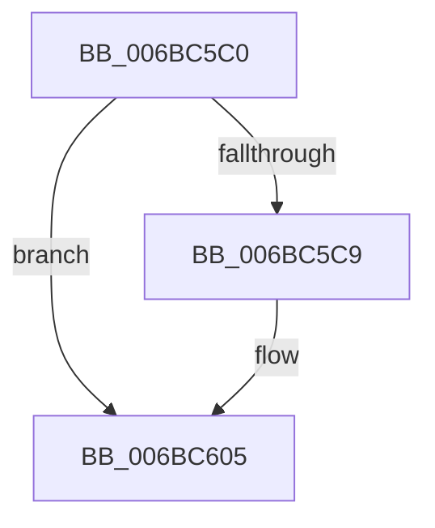

# KiCustomAccessHandler4

- RVA: `0x006BC5C0`–`0x006BC60B` (길이 `75` bytes)
- VA: `0x00000001406BC5C0`
- 실행 섹션: `.text`
- PDB 이름 있음: `예`; PDB Function 태그: `아니요`
- unwind 정보 RVA: `0x000C2EA8`
- 디코드: `17`개 명령, `75/75` bytes 표시
- 미해석 바이트: `0` (있으면 어셈블리에 `.byte`로 보존)

> 이 문서는 커널 이미지의 기계어와 PDB 기호를 분석해 생성했습니다. 4번과 5번은 함수 원형과 자료형을 바이너리 사용 방식에서 추정한 C 해석이며 원본 소스 복구 결과는 아닙니다.

## 1. Dependencies

- 직접 호출 지점: **0**; 고유 호출 대상: **0**
- 직접 호출자로 확인된 함수: **0**
- RIP 상대 이미지 참조: **1**

### Outgoing calls
- 직접 디코드된 call 명령이 없습니다.

### Direct callers
- 이 함수 시작 RVA로 연결되는 직접 call은 확인되지 않았습니다. 간접 호출은 완전히 역산할 수 없습니다.

### Static image references
- `0x006BC5EB` → RVA `0x006BC5C4` (`.text`; read)

## 2. Other-region calls and transfers

- 다른 실행 섹션으로 향하는 call: **0**
- 별도 외부 분기/꼬리 이동을 확인하지 못했습니다.

## 3. Assembly (complete function range)

```asm
006BC5C0  F7 41 04 66 00 00 00            test dword ptr [rcx + 4], 0x66
006BC5C7  75 3C                           jne 0x1406bc605
006BC5C9  0F 31                           rdtsc
006BC5CB  48 89 41 28                     mov qword ptr [rcx + 0x28], rax
006BC5CF  48 31 51 28                     xor qword ptr [rcx + 0x28], rdx
006BC5D3  C1 E8 05                        shr eax, 5
006BC5D6  83 E0 70                        and eax, 0x70
006BC5D9  49 29 80 98 00 00 00            sub qword ptr [r8 + 0x98], rax
006BC5E0  83 E2 7F                        and edx, 0x7f
006BC5E3  81 CA 00 00 00 C0               or edx, 0xc0000000
006BC5E9  89 11                           mov dword ptr [rcx], edx
006BC5EB  48 8D 05 D2 FF FF FF            lea rax, [rip - 0x2e]
006BC5F2  48 89 41 10                     mov qword ptr [rcx + 0x10], rax
006BC5F6  49 89 80 F8 00 00 00            mov qword ptr [r8 + 0xf8], rax
006BC5FD  49 83 A0 88 00 00 00 00         and qword ptr [r8 + 0x88], 0
006BC605  B8 01 00 00 00                  mov eax, 1
006BC60A  C3                              ret
```

## 4. C-style interpretation (structured pseudocode)

```c
__int64 __fastcall KiCustomAccessHandler4(__int64 a1, __int64 a2, __int64 a3)
{
    __int64 result;

    if (((*(unsigned int *)(a1 + 4)) & (102)) == 0) {
        *(unsigned __int64 *)(a1 + 40) = result;
        result = (unsigned int)((result) >> (5));
        result = (unsigned int)((result) & (112));
        a2 = (unsigned int)((a2) & (127));
        a2 = (unsigned int)((a2) | (0xC0000000ULL));
        *(unsigned int *)(a1) = (unsigned int)(a2);
        result = v_rip - 46;
        *(unsigned __int64 *)(a1 + 16) = result;
        *(unsigned __int64 *)(a3 + 248) = result;
    }
    return 1;
}
```

## 5. (Beta) C Style

```c
int64_t KiCustomAccessHandler4(void *Arg1, int64_t Arg2, void *Arg3)
{
    uint8_t *arg1 = (uint8_t *)Arg1;
    uint8_t *arg3 = (uint8_t *)Arg3;

    int64_t result;

    if (((*(uint32_t *)(arg1 + 0x4)) & (102)) == 0) {
        *(uint64_t *)(arg1 + 0x28) = result;
        result = (uint32_t)((result) >> (5));
        result = (uint32_t)((result) & (112));
        Arg2 = (uint32_t)((Arg2) & (127));
        Arg2 = (uint32_t)((Arg2) | (0xC0000000ULL));
        *(uint32_t *)(arg1) = (uint32_t)(Arg2);
        result = v_rip - 46;
        *(uint64_t *)(arg1 + 0x10) = result;
        *(uint64_t *)(arg3 + 0xF8) = result;
    }
    return 1;
}
```

### 관측된 메모리 오프셋

구조체 형식이 확인되지 않은 접근은 인자 기준의 오프셋으로만 기록했습니다.

| 기준 인자 | 오프셋 표현 | 폭 (bit) | 접근 |
|---|---:|---:|---|
| `Arg1` | `+ 0x0` | `32` | `W` |
| `Arg1` | `+ 0x4` | `32` | `R` |
| `Arg1` | `+ 0x10` | `64` | `W` |
| `Arg1` | `+ 0x28` | `64` | `R/W` |
| `Arg1` | `+ 0x28` | `64` | `W` |
| `Arg3` | `+ 0x88` | `64` | `R/W` |
| `Arg3` | `+ 0x98` | `64` | `R/W` |
| `Arg3` | `+ 0xF8` | `64` | `W` |

## 6. Execution-region graph

[열기: 2D/3D 그래프와 함수 탐색 컨트롤 패널](../../../control-panel.html?section=text&rva=0x006BC5C0&view=graph)

- 2D 그래프는 위에서 아래로 흐르고, 3D 그래프는 빈 공간을 드래그해 회전합니다. Shift+드래그는 이동, 휠은 확대·축소, 함수 노드 선택은 대상 보고서 이동입니다.

### Static fallback


