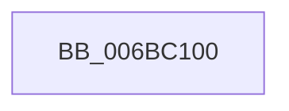

# KiCustomAccessRoutine2

- RVA: `0x006BC100`–`0x006BC128` (길이 `40` bytes)
- VA: `0x00000001406BC100`
- 실행 섹션: `.text`
- PDB 이름 있음: `예`; PDB Function 태그: `아니요`
- unwind 정보 RVA: `0x000C2A6C`
- 디코드: `14`개 명령, `40/40` bytes 표시
- 미해석 바이트: `0` (있으면 어셈블리에 `.byte`로 보존)

> 이 문서는 커널 이미지의 기계어와 PDB 기호를 분석해 생성했습니다. 4번과 5번은 함수 원형과 자료형을 바이너리 사용 방식에서 추정한 C 해석이며 원본 소스 복구 결과는 아닙니다.

## 1. Dependencies

- 직접 호출 지점: **1**; 고유 호출 대상: **1**
- 직접 호출자로 확인된 함수: **1**
- RIP 상대 이미지 참조: **0**

### Outgoing calls
- `0x006BC11D` → [KiCustomRecurseRoutine2](KiCustomRecurseRoutine2_function_006BC0E0.md) (function, `0x006BC0E0`)

### Direct callers
- [IopIrpStackProfilerDpcRoutine](../47/IopIrpStackProfilerDpcRoutine_function_00475420.md) at `0x00475655`

### Static image references
- 디코드된 RIP-relative 메모리 참조가 없습니다.

## 2. Other-region calls and transfers

- 다른 실행 섹션으로 향하는 call: **0**
- 별도 외부 분기/꼬리 이동을 확인하지 못했습니다.

## 3. Assembly (complete function range)

```asm
006BC100  48 83 EC 28                     sub rsp, 0x28
006BC104  48 8B D1                        mov rdx, rcx
006BC107  83 E1 03                        and ecx, 3
006BC10A  FF C1                           inc ecx
006BC10C  48 D3 C8                        ror rax, cl
006BC10F  4C 33 C0                        xor r8, rax
006BC112  4C 33 C8                        xor r9, rax
006BC115  4C 33 D0                        xor r10, rax
006BC118  4C 33 D8                        xor r11, rax
006BC11B  33 C0                           xor eax, eax
006BC11D  E8 BE FF FF FF                  call 0x1406bc0e0
006BC122  90                              nop
006BC123  48 83 C4 28                     add rsp, 0x28
006BC127  C3                              ret
```

## 4. C-style interpretation (structured pseudocode)

```c
__int64 __fastcall KiCustomAccessRoutine2(__int64 a1, __int64 a2, __int64 a3, __int64 a4)
{
    __int64 result;
    __int64 v_r10;
    __int64 v_r11;
    __int64 v_rsp;

    v_rsp = (v_rsp) - (40);
    a1 = (unsigned int)((a1) & (3));
    a1 = (unsigned int)((a1) + 1);
    a3 = (a3) ^ (result);
    a4 = (a4) ^ (result);
    v_r10 = (v_r10) ^ (result);
    v_r11 = (v_r11) ^ (result);
    result = 0;
    result = KiCustomRecurseRoutine2(a1, a1, a3, a4);
    v_rsp = (v_rsp) + (40);
    return result;
}
```

## 5. (Beta) C Style

```c
int64_t KiCustomAccessRoutine2(int64_t Arg1, int64_t Arg2, int64_t Arg3, int64_t Arg4)
{
    int64_t result;
    int64_t local_r10;
    int64_t local_r11;
    int64_t local_rsp;

    local_rsp = (local_rsp) - (40);
    Arg1 = (uint32_t)((Arg1) & (3));
    Arg1 = (uint32_t)((Arg1) + 1);
    Arg3 = (Arg3) ^ (result);
    Arg4 = (Arg4) ^ (result);
    local_r10 = (local_r10) ^ (result);
    local_r11 = (local_r11) ^ (result);
    result = 0;
    result = KiCustomRecurseRoutine2(Arg1, Arg1, Arg3, Arg4);
    local_rsp = (local_rsp) + (40);
    return result;
}
```

## 6. Execution-region graph

[열기: 2D/3D 그래프와 함수 탐색 컨트롤 패널](../../../control-panel.html?section=text&rva=0x006BC100&view=graph)

- 2D 그래프는 위에서 아래로 흐르고, 3D 그래프는 빈 공간을 드래그해 회전합니다. Shift+드래그는 이동, 휠은 확대·축소, 함수 노드 선택은 대상 보고서 이동입니다.

### Static fallback


