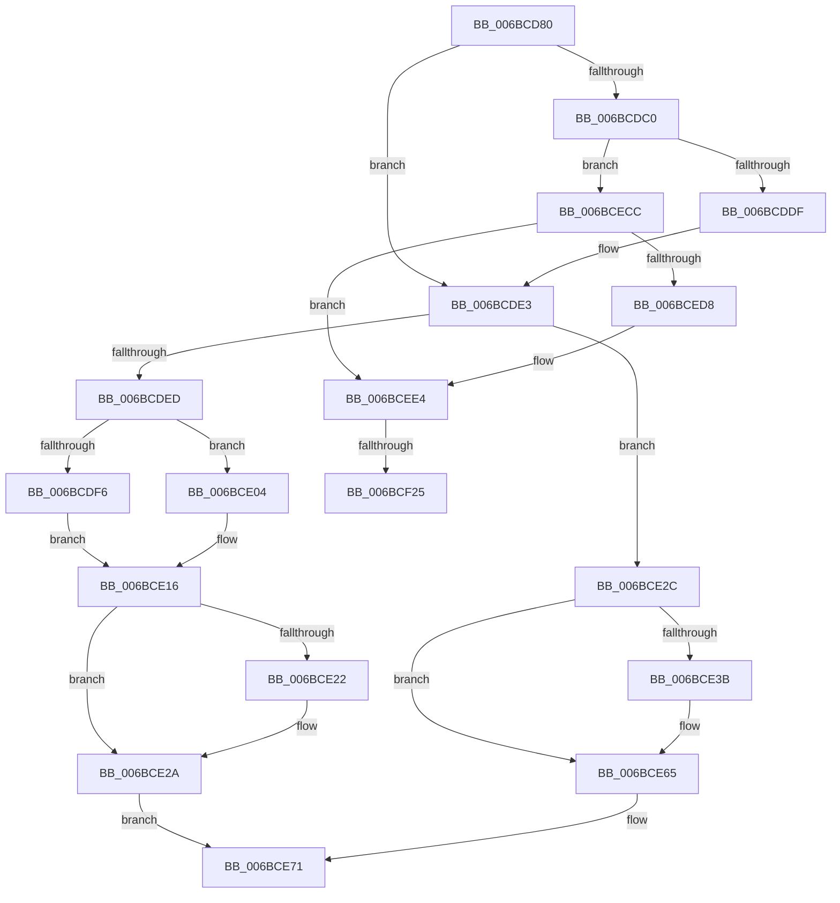

# KiDebugTrapOrFault

- RVA: `0x006BCD80`–`0x006BCF28` (길이 `424` bytes)
- VA: `0x00000001406BCD80`
- 실행 섹션: `.text`
- PDB 이름 있음: `예`; PDB Function 태그: `아니요`
- unwind 정보 RVA: `0x000C1ADC`
- 디코드: `103`개 명령, `424/424` bytes 표시
- 미해석 바이트: `0` (있으면 어셈블리에 `.byte`로 보존)

> 이 문서는 커널 이미지의 기계어와 PDB 기호를 분석해 생성했습니다. 4번과 5번은 함수 원형과 자료형을 바이너리 사용 방식에서 추정한 C 해석이며 원본 소스 복구 결과는 아닙니다.

## 1. Dependencies

- 직접 호출 지점: **1**; 고유 호출 대상: **1**
- 직접 호출자로 확인된 함수: **0**
- RIP 상대 이미지 참조: **3**

### Outgoing calls
- `0x006BCE5D` → [VslKernelShadowStackAssist](../3D/VslKernelShadowStackAssist_function_003D5BA0.md) (function, `0x003D5BA0`)

### Direct callers
- 이 함수 시작 RVA로 연결되는 직접 call은 확인되지 않았습니다. 간접 호출은 완전히 역산할 수 없습니다.

### Static image references
- `0x006BCDC0` → RVA `0x01201900` (`CFGRO`; read)
- `0x006BCDED` → RVA `0x01201840` (`CFGRO`; read)
- `0x006BCECC` → RVA `0x00F475C0` (`.data`; read)

## 2. Other-region calls and transfers

- 다른 실행 섹션으로 향하는 call: **0**
- call이 아닌 외부 분기/꼬리 이동: **2**
  - `0x006BCEC7` → [KxDebugTrapOrFault](KxDebugTrapOrFault_function_006BCF40.md) (`tail-transfer`)
  - `0x006BCF1F` → [KiKernelIstExit](../../kvascode/BC/KiKernelIstExit_function_00BCCC40.md) (`tail-transfer`)

## 3. Assembly (complete function range)

```asm
006BCD80  48 56                           push rsi
006BCD82  41 53                           push r11
006BCD84  41 52                           push r10
006BCD86  41 51                           push r9
006BCD88  41 50                           push r8
006BCD8A  51                              push rcx
006BCD8B  50                              push rax
006BCD8C  52                              push rdx
006BCD8D  48 81 EC 98 00 00 00            sub rsp, 0x98
006BCD94  0F 29 44 24 30                  movaps xmmword ptr [rsp + 0x30], xmm0
006BCD99  0F 29 4C 24 40                  movaps xmmword ptr [rsp + 0x40], xmm1
006BCD9E  0F 29 54 24 50                  movaps xmmword ptr [rsp + 0x50], xmm2
006BCDA3  0F 29 5C 24 60                  movaps xmmword ptr [rsp + 0x60], xmm3
006BCDA8  0F 29 64 24 70                  movaps xmmword ptr [rsp + 0x70], xmm4
006BCDAD  0F 29 AC 24 80 00 00 00         movaps xmmword ptr [rsp + 0x80], xmm5
006BCDB5  FC                              cld
006BCDB6  F6 84 24 E0 00 00 00 01         test byte ptr [rsp + 0xe0], 1
006BCDBE  75 23                           jne 0x1406bcde3
006BCDC0  48 8D 05 39 4B B4 00            lea rax, [rip + 0xb44b39]
006BCDC7  B9 08 00 00 00                  mov ecx, 8
006BCDCC  48 8B 54 C8 F8                  mov rdx, qword ptr [rax + rcx*8 - 8]
006BCDD1  48 39 94 24 D8 00 00 00         cmp qword ptr [rsp + 0xd8], rdx
006BCDD9  0F 84 ED 00 00 00               je 0x1406bcecc
006BCDDF  E2 EB                           loop 0x1406bcdcc
006BCDE1  85 C9                           test ecx, ecx
006BCDE3  48 8D 8C 24 00 01 00 00         lea rcx, [rsp + 0x100]
006BCDEB  74 3F                           je 0x1406bce2c
006BCDED  F6 05 4C 4A B4 00 01            test byte ptr [rip + 0xb44a4c], 1
006BCDF4  74 0E                           je 0x1406bce04
006BCDF6  0F AE E8                        lfence
006BCDF9  65 48 8B 24 25 08 B0 00 00      mov rsp, qword ptr gs:[0xb008]
006BCE02  EB 12                           jmp 0x1406bce16
006BCE04  0F 01 F8                        swapgs
006BCE07  0F AE E8                        lfence
006BCE0A  65 48 8B 24 25 A8 01 00 00      mov rsp, qword ptr gs:[0x1a8]
006BCE13  0F 01 F8                        swapgs
006BCE16  33 D2                           xor edx, edx
006BCE18  F3 48 0F 1E CA                  rdsspq rdx
006BCE1D  48 85 D2                        test rdx, rdx
006BCE20  74 08                           je 0x1406bce2a
006BCE22  F3 0F AE 32                     clrssbsy dword ptr [rdx]
006BCE26  F3 0F 01 E8                     setssbsy
006BCE2A  EB 45                           jmp 0x1406bce71
006BCE2C  0F AE E8                        lfence
006BCE2F  33 D2                           xor edx, edx
006BCE31  F3 48 0F 1E CA                  rdsspq rdx
006BCE36  48 85 D2                        test rdx, rdx
006BCE39  74 2A                           je 0x1406bce65
006BCE3B  48 8B F1                        mov rsi, rcx
006BCE3E  48 C7 C1 02 00 00 00            mov rcx, 2
006BCE45  45 33 C0                        xor r8d, r8d
006BCE48  4C 8B 0A                        mov r9, qword ptr [rdx]
006BCE4B  48 C7 44 24 20 00 00 00 00      mov qword ptr [rsp + 0x20], 0
006BCE54  48 C7 44 24 28 04 00 00 00      mov qword ptr [rsp + 0x28], 4
006BCE5D  E8 3E 8D D1 FF                  call 0x1403d5ba0
006BCE62  48 8B CE                        mov rcx, rsi
006BCE65  48 8B A4 24 F0 00 00 00         mov rsp, qword ptr [rsp + 0xf0]
006BCE6D  48 83 E4 F0                     and rsp, 0xfffffffffffffff0
006BCE71  FF 71 F8                        push qword ptr [rcx - 8]
006BCE74  FF 71 F0                        push qword ptr [rcx - 0x10]
006BCE77  FF 71 E8                        push qword ptr [rcx - 0x18]
006BCE7A  FF 71 E0                        push qword ptr [rcx - 0x20]
006BCE7D  FF 71 D8                        push qword ptr [rcx - 0x28]
006BCE80  0F 28 69 80                     movaps xmm5, xmmword ptr [rcx - 0x80]
006BCE84  0F 28 A1 70 FF FF FF            movaps xmm4, xmmword ptr [rcx - 0x90]
006BCE8B  0F 28 99 60 FF FF FF            movaps xmm3, xmmword ptr [rcx - 0xa0]
006BCE92  0F 28 91 50 FF FF FF            movaps xmm2, xmmword ptr [rcx - 0xb0]
006BCE99  0F 28 89 40 FF FF FF            movaps xmm1, xmmword ptr [rcx - 0xc0]
006BCEA0  0F 28 81 30 FF FF FF            movaps xmm0, xmmword ptr [rcx - 0xd0]
006BCEA7  48 8B 51 98                     mov rdx, qword ptr [rcx - 0x68]
006BCEAB  48 8B 41 A0                     mov rax, qword ptr [rcx - 0x60]
006BCEAF  4C 8B 41 B0                     mov r8, qword ptr [rcx - 0x50]
006BCEB3  4C 8B 49 B8                     mov r9, qword ptr [rcx - 0x48]
006BCEB7  4C 8B 51 C0                     mov r10, qword ptr [rcx - 0x40]
006BCEBB  4C 8B 59 C8                     mov r11, qword ptr [rcx - 0x38]
006BCEBF  48 8B 71 D0                     mov rsi, qword ptr [rcx - 0x30]
006BCEC3  48 8B 49 A8                     mov rcx, qword ptr [rcx - 0x58]
006BCEC7  E9 74 00 00 00                  jmp 0x1406bcf40
006BCECC  F7 05 EA A6 88 00 02 00 00 00   test dword ptr [rip + 0x88a6ea], 2
006BCED6  74 0C                           je 0x1406bcee4
006BCED8  B9 D9 01 00 00                  mov ecx, 0x1d9
006BCEDD  0F 32                           rdmsr
006BCEDF  83 C8 01                        or eax, 1
006BCEE2  0F 30                           wrmsr
006BCEE4  0F 28 AC 24 80 00 00 00         movaps xmm5, xmmword ptr [rsp + 0x80]
006BCEEC  0F 28 64 24 70                  movaps xmm4, xmmword ptr [rsp + 0x70]
006BCEF1  0F 28 5C 24 60                  movaps xmm3, xmmword ptr [rsp + 0x60]
006BCEF6  0F 28 54 24 50                  movaps xmm2, xmmword ptr [rsp + 0x50]
006BCEFB  0F 28 4C 24 40                  movaps xmm1, xmmword ptr [rsp + 0x40]
006BCF00  0F 28 44 24 30                  movaps xmm0, xmmword ptr [rsp + 0x30]
006BCF05  48 81 C4 98 00 00 00            add rsp, 0x98
006BCF0C  5A                              pop rdx
006BCF0D  58                              pop rax
006BCF0E  59                              pop rcx
006BCF0F  41 58                           pop r8
006BCF11  41 59                           pop r9
006BCF13  41 5A                           pop r10
006BCF15  41 5B                           pop r11
006BCF17  5E                              pop rsi
006BCF18  F6 05 21 49 B4 00 01            test byte ptr [rip + 0xb44921], 1
006BCF1F  0F 85 1B FD 50 00               jne 0x140bccc40
006BCF25  48 CF                           iretq
006BCF27  C3                              ret
```

## 4. C-style interpretation (structured pseudocode)

```c
__int64 __fastcall KiDebugTrapOrFault(__int64 a1, __int64 a2, __int64 a3, __int64 a4, __int64 a5)
{
    __int64 result;
    __int64 v_rsi;
    __int64 v_rsp;
    unsigned __int64 v_stack_m58;
    unsigned __int64 v_stack_m68;
    unsigned __int64 v_stack_m78;
    unsigned __int64 v_stack_m80;
    unsigned __int64 v_stack_m88;
    unsigned __int64 v_stack_m90;
    unsigned __int64 v_stack_m98;
    unsigned __int64 v_stack_mA0;
    unsigned __int64 v_stack_mA8;
    unsigned __int64 v_stack_mB0;
    unsigned __int64 v_stack_mB8;
    unsigned __int64 v_stack_mC0;
    unsigned __int64 v_stack_mD0;
    unsigned __int64 v_stack_p0;
    unsigned __int64 v_stack_p18;
    unsigned __int8 v_stack_p8;

    v_rsp = (v_rsp) - (152);
    v_stack_mA8 = v_xmm0;
    v_stack_m98 = v_xmm1;
    v_stack_m88 = v_xmm2;
    v_stack_m78 = v_xmm3;
    v_stack_m68 = v_xmm4;
    v_stack_m58 = v_xmm5;
    if (((v_stack_p8) & (1)) != 0) goto loc_006BCDE3;
    if (v_stack_p0 == (*(unsigned __int64 *)(v_rip + 11815737 + 8 * 8 - 8))) goto loc_006BCECC;
loc_006BCDE3:
    if (8 == 0) goto loc_006BCE2C;
    if (((*(unsigned __int8 *)(v_rip + 11815500)) & (1)) == 0) goto loc_006BCE04;
    goto loc_006BCE16;
loc_006BCE04:
loc_006BCE16:
    a2 = 0;
    if (0 != 0) {
    }
    goto loc_006BCE71;
loc_006BCE2C:
    a2 = 0;
    result = v_rip + 11815737;
    if (0 != 0) {
        v_rsi = a5;
        a1 = 2;
        a3 = 0;
        a4 = *(unsigned __int64 *)(a2);
        v_stack_mB8 = 0;
        v_stack_mB0 = 4;
        result = VslKernelShadowStackAssist(a1, a2, a3, a4);
        a1 = v_rsi;
    }
    v_rsp = (v_stack_p18) & (-16);
loc_006BCE71:
loc_006BCECC:
    result = *(unsigned __int64 *)(a1 - 96);
    if (((*(unsigned int *)(v_rip + 8955626)) & (2)) != 0) {
        a1 = 473;
        result = (unsigned int)((*(unsigned __int64 *)(a1 - 96)) | (1));
    }
    v_rsp = (v_rsp) + (152);
    return result;
}
```

## 5. (Beta) C Style

```c
int64_t KiDebugTrapOrFault(int64_t Arg1, int64_t Arg2, int64_t Arg3, int64_t Arg4, int64_t Arg5)
{
    int64_t result;
    int64_t local_rsi;
    int64_t local_rsp;
    uint64_t v_stack_m58;
    uint64_t v_stack_m68;
    uint64_t v_stack_m78;
    uint64_t v_stack_m80;
    uint64_t v_stack_m88;
    uint64_t v_stack_m90;
    uint64_t v_stack_m98;
    uint64_t v_stack_mA0;
    uint64_t v_stack_mA8;
    uint64_t v_stack_mB0;
    uint64_t v_stack_mB8;
    uint64_t v_stack_mC0;
    uint64_t v_stack_mD0;
    uint64_t v_stack_p0;
    uint64_t v_stack_p18;
    uint8_t v_stack_p8;

    local_rsp = (local_rsp) - (152);
    v_stack_mA8 = v_xmm0;
    v_stack_m98 = v_xmm1;
    v_stack_m88 = v_xmm2;
    v_stack_m78 = v_xmm3;
    v_stack_m68 = v_xmm4;
    v_stack_m58 = v_xmm5;
    if (((v_stack_p8) & (1)) != 0) goto loc_006BCDE3;
    if (v_stack_p0 == (*(uint64_t *)(v_rip + 0xB44B39 + 0x8 * 8 - 0x8))) goto loc_006BCECC;
loc_006BCDE3:
    if (8 == 0) goto loc_006BCE2C;
    if (((*(uint8_t *)(v_rip + 0xB44A4C)) & (1)) == 0) goto loc_006BCE04;
    goto loc_006BCE16;
loc_006BCE04:
loc_006BCE16:
    Arg2 = 0;
    if (0 != 0) {
    }
    goto loc_006BCE71;
loc_006BCE2C:
    Arg2 = 0;
    result = v_rip + 11815737;
    if (0 != 0) {
        local_rsi = Arg5;
        Arg1 = 2;
        Arg3 = 0;
        Arg4 = *(uint64_t *)(Arg2);
        v_stack_mB8 = 0;
        v_stack_mB0 = 4;
        result = VslKernelShadowStackAssist(Arg1, Arg2, Arg3, Arg4);
        Arg1 = local_rsi;
    }
    local_rsp = (v_stack_p18) & (-16);
loc_006BCE71:
loc_006BCECC:
    result = *(uint64_t *)(Arg1 - 0x60);
    if (((*(uint32_t *)(v_rip + 0x88A6EA)) & (2)) != 0) {
        Arg1 = 473;
        result = (uint32_t)((*(uint64_t *)(Arg1 - 0x60)) | (1));
    }
    local_rsp = (local_rsp) + (152);
    return result;
}
```

## 6. Execution-region graph

[열기: 2D/3D 그래프와 함수 탐색 컨트롤 패널](../../../control-panel.html?section=text&rva=0x006BCD80&view=graph)

- 2D 그래프는 위에서 아래로 흐르고, 3D 그래프는 빈 공간을 드래그해 회전합니다. Shift+드래그는 이동, 휠은 확대·축소, 함수 노드 선택은 대상 보고서 이동입니다.

### Static fallback


