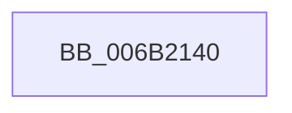

# KiDecrementKernelShadowStack

- RVA: `0x006B2140`–`0x006B2161` (길이 `33` bytes)
- VA: `0x00000001406B2140`
- 실행 섹션: `.text`
- PDB 이름 있음: `예`; PDB Function 태그: `아니요`
- unwind 정보 RVA: `0x000C1764`
- 디코드: `9`개 명령, `33/33` bytes 표시
- 미해석 바이트: `0` (있으면 어셈블리에 `.byte`로 보존)

> 이 문서는 커널 이미지의 기계어와 PDB 기호를 분석해 생성했습니다. 4번과 5번은 함수 원형과 자료형을 바이너리 사용 방식에서 추정한 C 해석이며 원본 소스 복구 결과는 아닙니다.

## 1. Dependencies

- 직접 호출 지점: **1**; 고유 호출 대상: **1**
- 직접 호출자로 확인된 함수: **2**
- RIP 상대 이미지 참조: **0**

### Outgoing calls
- `0x006B2150` → [KiDecrementKernelShadowStack + 0x16](KiDecrementKernelShadowStack_function_006B2140.md) (inside-function, `0x006B2156`)

### Direct callers
- [KiFixupControlProtectionKernelModeReturnMismatch](../5C/KiFixupControlProtectionKernelModeReturnMismatch_function_005C8028.md) at `0x005C809C`
- [KiDecrementKernelShadowStack](KiDecrementKernelShadowStack_function_006B2140.md) at `0x006B2150`

### Static image references
- 디코드된 RIP-relative 메모리 참조가 없습니다.

## 2. Other-region calls and transfers

- 다른 실행 섹션으로 향하는 call: **0**
- 별도 외부 분기/꼬리 이동을 확인하지 못했습니다.

## 3. Assembly (complete function range)

```asm
006B2140  F3 48 0F 1E CA                  rdsspq rdx
006B2145  48 8B 0A                        mov rcx, qword ptr [rdx]
006B2148  45 33 C0                        xor r8d, r8d
006B214B  4C 0F 38 F6 02                  wrssq qword ptr [rdx], r8
006B2150  E8 01 00 00 00                  call 0x1406b2156
006B2155  90                              nop
006B2156  48 0F 38 F6 4A F8               wrssq qword ptr [rdx - 8], rcx
006B215C  48 83 C4 08                     add rsp, 8
006B2160  C3                              ret
```

## 4. C-style interpretation (structured pseudocode)

```c
__int64 __fastcall KiDecrementKernelShadowStack(__int64 a1, __int64 a2, int a3)
{
    __int64 result;
    __int64 v_rsp;

    a3 = 0;
    result = KiDecrementKernelShadowStack___0x16(*(unsigned __int64 *)(a2), a2, a3, a4);
    v_rsp = (v_rsp) + (8);
    return result;
}
```

## 5. (Beta) C Style

```c
int64_t KiDecrementKernelShadowStack(int64_t Arg1, int64_t Arg2, int32_t Arg3)
{
    int64_t result;
    int64_t local_rsp;

    Arg3 = 0;
    result = KiDecrementKernelShadowStack___0x16(*(uint64_t *)(Arg2), Arg2, Arg3, a4);
    local_rsp = (local_rsp) + (8);
    return result;
}
```

## 6. Execution-region graph

[열기: 2D/3D 그래프와 함수 탐색 컨트롤 패널](../../../control-panel.html?section=text&rva=0x006B2140&view=graph)

- 2D 그래프는 위에서 아래로 흐르고, 3D 그래프는 빈 공간을 드래그해 회전합니다. Shift+드래그는 이동, 휠은 확대·축소, 함수 노드 선택은 대상 보고서 이동입니다.

### Static fallback


