# KiDivideErrorFault

- RVA: `0x006BCA00`–`0x006BCD51` (길이 `849` bytes)
- VA: `0x00000001406BCA00`
- 실행 섹션: `.text`
- PDB 이름 있음: `예`; PDB Function 태그: `아니요`
- unwind 정보 RVA: `0x000C1AC8`
- 디코드: `184`개 명령, `849/849` bytes 표시
- 미해석 바이트: `0` (있으면 어셈블리에 `.byte`로 보존)

> 이 문서는 커널 이미지의 기계어와 PDB 기호를 분석해 생성했습니다. 4번과 5번은 함수 원형과 자료형을 바이너리 사용 방식에서 추정한 C 해석이며 원본 소스 복구 결과는 아닙니다.

## 1. Dependencies

- 직접 호출 지점: **36**; 고유 호출 대상: **36**
- 직접 호출자로 확인된 함수: **1**
- RIP 상대 이미지 참조: **3**

### Outgoing calls
- `0x006BCB56` → [KiDivideErrorFault + 0x269](KiDivideErrorFault_function_006BCA00.md) (inside-function, `0x006BCC69`)
- `0x006BCB5F` → [KiDivideErrorFault + 0x272](KiDivideErrorFault_function_006BCA00.md) (inside-function, `0x006BCC72`)
- `0x006BCB68` → [KiDivideErrorFault + 0x15B](KiDivideErrorFault_function_006BCA00.md) (inside-function, `0x006BCB5B`)
- `0x006BCB71` → [KiDivideErrorFault + 0x164](KiDivideErrorFault_function_006BCA00.md) (inside-function, `0x006BCB64`)
- `0x006BCB7A` → [KiDivideErrorFault + 0x16D](KiDivideErrorFault_function_006BCA00.md) (inside-function, `0x006BCB6D`)
- `0x006BCB83` → [KiDivideErrorFault + 0x176](KiDivideErrorFault_function_006BCA00.md) (inside-function, `0x006BCB76`)
- `0x006BCB8C` → [KiDivideErrorFault + 0x17F](KiDivideErrorFault_function_006BCA00.md) (inside-function, `0x006BCB7F`)
- `0x006BCB95` → [KiDivideErrorFault + 0x188](KiDivideErrorFault_function_006BCA00.md) (inside-function, `0x006BCB88`)
- `0x006BCB9E` → [KiDivideErrorFault + 0x191](KiDivideErrorFault_function_006BCA00.md) (inside-function, `0x006BCB91`)
- `0x006BCBA7` → [KiDivideErrorFault + 0x19A](KiDivideErrorFault_function_006BCA00.md) (inside-function, `0x006BCB9A`)
- `0x006BCBB0` → [KiDivideErrorFault + 0x1A3](KiDivideErrorFault_function_006BCA00.md) (inside-function, `0x006BCBA3`)
- `0x006BCBB9` → [KiDivideErrorFault + 0x1AC](KiDivideErrorFault_function_006BCA00.md) (inside-function, `0x006BCBAC`)
- `0x006BCBC2` → [KiDivideErrorFault + 0x1B5](KiDivideErrorFault_function_006BCA00.md) (inside-function, `0x006BCBB5`)
- `0x006BCBCB` → [KiDivideErrorFault + 0x1BE](KiDivideErrorFault_function_006BCA00.md) (inside-function, `0x006BCBBE`)
- `0x006BCBD4` → [KiDivideErrorFault + 0x1C7](KiDivideErrorFault_function_006BCA00.md) (inside-function, `0x006BCBC7`)
- `0x006BCBDD` → [KiDivideErrorFault + 0x1D0](KiDivideErrorFault_function_006BCA00.md) (inside-function, `0x006BCBD0`)
- `0x006BCBE6` → [KiDivideErrorFault + 0x1D9](KiDivideErrorFault_function_006BCA00.md) (inside-function, `0x006BCBD9`)
- `0x006BCBEF` → [KiDivideErrorFault + 0x1E2](KiDivideErrorFault_function_006BCA00.md) (inside-function, `0x006BCBE2`)
- `0x006BCBF8` → [KiDivideErrorFault + 0x1EB](KiDivideErrorFault_function_006BCA00.md) (inside-function, `0x006BCBEB`)
- `0x006BCC01` → [KiDivideErrorFault + 0x1F4](KiDivideErrorFault_function_006BCA00.md) (inside-function, `0x006BCBF4`)
- `0x006BCC0A` → [KiDivideErrorFault + 0x1FD](KiDivideErrorFault_function_006BCA00.md) (inside-function, `0x006BCBFD`)
- `0x006BCC13` → [KiDivideErrorFault + 0x206](KiDivideErrorFault_function_006BCA00.md) (inside-function, `0x006BCC06`)
- `0x006BCC1C` → [KiDivideErrorFault + 0x20F](KiDivideErrorFault_function_006BCA00.md) (inside-function, `0x006BCC0F`)
- `0x006BCC25` → [KiDivideErrorFault + 0x218](KiDivideErrorFault_function_006BCA00.md) (inside-function, `0x006BCC18`)
- `0x006BCC2E` → [KiDivideErrorFault + 0x221](KiDivideErrorFault_function_006BCA00.md) (inside-function, `0x006BCC21`)
- `0x006BCC37` → [KiDivideErrorFault + 0x22A](KiDivideErrorFault_function_006BCA00.md) (inside-function, `0x006BCC2A`)
- `0x006BCC40` → [KiDivideErrorFault + 0x233](KiDivideErrorFault_function_006BCA00.md) (inside-function, `0x006BCC33`)
- `0x006BCC49` → [KiDivideErrorFault + 0x23C](KiDivideErrorFault_function_006BCA00.md) (inside-function, `0x006BCC3C`)
- `0x006BCC52` → [KiDivideErrorFault + 0x245](KiDivideErrorFault_function_006BCA00.md) (inside-function, `0x006BCC45`)
- `0x006BCC5B` → [KiDivideErrorFault + 0x24E](KiDivideErrorFault_function_006BCA00.md) (inside-function, `0x006BCC4E`)
- `0x006BCC64` → [KiDivideErrorFault + 0x257](KiDivideErrorFault_function_006BCA00.md) (inside-function, `0x006BCC57`)
- `0x006BCC6D` → [KiDivideErrorFault + 0x260](KiDivideErrorFault_function_006BCA00.md) (inside-function, `0x006BCC60`)
- `0x006BCC98` → [KiFlushBhbDuringTrapEntryOrExit](../6C/KiFlushBhbDuringTrapEntryOrExit_function_006C6340.md) (function, `0x006C6340`)
- `0x006BCCE1` → [KiSaveDebugRegisterState](../4F/KiSaveDebugRegisterState_function_004FD960.md) (function, `0x004FD960`)
- `0x006BCD15` → [KiSynchronizeUserIsolationDomainExit](../41/KiSynchronizeUserIsolationDomainExit_function_0041BFA0.md) (function, `0x0041BFA0`)
- `0x006BCD4A` → [KiExceptionDispatch](../6C/KiExceptionDispatch_function_006C5900.md) (function, `0x006C5900`)

### Direct callers
- [KiDivideErrorFault](KiDivideErrorFault_function_006BCA00.md) at `0x006BCB56`
- [KiDivideErrorFault](KiDivideErrorFault_function_006BCA00.md) at `0x006BCB5F`
- [KiDivideErrorFault](KiDivideErrorFault_function_006BCA00.md) at `0x006BCB68`
- [KiDivideErrorFault](KiDivideErrorFault_function_006BCA00.md) at `0x006BCB71`
- [KiDivideErrorFault](KiDivideErrorFault_function_006BCA00.md) at `0x006BCB7A`
- [KiDivideErrorFault](KiDivideErrorFault_function_006BCA00.md) at `0x006BCB83`
- [KiDivideErrorFault](KiDivideErrorFault_function_006BCA00.md) at `0x006BCB8C`
- [KiDivideErrorFault](KiDivideErrorFault_function_006BCA00.md) at `0x006BCB95`
- [KiDivideErrorFault](KiDivideErrorFault_function_006BCA00.md) at `0x006BCB9E`
- [KiDivideErrorFault](KiDivideErrorFault_function_006BCA00.md) at `0x006BCBA7`
- [KiDivideErrorFault](KiDivideErrorFault_function_006BCA00.md) at `0x006BCBB0`
- [KiDivideErrorFault](KiDivideErrorFault_function_006BCA00.md) at `0x006BCBB9`
- [KiDivideErrorFault](KiDivideErrorFault_function_006BCA00.md) at `0x006BCBC2`
- [KiDivideErrorFault](KiDivideErrorFault_function_006BCA00.md) at `0x006BCBCB`
- [KiDivideErrorFault](KiDivideErrorFault_function_006BCA00.md) at `0x006BCBD4`
- [KiDivideErrorFault](KiDivideErrorFault_function_006BCA00.md) at `0x006BCBDD`
- [KiDivideErrorFault](KiDivideErrorFault_function_006BCA00.md) at `0x006BCBE6`
- [KiDivideErrorFault](KiDivideErrorFault_function_006BCA00.md) at `0x006BCBEF`
- [KiDivideErrorFault](KiDivideErrorFault_function_006BCA00.md) at `0x006BCBF8`
- [KiDivideErrorFault](KiDivideErrorFault_function_006BCA00.md) at `0x006BCC01`
- [KiDivideErrorFault](KiDivideErrorFault_function_006BCA00.md) at `0x006BCC0A`
- [KiDivideErrorFault](KiDivideErrorFault_function_006BCA00.md) at `0x006BCC13`
- [KiDivideErrorFault](KiDivideErrorFault_function_006BCA00.md) at `0x006BCC1C`
- [KiDivideErrorFault](KiDivideErrorFault_function_006BCA00.md) at `0x006BCC25`
- [KiDivideErrorFault](KiDivideErrorFault_function_006BCA00.md) at `0x006BCC2E`
- [KiDivideErrorFault](KiDivideErrorFault_function_006BCA00.md) at `0x006BCC37`
- [KiDivideErrorFault](KiDivideErrorFault_function_006BCA00.md) at `0x006BCC40`
- [KiDivideErrorFault](KiDivideErrorFault_function_006BCA00.md) at `0x006BCC49`
- [KiDivideErrorFault](KiDivideErrorFault_function_006BCA00.md) at `0x006BCC52`
- [KiDivideErrorFault](KiDivideErrorFault_function_006BCA00.md) at `0x006BCC5B`
- [KiDivideErrorFault](KiDivideErrorFault_function_006BCA00.md) at `0x006BCC64`
- [KiDivideErrorFault](KiDivideErrorFault_function_006BCA00.md) at `0x006BCC6D`

### Static image references
- `0x006BCA75` → RVA `0x01201840` (`CFGRO`; read)
- `0x006BCCA9` → RVA `0x00FC7264` (`ALMOSTRO`; read)
- `0x006BCD1A` → RVA `0x00FC6BF0` (`ALMOSTRO`; read)

## 2. Other-region calls and transfers

- 다른 실행 섹션으로 향하는 call: **0**
- 별도 외부 분기/꼬리 이동을 확인하지 못했습니다.

## 3. Assembly (complete function range)

```asm
006BCA00  48 83 EC 08                     sub rsp, 8
006BCA04  55                              push rbp
006BCA05  48 81 EC 58 01 00 00            sub rsp, 0x158
006BCA0C  48 8D AC 24 80 00 00 00         lea rbp, [rsp + 0x80]
006BCA14  C6 45 AB 01                     mov byte ptr [rbp - 0x55], 1
006BCA18  48 89 45 B0                     mov qword ptr [rbp - 0x50], rax
006BCA1C  48 89 4D B8                     mov qword ptr [rbp - 0x48], rcx
006BCA20  48 89 55 C0                     mov qword ptr [rbp - 0x40], rdx
006BCA24  4C 89 45 C8                     mov qword ptr [rbp - 0x38], r8
006BCA28  4C 89 4D D0                     mov qword ptr [rbp - 0x30], r9
006BCA2C  4C 89 55 D8                     mov qword ptr [rbp - 0x28], r10
006BCA30  4C 89 5D E0                     mov qword ptr [rbp - 0x20], r11
006BCA34  F6 85 F0 00 00 00 01            test byte ptr [rbp + 0xf0], 1
006BCA3B  75 38                           jne 0x1406bca75
006BCA3D  33 D2                           xor edx, edx
006BCA3F  F3 48 0F 1E CA                  rdsspq rdx
006BCA44  48 89 55 58                     mov qword ptr [rbp + 0x58], rdx
006BCA48  0F AE E8                        lfence
006BCA4B  65 F6 04 25 58 08 00 00 01      test byte ptr gs:[0x858], 1
006BCA54  75 08                           jne 0x1406bca5e
006BCA56  0F AE E8                        lfence
006BCA59  E9 88 02 00 00                  jmp 0x1406bcce6
006BCA5E  65 0F B7 04 25 66 08 00 00      movzx eax, word ptr gs:[0x866]
006BCA67  B9 48 00 00 00                  mov ecx, 0x48
006BCA6C  33 D2                           xor edx, edx
006BCA6E  0F 30                           wrmsr
006BCA70  E9 71 02 00 00                  jmp 0x1406bcce6
006BCA75  F6 05 C4 4D B4 00 01            test byte ptr [rip + 0xb44dc4], 1
006BCA7C  75 03                           jne 0x1406bca81
006BCA7E  0F 01 F8                        swapgs
006BCA81  0F AE E8                        lfence
006BCA84  65 48 8B 0C 25 28 9D 00 00      mov rcx, qword ptr gs:[0x9d28]
006BCA8D  48 85 C9                        test rcx, rcx
006BCA90  74 1F                           je 0x1406bcab1
006BCA92  F3 48 0F 1E CA                  rdsspq rdx
006BCA97  65 4C 8B 14 25 20 9D 00 00      mov r10, qword ptr gs:[0x9d20]
006BCAA0  49 83 C2 08                     add r10, 8
006BCAA4  49 3B D2                        cmp rdx, r10
006BCAA7  75 08                           jne 0x1406bcab1
006BCAA9  F3 0F 01 29                     rstorssp dword ptr [rcx]
006BCAAD  F3 0F 01 EA                     saveprevssp
006BCAB1  65 4C 8B 14 25 88 01 00 00      mov r10, qword ptr gs:[0x188]
006BCABA  65 48 8B 0C 25 88 01 00 00      mov rcx, qword ptr gs:[0x188]
006BCAC3  48 8B 89 20 02 00 00            mov rcx, qword ptr [rcx + 0x220]
006BCACA  48 8B 89 60 07 00 00            mov rcx, qword ptr [rcx + 0x760]
006BCAD1  65 48 89 0C 25 50 08 00 00      mov qword ptr gs:[0x850], rcx
006BCADA  66 65 8B 0C 25 62 08 00 00      mov cx, word ptr gs:[0x862]
006BCAE3  66 65 89 0C 25 64 08 00 00      mov word ptr gs:[0x864], cx
006BCAEC  65 8A 0C 25 58 08 00 00         mov cl, byte ptr gs:[0x858]
006BCAF4  65 88 0C 25 5A 08 00 00         mov byte ptr gs:[0x85a], cl
006BCAFC  65 0F B7 04 25 68 08 00 00      movzx eax, word ptr gs:[0x868]
006BCB05  66 65 39 04 25 66 08 00 00      cmp word ptr gs:[0x866], ax
006BCB0E  74 12                           je 0x1406bcb22
006BCB10  66 65 89 04 25 66 08 00 00      mov word ptr gs:[0x866], ax
006BCB19  B9 48 00 00 00                  mov ecx, 0x48
006BCB1E  33 D2                           xor edx, edx
006BCB20  0F 30                           wrmsr
006BCB22  65 0F B6 14 25 58 08 00 00      movzx edx, byte ptr gs:[0x858]
006BCB2B  F7 C2 08 00 00 00               test edx, 8
006BCB31  74 17                           je 0x1406bcb4a
006BCB33  B8 01 00 00 00                  mov eax, 1
006BCB38  33 D2                           xor edx, edx
006BCB3A  B9 49 00 00 00                  mov ecx, 0x49
006BCB3F  0F 30                           wrmsr
006BCB41  65 0F B6 14 25 58 08 00 00      movzx edx, byte ptr gs:[0x858]
006BCB4A  F7 C2 02 00 00 00               test edx, 2
006BCB50  0F 84 37 01 00 00               je 0x1406bcc8d
006BCB56  E8 0E 01 00 00                  call 0x1406bcc69
006BCB5B  48 83 C4 08                     add rsp, 8
006BCB5F  E8 0E 01 00 00                  call 0x1406bcc72
006BCB64  48 83 C4 08                     add rsp, 8
006BCB68  E8 EE FF FF FF                  call 0x1406bcb5b
006BCB6D  48 83 C4 08                     add rsp, 8
006BCB71  E8 EE FF FF FF                  call 0x1406bcb64
006BCB76  48 83 C4 08                     add rsp, 8
006BCB7A  E8 EE FF FF FF                  call 0x1406bcb6d
006BCB7F  48 83 C4 08                     add rsp, 8
006BCB83  E8 EE FF FF FF                  call 0x1406bcb76
006BCB88  48 83 C4 08                     add rsp, 8
006BCB8C  E8 EE FF FF FF                  call 0x1406bcb7f
006BCB91  48 83 C4 08                     add rsp, 8
006BCB95  E8 EE FF FF FF                  call 0x1406bcb88
006BCB9A  48 83 C4 08                     add rsp, 8
006BCB9E  E8 EE FF FF FF                  call 0x1406bcb91
006BCBA3  48 83 C4 08                     add rsp, 8
006BCBA7  E8 EE FF FF FF                  call 0x1406bcb9a
006BCBAC  48 83 C4 08                     add rsp, 8
006BCBB0  E8 EE FF FF FF                  call 0x1406bcba3
006BCBB5  48 83 C4 08                     add rsp, 8
006BCBB9  E8 EE FF FF FF                  call 0x1406bcbac
006BCBBE  48 83 C4 08                     add rsp, 8
006BCBC2  E8 EE FF FF FF                  call 0x1406bcbb5
006BCBC7  48 83 C4 08                     add rsp, 8
006BCBCB  E8 EE FF FF FF                  call 0x1406bcbbe
006BCBD0  48 83 C4 08                     add rsp, 8
006BCBD4  E8 EE FF FF FF                  call 0x1406bcbc7
006BCBD9  48 83 C4 08                     add rsp, 8
006BCBDD  E8 EE FF FF FF                  call 0x1406bcbd0
006BCBE2  48 83 C4 08                     add rsp, 8
006BCBE6  E8 EE FF FF FF                  call 0x1406bcbd9
006BCBEB  48 83 C4 08                     add rsp, 8
006BCBEF  E8 EE FF FF FF                  call 0x1406bcbe2
006BCBF4  48 83 C4 08                     add rsp, 8
006BCBF8  E8 EE FF FF FF                  call 0x1406bcbeb
006BCBFD  48 83 C4 08                     add rsp, 8
006BCC01  E8 EE FF FF FF                  call 0x1406bcbf4
006BCC06  48 83 C4 08                     add rsp, 8
006BCC0A  E8 EE FF FF FF                  call 0x1406bcbfd
006BCC0F  48 83 C4 08                     add rsp, 8
006BCC13  E8 EE FF FF FF                  call 0x1406bcc06
006BCC18  48 83 C4 08                     add rsp, 8
006BCC1C  E8 EE FF FF FF                  call 0x1406bcc0f
006BCC21  48 83 C4 08                     add rsp, 8
006BCC25  E8 EE FF FF FF                  call 0x1406bcc18
006BCC2A  48 83 C4 08                     add rsp, 8
006BCC2E  E8 EE FF FF FF                  call 0x1406bcc21
006BCC33  48 83 C4 08                     add rsp, 8
006BCC37  E8 EE FF FF FF                  call 0x1406bcc2a
006BCC3C  48 83 C4 08                     add rsp, 8
006BCC40  E8 EE FF FF FF                  call 0x1406bcc33
006BCC45  48 83 C4 08                     add rsp, 8
006BCC49  E8 EE FF FF FF                  call 0x1406bcc3c
006BCC4E  48 83 C4 08                     add rsp, 8
006BCC52  E8 EE FF FF FF                  call 0x1406bcc45
006BCC57  48 83 C4 08                     add rsp, 8
006BCC5B  E8 EE FF FF FF                  call 0x1406bcc4e
006BCC60  48 83 C4 08                     add rsp, 8
006BCC64  E8 EE FF FF FF                  call 0x1406bcc57
006BCC69  48 83 C4 08                     add rsp, 8
006BCC6D  E8 EE FF FF FF                  call 0x1406bcc60
006BCC72  48 83 C4 08                     add rsp, 8
006BCC76  B8 DA DA 00 00                  mov eax, 0xdada
006BCC7B  65 F6 04 25 5C 08 00 00 08      test byte ptr gs:[0x85c], 8
006BCC84  74 07                           je 0x1406bcc8d
006BCC86  B0 20                           mov al, 0x20
006BCC88  F3 48 0F AE E8                  incsspq rax
006BCC8D  F7 C2 80 00 00 00               test edx, 0x80
006BCC93  74 08                           je 0x1406bcc9d
006BCC95  0F AE E8                        lfence
006BCC98  E8 A3 96 00 00                  call 0x1406c6340
006BCC9D  0F AE E8                        lfence
006BCCA0  65 C6 04 25 5E 08 00 00 00      mov byte ptr gs:[0x85e], 0
006BCCA9  83 3D B4 A5 90 00 00            cmp dword ptr [rip + 0x90a5b4], 0
006BCCB0  74 1F                           je 0x1406bccd1
006BCCB2  B9 A7 06 00 00                  mov ecx, 0x6a7
006BCCB7  0F 32                           rdmsr
006BCCB9  83 FA 00                        cmp edx, 0
006BCCBC  74 13                           je 0x1406bccd1
006BCCBE  8B CA                           mov ecx, edx
006BCCC0  23 15 9E A5 90 00               and edx, dword ptr [rip + 0x90a59e]
006BCCC6  3B D1                           cmp edx, ecx
006BCCC8  74 07                           je 0x1406bccd1
006BCCCA  B9 A7 06 00 00                  mov ecx, 0x6a7
006BCCCF  0F 30                           wrmsr
006BCCD1  41 F6 42 03 03                  test byte ptr [r10 + 3], 3
006BCCD6  66 C7 85 80 00 00 00 00 00      mov word ptr [rbp + 0x80], 0
006BCCDF  74 05                           je 0x1406bcce6
006BCCE1  E8 7A 0C E4 FF                  call 0x1404fd960
006BCCE6  FC                              cld
006BCCE7  0F AE 5D AC                     stmxcsr dword ptr [rbp - 0x54]
006BCCEB  65 0F AE 14 25 80 01 00 00      ldmxcsr dword ptr gs:[0x180]
006BCCF4  0F 29 45 F0                     movaps xmmword ptr [rbp - 0x10], xmm0
006BCCF8  0F 29 4D 00                     movaps xmmword ptr [rbp], xmm1
006BCCFC  0F 29 55 10                     movaps xmmword ptr [rbp + 0x10], xmm2
006BCD00  0F 29 5D 20                     movaps xmmword ptr [rbp + 0x20], xmm3
006BCD04  0F 29 65 30                     movaps xmmword ptr [rbp + 0x30], xmm4
006BCD08  0F 29 6D 40                     movaps xmmword ptr [rbp + 0x40], xmm5
006BCD0C  F6 85 F0 00 00 00 01            test byte ptr [rbp + 0xf0], 1
006BCD13  74 05                           je 0x1406bcd1a
006BCD15  E8 86 F2 D5 FF                  call 0x14041bfa0
006BCD1A  F6 05 CF 9E 90 00 FF            test byte ptr [rip + 0x909ecf], 0xff
006BCD21  74 0C                           je 0x1406bcd2f
006BCD23  F6 85 F0 00 00 00 01            test byte ptr [rbp + 0xf0], 1
006BCD2A  74 03                           je 0x1406bcd2f
006BCD2C  0F 01 CB                        stac
006BCD2F  F7 85 F8 00 00 00 00 02 00 00   test dword ptr [rbp + 0xf8], 0x200
006BCD39  74 01                           je 0x1406bcd3c
006BCD3B  FB                              sti
006BCD3C  B9 03 00 00 10                  mov ecx, 0x10000003
006BCD41  33 D2                           xor edx, edx
006BCD43  4C 8B 85 E8 00 00 00            mov r8, qword ptr [rbp + 0xe8]
006BCD4A  E8 B1 8B 00 00                  call 0x1406c5900
006BCD4F  90                              nop
006BCD50  C3                              ret
```

## 4. C-style interpretation (structured pseudocode)

```c
__int64 __fastcall KiDivideErrorFault(__int64 a1, __int64 a2, __int64 a3, __int64 a4)
{
    __int64 result;
    __int64 v_r10;
    __int64 v_rsp;
    unsigned __int64 v_stack_m108;
    unsigned __int64 v_stack_m110;
    unsigned __int64 v_stack_m118;
    unsigned __int64 v_stack_m120;
    unsigned __int64 v_stack_m128;
    unsigned __int64 v_stack_m130;
    unsigned __int64 v_stack_m138;
    unsigned int v_stack_m13C;
    unsigned __int8 v_stack_m13D;
    unsigned __int16 v_stack_m68;
    unsigned __int64 v_stack_m90;
    unsigned __int64 v_stack_mA8;
    unsigned __int64 v_stack_mB8;
    unsigned __int64 v_stack_mC8;
    unsigned __int64 v_stack_mD8;
    unsigned __int64 v_stack_mE8;
    unsigned __int64 v_stack_mF8;
    unsigned __int64 v_stack_p0;
    unsigned int v_stack_p10;
    unsigned __int8 v_stack_p8;

    v_rsp = (v_rsp) - (8);
    v_rsp = (v_rsp) - (344);
    v_stack_m13D = 1;
    v_stack_m138 = result;
    v_stack_m130 = a1;
    v_stack_m128 = a2;
    v_stack_m120 = a3;
    v_stack_m118 = a4;
    v_stack_m110 = v_r10;
    v_stack_m108 = v_r11;
    if (((v_stack_p8) & (1)) != 0) goto loc_006BCA75;
    a2 = 0;
    v_stack_m90 = 0;
    if (((*(unsigned __int8 *)(gs_base + (0 + 2136))) & (1)) != 0) goto loc_006BCA5E;
    goto loc_006BCCE6;
loc_006BCA5E:
    a2 = 0;
    goto loc_006BCCE6;
loc_006BCA75:
    if (((*(unsigned __int8 *)(v_rip + 11816388)) & (1)) == 0) {
    }
    if (*(unsigned __int64 *)(gs_base + (0 + 40232)) == 0) goto loc_006BCAB1;
    v_r10 = (*(unsigned __int64 *)(gs_base + (0 + 40224))) + (8);
    if (0 == v_r10) {
    }
    *(unsigned __int64 *)(gs_base + (0 + 2128)) = *(unsigned __int64 *)(*(unsigned __int64 *)(*(unsigned __int64 *)(gs_base + (0 + 392)) + 544) + 1888);
    *(unsigned __int16 *)(gs_base + (0 + 2148)) = (unsigned __int16)(*(unsigned __int16 *)(gs_base + (0 + 2146)));
    *(unsigned __int8 *)(gs_base + (0 + 2138)) = (unsigned __int8)(*(unsigned __int8 *)(gs_base + (0 + 2136)));
    if ((*(unsigned __int16 *)(gs_base + (0 + 2150))) != ((unsigned __int16)(*(unsigned __int16 *)(gs_base + (0 + 2152))))) {
        *(unsigned __int16 *)(gs_base + (0 + 2150)) = (unsigned __int16)(*(unsigned __int16 *)(gs_base + (0 + 2152)));
        a1 = 72;
        a2 = 0;
    }
    result = *(unsigned __int16 *)(gs_base + (0 + 2152));
    if ((((unsigned int)(*(unsigned __int8 *)(gs_base + (0 + 2136)))) & (8)) != 0) {
        result = 1;
        a2 = 0;
        a1 = 73;
        a2 = *(unsigned __int8 *)(gs_base + (0 + 2136));
    }
    if ((((unsigned int)(a2)) & (2)) == 0) goto loc_006BCC8D;
    result = KiDivideErrorFault___0x269(a1, a2, a3, a4);
    v_rsp = (v_rsp) + (8);
    result = KiDivideErrorFault___0x272(a1, a2, a3, a4);
    v_rsp = (v_rsp) + (8);
    result = KiDivideErrorFault___0x15B(a1, a2, a3, a4);
    v_rsp = (v_rsp) + (8);
    result = KiDivideErrorFault___0x164(a1, a2, a3, a4);
    v_rsp = (v_rsp) + (8);
    result = KiDivideErrorFault___0x16D(a1, a2, a3, a4);
    v_rsp = (v_rsp) + (8);
    result = KiDivideErrorFault___0x176(a1, a2, a3, a4);
    v_rsp = (v_rsp) + (8);
    result = KiDivideErrorFault___0x17F(a1, a2, a3, a4);
    v_rsp = (v_rsp) + (8);
    result = KiDivideErrorFault___0x188(a1, a2, a3, a4);
    v_rsp = (v_rsp) + (8);
    result = KiDivideErrorFault___0x191(a1, a2, a3, a4);
    v_rsp = (v_rsp) + (8);
    result = KiDivideErrorFault___0x19A(a1, a2, a3, a4);
    v_rsp = (v_rsp) + (8);
    result = KiDivideErrorFault___0x1A3(a1, a2, a3, a4);
    v_rsp = (v_rsp) + (8);
    result = KiDivideErrorFault___0x1AC(a1, a2, a3, a4);
    v_rsp = (v_rsp) + (8);
    result = KiDivideErrorFault___0x1B5(a1, a2, a3, a4);
    v_rsp = (v_rsp) + (8);
    result = KiDivideErrorFault___0x1BE(a1, a2, a3, a4);
    v_rsp = (v_rsp) + (8);
    result = KiDivideErrorFault___0x1C7(a1, a2, a3, a4);
    v_rsp = (v_rsp) + (8);
    result = KiDivideErrorFault___0x1D0(a1, a2, a3, a4);
    v_rsp = (v_rsp) + (8);
    result = KiDivideErrorFault___0x1D9(a1, a2, a3, a4);
    v_rsp = (v_rsp) + (8);
    result = KiDivideErrorFault___0x1E2(a1, a2, a3, a4);
    v_rsp = (v_rsp) + (8);
    result = KiDivideErrorFault___0x1EB(a1, a2, a3, a4);
    v_rsp = (v_rsp) + (8);
    result = KiDivideErrorFault___0x1F4(a1, a2, a3, a4);
    v_rsp = (v_rsp) + (8);
    result = KiDivideErrorFault___0x1FD(a1, a2, a3, a4);
    v_rsp = (v_rsp) + (8);
    result = KiDivideErrorFault___0x206(a1, a2, a3, a4);
    v_rsp = (v_rsp) + (8);
    result = KiDivideErrorFault___0x20F(a1, a2, a3, a4);
    v_rsp = (v_rsp) + (8);
    result = KiDivideErrorFault___0x218(a1, a2, a3, a4);
    v_rsp = (v_rsp) + (8);
    result = KiDivideErrorFault___0x221(a1, a2, a3, a4);
    v_rsp = (v_rsp) + (8);
    result = KiDivideErrorFault___0x22A(a1, a2, a3, a4);
    v_rsp = (v_rsp) + (8);
    result = KiDivideErrorFault___0x233(a1, a2, a3, a4);
    v_rsp = (v_rsp) + (8);
    result = KiDivideErrorFault___0x23C(a1, a2, a3, a4);
    v_rsp = (v_rsp) + (8);
    result = KiDivideErrorFault___0x245(a1, a2, a3, a4);
    v_rsp = (v_rsp) + (8);
    result = KiDivideErrorFault___0x24E(a1, a2, a3, a4);
    v_rsp = (v_rsp) + (8);
    result = KiDivideErrorFault___0x257(a1, a2, a3, a4);
    v_rsp = (v_rsp) + (8);
    result = KiDivideErrorFault___0x260(a1, a2, a3, a4);
    v_rsp = (v_rsp) + (8);
    result = (unsigned int)(0xDADAULL);
    if (((*(unsigned __int8 *)(gs_base + (0 + 2140))) & (8)) != 0) {
        result = 32;
    }
    if ((((unsigned int)(a2)) & (128)) != 0) {
        result = KiFlushBhbDuringTrapEntryOrExit(a1, a2, a3, a4);
    }
    *(unsigned __int8 *)(gs_base + (0 + 2142)) = 0;
    if ((*(unsigned int *)(v_rip + 9479604)) == 0) goto loc_006BCCD1;
    if (((unsigned int)(a2)) == 0) goto loc_006BCCD1;
    a2 = (unsigned int)((a2) & (*(unsigned int *)(v_rip + 9479582)));
    if (((unsigned int)(a2)) != ((unsigned int)((unsigned int)((unsigned int)(a2))))) {
        a1 = 0x6A7ULL;
    }
    v_stack_m68 = 0;
    if (((*(unsigned __int8 *)(*(unsigned __int64 *)(gs_base + (0 + 392)) + 3)) & (3)) != 0) {
        result = KiSaveDebugRegisterState(a1, a2, a3, a4);
    }
    v_stack_mF8 = v_xmm0;
    v_stack_mE8 = v_xmm1;
    v_stack_mD8 = v_xmm2;
    v_stack_mC8 = v_xmm3;
    v_stack_mB8 = v_xmm4;
    v_stack_mA8 = v_xmm5;
    if (((v_stack_p8) & (1)) != 0) {
        result = KiSynchronizeUserIsolationDomainExit(a1, a2, a3, a4);
    }
    if (((*(unsigned __int8 *)(v_rip + 9477839)) & (255)) == 0) goto loc_006BCD2F;
    if (((v_stack_p8) & (1)) != 0) {
    }
    if (((v_stack_p10) & (512)) != 0) {
    }
    a2 = 0;
    result = KiExceptionDispatch((unsigned int)(0x10000003ULL), a2, v_stack_p0, a4);
    return result;
}
```

## 5. (Beta) C Style

```c
int64_t KiDivideErrorFault(int64_t Arg1, int64_t Arg2, int64_t Arg3, int64_t Arg4)
{
    int64_t result;
    int64_t local_r10;
    int64_t local_rsp;
    uint64_t v_stack_m108;
    uint64_t v_stack_m110;
    uint64_t v_stack_m118;
    uint64_t v_stack_m120;
    uint64_t v_stack_m128;
    uint64_t v_stack_m130;
    uint64_t v_stack_m138;
    uint32_t v_stack_m13C;
    uint8_t v_stack_m13D;
    uint16_t v_stack_m68;
    uint64_t v_stack_m90;
    uint64_t v_stack_mA8;
    uint64_t v_stack_mB8;
    uint64_t v_stack_mC8;
    uint64_t v_stack_mD8;
    uint64_t v_stack_mE8;
    uint64_t v_stack_mF8;
    uint64_t v_stack_p0;
    uint32_t v_stack_p10;
    uint8_t v_stack_p8;

    local_rsp = (local_rsp) - (8);
    local_rsp = (local_rsp) - (344);
    v_stack_m13D = 1;
    v_stack_m138 = result;
    v_stack_m130 = Arg1;
    v_stack_m128 = Arg2;
    v_stack_m120 = Arg3;
    v_stack_m118 = Arg4;
    v_stack_m110 = local_r10;
    v_stack_m108 = local_r11;
    if (((v_stack_p8) & (1)) != 0) goto loc_006BCA75;
    Arg2 = 0;
    v_stack_m90 = 0;
    if (((*(uint8_t *)(gs_base + (0 + 0x858))) & (1)) != 0) goto loc_006BCA5E;
    goto loc_006BCCE6;
loc_006BCA5E:
    Arg2 = 0;
    goto loc_006BCCE6;
loc_006BCA75:
    if (((*(uint8_t *)(v_rip + 0xB44DC4)) & (1)) == 0) {
    }
    if (*(uint64_t *)(gs_base + (0 + 0x9D28)) == 0) goto loc_006BCAB1;
    local_r10 = (*(uint64_t *)(gs_base + (0 + 0x9D20))) + (8);
    if (0 == local_r10) {
    }
    *(uint64_t *)(gs_base + (0 + 0x850)) = *(uint64_t *)(*(uint64_t *)(*(uint64_t *)(gs_base + (0 + 0x188)) + 0x220) + 0x760);
    *(uint16_t *)(gs_base + (0 + 0x864)) = (uint16_t)(*(uint16_t *)(gs_base + (0 + 0x862)));
    *(uint8_t *)(gs_base + (0 + 0x85A)) = (uint8_t)(*(uint8_t *)(gs_base + (0 + 0x858)));
    if ((*(uint16_t *)(gs_base + (0 + 0x866))) != ((uint16_t)(*(uint16_t *)(gs_base + (0 + 0x868))))) {
        *(uint16_t *)(gs_base + (0 + 0x866)) = (uint16_t)(*(uint16_t *)(gs_base + (0 + 0x868)));
        Arg1 = 72;
        Arg2 = 0;
    }
    result = *(uint16_t *)(gs_base + (0 + 0x868));
    if ((((uint32_t)(*(uint8_t *)(gs_base + (0 + 0x858)))) & (8)) != 0) {
        result = 1;
        Arg2 = 0;
        Arg1 = 73;
        Arg2 = *(uint8_t *)(gs_base + (0 + 0x858));
    }
    if ((((uint32_t)(Arg2)) & (2)) == 0) goto loc_006BCC8D;
    result = KiDivideErrorFault___0x269(Arg1, Arg2, Arg3, Arg4);
    local_rsp = (local_rsp) + (8);
    result = KiDivideErrorFault___0x272(Arg1, Arg2, Arg3, Arg4);
    local_rsp = (local_rsp) + (8);
    result = KiDivideErrorFault___0x15B(Arg1, Arg2, Arg3, Arg4);
    local_rsp = (local_rsp) + (8);
    result = KiDivideErrorFault___0x164(Arg1, Arg2, Arg3, Arg4);
    local_rsp = (local_rsp) + (8);
    result = KiDivideErrorFault___0x16D(Arg1, Arg2, Arg3, Arg4);
    local_rsp = (local_rsp) + (8);
    result = KiDivideErrorFault___0x176(Arg1, Arg2, Arg3, Arg4);
    local_rsp = (local_rsp) + (8);
    result = KiDivideErrorFault___0x17F(Arg1, Arg2, Arg3, Arg4);
    local_rsp = (local_rsp) + (8);
    result = KiDivideErrorFault___0x188(Arg1, Arg2, Arg3, Arg4);
    local_rsp = (local_rsp) + (8);
    result = KiDivideErrorFault___0x191(Arg1, Arg2, Arg3, Arg4);
    local_rsp = (local_rsp) + (8);
    result = KiDivideErrorFault___0x19A(Arg1, Arg2, Arg3, Arg4);
    local_rsp = (local_rsp) + (8);
    result = KiDivideErrorFault___0x1A3(Arg1, Arg2, Arg3, Arg4);
    local_rsp = (local_rsp) + (8);
    result = KiDivideErrorFault___0x1AC(Arg1, Arg2, Arg3, Arg4);
    local_rsp = (local_rsp) + (8);
    result = KiDivideErrorFault___0x1B5(Arg1, Arg2, Arg3, Arg4);
    local_rsp = (local_rsp) + (8);
    result = KiDivideErrorFault___0x1BE(Arg1, Arg2, Arg3, Arg4);
    local_rsp = (local_rsp) + (8);
    result = KiDivideErrorFault___0x1C7(Arg1, Arg2, Arg3, Arg4);
    local_rsp = (local_rsp) + (8);
    result = KiDivideErrorFault___0x1D0(Arg1, Arg2, Arg3, Arg4);
    local_rsp = (local_rsp) + (8);
    result = KiDivideErrorFault___0x1D9(Arg1, Arg2, Arg3, Arg4);
    local_rsp = (local_rsp) + (8);
    result = KiDivideErrorFault___0x1E2(Arg1, Arg2, Arg3, Arg4);
    local_rsp = (local_rsp) + (8);
    result = KiDivideErrorFault___0x1EB(Arg1, Arg2, Arg3, Arg4);
    local_rsp = (local_rsp) + (8);
    result = KiDivideErrorFault___0x1F4(Arg1, Arg2, Arg3, Arg4);
    local_rsp = (local_rsp) + (8);
    result = KiDivideErrorFault___0x1FD(Arg1, Arg2, Arg3, Arg4);
    local_rsp = (local_rsp) + (8);
    result = KiDivideErrorFault___0x206(Arg1, Arg2, Arg3, Arg4);
    local_rsp = (local_rsp) + (8);
    result = KiDivideErrorFault___0x20F(Arg1, Arg2, Arg3, Arg4);
    local_rsp = (local_rsp) + (8);
    result = KiDivideErrorFault___0x218(Arg1, Arg2, Arg3, Arg4);
    local_rsp = (local_rsp) + (8);
    result = KiDivideErrorFault___0x221(Arg1, Arg2, Arg3, Arg4);
    local_rsp = (local_rsp) + (8);
    result = KiDivideErrorFault___0x22A(Arg1, Arg2, Arg3, Arg4);
    local_rsp = (local_rsp) + (8);
    result = KiDivideErrorFault___0x233(Arg1, Arg2, Arg3, Arg4);
    local_rsp = (local_rsp) + (8);
    result = KiDivideErrorFault___0x23C(Arg1, Arg2, Arg3, Arg4);
    local_rsp = (local_rsp) + (8);
    result = KiDivideErrorFault___0x245(Arg1, Arg2, Arg3, Arg4);
    local_rsp = (local_rsp) + (8);
    result = KiDivideErrorFault___0x24E(Arg1, Arg2, Arg3, Arg4);
    local_rsp = (local_rsp) + (8);
    result = KiDivideErrorFault___0x257(Arg1, Arg2, Arg3, Arg4);
    local_rsp = (local_rsp) + (8);
    result = KiDivideErrorFault___0x260(Arg1, Arg2, Arg3, Arg4);
    local_rsp = (local_rsp) + (8);
    result = (uint32_t)(0xDADAULL);
    if (((*(uint8_t *)(gs_base + (0 + 0x85C))) & (8)) != 0) {
        result = 32;
    }
    if ((((uint32_t)(Arg2)) & (128)) != 0) {
        result = KiFlushBhbDuringTrapEntryOrExit(Arg1, Arg2, Arg3, Arg4);
    }
    *(uint8_t *)(gs_base + (0 + 0x85E)) = 0;
    if ((*(uint32_t *)(v_rip + 0x90A5B4)) == 0) goto loc_006BCCD1;
    if (((uint32_t)(Arg2)) == 0) goto loc_006BCCD1;
    Arg2 = (uint32_t)((Arg2) & (*(uint32_t *)(v_rip + 0x90A59E)));
    if (((uint32_t)(Arg2)) != ((uint32_t)((uint32_t)((uint32_t)(Arg2))))) {
        Arg1 = 0x6A7ULL;
    }
    v_stack_m68 = 0;
    if (((*(uint8_t *)(*(uint64_t *)(gs_base + (0 + 0x188)) + 0x3)) & (3)) != 0) {
        result = KiSaveDebugRegisterState(Arg1, Arg2, Arg3, Arg4);
    }
    v_stack_mF8 = v_xmm0;
    v_stack_mE8 = v_xmm1;
    v_stack_mD8 = v_xmm2;
    v_stack_mC8 = v_xmm3;
    v_stack_mB8 = v_xmm4;
    v_stack_mA8 = v_xmm5;
    if (((v_stack_p8) & (1)) != 0) {
        result = KiSynchronizeUserIsolationDomainExit(Arg1, Arg2, Arg3, Arg4);
    }
    if (((*(uint8_t *)(v_rip + 0x909ECF)) & (255)) == 0) goto loc_006BCD2F;
    if (((v_stack_p8) & (1)) != 0) {
    }
    if (((v_stack_p10) & (512)) != 0) {
    }
    Arg2 = 0;
    result = KiExceptionDispatch((uint32_t)(0x10000003ULL), Arg2, v_stack_p0, Arg4);
    return result;
}
```

## 6. Execution-region graph

[열기: 2D/3D 그래프와 함수 탐색 컨트롤 패널](../../../control-panel.html?section=text&rva=0x006BCA00&view=graph)

- 2D 그래프는 위에서 아래로 흐르고, 3D 그래프는 빈 공간을 드래그해 회전합니다. Shift+드래그는 이동, 휠은 확대·축소, 함수 노드 선택은 대상 보고서 이동입니다.

### Static fallback

```mermaid
flowchart TD
  bb_006BCA00[BB_006BCA00]
  bb_006BCA3D[BB_006BCA3D]
  bb_006BCA56[BB_006BCA56]
  bb_006BCA5E[BB_006BCA5E]
  bb_006BCA75[BB_006BCA75]
  bb_006BCA7E[BB_006BCA7E]
  bb_006BCA81[BB_006BCA81]
  bb_006BCA92[BB_006BCA92]
  bb_006BCAA9[BB_006BCAA9]
  bb_006BCAB1[BB_006BCAB1]
  bb_006BCB10[BB_006BCB10]
  bb_006BCB22[BB_006BCB22]
  bb_006BCB33[BB_006BCB33]
  bb_006BCB4A[BB_006BCB4A]
  bb_006BCB56[BB_006BCB56]
  bb_006BCC86[BB_006BCC86]
  bb_006BCC8D[BB_006BCC8D]
  bb_006BCC95[BB_006BCC95]
  bb_006BCC9D[BB_006BCC9D]
  bb_006BCCB2[BB_006BCCB2]
  bb_006BCCBE[BB_006BCCBE]
  bb_006BCCCA[BB_006BCCCA]
  bb_006BCCD1[BB_006BCCD1]
  bb_006BCCE1[BB_006BCCE1]
  bb_006BCCE6[BB_006BCCE6]
  bb_006BCD15[BB_006BCD15]
  bb_006BCD1A[BB_006BCD1A]
  bb_006BCD23[BB_006BCD23]
  bb_006BCD2C[BB_006BCD2C]
  bb_006BCD2F[BB_006BCD2F]
  bb_006BCD3B[BB_006BCD3B]
  bb_006BCD3C[BB_006BCD3C]
  bb_006BCA00 -->|branch| bb_006BCA75
  bb_006BCA00 -->|fallthrough| bb_006BCA3D
  bb_006BCA3D -->|branch| bb_006BCA5E
  bb_006BCA3D -->|fallthrough| bb_006BCA56
  bb_006BCA56 -->|branch| bb_006BCCE6
  bb_006BCA5E -->|branch| bb_006BCCE6
  bb_006BCA75 -->|branch| bb_006BCA81
  bb_006BCA75 -->|fallthrough| bb_006BCA7E
  bb_006BCA7E -->|flow| bb_006BCA81
  bb_006BCA81 -->|branch| bb_006BCAB1
  bb_006BCA81 -->|fallthrough| bb_006BCA92
  bb_006BCA92 -->|branch| bb_006BCAB1
  bb_006BCA92 -->|fallthrough| bb_006BCAA9
  bb_006BCAA9 -->|flow| bb_006BCAB1
  bb_006BCAB1 -->|branch| bb_006BCB22
  bb_006BCAB1 -->|fallthrough| bb_006BCB10
  bb_006BCB10 -->|flow| bb_006BCB22
  bb_006BCB22 -->|branch| bb_006BCB4A
  bb_006BCB22 -->|fallthrough| bb_006BCB33
  bb_006BCB33 -->|flow| bb_006BCB4A
  bb_006BCB4A -->|branch| bb_006BCC8D
  bb_006BCB4A -->|fallthrough| bb_006BCB56
  bb_006BCB56 -->|branch| bb_006BCC8D
  bb_006BCB56 -->|fallthrough| bb_006BCC86
  bb_006BCC86 -->|flow| bb_006BCC8D
  bb_006BCC8D -->|branch| bb_006BCC9D
  bb_006BCC8D -->|fallthrough| bb_006BCC95
  bb_006BCC95 -->|flow| bb_006BCC9D
  bb_006BCC9D -->|branch| bb_006BCCD1
  bb_006BCC9D -->|fallthrough| bb_006BCCB2
  bb_006BCCB2 -->|branch| bb_006BCCD1
  bb_006BCCB2 -->|fallthrough| bb_006BCCBE
  bb_006BCCBE -->|branch| bb_006BCCD1
  bb_006BCCBE -->|fallthrough| bb_006BCCCA
  bb_006BCCCA -->|flow| bb_006BCCD1
  bb_006BCCD1 -->|branch| bb_006BCCE6
  bb_006BCCD1 -->|fallthrough| bb_006BCCE1
  bb_006BCCE1 -->|flow| bb_006BCCE6
  bb_006BCCE6 -->|branch| bb_006BCD1A
  bb_006BCCE6 -->|fallthrough| bb_006BCD15
  bb_006BCD15 -->|flow| bb_006BCD1A
  bb_006BCD1A -->|branch| bb_006BCD2F
  bb_006BCD1A -->|fallthrough| bb_006BCD23
  bb_006BCD23 -->|branch| bb_006BCD2F
  bb_006BCD23 -->|fallthrough| bb_006BCD2C
  bb_006BCD2C -->|flow| bb_006BCD2F
  bb_006BCD2F -->|branch| bb_006BCD3C
  bb_006BCD2F -->|fallthrough| bb_006BCD3B
  bb_006BCD3B -->|flow| bb_006BCD3C
```


