# KiDoubleFaultAbort

- RVA: `0x006BF1C0`–`0x006BF513` (길이 `851` bytes)
- VA: `0x00000001406BF1C0`
- 실행 섹션: `.text`
- PDB 이름 있음: `예`; PDB Function 태그: `아니요`
- unwind 정보 RVA: `0x000C1C04`
- 디코드: `183`개 명령, `851/851` bytes 표시
- 미해석 바이트: `0` (있으면 어셈블리에 `.byte`로 보존)

> 이 문서는 커널 이미지의 기계어와 PDB 기호를 분석해 생성했습니다. 4번과 5번은 함수 원형과 자료형을 바이너리 사용 방식에서 추정한 C 해석이며 원본 소스 복구 결과는 아닙니다.

## 1. Dependencies

- 직접 호출 지점: **36**; 고유 호출 대상: **36**
- 직접 호출자로 확인된 함수: **1**
- RIP 상대 이미지 참조: **3**

### Outgoing calls
- `0x006BF312` → [KiDoubleFaultAbort + 0x265](KiDoubleFaultAbort_function_006BF1C0.md) (inside-function, `0x006BF425`)
- `0x006BF31B` → [KiDoubleFaultAbort + 0x26E](KiDoubleFaultAbort_function_006BF1C0.md) (inside-function, `0x006BF42E`)
- `0x006BF324` → [KiDoubleFaultAbort + 0x157](KiDoubleFaultAbort_function_006BF1C0.md) (inside-function, `0x006BF317`)
- `0x006BF32D` → [KiDoubleFaultAbort + 0x160](KiDoubleFaultAbort_function_006BF1C0.md) (inside-function, `0x006BF320`)
- `0x006BF336` → [KiDoubleFaultAbort + 0x169](KiDoubleFaultAbort_function_006BF1C0.md) (inside-function, `0x006BF329`)
- `0x006BF33F` → [KiDoubleFaultAbort + 0x172](KiDoubleFaultAbort_function_006BF1C0.md) (inside-function, `0x006BF332`)
- `0x006BF348` → [KiDoubleFaultAbort + 0x17B](KiDoubleFaultAbort_function_006BF1C0.md) (inside-function, `0x006BF33B`)
- `0x006BF351` → [KiDoubleFaultAbort + 0x184](KiDoubleFaultAbort_function_006BF1C0.md) (inside-function, `0x006BF344`)
- `0x006BF35A` → [KiDoubleFaultAbort + 0x18D](KiDoubleFaultAbort_function_006BF1C0.md) (inside-function, `0x006BF34D`)
- `0x006BF363` → [KiDoubleFaultAbort + 0x196](KiDoubleFaultAbort_function_006BF1C0.md) (inside-function, `0x006BF356`)
- `0x006BF36C` → [KiDoubleFaultAbort + 0x19F](KiDoubleFaultAbort_function_006BF1C0.md) (inside-function, `0x006BF35F`)
- `0x006BF375` → [KiDoubleFaultAbort + 0x1A8](KiDoubleFaultAbort_function_006BF1C0.md) (inside-function, `0x006BF368`)
- `0x006BF37E` → [KiDoubleFaultAbort + 0x1B1](KiDoubleFaultAbort_function_006BF1C0.md) (inside-function, `0x006BF371`)
- `0x006BF387` → [KiDoubleFaultAbort + 0x1BA](KiDoubleFaultAbort_function_006BF1C0.md) (inside-function, `0x006BF37A`)
- `0x006BF390` → [KiDoubleFaultAbort + 0x1C3](KiDoubleFaultAbort_function_006BF1C0.md) (inside-function, `0x006BF383`)
- `0x006BF399` → [KiDoubleFaultAbort + 0x1CC](KiDoubleFaultAbort_function_006BF1C0.md) (inside-function, `0x006BF38C`)
- `0x006BF3A2` → [KiDoubleFaultAbort + 0x1D5](KiDoubleFaultAbort_function_006BF1C0.md) (inside-function, `0x006BF395`)
- `0x006BF3AB` → [KiDoubleFaultAbort + 0x1DE](KiDoubleFaultAbort_function_006BF1C0.md) (inside-function, `0x006BF39E`)
- `0x006BF3B4` → [KiDoubleFaultAbort + 0x1E7](KiDoubleFaultAbort_function_006BF1C0.md) (inside-function, `0x006BF3A7`)
- `0x006BF3BD` → [KiDoubleFaultAbort + 0x1F0](KiDoubleFaultAbort_function_006BF1C0.md) (inside-function, `0x006BF3B0`)
- `0x006BF3C6` → [KiDoubleFaultAbort + 0x1F9](KiDoubleFaultAbort_function_006BF1C0.md) (inside-function, `0x006BF3B9`)
- `0x006BF3CF` → [KiDoubleFaultAbort + 0x202](KiDoubleFaultAbort_function_006BF1C0.md) (inside-function, `0x006BF3C2`)
- `0x006BF3D8` → [KiDoubleFaultAbort + 0x20B](KiDoubleFaultAbort_function_006BF1C0.md) (inside-function, `0x006BF3CB`)
- `0x006BF3E1` → [KiDoubleFaultAbort + 0x214](KiDoubleFaultAbort_function_006BF1C0.md) (inside-function, `0x006BF3D4`)
- `0x006BF3EA` → [KiDoubleFaultAbort + 0x21D](KiDoubleFaultAbort_function_006BF1C0.md) (inside-function, `0x006BF3DD`)
- `0x006BF3F3` → [KiDoubleFaultAbort + 0x226](KiDoubleFaultAbort_function_006BF1C0.md) (inside-function, `0x006BF3E6`)
- `0x006BF3FC` → [KiDoubleFaultAbort + 0x22F](KiDoubleFaultAbort_function_006BF1C0.md) (inside-function, `0x006BF3EF`)
- `0x006BF405` → [KiDoubleFaultAbort + 0x238](KiDoubleFaultAbort_function_006BF1C0.md) (inside-function, `0x006BF3F8`)
- `0x006BF40E` → [KiDoubleFaultAbort + 0x241](KiDoubleFaultAbort_function_006BF1C0.md) (inside-function, `0x006BF401`)
- `0x006BF417` → [KiDoubleFaultAbort + 0x24A](KiDoubleFaultAbort_function_006BF1C0.md) (inside-function, `0x006BF40A`)
- `0x006BF420` → [KiDoubleFaultAbort + 0x253](KiDoubleFaultAbort_function_006BF1C0.md) (inside-function, `0x006BF413`)
- `0x006BF429` → [KiDoubleFaultAbort + 0x25C](KiDoubleFaultAbort_function_006BF1C0.md) (inside-function, `0x006BF41C`)
- `0x006BF454` → [KiFlushBhbDuringTrapEntryOrExit](../6C/KiFlushBhbDuringTrapEntryOrExit_function_006C6340.md) (function, `0x006C6340`)
- `0x006BF49D` → [KiSaveDebugRegisterState](../4F/KiSaveDebugRegisterState_function_004FD960.md) (function, `0x004FD960`)
- `0x006BF4D1` → [KiSynchronizeUserIsolationDomainExit](../41/KiSynchronizeUserIsolationDomainExit_function_0041BFA0.md) (function, `0x0041BFA0`)
- `0x006BF50C` → [KiBugCheckDispatch](../6C/KiBugCheckDispatch_function_006C5880.md) (function, `0x006C5880`)

### Direct callers
- [KiDoubleFaultAbort](KiDoubleFaultAbort_function_006BF1C0.md) at `0x006BF312`
- [KiDoubleFaultAbort](KiDoubleFaultAbort_function_006BF1C0.md) at `0x006BF31B`
- [KiDoubleFaultAbort](KiDoubleFaultAbort_function_006BF1C0.md) at `0x006BF324`
- [KiDoubleFaultAbort](KiDoubleFaultAbort_function_006BF1C0.md) at `0x006BF32D`
- [KiDoubleFaultAbort](KiDoubleFaultAbort_function_006BF1C0.md) at `0x006BF336`
- [KiDoubleFaultAbort](KiDoubleFaultAbort_function_006BF1C0.md) at `0x006BF33F`
- [KiDoubleFaultAbort](KiDoubleFaultAbort_function_006BF1C0.md) at `0x006BF348`
- [KiDoubleFaultAbort](KiDoubleFaultAbort_function_006BF1C0.md) at `0x006BF351`
- [KiDoubleFaultAbort](KiDoubleFaultAbort_function_006BF1C0.md) at `0x006BF35A`
- [KiDoubleFaultAbort](KiDoubleFaultAbort_function_006BF1C0.md) at `0x006BF363`
- [KiDoubleFaultAbort](KiDoubleFaultAbort_function_006BF1C0.md) at `0x006BF36C`
- [KiDoubleFaultAbort](KiDoubleFaultAbort_function_006BF1C0.md) at `0x006BF375`
- [KiDoubleFaultAbort](KiDoubleFaultAbort_function_006BF1C0.md) at `0x006BF37E`
- [KiDoubleFaultAbort](KiDoubleFaultAbort_function_006BF1C0.md) at `0x006BF387`
- [KiDoubleFaultAbort](KiDoubleFaultAbort_function_006BF1C0.md) at `0x006BF390`
- [KiDoubleFaultAbort](KiDoubleFaultAbort_function_006BF1C0.md) at `0x006BF399`
- [KiDoubleFaultAbort](KiDoubleFaultAbort_function_006BF1C0.md) at `0x006BF3A2`
- [KiDoubleFaultAbort](KiDoubleFaultAbort_function_006BF1C0.md) at `0x006BF3AB`
- [KiDoubleFaultAbort](KiDoubleFaultAbort_function_006BF1C0.md) at `0x006BF3B4`
- [KiDoubleFaultAbort](KiDoubleFaultAbort_function_006BF1C0.md) at `0x006BF3BD`
- [KiDoubleFaultAbort](KiDoubleFaultAbort_function_006BF1C0.md) at `0x006BF3C6`
- [KiDoubleFaultAbort](KiDoubleFaultAbort_function_006BF1C0.md) at `0x006BF3CF`
- [KiDoubleFaultAbort](KiDoubleFaultAbort_function_006BF1C0.md) at `0x006BF3D8`
- [KiDoubleFaultAbort](KiDoubleFaultAbort_function_006BF1C0.md) at `0x006BF3E1`
- [KiDoubleFaultAbort](KiDoubleFaultAbort_function_006BF1C0.md) at `0x006BF3EA`
- [KiDoubleFaultAbort](KiDoubleFaultAbort_function_006BF1C0.md) at `0x006BF3F3`
- [KiDoubleFaultAbort](KiDoubleFaultAbort_function_006BF1C0.md) at `0x006BF3FC`
- [KiDoubleFaultAbort](KiDoubleFaultAbort_function_006BF1C0.md) at `0x006BF405`
- [KiDoubleFaultAbort](KiDoubleFaultAbort_function_006BF1C0.md) at `0x006BF40E`
- [KiDoubleFaultAbort](KiDoubleFaultAbort_function_006BF1C0.md) at `0x006BF417`
- [KiDoubleFaultAbort](KiDoubleFaultAbort_function_006BF1C0.md) at `0x006BF420`
- [KiDoubleFaultAbort](KiDoubleFaultAbort_function_006BF1C0.md) at `0x006BF429`

### Static image references
- `0x006BF231` → RVA `0x01201840` (`CFGRO`; read)
- `0x006BF465` → RVA `0x00FC7264` (`ALMOSTRO`; read)
- `0x006BF4D6` → RVA `0x00FC6BF0` (`ALMOSTRO`; read)

## 2. Other-region calls and transfers

- 다른 실행 섹션으로 향하는 call: **0**
- 별도 외부 분기/꼬리 이동을 확인하지 못했습니다.

## 3. Assembly (complete function range)

```asm
006BF1C0  55                              push rbp
006BF1C1  48 81 EC 58 01 00 00            sub rsp, 0x158
006BF1C8  48 8D AC 24 80 00 00 00         lea rbp, [rsp + 0x80]
006BF1D0  C6 45 AB 01                     mov byte ptr [rbp - 0x55], 1
006BF1D4  48 89 45 B0                     mov qword ptr [rbp - 0x50], rax
006BF1D8  48 89 4D B8                     mov qword ptr [rbp - 0x48], rcx
006BF1DC  48 89 55 C0                     mov qword ptr [rbp - 0x40], rdx
006BF1E0  4C 89 45 C8                     mov qword ptr [rbp - 0x38], r8
006BF1E4  4C 89 4D D0                     mov qword ptr [rbp - 0x30], r9
006BF1E8  4C 89 55 D8                     mov qword ptr [rbp - 0x28], r10
006BF1EC  4C 89 5D E0                     mov qword ptr [rbp - 0x20], r11
006BF1F0  F6 85 F0 00 00 00 01            test byte ptr [rbp + 0xf0], 1
006BF1F7  75 38                           jne 0x1406bf231
006BF1F9  33 D2                           xor edx, edx
006BF1FB  F3 48 0F 1E CA                  rdsspq rdx
006BF200  48 89 55 58                     mov qword ptr [rbp + 0x58], rdx
006BF204  0F AE E8                        lfence
006BF207  65 F6 04 25 58 08 00 00 01      test byte ptr gs:[0x858], 1
006BF210  75 08                           jne 0x1406bf21a
006BF212  0F AE E8                        lfence
006BF215  E9 88 02 00 00                  jmp 0x1406bf4a2
006BF21A  65 0F B7 04 25 66 08 00 00      movzx eax, word ptr gs:[0x866]
006BF223  B9 48 00 00 00                  mov ecx, 0x48
006BF228  33 D2                           xor edx, edx
006BF22A  0F 30                           wrmsr
006BF22C  E9 71 02 00 00                  jmp 0x1406bf4a2
006BF231  F6 05 08 26 B4 00 01            test byte ptr [rip + 0xb42608], 1
006BF238  75 03                           jne 0x1406bf23d
006BF23A  0F 01 F8                        swapgs
006BF23D  0F AE E8                        lfence
006BF240  65 48 8B 0C 25 28 9D 00 00      mov rcx, qword ptr gs:[0x9d28]
006BF249  48 85 C9                        test rcx, rcx
006BF24C  74 1F                           je 0x1406bf26d
006BF24E  F3 48 0F 1E CA                  rdsspq rdx
006BF253  65 4C 8B 14 25 20 9D 00 00      mov r10, qword ptr gs:[0x9d20]
006BF25C  49 83 C2 08                     add r10, 8
006BF260  49 3B D2                        cmp rdx, r10
006BF263  75 08                           jne 0x1406bf26d
006BF265  F3 0F 01 29                     rstorssp dword ptr [rcx]
006BF269  F3 0F 01 EA                     saveprevssp
006BF26D  65 4C 8B 14 25 88 01 00 00      mov r10, qword ptr gs:[0x188]
006BF276  65 48 8B 0C 25 88 01 00 00      mov rcx, qword ptr gs:[0x188]
006BF27F  48 8B 89 20 02 00 00            mov rcx, qword ptr [rcx + 0x220]
006BF286  48 8B 89 60 07 00 00            mov rcx, qword ptr [rcx + 0x760]
006BF28D  65 48 89 0C 25 50 08 00 00      mov qword ptr gs:[0x850], rcx
006BF296  66 65 8B 0C 25 62 08 00 00      mov cx, word ptr gs:[0x862]
006BF29F  66 65 89 0C 25 64 08 00 00      mov word ptr gs:[0x864], cx
006BF2A8  65 8A 0C 25 58 08 00 00         mov cl, byte ptr gs:[0x858]
006BF2B0  65 88 0C 25 5A 08 00 00         mov byte ptr gs:[0x85a], cl
006BF2B8  65 0F B7 04 25 68 08 00 00      movzx eax, word ptr gs:[0x868]
006BF2C1  66 65 39 04 25 66 08 00 00      cmp word ptr gs:[0x866], ax
006BF2CA  74 12                           je 0x1406bf2de
006BF2CC  66 65 89 04 25 66 08 00 00      mov word ptr gs:[0x866], ax
006BF2D5  B9 48 00 00 00                  mov ecx, 0x48
006BF2DA  33 D2                           xor edx, edx
006BF2DC  0F 30                           wrmsr
006BF2DE  65 0F B6 14 25 58 08 00 00      movzx edx, byte ptr gs:[0x858]
006BF2E7  F7 C2 08 00 00 00               test edx, 8
006BF2ED  74 17                           je 0x1406bf306
006BF2EF  B8 01 00 00 00                  mov eax, 1
006BF2F4  33 D2                           xor edx, edx
006BF2F6  B9 49 00 00 00                  mov ecx, 0x49
006BF2FB  0F 30                           wrmsr
006BF2FD  65 0F B6 14 25 58 08 00 00      movzx edx, byte ptr gs:[0x858]
006BF306  F7 C2 02 00 00 00               test edx, 2
006BF30C  0F 84 37 01 00 00               je 0x1406bf449
006BF312  E8 0E 01 00 00                  call 0x1406bf425
006BF317  48 83 C4 08                     add rsp, 8
006BF31B  E8 0E 01 00 00                  call 0x1406bf42e
006BF320  48 83 C4 08                     add rsp, 8
006BF324  E8 EE FF FF FF                  call 0x1406bf317
006BF329  48 83 C4 08                     add rsp, 8
006BF32D  E8 EE FF FF FF                  call 0x1406bf320
006BF332  48 83 C4 08                     add rsp, 8
006BF336  E8 EE FF FF FF                  call 0x1406bf329
006BF33B  48 83 C4 08                     add rsp, 8
006BF33F  E8 EE FF FF FF                  call 0x1406bf332
006BF344  48 83 C4 08                     add rsp, 8
006BF348  E8 EE FF FF FF                  call 0x1406bf33b
006BF34D  48 83 C4 08                     add rsp, 8
006BF351  E8 EE FF FF FF                  call 0x1406bf344
006BF356  48 83 C4 08                     add rsp, 8
006BF35A  E8 EE FF FF FF                  call 0x1406bf34d
006BF35F  48 83 C4 08                     add rsp, 8
006BF363  E8 EE FF FF FF                  call 0x1406bf356
006BF368  48 83 C4 08                     add rsp, 8
006BF36C  E8 EE FF FF FF                  call 0x1406bf35f
006BF371  48 83 C4 08                     add rsp, 8
006BF375  E8 EE FF FF FF                  call 0x1406bf368
006BF37A  48 83 C4 08                     add rsp, 8
006BF37E  E8 EE FF FF FF                  call 0x1406bf371
006BF383  48 83 C4 08                     add rsp, 8
006BF387  E8 EE FF FF FF                  call 0x1406bf37a
006BF38C  48 83 C4 08                     add rsp, 8
006BF390  E8 EE FF FF FF                  call 0x1406bf383
006BF395  48 83 C4 08                     add rsp, 8
006BF399  E8 EE FF FF FF                  call 0x1406bf38c
006BF39E  48 83 C4 08                     add rsp, 8
006BF3A2  E8 EE FF FF FF                  call 0x1406bf395
006BF3A7  48 83 C4 08                     add rsp, 8
006BF3AB  E8 EE FF FF FF                  call 0x1406bf39e
006BF3B0  48 83 C4 08                     add rsp, 8
006BF3B4  E8 EE FF FF FF                  call 0x1406bf3a7
006BF3B9  48 83 C4 08                     add rsp, 8
006BF3BD  E8 EE FF FF FF                  call 0x1406bf3b0
006BF3C2  48 83 C4 08                     add rsp, 8
006BF3C6  E8 EE FF FF FF                  call 0x1406bf3b9
006BF3CB  48 83 C4 08                     add rsp, 8
006BF3CF  E8 EE FF FF FF                  call 0x1406bf3c2
006BF3D4  48 83 C4 08                     add rsp, 8
006BF3D8  E8 EE FF FF FF                  call 0x1406bf3cb
006BF3DD  48 83 C4 08                     add rsp, 8
006BF3E1  E8 EE FF FF FF                  call 0x1406bf3d4
006BF3E6  48 83 C4 08                     add rsp, 8
006BF3EA  E8 EE FF FF FF                  call 0x1406bf3dd
006BF3EF  48 83 C4 08                     add rsp, 8
006BF3F3  E8 EE FF FF FF                  call 0x1406bf3e6
006BF3F8  48 83 C4 08                     add rsp, 8
006BF3FC  E8 EE FF FF FF                  call 0x1406bf3ef
006BF401  48 83 C4 08                     add rsp, 8
006BF405  E8 EE FF FF FF                  call 0x1406bf3f8
006BF40A  48 83 C4 08                     add rsp, 8
006BF40E  E8 EE FF FF FF                  call 0x1406bf401
006BF413  48 83 C4 08                     add rsp, 8
006BF417  E8 EE FF FF FF                  call 0x1406bf40a
006BF41C  48 83 C4 08                     add rsp, 8
006BF420  E8 EE FF FF FF                  call 0x1406bf413
006BF425  48 83 C4 08                     add rsp, 8
006BF429  E8 EE FF FF FF                  call 0x1406bf41c
006BF42E  48 83 C4 08                     add rsp, 8
006BF432  B8 DA DA 00 00                  mov eax, 0xdada
006BF437  65 F6 04 25 5C 08 00 00 08      test byte ptr gs:[0x85c], 8
006BF440  74 07                           je 0x1406bf449
006BF442  B0 20                           mov al, 0x20
006BF444  F3 48 0F AE E8                  incsspq rax
006BF449  F7 C2 80 00 00 00               test edx, 0x80
006BF44F  74 08                           je 0x1406bf459
006BF451  0F AE E8                        lfence
006BF454  E8 E7 6E 00 00                  call 0x1406c6340
006BF459  0F AE E8                        lfence
006BF45C  65 C6 04 25 5E 08 00 00 00      mov byte ptr gs:[0x85e], 0
006BF465  83 3D F8 7D 90 00 00            cmp dword ptr [rip + 0x907df8], 0
006BF46C  74 1F                           je 0x1406bf48d
006BF46E  B9 A7 06 00 00                  mov ecx, 0x6a7
006BF473  0F 32                           rdmsr
006BF475  83 FA 00                        cmp edx, 0
006BF478  74 13                           je 0x1406bf48d
006BF47A  8B CA                           mov ecx, edx
006BF47C  23 15 E2 7D 90 00               and edx, dword ptr [rip + 0x907de2]
006BF482  3B D1                           cmp edx, ecx
006BF484  74 07                           je 0x1406bf48d
006BF486  B9 A7 06 00 00                  mov ecx, 0x6a7
006BF48B  0F 30                           wrmsr
006BF48D  41 F6 42 03 03                  test byte ptr [r10 + 3], 3
006BF492  66 C7 85 80 00 00 00 00 00      mov word ptr [rbp + 0x80], 0
006BF49B  74 05                           je 0x1406bf4a2
006BF49D  E8 BE E4 E3 FF                  call 0x1404fd960
006BF4A2  FC                              cld
006BF4A3  0F AE 5D AC                     stmxcsr dword ptr [rbp - 0x54]
006BF4A7  65 0F AE 14 25 80 01 00 00      ldmxcsr dword ptr gs:[0x180]
006BF4B0  0F 29 45 F0                     movaps xmmword ptr [rbp - 0x10], xmm0
006BF4B4  0F 29 4D 00                     movaps xmmword ptr [rbp], xmm1
006BF4B8  0F 29 55 10                     movaps xmmword ptr [rbp + 0x10], xmm2
006BF4BC  0F 29 5D 20                     movaps xmmword ptr [rbp + 0x20], xmm3
006BF4C0  0F 29 65 30                     movaps xmmword ptr [rbp + 0x30], xmm4
006BF4C4  0F 29 6D 40                     movaps xmmword ptr [rbp + 0x40], xmm5
006BF4C8  F6 85 F0 00 00 00 01            test byte ptr [rbp + 0xf0], 1
006BF4CF  74 05                           je 0x1406bf4d6
006BF4D1  E8 CA CA D5 FF                  call 0x14041bfa0
006BF4D6  F6 05 13 77 90 00 FF            test byte ptr [rip + 0x907713], 0xff
006BF4DD  74 0C                           je 0x1406bf4eb
006BF4DF  F6 85 F0 00 00 00 01            test byte ptr [rbp + 0xf0], 1
006BF4E6  74 03                           je 0x1406bf4eb
006BF4E8  0F 01 CB                        stac
006BF4EB  8B 85 E0 00 00 00               mov eax, dword ptr [rbp + 0xe0]
006BF4F1  4C 8B 95 E8 00 00 00            mov r10, qword ptr [rbp + 0xe8]
006BF4F8  4C 8B 8D 00 01 00 00            mov r9, qword ptr [rbp + 0x100]
006BF4FF  4C 8B C4                        mov r8, rsp
006BF502  BA 08 00 00 00                  mov edx, 8
006BF507  B9 7F 00 00 00                  mov ecx, 0x7f
006BF50C  E8 6F 63 00 00                  call 0x1406c5880
006BF511  90                              nop
006BF512  C3                              ret
```

## 4. C-style interpretation (structured pseudocode)

```c
__int64 __fastcall KiDoubleFaultAbort(__int64 a1, __int64 a2, __int64 a3, __int64 a4)
{
    __int64 result;
    __int64 v_r10;
    __int64 v_rsp;
    unsigned __int64 v_stack_m100;
    unsigned __int64 v_stack_m108;
    unsigned __int64 v_stack_m110;
    unsigned __int64 v_stack_m118;
    unsigned __int64 v_stack_m120;
    unsigned __int64 v_stack_m128;
    unsigned __int64 v_stack_m130;
    unsigned int v_stack_m134;
    unsigned __int8 v_stack_m135;
    unsigned __int16 v_stack_m60;
    unsigned __int64 v_stack_m88;
    unsigned __int64 v_stack_mA0;
    unsigned __int64 v_stack_mB0;
    unsigned __int64 v_stack_mC0;
    unsigned __int64 v_stack_mD0;
    unsigned __int64 v_stack_mE0;
    unsigned __int64 v_stack_mF0;
    unsigned int v_stack_p0;
    unsigned __int8 v_stack_p10;
    unsigned __int64 v_stack_p20;
    unsigned __int64 v_stack_p8;

    v_rsp = (v_rsp) - (344);
    v_stack_m135 = 1;
    v_stack_m130 = result;
    v_stack_m128 = a1;
    v_stack_m120 = a2;
    v_stack_m118 = a3;
    v_stack_m110 = a4;
    v_stack_m108 = v_r10;
    v_stack_m100 = v_r11;
    if (((v_stack_p10) & (1)) != 0) goto loc_006BF231;
    a2 = 0;
    v_stack_m88 = 0;
    if (((*(unsigned __int8 *)(gs_base + (0 + 2136))) & (1)) != 0) goto loc_006BF21A;
    goto loc_006BF4A2;
loc_006BF21A:
    a2 = 0;
    goto loc_006BF4A2;
loc_006BF231:
    if (((*(unsigned __int8 *)(v_rip + 11806216)) & (1)) == 0) {
    }
    if (*(unsigned __int64 *)(gs_base + (0 + 40232)) == 0) goto loc_006BF26D;
    v_r10 = (*(unsigned __int64 *)(gs_base + (0 + 40224))) + (8);
    if (0 == v_r10) {
    }
    *(unsigned __int64 *)(gs_base + (0 + 2128)) = *(unsigned __int64 *)(*(unsigned __int64 *)(*(unsigned __int64 *)(gs_base + (0 + 392)) + 544) + 1888);
    *(unsigned __int16 *)(gs_base + (0 + 2148)) = (unsigned __int16)(*(unsigned __int16 *)(gs_base + (0 + 2146)));
    *(unsigned __int8 *)(gs_base + (0 + 2138)) = (unsigned __int8)(*(unsigned __int8 *)(gs_base + (0 + 2136)));
    if ((*(unsigned __int16 *)(gs_base + (0 + 2150))) != ((unsigned __int16)(*(unsigned __int16 *)(gs_base + (0 + 2152))))) {
        *(unsigned __int16 *)(gs_base + (0 + 2150)) = (unsigned __int16)(*(unsigned __int16 *)(gs_base + (0 + 2152)));
        a1 = 72;
        a2 = 0;
    }
    result = *(unsigned __int16 *)(gs_base + (0 + 2152));
    if ((((unsigned int)(*(unsigned __int8 *)(gs_base + (0 + 2136)))) & (8)) != 0) {
        result = 1;
        a2 = 0;
        a1 = 73;
        a2 = *(unsigned __int8 *)(gs_base + (0 + 2136));
    }
    if ((((unsigned int)(a2)) & (2)) == 0) goto loc_006BF449;
    result = KiDoubleFaultAbort___0x265(a1, a2, a3, a4);
    v_rsp = (v_rsp) + (8);
    result = KiDoubleFaultAbort___0x26E(a1, a2, a3, a4);
    v_rsp = (v_rsp) + (8);
    result = KiDoubleFaultAbort___0x157(a1, a2, a3, a4);
    v_rsp = (v_rsp) + (8);
    result = KiDoubleFaultAbort___0x160(a1, a2, a3, a4);
    v_rsp = (v_rsp) + (8);
    result = KiDoubleFaultAbort___0x169(a1, a2, a3, a4);
    v_rsp = (v_rsp) + (8);
    result = KiDoubleFaultAbort___0x172(a1, a2, a3, a4);
    v_rsp = (v_rsp) + (8);
    result = KiDoubleFaultAbort___0x17B(a1, a2, a3, a4);
    v_rsp = (v_rsp) + (8);
    result = KiDoubleFaultAbort___0x184(a1, a2, a3, a4);
    v_rsp = (v_rsp) + (8);
    result = KiDoubleFaultAbort___0x18D(a1, a2, a3, a4);
    v_rsp = (v_rsp) + (8);
    result = KiDoubleFaultAbort___0x196(a1, a2, a3, a4);
    v_rsp = (v_rsp) + (8);
    result = KiDoubleFaultAbort___0x19F(a1, a2, a3, a4);
    v_rsp = (v_rsp) + (8);
    result = KiDoubleFaultAbort___0x1A8(a1, a2, a3, a4);
    v_rsp = (v_rsp) + (8);
    result = KiDoubleFaultAbort___0x1B1(a1, a2, a3, a4);
    v_rsp = (v_rsp) + (8);
    result = KiDoubleFaultAbort___0x1BA(a1, a2, a3, a4);
    v_rsp = (v_rsp) + (8);
    result = KiDoubleFaultAbort___0x1C3(a1, a2, a3, a4);
    v_rsp = (v_rsp) + (8);
    result = KiDoubleFaultAbort___0x1CC(a1, a2, a3, a4);
    v_rsp = (v_rsp) + (8);
    result = KiDoubleFaultAbort___0x1D5(a1, a2, a3, a4);
    v_rsp = (v_rsp) + (8);
    result = KiDoubleFaultAbort___0x1DE(a1, a2, a3, a4);
    v_rsp = (v_rsp) + (8);
    result = KiDoubleFaultAbort___0x1E7(a1, a2, a3, a4);
    v_rsp = (v_rsp) + (8);
    result = KiDoubleFaultAbort___0x1F0(a1, a2, a3, a4);
    v_rsp = (v_rsp) + (8);
    result = KiDoubleFaultAbort___0x1F9(a1, a2, a3, a4);
    v_rsp = (v_rsp) + (8);
    result = KiDoubleFaultAbort___0x202(a1, a2, a3, a4);
    v_rsp = (v_rsp) + (8);
    result = KiDoubleFaultAbort___0x20B(a1, a2, a3, a4);
    v_rsp = (v_rsp) + (8);
    result = KiDoubleFaultAbort___0x214(a1, a2, a3, a4);
    v_rsp = (v_rsp) + (8);
    result = KiDoubleFaultAbort___0x21D(a1, a2, a3, a4);
    v_rsp = (v_rsp) + (8);
    result = KiDoubleFaultAbort___0x226(a1, a2, a3, a4);
    v_rsp = (v_rsp) + (8);
    result = KiDoubleFaultAbort___0x22F(a1, a2, a3, a4);
    v_rsp = (v_rsp) + (8);
    result = KiDoubleFaultAbort___0x238(a1, a2, a3, a4);
    v_rsp = (v_rsp) + (8);
    result = KiDoubleFaultAbort___0x241(a1, a2, a3, a4);
    v_rsp = (v_rsp) + (8);
    result = KiDoubleFaultAbort___0x24A(a1, a2, a3, a4);
    v_rsp = (v_rsp) + (8);
    result = KiDoubleFaultAbort___0x253(a1, a2, a3, a4);
    v_rsp = (v_rsp) + (8);
    result = KiDoubleFaultAbort___0x25C(a1, a2, a3, a4);
    v_rsp = (v_rsp) + (8);
    result = (unsigned int)(0xDADAULL);
    if (((*(unsigned __int8 *)(gs_base + (0 + 2140))) & (8)) != 0) {
        result = 32;
    }
    if ((((unsigned int)(a2)) & (128)) != 0) {
        result = KiFlushBhbDuringTrapEntryOrExit(a1, a2, a3, a4);
    }
    *(unsigned __int8 *)(gs_base + (0 + 2142)) = 0;
    if ((*(unsigned int *)(v_rip + 9469432)) == 0) goto loc_006BF48D;
    if (((unsigned int)(a2)) == 0) goto loc_006BF48D;
    a2 = (unsigned int)((a2) & (*(unsigned int *)(v_rip + 9469410)));
    if (((unsigned int)(a2)) != ((unsigned int)((unsigned int)((unsigned int)(a2))))) {
        a1 = 0x6A7ULL;
    }
    v_stack_m60 = 0;
    if (((*(unsigned __int8 *)(*(unsigned __int64 *)(gs_base + (0 + 392)) + 3)) & (3)) != 0) {
        result = KiSaveDebugRegisterState(a1, a2, a3, a4);
    }
    v_stack_mF0 = v_xmm0;
    v_stack_mE0 = v_xmm1;
    v_stack_mD0 = v_xmm2;
    v_stack_mC0 = v_xmm3;
    v_stack_mB0 = v_xmm4;
    v_stack_mA0 = v_xmm5;
    if (((v_stack_p10) & (1)) != 0) {
        result = KiSynchronizeUserIsolationDomainExit(a1, a2, a3, a4);
    }
    if (((*(unsigned __int8 *)(v_rip + 9467667)) & (255)) == 0) goto loc_006BF4EB;
    if (((v_stack_p10) & (1)) != 0) {
    }
    result = KiBugCheckDispatch(127, 8, v_rsp, v_stack_p20);
    return result;
}
```

## 5. (Beta) C Style

```c
int64_t KiDoubleFaultAbort(int64_t Arg1, int64_t Arg2, int64_t Arg3, int64_t Arg4)
{
    int64_t result;
    int64_t local_r10;
    int64_t local_rsp;
    uint64_t v_stack_m100;
    uint64_t v_stack_m108;
    uint64_t v_stack_m110;
    uint64_t v_stack_m118;
    uint64_t v_stack_m120;
    uint64_t v_stack_m128;
    uint64_t v_stack_m130;
    uint32_t v_stack_m134;
    uint8_t v_stack_m135;
    uint16_t v_stack_m60;
    uint64_t v_stack_m88;
    uint64_t v_stack_mA0;
    uint64_t v_stack_mB0;
    uint64_t v_stack_mC0;
    uint64_t v_stack_mD0;
    uint64_t v_stack_mE0;
    uint64_t v_stack_mF0;
    uint32_t v_stack_p0;
    uint8_t v_stack_p10;
    uint64_t v_stack_p20;
    uint64_t v_stack_p8;

    local_rsp = (local_rsp) - (344);
    v_stack_m135 = 1;
    v_stack_m130 = result;
    v_stack_m128 = Arg1;
    v_stack_m120 = Arg2;
    v_stack_m118 = Arg3;
    v_stack_m110 = Arg4;
    v_stack_m108 = local_r10;
    v_stack_m100 = local_r11;
    if (((v_stack_p10) & (1)) != 0) goto loc_006BF231;
    Arg2 = 0;
    v_stack_m88 = 0;
    if (((*(uint8_t *)(gs_base + (0 + 0x858))) & (1)) != 0) goto loc_006BF21A;
    goto loc_006BF4A2;
loc_006BF21A:
    Arg2 = 0;
    goto loc_006BF4A2;
loc_006BF231:
    if (((*(uint8_t *)(v_rip + 0xB42608)) & (1)) == 0) {
    }
    if (*(uint64_t *)(gs_base + (0 + 0x9D28)) == 0) goto loc_006BF26D;
    local_r10 = (*(uint64_t *)(gs_base + (0 + 0x9D20))) + (8);
    if (0 == local_r10) {
    }
    *(uint64_t *)(gs_base + (0 + 0x850)) = *(uint64_t *)(*(uint64_t *)(*(uint64_t *)(gs_base + (0 + 0x188)) + 0x220) + 0x760);
    *(uint16_t *)(gs_base + (0 + 0x864)) = (uint16_t)(*(uint16_t *)(gs_base + (0 + 0x862)));
    *(uint8_t *)(gs_base + (0 + 0x85A)) = (uint8_t)(*(uint8_t *)(gs_base + (0 + 0x858)));
    if ((*(uint16_t *)(gs_base + (0 + 0x866))) != ((uint16_t)(*(uint16_t *)(gs_base + (0 + 0x868))))) {
        *(uint16_t *)(gs_base + (0 + 0x866)) = (uint16_t)(*(uint16_t *)(gs_base + (0 + 0x868)));
        Arg1 = 72;
        Arg2 = 0;
    }
    result = *(uint16_t *)(gs_base + (0 + 0x868));
    if ((((uint32_t)(*(uint8_t *)(gs_base + (0 + 0x858)))) & (8)) != 0) {
        result = 1;
        Arg2 = 0;
        Arg1 = 73;
        Arg2 = *(uint8_t *)(gs_base + (0 + 0x858));
    }
    if ((((uint32_t)(Arg2)) & (2)) == 0) goto loc_006BF449;
    result = KiDoubleFaultAbort___0x265(Arg1, Arg2, Arg3, Arg4);
    local_rsp = (local_rsp) + (8);
    result = KiDoubleFaultAbort___0x26E(Arg1, Arg2, Arg3, Arg4);
    local_rsp = (local_rsp) + (8);
    result = KiDoubleFaultAbort___0x157(Arg1, Arg2, Arg3, Arg4);
    local_rsp = (local_rsp) + (8);
    result = KiDoubleFaultAbort___0x160(Arg1, Arg2, Arg3, Arg4);
    local_rsp = (local_rsp) + (8);
    result = KiDoubleFaultAbort___0x169(Arg1, Arg2, Arg3, Arg4);
    local_rsp = (local_rsp) + (8);
    result = KiDoubleFaultAbort___0x172(Arg1, Arg2, Arg3, Arg4);
    local_rsp = (local_rsp) + (8);
    result = KiDoubleFaultAbort___0x17B(Arg1, Arg2, Arg3, Arg4);
    local_rsp = (local_rsp) + (8);
    result = KiDoubleFaultAbort___0x184(Arg1, Arg2, Arg3, Arg4);
    local_rsp = (local_rsp) + (8);
    result = KiDoubleFaultAbort___0x18D(Arg1, Arg2, Arg3, Arg4);
    local_rsp = (local_rsp) + (8);
    result = KiDoubleFaultAbort___0x196(Arg1, Arg2, Arg3, Arg4);
    local_rsp = (local_rsp) + (8);
    result = KiDoubleFaultAbort___0x19F(Arg1, Arg2, Arg3, Arg4);
    local_rsp = (local_rsp) + (8);
    result = KiDoubleFaultAbort___0x1A8(Arg1, Arg2, Arg3, Arg4);
    local_rsp = (local_rsp) + (8);
    result = KiDoubleFaultAbort___0x1B1(Arg1, Arg2, Arg3, Arg4);
    local_rsp = (local_rsp) + (8);
    result = KiDoubleFaultAbort___0x1BA(Arg1, Arg2, Arg3, Arg4);
    local_rsp = (local_rsp) + (8);
    result = KiDoubleFaultAbort___0x1C3(Arg1, Arg2, Arg3, Arg4);
    local_rsp = (local_rsp) + (8);
    result = KiDoubleFaultAbort___0x1CC(Arg1, Arg2, Arg3, Arg4);
    local_rsp = (local_rsp) + (8);
    result = KiDoubleFaultAbort___0x1D5(Arg1, Arg2, Arg3, Arg4);
    local_rsp = (local_rsp) + (8);
    result = KiDoubleFaultAbort___0x1DE(Arg1, Arg2, Arg3, Arg4);
    local_rsp = (local_rsp) + (8);
    result = KiDoubleFaultAbort___0x1E7(Arg1, Arg2, Arg3, Arg4);
    local_rsp = (local_rsp) + (8);
    result = KiDoubleFaultAbort___0x1F0(Arg1, Arg2, Arg3, Arg4);
    local_rsp = (local_rsp) + (8);
    result = KiDoubleFaultAbort___0x1F9(Arg1, Arg2, Arg3, Arg4);
    local_rsp = (local_rsp) + (8);
    result = KiDoubleFaultAbort___0x202(Arg1, Arg2, Arg3, Arg4);
    local_rsp = (local_rsp) + (8);
    result = KiDoubleFaultAbort___0x20B(Arg1, Arg2, Arg3, Arg4);
    local_rsp = (local_rsp) + (8);
    result = KiDoubleFaultAbort___0x214(Arg1, Arg2, Arg3, Arg4);
    local_rsp = (local_rsp) + (8);
    result = KiDoubleFaultAbort___0x21D(Arg1, Arg2, Arg3, Arg4);
    local_rsp = (local_rsp) + (8);
    result = KiDoubleFaultAbort___0x226(Arg1, Arg2, Arg3, Arg4);
    local_rsp = (local_rsp) + (8);
    result = KiDoubleFaultAbort___0x22F(Arg1, Arg2, Arg3, Arg4);
    local_rsp = (local_rsp) + (8);
    result = KiDoubleFaultAbort___0x238(Arg1, Arg2, Arg3, Arg4);
    local_rsp = (local_rsp) + (8);
    result = KiDoubleFaultAbort___0x241(Arg1, Arg2, Arg3, Arg4);
    local_rsp = (local_rsp) + (8);
    result = KiDoubleFaultAbort___0x24A(Arg1, Arg2, Arg3, Arg4);
    local_rsp = (local_rsp) + (8);
    result = KiDoubleFaultAbort___0x253(Arg1, Arg2, Arg3, Arg4);
    local_rsp = (local_rsp) + (8);
    result = KiDoubleFaultAbort___0x25C(Arg1, Arg2, Arg3, Arg4);
    local_rsp = (local_rsp) + (8);
    result = (uint32_t)(0xDADAULL);
    if (((*(uint8_t *)(gs_base + (0 + 0x85C))) & (8)) != 0) {
        result = 32;
    }
    if ((((uint32_t)(Arg2)) & (128)) != 0) {
        result = KiFlushBhbDuringTrapEntryOrExit(Arg1, Arg2, Arg3, Arg4);
    }
    *(uint8_t *)(gs_base + (0 + 0x85E)) = 0;
    if ((*(uint32_t *)(v_rip + 0x907DF8)) == 0) goto loc_006BF48D;
    if (((uint32_t)(Arg2)) == 0) goto loc_006BF48D;
    Arg2 = (uint32_t)((Arg2) & (*(uint32_t *)(v_rip + 0x907DE2)));
    if (((uint32_t)(Arg2)) != ((uint32_t)((uint32_t)((uint32_t)(Arg2))))) {
        Arg1 = 0x6A7ULL;
    }
    v_stack_m60 = 0;
    if (((*(uint8_t *)(*(uint64_t *)(gs_base + (0 + 0x188)) + 0x3)) & (3)) != 0) {
        result = KiSaveDebugRegisterState(Arg1, Arg2, Arg3, Arg4);
    }
    v_stack_mF0 = v_xmm0;
    v_stack_mE0 = v_xmm1;
    v_stack_mD0 = v_xmm2;
    v_stack_mC0 = v_xmm3;
    v_stack_mB0 = v_xmm4;
    v_stack_mA0 = v_xmm5;
    if (((v_stack_p10) & (1)) != 0) {
        result = KiSynchronizeUserIsolationDomainExit(Arg1, Arg2, Arg3, Arg4);
    }
    if (((*(uint8_t *)(v_rip + 0x907713)) & (255)) == 0) goto loc_006BF4EB;
    if (((v_stack_p10) & (1)) != 0) {
    }
    result = KiBugCheckDispatch(127, 8, local_rsp, v_stack_p20);
    return result;
}
```

## 6. Execution-region graph

[열기: 2D/3D 그래프와 함수 탐색 컨트롤 패널](../../../control-panel.html?section=text&rva=0x006BF1C0&view=graph)

- 2D 그래프는 위에서 아래로 흐르고, 3D 그래프는 빈 공간을 드래그해 회전합니다. Shift+드래그는 이동, 휠은 확대·축소, 함수 노드 선택은 대상 보고서 이동입니다.

### Static fallback

```mermaid
flowchart TD
  bb_006BF1C0[BB_006BF1C0]
  bb_006BF1F9[BB_006BF1F9]
  bb_006BF212[BB_006BF212]
  bb_006BF21A[BB_006BF21A]
  bb_006BF231[BB_006BF231]
  bb_006BF23A[BB_006BF23A]
  bb_006BF23D[BB_006BF23D]
  bb_006BF24E[BB_006BF24E]
  bb_006BF265[BB_006BF265]
  bb_006BF26D[BB_006BF26D]
  bb_006BF2CC[BB_006BF2CC]
  bb_006BF2DE[BB_006BF2DE]
  bb_006BF2EF[BB_006BF2EF]
  bb_006BF306[BB_006BF306]
  bb_006BF312[BB_006BF312]
  bb_006BF442[BB_006BF442]
  bb_006BF449[BB_006BF449]
  bb_006BF451[BB_006BF451]
  bb_006BF459[BB_006BF459]
  bb_006BF46E[BB_006BF46E]
  bb_006BF47A[BB_006BF47A]
  bb_006BF486[BB_006BF486]
  bb_006BF48D[BB_006BF48D]
  bb_006BF49D[BB_006BF49D]
  bb_006BF4A2[BB_006BF4A2]
  bb_006BF4D1[BB_006BF4D1]
  bb_006BF4D6[BB_006BF4D6]
  bb_006BF4DF[BB_006BF4DF]
  bb_006BF4E8[BB_006BF4E8]
  bb_006BF4EB[BB_006BF4EB]
  bb_006BF1C0 -->|branch| bb_006BF231
  bb_006BF1C0 -->|fallthrough| bb_006BF1F9
  bb_006BF1F9 -->|branch| bb_006BF21A
  bb_006BF1F9 -->|fallthrough| bb_006BF212
  bb_006BF212 -->|branch| bb_006BF4A2
  bb_006BF21A -->|branch| bb_006BF4A2
  bb_006BF231 -->|branch| bb_006BF23D
  bb_006BF231 -->|fallthrough| bb_006BF23A
  bb_006BF23A -->|flow| bb_006BF23D
  bb_006BF23D -->|branch| bb_006BF26D
  bb_006BF23D -->|fallthrough| bb_006BF24E
  bb_006BF24E -->|branch| bb_006BF26D
  bb_006BF24E -->|fallthrough| bb_006BF265
  bb_006BF265 -->|flow| bb_006BF26D
  bb_006BF26D -->|branch| bb_006BF2DE
  bb_006BF26D -->|fallthrough| bb_006BF2CC
  bb_006BF2CC -->|flow| bb_006BF2DE
  bb_006BF2DE -->|branch| bb_006BF306
  bb_006BF2DE -->|fallthrough| bb_006BF2EF
  bb_006BF2EF -->|flow| bb_006BF306
  bb_006BF306 -->|branch| bb_006BF449
  bb_006BF306 -->|fallthrough| bb_006BF312
  bb_006BF312 -->|branch| bb_006BF449
  bb_006BF312 -->|fallthrough| bb_006BF442
  bb_006BF442 -->|flow| bb_006BF449
  bb_006BF449 -->|branch| bb_006BF459
  bb_006BF449 -->|fallthrough| bb_006BF451
  bb_006BF451 -->|flow| bb_006BF459
  bb_006BF459 -->|branch| bb_006BF48D
  bb_006BF459 -->|fallthrough| bb_006BF46E
  bb_006BF46E -->|branch| bb_006BF48D
  bb_006BF46E -->|fallthrough| bb_006BF47A
  bb_006BF47A -->|branch| bb_006BF48D
  bb_006BF47A -->|fallthrough| bb_006BF486
  bb_006BF486 -->|flow| bb_006BF48D
  bb_006BF48D -->|branch| bb_006BF4A2
  bb_006BF48D -->|fallthrough| bb_006BF49D
  bb_006BF49D -->|flow| bb_006BF4A2
  bb_006BF4A2 -->|branch| bb_006BF4D6
  bb_006BF4A2 -->|fallthrough| bb_006BF4D1
  bb_006BF4D1 -->|flow| bb_006BF4D6
  bb_006BF4D6 -->|branch| bb_006BF4EB
  bb_006BF4D6 -->|fallthrough| bb_006BF4DF
  bb_006BF4DF -->|branch| bb_006BF4EB
  bb_006BF4DF -->|fallthrough| bb_006BF4E8
  bb_006BF4E8 -->|flow| bb_006BF4EB
```


