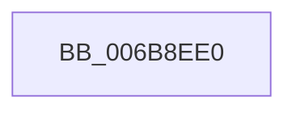

# KiDpcInterruptBypass

- RVA: `0x006B8EE0`–`0x006B8F01` (길이 `33` bytes)
- VA: `0x00000001406B8EE0`
- 실행 섹션: `.text`
- PDB 이름 있음: `예`; PDB Function 태그: `아니요`
- unwind 정보 RVA: `0x000C22C4`
- 디코드: `10`개 명령, `33/33` bytes 표시
- 미해석 바이트: `0` (있으면 어셈블리에 `.byte`로 보존)

> 이 문서는 커널 이미지의 기계어와 PDB 기호를 분석해 생성했습니다. 4번과 5번은 함수 원형과 자료형을 바이너리 사용 방식에서 추정한 C 해석이며 원본 소스 복구 결과는 아닙니다.

## 1. Dependencies

- 직접 호출 지점: **1**; 고유 호출 대상: **1**
- 직접 호출자로 확인된 함수: **11**
- RIP 상대 이미지 참조: **0**

### Outgoing calls
- `0x006B8EF6` → [KiDispatchInterrupt](../21/KiDispatchInterrupt_function_0021B7F0.md) (function, `0x0021B7F0`)

### Direct callers
- [KiChainedDispatch](KiChainedDispatch_function_006B3480.md) at `0x006B34DF`
- [KiInterruptDispatch](KiInterruptDispatch_function_006B3B30.md) at `0x006B3B8F`
- [KiInterruptDispatchNoLock](KiInterruptDispatchNoLock_function_006B3F10.md) at `0x006B3F6F`
- [KiInterruptDispatchNoLockNoEtw](KiInterruptDispatchNoLockNoEtw_function_006B42F0.md) at `0x006B434F`
- [KiInterruptDispatchNoEOI](KiInterruptDispatchNoEOI_function_006B46D0.md) at `0x006B4727`
- [KiSpuriousDispatchNoEOI](KiSpuriousDispatchNoEOI_function_006B4AA0.md) at `0x006B4AEB`
- [KxIsrLinkage](KxIsrLinkage_function_006B5680.md) at `0x006B5A9A`
- [KiHvInterruptDispatch](KiHvInterruptDispatch_function_006B7750.md) at `0x006B77BC`
- [KiVmbusInterruptDispatch](KiVmbusInterruptDispatch_function_006B7B40.md) at `0x006B7B98`
- [KiSwInterrupt](KiSwInterrupt_function_006B8070.md) at `0x006B8433`
- [KiIpiInterrupt](KiIpiInterrupt_function_006B8F20.md) at `0x006B92DD`

### Static image references
- 디코드된 RIP-relative 메모리 참조가 없습니다.

## 2. Other-region calls and transfers

- 다른 실행 섹션으로 향하는 call: **0**
- 별도 외부 분기/꼬리 이동을 확인하지 못했습니다.

## 3. Assembly (complete function range)

```asm
006B8EE0  48 83 EC 28                     sub rsp, 0x28
006B8EE4  B9 02 00 00 00                  mov ecx, 2
006B8EE9  44 0F 22 C1                     mov cr8, rcx
006B8EED  FB                              sti
006B8EEE  48 8B 4D A9                     mov rcx, qword ptr [rbp - 0x57]
006B8EF2  48 8D 55 80                     lea rdx, [rbp - 0x80]
006B8EF6  E8 F5 28 B6 FF                  call 0x14021b7f0
006B8EFB  FA                              cli
006B8EFC  48 83 C4 28                     add rsp, 0x28
006B8F00  C3                              ret
```

## 4. C-style interpretation (structured pseudocode)

```c
__int64 __fastcall KiDpcInterruptBypass(void)
{
    __int64 result;
    __int64 v_rsp;

    v_rsp = (v_rsp) - (40);
    result = KiDispatchInterrupt(*(unsigned __int64 *)(v_rbp - 87), v_rbp - 128, a3, a4);
    v_rsp = (v_rsp) + (40);
    return result;
}
```

## 5. (Beta) C Style

```c
void KiDpcInterruptBypass(void)
{
    int64_t result;
    int64_t local_rsp;

    local_rsp = (local_rsp) - (40);
    result = KiDispatchInterrupt(*(uint64_t *)(local_rbp - 0x57), local_rbp - 128, a3, a4);
    local_rsp = (local_rsp) + (40);
    return result;
}
```

## 6. Execution-region graph

[열기: 2D/3D 그래프와 함수 탐색 컨트롤 패널](../../../control-panel.html?section=text&rva=0x006B8EE0&view=graph)

- 2D 그래프는 위에서 아래로 흐르고, 3D 그래프는 빈 공간을 드래그해 회전합니다. Shift+드래그는 이동, 휠은 확대·축소, 함수 노드 선택은 대상 보고서 이동입니다.

### Static fallback


