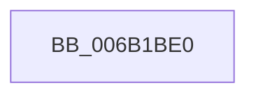

# KiEncls

- RVA: `0x006B1BE0`–`0x006B1BF2` (길이 `18` bytes)
- VA: `0x00000001406B1BE0`
- 실행 섹션: `.text`
- PDB 이름 있음: `예`; PDB Function 태그: `아니요`
- unwind 정보 RVA: `0x000C16D4`
- 디코드: `8`개 명령, `18/18` bytes 표시
- 미해석 바이트: `0` (있으면 어셈블리에 `.byte`로 보존)

> 이 문서는 커널 이미지의 기계어와 PDB 기호를 분석해 생성했습니다. 4번과 5번은 함수 원형과 자료형을 바이너리 사용 방식에서 추정한 C 해석이며 원본 소스 복구 결과는 아닙니다.

## 1. Dependencies

- 직접 호출 지점: **0**; 고유 호출 대상: **0**
- 직접 호출자로 확인된 함수: **11**
- RIP 상대 이미지 참조: **0**

### Outgoing calls
- 직접 디코드된 call 명령이 없습니다.

### Direct callers
- [KeAddEnclavePage](../36/KeAddEnclavePage_function_003683F8.md) at `0x003684C5`
- [KeAddEnclavePage](../36/KeAddEnclavePage_function_003683F8.md) at `0x003684E4`
- [KeRemoveEnclavePage](../36/KeRemoveEnclavePage_function_00368C90.md) at `0x00368CAA`
- [KeBlockEnclavePage](../5B/KeBlockEnclavePage_function_005BB998.md) at `0x005BB9B7`
- [KeCanChangeEnclavePageProtection](../5B/KeCanChangeEnclavePageProtection_function_005BB9E0.md) at `0x005BBA3D`
- [KeChangeEnclavePageProtection](../5B/KeChangeEnclavePageProtection_function_005BBAA0.md) at `0x005BBB5A`
- [KeCreateEnclaveMetadataPage](../5B/KeCreateEnclaveMetadataPage_function_005BBBA0.md) at `0x005BBBBC`
- [KeOutPageEnclavePage](../5B/KeOutPageEnclavePage_function_005BBBDC.md) at `0x005BBC58`
- [KeTrackEnclaveTbFlush](../5B/KeTrackEnclaveTbFlush_function_005BBC94.md) at `0x005BBCAE`
- [KeCreateEnclave](../../page/74/KeCreateEnclave_function_007461E4.md) at `0x007462CC`
- [KeDebugWriteEnclaveMemory](../../page/74/KeDebugWriteEnclaveMemory_function_00746310.md) at `0x00746352`
- [KeInitializeEnclave](../../page/74/KeInitializeEnclave_function_00746394.md) at `0x007463EA`

### Static image references
- 디코드된 RIP-relative 메모리 참조가 없습니다.

## 2. Other-region calls and transfers

- 다른 실행 섹션으로 향하는 call: **0**
- 별도 외부 분기/꼬리 이동을 확인하지 못했습니다.

## 3. Assembly (complete function range)

```asm
006B1BE0  48 53                           push rbx
006B1BE2  8B C1                           mov eax, ecx
006B1BE4  48 8B DA                        mov rbx, rdx
006B1BE7  49 8B C8                        mov rcx, r8
006B1BEA  49 8B D1                        mov rdx, r9
006B1BED  0F 01 CF                        encls
006B1BF0  5B                              pop rbx
006B1BF1  C3                              ret
```

## 4. C-style interpretation (structured pseudocode)

```c
__int64 __fastcall KiEncls(int a1, __int64 a2, __int64 a3, __int64 a4)
{
    return (unsigned int)(a1);
}
```

## 5. (Beta) C Style

```c
int64_t KiEncls(int32_t Arg1, int64_t Arg2, int64_t Arg3, int64_t Arg4)
{
    return (uint32_t)(Arg1);
}
```

## 6. Execution-region graph

[열기: 2D/3D 그래프와 함수 탐색 컨트롤 패널](../../../control-panel.html?section=text&rva=0x006B1BE0&view=graph)

- 2D 그래프는 위에서 아래로 흐르고, 3D 그래프는 빈 공간을 드래그해 회전합니다. Shift+드래그는 이동, 휠은 확대·축소, 함수 노드 선택은 대상 보고서 이동입니다.

### Static fallback


