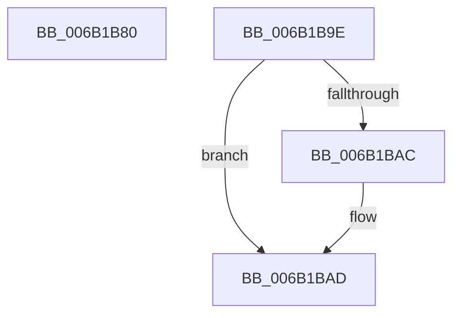

# KiExceptionDispatchOnExceptionStack

- RVA: `0x006B1B80`–`0x006B1BAE` (길이 `46` bytes)
- VA: `0x00000001406B1B80`
- 실행 섹션: `.text`
- PDB 이름 있음: `예`; PDB Function 태그: `아니요`
- unwind 정보 RVA: `0x000C16B8`
- 디코드: `12`개 명령, `46/46` bytes 표시
- 미해석 바이트: `0` (있으면 어셈블리에 `.byte`로 보존)

> 이 문서는 커널 이미지의 기계어와 PDB 기호를 분석해 생성했습니다. 4번과 5번은 함수 원형과 자료형을 바이너리 사용 방식에서 추정한 C 해석이며 원본 소스 복구 결과는 아닙니다.

## 1. Dependencies

- 직접 호출 지점: **0**; 고유 호출 대상: **0**
- 직접 호출자로 확인된 함수: **1**
- RIP 상대 이미지 참조: **0**

### Outgoing calls
- 직접 디코드된 call 명령이 없습니다.

### Direct callers
- [KiExceptionDispatch](../6C/KiExceptionDispatch_function_006C5900.md) at `0x006C5A39`

### Static image references
- 디코드된 RIP-relative 메모리 참조가 없습니다.

## 2. Other-region calls and transfers

- 다른 실행 섹션으로 향하는 call: **0**
- call이 아닌 외부 분기/꼬리 이동: **1**
  - `0x006B1B9C` → [KxExceptionDispatchOnExceptionStack](KxExceptionDispatchOnExceptionStack_function_006B1BC0.md) (`tail-transfer`)

## 3. Assembly (complete function range)

```asm
006B1B80  48 8B C4                        mov rax, rsp
006B1B83  4C 8B 54 24 28                  mov r10, qword ptr [rsp + 0x28]
006B1B88  FA                              cli
006B1B89  65 48 8B 24 25 E8 88 00 00      mov rsp, qword ptr gs:[0x88e8]
006B1B92  48 89 44 24 40                  mov qword ptr [rsp + 0x40], rax
006B1B97  4C 89 54 24 20                  mov qword ptr [rsp + 0x20], r10
006B1B9C  EB 22                           jmp 0x1406b1bc0
006B1B9E  66 90                           nop
006B1BA0  F7 85 F8 00 00 00 00 02 00 00   test dword ptr [rbp + 0xf8], 0x200
006B1BAA  74 01                           je 0x1406b1bad
006B1BAC  FB                              sti
006B1BAD  C3                              ret
```

## 4. C-style interpretation (structured pseudocode)

```c
__int64 __fastcall KiExceptionDispatchOnExceptionStack(__int64 a1, __int64 a2, __int64 a3, __int64 a4, __int64 a5)
{
    unsigned __int64 v_stack_p20;
    unsigned __int64 v_stack_p40;

    v_stack_p40 = v_rsp;
    v_stack_p20 = a5;
}
```

## 5. (Beta) C Style

```c
int64_t KiExceptionDispatchOnExceptionStack(int64_t Arg1, int64_t Arg2, int64_t Arg3, int64_t Arg4, int64_t Arg5)
{
    uint64_t v_stack_p20;
    uint64_t v_stack_p40;

    v_stack_p40 = local_rsp;
    v_stack_p20 = Arg5;
}
```

## 6. Execution-region graph

[열기: 2D/3D 그래프와 함수 탐색 컨트롤 패널](../../../control-panel.html?section=text&rva=0x006B1B80&view=graph)

- 2D 그래프는 위에서 아래로 흐르고, 3D 그래프는 빈 공간을 드래그해 회전합니다. Shift+드래그는 이동, 휠은 확대·축소, 함수 노드 선택은 대상 보고서 이동입니다.

### Static fallback


