# KiHvInterruptDispatch

- RVA: `0x006B7750`–`0x006B7B2E` (길이 `990` bytes)
- VA: `0x00000001406B7750`
- 실행 섹션: `.text`
- PDB 이름 있음: `예`; PDB Function 태그: `아니요`
- unwind 정보 RVA: `0x000C2234`
- 디코드: `219`개 명령, `990/990` bytes 표시
- 미해석 바이트: `0` (있으면 어셈블리에 `.byte`로 보존)

> 이 문서는 커널 이미지의 기계어와 PDB 기호를 분석해 생성했습니다. 4번과 5번은 함수 원형과 자료형을 바이너리 사용 방식에서 추정한 C 해석이며 원본 소스 복구 결과는 아닙니다.

## 1. Dependencies

- 직접 호출 지점: **43**; 고유 호출 대상: **43**
- 직접 호출자로 확인된 함수: **1**
- RIP 상대 이미지 참조: **6**

### Outgoing calls
- `0x006B7787` → [KiHvInterruptSubDispatch](KiHvInterruptSubDispatch_function_006B7F10.md) (function, `0x006B7F10`)
- `0x006B77A0` → [HalPerformEndOfInterrupt](../41/HalPerformEndOfInterrupt_function_00418E20.md) (function, `0x00418E20`)
- `0x006B77B3` → [KiEndInterruptCycleAccumulation](../3F/KiEndInterruptCycleAccumulation_function_003FAAE0.md) (function, `0x003FAAE0`)
- `0x006B77BC` → [KiDpcInterruptBypass](KiDpcInterruptBypass_function_006B8EE0.md) (function, `0x006B8EE0`)
- `0x006B77CE` → [KzSetIrqlUnsafe](../5B/KzSetIrqlUnsafe_function_005B8AE0.md) (function, `0x005B8AE0`)
- `0x006B7816` → [KiInitiateUserApc](KiInitiateUserApc_function_006B6540.md) (function, `0x006B6540`)
- `0x006B7827` → [KiSynchronizeUserIsolationDomainEntry](../26/KiSynchronizeUserIsolationDomainEntry_function_00263F60.md) (function, `0x00263F60`)
- `0x006B7841` → [KiUpdateStibpPairing](../3E/KiUpdateStibpPairing_function_003E71C0.md) (function, `0x003E71C0`)
- `0x006B7857` → [KiRestoreSetContextState](KiRestoreSetContextState_function_006B1CA0.md) (function, `0x006B1CA0`)
- `0x006B7873` → [KiCopyCounters](../5C/KiCopyCounters_function_005C0710.md) (function, `0x005C0710`)
- `0x006B788F` → [KiRestoreDebugRegisterState](../4F/KiRestoreDebugRegisterState_function_004FD8E0.md) (function, `0x004FD8E0`)
- `0x006B7929` → [KiHvInterruptDispatch + 0x2EC](KiHvInterruptDispatch_function_006B7750.md) (inside-function, `0x006B7A3C`)
- `0x006B7932` → [KiHvInterruptDispatch + 0x2F5](KiHvInterruptDispatch_function_006B7750.md) (inside-function, `0x006B7A45`)
- `0x006B793B` → [KiHvInterruptDispatch + 0x1DE](KiHvInterruptDispatch_function_006B7750.md) (inside-function, `0x006B792E`)
- `0x006B7944` → [KiHvInterruptDispatch + 0x1E7](KiHvInterruptDispatch_function_006B7750.md) (inside-function, `0x006B7937`)
- `0x006B794D` → [KiHvInterruptDispatch + 0x1F0](KiHvInterruptDispatch_function_006B7750.md) (inside-function, `0x006B7940`)
- `0x006B7956` → [KiHvInterruptDispatch + 0x1F9](KiHvInterruptDispatch_function_006B7750.md) (inside-function, `0x006B7949`)
- `0x006B795F` → [KiHvInterruptDispatch + 0x202](KiHvInterruptDispatch_function_006B7750.md) (inside-function, `0x006B7952`)
- `0x006B7968` → [KiHvInterruptDispatch + 0x20B](KiHvInterruptDispatch_function_006B7750.md) (inside-function, `0x006B795B`)
- `0x006B7971` → [KiHvInterruptDispatch + 0x214](KiHvInterruptDispatch_function_006B7750.md) (inside-function, `0x006B7964`)
- `0x006B797A` → [KiHvInterruptDispatch + 0x21D](KiHvInterruptDispatch_function_006B7750.md) (inside-function, `0x006B796D`)
- `0x006B7983` → [KiHvInterruptDispatch + 0x226](KiHvInterruptDispatch_function_006B7750.md) (inside-function, `0x006B7976`)
- `0x006B798C` → [KiHvInterruptDispatch + 0x22F](KiHvInterruptDispatch_function_006B7750.md) (inside-function, `0x006B797F`)
- `0x006B7995` → [KiHvInterruptDispatch + 0x238](KiHvInterruptDispatch_function_006B7750.md) (inside-function, `0x006B7988`)
- `0x006B799E` → [KiHvInterruptDispatch + 0x241](KiHvInterruptDispatch_function_006B7750.md) (inside-function, `0x006B7991`)
- `0x006B79A7` → [KiHvInterruptDispatch + 0x24A](KiHvInterruptDispatch_function_006B7750.md) (inside-function, `0x006B799A`)
- `0x006B79B0` → [KiHvInterruptDispatch + 0x253](KiHvInterruptDispatch_function_006B7750.md) (inside-function, `0x006B79A3`)
- `0x006B79B9` → [KiHvInterruptDispatch + 0x25C](KiHvInterruptDispatch_function_006B7750.md) (inside-function, `0x006B79AC`)
- `0x006B79C2` → [KiHvInterruptDispatch + 0x265](KiHvInterruptDispatch_function_006B7750.md) (inside-function, `0x006B79B5`)
- `0x006B79CB` → [KiHvInterruptDispatch + 0x26E](KiHvInterruptDispatch_function_006B7750.md) (inside-function, `0x006B79BE`)
- `0x006B79D4` → [KiHvInterruptDispatch + 0x277](KiHvInterruptDispatch_function_006B7750.md) (inside-function, `0x006B79C7`)
- `0x006B79DD` → [KiHvInterruptDispatch + 0x280](KiHvInterruptDispatch_function_006B7750.md) (inside-function, `0x006B79D0`)
- `0x006B79E6` → [KiHvInterruptDispatch + 0x289](KiHvInterruptDispatch_function_006B7750.md) (inside-function, `0x006B79D9`)
- `0x006B79EF` → [KiHvInterruptDispatch + 0x292](KiHvInterruptDispatch_function_006B7750.md) (inside-function, `0x006B79E2`)
- `0x006B79F8` → [KiHvInterruptDispatch + 0x29B](KiHvInterruptDispatch_function_006B7750.md) (inside-function, `0x006B79EB`)
- `0x006B7A01` → [KiHvInterruptDispatch + 0x2A4](KiHvInterruptDispatch_function_006B7750.md) (inside-function, `0x006B79F4`)
- `0x006B7A0A` → [KiHvInterruptDispatch + 0x2AD](KiHvInterruptDispatch_function_006B7750.md) (inside-function, `0x006B79FD`)
- `0x006B7A13` → [KiHvInterruptDispatch + 0x2B6](KiHvInterruptDispatch_function_006B7750.md) (inside-function, `0x006B7A06`)
- `0x006B7A1C` → [KiHvInterruptDispatch + 0x2BF](KiHvInterruptDispatch_function_006B7750.md) (inside-function, `0x006B7A0F`)
- `0x006B7A25` → [KiHvInterruptDispatch + 0x2C8](KiHvInterruptDispatch_function_006B7750.md) (inside-function, `0x006B7A18`)
- `0x006B7A2E` → [KiHvInterruptDispatch + 0x2D1](KiHvInterruptDispatch_function_006B7750.md) (inside-function, `0x006B7A21`)
- `0x006B7A37` → [KiHvInterruptDispatch + 0x2DA](KiHvInterruptDispatch_function_006B7750.md) (inside-function, `0x006B7A2A`)
- `0x006B7A40` → [KiHvInterruptDispatch + 0x2E3](KiHvInterruptDispatch_function_006B7750.md) (inside-function, `0x006B7A33`)

### Direct callers
- [KiHvInterruptDispatch](KiHvInterruptDispatch_function_006B7750.md) at `0x006B7929`
- [KiHvInterruptDispatch](KiHvInterruptDispatch_function_006B7750.md) at `0x006B7932`
- [KiHvInterruptDispatch](KiHvInterruptDispatch_function_006B7750.md) at `0x006B793B`
- [KiHvInterruptDispatch](KiHvInterruptDispatch_function_006B7750.md) at `0x006B7944`
- [KiHvInterruptDispatch](KiHvInterruptDispatch_function_006B7750.md) at `0x006B794D`
- [KiHvInterruptDispatch](KiHvInterruptDispatch_function_006B7750.md) at `0x006B7956`
- [KiHvInterruptDispatch](KiHvInterruptDispatch_function_006B7750.md) at `0x006B795F`
- [KiHvInterruptDispatch](KiHvInterruptDispatch_function_006B7750.md) at `0x006B7968`
- [KiHvInterruptDispatch](KiHvInterruptDispatch_function_006B7750.md) at `0x006B7971`
- [KiHvInterruptDispatch](KiHvInterruptDispatch_function_006B7750.md) at `0x006B797A`
- [KiHvInterruptDispatch](KiHvInterruptDispatch_function_006B7750.md) at `0x006B7983`
- [KiHvInterruptDispatch](KiHvInterruptDispatch_function_006B7750.md) at `0x006B798C`
- [KiHvInterruptDispatch](KiHvInterruptDispatch_function_006B7750.md) at `0x006B7995`
- [KiHvInterruptDispatch](KiHvInterruptDispatch_function_006B7750.md) at `0x006B799E`
- [KiHvInterruptDispatch](KiHvInterruptDispatch_function_006B7750.md) at `0x006B79A7`
- [KiHvInterruptDispatch](KiHvInterruptDispatch_function_006B7750.md) at `0x006B79B0`
- [KiHvInterruptDispatch](KiHvInterruptDispatch_function_006B7750.md) at `0x006B79B9`
- [KiHvInterruptDispatch](KiHvInterruptDispatch_function_006B7750.md) at `0x006B79C2`
- [KiHvInterruptDispatch](KiHvInterruptDispatch_function_006B7750.md) at `0x006B79CB`
- [KiHvInterruptDispatch](KiHvInterruptDispatch_function_006B7750.md) at `0x006B79D4`
- [KiHvInterruptDispatch](KiHvInterruptDispatch_function_006B7750.md) at `0x006B79DD`
- [KiHvInterruptDispatch](KiHvInterruptDispatch_function_006B7750.md) at `0x006B79E6`
- [KiHvInterruptDispatch](KiHvInterruptDispatch_function_006B7750.md) at `0x006B79EF`
- [KiHvInterruptDispatch](KiHvInterruptDispatch_function_006B7750.md) at `0x006B79F8`
- [KiHvInterruptDispatch](KiHvInterruptDispatch_function_006B7750.md) at `0x006B7A01`
- [KiHvInterruptDispatch](KiHvInterruptDispatch_function_006B7750.md) at `0x006B7A0A`
- [KiHvInterruptDispatch](KiHvInterruptDispatch_function_006B7750.md) at `0x006B7A13`
- [KiHvInterruptDispatch](KiHvInterruptDispatch_function_006B7750.md) at `0x006B7A1C`
- [KiHvInterruptDispatch](KiHvInterruptDispatch_function_006B7750.md) at `0x006B7A25`
- [KiHvInterruptDispatch](KiHvInterruptDispatch_function_006B7750.md) at `0x006B7A2E`
- [KiHvInterruptDispatch](KiHvInterruptDispatch_function_006B7750.md) at `0x006B7A37`
- [KiHvInterruptDispatch](KiHvInterruptDispatch_function_006B7750.md) at `0x006B7A40`

### Static image references
- `0x006B775C` → RVA `0x00FC505C` (`ALMOSTRO`; read)
- `0x006B7772` → RVA `0x00F4754C` (`.data`; read)
- `0x006B7791` → RVA `0x00FC6AB8` (`ALMOSTRO`; read)
- `0x006B77C5` → RVA `0x00FC6D20` (`ALMOSTRO`; read)
- `0x006B77EE` → RVA `0x00FC6BF0` (`ALMOSTRO`; read)
- `0x006B7ABE` → RVA `0x01201840` (`CFGRO`; read)

## 2. Other-region calls and transfers

- 다른 실행 섹션으로 향하는 call: **0**
- call이 아닌 외부 분기/꼬리 이동: **1**
  - `0x006B7AC7` → [KiKernelExit](../../kvascode/BC/KiKernelExit_function_00BCCB80.md) (`tail-transfer`)

## 3. Assembly (complete function range)

```asm
006B7750  65 48 8B 0C 25 58 91 00 00      mov rcx, qword ptr gs:[0x9158]
006B7759  48 8B C1                        mov rax, rcx
006B775C  8B 15 FA D8 90 00               mov edx, dword ptr [rip + 0x90d8fa]
006B7762  48 2B C2                        sub rax, rdx
006B7765  48 8B D4                        mov rdx, rsp
006B7768  48 3B C4                        cmp rax, rsp
006B776B  77 05                           ja 0x1406b7772
006B776D  48 3B E1                        cmp rsp, rcx
006B7770  72 0C                           jb 0x1406b777e
006B7772  83 3D D3 FD 88 00 00            cmp dword ptr [rip + 0x88fdd3], 0
006B7779  75 03                           jne 0x1406b777e
006B777B  48 8B E1                        mov rsp, rcx
006B777E  48 83 EC 20                     sub rsp, 0x20
006B7782  48 89 54 24 10                  mov qword ptr [rsp + 0x10], rdx
006B7787  E8 84 07 00 00                  call 0x1406b7f10
006B778C  48 8B 64 24 10                  mov rsp, qword ptr [rsp + 0x10]
006B7791  F7 05 1D F3 90 00 00 10 00 00   test dword ptr [rip + 0x90f31d], 0x1000
006B779B  74 08                           je 0x1406b77a5
006B779D  48 8B CE                        mov rcx, rsi
006B77A0  E8 7B 16 D6 FF                  call 0x140418e20
006B77A5  FA                              cli
006B77A6  65 48 8B 0C 25 20 00 00 00      mov rcx, qword ptr gs:[0x20]
006B77AF  0F B6 55 A9                     movzx edx, byte ptr [rbp - 0x57]
006B77B3  E8 28 33 D4 FF                  call 0x1403faae0
006B77B8  84 C0                           test al, al
006B77BA  74 05                           je 0x1406b77c1
006B77BC  E8 1F 17 00 00                  call 0x1406b8ee0
006B77C1  0F B6 4D A9                     movzx ecx, byte ptr [rbp - 0x57]
006B77C5  83 3D 54 F5 90 00 00            cmp dword ptr [rip + 0x90f554], 0
006B77CC  74 07                           je 0x1406b77d5
006B77CE  E8 0D 13 F0 FF                  call 0x1405b8ae0
006B77D3  EB 04                           jmp 0x1406b77d9
006B77D5  44 0F 22 C1                     mov cr8, rcx
006B77D9  48 8B B5 D0 00 00 00            mov rsi, qword ptr [rbp + 0xd0]
006B77E0  FA                              cli
006B77E1  F6 85 F0 00 00 00 01            test byte ptr [rbp + 0xf0], 1
006B77E8  0F 84 F5 02 00 00               je 0x1406b7ae3
006B77EE  F6 05 FB F3 90 00 FF            test byte ptr [rip + 0x90f3fb], 0xff
006B77F5  74 03                           je 0x1406b77fa
006B77F7  0F 01 CB                        stac
006B77FA  65 48 8B 0C 25 88 01 00 00      mov rcx, qword ptr gs:[0x188]
006B7803  F6 81 C2 00 00 00 03            test byte ptr [rcx + 0xc2], 3
006B780A  74 1B                           je 0x1406b7827
006B780C  B9 01 00 00 00                  mov ecx, 1
006B7811  44 0F 22 C1                     mov cr8, rcx
006B7815  FB                              sti
006B7816  E8 25 ED FF FF                  call 0x1406b6540
006B781B  FA                              cli
006B781C  B9 00 00 00 00                  mov ecx, 0
006B7821  44 0F 22 C1                     mov cr8, rcx
006B7825  EB D3                           jmp 0x1406b77fa
006B7827  E8 34 C7 BA FF                  call 0x140263f60
006B782C  85 C0                           test eax, eax
006B782E  48 8B 45 B0                     mov rax, qword ptr [rbp - 0x50]
006B7832  75 C6                           jne 0x1406b77fa
006B7834  65 F6 04 25 60 08 00 00 02      test byte ptr gs:[0x860], 2
006B783D  74 07                           je 0x1406b7846
006B783F  33 C9                           xor ecx, ecx
006B7841  E8 7A F9 D2 FF                  call 0x1403e71c0
006B7846  65 48 8B 0C 25 88 01 00 00      mov rcx, qword ptr gs:[0x188]
006B784F  F7 01 00 00 00 08               test dword ptr [rcx], 0x8000000
006B7855  74 05                           je 0x1406b785c
006B7857  E8 44 A4 FF FF                  call 0x1406b1ca0
006B785C  65 48 8B 0C 25 88 01 00 00      mov rcx, qword ptr gs:[0x188]
006B7865  F7 01 00 00 01 00               test dword ptr [rcx], 0x10000
006B786B  74 14                           je 0x1406b7881
006B786D  F6 41 02 01                     test byte ptr [rcx + 2], 1
006B7871  74 0E                           je 0x1406b7881
006B7873  E8 98 8E F0 FF                  call 0x1405c0710
006B7878  65 48 8B 0C 25 88 01 00 00      mov rcx, qword ptr gs:[0x188]
006B7881  0F AE 55 AC                     ldmxcsr dword ptr [rbp - 0x54]
006B7885  66 83 BD 80 00 00 00 00         cmp word ptr [rbp + 0x80], 0
006B788D  74 05                           je 0x1406b7894
006B788F  E8 4C 60 E4 FF                  call 0x1404fd8e0
006B7894  65 48 8B 0C 25 88 01 00 00      mov rcx, qword ptr gs:[0x188]
006B789D  0F BA 61 74 16                  bt dword ptr [rcx + 0x74], 0x16
006B78A2  73 2A                           jae 0x1406b78ce
006B78A4  33 C9                           xor ecx, ecx
006B78A6  F3 48 0F 1E C9                  rdsspq rcx
006B78AB  65 4C 8B 04 25 28 9D 00 00      mov r8, qword ptr gs:[0x9d28]
006B78B4  49 83 C0 08                     add r8, 8
006B78B8  49 3B C8                        cmp rcx, r8
006B78BB  75 11                           jne 0x1406b78ce
006B78BD  65 48 8B 0C 25 20 9D 00 00      mov rcx, qword ptr gs:[0x9d20]
006B78C6  F3 0F 01 29                     rstorssp dword ptr [rcx]
006B78CA  F3 0F 01 EA                     saveprevssp
006B78CE  65 C6 04 25 5E 08 00 00 00      mov byte ptr gs:[0x85e], 0
006B78D7  65 0F B7 04 25 6C 08 00 00      movzx eax, word ptr gs:[0x86c]
006B78E0  66 65 39 04 25 66 08 00 00      cmp word ptr gs:[0x866], ax
006B78E9  74 12                           je 0x1406b78fd
006B78EB  66 65 89 04 25 66 08 00 00      mov word ptr gs:[0x866], ax
006B78F4  B9 48 00 00 00                  mov ecx, 0x48
006B78F9  33 D2                           xor edx, edx
006B78FB  0F 30                           wrmsr
006B78FD  66 65 0F BA 34 25 58 08 00 00 02  btr word ptr gs:[0x858], 2
006B7908  73 0E                           jae 0x1406b7918
006B790A  B8 01 00 00 00                  mov eax, 1
006B790F  33 D2                           xor edx, edx
006B7911  B9 49 00 00 00                  mov ecx, 0x49
006B7916  0F 30                           wrmsr
006B7918  66 65 0F BA 34 25 58 08 00 00 05  btr word ptr gs:[0x858], 5
006B7923  0F 83 37 01 00 00               jae 0x1406b7a60
006B7929  E8 0E 01 00 00                  call 0x1406b7a3c
006B792E  48 83 C4 08                     add rsp, 8
006B7932  E8 0E 01 00 00                  call 0x1406b7a45
006B7937  48 83 C4 08                     add rsp, 8
006B793B  E8 EE FF FF FF                  call 0x1406b792e
006B7940  48 83 C4 08                     add rsp, 8
006B7944  E8 EE FF FF FF                  call 0x1406b7937
006B7949  48 83 C4 08                     add rsp, 8
006B794D  E8 EE FF FF FF                  call 0x1406b7940
006B7952  48 83 C4 08                     add rsp, 8
006B7956  E8 EE FF FF FF                  call 0x1406b7949
006B795B  48 83 C4 08                     add rsp, 8
006B795F  E8 EE FF FF FF                  call 0x1406b7952
006B7964  48 83 C4 08                     add rsp, 8
006B7968  E8 EE FF FF FF                  call 0x1406b795b
006B796D  48 83 C4 08                     add rsp, 8
006B7971  E8 EE FF FF FF                  call 0x1406b7964
006B7976  48 83 C4 08                     add rsp, 8
006B797A  E8 EE FF FF FF                  call 0x1406b796d
006B797F  48 83 C4 08                     add rsp, 8
006B7983  E8 EE FF FF FF                  call 0x1406b7976
006B7988  48 83 C4 08                     add rsp, 8
006B798C  E8 EE FF FF FF                  call 0x1406b797f
006B7991  48 83 C4 08                     add rsp, 8
006B7995  E8 EE FF FF FF                  call 0x1406b7988
006B799A  48 83 C4 08                     add rsp, 8
006B799E  E8 EE FF FF FF                  call 0x1406b7991
006B79A3  48 83 C4 08                     add rsp, 8
006B79A7  E8 EE FF FF FF                  call 0x1406b799a
006B79AC  48 83 C4 08                     add rsp, 8
006B79B0  E8 EE FF FF FF                  call 0x1406b79a3
006B79B5  48 83 C4 08                     add rsp, 8
006B79B9  E8 EE FF FF FF                  call 0x1406b79ac
006B79BE  48 83 C4 08                     add rsp, 8
006B79C2  E8 EE FF FF FF                  call 0x1406b79b5
006B79C7  48 83 C4 08                     add rsp, 8
006B79CB  E8 EE FF FF FF                  call 0x1406b79be
006B79D0  48 83 C4 08                     add rsp, 8
006B79D4  E8 EE FF FF FF                  call 0x1406b79c7
006B79D9  48 83 C4 08                     add rsp, 8
006B79DD  E8 EE FF FF FF                  call 0x1406b79d0
006B79E2  48 83 C4 08                     add rsp, 8
006B79E6  E8 EE FF FF FF                  call 0x1406b79d9
006B79EB  48 83 C4 08                     add rsp, 8
006B79EF  E8 EE FF FF FF                  call 0x1406b79e2
006B79F4  48 83 C4 08                     add rsp, 8
006B79F8  E8 EE FF FF FF                  call 0x1406b79eb
006B79FD  48 83 C4 08                     add rsp, 8
006B7A01  E8 EE FF FF FF                  call 0x1406b79f4
006B7A06  48 83 C4 08                     add rsp, 8
006B7A0A  E8 EE FF FF FF                  call 0x1406b79fd
006B7A0F  48 83 C4 08                     add rsp, 8
006B7A13  E8 EE FF FF FF                  call 0x1406b7a06
006B7A18  48 83 C4 08                     add rsp, 8
006B7A1C  E8 EE FF FF FF                  call 0x1406b7a0f
006B7A21  48 83 C4 08                     add rsp, 8
006B7A25  E8 EE FF FF FF                  call 0x1406b7a18
006B7A2A  48 83 C4 08                     add rsp, 8
006B7A2E  E8 EE FF FF FF                  call 0x1406b7a21
006B7A33  48 83 C4 08                     add rsp, 8
006B7A37  E8 EE FF FF FF                  call 0x1406b7a2a
006B7A3C  48 83 C4 08                     add rsp, 8
006B7A40  E8 EE FF FF FF                  call 0x1406b7a33
006B7A45  48 83 C4 08                     add rsp, 8
006B7A49  B8 DA DA 00 00                  mov eax, 0xdada
006B7A4E  65 F6 04 25 5C 08 00 00 08      test byte ptr gs:[0x85c], 8
006B7A57  74 07                           je 0x1406b7a60
006B7A59  B0 20                           mov al, 0x20
006B7A5B  F3 48 0F AE E8                  incsspq rax
006B7A60  66 65 F7 04 25 58 08 00 00 00 01  test word ptr gs:[0x858], 0x100
006B7A6B  74 0C                           je 0x1406b7a79
006B7A6D  33 C0                           xor eax, eax
006B7A6F  33 D2                           xor edx, edx
006B7A71  B9 01 00 00 00                  mov ecx, 1
006B7A76  48 F7 F1                        div rcx
006B7A79  0F 28 45 F0                     movaps xmm0, xmmword ptr [rbp - 0x10]
006B7A7D  0F 28 4D 00                     movaps xmm1, xmmword ptr [rbp]
006B7A81  0F 28 55 10                     movaps xmm2, xmmword ptr [rbp + 0x10]
006B7A85  0F 28 5D 20                     movaps xmm3, xmmword ptr [rbp + 0x20]
006B7A89  0F 28 65 30                     movaps xmm4, xmmword ptr [rbp + 0x30]
006B7A8D  0F 28 6D 40                     movaps xmm5, xmmword ptr [rbp + 0x40]
006B7A91  4C 8B 5D E0                     mov r11, qword ptr [rbp - 0x20]
006B7A95  4C 8B 55 D8                     mov r10, qword ptr [rbp - 0x28]
006B7A99  4C 8B 4D D0                     mov r9, qword ptr [rbp - 0x30]
006B7A9D  4C 8B 45 C8                     mov r8, qword ptr [rbp - 0x38]
006B7AA1  48 8B 55 C0                     mov rdx, qword ptr [rbp - 0x40]
006B7AA5  48 8B 4D B8                     mov rcx, qword ptr [rbp - 0x48]
006B7AA9  48 8B 45 B0                     mov rax, qword ptr [rbp - 0x50]
006B7AAD  48 8B E5                        mov rsp, rbp
006B7AB0  48 8B AD D8 00 00 00            mov rbp, qword ptr [rbp + 0xd8]
006B7AB7  48 81 C4 E8 00 00 00            add rsp, 0xe8
006B7ABE  F6 05 7B 9D B4 00 01            test byte ptr [rip + 0xb49d7b], 1
006B7AC5  74 05                           je 0x1406b7acc
006B7AC7  E9 B4 50 51 00                  jmp 0x140bccb80
006B7ACC  66 65 F7 04 25 58 08 00 00 00 02  test word ptr gs:[0x858], 0x200
006B7AD7  74 05                           je 0x1406b7ade
006B7AD9  0F 00 6C 24 20                  verw word ptr [rsp + 0x20]
006B7ADE  0F 01 F8                        swapgs
006B7AE1  48 CF                           iretq
006B7AE3  0F AE 55 AC                     ldmxcsr dword ptr [rbp - 0x54]
006B7AE7  0F 28 45 F0                     movaps xmm0, xmmword ptr [rbp - 0x10]
006B7AEB  0F 28 4D 00                     movaps xmm1, xmmword ptr [rbp]
006B7AEF  0F 28 55 10                     movaps xmm2, xmmword ptr [rbp + 0x10]
006B7AF3  0F 28 5D 20                     movaps xmm3, xmmword ptr [rbp + 0x20]
006B7AF7  0F 28 65 30                     movaps xmm4, xmmword ptr [rbp + 0x30]
006B7AFB  0F 28 6D 40                     movaps xmm5, xmmword ptr [rbp + 0x40]
006B7AFF  4C 8B 5D E0                     mov r11, qword ptr [rbp - 0x20]
006B7B03  4C 8B 55 D8                     mov r10, qword ptr [rbp - 0x28]
006B7B07  4C 8B 4D D0                     mov r9, qword ptr [rbp - 0x30]
006B7B0B  4C 8B 45 C8                     mov r8, qword ptr [rbp - 0x38]
006B7B0F  48 8B 55 C0                     mov rdx, qword ptr [rbp - 0x40]
006B7B13  48 8B 4D B8                     mov rcx, qword ptr [rbp - 0x48]
006B7B17  48 8B 45 B0                     mov rax, qword ptr [rbp - 0x50]
006B7B1B  48 8B E5                        mov rsp, rbp
006B7B1E  48 8B AD D8 00 00 00            mov rbp, qword ptr [rbp + 0xd8]
006B7B25  48 81 C4 E8 00 00 00            add rsp, 0xe8
006B7B2C  48 CF                           iretq
```

## 4. C-style interpretation (structured pseudocode)

```c
__int64 __fastcall KiHvInterruptDispatch(void)
{
    __int64 result;
    __int64 v_rsp;
    unsigned __int64 v_stack_m10;
    unsigned __int16 v_stack_p1E8;

    result = (*(unsigned __int64 *)(gs_base + (0 + 37208))) - ((unsigned int)(*(unsigned int *)(v_rip + 9492730)));
    if (result > v_rsp) goto loc_006B7772;
    if (v_rsp < (*(unsigned __int64 *)(gs_base + (0 + 37208)))) goto loc_006B777E;
loc_006B7772:
    if ((*(unsigned int *)(v_rip + 8977875)) == 0) {
        v_rsp = *(unsigned __int64 *)(gs_base + (0 + 37208));
    }
    v_rsp = (v_rsp) - (32);
    v_stack_m10 = v_rsp;
    result = KiHvInterruptSubDispatch(*(unsigned __int64 *)(gs_base + (0 + 37208)), v_rsp, a3, a4);
    if (((*(unsigned int *)(v_rip + 9499421)) & (0x1000ULL)) != 0) {
        a1 = v_rsi;
        result = HalPerformEndOfInterrupt(a1, v_rsp, a3, a4);
    }
    result = KiEndInterruptCycleAccumulation(*(unsigned __int64 *)(gs_base + (0 + 32)), *(unsigned __int8 *)(v_rbp - 87), a3, a4);
    if ((unsigned __int8)(result) != 0) {
        result = KiDpcInterruptBypass(*(unsigned __int64 *)(gs_base + (0 + 32)), *(unsigned __int8 *)(v_rbp - 87), a3, a4);
    }
    if ((*(unsigned int *)(v_rip + 9499988)) == 0) goto loc_006B77D5;
    result = KzSetIrqlUnsafe(*(unsigned __int8 *)(v_rbp - 87), *(unsigned __int8 *)(v_rbp - 87), a3, a4);
    goto loc_006B77D9;
loc_006B77D5:
loc_006B77D9:
    if (((*(unsigned __int8 *)(v_rbp + 240)) & (1)) == 0) goto loc_006B7AE3;
    if (((*(unsigned __int8 *)(v_rip + 9499643)) & (255)) != 0) {
    }
    if (((*(unsigned __int8 *)(*(unsigned __int64 *)(gs_base + (0 + 392)) + 194)) & (3)) == 0) goto loc_006B7827;
    result = KiInitiateUserApc(1, *(unsigned __int8 *)(v_rbp - 87), a3, a4);
    goto loc_006B77FA;
loc_006B7827:
    result = KiSynchronizeUserIsolationDomainEntry(0, *(unsigned __int8 *)(v_rbp - 87), a3, a4);
    if ((unsigned int)(result) != 0) goto loc_006B77FA;
    result = *(unsigned __int64 *)(v_rbp - 80);
    if (((*(unsigned __int8 *)(gs_base + (0 + 2144))) & (2)) != 0) {
        a1 = 0;
        result = KiUpdateStibpPairing(a1, *(unsigned __int8 *)(v_rbp - 87), a3, a4);
    }
    if (((*(unsigned int *)(*(unsigned __int64 *)(gs_base + (0 + 392)))) & (0x8000000ULL)) != 0) {
        result = KiRestoreSetContextState(*(unsigned __int64 *)(gs_base + (0 + 392)), *(unsigned __int8 *)(v_rbp - 87), a3, a4);
    }
    if (((*(unsigned int *)(*(unsigned __int64 *)(gs_base + (0 + 392)))) & (0x10000ULL)) == 0) goto loc_006B7881;
    if (((*(unsigned __int8 *)(*(unsigned __int64 *)(gs_base + (0 + 392)) + 2)) & (1)) != 0) {
        result = KiCopyCounters(*(unsigned __int64 *)(gs_base + (0 + 392)), *(unsigned __int8 *)(v_rbp - 87), a3, a4);
        a1 = *(unsigned __int64 *)(gs_base + (0 + 392));
    }
    if ((*(unsigned __int16 *)(v_rbp + 128)) != 0) {
        result = KiRestoreDebugRegisterState(a1, *(unsigned __int8 *)(v_rbp - 87), a3, a4);
    }
    if ((*(unsigned __int16 *)(v_rbp + 128)) >= 0) goto loc_006B78CE;
    a1 = 0;
    a3 = (*(unsigned __int64 *)(gs_base + (0 + 40232))) + (8);
    if (0 == a3) {
        a1 = *(unsigned __int64 *)(gs_base + (0 + 40224));
    }
    *(unsigned __int8 *)(gs_base + (0 + 2142)) = 0;
    if ((*(unsigned __int16 *)(gs_base + (0 + 2150))) != ((unsigned __int16)(*(unsigned __int16 *)(gs_base + (0 + 2156))))) {
        *(unsigned __int16 *)(gs_base + (0 + 2150)) = (unsigned __int16)(*(unsigned __int16 *)(gs_base + (0 + 2156)));
        a1 = 72;
        a2 = 0;
    }
    result = *(unsigned __int16 *)(gs_base + (0 + 2156));
    if (!(condition_is_above_or_equal)) {
        result = 1;
        a2 = 0;
        a1 = 73;
    }
    if (condition_is_above_or_equal) goto loc_006B7A60;
    result = KiHvInterruptDispatch___0x2EC(a1, a2, a3, a4);
    v_rsp = (v_stack_m10) + (8);
    result = KiHvInterruptDispatch___0x2F5(a1, a2, a3, a4);
    v_rsp = (v_rsp) + (8);
    result = KiHvInterruptDispatch___0x1DE(a1, a2, a3, a4);
    v_rsp = (v_rsp) + (8);
    result = KiHvInterruptDispatch___0x1E7(a1, a2, a3, a4);
    v_rsp = (v_rsp) + (8);
    result = KiHvInterruptDispatch___0x1F0(a1, a2, a3, a4);
    v_rsp = (v_rsp) + (8);
    result = KiHvInterruptDispatch___0x1F9(a1, a2, a3, a4);
    v_rsp = (v_rsp) + (8);
    result = KiHvInterruptDispatch___0x202(a1, a2, a3, a4);
    v_rsp = (v_rsp) + (8);
    result = KiHvInterruptDispatch___0x20B(a1, a2, a3, a4);
    v_rsp = (v_rsp) + (8);
    result = KiHvInterruptDispatch___0x214(a1, a2, a3, a4);
    v_rsp = (v_rsp) + (8);
    result = KiHvInterruptDispatch___0x21D(a1, a2, a3, a4);
    v_rsp = (v_rsp) + (8);
    result = KiHvInterruptDispatch___0x226(a1, a2, a3, a4);
    v_rsp = (v_rsp) + (8);
    result = KiHvInterruptDispatch___0x22F(a1, a2, a3, a4);
    v_rsp = (v_rsp) + (8);
    result = KiHvInterruptDispatch___0x238(a1, a2, a3, a4);
    v_rsp = (v_rsp) + (8);
    result = KiHvInterruptDispatch___0x241(a1, a2, a3, a4);
    v_rsp = (v_rsp) + (8);
    result = KiHvInterruptDispatch___0x24A(a1, a2, a3, a4);
    v_rsp = (v_rsp) + (8);
    result = KiHvInterruptDispatch___0x253(a1, a2, a3, a4);
    v_rsp = (v_rsp) + (8);
    result = KiHvInterruptDispatch___0x25C(a1, a2, a3, a4);
    v_rsp = (v_rsp) + (8);
    result = KiHvInterruptDispatch___0x265(a1, a2, a3, a4);
    v_rsp = (v_rsp) + (8);
    result = KiHvInterruptDispatch___0x26E(a1, a2, a3, a4);
    v_rsp = (v_rsp) + (8);
    result = KiHvInterruptDispatch___0x277(a1, a2, a3, a4);
    v_rsp = (v_rsp) + (8);
    result = KiHvInterruptDispatch___0x280(a1, a2, a3, a4);
    v_rsp = (v_rsp) + (8);
    result = KiHvInterruptDispatch___0x289(a1, a2, a3, a4);
    v_rsp = (v_rsp) + (8);
    result = KiHvInterruptDispatch___0x292(a1, a2, a3, a4);
    v_rsp = (v_rsp) + (8);
    result = KiHvInterruptDispatch___0x29B(a1, a2, a3, a4);
    v_rsp = (v_rsp) + (8);
    result = KiHvInterruptDispatch___0x2A4(a1, a2, a3, a4);
    v_rsp = (v_rsp) + (8);
    result = KiHvInterruptDispatch___0x2AD(a1, a2, a3, a4);
    v_rsp = (v_rsp) + (8);
    result = KiHvInterruptDispatch___0x2B6(a1, a2, a3, a4);
    v_rsp = (v_rsp) + (8);
    result = KiHvInterruptDispatch___0x2BF(a1, a2, a3, a4);
    v_rsp = (v_rsp) + (8);
    result = KiHvInterruptDispatch___0x2C8(a1, a2, a3, a4);
    v_rsp = (v_rsp) + (8);
    result = KiHvInterruptDispatch___0x2D1(a1, a2, a3, a4);
    v_rsp = (v_rsp) + (8);
    result = KiHvInterruptDispatch___0x2DA(a1, a2, a3, a4);
    v_rsp = (v_rsp) + (8);
    result = KiHvInterruptDispatch___0x2E3(a1, a2, a3, a4);
    v_rsp = (v_rsp) + (8);
    result = (unsigned int)(0xDADAULL);
    if (((*(unsigned __int8 *)(gs_base + (0 + 2140))) & (8)) != 0) {
        result = 32;
    }
    if (((*(unsigned __int16 *)(gs_base + (0 + 2136))) & (256)) != 0) {
        result = 0;
        a2 = 0;
        a1 = 1;
    }
    v_rsp = (v_rbp) + (232);
    if (((*(unsigned __int8 *)(v_rip + 11836795)) & (1)) == 0) goto loc_006B7ACC;
loc_006B7ACC:
    if (((*(unsigned __int16 *)(gs_base + (0 + 2136))) & (512)) != 0) {
    }
loc_006B7AE3:
    v_rsp = (*(unsigned __int64 *)(v_rbp + 216)) + (232);
    return *(unsigned __int64 *)(*(unsigned __int64 *)(v_rbp + 216) - 80);
}
```

## 5. (Beta) C Style

```c
void KiHvInterruptDispatch(void)
{
    int64_t result;
    int64_t local_rsp;
    uint64_t v_stack_m10;
    uint16_t v_stack_p1E8;

    result = (*(uint64_t *)(gs_base + (0 + 0x9158))) - ((uint32_t)(*(uint32_t *)(v_rip + 0x90D8FA)));
    if (result > local_rsp) goto loc_006B7772;
    if (local_rsp < (*(uint64_t *)(gs_base + (0 + 0x9158)))) goto loc_006B777E;
loc_006B7772:
    if ((*(uint32_t *)(v_rip + 0x88FDD3)) == 0) {
        local_rsp = *(uint64_t *)(gs_base + (0 + 0x9158));
    }
    local_rsp = (local_rsp) - (32);
    v_stack_m10 = local_rsp;
    result = KiHvInterruptSubDispatch(*(uint64_t *)(gs_base + (0 + 0x9158)), local_rsp, a3, a4);
    if (((*(uint32_t *)(v_rip + 0x90F31D)) & (0x1000ULL)) != 0) {
        a1 = local_rsi;
        result = HalPerformEndOfInterrupt(a1, local_rsp, a3, a4);
    }
    result = KiEndInterruptCycleAccumulation(*(uint64_t *)(gs_base + (0 + 0x20)), *(uint8_t *)(local_rbp - 0x57), a3, a4);
    if ((uint8_t)(result) != 0) {
        result = KiDpcInterruptBypass(*(uint64_t *)(gs_base + (0 + 0x20)), *(uint8_t *)(local_rbp - 0x57), a3, a4);
    }
    if ((*(uint32_t *)(v_rip + 0x90F554)) == 0) goto loc_006B77D5;
    result = KzSetIrqlUnsafe(*(uint8_t *)(local_rbp - 0x57), *(uint8_t *)(local_rbp - 0x57), a3, a4);
    goto loc_006B77D9;
loc_006B77D5:
loc_006B77D9:
    if (((*(uint8_t *)(local_rbp + 0xF0)) & (1)) == 0) goto loc_006B7AE3;
    if (((*(uint8_t *)(v_rip + 0x90F3FB)) & (255)) != 0) {
    }
    if (((*(uint8_t *)(*(uint64_t *)(gs_base + (0 + 0x188)) + 0xC2)) & (3)) == 0) goto loc_006B7827;
    result = KiInitiateUserApc(1, *(uint8_t *)(local_rbp - 0x57), a3, a4);
    goto loc_006B77FA;
loc_006B7827:
    result = KiSynchronizeUserIsolationDomainEntry(0, *(uint8_t *)(local_rbp - 0x57), a3, a4);
    if ((uint32_t)(result) != 0) goto loc_006B77FA;
    result = *(uint64_t *)(local_rbp - 0x50);
    if (((*(uint8_t *)(gs_base + (0 + 0x860))) & (2)) != 0) {
        a1 = 0;
        result = KiUpdateStibpPairing(a1, *(uint8_t *)(local_rbp - 0x57), a3, a4);
    }
    if (((*(uint32_t *)(*(uint64_t *)(gs_base + (0 + 0x188)))) & (0x8000000ULL)) != 0) {
        result = KiRestoreSetContextState(*(uint64_t *)(gs_base + (0 + 0x188)), *(uint8_t *)(local_rbp - 0x57), a3, a4);
    }
    if (((*(uint32_t *)(*(uint64_t *)(gs_base + (0 + 0x188)))) & (0x10000ULL)) == 0) goto loc_006B7881;
    if (((*(uint8_t *)(*(uint64_t *)(gs_base + (0 + 0x188)) + 0x2)) & (1)) != 0) {
        result = KiCopyCounters(*(uint64_t *)(gs_base + (0 + 0x188)), *(uint8_t *)(local_rbp - 0x57), a3, a4);
        a1 = *(uint64_t *)(gs_base + (0 + 0x188));
    }
    if ((*(uint16_t *)(local_rbp + 0x80)) != 0) {
        result = KiRestoreDebugRegisterState(a1, *(uint8_t *)(local_rbp - 0x57), a3, a4);
    }
    if ((*(uint16_t *)(local_rbp + 0x80)) >= 0) goto loc_006B78CE;
    a1 = 0;
    a3 = (*(uint64_t *)(gs_base + (0 + 0x9D28))) + (8);
    if (0 == a3) {
        a1 = *(uint64_t *)(gs_base + (0 + 0x9D20));
    }
    *(uint8_t *)(gs_base + (0 + 0x85E)) = 0;
    if ((*(uint16_t *)(gs_base + (0 + 0x866))) != ((uint16_t)(*(uint16_t *)(gs_base + (0 + 0x86C))))) {
        *(uint16_t *)(gs_base + (0 + 0x866)) = (uint16_t)(*(uint16_t *)(gs_base + (0 + 0x86C)));
        a1 = 72;
        a2 = 0;
    }
    result = *(uint16_t *)(gs_base + (0 + 0x86C));
    if (!(condition_is_above_or_equal)) {
        result = 1;
        a2 = 0;
        a1 = 73;
    }
    if (condition_is_above_or_equal) goto loc_006B7A60;
    result = KiHvInterruptDispatch___0x2EC(a1, a2, a3, a4);
    local_rsp = (v_stack_m10) + (8);
    result = KiHvInterruptDispatch___0x2F5(a1, a2, a3, a4);
    local_rsp = (local_rsp) + (8);
    result = KiHvInterruptDispatch___0x1DE(a1, a2, a3, a4);
    local_rsp = (local_rsp) + (8);
    result = KiHvInterruptDispatch___0x1E7(a1, a2, a3, a4);
    local_rsp = (local_rsp) + (8);
    result = KiHvInterruptDispatch___0x1F0(a1, a2, a3, a4);
    local_rsp = (local_rsp) + (8);
    result = KiHvInterruptDispatch___0x1F9(a1, a2, a3, a4);
    local_rsp = (local_rsp) + (8);
    result = KiHvInterruptDispatch___0x202(a1, a2, a3, a4);
    local_rsp = (local_rsp) + (8);
    result = KiHvInterruptDispatch___0x20B(a1, a2, a3, a4);
    local_rsp = (local_rsp) + (8);
    result = KiHvInterruptDispatch___0x214(a1, a2, a3, a4);
    local_rsp = (local_rsp) + (8);
    result = KiHvInterruptDispatch___0x21D(a1, a2, a3, a4);
    local_rsp = (local_rsp) + (8);
    result = KiHvInterruptDispatch___0x226(a1, a2, a3, a4);
    local_rsp = (local_rsp) + (8);
    result = KiHvInterruptDispatch___0x22F(a1, a2, a3, a4);
    local_rsp = (local_rsp) + (8);
    result = KiHvInterruptDispatch___0x238(a1, a2, a3, a4);
    local_rsp = (local_rsp) + (8);
    result = KiHvInterruptDispatch___0x241(a1, a2, a3, a4);
    local_rsp = (local_rsp) + (8);
    result = KiHvInterruptDispatch___0x24A(a1, a2, a3, a4);
    local_rsp = (local_rsp) + (8);
    result = KiHvInterruptDispatch___0x253(a1, a2, a3, a4);
    local_rsp = (local_rsp) + (8);
    result = KiHvInterruptDispatch___0x25C(a1, a2, a3, a4);
    local_rsp = (local_rsp) + (8);
    result = KiHvInterruptDispatch___0x265(a1, a2, a3, a4);
    local_rsp = (local_rsp) + (8);
    result = KiHvInterruptDispatch___0x26E(a1, a2, a3, a4);
    local_rsp = (local_rsp) + (8);
    result = KiHvInterruptDispatch___0x277(a1, a2, a3, a4);
    local_rsp = (local_rsp) + (8);
    result = KiHvInterruptDispatch___0x280(a1, a2, a3, a4);
    local_rsp = (local_rsp) + (8);
    result = KiHvInterruptDispatch___0x289(a1, a2, a3, a4);
    local_rsp = (local_rsp) + (8);
    result = KiHvInterruptDispatch___0x292(a1, a2, a3, a4);
    local_rsp = (local_rsp) + (8);
    result = KiHvInterruptDispatch___0x29B(a1, a2, a3, a4);
    local_rsp = (local_rsp) + (8);
    result = KiHvInterruptDispatch___0x2A4(a1, a2, a3, a4);
    local_rsp = (local_rsp) + (8);
    result = KiHvInterruptDispatch___0x2AD(a1, a2, a3, a4);
    local_rsp = (local_rsp) + (8);
    result = KiHvInterruptDispatch___0x2B6(a1, a2, a3, a4);
    local_rsp = (local_rsp) + (8);
    result = KiHvInterruptDispatch___0x2BF(a1, a2, a3, a4);
    local_rsp = (local_rsp) + (8);
    result = KiHvInterruptDispatch___0x2C8(a1, a2, a3, a4);
    local_rsp = (local_rsp) + (8);
    result = KiHvInterruptDispatch___0x2D1(a1, a2, a3, a4);
    local_rsp = (local_rsp) + (8);
    result = KiHvInterruptDispatch___0x2DA(a1, a2, a3, a4);
    local_rsp = (local_rsp) + (8);
    result = KiHvInterruptDispatch___0x2E3(a1, a2, a3, a4);
    local_rsp = (local_rsp) + (8);
    result = (uint32_t)(0xDADAULL);
    if (((*(uint8_t *)(gs_base + (0 + 0x85C))) & (8)) != 0) {
        result = 32;
    }
    if (((*(uint16_t *)(gs_base + (0 + 0x858))) & (256)) != 0) {
        result = 0;
        a2 = 0;
        a1 = 1;
    }
    local_rsp = (local_rbp) + (232);
    if (((*(uint8_t *)(v_rip + 0xB49D7B)) & (1)) == 0) goto loc_006B7ACC;
loc_006B7ACC:
    if (((*(uint16_t *)(gs_base + (0 + 0x858))) & (512)) != 0) {
    }
loc_006B7AE3:
    local_rsp = (*(uint64_t *)(local_rbp + 0xD8)) + (232);
    return *(uint64_t *)(*(uint64_t *)(local_rbp + 0xD8) - 0x50);
}
```

## 6. Execution-region graph

[열기: 2D/3D 그래프와 함수 탐색 컨트롤 패널](../../../control-panel.html?section=text&rva=0x006B7750&view=graph)

- 2D 그래프는 위에서 아래로 흐르고, 3D 그래프는 빈 공간을 드래그해 회전합니다. Shift+드래그는 이동, 휠은 확대·축소, 함수 노드 선택은 대상 보고서 이동입니다.

### Static fallback

```mermaid
flowchart TD
  bb_006B7750[BB_006B7750]
  bb_006B776D[BB_006B776D]
  bb_006B7772[BB_006B7772]
  bb_006B777B[BB_006B777B]
  bb_006B777E[BB_006B777E]
  bb_006B779D[BB_006B779D]
  bb_006B77A5[BB_006B77A5]
  bb_006B77BC[BB_006B77BC]
  bb_006B77C1[BB_006B77C1]
  bb_006B77CE[BB_006B77CE]
  bb_006B77D5[BB_006B77D5]
  bb_006B77D9[BB_006B77D9]
  bb_006B77EE[BB_006B77EE]
  bb_006B77F7[BB_006B77F7]
  bb_006B77FA[BB_006B77FA]
  bb_006B780C[BB_006B780C]
  bb_006B7827[BB_006B7827]
  bb_006B7834[BB_006B7834]
  bb_006B783F[BB_006B783F]
  bb_006B7846[BB_006B7846]
  bb_006B7857[BB_006B7857]
  bb_006B785C[BB_006B785C]
  bb_006B786D[BB_006B786D]
  bb_006B7873[BB_006B7873]
  bb_006B7881[BB_006B7881]
  bb_006B788F[BB_006B788F]
  bb_006B7894[BB_006B7894]
  bb_006B78A4[BB_006B78A4]
  bb_006B78BD[BB_006B78BD]
  bb_006B78CE[BB_006B78CE]
  bb_006B78EB[BB_006B78EB]
  bb_006B78FD[BB_006B78FD]
  bb_006B790A[BB_006B790A]
  bb_006B7918[BB_006B7918]
  bb_006B7929[BB_006B7929]
  bb_006B7A59[BB_006B7A59]
  bb_006B7A60[BB_006B7A60]
  bb_006B7A6D[BB_006B7A6D]
  bb_006B7A79[BB_006B7A79]
  bb_006B7AC7[BB_006B7AC7]
  bb_006B7ACC[BB_006B7ACC]
  bb_006B7AD9[BB_006B7AD9]
  bb_006B7ADE[BB_006B7ADE]
  bb_006B7AE3[BB_006B7AE3]
  bb_006B7750 -->|branch| bb_006B7772
  bb_006B7750 -->|fallthrough| bb_006B776D
  bb_006B776D -->|branch| bb_006B777E
  bb_006B776D -->|fallthrough| bb_006B7772
  bb_006B7772 -->|branch| bb_006B777E
  bb_006B7772 -->|fallthrough| bb_006B777B
  bb_006B777B -->|flow| bb_006B777E
  bb_006B777E -->|branch| bb_006B77A5
  bb_006B777E -->|fallthrough| bb_006B779D
  bb_006B779D -->|flow| bb_006B77A5
  bb_006B77A5 -->|branch| bb_006B77C1
  bb_006B77A5 -->|fallthrough| bb_006B77BC
  bb_006B77BC -->|flow| bb_006B77C1
  bb_006B77C1 -->|branch| bb_006B77D5
  bb_006B77C1 -->|fallthrough| bb_006B77CE
  bb_006B77CE -->|branch| bb_006B77D9
  bb_006B77D5 -->|flow| bb_006B77D9
  bb_006B77D9 -->|branch| bb_006B7AE3
  bb_006B77D9 -->|fallthrough| bb_006B77EE
  bb_006B77EE -->|branch| bb_006B77FA
  bb_006B77EE -->|fallthrough| bb_006B77F7
  bb_006B77F7 -->|flow| bb_006B77FA
  bb_006B77FA -->|branch| bb_006B7827
  bb_006B77FA -->|fallthrough| bb_006B780C
  bb_006B780C -->|branch| bb_006B77FA
  bb_006B7827 -->|branch| bb_006B77FA
  bb_006B7827 -->|fallthrough| bb_006B7834
  bb_006B7834 -->|branch| bb_006B7846
  bb_006B7834 -->|fallthrough| bb_006B783F
  bb_006B783F -->|flow| bb_006B7846
  bb_006B7846 -->|branch| bb_006B785C
  bb_006B7846 -->|fallthrough| bb_006B7857
  bb_006B7857 -->|flow| bb_006B785C
  bb_006B785C -->|branch| bb_006B7881
  bb_006B785C -->|fallthrough| bb_006B786D
  bb_006B786D -->|branch| bb_006B7881
  bb_006B786D -->|fallthrough| bb_006B7873
  bb_006B7873 -->|flow| bb_006B7881
  bb_006B7881 -->|branch| bb_006B7894
  bb_006B7881 -->|fallthrough| bb_006B788F
  bb_006B788F -->|flow| bb_006B7894
  bb_006B7894 -->|branch| bb_006B78CE
  bb_006B7894 -->|fallthrough| bb_006B78A4
  bb_006B78A4 -->|branch| bb_006B78CE
  bb_006B78A4 -->|fallthrough| bb_006B78BD
  bb_006B78BD -->|flow| bb_006B78CE
  bb_006B78CE -->|branch| bb_006B78FD
  bb_006B78CE -->|fallthrough| bb_006B78EB
  bb_006B78EB -->|flow| bb_006B78FD
  bb_006B78FD -->|branch| bb_006B7918
  bb_006B78FD -->|fallthrough| bb_006B790A
  bb_006B790A -->|flow| bb_006B7918
  bb_006B7918 -->|branch| bb_006B7A60
  bb_006B7918 -->|fallthrough| bb_006B7929
  bb_006B7929 -->|branch| bb_006B7A60
  bb_006B7929 -->|fallthrough| bb_006B7A59
  bb_006B7A59 -->|flow| bb_006B7A60
  bb_006B7A60 -->|branch| bb_006B7A79
  bb_006B7A60 -->|fallthrough| bb_006B7A6D
  bb_006B7A6D -->|flow| bb_006B7A79
  bb_006B7A79 -->|branch| bb_006B7ACC
  bb_006B7A79 -->|fallthrough| bb_006B7AC7
  bb_006B7ACC -->|branch| bb_006B7ADE
  bb_006B7ACC -->|fallthrough| bb_006B7AD9
  bb_006B7AD9 -->|flow| bb_006B7ADE
  bb_006B7ADE -->|flow| bb_006B7AE3
```


