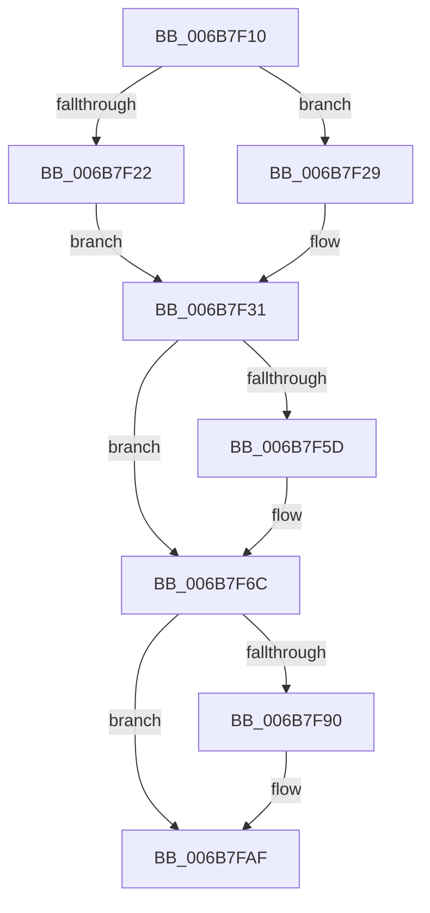

# KiHvInterruptSubDispatch

- RVA: `0x006B7F10`–`0x006B7FB5` (길이 `165` bytes)
- VA: `0x00000001406B7F10`
- 실행 섹션: `.text`
- PDB 이름 있음: `예`; PDB Function 태그: `아니요`
- unwind 정보 RVA: `0x000C2274`
- 디코드: `37`개 명령, `165/165` bytes 표시
- 미해석 바이트: `0` (있으면 어셈블리에 `.byte`로 보존)

> 이 문서는 커널 이미지의 기계어와 PDB 기호를 분석해 생성했습니다. 4번과 5번은 함수 원형과 자료형을 바이너리 사용 방식에서 추정한 C 해석이며 원본 소스 복구 결과는 아닙니다.

## 1. Dependencies

- 직접 호출 지점: **6**; 고유 호출 대상: **6**
- 직접 호출자로 확인된 함수: **1**
- RIP 상대 이미지 참조: **4**

### Outgoing calls
- `0x006B7F22` → [KzSetIrqlUnsafe](../5B/KzSetIrqlUnsafe_function_005B8AE0.md) (function, `0x005B8AE0`)
- `0x006B7F44` → [KiStartInterruptCycleAccumulation](../37/KiStartInterruptCycleAccumulation_function_0037B410.md) (function, `0x0037B410`)
- `0x006B7F67` → [EtwGetKernelTraceTimestamp](../39/EtwGetKernelTraceTimestamp_function_0039FC50.md) (function, `0x0039FC50`)
- `0x006B7F6C` → [HvlSharedIsr](../44/HvlSharedIsr_function_0044B020.md) (function, `0x0044B020`)
- `0x006B7F82` → [guard_dispatch_icall](guard_dispatch_icall_function_006BAAD0.md) (function, `0x006BAAD0`)
- `0x006B7FAA` → [PerfInfoLogInterruptHv](../45/PerfInfoLogInterruptHv_function_00450110.md) (function, `0x00450110`)

### Direct callers
- [KiHvInterruptDispatch](KiHvInterruptDispatch_function_006B7750.md) at `0x006B7787`

### Static image references
- `0x006B7F19` → RVA `0x00FC6D20` (`ALMOSTRO`; read)
- `0x006B7F4A` → RVA `0x00FC6B04` (`ALMOSTRO`; read)
- `0x006B7F77` → RVA `0x00FC5608` (`ALMOSTRO`; read)
- `0x006B7F95` → RVA `0x006B6620` (`KiHvInterrupt`; read)

## 2. Other-region calls and transfers

- 다른 실행 섹션으로 향하는 call: **0**
- 별도 외부 분기/꼬리 이동을 확인하지 못했습니다.

## 3. Assembly (complete function range)

```asm
006B7F10  48 83 EC 48                     sub rsp, 0x48
006B7F14  B9 03 00 00 00                  mov ecx, 3
006B7F19  83 3D 00 EE 90 00 00            cmp dword ptr [rip + 0x90ee00], 0
006B7F20  74 07                           je 0x1406b7f29
006B7F22  E8 B9 0B F0 FF                  call 0x1405b8ae0
006B7F27  EB 08                           jmp 0x1406b7f31
006B7F29  44 0F 20 C0                     mov rax, cr8
006B7F2D  44 0F 22 C1                     mov cr8, rcx
006B7F31  88 45 A9                        mov byte ptr [rbp - 0x57], al
006B7F34  65 48 8B 0C 25 20 00 00 00      mov rcx, qword ptr gs:[0x20]
006B7F3D  33 D2                           xor edx, edx
006B7F3F  BA 01 00 00 00                  mov edx, 1
006B7F44  E8 C7 34 CC FF                  call 0x14037b410
006B7F49  FB                              sti
006B7F4A  F7 05 B0 EB 90 00 00 40 00 00   test dword ptr [rip + 0x90ebb0], 0x4000
006B7F54  0F 95 85 F3 00 00 00            setne byte ptr [rbp + 0xf3]
006B7F5B  74 0F                           je 0x1406b7f6c
006B7F5D  48 8D 4C 24 20                  lea rcx, [rsp + 0x20]
006B7F62  BA 00 40 00 20                  mov edx, 0x20004000
006B7F67  E8 E4 7C CE FF                  call 0x14039fc50
006B7F6C  E8 AF 30 D9 FF                  call 0x14044b020
006B7F71  8B 8D E0 00 00 00               mov ecx, dword ptr [rbp + 0xe0]
006B7F77  48 8D 05 8A D6 90 00            lea rax, [rip + 0x90d68a]
006B7F7E  48 8B 04 C8                     mov rax, qword ptr [rax + rcx*8]
006B7F82  E8 49 2B 00 00                  call 0x1406baad0
006B7F87  F6 85 F3 00 00 00 FF            test byte ptr [rbp + 0xf3], 0xff
006B7F8E  74 1F                           je 0x1406b7faf
006B7F90  4C 8D 44 24 20                  lea r8, [rsp + 0x20]
006B7F95  48 8D 0D 84 E6 FF FF            lea rcx, [rip - 0x197c]
006B7F9C  8B 95 E0 00 00 00               mov edx, dword ptr [rbp + 0xe0]
006B7FA2  83 C2 30                        add edx, 0x30
006B7FA5  C1 E2 08                        shl edx, 8
006B7FA8  FF C2                           inc edx
006B7FAA  E8 61 81 D9 FF                  call 0x140450110
006B7FAF  FA                              cli
006B7FB0  48 83 C4 48                     add rsp, 0x48
006B7FB4  C3                              ret
```

## 4. C-style interpretation (structured pseudocode)

```c
__int64 __fastcall KiHvInterruptSubDispatch(__int64 a1, int a2)
{
    __int64 result;
    __int64 v_rsp;
    unsigned __int64 v_stack_m28;

    v_rsp = (v_rsp) - (72);
    if ((*(unsigned int *)(v_rip + 9498112)) == 0) goto loc_006B7F29;
    result = KzSetIrqlUnsafe(3, a2, a3, a4);
    goto loc_006B7F31;
loc_006B7F29:
loc_006B7F31:
    *(unsigned __int8 *)(v_rbp - 87) = (unsigned __int8)(v_cr8);
    a2 = 0;
    result = KiStartInterruptCycleAccumulation(*(unsigned __int64 *)(gs_base + (0 + 32)), 1, a3, a4);
    if (((*(unsigned int *)(v_rip + 9497520)) & (0x4000ULL)) != 0) {
        a1 = v_stack_m28;
        a2 = 0x20004000ULL;
        result = EtwGetKernelTraceTimestamp(a1, a2, a3, a4);
    }
    result = HvlSharedIsr(a1, a2, a3, a4);
    result = guard_dispatch_icall((unsigned int)(*(unsigned int *)(v_rbp + 224)), a2, a3, a4);
    if (((*(unsigned __int8 *)(v_rbp + 243)) & (255)) != 0) {
        a3 = v_stack_m28;
        a1 = v_rip - 6524;
        a2 = *(unsigned int *)(v_rbp + 224);
        a2 = (unsigned int)((a2) + (48));
        a2 = (unsigned int)((a2) << (8));
        a2 = (unsigned int)((a2) + 1);
        result = PerfInfoLogInterruptHv(a1, a2, a3, a4);
    }
    v_rsp = (v_rsp) + (72);
    return result;
}
```

## 5. (Beta) C Style

```c
int64_t KiHvInterruptSubDispatch(int64_t Arg1, int32_t Arg2)
{
    int64_t result;
    int64_t local_rsp;
    uint64_t v_stack_m28;

    local_rsp = (local_rsp) - (72);
    if ((*(uint32_t *)(v_rip + 0x90EE00)) == 0) goto loc_006B7F29;
    result = KzSetIrqlUnsafe(3, Arg2, a3, a4);
    goto loc_006B7F31;
loc_006B7F29:
loc_006B7F31:
    *(uint8_t *)(local_rbp - 0x57) = (uint8_t)(v_cr8);
    Arg2 = 0;
    result = KiStartInterruptCycleAccumulation(*(uint64_t *)(gs_base + (0 + 0x20)), 1, a3, a4);
    if (((*(uint32_t *)(v_rip + 0x90EBB0)) & (0x4000ULL)) != 0) {
        Arg1 = v_stack_m28;
        Arg2 = 0x20004000ULL;
        result = EtwGetKernelTraceTimestamp(Arg1, Arg2, a3, a4);
    }
    result = HvlSharedIsr(Arg1, Arg2, a3, a4);
    result = guard_dispatch_icall((uint32_t)(*(uint32_t *)(local_rbp + 0xE0)), Arg2, a3, a4);
    if (((*(uint8_t *)(local_rbp + 0xF3)) & (255)) != 0) {
        a3 = v_stack_m28;
        Arg1 = v_rip - 6524;
        Arg2 = *(uint32_t *)(local_rbp + 0xE0);
        Arg2 = (uint32_t)((Arg2) + (48));
        Arg2 = (uint32_t)((Arg2) << (8));
        Arg2 = (uint32_t)((Arg2) + 1);
        result = PerfInfoLogInterruptHv(Arg1, Arg2, a3, a4);
    }
    local_rsp = (local_rsp) + (72);
    return result;
}
```

## 6. Execution-region graph

[열기: 2D/3D 그래프와 함수 탐색 컨트롤 패널](../../../control-panel.html?section=text&rva=0x006B7F10&view=graph)

- 2D 그래프는 위에서 아래로 흐르고, 3D 그래프는 빈 공간을 드래그해 회전합니다. Shift+드래그는 이동, 휠은 확대·축소, 함수 노드 선택은 대상 보고서 이동입니다.

### Static fallback


