# KiHvInterrupt

- RVA: `0x006B6620`–`0x006B6981` (길이 `865` bytes)
- VA: `0x00000001406B6620`
- 실행 섹션: `.text`
- PDB 이름 있음: `예`; PDB Function 태그: `아니요`
- unwind 정보 RVA: `0x000C21D0`
- 디코드: `185`개 명령, `865/865` bytes 표시
- 미해석 바이트: `0` (있으면 어셈블리에 `.byte`로 보존)

> 이 문서는 커널 이미지의 기계어와 PDB 기호를 분석해 생성했습니다. 4번과 5번은 함수 원형과 자료형을 바이너리 사용 방식에서 추정한 C 해석이며 원본 소스 복구 결과는 아닙니다.

## 1. Dependencies

- 직접 호출 지점: **37**; 고유 호출 대상: **37**
- 직접 호출자로 확인된 함수: **1**
- RIP 상대 이미지 참조: **4**

### Outgoing calls
- `0x006B6775` → [KiHvInterrupt + 0x268](KiHvInterrupt_function_006B6620.md) (inside-function, `0x006B6888`)
- `0x006B677E` → [KiHvInterrupt + 0x271](KiHvInterrupt_function_006B6620.md) (inside-function, `0x006B6891`)
- `0x006B6787` → [KiHvInterrupt + 0x15A](KiHvInterrupt_function_006B6620.md) (inside-function, `0x006B677A`)
- `0x006B6790` → [KiHvInterrupt + 0x163](KiHvInterrupt_function_006B6620.md) (inside-function, `0x006B6783`)
- `0x006B6799` → [KiHvInterrupt + 0x16C](KiHvInterrupt_function_006B6620.md) (inside-function, `0x006B678C`)
- `0x006B67A2` → [KiHvInterrupt + 0x175](KiHvInterrupt_function_006B6620.md) (inside-function, `0x006B6795`)
- `0x006B67AB` → [KiHvInterrupt + 0x17E](KiHvInterrupt_function_006B6620.md) (inside-function, `0x006B679E`)
- `0x006B67B4` → [KiHvInterrupt + 0x187](KiHvInterrupt_function_006B6620.md) (inside-function, `0x006B67A7`)
- `0x006B67BD` → [KiHvInterrupt + 0x190](KiHvInterrupt_function_006B6620.md) (inside-function, `0x006B67B0`)
- `0x006B67C6` → [KiHvInterrupt + 0x199](KiHvInterrupt_function_006B6620.md) (inside-function, `0x006B67B9`)
- `0x006B67CF` → [KiHvInterrupt + 0x1A2](KiHvInterrupt_function_006B6620.md) (inside-function, `0x006B67C2`)
- `0x006B67D8` → [KiHvInterrupt + 0x1AB](KiHvInterrupt_function_006B6620.md) (inside-function, `0x006B67CB`)
- `0x006B67E1` → [KiHvInterrupt + 0x1B4](KiHvInterrupt_function_006B6620.md) (inside-function, `0x006B67D4`)
- `0x006B67EA` → [KiHvInterrupt + 0x1BD](KiHvInterrupt_function_006B6620.md) (inside-function, `0x006B67DD`)
- `0x006B67F3` → [KiHvInterrupt + 0x1C6](KiHvInterrupt_function_006B6620.md) (inside-function, `0x006B67E6`)
- `0x006B67FC` → [KiHvInterrupt + 0x1CF](KiHvInterrupt_function_006B6620.md) (inside-function, `0x006B67EF`)
- `0x006B6805` → [KiHvInterrupt + 0x1D8](KiHvInterrupt_function_006B6620.md) (inside-function, `0x006B67F8`)
- `0x006B680E` → [KiHvInterrupt + 0x1E1](KiHvInterrupt_function_006B6620.md) (inside-function, `0x006B6801`)
- `0x006B6817` → [KiHvInterrupt + 0x1EA](KiHvInterrupt_function_006B6620.md) (inside-function, `0x006B680A`)
- `0x006B6820` → [KiHvInterrupt + 0x1F3](KiHvInterrupt_function_006B6620.md) (inside-function, `0x006B6813`)
- `0x006B6829` → [KiHvInterrupt + 0x1FC](KiHvInterrupt_function_006B6620.md) (inside-function, `0x006B681C`)
- `0x006B6832` → [KiHvInterrupt + 0x205](KiHvInterrupt_function_006B6620.md) (inside-function, `0x006B6825`)
- `0x006B683B` → [KiHvInterrupt + 0x20E](KiHvInterrupt_function_006B6620.md) (inside-function, `0x006B682E`)
- `0x006B6844` → [KiHvInterrupt + 0x217](KiHvInterrupt_function_006B6620.md) (inside-function, `0x006B6837`)
- `0x006B684D` → [KiHvInterrupt + 0x220](KiHvInterrupt_function_006B6620.md) (inside-function, `0x006B6840`)
- `0x006B6856` → [KiHvInterrupt + 0x229](KiHvInterrupt_function_006B6620.md) (inside-function, `0x006B6849`)
- `0x006B685F` → [KiHvInterrupt + 0x232](KiHvInterrupt_function_006B6620.md) (inside-function, `0x006B6852`)
- `0x006B6868` → [KiHvInterrupt + 0x23B](KiHvInterrupt_function_006B6620.md) (inside-function, `0x006B685B`)
- `0x006B6871` → [KiHvInterrupt + 0x244](KiHvInterrupt_function_006B6620.md) (inside-function, `0x006B6864`)
- `0x006B687A` → [KiHvInterrupt + 0x24D](KiHvInterrupt_function_006B6620.md) (inside-function, `0x006B686D`)
- `0x006B6883` → [KiHvInterrupt + 0x256](KiHvInterrupt_function_006B6620.md) (inside-function, `0x006B6876`)
- `0x006B688C` → [KiHvInterrupt + 0x25F](KiHvInterrupt_function_006B6620.md) (inside-function, `0x006B687F`)
- `0x006B68B7` → [KiFlushBhbDuringTrapEntryOrExit](../6C/KiFlushBhbDuringTrapEntryOrExit_function_006C6340.md) (function, `0x006C6340`)
- `0x006B6900` → [KiSaveDebugRegisterState](../4F/KiSaveDebugRegisterState_function_004FD960.md) (function, `0x004FD960`)
- `0x006B6934` → [KiSynchronizeUserIsolationDomainExit](../41/KiSynchronizeUserIsolationDomainExit_function_0041BFA0.md) (function, `0x0041BFA0`)
- `0x006B6944` → [KeWakeProcessor](../5B/KeWakeProcessor_function_005BE080.md) (function, `0x005BE080`)
- `0x006B696D` → [KiCheckForSListAddress](../40/KiCheckForSListAddress_function_0040B810.md) (function, `0x0040B810`)

### Direct callers
- [KiHvInterrupt](KiHvInterrupt_function_006B6620.md) at `0x006B6775`
- [KiHvInterrupt](KiHvInterrupt_function_006B6620.md) at `0x006B677E`
- [KiHvInterrupt](KiHvInterrupt_function_006B6620.md) at `0x006B6787`
- [KiHvInterrupt](KiHvInterrupt_function_006B6620.md) at `0x006B6790`
- [KiHvInterrupt](KiHvInterrupt_function_006B6620.md) at `0x006B6799`
- [KiHvInterrupt](KiHvInterrupt_function_006B6620.md) at `0x006B67A2`
- [KiHvInterrupt](KiHvInterrupt_function_006B6620.md) at `0x006B67AB`
- [KiHvInterrupt](KiHvInterrupt_function_006B6620.md) at `0x006B67B4`
- [KiHvInterrupt](KiHvInterrupt_function_006B6620.md) at `0x006B67BD`
- [KiHvInterrupt](KiHvInterrupt_function_006B6620.md) at `0x006B67C6`
- [KiHvInterrupt](KiHvInterrupt_function_006B6620.md) at `0x006B67CF`
- [KiHvInterrupt](KiHvInterrupt_function_006B6620.md) at `0x006B67D8`
- [KiHvInterrupt](KiHvInterrupt_function_006B6620.md) at `0x006B67E1`
- [KiHvInterrupt](KiHvInterrupt_function_006B6620.md) at `0x006B67EA`
- [KiHvInterrupt](KiHvInterrupt_function_006B6620.md) at `0x006B67F3`
- [KiHvInterrupt](KiHvInterrupt_function_006B6620.md) at `0x006B67FC`
- [KiHvInterrupt](KiHvInterrupt_function_006B6620.md) at `0x006B6805`
- [KiHvInterrupt](KiHvInterrupt_function_006B6620.md) at `0x006B680E`
- [KiHvInterrupt](KiHvInterrupt_function_006B6620.md) at `0x006B6817`
- [KiHvInterrupt](KiHvInterrupt_function_006B6620.md) at `0x006B6820`
- [KiHvInterrupt](KiHvInterrupt_function_006B6620.md) at `0x006B6829`
- [KiHvInterrupt](KiHvInterrupt_function_006B6620.md) at `0x006B6832`
- [KiHvInterrupt](KiHvInterrupt_function_006B6620.md) at `0x006B683B`
- [KiHvInterrupt](KiHvInterrupt_function_006B6620.md) at `0x006B6844`
- [KiHvInterrupt](KiHvInterrupt_function_006B6620.md) at `0x006B684D`
- [KiHvInterrupt](KiHvInterrupt_function_006B6620.md) at `0x006B6856`
- [KiHvInterrupt](KiHvInterrupt_function_006B6620.md) at `0x006B685F`
- [KiHvInterrupt](KiHvInterrupt_function_006B6620.md) at `0x006B6868`
- [KiHvInterrupt](KiHvInterrupt_function_006B6620.md) at `0x006B6871`
- [KiHvInterrupt](KiHvInterrupt_function_006B6620.md) at `0x006B687A`
- [KiHvInterrupt](KiHvInterrupt_function_006B6620.md) at `0x006B6883`
- [KiHvInterrupt](KiHvInterrupt_function_006B6620.md) at `0x006B688C`

### Static image references
- `0x006B6694` → RVA `0x01201840` (`CFGRO`; read)
- `0x006B68C8` → RVA `0x00FC7264` (`ALMOSTRO`; read)
- `0x006B6949` → RVA `0x006BA577` (`ExpInterlockedPopEntrySListResume`; read)
- `0x006B6959` → RVA `0x006BA590` (`ExpInterlockedPopEntrySListEnd`; read)

## 2. Other-region calls and transfers

- 다른 실행 섹션으로 향하는 call: **0**
- call이 아닌 외부 분기/꼬리 이동: **1**
  - `0x006B697C` → [KiHvInterruptDispatch](KiHvInterruptDispatch_function_006B7750.md) (`tail-transfer`)

## 3. Assembly (complete function range)

```asm
006B6620  6A 00                           push 0
006B6622  55                              push rbp
006B6623  56                              push rsi
006B6624  48 81 EC 50 01 00 00            sub rsp, 0x150
006B662B  48 8D AC 24 80 00 00 00         lea rbp, [rsp + 0x80]
006B6633  C6 45 AB 00                     mov byte ptr [rbp - 0x55], 0
006B6637  48 89 45 B0                     mov qword ptr [rbp - 0x50], rax
006B663B  48 89 4D B8                     mov qword ptr [rbp - 0x48], rcx
006B663F  48 89 55 C0                     mov qword ptr [rbp - 0x40], rdx
006B6643  4C 89 45 C8                     mov qword ptr [rbp - 0x38], r8
006B6647  4C 89 4D D0                     mov qword ptr [rbp - 0x30], r9
006B664B  4C 89 55 D8                     mov qword ptr [rbp - 0x28], r10
006B664F  4C 89 5D E0                     mov qword ptr [rbp - 0x20], r11
006B6653  F6 85 F0 00 00 00 01            test byte ptr [rbp + 0xf0], 1
006B665A  75 38                           jne 0x1406b6694
006B665C  33 D2                           xor edx, edx
006B665E  F3 48 0F 1E CA                  rdsspq rdx
006B6663  48 89 55 58                     mov qword ptr [rbp + 0x58], rdx
006B6667  0F AE E8                        lfence
006B666A  65 F6 04 25 58 08 00 00 01      test byte ptr gs:[0x858], 1
006B6673  75 08                           jne 0x1406b667d
006B6675  0F AE E8                        lfence
006B6678  E9 88 02 00 00                  jmp 0x1406b6905
006B667D  65 0F B7 04 25 66 08 00 00      movzx eax, word ptr gs:[0x866]
006B6686  B9 48 00 00 00                  mov ecx, 0x48
006B668B  33 D2                           xor edx, edx
006B668D  0F 30                           wrmsr
006B668F  E9 71 02 00 00                  jmp 0x1406b6905
006B6694  F6 05 A5 B1 B4 00 01            test byte ptr [rip + 0xb4b1a5], 1
006B669B  75 03                           jne 0x1406b66a0
006B669D  0F 01 F8                        swapgs
006B66A0  0F AE E8                        lfence
006B66A3  65 48 8B 0C 25 28 9D 00 00      mov rcx, qword ptr gs:[0x9d28]
006B66AC  48 85 C9                        test rcx, rcx
006B66AF  74 1F                           je 0x1406b66d0
006B66B1  F3 48 0F 1E CA                  rdsspq rdx
006B66B6  65 4C 8B 14 25 20 9D 00 00      mov r10, qword ptr gs:[0x9d20]
006B66BF  49 83 C2 08                     add r10, 8
006B66C3  49 3B D2                        cmp rdx, r10
006B66C6  75 08                           jne 0x1406b66d0
006B66C8  F3 0F 01 29                     rstorssp dword ptr [rcx]
006B66CC  F3 0F 01 EA                     saveprevssp
006B66D0  65 4C 8B 14 25 88 01 00 00      mov r10, qword ptr gs:[0x188]
006B66D9  65 48 8B 0C 25 88 01 00 00      mov rcx, qword ptr gs:[0x188]
006B66E2  48 8B 89 20 02 00 00            mov rcx, qword ptr [rcx + 0x220]
006B66E9  48 8B 89 60 07 00 00            mov rcx, qword ptr [rcx + 0x760]
006B66F0  65 48 89 0C 25 50 08 00 00      mov qword ptr gs:[0x850], rcx
006B66F9  66 65 8B 0C 25 62 08 00 00      mov cx, word ptr gs:[0x862]
006B6702  66 65 89 0C 25 64 08 00 00      mov word ptr gs:[0x864], cx
006B670B  65 8A 0C 25 58 08 00 00         mov cl, byte ptr gs:[0x858]
006B6713  65 88 0C 25 5A 08 00 00         mov byte ptr gs:[0x85a], cl
006B671B  65 0F B7 04 25 68 08 00 00      movzx eax, word ptr gs:[0x868]
006B6724  66 65 39 04 25 66 08 00 00      cmp word ptr gs:[0x866], ax
006B672D  74 12                           je 0x1406b6741
006B672F  66 65 89 04 25 66 08 00 00      mov word ptr gs:[0x866], ax
006B6738  B9 48 00 00 00                  mov ecx, 0x48
006B673D  33 D2                           xor edx, edx
006B673F  0F 30                           wrmsr
006B6741  65 0F B6 14 25 58 08 00 00      movzx edx, byte ptr gs:[0x858]
006B674A  F7 C2 08 00 00 00               test edx, 8
006B6750  74 17                           je 0x1406b6769
006B6752  B8 01 00 00 00                  mov eax, 1
006B6757  33 D2                           xor edx, edx
006B6759  B9 49 00 00 00                  mov ecx, 0x49
006B675E  0F 30                           wrmsr
006B6760  65 0F B6 14 25 58 08 00 00      movzx edx, byte ptr gs:[0x858]
006B6769  F7 C2 02 00 00 00               test edx, 2
006B676F  0F 84 37 01 00 00               je 0x1406b68ac
006B6775  E8 0E 01 00 00                  call 0x1406b6888
006B677A  48 83 C4 08                     add rsp, 8
006B677E  E8 0E 01 00 00                  call 0x1406b6891
006B6783  48 83 C4 08                     add rsp, 8
006B6787  E8 EE FF FF FF                  call 0x1406b677a
006B678C  48 83 C4 08                     add rsp, 8
006B6790  E8 EE FF FF FF                  call 0x1406b6783
006B6795  48 83 C4 08                     add rsp, 8
006B6799  E8 EE FF FF FF                  call 0x1406b678c
006B679E  48 83 C4 08                     add rsp, 8
006B67A2  E8 EE FF FF FF                  call 0x1406b6795
006B67A7  48 83 C4 08                     add rsp, 8
006B67AB  E8 EE FF FF FF                  call 0x1406b679e
006B67B0  48 83 C4 08                     add rsp, 8
006B67B4  E8 EE FF FF FF                  call 0x1406b67a7
006B67B9  48 83 C4 08                     add rsp, 8
006B67BD  E8 EE FF FF FF                  call 0x1406b67b0
006B67C2  48 83 C4 08                     add rsp, 8
006B67C6  E8 EE FF FF FF                  call 0x1406b67b9
006B67CB  48 83 C4 08                     add rsp, 8
006B67CF  E8 EE FF FF FF                  call 0x1406b67c2
006B67D4  48 83 C4 08                     add rsp, 8
006B67D8  E8 EE FF FF FF                  call 0x1406b67cb
006B67DD  48 83 C4 08                     add rsp, 8
006B67E1  E8 EE FF FF FF                  call 0x1406b67d4
006B67E6  48 83 C4 08                     add rsp, 8
006B67EA  E8 EE FF FF FF                  call 0x1406b67dd
006B67EF  48 83 C4 08                     add rsp, 8
006B67F3  E8 EE FF FF FF                  call 0x1406b67e6
006B67F8  48 83 C4 08                     add rsp, 8
006B67FC  E8 EE FF FF FF                  call 0x1406b67ef
006B6801  48 83 C4 08                     add rsp, 8
006B6805  E8 EE FF FF FF                  call 0x1406b67f8
006B680A  48 83 C4 08                     add rsp, 8
006B680E  E8 EE FF FF FF                  call 0x1406b6801
006B6813  48 83 C4 08                     add rsp, 8
006B6817  E8 EE FF FF FF                  call 0x1406b680a
006B681C  48 83 C4 08                     add rsp, 8
006B6820  E8 EE FF FF FF                  call 0x1406b6813
006B6825  48 83 C4 08                     add rsp, 8
006B6829  E8 EE FF FF FF                  call 0x1406b681c
006B682E  48 83 C4 08                     add rsp, 8
006B6832  E8 EE FF FF FF                  call 0x1406b6825
006B6837  48 83 C4 08                     add rsp, 8
006B683B  E8 EE FF FF FF                  call 0x1406b682e
006B6840  48 83 C4 08                     add rsp, 8
006B6844  E8 EE FF FF FF                  call 0x1406b6837
006B6849  48 83 C4 08                     add rsp, 8
006B684D  E8 EE FF FF FF                  call 0x1406b6840
006B6852  48 83 C4 08                     add rsp, 8
006B6856  E8 EE FF FF FF                  call 0x1406b6849
006B685B  48 83 C4 08                     add rsp, 8
006B685F  E8 EE FF FF FF                  call 0x1406b6852
006B6864  48 83 C4 08                     add rsp, 8
006B6868  E8 EE FF FF FF                  call 0x1406b685b
006B686D  48 83 C4 08                     add rsp, 8
006B6871  E8 EE FF FF FF                  call 0x1406b6864
006B6876  48 83 C4 08                     add rsp, 8
006B687A  E8 EE FF FF FF                  call 0x1406b686d
006B687F  48 83 C4 08                     add rsp, 8
006B6883  E8 EE FF FF FF                  call 0x1406b6876
006B6888  48 83 C4 08                     add rsp, 8
006B688C  E8 EE FF FF FF                  call 0x1406b687f
006B6891  48 83 C4 08                     add rsp, 8
006B6895  B8 DA DA 00 00                  mov eax, 0xdada
006B689A  65 F6 04 25 5C 08 00 00 08      test byte ptr gs:[0x85c], 8
006B68A3  74 07                           je 0x1406b68ac
006B68A5  B0 20                           mov al, 0x20
006B68A7  F3 48 0F AE E8                  incsspq rax
006B68AC  F7 C2 80 00 00 00               test edx, 0x80
006B68B2  74 08                           je 0x1406b68bc
006B68B4  0F AE E8                        lfence
006B68B7  E8 84 FA 00 00                  call 0x1406c6340
006B68BC  0F AE E8                        lfence
006B68BF  65 C6 04 25 5E 08 00 00 00      mov byte ptr gs:[0x85e], 0
006B68C8  83 3D 95 09 91 00 00            cmp dword ptr [rip + 0x910995], 0
006B68CF  74 1F                           je 0x1406b68f0
006B68D1  B9 A7 06 00 00                  mov ecx, 0x6a7
006B68D6  0F 32                           rdmsr
006B68D8  83 FA 00                        cmp edx, 0
006B68DB  74 13                           je 0x1406b68f0
006B68DD  8B CA                           mov ecx, edx
006B68DF  23 15 7F 09 91 00               and edx, dword ptr [rip + 0x91097f]
006B68E5  3B D1                           cmp edx, ecx
006B68E7  74 07                           je 0x1406b68f0
006B68E9  B9 A7 06 00 00                  mov ecx, 0x6a7
006B68EE  0F 30                           wrmsr
006B68F0  41 F6 42 03 03                  test byte ptr [r10 + 3], 3
006B68F5  66 C7 85 80 00 00 00 00 00      mov word ptr [rbp + 0x80], 0
006B68FE  74 05                           je 0x1406b6905
006B6900  E8 5B 70 E4 FF                  call 0x1404fd960
006B6905  FC                              cld
006B6906  0F AE 5D AC                     stmxcsr dword ptr [rbp - 0x54]
006B690A  65 0F AE 14 25 80 01 00 00      ldmxcsr dword ptr gs:[0x180]
006B6913  0F 29 45 F0                     movaps xmmword ptr [rbp - 0x10], xmm0
006B6917  0F 29 4D 00                     movaps xmmword ptr [rbp], xmm1
006B691B  0F 29 55 10                     movaps xmmword ptr [rbp + 0x10], xmm2
006B691F  0F 29 5D 20                     movaps xmmword ptr [rbp + 0x20], xmm3
006B6923  0F 29 65 30                     movaps xmmword ptr [rbp + 0x30], xmm4
006B6927  0F 29 6D 40                     movaps xmmword ptr [rbp + 0x40], xmm5
006B692B  F6 85 F0 00 00 00 01            test byte ptr [rbp + 0xf0], 1
006B6932  74 05                           je 0x1406b6939
006B6934  E8 67 56 D6 FF                  call 0x14041bfa0
006B6939  65 80 3C 25 DA 87 00 00 00      cmp byte ptr gs:[0x87da], 0
006B6942  74 05                           je 0x1406b6949
006B6944  E8 37 77 F0 FF                  call 0x1405be080
006B6949  48 8D 05 27 3C 00 00            lea rax, [rip + 0x3c27]
006B6950  48 3B 85 E8 00 00 00            cmp rax, qword ptr [rbp + 0xe8]
006B6957  73 19                           jae 0x1406b6972
006B6959  48 8D 05 30 3C 00 00            lea rax, [rip + 0x3c30]
006B6960  48 3B 85 E8 00 00 00            cmp rax, qword ptr [rbp + 0xe8]
006B6967  72 09                           jb 0x1406b6972
006B6969  48 8D 4D 80                     lea rcx, [rbp - 0x80]
006B696D  E8 9E 4E D5 FF                  call 0x14040b810
006B6972  33 F6                           xor esi, esi
006B6974  65 FF 04 25 C0 87 00 00         inc dword ptr gs:[0x87c0]
006B697C  E9 CF 0D 00 00                  jmp 0x1406b7750
```

## 4. C-style interpretation (structured pseudocode)

```c
__int64 __fastcall KiHvInterrupt(__int64 a1, __int64 a2, __int64 a3, __int64 a4)
{
    __int64 result;
    __int64 v_r10;
    __int64 v_rsi;
    __int64 v_rsp;
    unsigned __int64 v_stack_m108;
    unsigned __int64 v_stack_m110;
    unsigned __int64 v_stack_m118;
    unsigned __int64 v_stack_m120;
    unsigned __int64 v_stack_m128;
    unsigned __int64 v_stack_m130;
    unsigned __int64 v_stack_m138;
    unsigned int v_stack_m13C;
    unsigned __int8 v_stack_m13D;
    unsigned __int64 v_stack_m168;
    unsigned __int16 v_stack_m68;
    unsigned __int64 v_stack_m90;
    unsigned __int64 v_stack_mA8;
    unsigned __int64 v_stack_mB8;
    unsigned __int64 v_stack_mC8;
    unsigned __int64 v_stack_mD8;
    unsigned __int64 v_stack_mE8;
    unsigned __int64 v_stack_mF8;
    unsigned __int64 v_stack_p0;
    unsigned __int8 v_stack_p8;

    v_rsp = (v_rsp) - (336);
    v_stack_m13D = 0;
    v_stack_m138 = result;
    v_stack_m130 = a1;
    v_stack_m128 = a2;
    v_stack_m120 = a3;
    v_stack_m118 = a4;
    v_stack_m110 = v_r10;
    v_stack_m108 = v_r11;
    if (((v_stack_p8) & (1)) != 0) goto loc_006B6694;
    a2 = 0;
    v_stack_m90 = 0;
    if (((*(unsigned __int8 *)(gs_base + (0 + 2136))) & (1)) != 0) goto loc_006B667D;
    goto loc_006B6905;
loc_006B667D:
    a2 = 0;
    goto loc_006B6905;
loc_006B6694:
    if (((*(unsigned __int8 *)(v_rip + 11841957)) & (1)) == 0) {
    }
    if (*(unsigned __int64 *)(gs_base + (0 + 40232)) == 0) goto loc_006B66D0;
    v_r10 = (*(unsigned __int64 *)(gs_base + (0 + 40224))) + (8);
    if (0 == v_r10) {
    }
    *(unsigned __int64 *)(gs_base + (0 + 2128)) = *(unsigned __int64 *)(*(unsigned __int64 *)(*(unsigned __int64 *)(gs_base + (0 + 392)) + 544) + 1888);
    *(unsigned __int16 *)(gs_base + (0 + 2148)) = (unsigned __int16)(*(unsigned __int16 *)(gs_base + (0 + 2146)));
    *(unsigned __int8 *)(gs_base + (0 + 2138)) = (unsigned __int8)(*(unsigned __int8 *)(gs_base + (0 + 2136)));
    if ((*(unsigned __int16 *)(gs_base + (0 + 2150))) != ((unsigned __int16)(*(unsigned __int16 *)(gs_base + (0 + 2152))))) {
        *(unsigned __int16 *)(gs_base + (0 + 2150)) = (unsigned __int16)(*(unsigned __int16 *)(gs_base + (0 + 2152)));
        a1 = 72;
        a2 = 0;
    }
    result = *(unsigned __int16 *)(gs_base + (0 + 2152));
    if ((((unsigned int)(*(unsigned __int8 *)(gs_base + (0 + 2136)))) & (8)) != 0) {
        result = 1;
        a2 = 0;
        a1 = 73;
        a2 = *(unsigned __int8 *)(gs_base + (0 + 2136));
    }
    if ((((unsigned int)(a2)) & (2)) == 0) goto loc_006B68AC;
    result = KiHvInterrupt___0x268(a1, a2, a3, a4);
    v_rsp = (v_rsp) + (8);
    result = KiHvInterrupt___0x271(a1, a2, a3, a4);
    v_rsp = (v_rsp) + (8);
    result = KiHvInterrupt___0x15A(a1, a2, a3, a4);
    v_rsp = (v_rsp) + (8);
    result = KiHvInterrupt___0x163(a1, a2, a3, a4);
    v_rsp = (v_rsp) + (8);
    result = KiHvInterrupt___0x16C(a1, a2, a3, a4);
    v_rsp = (v_rsp) + (8);
    result = KiHvInterrupt___0x175(a1, a2, a3, a4);
    v_rsp = (v_rsp) + (8);
    result = KiHvInterrupt___0x17E(a1, a2, a3, a4);
    v_rsp = (v_rsp) + (8);
    result = KiHvInterrupt___0x187(a1, a2, a3, a4);
    v_rsp = (v_rsp) + (8);
    result = KiHvInterrupt___0x190(a1, a2, a3, a4);
    v_rsp = (v_rsp) + (8);
    result = KiHvInterrupt___0x199(a1, a2, a3, a4);
    v_rsp = (v_rsp) + (8);
    result = KiHvInterrupt___0x1A2(a1, a2, a3, a4);
    v_rsp = (v_rsp) + (8);
    result = KiHvInterrupt___0x1AB(a1, a2, a3, a4);
    v_rsp = (v_rsp) + (8);
    result = KiHvInterrupt___0x1B4(a1, a2, a3, a4);
    v_rsp = (v_rsp) + (8);
    result = KiHvInterrupt___0x1BD(a1, a2, a3, a4);
    v_rsp = (v_rsp) + (8);
    result = KiHvInterrupt___0x1C6(a1, a2, a3, a4);
    v_rsp = (v_rsp) + (8);
    result = KiHvInterrupt___0x1CF(a1, a2, a3, a4);
    v_rsp = (v_rsp) + (8);
    result = KiHvInterrupt___0x1D8(a1, a2, a3, a4);
    v_rsp = (v_rsp) + (8);
    result = KiHvInterrupt___0x1E1(a1, a2, a3, a4);
    v_rsp = (v_rsp) + (8);
    result = KiHvInterrupt___0x1EA(a1, a2, a3, a4);
    v_rsp = (v_rsp) + (8);
    result = KiHvInterrupt___0x1F3(a1, a2, a3, a4);
    v_rsp = (v_rsp) + (8);
    result = KiHvInterrupt___0x1FC(a1, a2, a3, a4);
    v_rsp = (v_rsp) + (8);
    result = KiHvInterrupt___0x205(a1, a2, a3, a4);
    v_rsp = (v_rsp) + (8);
    result = KiHvInterrupt___0x20E(a1, a2, a3, a4);
    v_rsp = (v_rsp) + (8);
    result = KiHvInterrupt___0x217(a1, a2, a3, a4);
    v_rsp = (v_rsp) + (8);
    result = KiHvInterrupt___0x220(a1, a2, a3, a4);
    v_rsp = (v_rsp) + (8);
    result = KiHvInterrupt___0x229(a1, a2, a3, a4);
    v_rsp = (v_rsp) + (8);
    result = KiHvInterrupt___0x232(a1, a2, a3, a4);
    v_rsp = (v_rsp) + (8);
    result = KiHvInterrupt___0x23B(a1, a2, a3, a4);
    v_rsp = (v_rsp) + (8);
    result = KiHvInterrupt___0x244(a1, a2, a3, a4);
    v_rsp = (v_rsp) + (8);
    result = KiHvInterrupt___0x24D(a1, a2, a3, a4);
    v_rsp = (v_rsp) + (8);
    result = KiHvInterrupt___0x256(a1, a2, a3, a4);
    v_rsp = (v_rsp) + (8);
    result = KiHvInterrupt___0x25F(a1, a2, a3, a4);
    v_rsp = (v_rsp) + (8);
    result = (unsigned int)(0xDADAULL);
    if (((*(unsigned __int8 *)(gs_base + (0 + 2140))) & (8)) != 0) {
        result = 32;
    }
    if ((((unsigned int)(a2)) & (128)) != 0) {
        result = KiFlushBhbDuringTrapEntryOrExit(a1, a2, a3, a4);
    }
    *(unsigned __int8 *)(gs_base + (0 + 2142)) = 0;
    if ((*(unsigned int *)(v_rip + 9505173)) == 0) goto loc_006B68F0;
    if (((unsigned int)(a2)) == 0) goto loc_006B68F0;
    a2 = (unsigned int)((a2) & (*(unsigned int *)(v_rip + 9505151)));
    if (((unsigned int)(a2)) != ((unsigned int)((unsigned int)((unsigned int)(a2))))) {
        a1 = 0x6A7ULL;
    }
    v_stack_m68 = 0;
    if (((*(unsigned __int8 *)(*(unsigned __int64 *)(gs_base + (0 + 392)) + 3)) & (3)) != 0) {
        result = KiSaveDebugRegisterState(a1, a2, a3, a4);
    }
    v_stack_mF8 = v_xmm0;
    v_stack_mE8 = v_xmm1;
    v_stack_mD8 = v_xmm2;
    v_stack_mC8 = v_xmm3;
    v_stack_mB8 = v_xmm4;
    v_stack_mA8 = v_xmm5;
    if (((v_stack_p8) & (1)) != 0) {
        result = KiSynchronizeUserIsolationDomainExit(a1, a2, a3, a4);
    }
    if ((*(unsigned __int8 *)(gs_base + (0 + 34778))) != 0) {
        result = KeWakeProcessor(a1, a2, a3, a4);
    }
    if ((v_rip + 15399) >= v_stack_p0) goto loc_006B6972;
    result = v_rip + 15408;
    if ((v_rip + 15408) >= v_stack_p0) {
        a1 = v_stack_m168;
        result = KiCheckForSListAddress(a1, a2, a3, a4);
    }
    v_rsi = 0;
}
```

## 5. (Beta) C Style

```c
int64_t KiHvInterrupt(int64_t Arg1, int64_t Arg2, int64_t Arg3, int64_t Arg4)
{
    int64_t result;
    int64_t local_r10;
    int64_t local_rsi;
    int64_t local_rsp;
    uint64_t v_stack_m108;
    uint64_t v_stack_m110;
    uint64_t v_stack_m118;
    uint64_t v_stack_m120;
    uint64_t v_stack_m128;
    uint64_t v_stack_m130;
    uint64_t v_stack_m138;
    uint32_t v_stack_m13C;
    uint8_t v_stack_m13D;
    uint64_t v_stack_m168;
    uint16_t v_stack_m68;
    uint64_t v_stack_m90;
    uint64_t v_stack_mA8;
    uint64_t v_stack_mB8;
    uint64_t v_stack_mC8;
    uint64_t v_stack_mD8;
    uint64_t v_stack_mE8;
    uint64_t v_stack_mF8;
    uint64_t v_stack_p0;
    uint8_t v_stack_p8;

    local_rsp = (local_rsp) - (336);
    v_stack_m13D = 0;
    v_stack_m138 = result;
    v_stack_m130 = Arg1;
    v_stack_m128 = Arg2;
    v_stack_m120 = Arg3;
    v_stack_m118 = Arg4;
    v_stack_m110 = local_r10;
    v_stack_m108 = local_r11;
    if (((v_stack_p8) & (1)) != 0) goto loc_006B6694;
    Arg2 = 0;
    v_stack_m90 = 0;
    if (((*(uint8_t *)(gs_base + (0 + 0x858))) & (1)) != 0) goto loc_006B667D;
    goto loc_006B6905;
loc_006B667D:
    Arg2 = 0;
    goto loc_006B6905;
loc_006B6694:
    if (((*(uint8_t *)(v_rip + 0xB4B1A5)) & (1)) == 0) {
    }
    if (*(uint64_t *)(gs_base + (0 + 0x9D28)) == 0) goto loc_006B66D0;
    local_r10 = (*(uint64_t *)(gs_base + (0 + 0x9D20))) + (8);
    if (0 == local_r10) {
    }
    *(uint64_t *)(gs_base + (0 + 0x850)) = *(uint64_t *)(*(uint64_t *)(*(uint64_t *)(gs_base + (0 + 0x188)) + 0x220) + 0x760);
    *(uint16_t *)(gs_base + (0 + 0x864)) = (uint16_t)(*(uint16_t *)(gs_base + (0 + 0x862)));
    *(uint8_t *)(gs_base + (0 + 0x85A)) = (uint8_t)(*(uint8_t *)(gs_base + (0 + 0x858)));
    if ((*(uint16_t *)(gs_base + (0 + 0x866))) != ((uint16_t)(*(uint16_t *)(gs_base + (0 + 0x868))))) {
        *(uint16_t *)(gs_base + (0 + 0x866)) = (uint16_t)(*(uint16_t *)(gs_base + (0 + 0x868)));
        Arg1 = 72;
        Arg2 = 0;
    }
    result = *(uint16_t *)(gs_base + (0 + 0x868));
    if ((((uint32_t)(*(uint8_t *)(gs_base + (0 + 0x858)))) & (8)) != 0) {
        result = 1;
        Arg2 = 0;
        Arg1 = 73;
        Arg2 = *(uint8_t *)(gs_base + (0 + 0x858));
    }
    if ((((uint32_t)(Arg2)) & (2)) == 0) goto loc_006B68AC;
    result = KiHvInterrupt___0x268(Arg1, Arg2, Arg3, Arg4);
    local_rsp = (local_rsp) + (8);
    result = KiHvInterrupt___0x271(Arg1, Arg2, Arg3, Arg4);
    local_rsp = (local_rsp) + (8);
    result = KiHvInterrupt___0x15A(Arg1, Arg2, Arg3, Arg4);
    local_rsp = (local_rsp) + (8);
    result = KiHvInterrupt___0x163(Arg1, Arg2, Arg3, Arg4);
    local_rsp = (local_rsp) + (8);
    result = KiHvInterrupt___0x16C(Arg1, Arg2, Arg3, Arg4);
    local_rsp = (local_rsp) + (8);
    result = KiHvInterrupt___0x175(Arg1, Arg2, Arg3, Arg4);
    local_rsp = (local_rsp) + (8);
    result = KiHvInterrupt___0x17E(Arg1, Arg2, Arg3, Arg4);
    local_rsp = (local_rsp) + (8);
    result = KiHvInterrupt___0x187(Arg1, Arg2, Arg3, Arg4);
    local_rsp = (local_rsp) + (8);
    result = KiHvInterrupt___0x190(Arg1, Arg2, Arg3, Arg4);
    local_rsp = (local_rsp) + (8);
    result = KiHvInterrupt___0x199(Arg1, Arg2, Arg3, Arg4);
    local_rsp = (local_rsp) + (8);
    result = KiHvInterrupt___0x1A2(Arg1, Arg2, Arg3, Arg4);
    local_rsp = (local_rsp) + (8);
    result = KiHvInterrupt___0x1AB(Arg1, Arg2, Arg3, Arg4);
    local_rsp = (local_rsp) + (8);
    result = KiHvInterrupt___0x1B4(Arg1, Arg2, Arg3, Arg4);
    local_rsp = (local_rsp) + (8);
    result = KiHvInterrupt___0x1BD(Arg1, Arg2, Arg3, Arg4);
    local_rsp = (local_rsp) + (8);
    result = KiHvInterrupt___0x1C6(Arg1, Arg2, Arg3, Arg4);
    local_rsp = (local_rsp) + (8);
    result = KiHvInterrupt___0x1CF(Arg1, Arg2, Arg3, Arg4);
    local_rsp = (local_rsp) + (8);
    result = KiHvInterrupt___0x1D8(Arg1, Arg2, Arg3, Arg4);
    local_rsp = (local_rsp) + (8);
    result = KiHvInterrupt___0x1E1(Arg1, Arg2, Arg3, Arg4);
    local_rsp = (local_rsp) + (8);
    result = KiHvInterrupt___0x1EA(Arg1, Arg2, Arg3, Arg4);
    local_rsp = (local_rsp) + (8);
    result = KiHvInterrupt___0x1F3(Arg1, Arg2, Arg3, Arg4);
    local_rsp = (local_rsp) + (8);
    result = KiHvInterrupt___0x1FC(Arg1, Arg2, Arg3, Arg4);
    local_rsp = (local_rsp) + (8);
    result = KiHvInterrupt___0x205(Arg1, Arg2, Arg3, Arg4);
    local_rsp = (local_rsp) + (8);
    result = KiHvInterrupt___0x20E(Arg1, Arg2, Arg3, Arg4);
    local_rsp = (local_rsp) + (8);
    result = KiHvInterrupt___0x217(Arg1, Arg2, Arg3, Arg4);
    local_rsp = (local_rsp) + (8);
    result = KiHvInterrupt___0x220(Arg1, Arg2, Arg3, Arg4);
    local_rsp = (local_rsp) + (8);
    result = KiHvInterrupt___0x229(Arg1, Arg2, Arg3, Arg4);
    local_rsp = (local_rsp) + (8);
    result = KiHvInterrupt___0x232(Arg1, Arg2, Arg3, Arg4);
    local_rsp = (local_rsp) + (8);
    result = KiHvInterrupt___0x23B(Arg1, Arg2, Arg3, Arg4);
    local_rsp = (local_rsp) + (8);
    result = KiHvInterrupt___0x244(Arg1, Arg2, Arg3, Arg4);
    local_rsp = (local_rsp) + (8);
    result = KiHvInterrupt___0x24D(Arg1, Arg2, Arg3, Arg4);
    local_rsp = (local_rsp) + (8);
    result = KiHvInterrupt___0x256(Arg1, Arg2, Arg3, Arg4);
    local_rsp = (local_rsp) + (8);
    result = KiHvInterrupt___0x25F(Arg1, Arg2, Arg3, Arg4);
    local_rsp = (local_rsp) + (8);
    result = (uint32_t)(0xDADAULL);
    if (((*(uint8_t *)(gs_base + (0 + 0x85C))) & (8)) != 0) {
        result = 32;
    }
    if ((((uint32_t)(Arg2)) & (128)) != 0) {
        result = KiFlushBhbDuringTrapEntryOrExit(Arg1, Arg2, Arg3, Arg4);
    }
    *(uint8_t *)(gs_base + (0 + 0x85E)) = 0;
    if ((*(uint32_t *)(v_rip + 0x910995)) == 0) goto loc_006B68F0;
    if (((uint32_t)(Arg2)) == 0) goto loc_006B68F0;
    Arg2 = (uint32_t)((Arg2) & (*(uint32_t *)(v_rip + 0x91097F)));
    if (((uint32_t)(Arg2)) != ((uint32_t)((uint32_t)((uint32_t)(Arg2))))) {
        Arg1 = 0x6A7ULL;
    }
    v_stack_m68 = 0;
    if (((*(uint8_t *)(*(uint64_t *)(gs_base + (0 + 0x188)) + 0x3)) & (3)) != 0) {
        result = KiSaveDebugRegisterState(Arg1, Arg2, Arg3, Arg4);
    }
    v_stack_mF8 = v_xmm0;
    v_stack_mE8 = v_xmm1;
    v_stack_mD8 = v_xmm2;
    v_stack_mC8 = v_xmm3;
    v_stack_mB8 = v_xmm4;
    v_stack_mA8 = v_xmm5;
    if (((v_stack_p8) & (1)) != 0) {
        result = KiSynchronizeUserIsolationDomainExit(Arg1, Arg2, Arg3, Arg4);
    }
    if ((*(uint8_t *)(gs_base + (0 + 0x87DA))) != 0) {
        result = KeWakeProcessor(Arg1, Arg2, Arg3, Arg4);
    }
    if ((v_rip + 15399) >= v_stack_p0) goto loc_006B6972;
    result = v_rip + 15408;
    if ((v_rip + 15408) >= v_stack_p0) {
        Arg1 = v_stack_m168;
        result = KiCheckForSListAddress(Arg1, Arg2, Arg3, Arg4);
    }
    local_rsi = 0;
}
```

## 6. Execution-region graph

[열기: 2D/3D 그래프와 함수 탐색 컨트롤 패널](../../../control-panel.html?section=text&rva=0x006B6620&view=graph)

- 2D 그래프는 위에서 아래로 흐르고, 3D 그래프는 빈 공간을 드래그해 회전합니다. Shift+드래그는 이동, 휠은 확대·축소, 함수 노드 선택은 대상 보고서 이동입니다.

### Static fallback

```mermaid
flowchart TD
  bb_006B6620[BB_006B6620]
  bb_006B665C[BB_006B665C]
  bb_006B6675[BB_006B6675]
  bb_006B667D[BB_006B667D]
  bb_006B6694[BB_006B6694]
  bb_006B669D[BB_006B669D]
  bb_006B66A0[BB_006B66A0]
  bb_006B66B1[BB_006B66B1]
  bb_006B66C8[BB_006B66C8]
  bb_006B66D0[BB_006B66D0]
  bb_006B672F[BB_006B672F]
  bb_006B6741[BB_006B6741]
  bb_006B6752[BB_006B6752]
  bb_006B6769[BB_006B6769]
  bb_006B6775[BB_006B6775]
  bb_006B68A5[BB_006B68A5]
  bb_006B68AC[BB_006B68AC]
  bb_006B68B4[BB_006B68B4]
  bb_006B68BC[BB_006B68BC]
  bb_006B68D1[BB_006B68D1]
  bb_006B68DD[BB_006B68DD]
  bb_006B68E9[BB_006B68E9]
  bb_006B68F0[BB_006B68F0]
  bb_006B6900[BB_006B6900]
  bb_006B6905[BB_006B6905]
  bb_006B6934[BB_006B6934]
  bb_006B6939[BB_006B6939]
  bb_006B6944[BB_006B6944]
  bb_006B6949[BB_006B6949]
  bb_006B6959[BB_006B6959]
  bb_006B6969[BB_006B6969]
  bb_006B6972[BB_006B6972]
  bb_006B6620 -->|branch| bb_006B6694
  bb_006B6620 -->|fallthrough| bb_006B665C
  bb_006B665C -->|branch| bb_006B667D
  bb_006B665C -->|fallthrough| bb_006B6675
  bb_006B6675 -->|branch| bb_006B6905
  bb_006B667D -->|branch| bb_006B6905
  bb_006B6694 -->|branch| bb_006B66A0
  bb_006B6694 -->|fallthrough| bb_006B669D
  bb_006B669D -->|flow| bb_006B66A0
  bb_006B66A0 -->|branch| bb_006B66D0
  bb_006B66A0 -->|fallthrough| bb_006B66B1
  bb_006B66B1 -->|branch| bb_006B66D0
  bb_006B66B1 -->|fallthrough| bb_006B66C8
  bb_006B66C8 -->|flow| bb_006B66D0
  bb_006B66D0 -->|branch| bb_006B6741
  bb_006B66D0 -->|fallthrough| bb_006B672F
  bb_006B672F -->|flow| bb_006B6741
  bb_006B6741 -->|branch| bb_006B6769
  bb_006B6741 -->|fallthrough| bb_006B6752
  bb_006B6752 -->|flow| bb_006B6769
  bb_006B6769 -->|branch| bb_006B68AC
  bb_006B6769 -->|fallthrough| bb_006B6775
  bb_006B6775 -->|branch| bb_006B68AC
  bb_006B6775 -->|fallthrough| bb_006B68A5
  bb_006B68A5 -->|flow| bb_006B68AC
  bb_006B68AC -->|branch| bb_006B68BC
  bb_006B68AC -->|fallthrough| bb_006B68B4
  bb_006B68B4 -->|flow| bb_006B68BC
  bb_006B68BC -->|branch| bb_006B68F0
  bb_006B68BC -->|fallthrough| bb_006B68D1
  bb_006B68D1 -->|branch| bb_006B68F0
  bb_006B68D1 -->|fallthrough| bb_006B68DD
  bb_006B68DD -->|branch| bb_006B68F0
  bb_006B68DD -->|fallthrough| bb_006B68E9
  bb_006B68E9 -->|flow| bb_006B68F0
  bb_006B68F0 -->|branch| bb_006B6905
  bb_006B68F0 -->|fallthrough| bb_006B6900
  bb_006B6900 -->|flow| bb_006B6905
  bb_006B6905 -->|branch| bb_006B6939
  bb_006B6905 -->|fallthrough| bb_006B6934
  bb_006B6934 -->|flow| bb_006B6939
  bb_006B6939 -->|branch| bb_006B6949
  bb_006B6939 -->|fallthrough| bb_006B6944
  bb_006B6944 -->|flow| bb_006B6949
  bb_006B6949 -->|branch| bb_006B6972
  bb_006B6949 -->|fallthrough| bb_006B6959
  bb_006B6959 -->|branch| bb_006B6972
  bb_006B6959 -->|fallthrough| bb_006B6969
  bb_006B6969 -->|flow| bb_006B6972
```


