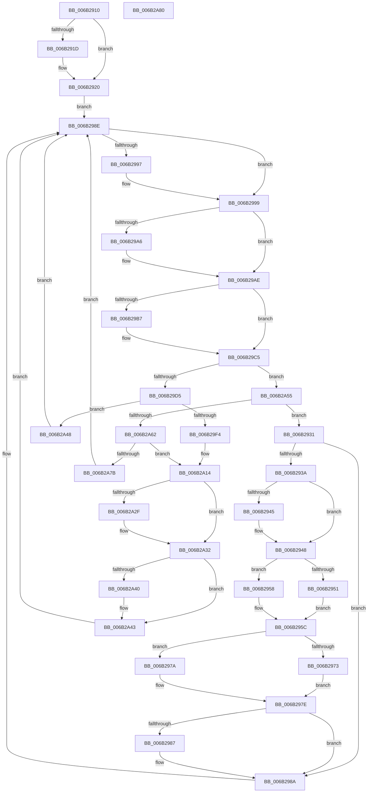

# KiIdleLoop

- RVA: `0x006B2910`–`0x006B2A81` (길이 `369` bytes)
- VA: `0x00000001406B2910`
- 실행 섹션: `.text`
- PDB 이름 있음: `예`; PDB Function 태그: `아니요`
- unwind 정보 RVA: `0x000C1A38`
- 디코드: `97`개 명령, `369/369` bytes 표시
- 미해석 바이트: `0` (있으면 어셈블리에 `.byte`로 보존)

> 이 문서는 커널 이미지의 기계어와 PDB 기호를 분석해 생성했습니다. 4번과 5번은 함수 원형과 자료형을 바이너리 사용 방식에서 추정한 C 해석이며 원본 소스 복구 결과는 아닙니다.

## 1. Dependencies

- 직접 호출 지점: **12**; 고유 호출 대상: **10**
- 직접 호출자로 확인된 함수: **1**
- RIP 상대 이미지 참조: **3**

### Outgoing calls
- `0x006B2951` → [KzSetIrqlUnsafe](../5B/KzSetIrqlUnsafe_function_005B8AE0.md) (function, `0x005B8AE0`)
- `0x006B295F` → [PoIdle](../2C/PoIdle_function_002CFB40.md) (function, `0x002CFB40`)
- `0x006B2973` → [KzSetIrqlUnsafe](../5B/KzSetIrqlUnsafe_function_005B8AE0.md) (function, `0x005B8AE0`)
- `0x006B29A9` → [KiRetireDpcList](../21/KiRetireDpcList_function_0021A0B0.md) (function, `0x0021A0B0`)
- `0x006B29BF` → [KiQuantumEnd](../21/KiQuantumEnd_function_0021BA90.md) (function, `0x0021BA90`)
- `0x006B29E1` → [KiAcquirePrcbLock](../41/KiAcquirePrcbLock_function_004168F0.md) (function, `0x004168F0`)
- `0x006B29FB` → [KiEndIdleCycleAccumulation](../37/KiEndIdleCycleAccumulation_function_0037B470.md) (function, `0x0037B470`)
- `0x006B2A07` → [KiUpdatePriorityMatrixForRunningTransition](../37/KiUpdatePriorityMatrixForRunningTransition_function_0037B3A0.md) (function, `0x0037B3A0`)
- `0x006B2A0F` → [KiReleasePrcbLock](../43/KiReleasePrcbLock_function_0043DC10.md) (function, `0x0043DC10`)
- `0x006B2A32` → [SwapContext](SwapContext_function_006B9820.md) (function, `0x006B9820`)
- `0x006B2A4B` → [KiReleasePrcbLock](../43/KiReleasePrcbLock_function_0043DC10.md) (function, `0x0043DC10`)
- `0x006B2A6A` → [KiIdleSchedule](../35/KiIdleSchedule_function_00355000.md) (function, `0x00355000`)

### Direct callers
- [KiSystemStartup](../../pagelk/B5/KiSystemStartup_function_00B5B3C0.md) at `0x00B5B68D`

### Static image references
- `0x006B2914` → RVA `0x00FC6BF0` (`ALMOSTRO`; read)
- `0x006B2948` → RVA `0x00FC6D20` (`ALMOSTRO`; read)
- `0x006B298E` → RVA `0x00FC5066` (`ALMOSTRO`; read)

## 2. Other-region calls and transfers

- 다른 실행 섹션으로 향하는 call: **0**
- 별도 외부 분기/꼬리 이동을 확인하지 못했습니다.

## 3. Assembly (complete function range)

```asm
006B2910  48 83 EC 28                     sub rsp, 0x28
006B2914  F6 05 D5 42 91 00 FF            test byte ptr [rip + 0x9142d5], 0xff
006B291B  74 03                           je 0x1406b2920
006B291D  0F 01 CA                        clac
006B2920  48 83 64 24 28 00               and qword ptr [rsp + 0x28], 0
006B2926  65 48 8B 1C 25 20 00 00 00      mov rbx, qword ptr gs:[0x20]
006B292F  EB 5D                           jmp 0x1406b298e
006B2931  F6 83 BC 38 00 00 BF            test byte ptr [rbx + 0x38bc], 0xbf
006B2938  75 50                           jne 0x1406b298a
006B293A  33 C9                           xor ecx, ecx
006B293C  F6 05 AD 42 91 00 FF            test byte ptr [rip + 0x9142ad], 0xff
006B2943  74 03                           je 0x1406b2948
006B2945  0F 01 CB                        stac
006B2948  83 3D D1 43 91 00 00            cmp dword ptr [rip + 0x9143d1], 0
006B294F  74 07                           je 0x1406b2958
006B2951  E8 8A 61 F0 FF                  call 0x1405b8ae0
006B2956  EB 04                           jmp 0x1406b295c
006B2958  44 0F 22 C1                     mov cr8, rcx
006B295C  48 8B CB                        mov rcx, rbx
006B295F  E8 DC D1 C1 FF                  call 0x1402cfb40
006B2964  FB                              sti
006B2965  B9 02 00 00 00                  mov ecx, 2
006B296A  83 3D AF 43 91 00 00            cmp dword ptr [rip + 0x9143af], 0
006B2971  74 07                           je 0x1406b297a
006B2973  E8 68 61 F0 FF                  call 0x1405b8ae0
006B2978  EB 04                           jmp 0x1406b297e
006B297A  44 0F 22 C1                     mov cr8, rcx
006B297E  F6 05 6B 42 91 00 FF            test byte ptr [rip + 0x91426b], 0xff
006B2985  74 03                           je 0x1406b298a
006B2987  0F 01 CA                        clac
006B298A  80 63 07 00                     and byte ptr [rbx + 7], 0
006B298E  80 3D D1 26 91 00 00            cmp byte ptr [rip + 0x9126d1], 0
006B2995  74 02                           je 0x1406b2999
006B2997  F3 90                           pause
006B2999  FB                              sti
006B299A  90                              nop
006B299B  90                              nop
006B299C  FA                              cli
006B299D  F6 83 BC 38 00 00 BF            test byte ptr [rbx + 0x38bc], 0xbf
006B29A4  74 08                           je 0x1406b29ae
006B29A6  48 8B CB                        mov rcx, rbx
006B29A9  E8 02 77 B6 FF                  call 0x14021a0b0
006B29AE  80 BB B9 38 00 00 00            cmp byte ptr [rbx + 0x38b9], 0
006B29B5  74 0E                           je 0x1406b29c5
006B29B7  80 A3 B9 38 00 00 00            and byte ptr [rbx + 0x38b9], 0
006B29BE  FB                              sti
006B29BF  E8 CC 90 B6 FF                  call 0x14021ba90
006B29C4  FA                              cli
006B29C5  F0 80 4B 07 01                  lock or byte ptr [rbx + 7], 1
006B29CA  48 83 7B 10 00                  cmp qword ptr [rbx + 0x10], 0
006B29CF  0F 84 80 00 00 00               je 0x1406b2a55
006B29D5  80 63 07 00                     and byte ptr [rbx + 7], 0
006B29D9  FB                              sti
006B29DA  48 8B 7B 18                     mov rdi, qword ptr [rbx + 0x18]
006B29DE  48 8B CB                        mov rcx, rbx
006B29E1  E8 0A 3F D6 FF                  call 0x1404168f0
006B29E6  48 8B 73 10                     mov rsi, qword ptr [rbx + 0x10]
006B29EA  48 83 63 10 00                  and qword ptr [rbx + 0x10], 0
006B29EF  48 3B F7                        cmp rsi, rdi
006B29F2  74 54                           je 0x1406b2a48
006B29F4  FA                              cli
006B29F5  48 8B CB                        mov rcx, rbx
006B29F8  48 8B D7                        mov rdx, rdi
006B29FB  E8 70 8A CC FF                  call 0x14037b470
006B2A00  FB                              sti
006B2A01  48 8B CB                        mov rcx, rbx
006B2A04  48 8B D6                        mov rdx, rsi
006B2A07  E8 94 89 CC FF                  call 0x14037b3a0
006B2A0C  48 8B CB                        mov rcx, rbx
006B2A0F  E8 FC B1 D8 FF                  call 0x14043dc10
006B2A14  F6 83 BC 38 00 00 AF            test byte ptr [rbx + 0x38bc], 0xaf
006B2A1B  B9 01 00 00 00                  mov ecx, 1
006B2A20  0F 95 C0                        setne al
006B2A23  08 43 06                        or byte ptr [rbx + 6], al
006B2A26  F6 05 C3 41 91 00 FF            test byte ptr [rip + 0x9141c3], 0xff
006B2A2D  74 03                           je 0x1406b2a32
006B2A2F  0F 01 CB                        stac
006B2A32  E8 E9 6D 00 00                  call 0x1406b9820
006B2A37  F6 05 B2 41 91 00 FF            test byte ptr [rip + 0x9141b2], 0xff
006B2A3E  74 03                           je 0x1406b2a43
006B2A40  0F 01 CA                        clac
006B2A43  E9 46 FF FF FF                  jmp 0x1406b298e
006B2A48  48 8B CB                        mov rcx, rbx
006B2A4B  E8 C0 B1 D8 FF                  call 0x14043dc10
006B2A50  E9 39 FF FF FF                  jmp 0x1406b298e
006B2A55  80 BB BB 38 00 00 00            cmp byte ptr [rbx + 0x38bb], 0
006B2A5C  0F 84 CF FE FF FF               je 0x1406b2931
006B2A62  80 63 07 00                     and byte ptr [rbx + 7], 0
006B2A66  FB                              sti
006B2A67  48 8B CB                        mov rcx, rbx
006B2A6A  E8 91 25 CA FF                  call 0x140355000
006B2A6F  48 85 C0                        test rax, rax
006B2A72  48 8B F0                        mov rsi, rax
006B2A75  48 8B 7B 18                     mov rdi, qword ptr [rbx + 0x18]
006B2A79  75 99                           jne 0x1406b2a14
006B2A7B  E9 0E FF FF FF                  jmp 0x1406b298e
006B2A80  C3                              ret
```

## 4. C-style interpretation (structured pseudocode)

```c
__int64 __fastcall KiIdleLoop(int a1)
{
    __int64 result;
    __int64 v_rsp;
    unsigned __int64 v_stack_p0;

    v_rsp = (v_rsp) - (40);
    if (((*(unsigned __int8 *)(v_rip + 9519829)) & (255)) != 0) {
    }
    goto loc_006B298E;
loc_006B2931:
    if (((*(unsigned __int8 *)(*(unsigned __int64 *)(gs_base + (0 + 32)) + 14524)) & (191)) != 0) goto loc_006B298A;
    a1 = 0;
    if (((*(unsigned __int8 *)(v_rip + 9519789)) & (255)) != 0) {
    }
    if ((*(unsigned int *)(v_rip + 9520081)) == 0) goto loc_006B2958;
    result = KzSetIrqlUnsafe(a1, a2, a3, a4);
    goto loc_006B295C;
loc_006B2958:
loc_006B295C:
    result = PoIdle(*(unsigned __int64 *)(gs_base + (0 + 32)), a2, a3, a4);
    if ((*(unsigned int *)(v_rip + 9520047)) == 0) goto loc_006B297A;
    result = KzSetIrqlUnsafe(2, a2, a3, a4);
    goto loc_006B297E;
loc_006B297A:
loc_006B297E:
    if (((*(unsigned __int8 *)(v_rip + 9519723)) & (255)) != 0) {
    }
loc_006B298E:
    if ((*(unsigned __int8 *)(v_rip + 9512657)) != 0) {
    }
    if (((*(unsigned __int8 *)(*(unsigned __int64 *)(gs_base + (0 + 32)) + 14524)) & (191)) != 0) {
        a1 = *(unsigned __int64 *)(gs_base + (0 + 32));
        result = KiRetireDpcList(a1, a2, a3, a4);
    }
    if ((*(unsigned __int8 *)(*(unsigned __int64 *)(gs_base + (0 + 32)) + 14521)) != 0) {
        result = KiQuantumEnd(a1, a2, a3, a4);
    }
    if ((*(unsigned __int64 *)(*(unsigned __int64 *)(gs_base + (0 + 32)) + 16)) == 0) goto loc_006B2A55;
    result = KiAcquirePrcbLock(*(unsigned __int64 *)(gs_base + (0 + 32)), a2, a3, a4);
    if ((*(unsigned __int64 *)(*(unsigned __int64 *)(gs_base + (0 + 32)) + 16)) == (*(unsigned __int64 *)(*(unsigned __int64 *)(gs_base + (0 + 32)) + 24))) goto loc_006B2A48;
    result = KiEndIdleCycleAccumulation(*(unsigned __int64 *)(gs_base + (0 + 32)), *(unsigned __int64 *)(*(unsigned __int64 *)(gs_base + (0 + 32)) + 24), a3, a4);
    result = KiUpdatePriorityMatrixForRunningTransition(*(unsigned __int64 *)(gs_base + (0 + 32)), *(unsigned __int64 *)(*(unsigned __int64 *)(gs_base + (0 + 32)) + 16), a3, a4);
    result = KiReleasePrcbLock(*(unsigned __int64 *)(gs_base + (0 + 32)), *(unsigned __int64 *)(*(unsigned __int64 *)(gs_base + (0 + 32)) + 16), a3, a4);
loc_006B2A14:
    result = (((*(unsigned __int8 *)(*(unsigned __int64 *)(gs_base + (0 + 32)) + 14524)) & (175)) != 0) ? 1 : 0;
    if (((*(unsigned __int8 *)(v_rip + 9519555)) & (255)) != 0) {
    }
    result = SwapContext(1, *(unsigned __int64 *)(*(unsigned __int64 *)(gs_base + (0 + 32)) + 16), a3, a4);
    if (((*(unsigned __int8 *)(v_rip + 9519538)) & (255)) != 0) {
    }
    goto loc_006B298E;
loc_006B2A48:
    result = KiReleasePrcbLock(*(unsigned __int64 *)(gs_base + (0 + 32)), *(unsigned __int64 *)(*(unsigned __int64 *)(gs_base + (0 + 32)) + 16), a3, a4);
    goto loc_006B298E;
loc_006B2A55:
    if ((*(unsigned __int8 *)(*(unsigned __int64 *)(gs_base + (0 + 32)) + 14523)) == 0) goto loc_006B2931;
    result = KiIdleSchedule(*(unsigned __int64 *)(gs_base + (0 + 32)), *(unsigned __int64 *)(*(unsigned __int64 *)(gs_base + (0 + 32)) + 16), a3, a4);
    if (result != 0) goto loc_006B2A14;
    goto loc_006B298E;
}
```

## 5. (Beta) C Style

```c
int64_t KiIdleLoop(int32_t Arg1)
{
    int64_t result;
    int64_t local_rsp;
    uint64_t v_stack_p0;

    local_rsp = (local_rsp) - (40);
    if (((*(uint8_t *)(v_rip + 0x9142D5)) & (255)) != 0) {
    }
    goto loc_006B298E;
loc_006B2931:
    if (((*(uint8_t *)(*(uint64_t *)(gs_base + (0 + 0x20)) + 0x38BC)) & (191)) != 0) goto loc_006B298A;
    Arg1 = 0;
    if (((*(uint8_t *)(v_rip + 0x9142AD)) & (255)) != 0) {
    }
    if ((*(uint32_t *)(v_rip + 0x9143D1)) == 0) goto loc_006B2958;
    result = KzSetIrqlUnsafe(Arg1, a2, a3, a4);
    goto loc_006B295C;
loc_006B2958:
loc_006B295C:
    result = PoIdle(*(uint64_t *)(gs_base + (0 + 0x20)), a2, a3, a4);
    if ((*(uint32_t *)(v_rip + 0x9143AF)) == 0) goto loc_006B297A;
    result = KzSetIrqlUnsafe(2, a2, a3, a4);
    goto loc_006B297E;
loc_006B297A:
loc_006B297E:
    if (((*(uint8_t *)(v_rip + 0x91426B)) & (255)) != 0) {
    }
loc_006B298E:
    if ((*(uint8_t *)(v_rip + 0x9126D1)) != 0) {
    }
    if (((*(uint8_t *)(*(uint64_t *)(gs_base + (0 + 0x20)) + 0x38BC)) & (191)) != 0) {
        Arg1 = *(uint64_t *)(gs_base + (0 + 0x20));
        result = KiRetireDpcList(Arg1, a2, a3, a4);
    }
    if ((*(uint8_t *)(*(uint64_t *)(gs_base + (0 + 0x20)) + 0x38B9)) != 0) {
        result = KiQuantumEnd(Arg1, a2, a3, a4);
    }
    if ((*(uint64_t *)(*(uint64_t *)(gs_base + (0 + 0x20)) + 0x10)) == 0) goto loc_006B2A55;
    result = KiAcquirePrcbLock(*(uint64_t *)(gs_base + (0 + 0x20)), a2, a3, a4);
    if ((*(uint64_t *)(*(uint64_t *)(gs_base + (0 + 0x20)) + 0x10)) == (*(uint64_t *)(*(uint64_t *)(gs_base + (0 + 0x20)) + 0x18))) goto loc_006B2A48;
    result = KiEndIdleCycleAccumulation(*(uint64_t *)(gs_base + (0 + 0x20)), *(uint64_t *)(*(uint64_t *)(gs_base + (0 + 0x20)) + 0x18), a3, a4);
    result = KiUpdatePriorityMatrixForRunningTransition(*(uint64_t *)(gs_base + (0 + 0x20)), *(uint64_t *)(*(uint64_t *)(gs_base + (0 + 0x20)) + 0x10), a3, a4);
    result = KiReleasePrcbLock(*(uint64_t *)(gs_base + (0 + 0x20)), *(uint64_t *)(*(uint64_t *)(gs_base + (0 + 0x20)) + 0x10), a3, a4);
loc_006B2A14:
    result = (((*(uint8_t *)(*(uint64_t *)(gs_base + (0 + 0x20)) + 0x38BC)) & (175)) != 0) ? 1 : 0;
    if (((*(uint8_t *)(v_rip + 0x9141C3)) & (255)) != 0) {
    }
    result = SwapContext(1, *(uint64_t *)(*(uint64_t *)(gs_base + (0 + 0x20)) + 0x10), a3, a4);
    if (((*(uint8_t *)(v_rip + 0x9141B2)) & (255)) != 0) {
    }
    goto loc_006B298E;
loc_006B2A48:
    result = KiReleasePrcbLock(*(uint64_t *)(gs_base + (0 + 0x20)), *(uint64_t *)(*(uint64_t *)(gs_base + (0 + 0x20)) + 0x10), a3, a4);
    goto loc_006B298E;
loc_006B2A55:
    if ((*(uint8_t *)(*(uint64_t *)(gs_base + (0 + 0x20)) + 0x38BB)) == 0) goto loc_006B2931;
    result = KiIdleSchedule(*(uint64_t *)(gs_base + (0 + 0x20)), *(uint64_t *)(*(uint64_t *)(gs_base + (0 + 0x20)) + 0x10), a3, a4);
    if (result != 0) goto loc_006B2A14;
    goto loc_006B298E;
}
```

## 6. Execution-region graph

[열기: 2D/3D 그래프와 함수 탐색 컨트롤 패널](../../../control-panel.html?section=text&rva=0x006B2910&view=graph)

- 2D 그래프는 위에서 아래로 흐르고, 3D 그래프는 빈 공간을 드래그해 회전합니다. Shift+드래그는 이동, 휠은 확대·축소, 함수 노드 선택은 대상 보고서 이동입니다.

### Static fallback


