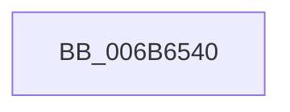

# KiInitiateUserApc

- RVA: `0x006B6540`–`0x006B6610` (길이 `208` bytes)
- VA: `0x00000001406B6540`
- 실행 섹션: `.text`
- PDB 이름 있음: `예`; PDB Function 태그: `아니요`
- unwind 정보 RVA: `0x000C217C`
- 디코드: `43`개 명령, `208/208` bytes 표시
- 미해석 바이트: `0` (있으면 어셈블리에 `.byte`로 보존)

> 이 문서는 커널 이미지의 기계어와 PDB 기호를 분석해 생성했습니다. 4번과 5번은 함수 원형과 자료형을 바이너리 사용 방식에서 추정한 C 해석이며 원본 소스 복구 결과는 아닙니다.

## 1. Dependencies

- 직접 호출 지점: **1**; 고유 호출 대상: **1**
- 직접 호출자로 확인된 함수: **26**
- RIP 상대 이미지 참조: **0**

### Outgoing calls
- `0x006B65AB` → [KiDeliverApc](../25/KiDeliverApc_function_00250F20.md) (function, `0x00250F20`)

### Direct callers
- [NtContinueEx](NtContinueEx_function_006B10D0.md) at `0x006B122B`
- [NtRaiseException](NtRaiseException_function_006B1560.md) at `0x006B16CB`
- [KxStartUserThread](KxStartUserThread_function_006B2E50.md) at `0x006B2F66`
- [KiChainedDispatch](KiChainedDispatch_function_006B3480.md) at `0x006B3538`
- [KiInterruptDispatch](KiInterruptDispatch_function_006B3B30.md) at `0x006B3BE8`
- [KiInterruptDispatchNoLock](KiInterruptDispatchNoLock_function_006B3F10.md) at `0x006B3FC8`
- [KiInterruptDispatchNoLockNoEtw](KiInterruptDispatchNoLockNoEtw_function_006B42F0.md) at `0x006B43A8`
- [KiInterruptDispatchNoEOI](KiInterruptDispatchNoEOI_function_006B46D0.md) at `0x006B4780`
- [KiSpuriousDispatchNoEOI](KiSpuriousDispatchNoEOI_function_006B4AA0.md) at `0x006B4B45`
- [KxIsrLinkage](KxIsrLinkage_function_006B5680.md) at `0x006B5AF4`
- [KiApcInterrupt](KiApcInterrupt_function_006B5E20.md) at `0x006B6221`
- [KiHvInterruptDispatch](KiHvInterruptDispatch_function_006B7750.md) at `0x006B7816`
- [KiVmbusInterruptDispatch](KiVmbusInterruptDispatch_function_006B7B40.md) at `0x006B7BF2`
- [KiSwInterrupt](KiSwInterrupt_function_006B8070.md) at `0x006B848D`
- [KiDpcInterrupt](KiDpcInterrupt_function_006B87C0.md) at `0x006B8BB5`
- [KiIpiInterrupt](KiIpiInterrupt_function_006B8F20.md) at `0x006B9336`
- [NtCallEnclave](NtCallEnclave_function_006BABA0.md) at `0x006BAC3D`
- [KiBoundFault](KiBoundFault_function_006BE040.md) at `0x006BE410`
- [KiInvalidOpcodeFault](KiInvalidOpcodeFault_function_006BE740.md) at `0x006BEAC6`
- [KiPageFault](../6C/KiPageFault_function_006C0740.md) at `0x006C0C27`
- [KxMcheckAlternateReturn](../6C/KxMcheckAlternateReturn_function_006C1E00.md) at `0x006C21B5`
- [KiVirtualizationException](../6C/KiVirtualizationException_function_006C2900.md) at `0x006C2CD7`
- [KiControlProtectionFault](../6C/KiControlProtectionFault_function_006C3040.md) at `0x006C3479`
- [KiSystemCall64](../6C/KiSystemCall64_function_006C4A40.md) at `0x006C5008`
- [KiSystemCall64](../6C/KiSystemCall64_function_006C4A40.md) at `0x006C53FA`
- [KiExceptionDispatch](../6C/KiExceptionDispatch_function_006C5900.md) at `0x006C5AE9`
- [KiFastFailDispatch](../6C/KiFastFailDispatch_function_006C5E40.md) at `0x006C5FAA`

### Static image references
- 디코드된 RIP-relative 메모리 참조가 없습니다.

## 2. Other-region calls and transfers

- 다른 실행 섹션으로 향하는 call: **0**
- 별도 외부 분기/꼬리 이동을 확인하지 못했습니다.

## 3. Assembly (complete function range)

```asm
006B6540  48 81 EC 38 01 00 00            sub rsp, 0x138
006B6547  48 8D 84 24 00 01 00 00         lea rax, [rsp + 0x100]
006B654F  0F 29 74 24 30                  movaps xmmword ptr [rsp + 0x30], xmm6
006B6554  0F 29 7C 24 40                  movaps xmmword ptr [rsp + 0x40], xmm7
006B6559  44 0F 29 44 24 50               movaps xmmword ptr [rsp + 0x50], xmm8
006B655F  44 0F 29 4C 24 60               movaps xmmword ptr [rsp + 0x60], xmm9
006B6565  44 0F 29 54 24 70               movaps xmmword ptr [rsp + 0x70], xmm10
006B656B  44 0F 29 58 80                  movaps xmmword ptr [rax - 0x80], xmm11
006B6570  44 0F 29 60 90                  movaps xmmword ptr [rax - 0x70], xmm12
006B6575  44 0F 29 68 A0                  movaps xmmword ptr [rax - 0x60], xmm13
006B657A  44 0F 29 70 B0                  movaps xmmword ptr [rax - 0x50], xmm14
006B657F  44 0F 29 78 C0                  movaps xmmword ptr [rax - 0x40], xmm15
006B6584  48 89 18                        mov qword ptr [rax], rbx
006B6587  48 89 78 08                     mov qword ptr [rax + 8], rdi
006B658B  48 89 70 10                     mov qword ptr [rax + 0x10], rsi
006B658F  4C 89 60 18                     mov qword ptr [rax + 0x18], r12
006B6593  4C 89 68 20                     mov qword ptr [rax + 0x20], r13
006B6597  4C 89 70 28                     mov qword ptr [rax + 0x28], r14
006B659B  4C 89 78 30                     mov qword ptr [rax + 0x30], r15
006B659F  B9 01 00 00 00                  mov ecx, 1
006B65A4  48 8B D4                        mov rdx, rsp
006B65A7  4C 8D 45 80                     lea r8, [rbp - 0x80]
006B65AB  E8 70 A9 B9 FF                  call 0x140250f20
006B65B0  48 8D 8C 24 00 01 00 00         lea rcx, [rsp + 0x100]
006B65B8  0F 28 74 24 30                  movaps xmm6, xmmword ptr [rsp + 0x30]
006B65BD  0F 28 7C 24 40                  movaps xmm7, xmmword ptr [rsp + 0x40]
006B65C2  44 0F 28 44 24 50               movaps xmm8, xmmword ptr [rsp + 0x50]
006B65C8  44 0F 28 4C 24 60               movaps xmm9, xmmword ptr [rsp + 0x60]
006B65CE  44 0F 28 54 24 70               movaps xmm10, xmmword ptr [rsp + 0x70]
006B65D4  44 0F 28 59 80                  movaps xmm11, xmmword ptr [rcx - 0x80]
006B65D9  44 0F 28 61 90                  movaps xmm12, xmmword ptr [rcx - 0x70]
006B65DE  44 0F 28 69 A0                  movaps xmm13, xmmword ptr [rcx - 0x60]
006B65E3  44 0F 28 71 B0                  movaps xmm14, xmmword ptr [rcx - 0x50]
006B65E8  44 0F 28 79 C0                  movaps xmm15, xmmword ptr [rcx - 0x40]
006B65ED  48 8B 19                        mov rbx, qword ptr [rcx]
006B65F0  48 8B 79 08                     mov rdi, qword ptr [rcx + 8]
006B65F4  48 8B 71 10                     mov rsi, qword ptr [rcx + 0x10]
006B65F8  4C 8B 61 18                     mov r12, qword ptr [rcx + 0x18]
006B65FC  4C 8B 69 20                     mov r13, qword ptr [rcx + 0x20]
006B6600  4C 8B 71 28                     mov r14, qword ptr [rcx + 0x28]
006B6604  4C 8B 79 30                     mov r15, qword ptr [rcx + 0x30]
006B6608  48 81 C4 38 01 00 00            add rsp, 0x138
006B660F  C3                              ret
```

## 4. C-style interpretation (structured pseudocode)

```c
__int64 __fastcall KiInitiateUserApc(void)
{
    __int64 result;
    __int64 v_rsp;
    unsigned __int64 v_stack_m108;
    unsigned __int64 v_stack_m38;
    unsigned __int64 v_stack_mC8;
    unsigned __int64 v_stack_mD8;
    unsigned __int64 v_stack_mE8;
    unsigned __int64 v_stack_mF8;

    v_rsp = (v_rsp) - (312);
    v_stack_m108 = v_xmm6;
    v_stack_mF8 = v_xmm7;
    v_stack_mE8 = v_xmm8;
    v_stack_mD8 = v_xmm9;
    v_stack_mC8 = v_xmm10;
    *(unsigned __int64 *)(v_stack_m38 - 128) = v_xmm11;
    *(unsigned __int64 *)(v_stack_m38 - 112) = v_xmm12;
    *(unsigned __int64 *)(v_stack_m38 - 96) = v_xmm13;
    *(unsigned __int64 *)(v_stack_m38 - 80) = v_xmm14;
    *(unsigned __int64 *)(v_stack_m38 - 64) = v_xmm15;
    *(unsigned __int64 *)(v_stack_m38) = v_rbx;
    *(unsigned __int64 *)(v_stack_m38 + 8) = v_rdi;
    *(unsigned __int64 *)(v_stack_m38 + 16) = v_rsi;
    *(unsigned __int64 *)(v_stack_m38 + 24) = v_r12;
    *(unsigned __int64 *)(v_stack_m38 + 32) = v_r13;
    *(unsigned __int64 *)(v_stack_m38 + 40) = v_r14;
    *(unsigned __int64 *)(v_stack_m38 + 48) = v_r15;
    result = KiDeliverApc(1, v_rsp, v_rbp - 128, a4);
    v_rsp = (v_rsp) + (312);
    return result;
}
```

## 5. (Beta) C Style

```c
void KiInitiateUserApc(void)
{
    int64_t result;
    int64_t local_rsp;
    uint64_t v_stack_m108;
    uint64_t v_stack_m38;
    uint64_t v_stack_mC8;
    uint64_t v_stack_mD8;
    uint64_t v_stack_mE8;
    uint64_t v_stack_mF8;

    local_rsp = (local_rsp) - (312);
    v_stack_m108 = v_xmm6;
    v_stack_mF8 = v_xmm7;
    v_stack_mE8 = v_xmm8;
    v_stack_mD8 = v_xmm9;
    v_stack_mC8 = v_xmm10;
    *(uint64_t *)(v_stack_m38 - 0x80) = v_xmm11;
    *(uint64_t *)(v_stack_m38 - 0x70) = v_xmm12;
    *(uint64_t *)(v_stack_m38 - 0x60) = v_xmm13;
    *(uint64_t *)(v_stack_m38 - 0x50) = v_xmm14;
    *(uint64_t *)(v_stack_m38 - 0x40) = v_xmm15;
    *(uint64_t *)(v_stack_m38) = local_rbx;
    *(uint64_t *)(v_stack_m38 + 0x8) = local_rdi;
    *(uint64_t *)(v_stack_m38 + 0x10) = local_rsi;
    *(uint64_t *)(v_stack_m38 + 0x18) = local_r12;
    *(uint64_t *)(v_stack_m38 + 0x20) = local_r13;
    *(uint64_t *)(v_stack_m38 + 0x28) = local_r14;
    *(uint64_t *)(v_stack_m38 + 0x30) = local_r15;
    result = KiDeliverApc(1, local_rsp, local_rbp - 128, a4);
    local_rsp = (local_rsp) + (312);
    return result;
}
```

## 6. Execution-region graph

[열기: 2D/3D 그래프와 함수 탐색 컨트롤 패널](../../../control-panel.html?section=text&rva=0x006B6540&view=graph)

- 2D 그래프는 위에서 아래로 흐르고, 3D 그래프는 빈 공간을 드래그해 회전합니다. Shift+드래그는 이동, 휠은 확대·축소, 함수 노드 선택은 대상 보고서 이동입니다.

### Static fallback


