# KiInterruptDispatchNoEOI

- RVA: `0x006B46D0`–`0x006B4A98` (길이 `968` bytes)
- VA: `0x00000001406B46D0`
- 실행 섹션: `.text`
- PDB 이름 있음: `예`; PDB Function 태그: `아니요`
- unwind 정보 RVA: `0x000C2050`
- 디코드: `213`개 명령, `968/968` bytes 표시
- 미해석 바이트: `0` (있으면 어셈블리에 `.byte`로 보존)

> 이 문서는 커널 이미지의 기계어와 PDB 기호를 분석해 생성했습니다. 4번과 5번은 함수 원형과 자료형을 바이너리 사용 방식에서 추정한 C 해석이며 원본 소스 복구 결과는 아닙니다.

## 1. Dependencies

- 직접 호출 지점: **42**; 고유 호출 대상: **42**
- 직접 호출자로 확인된 함수: **1**
- RIP 상대 이미지 참조: **5**

### Outgoing calls
- `0x006B4707` → [KiInterruptSubDispatchNoLock](KiInterruptSubDispatchNoLock_function_006B3A30.md) (function, `0x006B3A30`)
- `0x006B471E` → [KiEndInterruptCycleAccumulation](../3F/KiEndInterruptCycleAccumulation_function_003FAAE0.md) (function, `0x003FAAE0`)
- `0x006B4727` → [KiDpcInterruptBypass](KiDpcInterruptBypass_function_006B8EE0.md) (function, `0x006B8EE0`)
- `0x006B4739` → [KzSetIrqlUnsafe](../5B/KzSetIrqlUnsafe_function_005B8AE0.md) (function, `0x005B8AE0`)
- `0x006B4780` → [KiInitiateUserApc](KiInitiateUserApc_function_006B6540.md) (function, `0x006B6540`)
- `0x006B4791` → [KiSynchronizeUserIsolationDomainEntry](../26/KiSynchronizeUserIsolationDomainEntry_function_00263F60.md) (function, `0x00263F60`)
- `0x006B47AB` → [KiUpdateStibpPairing](../3E/KiUpdateStibpPairing_function_003E71C0.md) (function, `0x003E71C0`)
- `0x006B47C1` → [KiRestoreSetContextState](KiRestoreSetContextState_function_006B1CA0.md) (function, `0x006B1CA0`)
- `0x006B47DD` → [KiCopyCounters](../5C/KiCopyCounters_function_005C0710.md) (function, `0x005C0710`)
- `0x006B47F9` → [KiRestoreDebugRegisterState](../4F/KiRestoreDebugRegisterState_function_004FD8E0.md) (function, `0x004FD8E0`)
- `0x006B4893` → [KiInterruptDispatchNoEOI + 0x2D6](KiInterruptDispatchNoEOI_function_006B46D0.md) (inside-function, `0x006B49A6`)
- `0x006B489C` → [KiInterruptDispatchNoEOI + 0x2DF](KiInterruptDispatchNoEOI_function_006B46D0.md) (inside-function, `0x006B49AF`)
- `0x006B48A5` → [KiInterruptDispatchNoEOI + 0x1C8](KiInterruptDispatchNoEOI_function_006B46D0.md) (inside-function, `0x006B4898`)
- `0x006B48AE` → [KiInterruptDispatchNoEOI + 0x1D1](KiInterruptDispatchNoEOI_function_006B46D0.md) (inside-function, `0x006B48A1`)
- `0x006B48B7` → [KiInterruptDispatchNoEOI + 0x1DA](KiInterruptDispatchNoEOI_function_006B46D0.md) (inside-function, `0x006B48AA`)
- `0x006B48C0` → [KiInterruptDispatchNoEOI + 0x1E3](KiInterruptDispatchNoEOI_function_006B46D0.md) (inside-function, `0x006B48B3`)
- `0x006B48C9` → [KiInterruptDispatchNoEOI + 0x1EC](KiInterruptDispatchNoEOI_function_006B46D0.md) (inside-function, `0x006B48BC`)
- `0x006B48D2` → [KiInterruptDispatchNoEOI + 0x1F5](KiInterruptDispatchNoEOI_function_006B46D0.md) (inside-function, `0x006B48C5`)
- `0x006B48DB` → [KiInterruptDispatchNoEOI + 0x1FE](KiInterruptDispatchNoEOI_function_006B46D0.md) (inside-function, `0x006B48CE`)
- `0x006B48E4` → [KiInterruptDispatchNoEOI + 0x207](KiInterruptDispatchNoEOI_function_006B46D0.md) (inside-function, `0x006B48D7`)
- `0x006B48ED` → [KiInterruptDispatchNoEOI + 0x210](KiInterruptDispatchNoEOI_function_006B46D0.md) (inside-function, `0x006B48E0`)
- `0x006B48F6` → [KiInterruptDispatchNoEOI + 0x219](KiInterruptDispatchNoEOI_function_006B46D0.md) (inside-function, `0x006B48E9`)
- `0x006B48FF` → [KiInterruptDispatchNoEOI + 0x222](KiInterruptDispatchNoEOI_function_006B46D0.md) (inside-function, `0x006B48F2`)
- `0x006B4908` → [KiInterruptDispatchNoEOI + 0x22B](KiInterruptDispatchNoEOI_function_006B46D0.md) (inside-function, `0x006B48FB`)
- `0x006B4911` → [KiInterruptDispatchNoEOI + 0x234](KiInterruptDispatchNoEOI_function_006B46D0.md) (inside-function, `0x006B4904`)
- `0x006B491A` → [KiInterruptDispatchNoEOI + 0x23D](KiInterruptDispatchNoEOI_function_006B46D0.md) (inside-function, `0x006B490D`)
- `0x006B4923` → [KiInterruptDispatchNoEOI + 0x246](KiInterruptDispatchNoEOI_function_006B46D0.md) (inside-function, `0x006B4916`)
- `0x006B492C` → [KiInterruptDispatchNoEOI + 0x24F](KiInterruptDispatchNoEOI_function_006B46D0.md) (inside-function, `0x006B491F`)
- `0x006B4935` → [KiInterruptDispatchNoEOI + 0x258](KiInterruptDispatchNoEOI_function_006B46D0.md) (inside-function, `0x006B4928`)
- `0x006B493E` → [KiInterruptDispatchNoEOI + 0x261](KiInterruptDispatchNoEOI_function_006B46D0.md) (inside-function, `0x006B4931`)
- `0x006B4947` → [KiInterruptDispatchNoEOI + 0x26A](KiInterruptDispatchNoEOI_function_006B46D0.md) (inside-function, `0x006B493A`)
- `0x006B4950` → [KiInterruptDispatchNoEOI + 0x273](KiInterruptDispatchNoEOI_function_006B46D0.md) (inside-function, `0x006B4943`)
- `0x006B4959` → [KiInterruptDispatchNoEOI + 0x27C](KiInterruptDispatchNoEOI_function_006B46D0.md) (inside-function, `0x006B494C`)
- `0x006B4962` → [KiInterruptDispatchNoEOI + 0x285](KiInterruptDispatchNoEOI_function_006B46D0.md) (inside-function, `0x006B4955`)
- `0x006B496B` → [KiInterruptDispatchNoEOI + 0x28E](KiInterruptDispatchNoEOI_function_006B46D0.md) (inside-function, `0x006B495E`)
- `0x006B4974` → [KiInterruptDispatchNoEOI + 0x297](KiInterruptDispatchNoEOI_function_006B46D0.md) (inside-function, `0x006B4967`)
- `0x006B497D` → [KiInterruptDispatchNoEOI + 0x2A0](KiInterruptDispatchNoEOI_function_006B46D0.md) (inside-function, `0x006B4970`)
- `0x006B4986` → [KiInterruptDispatchNoEOI + 0x2A9](KiInterruptDispatchNoEOI_function_006B46D0.md) (inside-function, `0x006B4979`)
- `0x006B498F` → [KiInterruptDispatchNoEOI + 0x2B2](KiInterruptDispatchNoEOI_function_006B46D0.md) (inside-function, `0x006B4982`)
- `0x006B4998` → [KiInterruptDispatchNoEOI + 0x2BB](KiInterruptDispatchNoEOI_function_006B46D0.md) (inside-function, `0x006B498B`)
- `0x006B49A1` → [KiInterruptDispatchNoEOI + 0x2C4](KiInterruptDispatchNoEOI_function_006B46D0.md) (inside-function, `0x006B4994`)
- `0x006B49AA` → [KiInterruptDispatchNoEOI + 0x2CD](KiInterruptDispatchNoEOI_function_006B46D0.md) (inside-function, `0x006B499D`)

### Direct callers
- [KiInterruptDispatchNoEOI](KiInterruptDispatchNoEOI_function_006B46D0.md) at `0x006B4893`
- [KiInterruptDispatchNoEOI](KiInterruptDispatchNoEOI_function_006B46D0.md) at `0x006B489C`
- [KiInterruptDispatchNoEOI](KiInterruptDispatchNoEOI_function_006B46D0.md) at `0x006B48A5`
- [KiInterruptDispatchNoEOI](KiInterruptDispatchNoEOI_function_006B46D0.md) at `0x006B48AE`
- [KiInterruptDispatchNoEOI](KiInterruptDispatchNoEOI_function_006B46D0.md) at `0x006B48B7`
- [KiInterruptDispatchNoEOI](KiInterruptDispatchNoEOI_function_006B46D0.md) at `0x006B48C0`
- [KiInterruptDispatchNoEOI](KiInterruptDispatchNoEOI_function_006B46D0.md) at `0x006B48C9`
- [KiInterruptDispatchNoEOI](KiInterruptDispatchNoEOI_function_006B46D0.md) at `0x006B48D2`
- [KiInterruptDispatchNoEOI](KiInterruptDispatchNoEOI_function_006B46D0.md) at `0x006B48DB`
- [KiInterruptDispatchNoEOI](KiInterruptDispatchNoEOI_function_006B46D0.md) at `0x006B48E4`
- [KiInterruptDispatchNoEOI](KiInterruptDispatchNoEOI_function_006B46D0.md) at `0x006B48ED`
- [KiInterruptDispatchNoEOI](KiInterruptDispatchNoEOI_function_006B46D0.md) at `0x006B48F6`
- [KiInterruptDispatchNoEOI](KiInterruptDispatchNoEOI_function_006B46D0.md) at `0x006B48FF`
- [KiInterruptDispatchNoEOI](KiInterruptDispatchNoEOI_function_006B46D0.md) at `0x006B4908`
- [KiInterruptDispatchNoEOI](KiInterruptDispatchNoEOI_function_006B46D0.md) at `0x006B4911`
- [KiInterruptDispatchNoEOI](KiInterruptDispatchNoEOI_function_006B46D0.md) at `0x006B491A`
- [KiInterruptDispatchNoEOI](KiInterruptDispatchNoEOI_function_006B46D0.md) at `0x006B4923`
- [KiInterruptDispatchNoEOI](KiInterruptDispatchNoEOI_function_006B46D0.md) at `0x006B492C`
- [KiInterruptDispatchNoEOI](KiInterruptDispatchNoEOI_function_006B46D0.md) at `0x006B4935`
- [KiInterruptDispatchNoEOI](KiInterruptDispatchNoEOI_function_006B46D0.md) at `0x006B493E`
- [KiInterruptDispatchNoEOI](KiInterruptDispatchNoEOI_function_006B46D0.md) at `0x006B4947`
- [KiInterruptDispatchNoEOI](KiInterruptDispatchNoEOI_function_006B46D0.md) at `0x006B4950`
- [KiInterruptDispatchNoEOI](KiInterruptDispatchNoEOI_function_006B46D0.md) at `0x006B4959`
- [KiInterruptDispatchNoEOI](KiInterruptDispatchNoEOI_function_006B46D0.md) at `0x006B4962`
- [KiInterruptDispatchNoEOI](KiInterruptDispatchNoEOI_function_006B46D0.md) at `0x006B496B`
- [KiInterruptDispatchNoEOI](KiInterruptDispatchNoEOI_function_006B46D0.md) at `0x006B4974`
- [KiInterruptDispatchNoEOI](KiInterruptDispatchNoEOI_function_006B46D0.md) at `0x006B497D`
- [KiInterruptDispatchNoEOI](KiInterruptDispatchNoEOI_function_006B46D0.md) at `0x006B4986`
- [KiInterruptDispatchNoEOI](KiInterruptDispatchNoEOI_function_006B46D0.md) at `0x006B498F`
- [KiInterruptDispatchNoEOI](KiInterruptDispatchNoEOI_function_006B46D0.md) at `0x006B4998`
- [KiInterruptDispatchNoEOI](KiInterruptDispatchNoEOI_function_006B46D0.md) at `0x006B49A1`
- [KiInterruptDispatchNoEOI](KiInterruptDispatchNoEOI_function_006B46D0.md) at `0x006B49AA`

### Static image references
- `0x006B46DC` → RVA `0x00FC505C` (`ALMOSTRO`; read)
- `0x006B46F2` → RVA `0x00F4754C` (`.data`; read)
- `0x006B4730` → RVA `0x00FC6D20` (`ALMOSTRO`; read)
- `0x006B4758` → RVA `0x00FC6BF0` (`ALMOSTRO`; read)
- `0x006B4A28` → RVA `0x01201840` (`CFGRO`; read)

## 2. Other-region calls and transfers

- 다른 실행 섹션으로 향하는 call: **0**
- call이 아닌 외부 분기/꼬리 이동: **1**
  - `0x006B4A31` → [KiKernelExit](../../kvascode/BC/KiKernelExit_function_00BCCB80.md) (`tail-transfer`)

## 3. Assembly (complete function range)

```asm
006B46D0  65 48 8B 0C 25 58 91 00 00      mov rcx, qword ptr gs:[0x9158]
006B46D9  48 8B C1                        mov rax, rcx
006B46DC  8B 15 7A 09 91 00               mov edx, dword ptr [rip + 0x91097a]
006B46E2  48 2B C2                        sub rax, rdx
006B46E5  48 8B D4                        mov rdx, rsp
006B46E8  48 3B C4                        cmp rax, rsp
006B46EB  77 05                           ja 0x1406b46f2
006B46ED  48 3B E1                        cmp rsp, rcx
006B46F0  72 0C                           jb 0x1406b46fe
006B46F2  83 3D 53 2E 89 00 00            cmp dword ptr [rip + 0x892e53], 0
006B46F9  75 03                           jne 0x1406b46fe
006B46FB  48 8B E1                        mov rsp, rcx
006B46FE  48 83 EC 20                     sub rsp, 0x20
006B4702  48 89 54 24 10                  mov qword ptr [rsp + 0x10], rdx
006B4707  E8 24 F3 FF FF                  call 0x1406b3a30
006B470C  48 8B 64 24 10                  mov rsp, qword ptr [rsp + 0x10]
006B4711  65 48 8B 0C 25 20 00 00 00      mov rcx, qword ptr gs:[0x20]
006B471A  0F B6 55 A9                     movzx edx, byte ptr [rbp - 0x57]
006B471E  E8 BD 63 D4 FF                  call 0x1403faae0
006B4723  84 C0                           test al, al
006B4725  74 05                           je 0x1406b472c
006B4727  E8 B4 47 00 00                  call 0x1406b8ee0
006B472C  0F B6 4D A9                     movzx ecx, byte ptr [rbp - 0x57]
006B4730  83 3D E9 25 91 00 00            cmp dword ptr [rip + 0x9125e9], 0
006B4737  74 07                           je 0x1406b4740
006B4739  E8 A2 43 F0 FF                  call 0x1405b8ae0
006B473E  EB 04                           jmp 0x1406b4744
006B4740  44 0F 22 C1                     mov cr8, rcx
006B4744  48 8B B5 D0 00 00 00            mov rsi, qword ptr [rbp + 0xd0]
006B474B  F6 85 F0 00 00 00 01            test byte ptr [rbp + 0xf0], 1
006B4752  0F 84 F5 02 00 00               je 0x1406b4a4d
006B4758  F6 05 91 24 91 00 FF            test byte ptr [rip + 0x912491], 0xff
006B475F  74 03                           je 0x1406b4764
006B4761  0F 01 CB                        stac
006B4764  65 48 8B 0C 25 88 01 00 00      mov rcx, qword ptr gs:[0x188]
006B476D  F6 81 C2 00 00 00 03            test byte ptr [rcx + 0xc2], 3
006B4774  74 1B                           je 0x1406b4791
006B4776  B9 01 00 00 00                  mov ecx, 1
006B477B  44 0F 22 C1                     mov cr8, rcx
006B477F  FB                              sti
006B4780  E8 BB 1D 00 00                  call 0x1406b6540
006B4785  FA                              cli
006B4786  B9 00 00 00 00                  mov ecx, 0
006B478B  44 0F 22 C1                     mov cr8, rcx
006B478F  EB D3                           jmp 0x1406b4764
006B4791  E8 CA F7 BA FF                  call 0x140263f60
006B4796  85 C0                           test eax, eax
006B4798  48 8B 45 B0                     mov rax, qword ptr [rbp - 0x50]
006B479C  75 C6                           jne 0x1406b4764
006B479E  65 F6 04 25 60 08 00 00 02      test byte ptr gs:[0x860], 2
006B47A7  74 07                           je 0x1406b47b0
006B47A9  33 C9                           xor ecx, ecx
006B47AB  E8 10 2A D3 FF                  call 0x1403e71c0
006B47B0  65 48 8B 0C 25 88 01 00 00      mov rcx, qword ptr gs:[0x188]
006B47B9  F7 01 00 00 00 08               test dword ptr [rcx], 0x8000000
006B47BF  74 05                           je 0x1406b47c6
006B47C1  E8 DA D4 FF FF                  call 0x1406b1ca0
006B47C6  65 48 8B 0C 25 88 01 00 00      mov rcx, qword ptr gs:[0x188]
006B47CF  F7 01 00 00 01 00               test dword ptr [rcx], 0x10000
006B47D5  74 14                           je 0x1406b47eb
006B47D7  F6 41 02 01                     test byte ptr [rcx + 2], 1
006B47DB  74 0E                           je 0x1406b47eb
006B47DD  E8 2E BF F0 FF                  call 0x1405c0710
006B47E2  65 48 8B 0C 25 88 01 00 00      mov rcx, qword ptr gs:[0x188]
006B47EB  0F AE 55 AC                     ldmxcsr dword ptr [rbp - 0x54]
006B47EF  66 83 BD 80 00 00 00 00         cmp word ptr [rbp + 0x80], 0
006B47F7  74 05                           je 0x1406b47fe
006B47F9  E8 E2 90 E4 FF                  call 0x1404fd8e0
006B47FE  65 48 8B 0C 25 88 01 00 00      mov rcx, qword ptr gs:[0x188]
006B4807  0F BA 61 74 16                  bt dword ptr [rcx + 0x74], 0x16
006B480C  73 2A                           jae 0x1406b4838
006B480E  33 C9                           xor ecx, ecx
006B4810  F3 48 0F 1E C9                  rdsspq rcx
006B4815  65 4C 8B 04 25 28 9D 00 00      mov r8, qword ptr gs:[0x9d28]
006B481E  49 83 C0 08                     add r8, 8
006B4822  49 3B C8                        cmp rcx, r8
006B4825  75 11                           jne 0x1406b4838
006B4827  65 48 8B 0C 25 20 9D 00 00      mov rcx, qword ptr gs:[0x9d20]
006B4830  F3 0F 01 29                     rstorssp dword ptr [rcx]
006B4834  F3 0F 01 EA                     saveprevssp
006B4838  65 C6 04 25 5E 08 00 00 00      mov byte ptr gs:[0x85e], 0
006B4841  65 0F B7 04 25 6C 08 00 00      movzx eax, word ptr gs:[0x86c]
006B484A  66 65 39 04 25 66 08 00 00      cmp word ptr gs:[0x866], ax
006B4853  74 12                           je 0x1406b4867
006B4855  66 65 89 04 25 66 08 00 00      mov word ptr gs:[0x866], ax
006B485E  B9 48 00 00 00                  mov ecx, 0x48
006B4863  33 D2                           xor edx, edx
006B4865  0F 30                           wrmsr
006B4867  66 65 0F BA 34 25 58 08 00 00 02  btr word ptr gs:[0x858], 2
006B4872  73 0E                           jae 0x1406b4882
006B4874  B8 01 00 00 00                  mov eax, 1
006B4879  33 D2                           xor edx, edx
006B487B  B9 49 00 00 00                  mov ecx, 0x49
006B4880  0F 30                           wrmsr
006B4882  66 65 0F BA 34 25 58 08 00 00 05  btr word ptr gs:[0x858], 5
006B488D  0F 83 37 01 00 00               jae 0x1406b49ca
006B4893  E8 0E 01 00 00                  call 0x1406b49a6
006B4898  48 83 C4 08                     add rsp, 8
006B489C  E8 0E 01 00 00                  call 0x1406b49af
006B48A1  48 83 C4 08                     add rsp, 8
006B48A5  E8 EE FF FF FF                  call 0x1406b4898
006B48AA  48 83 C4 08                     add rsp, 8
006B48AE  E8 EE FF FF FF                  call 0x1406b48a1
006B48B3  48 83 C4 08                     add rsp, 8
006B48B7  E8 EE FF FF FF                  call 0x1406b48aa
006B48BC  48 83 C4 08                     add rsp, 8
006B48C0  E8 EE FF FF FF                  call 0x1406b48b3
006B48C5  48 83 C4 08                     add rsp, 8
006B48C9  E8 EE FF FF FF                  call 0x1406b48bc
006B48CE  48 83 C4 08                     add rsp, 8
006B48D2  E8 EE FF FF FF                  call 0x1406b48c5
006B48D7  48 83 C4 08                     add rsp, 8
006B48DB  E8 EE FF FF FF                  call 0x1406b48ce
006B48E0  48 83 C4 08                     add rsp, 8
006B48E4  E8 EE FF FF FF                  call 0x1406b48d7
006B48E9  48 83 C4 08                     add rsp, 8
006B48ED  E8 EE FF FF FF                  call 0x1406b48e0
006B48F2  48 83 C4 08                     add rsp, 8
006B48F6  E8 EE FF FF FF                  call 0x1406b48e9
006B48FB  48 83 C4 08                     add rsp, 8
006B48FF  E8 EE FF FF FF                  call 0x1406b48f2
006B4904  48 83 C4 08                     add rsp, 8
006B4908  E8 EE FF FF FF                  call 0x1406b48fb
006B490D  48 83 C4 08                     add rsp, 8
006B4911  E8 EE FF FF FF                  call 0x1406b4904
006B4916  48 83 C4 08                     add rsp, 8
006B491A  E8 EE FF FF FF                  call 0x1406b490d
006B491F  48 83 C4 08                     add rsp, 8
006B4923  E8 EE FF FF FF                  call 0x1406b4916
006B4928  48 83 C4 08                     add rsp, 8
006B492C  E8 EE FF FF FF                  call 0x1406b491f
006B4931  48 83 C4 08                     add rsp, 8
006B4935  E8 EE FF FF FF                  call 0x1406b4928
006B493A  48 83 C4 08                     add rsp, 8
006B493E  E8 EE FF FF FF                  call 0x1406b4931
006B4943  48 83 C4 08                     add rsp, 8
006B4947  E8 EE FF FF FF                  call 0x1406b493a
006B494C  48 83 C4 08                     add rsp, 8
006B4950  E8 EE FF FF FF                  call 0x1406b4943
006B4955  48 83 C4 08                     add rsp, 8
006B4959  E8 EE FF FF FF                  call 0x1406b494c
006B495E  48 83 C4 08                     add rsp, 8
006B4962  E8 EE FF FF FF                  call 0x1406b4955
006B4967  48 83 C4 08                     add rsp, 8
006B496B  E8 EE FF FF FF                  call 0x1406b495e
006B4970  48 83 C4 08                     add rsp, 8
006B4974  E8 EE FF FF FF                  call 0x1406b4967
006B4979  48 83 C4 08                     add rsp, 8
006B497D  E8 EE FF FF FF                  call 0x1406b4970
006B4982  48 83 C4 08                     add rsp, 8
006B4986  E8 EE FF FF FF                  call 0x1406b4979
006B498B  48 83 C4 08                     add rsp, 8
006B498F  E8 EE FF FF FF                  call 0x1406b4982
006B4994  48 83 C4 08                     add rsp, 8
006B4998  E8 EE FF FF FF                  call 0x1406b498b
006B499D  48 83 C4 08                     add rsp, 8
006B49A1  E8 EE FF FF FF                  call 0x1406b4994
006B49A6  48 83 C4 08                     add rsp, 8
006B49AA  E8 EE FF FF FF                  call 0x1406b499d
006B49AF  48 83 C4 08                     add rsp, 8
006B49B3  B8 DA DA 00 00                  mov eax, 0xdada
006B49B8  65 F6 04 25 5C 08 00 00 08      test byte ptr gs:[0x85c], 8
006B49C1  74 07                           je 0x1406b49ca
006B49C3  B0 20                           mov al, 0x20
006B49C5  F3 48 0F AE E8                  incsspq rax
006B49CA  66 65 F7 04 25 58 08 00 00 00 01  test word ptr gs:[0x858], 0x100
006B49D5  74 0C                           je 0x1406b49e3
006B49D7  33 C0                           xor eax, eax
006B49D9  33 D2                           xor edx, edx
006B49DB  B9 01 00 00 00                  mov ecx, 1
006B49E0  48 F7 F1                        div rcx
006B49E3  0F 28 45 F0                     movaps xmm0, xmmword ptr [rbp - 0x10]
006B49E7  0F 28 4D 00                     movaps xmm1, xmmword ptr [rbp]
006B49EB  0F 28 55 10                     movaps xmm2, xmmword ptr [rbp + 0x10]
006B49EF  0F 28 5D 20                     movaps xmm3, xmmword ptr [rbp + 0x20]
006B49F3  0F 28 65 30                     movaps xmm4, xmmword ptr [rbp + 0x30]
006B49F7  0F 28 6D 40                     movaps xmm5, xmmword ptr [rbp + 0x40]
006B49FB  4C 8B 5D E0                     mov r11, qword ptr [rbp - 0x20]
006B49FF  4C 8B 55 D8                     mov r10, qword ptr [rbp - 0x28]
006B4A03  4C 8B 4D D0                     mov r9, qword ptr [rbp - 0x30]
006B4A07  4C 8B 45 C8                     mov r8, qword ptr [rbp - 0x38]
006B4A0B  48 8B 55 C0                     mov rdx, qword ptr [rbp - 0x40]
006B4A0F  48 8B 4D B8                     mov rcx, qword ptr [rbp - 0x48]
006B4A13  48 8B 45 B0                     mov rax, qword ptr [rbp - 0x50]
006B4A17  48 8B E5                        mov rsp, rbp
006B4A1A  48 8B AD D8 00 00 00            mov rbp, qword ptr [rbp + 0xd8]
006B4A21  48 81 C4 E8 00 00 00            add rsp, 0xe8
006B4A28  F6 05 11 CE B4 00 01            test byte ptr [rip + 0xb4ce11], 1
006B4A2F  74 05                           je 0x1406b4a36
006B4A31  E9 4A 81 51 00                  jmp 0x140bccb80
006B4A36  66 65 F7 04 25 58 08 00 00 00 02  test word ptr gs:[0x858], 0x200
006B4A41  74 05                           je 0x1406b4a48
006B4A43  0F 00 6C 24 20                  verw word ptr [rsp + 0x20]
006B4A48  0F 01 F8                        swapgs
006B4A4B  48 CF                           iretq
006B4A4D  0F AE 55 AC                     ldmxcsr dword ptr [rbp - 0x54]
006B4A51  0F 28 45 F0                     movaps xmm0, xmmword ptr [rbp - 0x10]
006B4A55  0F 28 4D 00                     movaps xmm1, xmmword ptr [rbp]
006B4A59  0F 28 55 10                     movaps xmm2, xmmword ptr [rbp + 0x10]
006B4A5D  0F 28 5D 20                     movaps xmm3, xmmword ptr [rbp + 0x20]
006B4A61  0F 28 65 30                     movaps xmm4, xmmword ptr [rbp + 0x30]
006B4A65  0F 28 6D 40                     movaps xmm5, xmmword ptr [rbp + 0x40]
006B4A69  4C 8B 5D E0                     mov r11, qword ptr [rbp - 0x20]
006B4A6D  4C 8B 55 D8                     mov r10, qword ptr [rbp - 0x28]
006B4A71  4C 8B 4D D0                     mov r9, qword ptr [rbp - 0x30]
006B4A75  4C 8B 45 C8                     mov r8, qword ptr [rbp - 0x38]
006B4A79  48 8B 55 C0                     mov rdx, qword ptr [rbp - 0x40]
006B4A7D  48 8B 4D B8                     mov rcx, qword ptr [rbp - 0x48]
006B4A81  48 8B 45 B0                     mov rax, qword ptr [rbp - 0x50]
006B4A85  48 8B E5                        mov rsp, rbp
006B4A88  48 8B AD D8 00 00 00            mov rbp, qword ptr [rbp + 0xd8]
006B4A8F  48 81 C4 E8 00 00 00            add rsp, 0xe8
006B4A96  48 CF                           iretq
```

## 4. C-style interpretation (structured pseudocode)

```c
__int64 __fastcall KiInterruptDispatchNoEOI(void)
{
    __int64 result;
    __int64 v_rsp;
    unsigned __int64 v_stack_m10;
    unsigned __int16 v_stack_p1E8;

    result = (*(unsigned __int64 *)(gs_base + (0 + 37208))) - ((unsigned int)(*(unsigned int *)(v_rip + 9505146)));
    if (result > v_rsp) goto loc_006B46F2;
    if (v_rsp < (*(unsigned __int64 *)(gs_base + (0 + 37208)))) goto loc_006B46FE;
loc_006B46F2:
    if ((*(unsigned int *)(v_rip + 8990291)) == 0) {
        v_rsp = *(unsigned __int64 *)(gs_base + (0 + 37208));
    }
    v_rsp = (v_rsp) - (32);
    v_stack_m10 = v_rsp;
    result = KiInterruptSubDispatchNoLock(*(unsigned __int64 *)(gs_base + (0 + 37208)), v_rsp, a3, a4);
    result = KiEndInterruptCycleAccumulation(*(unsigned __int64 *)(gs_base + (0 + 32)), *(unsigned __int8 *)(v_rbp - 87), a3, a4);
    if ((unsigned __int8)(result) != 0) {
        result = KiDpcInterruptBypass(*(unsigned __int64 *)(gs_base + (0 + 32)), *(unsigned __int8 *)(v_rbp - 87), a3, a4);
    }
    if ((*(unsigned int *)(v_rip + 9512425)) == 0) goto loc_006B4740;
    result = KzSetIrqlUnsafe(*(unsigned __int8 *)(v_rbp - 87), *(unsigned __int8 *)(v_rbp - 87), a3, a4);
    goto loc_006B4744;
loc_006B4740:
loc_006B4744:
    if (((*(unsigned __int8 *)(v_rbp + 240)) & (1)) == 0) goto loc_006B4A4D;
    if (((*(unsigned __int8 *)(v_rip + 9512081)) & (255)) != 0) {
    }
    if (((*(unsigned __int8 *)(*(unsigned __int64 *)(gs_base + (0 + 392)) + 194)) & (3)) == 0) goto loc_006B4791;
    result = KiInitiateUserApc(1, *(unsigned __int8 *)(v_rbp - 87), a3, a4);
    goto loc_006B4764;
loc_006B4791:
    result = KiSynchronizeUserIsolationDomainEntry(0, *(unsigned __int8 *)(v_rbp - 87), a3, a4);
    if ((unsigned int)(result) != 0) goto loc_006B4764;
    result = *(unsigned __int64 *)(v_rbp - 80);
    if (((*(unsigned __int8 *)(gs_base + (0 + 2144))) & (2)) != 0) {
        a1 = 0;
        result = KiUpdateStibpPairing(a1, *(unsigned __int8 *)(v_rbp - 87), a3, a4);
    }
    if (((*(unsigned int *)(*(unsigned __int64 *)(gs_base + (0 + 392)))) & (0x8000000ULL)) != 0) {
        result = KiRestoreSetContextState(*(unsigned __int64 *)(gs_base + (0 + 392)), *(unsigned __int8 *)(v_rbp - 87), a3, a4);
    }
    if (((*(unsigned int *)(*(unsigned __int64 *)(gs_base + (0 + 392)))) & (0x10000ULL)) == 0) goto loc_006B47EB;
    if (((*(unsigned __int8 *)(*(unsigned __int64 *)(gs_base + (0 + 392)) + 2)) & (1)) != 0) {
        result = KiCopyCounters(*(unsigned __int64 *)(gs_base + (0 + 392)), *(unsigned __int8 *)(v_rbp - 87), a3, a4);
        a1 = *(unsigned __int64 *)(gs_base + (0 + 392));
    }
    if ((*(unsigned __int16 *)(v_rbp + 128)) != 0) {
        result = KiRestoreDebugRegisterState(a1, *(unsigned __int8 *)(v_rbp - 87), a3, a4);
    }
    if ((*(unsigned __int16 *)(v_rbp + 128)) >= 0) goto loc_006B4838;
    a1 = 0;
    a3 = (*(unsigned __int64 *)(gs_base + (0 + 40232))) + (8);
    if (0 == a3) {
        a1 = *(unsigned __int64 *)(gs_base + (0 + 40224));
    }
    *(unsigned __int8 *)(gs_base + (0 + 2142)) = 0;
    if ((*(unsigned __int16 *)(gs_base + (0 + 2150))) != ((unsigned __int16)(*(unsigned __int16 *)(gs_base + (0 + 2156))))) {
        *(unsigned __int16 *)(gs_base + (0 + 2150)) = (unsigned __int16)(*(unsigned __int16 *)(gs_base + (0 + 2156)));
        a1 = 72;
        a2 = 0;
    }
    result = *(unsigned __int16 *)(gs_base + (0 + 2156));
    if (!(condition_is_above_or_equal)) {
        result = 1;
        a2 = 0;
        a1 = 73;
    }
    if (condition_is_above_or_equal) goto loc_006B49CA;
    result = KiInterruptDispatchNoEOI___0x2D6(a1, a2, a3, a4);
    v_rsp = (v_stack_m10) + (8);
    result = KiInterruptDispatchNoEOI___0x2DF(a1, a2, a3, a4);
    v_rsp = (v_rsp) + (8);
    result = KiInterruptDispatchNoEOI___0x1C8(a1, a2, a3, a4);
    v_rsp = (v_rsp) + (8);
    result = KiInterruptDispatchNoEOI___0x1D1(a1, a2, a3, a4);
    v_rsp = (v_rsp) + (8);
    result = KiInterruptDispatchNoEOI___0x1DA(a1, a2, a3, a4);
    v_rsp = (v_rsp) + (8);
    result = KiInterruptDispatchNoEOI___0x1E3(a1, a2, a3, a4);
    v_rsp = (v_rsp) + (8);
    result = KiInterruptDispatchNoEOI___0x1EC(a1, a2, a3, a4);
    v_rsp = (v_rsp) + (8);
    result = KiInterruptDispatchNoEOI___0x1F5(a1, a2, a3, a4);
    v_rsp = (v_rsp) + (8);
    result = KiInterruptDispatchNoEOI___0x1FE(a1, a2, a3, a4);
    v_rsp = (v_rsp) + (8);
    result = KiInterruptDispatchNoEOI___0x207(a1, a2, a3, a4);
    v_rsp = (v_rsp) + (8);
    result = KiInterruptDispatchNoEOI___0x210(a1, a2, a3, a4);
    v_rsp = (v_rsp) + (8);
    result = KiInterruptDispatchNoEOI___0x219(a1, a2, a3, a4);
    v_rsp = (v_rsp) + (8);
    result = KiInterruptDispatchNoEOI___0x222(a1, a2, a3, a4);
    v_rsp = (v_rsp) + (8);
    result = KiInterruptDispatchNoEOI___0x22B(a1, a2, a3, a4);
    v_rsp = (v_rsp) + (8);
    result = KiInterruptDispatchNoEOI___0x234(a1, a2, a3, a4);
    v_rsp = (v_rsp) + (8);
    result = KiInterruptDispatchNoEOI___0x23D(a1, a2, a3, a4);
    v_rsp = (v_rsp) + (8);
    result = KiInterruptDispatchNoEOI___0x246(a1, a2, a3, a4);
    v_rsp = (v_rsp) + (8);
    result = KiInterruptDispatchNoEOI___0x24F(a1, a2, a3, a4);
    v_rsp = (v_rsp) + (8);
    result = KiInterruptDispatchNoEOI___0x258(a1, a2, a3, a4);
    v_rsp = (v_rsp) + (8);
    result = KiInterruptDispatchNoEOI___0x261(a1, a2, a3, a4);
    v_rsp = (v_rsp) + (8);
    result = KiInterruptDispatchNoEOI___0x26A(a1, a2, a3, a4);
    v_rsp = (v_rsp) + (8);
    result = KiInterruptDispatchNoEOI___0x273(a1, a2, a3, a4);
    v_rsp = (v_rsp) + (8);
    result = KiInterruptDispatchNoEOI___0x27C(a1, a2, a3, a4);
    v_rsp = (v_rsp) + (8);
    result = KiInterruptDispatchNoEOI___0x285(a1, a2, a3, a4);
    v_rsp = (v_rsp) + (8);
    result = KiInterruptDispatchNoEOI___0x28E(a1, a2, a3, a4);
    v_rsp = (v_rsp) + (8);
    result = KiInterruptDispatchNoEOI___0x297(a1, a2, a3, a4);
    v_rsp = (v_rsp) + (8);
    result = KiInterruptDispatchNoEOI___0x2A0(a1, a2, a3, a4);
    v_rsp = (v_rsp) + (8);
    result = KiInterruptDispatchNoEOI___0x2A9(a1, a2, a3, a4);
    v_rsp = (v_rsp) + (8);
    result = KiInterruptDispatchNoEOI___0x2B2(a1, a2, a3, a4);
    v_rsp = (v_rsp) + (8);
    result = KiInterruptDispatchNoEOI___0x2BB(a1, a2, a3, a4);
    v_rsp = (v_rsp) + (8);
    result = KiInterruptDispatchNoEOI___0x2C4(a1, a2, a3, a4);
    v_rsp = (v_rsp) + (8);
    result = KiInterruptDispatchNoEOI___0x2CD(a1, a2, a3, a4);
    v_rsp = (v_rsp) + (8);
    result = (unsigned int)(0xDADAULL);
    if (((*(unsigned __int8 *)(gs_base + (0 + 2140))) & (8)) != 0) {
        result = 32;
    }
    if (((*(unsigned __int16 *)(gs_base + (0 + 2136))) & (256)) != 0) {
        result = 0;
        a2 = 0;
        a1 = 1;
    }
    v_rsp = (v_rbp) + (232);
    if (((*(unsigned __int8 *)(v_rip + 11849233)) & (1)) == 0) goto loc_006B4A36;
loc_006B4A36:
    if (((*(unsigned __int16 *)(gs_base + (0 + 2136))) & (512)) != 0) {
    }
loc_006B4A4D:
    v_rsp = (*(unsigned __int64 *)(v_rbp + 216)) + (232);
    return *(unsigned __int64 *)(*(unsigned __int64 *)(v_rbp + 216) - 80);
}
```

## 5. (Beta) C Style

```c
void KiInterruptDispatchNoEOI(void)
{
    int64_t result;
    int64_t local_rsp;
    uint64_t v_stack_m10;
    uint16_t v_stack_p1E8;

    result = (*(uint64_t *)(gs_base + (0 + 0x9158))) - ((uint32_t)(*(uint32_t *)(v_rip + 0x91097A)));
    if (result > local_rsp) goto loc_006B46F2;
    if (local_rsp < (*(uint64_t *)(gs_base + (0 + 0x9158)))) goto loc_006B46FE;
loc_006B46F2:
    if ((*(uint32_t *)(v_rip + 0x892E53)) == 0) {
        local_rsp = *(uint64_t *)(gs_base + (0 + 0x9158));
    }
    local_rsp = (local_rsp) - (32);
    v_stack_m10 = local_rsp;
    result = KiInterruptSubDispatchNoLock(*(uint64_t *)(gs_base + (0 + 0x9158)), local_rsp, a3, a4);
    result = KiEndInterruptCycleAccumulation(*(uint64_t *)(gs_base + (0 + 0x20)), *(uint8_t *)(local_rbp - 0x57), a3, a4);
    if ((uint8_t)(result) != 0) {
        result = KiDpcInterruptBypass(*(uint64_t *)(gs_base + (0 + 0x20)), *(uint8_t *)(local_rbp - 0x57), a3, a4);
    }
    if ((*(uint32_t *)(v_rip + 0x9125E9)) == 0) goto loc_006B4740;
    result = KzSetIrqlUnsafe(*(uint8_t *)(local_rbp - 0x57), *(uint8_t *)(local_rbp - 0x57), a3, a4);
    goto loc_006B4744;
loc_006B4740:
loc_006B4744:
    if (((*(uint8_t *)(local_rbp + 0xF0)) & (1)) == 0) goto loc_006B4A4D;
    if (((*(uint8_t *)(v_rip + 0x912491)) & (255)) != 0) {
    }
    if (((*(uint8_t *)(*(uint64_t *)(gs_base + (0 + 0x188)) + 0xC2)) & (3)) == 0) goto loc_006B4791;
    result = KiInitiateUserApc(1, *(uint8_t *)(local_rbp - 0x57), a3, a4);
    goto loc_006B4764;
loc_006B4791:
    result = KiSynchronizeUserIsolationDomainEntry(0, *(uint8_t *)(local_rbp - 0x57), a3, a4);
    if ((uint32_t)(result) != 0) goto loc_006B4764;
    result = *(uint64_t *)(local_rbp - 0x50);
    if (((*(uint8_t *)(gs_base + (0 + 0x860))) & (2)) != 0) {
        a1 = 0;
        result = KiUpdateStibpPairing(a1, *(uint8_t *)(local_rbp - 0x57), a3, a4);
    }
    if (((*(uint32_t *)(*(uint64_t *)(gs_base + (0 + 0x188)))) & (0x8000000ULL)) != 0) {
        result = KiRestoreSetContextState(*(uint64_t *)(gs_base + (0 + 0x188)), *(uint8_t *)(local_rbp - 0x57), a3, a4);
    }
    if (((*(uint32_t *)(*(uint64_t *)(gs_base + (0 + 0x188)))) & (0x10000ULL)) == 0) goto loc_006B47EB;
    if (((*(uint8_t *)(*(uint64_t *)(gs_base + (0 + 0x188)) + 0x2)) & (1)) != 0) {
        result = KiCopyCounters(*(uint64_t *)(gs_base + (0 + 0x188)), *(uint8_t *)(local_rbp - 0x57), a3, a4);
        a1 = *(uint64_t *)(gs_base + (0 + 0x188));
    }
    if ((*(uint16_t *)(local_rbp + 0x80)) != 0) {
        result = KiRestoreDebugRegisterState(a1, *(uint8_t *)(local_rbp - 0x57), a3, a4);
    }
    if ((*(uint16_t *)(local_rbp + 0x80)) >= 0) goto loc_006B4838;
    a1 = 0;
    a3 = (*(uint64_t *)(gs_base + (0 + 0x9D28))) + (8);
    if (0 == a3) {
        a1 = *(uint64_t *)(gs_base + (0 + 0x9D20));
    }
    *(uint8_t *)(gs_base + (0 + 0x85E)) = 0;
    if ((*(uint16_t *)(gs_base + (0 + 0x866))) != ((uint16_t)(*(uint16_t *)(gs_base + (0 + 0x86C))))) {
        *(uint16_t *)(gs_base + (0 + 0x866)) = (uint16_t)(*(uint16_t *)(gs_base + (0 + 0x86C)));
        a1 = 72;
        a2 = 0;
    }
    result = *(uint16_t *)(gs_base + (0 + 0x86C));
    if (!(condition_is_above_or_equal)) {
        result = 1;
        a2 = 0;
        a1 = 73;
    }
    if (condition_is_above_or_equal) goto loc_006B49CA;
    result = KiInterruptDispatchNoEOI___0x2D6(a1, a2, a3, a4);
    local_rsp = (v_stack_m10) + (8);
    result = KiInterruptDispatchNoEOI___0x2DF(a1, a2, a3, a4);
    local_rsp = (local_rsp) + (8);
    result = KiInterruptDispatchNoEOI___0x1C8(a1, a2, a3, a4);
    local_rsp = (local_rsp) + (8);
    result = KiInterruptDispatchNoEOI___0x1D1(a1, a2, a3, a4);
    local_rsp = (local_rsp) + (8);
    result = KiInterruptDispatchNoEOI___0x1DA(a1, a2, a3, a4);
    local_rsp = (local_rsp) + (8);
    result = KiInterruptDispatchNoEOI___0x1E3(a1, a2, a3, a4);
    local_rsp = (local_rsp) + (8);
    result = KiInterruptDispatchNoEOI___0x1EC(a1, a2, a3, a4);
    local_rsp = (local_rsp) + (8);
    result = KiInterruptDispatchNoEOI___0x1F5(a1, a2, a3, a4);
    local_rsp = (local_rsp) + (8);
    result = KiInterruptDispatchNoEOI___0x1FE(a1, a2, a3, a4);
    local_rsp = (local_rsp) + (8);
    result = KiInterruptDispatchNoEOI___0x207(a1, a2, a3, a4);
    local_rsp = (local_rsp) + (8);
    result = KiInterruptDispatchNoEOI___0x210(a1, a2, a3, a4);
    local_rsp = (local_rsp) + (8);
    result = KiInterruptDispatchNoEOI___0x219(a1, a2, a3, a4);
    local_rsp = (local_rsp) + (8);
    result = KiInterruptDispatchNoEOI___0x222(a1, a2, a3, a4);
    local_rsp = (local_rsp) + (8);
    result = KiInterruptDispatchNoEOI___0x22B(a1, a2, a3, a4);
    local_rsp = (local_rsp) + (8);
    result = KiInterruptDispatchNoEOI___0x234(a1, a2, a3, a4);
    local_rsp = (local_rsp) + (8);
    result = KiInterruptDispatchNoEOI___0x23D(a1, a2, a3, a4);
    local_rsp = (local_rsp) + (8);
    result = KiInterruptDispatchNoEOI___0x246(a1, a2, a3, a4);
    local_rsp = (local_rsp) + (8);
    result = KiInterruptDispatchNoEOI___0x24F(a1, a2, a3, a4);
    local_rsp = (local_rsp) + (8);
    result = KiInterruptDispatchNoEOI___0x258(a1, a2, a3, a4);
    local_rsp = (local_rsp) + (8);
    result = KiInterruptDispatchNoEOI___0x261(a1, a2, a3, a4);
    local_rsp = (local_rsp) + (8);
    result = KiInterruptDispatchNoEOI___0x26A(a1, a2, a3, a4);
    local_rsp = (local_rsp) + (8);
    result = KiInterruptDispatchNoEOI___0x273(a1, a2, a3, a4);
    local_rsp = (local_rsp) + (8);
    result = KiInterruptDispatchNoEOI___0x27C(a1, a2, a3, a4);
    local_rsp = (local_rsp) + (8);
    result = KiInterruptDispatchNoEOI___0x285(a1, a2, a3, a4);
    local_rsp = (local_rsp) + (8);
    result = KiInterruptDispatchNoEOI___0x28E(a1, a2, a3, a4);
    local_rsp = (local_rsp) + (8);
    result = KiInterruptDispatchNoEOI___0x297(a1, a2, a3, a4);
    local_rsp = (local_rsp) + (8);
    result = KiInterruptDispatchNoEOI___0x2A0(a1, a2, a3, a4);
    local_rsp = (local_rsp) + (8);
    result = KiInterruptDispatchNoEOI___0x2A9(a1, a2, a3, a4);
    local_rsp = (local_rsp) + (8);
    result = KiInterruptDispatchNoEOI___0x2B2(a1, a2, a3, a4);
    local_rsp = (local_rsp) + (8);
    result = KiInterruptDispatchNoEOI___0x2BB(a1, a2, a3, a4);
    local_rsp = (local_rsp) + (8);
    result = KiInterruptDispatchNoEOI___0x2C4(a1, a2, a3, a4);
    local_rsp = (local_rsp) + (8);
    result = KiInterruptDispatchNoEOI___0x2CD(a1, a2, a3, a4);
    local_rsp = (local_rsp) + (8);
    result = (uint32_t)(0xDADAULL);
    if (((*(uint8_t *)(gs_base + (0 + 0x85C))) & (8)) != 0) {
        result = 32;
    }
    if (((*(uint16_t *)(gs_base + (0 + 0x858))) & (256)) != 0) {
        result = 0;
        a2 = 0;
        a1 = 1;
    }
    local_rsp = (local_rbp) + (232);
    if (((*(uint8_t *)(v_rip + 0xB4CE11)) & (1)) == 0) goto loc_006B4A36;
loc_006B4A36:
    if (((*(uint16_t *)(gs_base + (0 + 0x858))) & (512)) != 0) {
    }
loc_006B4A4D:
    local_rsp = (*(uint64_t *)(local_rbp + 0xD8)) + (232);
    return *(uint64_t *)(*(uint64_t *)(local_rbp + 0xD8) - 0x50);
}
```

## 6. Execution-region graph

[열기: 2D/3D 그래프와 함수 탐색 컨트롤 패널](../../../control-panel.html?section=text&rva=0x006B46D0&view=graph)

- 2D 그래프는 위에서 아래로 흐르고, 3D 그래프는 빈 공간을 드래그해 회전합니다. Shift+드래그는 이동, 휠은 확대·축소, 함수 노드 선택은 대상 보고서 이동입니다.

### Static fallback

```mermaid
flowchart TD
  bb_006B46D0[BB_006B46D0]
  bb_006B46ED[BB_006B46ED]
  bb_006B46F2[BB_006B46F2]
  bb_006B46FB[BB_006B46FB]
  bb_006B46FE[BB_006B46FE]
  bb_006B4727[BB_006B4727]
  bb_006B472C[BB_006B472C]
  bb_006B4739[BB_006B4739]
  bb_006B4740[BB_006B4740]
  bb_006B4744[BB_006B4744]
  bb_006B4758[BB_006B4758]
  bb_006B4761[BB_006B4761]
  bb_006B4764[BB_006B4764]
  bb_006B4776[BB_006B4776]
  bb_006B4791[BB_006B4791]
  bb_006B479E[BB_006B479E]
  bb_006B47A9[BB_006B47A9]
  bb_006B47B0[BB_006B47B0]
  bb_006B47C1[BB_006B47C1]
  bb_006B47C6[BB_006B47C6]
  bb_006B47D7[BB_006B47D7]
  bb_006B47DD[BB_006B47DD]
  bb_006B47EB[BB_006B47EB]
  bb_006B47F9[BB_006B47F9]
  bb_006B47FE[BB_006B47FE]
  bb_006B480E[BB_006B480E]
  bb_006B4827[BB_006B4827]
  bb_006B4838[BB_006B4838]
  bb_006B4855[BB_006B4855]
  bb_006B4867[BB_006B4867]
  bb_006B4874[BB_006B4874]
  bb_006B4882[BB_006B4882]
  bb_006B4893[BB_006B4893]
  bb_006B49C3[BB_006B49C3]
  bb_006B49CA[BB_006B49CA]
  bb_006B49D7[BB_006B49D7]
  bb_006B49E3[BB_006B49E3]
  bb_006B4A31[BB_006B4A31]
  bb_006B4A36[BB_006B4A36]
  bb_006B4A43[BB_006B4A43]
  bb_006B4A48[BB_006B4A48]
  bb_006B4A4D[BB_006B4A4D]
  bb_006B46D0 -->|branch| bb_006B46F2
  bb_006B46D0 -->|fallthrough| bb_006B46ED
  bb_006B46ED -->|branch| bb_006B46FE
  bb_006B46ED -->|fallthrough| bb_006B46F2
  bb_006B46F2 -->|branch| bb_006B46FE
  bb_006B46F2 -->|fallthrough| bb_006B46FB
  bb_006B46FB -->|flow| bb_006B46FE
  bb_006B46FE -->|branch| bb_006B472C
  bb_006B46FE -->|fallthrough| bb_006B4727
  bb_006B4727 -->|flow| bb_006B472C
  bb_006B472C -->|branch| bb_006B4740
  bb_006B472C -->|fallthrough| bb_006B4739
  bb_006B4739 -->|branch| bb_006B4744
  bb_006B4740 -->|flow| bb_006B4744
  bb_006B4744 -->|branch| bb_006B4A4D
  bb_006B4744 -->|fallthrough| bb_006B4758
  bb_006B4758 -->|branch| bb_006B4764
  bb_006B4758 -->|fallthrough| bb_006B4761
  bb_006B4761 -->|flow| bb_006B4764
  bb_006B4764 -->|branch| bb_006B4791
  bb_006B4764 -->|fallthrough| bb_006B4776
  bb_006B4776 -->|branch| bb_006B4764
  bb_006B4791 -->|branch| bb_006B4764
  bb_006B4791 -->|fallthrough| bb_006B479E
  bb_006B479E -->|branch| bb_006B47B0
  bb_006B479E -->|fallthrough| bb_006B47A9
  bb_006B47A9 -->|flow| bb_006B47B0
  bb_006B47B0 -->|branch| bb_006B47C6
  bb_006B47B0 -->|fallthrough| bb_006B47C1
  bb_006B47C1 -->|flow| bb_006B47C6
  bb_006B47C6 -->|branch| bb_006B47EB
  bb_006B47C6 -->|fallthrough| bb_006B47D7
  bb_006B47D7 -->|branch| bb_006B47EB
  bb_006B47D7 -->|fallthrough| bb_006B47DD
  bb_006B47DD -->|flow| bb_006B47EB
  bb_006B47EB -->|branch| bb_006B47FE
  bb_006B47EB -->|fallthrough| bb_006B47F9
  bb_006B47F9 -->|flow| bb_006B47FE
  bb_006B47FE -->|branch| bb_006B4838
  bb_006B47FE -->|fallthrough| bb_006B480E
  bb_006B480E -->|branch| bb_006B4838
  bb_006B480E -->|fallthrough| bb_006B4827
  bb_006B4827 -->|flow| bb_006B4838
  bb_006B4838 -->|branch| bb_006B4867
  bb_006B4838 -->|fallthrough| bb_006B4855
  bb_006B4855 -->|flow| bb_006B4867
  bb_006B4867 -->|branch| bb_006B4882
  bb_006B4867 -->|fallthrough| bb_006B4874
  bb_006B4874 -->|flow| bb_006B4882
  bb_006B4882 -->|branch| bb_006B49CA
  bb_006B4882 -->|fallthrough| bb_006B4893
  bb_006B4893 -->|branch| bb_006B49CA
  bb_006B4893 -->|fallthrough| bb_006B49C3
  bb_006B49C3 -->|flow| bb_006B49CA
  bb_006B49CA -->|branch| bb_006B49E3
  bb_006B49CA -->|fallthrough| bb_006B49D7
  bb_006B49D7 -->|flow| bb_006B49E3
  bb_006B49E3 -->|branch| bb_006B4A36
  bb_006B49E3 -->|fallthrough| bb_006B4A31
  bb_006B4A36 -->|branch| bb_006B4A48
  bb_006B4A36 -->|fallthrough| bb_006B4A43
  bb_006B4A43 -->|flow| bb_006B4A48
  bb_006B4A48 -->|flow| bb_006B4A4D
```


