# KiInterruptDispatchNoLockNoEtw

- RVA: `0x006B42F0`–`0x006B46C0` (길이 `976` bytes)
- VA: `0x00000001406B42F0`
- 실행 섹션: `.text`
- PDB 이름 있음: `예`; PDB Function 태그: `아니요`
- unwind 정보 RVA: `0x000C2030`
- 디코드: `215`개 명령, `976/976` bytes 표시
- 미해석 바이트: `0` (있으면 어셈블리에 `.byte`로 보존)

> 이 문서는 커널 이미지의 기계어와 PDB 기호를 분석해 생성했습니다. 4번과 5번은 함수 원형과 자료형을 바이너리 사용 방식에서 추정한 C 해석이며 원본 소스 복구 결과는 아닙니다.

## 1. Dependencies

- 직접 호출 지점: **43**; 고유 호출 대상: **43**
- 직접 호출자로 확인된 함수: **1**
- RIP 상대 이미지 참조: **5**

### Outgoing calls
- `0x006B4327` → [KiInterruptSubDispatchNoLockNoEtw](KiInterruptSubDispatchNoLockNoEtw_function_006B3AD0.md) (function, `0x006B3AD0`)
- `0x006B4334` → [HalPerformEndOfInterrupt](../41/HalPerformEndOfInterrupt_function_00418E20.md) (function, `0x00418E20`)
- `0x006B4346` → [KiEndInterruptCycleAccumulation](../3F/KiEndInterruptCycleAccumulation_function_003FAAE0.md) (function, `0x003FAAE0`)
- `0x006B434F` → [KiDpcInterruptBypass](KiDpcInterruptBypass_function_006B8EE0.md) (function, `0x006B8EE0`)
- `0x006B4361` → [KzSetIrqlUnsafe](../5B/KzSetIrqlUnsafe_function_005B8AE0.md) (function, `0x005B8AE0`)
- `0x006B43A8` → [KiInitiateUserApc](KiInitiateUserApc_function_006B6540.md) (function, `0x006B6540`)
- `0x006B43B9` → [KiSynchronizeUserIsolationDomainEntry](../26/KiSynchronizeUserIsolationDomainEntry_function_00263F60.md) (function, `0x00263F60`)
- `0x006B43D3` → [KiUpdateStibpPairing](../3E/KiUpdateStibpPairing_function_003E71C0.md) (function, `0x003E71C0`)
- `0x006B43E9` → [KiRestoreSetContextState](KiRestoreSetContextState_function_006B1CA0.md) (function, `0x006B1CA0`)
- `0x006B4405` → [KiCopyCounters](../5C/KiCopyCounters_function_005C0710.md) (function, `0x005C0710`)
- `0x006B4421` → [KiRestoreDebugRegisterState](../4F/KiRestoreDebugRegisterState_function_004FD8E0.md) (function, `0x004FD8E0`)
- `0x006B44BB` → [KiInterruptDispatchNoLockNoEtw + 0x2DE](KiInterruptDispatchNoLockNoEtw_function_006B42F0.md) (inside-function, `0x006B45CE`)
- `0x006B44C4` → [KiInterruptDispatchNoLockNoEtw + 0x2E7](KiInterruptDispatchNoLockNoEtw_function_006B42F0.md) (inside-function, `0x006B45D7`)
- `0x006B44CD` → [KiInterruptDispatchNoLockNoEtw + 0x1D0](KiInterruptDispatchNoLockNoEtw_function_006B42F0.md) (inside-function, `0x006B44C0`)
- `0x006B44D6` → [KiInterruptDispatchNoLockNoEtw + 0x1D9](KiInterruptDispatchNoLockNoEtw_function_006B42F0.md) (inside-function, `0x006B44C9`)
- `0x006B44DF` → [KiInterruptDispatchNoLockNoEtw + 0x1E2](KiInterruptDispatchNoLockNoEtw_function_006B42F0.md) (inside-function, `0x006B44D2`)
- `0x006B44E8` → [KiInterruptDispatchNoLockNoEtw + 0x1EB](KiInterruptDispatchNoLockNoEtw_function_006B42F0.md) (inside-function, `0x006B44DB`)
- `0x006B44F1` → [KiInterruptDispatchNoLockNoEtw + 0x1F4](KiInterruptDispatchNoLockNoEtw_function_006B42F0.md) (inside-function, `0x006B44E4`)
- `0x006B44FA` → [KiInterruptDispatchNoLockNoEtw + 0x1FD](KiInterruptDispatchNoLockNoEtw_function_006B42F0.md) (inside-function, `0x006B44ED`)
- `0x006B4503` → [KiInterruptDispatchNoLockNoEtw + 0x206](KiInterruptDispatchNoLockNoEtw_function_006B42F0.md) (inside-function, `0x006B44F6`)
- `0x006B450C` → [KiInterruptDispatchNoLockNoEtw + 0x20F](KiInterruptDispatchNoLockNoEtw_function_006B42F0.md) (inside-function, `0x006B44FF`)
- `0x006B4515` → [KiInterruptDispatchNoLockNoEtw + 0x218](KiInterruptDispatchNoLockNoEtw_function_006B42F0.md) (inside-function, `0x006B4508`)
- `0x006B451E` → [KiInterruptDispatchNoLockNoEtw + 0x221](KiInterruptDispatchNoLockNoEtw_function_006B42F0.md) (inside-function, `0x006B4511`)
- `0x006B4527` → [KiInterruptDispatchNoLockNoEtw + 0x22A](KiInterruptDispatchNoLockNoEtw_function_006B42F0.md) (inside-function, `0x006B451A`)
- `0x006B4530` → [KiInterruptDispatchNoLockNoEtw + 0x233](KiInterruptDispatchNoLockNoEtw_function_006B42F0.md) (inside-function, `0x006B4523`)
- `0x006B4539` → [KiInterruptDispatchNoLockNoEtw + 0x23C](KiInterruptDispatchNoLockNoEtw_function_006B42F0.md) (inside-function, `0x006B452C`)
- `0x006B4542` → [KiInterruptDispatchNoLockNoEtw + 0x245](KiInterruptDispatchNoLockNoEtw_function_006B42F0.md) (inside-function, `0x006B4535`)
- `0x006B454B` → [KiInterruptDispatchNoLockNoEtw + 0x24E](KiInterruptDispatchNoLockNoEtw_function_006B42F0.md) (inside-function, `0x006B453E`)
- `0x006B4554` → [KiInterruptDispatchNoLockNoEtw + 0x257](KiInterruptDispatchNoLockNoEtw_function_006B42F0.md) (inside-function, `0x006B4547`)
- `0x006B455D` → [KiInterruptDispatchNoLockNoEtw + 0x260](KiInterruptDispatchNoLockNoEtw_function_006B42F0.md) (inside-function, `0x006B4550`)
- `0x006B4566` → [KiInterruptDispatchNoLockNoEtw + 0x269](KiInterruptDispatchNoLockNoEtw_function_006B42F0.md) (inside-function, `0x006B4559`)
- `0x006B456F` → [KiInterruptDispatchNoLockNoEtw + 0x272](KiInterruptDispatchNoLockNoEtw_function_006B42F0.md) (inside-function, `0x006B4562`)
- `0x006B4578` → [KiInterruptDispatchNoLockNoEtw + 0x27B](KiInterruptDispatchNoLockNoEtw_function_006B42F0.md) (inside-function, `0x006B456B`)
- `0x006B4581` → [KiInterruptDispatchNoLockNoEtw + 0x284](KiInterruptDispatchNoLockNoEtw_function_006B42F0.md) (inside-function, `0x006B4574`)
- `0x006B458A` → [KiInterruptDispatchNoLockNoEtw + 0x28D](KiInterruptDispatchNoLockNoEtw_function_006B42F0.md) (inside-function, `0x006B457D`)
- `0x006B4593` → [KiInterruptDispatchNoLockNoEtw + 0x296](KiInterruptDispatchNoLockNoEtw_function_006B42F0.md) (inside-function, `0x006B4586`)
- `0x006B459C` → [KiInterruptDispatchNoLockNoEtw + 0x29F](KiInterruptDispatchNoLockNoEtw_function_006B42F0.md) (inside-function, `0x006B458F`)
- `0x006B45A5` → [KiInterruptDispatchNoLockNoEtw + 0x2A8](KiInterruptDispatchNoLockNoEtw_function_006B42F0.md) (inside-function, `0x006B4598`)
- `0x006B45AE` → [KiInterruptDispatchNoLockNoEtw + 0x2B1](KiInterruptDispatchNoLockNoEtw_function_006B42F0.md) (inside-function, `0x006B45A1`)
- `0x006B45B7` → [KiInterruptDispatchNoLockNoEtw + 0x2BA](KiInterruptDispatchNoLockNoEtw_function_006B42F0.md) (inside-function, `0x006B45AA`)
- `0x006B45C0` → [KiInterruptDispatchNoLockNoEtw + 0x2C3](KiInterruptDispatchNoLockNoEtw_function_006B42F0.md) (inside-function, `0x006B45B3`)
- `0x006B45C9` → [KiInterruptDispatchNoLockNoEtw + 0x2CC](KiInterruptDispatchNoLockNoEtw_function_006B42F0.md) (inside-function, `0x006B45BC`)
- `0x006B45D2` → [KiInterruptDispatchNoLockNoEtw + 0x2D5](KiInterruptDispatchNoLockNoEtw_function_006B42F0.md) (inside-function, `0x006B45C5`)

### Direct callers
- [KiInterruptDispatchNoLockNoEtw](KiInterruptDispatchNoLockNoEtw_function_006B42F0.md) at `0x006B44BB`
- [KiInterruptDispatchNoLockNoEtw](KiInterruptDispatchNoLockNoEtw_function_006B42F0.md) at `0x006B44C4`
- [KiInterruptDispatchNoLockNoEtw](KiInterruptDispatchNoLockNoEtw_function_006B42F0.md) at `0x006B44CD`
- [KiInterruptDispatchNoLockNoEtw](KiInterruptDispatchNoLockNoEtw_function_006B42F0.md) at `0x006B44D6`
- [KiInterruptDispatchNoLockNoEtw](KiInterruptDispatchNoLockNoEtw_function_006B42F0.md) at `0x006B44DF`
- [KiInterruptDispatchNoLockNoEtw](KiInterruptDispatchNoLockNoEtw_function_006B42F0.md) at `0x006B44E8`
- [KiInterruptDispatchNoLockNoEtw](KiInterruptDispatchNoLockNoEtw_function_006B42F0.md) at `0x006B44F1`
- [KiInterruptDispatchNoLockNoEtw](KiInterruptDispatchNoLockNoEtw_function_006B42F0.md) at `0x006B44FA`
- [KiInterruptDispatchNoLockNoEtw](KiInterruptDispatchNoLockNoEtw_function_006B42F0.md) at `0x006B4503`
- [KiInterruptDispatchNoLockNoEtw](KiInterruptDispatchNoLockNoEtw_function_006B42F0.md) at `0x006B450C`
- [KiInterruptDispatchNoLockNoEtw](KiInterruptDispatchNoLockNoEtw_function_006B42F0.md) at `0x006B4515`
- [KiInterruptDispatchNoLockNoEtw](KiInterruptDispatchNoLockNoEtw_function_006B42F0.md) at `0x006B451E`
- [KiInterruptDispatchNoLockNoEtw](KiInterruptDispatchNoLockNoEtw_function_006B42F0.md) at `0x006B4527`
- [KiInterruptDispatchNoLockNoEtw](KiInterruptDispatchNoLockNoEtw_function_006B42F0.md) at `0x006B4530`
- [KiInterruptDispatchNoLockNoEtw](KiInterruptDispatchNoLockNoEtw_function_006B42F0.md) at `0x006B4539`
- [KiInterruptDispatchNoLockNoEtw](KiInterruptDispatchNoLockNoEtw_function_006B42F0.md) at `0x006B4542`
- [KiInterruptDispatchNoLockNoEtw](KiInterruptDispatchNoLockNoEtw_function_006B42F0.md) at `0x006B454B`
- [KiInterruptDispatchNoLockNoEtw](KiInterruptDispatchNoLockNoEtw_function_006B42F0.md) at `0x006B4554`
- [KiInterruptDispatchNoLockNoEtw](KiInterruptDispatchNoLockNoEtw_function_006B42F0.md) at `0x006B455D`
- [KiInterruptDispatchNoLockNoEtw](KiInterruptDispatchNoLockNoEtw_function_006B42F0.md) at `0x006B4566`
- [KiInterruptDispatchNoLockNoEtw](KiInterruptDispatchNoLockNoEtw_function_006B42F0.md) at `0x006B456F`
- [KiInterruptDispatchNoLockNoEtw](KiInterruptDispatchNoLockNoEtw_function_006B42F0.md) at `0x006B4578`
- [KiInterruptDispatchNoLockNoEtw](KiInterruptDispatchNoLockNoEtw_function_006B42F0.md) at `0x006B4581`
- [KiInterruptDispatchNoLockNoEtw](KiInterruptDispatchNoLockNoEtw_function_006B42F0.md) at `0x006B458A`
- [KiInterruptDispatchNoLockNoEtw](KiInterruptDispatchNoLockNoEtw_function_006B42F0.md) at `0x006B4593`
- [KiInterruptDispatchNoLockNoEtw](KiInterruptDispatchNoLockNoEtw_function_006B42F0.md) at `0x006B459C`
- [KiInterruptDispatchNoLockNoEtw](KiInterruptDispatchNoLockNoEtw_function_006B42F0.md) at `0x006B45A5`
- [KiInterruptDispatchNoLockNoEtw](KiInterruptDispatchNoLockNoEtw_function_006B42F0.md) at `0x006B45AE`
- [KiInterruptDispatchNoLockNoEtw](KiInterruptDispatchNoLockNoEtw_function_006B42F0.md) at `0x006B45B7`
- [KiInterruptDispatchNoLockNoEtw](KiInterruptDispatchNoLockNoEtw_function_006B42F0.md) at `0x006B45C0`
- [KiInterruptDispatchNoLockNoEtw](KiInterruptDispatchNoLockNoEtw_function_006B42F0.md) at `0x006B45C9`
- [KiInterruptDispatchNoLockNoEtw](KiInterruptDispatchNoLockNoEtw_function_006B42F0.md) at `0x006B45D2`

### Static image references
- `0x006B42FC` → RVA `0x00FC505C` (`ALMOSTRO`; read)
- `0x006B4312` → RVA `0x00F4754C` (`.data`; read)
- `0x006B4358` → RVA `0x00FC6D20` (`ALMOSTRO`; read)
- `0x006B4380` → RVA `0x00FC6BF0` (`ALMOSTRO`; read)
- `0x006B4650` → RVA `0x01201840` (`CFGRO`; read)

## 2. Other-region calls and transfers

- 다른 실행 섹션으로 향하는 call: **0**
- call이 아닌 외부 분기/꼬리 이동: **1**
  - `0x006B4659` → [KiKernelExit](../../kvascode/BC/KiKernelExit_function_00BCCB80.md) (`tail-transfer`)

## 3. Assembly (complete function range)

```asm
006B42F0  65 48 8B 0C 25 58 91 00 00      mov rcx, qword ptr gs:[0x9158]
006B42F9  48 8B C1                        mov rax, rcx
006B42FC  8B 15 5A 0D 91 00               mov edx, dword ptr [rip + 0x910d5a]
006B4302  48 2B C2                        sub rax, rdx
006B4305  48 8B D4                        mov rdx, rsp
006B4308  48 3B C4                        cmp rax, rsp
006B430B  77 05                           ja 0x1406b4312
006B430D  48 3B E1                        cmp rsp, rcx
006B4310  72 0C                           jb 0x1406b431e
006B4312  83 3D 33 32 89 00 00            cmp dword ptr [rip + 0x893233], 0
006B4319  75 03                           jne 0x1406b431e
006B431B  48 8B E1                        mov rsp, rcx
006B431E  48 83 EC 20                     sub rsp, 0x20
006B4322  48 89 54 24 10                  mov qword ptr [rsp + 0x10], rdx
006B4327  E8 A4 F7 FF FF                  call 0x1406b3ad0
006B432C  48 8B 64 24 10                  mov rsp, qword ptr [rsp + 0x10]
006B4331  48 8B CE                        mov rcx, rsi
006B4334  E8 E7 4A D6 FF                  call 0x140418e20
006B4339  65 48 8B 0C 25 20 00 00 00      mov rcx, qword ptr gs:[0x20]
006B4342  0F B6 55 A9                     movzx edx, byte ptr [rbp - 0x57]
006B4346  E8 95 67 D4 FF                  call 0x1403faae0
006B434B  84 C0                           test al, al
006B434D  74 05                           je 0x1406b4354
006B434F  E8 8C 4B 00 00                  call 0x1406b8ee0
006B4354  0F B6 4D A9                     movzx ecx, byte ptr [rbp - 0x57]
006B4358  83 3D C1 29 91 00 00            cmp dword ptr [rip + 0x9129c1], 0
006B435F  74 07                           je 0x1406b4368
006B4361  E8 7A 47 F0 FF                  call 0x1405b8ae0
006B4366  EB 04                           jmp 0x1406b436c
006B4368  44 0F 22 C1                     mov cr8, rcx
006B436C  48 8B B5 D0 00 00 00            mov rsi, qword ptr [rbp + 0xd0]
006B4373  F6 85 F0 00 00 00 01            test byte ptr [rbp + 0xf0], 1
006B437A  0F 84 F5 02 00 00               je 0x1406b4675
006B4380  F6 05 69 28 91 00 FF            test byte ptr [rip + 0x912869], 0xff
006B4387  74 03                           je 0x1406b438c
006B4389  0F 01 CB                        stac
006B438C  65 48 8B 0C 25 88 01 00 00      mov rcx, qword ptr gs:[0x188]
006B4395  F6 81 C2 00 00 00 03            test byte ptr [rcx + 0xc2], 3
006B439C  74 1B                           je 0x1406b43b9
006B439E  B9 01 00 00 00                  mov ecx, 1
006B43A3  44 0F 22 C1                     mov cr8, rcx
006B43A7  FB                              sti
006B43A8  E8 93 21 00 00                  call 0x1406b6540
006B43AD  FA                              cli
006B43AE  B9 00 00 00 00                  mov ecx, 0
006B43B3  44 0F 22 C1                     mov cr8, rcx
006B43B7  EB D3                           jmp 0x1406b438c
006B43B9  E8 A2 FB BA FF                  call 0x140263f60
006B43BE  85 C0                           test eax, eax
006B43C0  48 8B 45 B0                     mov rax, qword ptr [rbp - 0x50]
006B43C4  75 C6                           jne 0x1406b438c
006B43C6  65 F6 04 25 60 08 00 00 02      test byte ptr gs:[0x860], 2
006B43CF  74 07                           je 0x1406b43d8
006B43D1  33 C9                           xor ecx, ecx
006B43D3  E8 E8 2D D3 FF                  call 0x1403e71c0
006B43D8  65 48 8B 0C 25 88 01 00 00      mov rcx, qword ptr gs:[0x188]
006B43E1  F7 01 00 00 00 08               test dword ptr [rcx], 0x8000000
006B43E7  74 05                           je 0x1406b43ee
006B43E9  E8 B2 D8 FF FF                  call 0x1406b1ca0
006B43EE  65 48 8B 0C 25 88 01 00 00      mov rcx, qword ptr gs:[0x188]
006B43F7  F7 01 00 00 01 00               test dword ptr [rcx], 0x10000
006B43FD  74 14                           je 0x1406b4413
006B43FF  F6 41 02 01                     test byte ptr [rcx + 2], 1
006B4403  74 0E                           je 0x1406b4413
006B4405  E8 06 C3 F0 FF                  call 0x1405c0710
006B440A  65 48 8B 0C 25 88 01 00 00      mov rcx, qword ptr gs:[0x188]
006B4413  0F AE 55 AC                     ldmxcsr dword ptr [rbp - 0x54]
006B4417  66 83 BD 80 00 00 00 00         cmp word ptr [rbp + 0x80], 0
006B441F  74 05                           je 0x1406b4426
006B4421  E8 BA 94 E4 FF                  call 0x1404fd8e0
006B4426  65 48 8B 0C 25 88 01 00 00      mov rcx, qword ptr gs:[0x188]
006B442F  0F BA 61 74 16                  bt dword ptr [rcx + 0x74], 0x16
006B4434  73 2A                           jae 0x1406b4460
006B4436  33 C9                           xor ecx, ecx
006B4438  F3 48 0F 1E C9                  rdsspq rcx
006B443D  65 4C 8B 04 25 28 9D 00 00      mov r8, qword ptr gs:[0x9d28]
006B4446  49 83 C0 08                     add r8, 8
006B444A  49 3B C8                        cmp rcx, r8
006B444D  75 11                           jne 0x1406b4460
006B444F  65 48 8B 0C 25 20 9D 00 00      mov rcx, qword ptr gs:[0x9d20]
006B4458  F3 0F 01 29                     rstorssp dword ptr [rcx]
006B445C  F3 0F 01 EA                     saveprevssp
006B4460  65 C6 04 25 5E 08 00 00 00      mov byte ptr gs:[0x85e], 0
006B4469  65 0F B7 04 25 6C 08 00 00      movzx eax, word ptr gs:[0x86c]
006B4472  66 65 39 04 25 66 08 00 00      cmp word ptr gs:[0x866], ax
006B447B  74 12                           je 0x1406b448f
006B447D  66 65 89 04 25 66 08 00 00      mov word ptr gs:[0x866], ax
006B4486  B9 48 00 00 00                  mov ecx, 0x48
006B448B  33 D2                           xor edx, edx
006B448D  0F 30                           wrmsr
006B448F  66 65 0F BA 34 25 58 08 00 00 02  btr word ptr gs:[0x858], 2
006B449A  73 0E                           jae 0x1406b44aa
006B449C  B8 01 00 00 00                  mov eax, 1
006B44A1  33 D2                           xor edx, edx
006B44A3  B9 49 00 00 00                  mov ecx, 0x49
006B44A8  0F 30                           wrmsr
006B44AA  66 65 0F BA 34 25 58 08 00 00 05  btr word ptr gs:[0x858], 5
006B44B5  0F 83 37 01 00 00               jae 0x1406b45f2
006B44BB  E8 0E 01 00 00                  call 0x1406b45ce
006B44C0  48 83 C4 08                     add rsp, 8
006B44C4  E8 0E 01 00 00                  call 0x1406b45d7
006B44C9  48 83 C4 08                     add rsp, 8
006B44CD  E8 EE FF FF FF                  call 0x1406b44c0
006B44D2  48 83 C4 08                     add rsp, 8
006B44D6  E8 EE FF FF FF                  call 0x1406b44c9
006B44DB  48 83 C4 08                     add rsp, 8
006B44DF  E8 EE FF FF FF                  call 0x1406b44d2
006B44E4  48 83 C4 08                     add rsp, 8
006B44E8  E8 EE FF FF FF                  call 0x1406b44db
006B44ED  48 83 C4 08                     add rsp, 8
006B44F1  E8 EE FF FF FF                  call 0x1406b44e4
006B44F6  48 83 C4 08                     add rsp, 8
006B44FA  E8 EE FF FF FF                  call 0x1406b44ed
006B44FF  48 83 C4 08                     add rsp, 8
006B4503  E8 EE FF FF FF                  call 0x1406b44f6
006B4508  48 83 C4 08                     add rsp, 8
006B450C  E8 EE FF FF FF                  call 0x1406b44ff
006B4511  48 83 C4 08                     add rsp, 8
006B4515  E8 EE FF FF FF                  call 0x1406b4508
006B451A  48 83 C4 08                     add rsp, 8
006B451E  E8 EE FF FF FF                  call 0x1406b4511
006B4523  48 83 C4 08                     add rsp, 8
006B4527  E8 EE FF FF FF                  call 0x1406b451a
006B452C  48 83 C4 08                     add rsp, 8
006B4530  E8 EE FF FF FF                  call 0x1406b4523
006B4535  48 83 C4 08                     add rsp, 8
006B4539  E8 EE FF FF FF                  call 0x1406b452c
006B453E  48 83 C4 08                     add rsp, 8
006B4542  E8 EE FF FF FF                  call 0x1406b4535
006B4547  48 83 C4 08                     add rsp, 8
006B454B  E8 EE FF FF FF                  call 0x1406b453e
006B4550  48 83 C4 08                     add rsp, 8
006B4554  E8 EE FF FF FF                  call 0x1406b4547
006B4559  48 83 C4 08                     add rsp, 8
006B455D  E8 EE FF FF FF                  call 0x1406b4550
006B4562  48 83 C4 08                     add rsp, 8
006B4566  E8 EE FF FF FF                  call 0x1406b4559
006B456B  48 83 C4 08                     add rsp, 8
006B456F  E8 EE FF FF FF                  call 0x1406b4562
006B4574  48 83 C4 08                     add rsp, 8
006B4578  E8 EE FF FF FF                  call 0x1406b456b
006B457D  48 83 C4 08                     add rsp, 8
006B4581  E8 EE FF FF FF                  call 0x1406b4574
006B4586  48 83 C4 08                     add rsp, 8
006B458A  E8 EE FF FF FF                  call 0x1406b457d
006B458F  48 83 C4 08                     add rsp, 8
006B4593  E8 EE FF FF FF                  call 0x1406b4586
006B4598  48 83 C4 08                     add rsp, 8
006B459C  E8 EE FF FF FF                  call 0x1406b458f
006B45A1  48 83 C4 08                     add rsp, 8
006B45A5  E8 EE FF FF FF                  call 0x1406b4598
006B45AA  48 83 C4 08                     add rsp, 8
006B45AE  E8 EE FF FF FF                  call 0x1406b45a1
006B45B3  48 83 C4 08                     add rsp, 8
006B45B7  E8 EE FF FF FF                  call 0x1406b45aa
006B45BC  48 83 C4 08                     add rsp, 8
006B45C0  E8 EE FF FF FF                  call 0x1406b45b3
006B45C5  48 83 C4 08                     add rsp, 8
006B45C9  E8 EE FF FF FF                  call 0x1406b45bc
006B45CE  48 83 C4 08                     add rsp, 8
006B45D2  E8 EE FF FF FF                  call 0x1406b45c5
006B45D7  48 83 C4 08                     add rsp, 8
006B45DB  B8 DA DA 00 00                  mov eax, 0xdada
006B45E0  65 F6 04 25 5C 08 00 00 08      test byte ptr gs:[0x85c], 8
006B45E9  74 07                           je 0x1406b45f2
006B45EB  B0 20                           mov al, 0x20
006B45ED  F3 48 0F AE E8                  incsspq rax
006B45F2  66 65 F7 04 25 58 08 00 00 00 01  test word ptr gs:[0x858], 0x100
006B45FD  74 0C                           je 0x1406b460b
006B45FF  33 C0                           xor eax, eax
006B4601  33 D2                           xor edx, edx
006B4603  B9 01 00 00 00                  mov ecx, 1
006B4608  48 F7 F1                        div rcx
006B460B  0F 28 45 F0                     movaps xmm0, xmmword ptr [rbp - 0x10]
006B460F  0F 28 4D 00                     movaps xmm1, xmmword ptr [rbp]
006B4613  0F 28 55 10                     movaps xmm2, xmmword ptr [rbp + 0x10]
006B4617  0F 28 5D 20                     movaps xmm3, xmmword ptr [rbp + 0x20]
006B461B  0F 28 65 30                     movaps xmm4, xmmword ptr [rbp + 0x30]
006B461F  0F 28 6D 40                     movaps xmm5, xmmword ptr [rbp + 0x40]
006B4623  4C 8B 5D E0                     mov r11, qword ptr [rbp - 0x20]
006B4627  4C 8B 55 D8                     mov r10, qword ptr [rbp - 0x28]
006B462B  4C 8B 4D D0                     mov r9, qword ptr [rbp - 0x30]
006B462F  4C 8B 45 C8                     mov r8, qword ptr [rbp - 0x38]
006B4633  48 8B 55 C0                     mov rdx, qword ptr [rbp - 0x40]
006B4637  48 8B 4D B8                     mov rcx, qword ptr [rbp - 0x48]
006B463B  48 8B 45 B0                     mov rax, qword ptr [rbp - 0x50]
006B463F  48 8B E5                        mov rsp, rbp
006B4642  48 8B AD D8 00 00 00            mov rbp, qword ptr [rbp + 0xd8]
006B4649  48 81 C4 E8 00 00 00            add rsp, 0xe8
006B4650  F6 05 E9 D1 B4 00 01            test byte ptr [rip + 0xb4d1e9], 1
006B4657  74 05                           je 0x1406b465e
006B4659  E9 22 85 51 00                  jmp 0x140bccb80
006B465E  66 65 F7 04 25 58 08 00 00 00 02  test word ptr gs:[0x858], 0x200
006B4669  74 05                           je 0x1406b4670
006B466B  0F 00 6C 24 20                  verw word ptr [rsp + 0x20]
006B4670  0F 01 F8                        swapgs
006B4673  48 CF                           iretq
006B4675  0F AE 55 AC                     ldmxcsr dword ptr [rbp - 0x54]
006B4679  0F 28 45 F0                     movaps xmm0, xmmword ptr [rbp - 0x10]
006B467D  0F 28 4D 00                     movaps xmm1, xmmword ptr [rbp]
006B4681  0F 28 55 10                     movaps xmm2, xmmword ptr [rbp + 0x10]
006B4685  0F 28 5D 20                     movaps xmm3, xmmword ptr [rbp + 0x20]
006B4689  0F 28 65 30                     movaps xmm4, xmmword ptr [rbp + 0x30]
006B468D  0F 28 6D 40                     movaps xmm5, xmmword ptr [rbp + 0x40]
006B4691  4C 8B 5D E0                     mov r11, qword ptr [rbp - 0x20]
006B4695  4C 8B 55 D8                     mov r10, qword ptr [rbp - 0x28]
006B4699  4C 8B 4D D0                     mov r9, qword ptr [rbp - 0x30]
006B469D  4C 8B 45 C8                     mov r8, qword ptr [rbp - 0x38]
006B46A1  48 8B 55 C0                     mov rdx, qword ptr [rbp - 0x40]
006B46A5  48 8B 4D B8                     mov rcx, qword ptr [rbp - 0x48]
006B46A9  48 8B 45 B0                     mov rax, qword ptr [rbp - 0x50]
006B46AD  48 8B E5                        mov rsp, rbp
006B46B0  48 8B AD D8 00 00 00            mov rbp, qword ptr [rbp + 0xd8]
006B46B7  48 81 C4 E8 00 00 00            add rsp, 0xe8
006B46BE  48 CF                           iretq
```

## 4. C-style interpretation (structured pseudocode)

```c
__int64 __fastcall KiInterruptDispatchNoLockNoEtw(void)
{
    __int64 result;
    __int64 v_rsp;
    unsigned __int64 v_stack_m10;
    unsigned __int16 v_stack_p1E8;

    result = (*(unsigned __int64 *)(gs_base + (0 + 37208))) - ((unsigned int)(*(unsigned int *)(v_rip + 9506138)));
    if (result > v_rsp) goto loc_006B4312;
    if (v_rsp < (*(unsigned __int64 *)(gs_base + (0 + 37208)))) goto loc_006B431E;
loc_006B4312:
    if ((*(unsigned int *)(v_rip + 8991283)) == 0) {
        v_rsp = *(unsigned __int64 *)(gs_base + (0 + 37208));
    }
    v_rsp = (v_rsp) - (32);
    v_stack_m10 = v_rsp;
    result = KiInterruptSubDispatchNoLockNoEtw(*(unsigned __int64 *)(gs_base + (0 + 37208)), v_rsp, a3, a4);
    result = HalPerformEndOfInterrupt(v_rsi, v_rsp, a3, a4);
    result = KiEndInterruptCycleAccumulation(*(unsigned __int64 *)(gs_base + (0 + 32)), *(unsigned __int8 *)(v_rbp - 87), a3, a4);
    if ((unsigned __int8)(result) != 0) {
        result = KiDpcInterruptBypass(*(unsigned __int64 *)(gs_base + (0 + 32)), *(unsigned __int8 *)(v_rbp - 87), a3, a4);
    }
    if ((*(unsigned int *)(v_rip + 9513409)) == 0) goto loc_006B4368;
    result = KzSetIrqlUnsafe(*(unsigned __int8 *)(v_rbp - 87), *(unsigned __int8 *)(v_rbp - 87), a3, a4);
    goto loc_006B436C;
loc_006B4368:
loc_006B436C:
    if (((*(unsigned __int8 *)(v_rbp + 240)) & (1)) == 0) goto loc_006B4675;
    if (((*(unsigned __int8 *)(v_rip + 9513065)) & (255)) != 0) {
    }
    if (((*(unsigned __int8 *)(*(unsigned __int64 *)(gs_base + (0 + 392)) + 194)) & (3)) == 0) goto loc_006B43B9;
    result = KiInitiateUserApc(1, *(unsigned __int8 *)(v_rbp - 87), a3, a4);
    goto loc_006B438C;
loc_006B43B9:
    result = KiSynchronizeUserIsolationDomainEntry(0, *(unsigned __int8 *)(v_rbp - 87), a3, a4);
    if ((unsigned int)(result) != 0) goto loc_006B438C;
    result = *(unsigned __int64 *)(v_rbp - 80);
    if (((*(unsigned __int8 *)(gs_base + (0 + 2144))) & (2)) != 0) {
        a1 = 0;
        result = KiUpdateStibpPairing(a1, *(unsigned __int8 *)(v_rbp - 87), a3, a4);
    }
    if (((*(unsigned int *)(*(unsigned __int64 *)(gs_base + (0 + 392)))) & (0x8000000ULL)) != 0) {
        result = KiRestoreSetContextState(*(unsigned __int64 *)(gs_base + (0 + 392)), *(unsigned __int8 *)(v_rbp - 87), a3, a4);
    }
    if (((*(unsigned int *)(*(unsigned __int64 *)(gs_base + (0 + 392)))) & (0x10000ULL)) == 0) goto loc_006B4413;
    if (((*(unsigned __int8 *)(*(unsigned __int64 *)(gs_base + (0 + 392)) + 2)) & (1)) != 0) {
        result = KiCopyCounters(*(unsigned __int64 *)(gs_base + (0 + 392)), *(unsigned __int8 *)(v_rbp - 87), a3, a4);
        a1 = *(unsigned __int64 *)(gs_base + (0 + 392));
    }
    if ((*(unsigned __int16 *)(v_rbp + 128)) != 0) {
        result = KiRestoreDebugRegisterState(a1, *(unsigned __int8 *)(v_rbp - 87), a3, a4);
    }
    if ((*(unsigned __int16 *)(v_rbp + 128)) >= 0) goto loc_006B4460;
    a1 = 0;
    a3 = (*(unsigned __int64 *)(gs_base + (0 + 40232))) + (8);
    if (0 == a3) {
        a1 = *(unsigned __int64 *)(gs_base + (0 + 40224));
    }
    *(unsigned __int8 *)(gs_base + (0 + 2142)) = 0;
    if ((*(unsigned __int16 *)(gs_base + (0 + 2150))) != ((unsigned __int16)(*(unsigned __int16 *)(gs_base + (0 + 2156))))) {
        *(unsigned __int16 *)(gs_base + (0 + 2150)) = (unsigned __int16)(*(unsigned __int16 *)(gs_base + (0 + 2156)));
        a1 = 72;
        a2 = 0;
    }
    result = *(unsigned __int16 *)(gs_base + (0 + 2156));
    if (!(condition_is_above_or_equal)) {
        result = 1;
        a2 = 0;
        a1 = 73;
    }
    if (condition_is_above_or_equal) goto loc_006B45F2;
    result = KiInterruptDispatchNoLockNoEtw___0x2DE(a1, a2, a3, a4);
    v_rsp = (v_stack_m10) + (8);
    result = KiInterruptDispatchNoLockNoEtw___0x2E7(a1, a2, a3, a4);
    v_rsp = (v_rsp) + (8);
    result = KiInterruptDispatchNoLockNoEtw___0x1D0(a1, a2, a3, a4);
    v_rsp = (v_rsp) + (8);
    result = KiInterruptDispatchNoLockNoEtw___0x1D9(a1, a2, a3, a4);
    v_rsp = (v_rsp) + (8);
    result = KiInterruptDispatchNoLockNoEtw___0x1E2(a1, a2, a3, a4);
    v_rsp = (v_rsp) + (8);
    result = KiInterruptDispatchNoLockNoEtw___0x1EB(a1, a2, a3, a4);
    v_rsp = (v_rsp) + (8);
    result = KiInterruptDispatchNoLockNoEtw___0x1F4(a1, a2, a3, a4);
    v_rsp = (v_rsp) + (8);
    result = KiInterruptDispatchNoLockNoEtw___0x1FD(a1, a2, a3, a4);
    v_rsp = (v_rsp) + (8);
    result = KiInterruptDispatchNoLockNoEtw___0x206(a1, a2, a3, a4);
    v_rsp = (v_rsp) + (8);
    result = KiInterruptDispatchNoLockNoEtw___0x20F(a1, a2, a3, a4);
    v_rsp = (v_rsp) + (8);
    result = KiInterruptDispatchNoLockNoEtw___0x218(a1, a2, a3, a4);
    v_rsp = (v_rsp) + (8);
    result = KiInterruptDispatchNoLockNoEtw___0x221(a1, a2, a3, a4);
    v_rsp = (v_rsp) + (8);
    result = KiInterruptDispatchNoLockNoEtw___0x22A(a1, a2, a3, a4);
    v_rsp = (v_rsp) + (8);
    result = KiInterruptDispatchNoLockNoEtw___0x233(a1, a2, a3, a4);
    v_rsp = (v_rsp) + (8);
    result = KiInterruptDispatchNoLockNoEtw___0x23C(a1, a2, a3, a4);
    v_rsp = (v_rsp) + (8);
    result = KiInterruptDispatchNoLockNoEtw___0x245(a1, a2, a3, a4);
    v_rsp = (v_rsp) + (8);
    result = KiInterruptDispatchNoLockNoEtw___0x24E(a1, a2, a3, a4);
    v_rsp = (v_rsp) + (8);
    result = KiInterruptDispatchNoLockNoEtw___0x257(a1, a2, a3, a4);
    v_rsp = (v_rsp) + (8);
    result = KiInterruptDispatchNoLockNoEtw___0x260(a1, a2, a3, a4);
    v_rsp = (v_rsp) + (8);
    result = KiInterruptDispatchNoLockNoEtw___0x269(a1, a2, a3, a4);
    v_rsp = (v_rsp) + (8);
    result = KiInterruptDispatchNoLockNoEtw___0x272(a1, a2, a3, a4);
    v_rsp = (v_rsp) + (8);
    result = KiInterruptDispatchNoLockNoEtw___0x27B(a1, a2, a3, a4);
    v_rsp = (v_rsp) + (8);
    result = KiInterruptDispatchNoLockNoEtw___0x284(a1, a2, a3, a4);
    v_rsp = (v_rsp) + (8);
    result = KiInterruptDispatchNoLockNoEtw___0x28D(a1, a2, a3, a4);
    v_rsp = (v_rsp) + (8);
    result = KiInterruptDispatchNoLockNoEtw___0x296(a1, a2, a3, a4);
    v_rsp = (v_rsp) + (8);
    result = KiInterruptDispatchNoLockNoEtw___0x29F(a1, a2, a3, a4);
    v_rsp = (v_rsp) + (8);
    result = KiInterruptDispatchNoLockNoEtw___0x2A8(a1, a2, a3, a4);
    v_rsp = (v_rsp) + (8);
    result = KiInterruptDispatchNoLockNoEtw___0x2B1(a1, a2, a3, a4);
    v_rsp = (v_rsp) + (8);
    result = KiInterruptDispatchNoLockNoEtw___0x2BA(a1, a2, a3, a4);
    v_rsp = (v_rsp) + (8);
    result = KiInterruptDispatchNoLockNoEtw___0x2C3(a1, a2, a3, a4);
    v_rsp = (v_rsp) + (8);
    result = KiInterruptDispatchNoLockNoEtw___0x2CC(a1, a2, a3, a4);
    v_rsp = (v_rsp) + (8);
    result = KiInterruptDispatchNoLockNoEtw___0x2D5(a1, a2, a3, a4);
    v_rsp = (v_rsp) + (8);
    result = (unsigned int)(0xDADAULL);
    if (((*(unsigned __int8 *)(gs_base + (0 + 2140))) & (8)) != 0) {
        result = 32;
    }
    if (((*(unsigned __int16 *)(gs_base + (0 + 2136))) & (256)) != 0) {
        result = 0;
        a2 = 0;
        a1 = 1;
    }
    v_rsp = (v_rbp) + (232);
    if (((*(unsigned __int8 *)(v_rip + 11850217)) & (1)) == 0) goto loc_006B465E;
loc_006B465E:
    if (((*(unsigned __int16 *)(gs_base + (0 + 2136))) & (512)) != 0) {
    }
loc_006B4675:
    v_rsp = (*(unsigned __int64 *)(v_rbp + 216)) + (232);
    return *(unsigned __int64 *)(*(unsigned __int64 *)(v_rbp + 216) - 80);
}
```

## 5. (Beta) C Style

```c
void KiInterruptDispatchNoLockNoEtw(void)
{
    int64_t result;
    int64_t local_rsp;
    uint64_t v_stack_m10;
    uint16_t v_stack_p1E8;

    result = (*(uint64_t *)(gs_base + (0 + 0x9158))) - ((uint32_t)(*(uint32_t *)(v_rip + 0x910D5A)));
    if (result > local_rsp) goto loc_006B4312;
    if (local_rsp < (*(uint64_t *)(gs_base + (0 + 0x9158)))) goto loc_006B431E;
loc_006B4312:
    if ((*(uint32_t *)(v_rip + 0x893233)) == 0) {
        local_rsp = *(uint64_t *)(gs_base + (0 + 0x9158));
    }
    local_rsp = (local_rsp) - (32);
    v_stack_m10 = local_rsp;
    result = KiInterruptSubDispatchNoLockNoEtw(*(uint64_t *)(gs_base + (0 + 0x9158)), local_rsp, a3, a4);
    result = HalPerformEndOfInterrupt(local_rsi, local_rsp, a3, a4);
    result = KiEndInterruptCycleAccumulation(*(uint64_t *)(gs_base + (0 + 0x20)), *(uint8_t *)(local_rbp - 0x57), a3, a4);
    if ((uint8_t)(result) != 0) {
        result = KiDpcInterruptBypass(*(uint64_t *)(gs_base + (0 + 0x20)), *(uint8_t *)(local_rbp - 0x57), a3, a4);
    }
    if ((*(uint32_t *)(v_rip + 0x9129C1)) == 0) goto loc_006B4368;
    result = KzSetIrqlUnsafe(*(uint8_t *)(local_rbp - 0x57), *(uint8_t *)(local_rbp - 0x57), a3, a4);
    goto loc_006B436C;
loc_006B4368:
loc_006B436C:
    if (((*(uint8_t *)(local_rbp + 0xF0)) & (1)) == 0) goto loc_006B4675;
    if (((*(uint8_t *)(v_rip + 0x912869)) & (255)) != 0) {
    }
    if (((*(uint8_t *)(*(uint64_t *)(gs_base + (0 + 0x188)) + 0xC2)) & (3)) == 0) goto loc_006B43B9;
    result = KiInitiateUserApc(1, *(uint8_t *)(local_rbp - 0x57), a3, a4);
    goto loc_006B438C;
loc_006B43B9:
    result = KiSynchronizeUserIsolationDomainEntry(0, *(uint8_t *)(local_rbp - 0x57), a3, a4);
    if ((uint32_t)(result) != 0) goto loc_006B438C;
    result = *(uint64_t *)(local_rbp - 0x50);
    if (((*(uint8_t *)(gs_base + (0 + 0x860))) & (2)) != 0) {
        a1 = 0;
        result = KiUpdateStibpPairing(a1, *(uint8_t *)(local_rbp - 0x57), a3, a4);
    }
    if (((*(uint32_t *)(*(uint64_t *)(gs_base + (0 + 0x188)))) & (0x8000000ULL)) != 0) {
        result = KiRestoreSetContextState(*(uint64_t *)(gs_base + (0 + 0x188)), *(uint8_t *)(local_rbp - 0x57), a3, a4);
    }
    if (((*(uint32_t *)(*(uint64_t *)(gs_base + (0 + 0x188)))) & (0x10000ULL)) == 0) goto loc_006B4413;
    if (((*(uint8_t *)(*(uint64_t *)(gs_base + (0 + 0x188)) + 0x2)) & (1)) != 0) {
        result = KiCopyCounters(*(uint64_t *)(gs_base + (0 + 0x188)), *(uint8_t *)(local_rbp - 0x57), a3, a4);
        a1 = *(uint64_t *)(gs_base + (0 + 0x188));
    }
    if ((*(uint16_t *)(local_rbp + 0x80)) != 0) {
        result = KiRestoreDebugRegisterState(a1, *(uint8_t *)(local_rbp - 0x57), a3, a4);
    }
    if ((*(uint16_t *)(local_rbp + 0x80)) >= 0) goto loc_006B4460;
    a1 = 0;
    a3 = (*(uint64_t *)(gs_base + (0 + 0x9D28))) + (8);
    if (0 == a3) {
        a1 = *(uint64_t *)(gs_base + (0 + 0x9D20));
    }
    *(uint8_t *)(gs_base + (0 + 0x85E)) = 0;
    if ((*(uint16_t *)(gs_base + (0 + 0x866))) != ((uint16_t)(*(uint16_t *)(gs_base + (0 + 0x86C))))) {
        *(uint16_t *)(gs_base + (0 + 0x866)) = (uint16_t)(*(uint16_t *)(gs_base + (0 + 0x86C)));
        a1 = 72;
        a2 = 0;
    }
    result = *(uint16_t *)(gs_base + (0 + 0x86C));
    if (!(condition_is_above_or_equal)) {
        result = 1;
        a2 = 0;
        a1 = 73;
    }
    if (condition_is_above_or_equal) goto loc_006B45F2;
    result = KiInterruptDispatchNoLockNoEtw___0x2DE(a1, a2, a3, a4);
    local_rsp = (v_stack_m10) + (8);
    result = KiInterruptDispatchNoLockNoEtw___0x2E7(a1, a2, a3, a4);
    local_rsp = (local_rsp) + (8);
    result = KiInterruptDispatchNoLockNoEtw___0x1D0(a1, a2, a3, a4);
    local_rsp = (local_rsp) + (8);
    result = KiInterruptDispatchNoLockNoEtw___0x1D9(a1, a2, a3, a4);
    local_rsp = (local_rsp) + (8);
    result = KiInterruptDispatchNoLockNoEtw___0x1E2(a1, a2, a3, a4);
    local_rsp = (local_rsp) + (8);
    result = KiInterruptDispatchNoLockNoEtw___0x1EB(a1, a2, a3, a4);
    local_rsp = (local_rsp) + (8);
    result = KiInterruptDispatchNoLockNoEtw___0x1F4(a1, a2, a3, a4);
    local_rsp = (local_rsp) + (8);
    result = KiInterruptDispatchNoLockNoEtw___0x1FD(a1, a2, a3, a4);
    local_rsp = (local_rsp) + (8);
    result = KiInterruptDispatchNoLockNoEtw___0x206(a1, a2, a3, a4);
    local_rsp = (local_rsp) + (8);
    result = KiInterruptDispatchNoLockNoEtw___0x20F(a1, a2, a3, a4);
    local_rsp = (local_rsp) + (8);
    result = KiInterruptDispatchNoLockNoEtw___0x218(a1, a2, a3, a4);
    local_rsp = (local_rsp) + (8);
    result = KiInterruptDispatchNoLockNoEtw___0x221(a1, a2, a3, a4);
    local_rsp = (local_rsp) + (8);
    result = KiInterruptDispatchNoLockNoEtw___0x22A(a1, a2, a3, a4);
    local_rsp = (local_rsp) + (8);
    result = KiInterruptDispatchNoLockNoEtw___0x233(a1, a2, a3, a4);
    local_rsp = (local_rsp) + (8);
    result = KiInterruptDispatchNoLockNoEtw___0x23C(a1, a2, a3, a4);
    local_rsp = (local_rsp) + (8);
    result = KiInterruptDispatchNoLockNoEtw___0x245(a1, a2, a3, a4);
    local_rsp = (local_rsp) + (8);
    result = KiInterruptDispatchNoLockNoEtw___0x24E(a1, a2, a3, a4);
    local_rsp = (local_rsp) + (8);
    result = KiInterruptDispatchNoLockNoEtw___0x257(a1, a2, a3, a4);
    local_rsp = (local_rsp) + (8);
    result = KiInterruptDispatchNoLockNoEtw___0x260(a1, a2, a3, a4);
    local_rsp = (local_rsp) + (8);
    result = KiInterruptDispatchNoLockNoEtw___0x269(a1, a2, a3, a4);
    local_rsp = (local_rsp) + (8);
    result = KiInterruptDispatchNoLockNoEtw___0x272(a1, a2, a3, a4);
    local_rsp = (local_rsp) + (8);
    result = KiInterruptDispatchNoLockNoEtw___0x27B(a1, a2, a3, a4);
    local_rsp = (local_rsp) + (8);
    result = KiInterruptDispatchNoLockNoEtw___0x284(a1, a2, a3, a4);
    local_rsp = (local_rsp) + (8);
    result = KiInterruptDispatchNoLockNoEtw___0x28D(a1, a2, a3, a4);
    local_rsp = (local_rsp) + (8);
    result = KiInterruptDispatchNoLockNoEtw___0x296(a1, a2, a3, a4);
    local_rsp = (local_rsp) + (8);
    result = KiInterruptDispatchNoLockNoEtw___0x29F(a1, a2, a3, a4);
    local_rsp = (local_rsp) + (8);
    result = KiInterruptDispatchNoLockNoEtw___0x2A8(a1, a2, a3, a4);
    local_rsp = (local_rsp) + (8);
    result = KiInterruptDispatchNoLockNoEtw___0x2B1(a1, a2, a3, a4);
    local_rsp = (local_rsp) + (8);
    result = KiInterruptDispatchNoLockNoEtw___0x2BA(a1, a2, a3, a4);
    local_rsp = (local_rsp) + (8);
    result = KiInterruptDispatchNoLockNoEtw___0x2C3(a1, a2, a3, a4);
    local_rsp = (local_rsp) + (8);
    result = KiInterruptDispatchNoLockNoEtw___0x2CC(a1, a2, a3, a4);
    local_rsp = (local_rsp) + (8);
    result = KiInterruptDispatchNoLockNoEtw___0x2D5(a1, a2, a3, a4);
    local_rsp = (local_rsp) + (8);
    result = (uint32_t)(0xDADAULL);
    if (((*(uint8_t *)(gs_base + (0 + 0x85C))) & (8)) != 0) {
        result = 32;
    }
    if (((*(uint16_t *)(gs_base + (0 + 0x858))) & (256)) != 0) {
        result = 0;
        a2 = 0;
        a1 = 1;
    }
    local_rsp = (local_rbp) + (232);
    if (((*(uint8_t *)(v_rip + 0xB4D1E9)) & (1)) == 0) goto loc_006B465E;
loc_006B465E:
    if (((*(uint16_t *)(gs_base + (0 + 0x858))) & (512)) != 0) {
    }
loc_006B4675:
    local_rsp = (*(uint64_t *)(local_rbp + 0xD8)) + (232);
    return *(uint64_t *)(*(uint64_t *)(local_rbp + 0xD8) - 0x50);
}
```

## 6. Execution-region graph

[열기: 2D/3D 그래프와 함수 탐색 컨트롤 패널](../../../control-panel.html?section=text&rva=0x006B42F0&view=graph)

- 2D 그래프는 위에서 아래로 흐르고, 3D 그래프는 빈 공간을 드래그해 회전합니다. Shift+드래그는 이동, 휠은 확대·축소, 함수 노드 선택은 대상 보고서 이동입니다.

### Static fallback

```mermaid
flowchart TD
  bb_006B42F0[BB_006B42F0]
  bb_006B430D[BB_006B430D]
  bb_006B4312[BB_006B4312]
  bb_006B431B[BB_006B431B]
  bb_006B431E[BB_006B431E]
  bb_006B434F[BB_006B434F]
  bb_006B4354[BB_006B4354]
  bb_006B4361[BB_006B4361]
  bb_006B4368[BB_006B4368]
  bb_006B436C[BB_006B436C]
  bb_006B4380[BB_006B4380]
  bb_006B4389[BB_006B4389]
  bb_006B438C[BB_006B438C]
  bb_006B439E[BB_006B439E]
  bb_006B43B9[BB_006B43B9]
  bb_006B43C6[BB_006B43C6]
  bb_006B43D1[BB_006B43D1]
  bb_006B43D8[BB_006B43D8]
  bb_006B43E9[BB_006B43E9]
  bb_006B43EE[BB_006B43EE]
  bb_006B43FF[BB_006B43FF]
  bb_006B4405[BB_006B4405]
  bb_006B4413[BB_006B4413]
  bb_006B4421[BB_006B4421]
  bb_006B4426[BB_006B4426]
  bb_006B4436[BB_006B4436]
  bb_006B444F[BB_006B444F]
  bb_006B4460[BB_006B4460]
  bb_006B447D[BB_006B447D]
  bb_006B448F[BB_006B448F]
  bb_006B449C[BB_006B449C]
  bb_006B44AA[BB_006B44AA]
  bb_006B44BB[BB_006B44BB]
  bb_006B45EB[BB_006B45EB]
  bb_006B45F2[BB_006B45F2]
  bb_006B45FF[BB_006B45FF]
  bb_006B460B[BB_006B460B]
  bb_006B4659[BB_006B4659]
  bb_006B465E[BB_006B465E]
  bb_006B466B[BB_006B466B]
  bb_006B4670[BB_006B4670]
  bb_006B4675[BB_006B4675]
  bb_006B42F0 -->|branch| bb_006B4312
  bb_006B42F0 -->|fallthrough| bb_006B430D
  bb_006B430D -->|branch| bb_006B431E
  bb_006B430D -->|fallthrough| bb_006B4312
  bb_006B4312 -->|branch| bb_006B431E
  bb_006B4312 -->|fallthrough| bb_006B431B
  bb_006B431B -->|flow| bb_006B431E
  bb_006B431E -->|branch| bb_006B4354
  bb_006B431E -->|fallthrough| bb_006B434F
  bb_006B434F -->|flow| bb_006B4354
  bb_006B4354 -->|branch| bb_006B4368
  bb_006B4354 -->|fallthrough| bb_006B4361
  bb_006B4361 -->|branch| bb_006B436C
  bb_006B4368 -->|flow| bb_006B436C
  bb_006B436C -->|branch| bb_006B4675
  bb_006B436C -->|fallthrough| bb_006B4380
  bb_006B4380 -->|branch| bb_006B438C
  bb_006B4380 -->|fallthrough| bb_006B4389
  bb_006B4389 -->|flow| bb_006B438C
  bb_006B438C -->|branch| bb_006B43B9
  bb_006B438C -->|fallthrough| bb_006B439E
  bb_006B439E -->|branch| bb_006B438C
  bb_006B43B9 -->|branch| bb_006B438C
  bb_006B43B9 -->|fallthrough| bb_006B43C6
  bb_006B43C6 -->|branch| bb_006B43D8
  bb_006B43C6 -->|fallthrough| bb_006B43D1
  bb_006B43D1 -->|flow| bb_006B43D8
  bb_006B43D8 -->|branch| bb_006B43EE
  bb_006B43D8 -->|fallthrough| bb_006B43E9
  bb_006B43E9 -->|flow| bb_006B43EE
  bb_006B43EE -->|branch| bb_006B4413
  bb_006B43EE -->|fallthrough| bb_006B43FF
  bb_006B43FF -->|branch| bb_006B4413
  bb_006B43FF -->|fallthrough| bb_006B4405
  bb_006B4405 -->|flow| bb_006B4413
  bb_006B4413 -->|branch| bb_006B4426
  bb_006B4413 -->|fallthrough| bb_006B4421
  bb_006B4421 -->|flow| bb_006B4426
  bb_006B4426 -->|branch| bb_006B4460
  bb_006B4426 -->|fallthrough| bb_006B4436
  bb_006B4436 -->|branch| bb_006B4460
  bb_006B4436 -->|fallthrough| bb_006B444F
  bb_006B444F -->|flow| bb_006B4460
  bb_006B4460 -->|branch| bb_006B448F
  bb_006B4460 -->|fallthrough| bb_006B447D
  bb_006B447D -->|flow| bb_006B448F
  bb_006B448F -->|branch| bb_006B44AA
  bb_006B448F -->|fallthrough| bb_006B449C
  bb_006B449C -->|flow| bb_006B44AA
  bb_006B44AA -->|branch| bb_006B45F2
  bb_006B44AA -->|fallthrough| bb_006B44BB
  bb_006B44BB -->|branch| bb_006B45F2
  bb_006B44BB -->|fallthrough| bb_006B45EB
  bb_006B45EB -->|flow| bb_006B45F2
  bb_006B45F2 -->|branch| bb_006B460B
  bb_006B45F2 -->|fallthrough| bb_006B45FF
  bb_006B45FF -->|flow| bb_006B460B
  bb_006B460B -->|branch| bb_006B465E
  bb_006B460B -->|fallthrough| bb_006B4659
  bb_006B465E -->|branch| bb_006B4670
  bb_006B465E -->|fallthrough| bb_006B466B
  bb_006B466B -->|flow| bb_006B4670
  bb_006B4670 -->|flow| bb_006B4675
```


