# KiInterruptDispatchNoLock

- RVA: `0x006B3F10`–`0x006B42E0` (길이 `976` bytes)
- VA: `0x00000001406B3F10`
- 실행 섹션: `.text`
- PDB 이름 있음: `예`; PDB Function 태그: `아니요`
- unwind 정보 RVA: `0x000C2010`
- 디코드: `215`개 명령, `976/976` bytes 표시
- 미해석 바이트: `0` (있으면 어셈블리에 `.byte`로 보존)

> 이 문서는 커널 이미지의 기계어와 PDB 기호를 분석해 생성했습니다. 4번과 5번은 함수 원형과 자료형을 바이너리 사용 방식에서 추정한 C 해석이며 원본 소스 복구 결과는 아닙니다.

## 1. Dependencies

- 직접 호출 지점: **43**; 고유 호출 대상: **43**
- 직접 호출자로 확인된 함수: **1**
- RIP 상대 이미지 참조: **5**

### Outgoing calls
- `0x006B3F47` → [KiInterruptSubDispatchNoLock](KiInterruptSubDispatchNoLock_function_006B3A30.md) (function, `0x006B3A30`)
- `0x006B3F54` → [HalPerformEndOfInterrupt](../41/HalPerformEndOfInterrupt_function_00418E20.md) (function, `0x00418E20`)
- `0x006B3F66` → [KiEndInterruptCycleAccumulation](../3F/KiEndInterruptCycleAccumulation_function_003FAAE0.md) (function, `0x003FAAE0`)
- `0x006B3F6F` → [KiDpcInterruptBypass](KiDpcInterruptBypass_function_006B8EE0.md) (function, `0x006B8EE0`)
- `0x006B3F81` → [KzSetIrqlUnsafe](../5B/KzSetIrqlUnsafe_function_005B8AE0.md) (function, `0x005B8AE0`)
- `0x006B3FC8` → [KiInitiateUserApc](KiInitiateUserApc_function_006B6540.md) (function, `0x006B6540`)
- `0x006B3FD9` → [KiSynchronizeUserIsolationDomainEntry](../26/KiSynchronizeUserIsolationDomainEntry_function_00263F60.md) (function, `0x00263F60`)
- `0x006B3FF3` → [KiUpdateStibpPairing](../3E/KiUpdateStibpPairing_function_003E71C0.md) (function, `0x003E71C0`)
- `0x006B4009` → [KiRestoreSetContextState](KiRestoreSetContextState_function_006B1CA0.md) (function, `0x006B1CA0`)
- `0x006B4025` → [KiCopyCounters](../5C/KiCopyCounters_function_005C0710.md) (function, `0x005C0710`)
- `0x006B4041` → [KiRestoreDebugRegisterState](../4F/KiRestoreDebugRegisterState_function_004FD8E0.md) (function, `0x004FD8E0`)
- `0x006B40DB` → [KiInterruptDispatchNoLock + 0x2DE](KiInterruptDispatchNoLock_function_006B3F10.md) (inside-function, `0x006B41EE`)
- `0x006B40E4` → [KiInterruptDispatchNoLock + 0x2E7](KiInterruptDispatchNoLock_function_006B3F10.md) (inside-function, `0x006B41F7`)
- `0x006B40ED` → [KiInterruptDispatchNoLock + 0x1D0](KiInterruptDispatchNoLock_function_006B3F10.md) (inside-function, `0x006B40E0`)
- `0x006B40F6` → [KiInterruptDispatchNoLock + 0x1D9](KiInterruptDispatchNoLock_function_006B3F10.md) (inside-function, `0x006B40E9`)
- `0x006B40FF` → [KiInterruptDispatchNoLock + 0x1E2](KiInterruptDispatchNoLock_function_006B3F10.md) (inside-function, `0x006B40F2`)
- `0x006B4108` → [KiInterruptDispatchNoLock + 0x1EB](KiInterruptDispatchNoLock_function_006B3F10.md) (inside-function, `0x006B40FB`)
- `0x006B4111` → [KiInterruptDispatchNoLock + 0x1F4](KiInterruptDispatchNoLock_function_006B3F10.md) (inside-function, `0x006B4104`)
- `0x006B411A` → [KiInterruptDispatchNoLock + 0x1FD](KiInterruptDispatchNoLock_function_006B3F10.md) (inside-function, `0x006B410D`)
- `0x006B4123` → [KiInterruptDispatchNoLock + 0x206](KiInterruptDispatchNoLock_function_006B3F10.md) (inside-function, `0x006B4116`)
- `0x006B412C` → [KiInterruptDispatchNoLock + 0x20F](KiInterruptDispatchNoLock_function_006B3F10.md) (inside-function, `0x006B411F`)
- `0x006B4135` → [KiInterruptDispatchNoLock + 0x218](KiInterruptDispatchNoLock_function_006B3F10.md) (inside-function, `0x006B4128`)
- `0x006B413E` → [KiInterruptDispatchNoLock + 0x221](KiInterruptDispatchNoLock_function_006B3F10.md) (inside-function, `0x006B4131`)
- `0x006B4147` → [KiInterruptDispatchNoLock + 0x22A](KiInterruptDispatchNoLock_function_006B3F10.md) (inside-function, `0x006B413A`)
- `0x006B4150` → [KiInterruptDispatchNoLock + 0x233](KiInterruptDispatchNoLock_function_006B3F10.md) (inside-function, `0x006B4143`)
- `0x006B4159` → [KiInterruptDispatchNoLock + 0x23C](KiInterruptDispatchNoLock_function_006B3F10.md) (inside-function, `0x006B414C`)
- `0x006B4162` → [KiInterruptDispatchNoLock + 0x245](KiInterruptDispatchNoLock_function_006B3F10.md) (inside-function, `0x006B4155`)
- `0x006B416B` → [KiInterruptDispatchNoLock + 0x24E](KiInterruptDispatchNoLock_function_006B3F10.md) (inside-function, `0x006B415E`)
- `0x006B4174` → [KiInterruptDispatchNoLock + 0x257](KiInterruptDispatchNoLock_function_006B3F10.md) (inside-function, `0x006B4167`)
- `0x006B417D` → [KiInterruptDispatchNoLock + 0x260](KiInterruptDispatchNoLock_function_006B3F10.md) (inside-function, `0x006B4170`)
- `0x006B4186` → [KiInterruptDispatchNoLock + 0x269](KiInterruptDispatchNoLock_function_006B3F10.md) (inside-function, `0x006B4179`)
- `0x006B418F` → [KiInterruptDispatchNoLock + 0x272](KiInterruptDispatchNoLock_function_006B3F10.md) (inside-function, `0x006B4182`)
- `0x006B4198` → [KiInterruptDispatchNoLock + 0x27B](KiInterruptDispatchNoLock_function_006B3F10.md) (inside-function, `0x006B418B`)
- `0x006B41A1` → [KiInterruptDispatchNoLock + 0x284](KiInterruptDispatchNoLock_function_006B3F10.md) (inside-function, `0x006B4194`)
- `0x006B41AA` → [KiInterruptDispatchNoLock + 0x28D](KiInterruptDispatchNoLock_function_006B3F10.md) (inside-function, `0x006B419D`)
- `0x006B41B3` → [KiInterruptDispatchNoLock + 0x296](KiInterruptDispatchNoLock_function_006B3F10.md) (inside-function, `0x006B41A6`)
- `0x006B41BC` → [KiInterruptDispatchNoLock + 0x29F](KiInterruptDispatchNoLock_function_006B3F10.md) (inside-function, `0x006B41AF`)
- `0x006B41C5` → [KiInterruptDispatchNoLock + 0x2A8](KiInterruptDispatchNoLock_function_006B3F10.md) (inside-function, `0x006B41B8`)
- `0x006B41CE` → [KiInterruptDispatchNoLock + 0x2B1](KiInterruptDispatchNoLock_function_006B3F10.md) (inside-function, `0x006B41C1`)
- `0x006B41D7` → [KiInterruptDispatchNoLock + 0x2BA](KiInterruptDispatchNoLock_function_006B3F10.md) (inside-function, `0x006B41CA`)
- `0x006B41E0` → [KiInterruptDispatchNoLock + 0x2C3](KiInterruptDispatchNoLock_function_006B3F10.md) (inside-function, `0x006B41D3`)
- `0x006B41E9` → [KiInterruptDispatchNoLock + 0x2CC](KiInterruptDispatchNoLock_function_006B3F10.md) (inside-function, `0x006B41DC`)
- `0x006B41F2` → [KiInterruptDispatchNoLock + 0x2D5](KiInterruptDispatchNoLock_function_006B3F10.md) (inside-function, `0x006B41E5`)

### Direct callers
- [KiInterruptDispatchNoLock](KiInterruptDispatchNoLock_function_006B3F10.md) at `0x006B40DB`
- [KiInterruptDispatchNoLock](KiInterruptDispatchNoLock_function_006B3F10.md) at `0x006B40E4`
- [KiInterruptDispatchNoLock](KiInterruptDispatchNoLock_function_006B3F10.md) at `0x006B40ED`
- [KiInterruptDispatchNoLock](KiInterruptDispatchNoLock_function_006B3F10.md) at `0x006B40F6`
- [KiInterruptDispatchNoLock](KiInterruptDispatchNoLock_function_006B3F10.md) at `0x006B40FF`
- [KiInterruptDispatchNoLock](KiInterruptDispatchNoLock_function_006B3F10.md) at `0x006B4108`
- [KiInterruptDispatchNoLock](KiInterruptDispatchNoLock_function_006B3F10.md) at `0x006B4111`
- [KiInterruptDispatchNoLock](KiInterruptDispatchNoLock_function_006B3F10.md) at `0x006B411A`
- [KiInterruptDispatchNoLock](KiInterruptDispatchNoLock_function_006B3F10.md) at `0x006B4123`
- [KiInterruptDispatchNoLock](KiInterruptDispatchNoLock_function_006B3F10.md) at `0x006B412C`
- [KiInterruptDispatchNoLock](KiInterruptDispatchNoLock_function_006B3F10.md) at `0x006B4135`
- [KiInterruptDispatchNoLock](KiInterruptDispatchNoLock_function_006B3F10.md) at `0x006B413E`
- [KiInterruptDispatchNoLock](KiInterruptDispatchNoLock_function_006B3F10.md) at `0x006B4147`
- [KiInterruptDispatchNoLock](KiInterruptDispatchNoLock_function_006B3F10.md) at `0x006B4150`
- [KiInterruptDispatchNoLock](KiInterruptDispatchNoLock_function_006B3F10.md) at `0x006B4159`
- [KiInterruptDispatchNoLock](KiInterruptDispatchNoLock_function_006B3F10.md) at `0x006B4162`
- [KiInterruptDispatchNoLock](KiInterruptDispatchNoLock_function_006B3F10.md) at `0x006B416B`
- [KiInterruptDispatchNoLock](KiInterruptDispatchNoLock_function_006B3F10.md) at `0x006B4174`
- [KiInterruptDispatchNoLock](KiInterruptDispatchNoLock_function_006B3F10.md) at `0x006B417D`
- [KiInterruptDispatchNoLock](KiInterruptDispatchNoLock_function_006B3F10.md) at `0x006B4186`
- [KiInterruptDispatchNoLock](KiInterruptDispatchNoLock_function_006B3F10.md) at `0x006B418F`
- [KiInterruptDispatchNoLock](KiInterruptDispatchNoLock_function_006B3F10.md) at `0x006B4198`
- [KiInterruptDispatchNoLock](KiInterruptDispatchNoLock_function_006B3F10.md) at `0x006B41A1`
- [KiInterruptDispatchNoLock](KiInterruptDispatchNoLock_function_006B3F10.md) at `0x006B41AA`
- [KiInterruptDispatchNoLock](KiInterruptDispatchNoLock_function_006B3F10.md) at `0x006B41B3`
- [KiInterruptDispatchNoLock](KiInterruptDispatchNoLock_function_006B3F10.md) at `0x006B41BC`
- [KiInterruptDispatchNoLock](KiInterruptDispatchNoLock_function_006B3F10.md) at `0x006B41C5`
- [KiInterruptDispatchNoLock](KiInterruptDispatchNoLock_function_006B3F10.md) at `0x006B41CE`
- [KiInterruptDispatchNoLock](KiInterruptDispatchNoLock_function_006B3F10.md) at `0x006B41D7`
- [KiInterruptDispatchNoLock](KiInterruptDispatchNoLock_function_006B3F10.md) at `0x006B41E0`
- [KiInterruptDispatchNoLock](KiInterruptDispatchNoLock_function_006B3F10.md) at `0x006B41E9`
- [KiInterruptDispatchNoLock](KiInterruptDispatchNoLock_function_006B3F10.md) at `0x006B41F2`

### Static image references
- `0x006B3F1C` → RVA `0x00FC505C` (`ALMOSTRO`; read)
- `0x006B3F32` → RVA `0x00F4754C` (`.data`; read)
- `0x006B3F78` → RVA `0x00FC6D20` (`ALMOSTRO`; read)
- `0x006B3FA0` → RVA `0x00FC6BF0` (`ALMOSTRO`; read)
- `0x006B4270` → RVA `0x01201840` (`CFGRO`; read)

## 2. Other-region calls and transfers

- 다른 실행 섹션으로 향하는 call: **0**
- call이 아닌 외부 분기/꼬리 이동: **1**
  - `0x006B4279` → [KiKernelExit](../../kvascode/BC/KiKernelExit_function_00BCCB80.md) (`tail-transfer`)

## 3. Assembly (complete function range)

```asm
006B3F10  65 48 8B 0C 25 58 91 00 00      mov rcx, qword ptr gs:[0x9158]
006B3F19  48 8B C1                        mov rax, rcx
006B3F1C  8B 15 3A 11 91 00               mov edx, dword ptr [rip + 0x91113a]
006B3F22  48 2B C2                        sub rax, rdx
006B3F25  48 8B D4                        mov rdx, rsp
006B3F28  48 3B C4                        cmp rax, rsp
006B3F2B  77 05                           ja 0x1406b3f32
006B3F2D  48 3B E1                        cmp rsp, rcx
006B3F30  72 0C                           jb 0x1406b3f3e
006B3F32  83 3D 13 36 89 00 00            cmp dword ptr [rip + 0x893613], 0
006B3F39  75 03                           jne 0x1406b3f3e
006B3F3B  48 8B E1                        mov rsp, rcx
006B3F3E  48 83 EC 20                     sub rsp, 0x20
006B3F42  48 89 54 24 10                  mov qword ptr [rsp + 0x10], rdx
006B3F47  E8 E4 FA FF FF                  call 0x1406b3a30
006B3F4C  48 8B 64 24 10                  mov rsp, qword ptr [rsp + 0x10]
006B3F51  48 8B CE                        mov rcx, rsi
006B3F54  E8 C7 4E D6 FF                  call 0x140418e20
006B3F59  65 48 8B 0C 25 20 00 00 00      mov rcx, qword ptr gs:[0x20]
006B3F62  0F B6 55 A9                     movzx edx, byte ptr [rbp - 0x57]
006B3F66  E8 75 6B D4 FF                  call 0x1403faae0
006B3F6B  84 C0                           test al, al
006B3F6D  74 05                           je 0x1406b3f74
006B3F6F  E8 6C 4F 00 00                  call 0x1406b8ee0
006B3F74  0F B6 4D A9                     movzx ecx, byte ptr [rbp - 0x57]
006B3F78  83 3D A1 2D 91 00 00            cmp dword ptr [rip + 0x912da1], 0
006B3F7F  74 07                           je 0x1406b3f88
006B3F81  E8 5A 4B F0 FF                  call 0x1405b8ae0
006B3F86  EB 04                           jmp 0x1406b3f8c
006B3F88  44 0F 22 C1                     mov cr8, rcx
006B3F8C  48 8B B5 D0 00 00 00            mov rsi, qword ptr [rbp + 0xd0]
006B3F93  F6 85 F0 00 00 00 01            test byte ptr [rbp + 0xf0], 1
006B3F9A  0F 84 F5 02 00 00               je 0x1406b4295
006B3FA0  F6 05 49 2C 91 00 FF            test byte ptr [rip + 0x912c49], 0xff
006B3FA7  74 03                           je 0x1406b3fac
006B3FA9  0F 01 CB                        stac
006B3FAC  65 48 8B 0C 25 88 01 00 00      mov rcx, qword ptr gs:[0x188]
006B3FB5  F6 81 C2 00 00 00 03            test byte ptr [rcx + 0xc2], 3
006B3FBC  74 1B                           je 0x1406b3fd9
006B3FBE  B9 01 00 00 00                  mov ecx, 1
006B3FC3  44 0F 22 C1                     mov cr8, rcx
006B3FC7  FB                              sti
006B3FC8  E8 73 25 00 00                  call 0x1406b6540
006B3FCD  FA                              cli
006B3FCE  B9 00 00 00 00                  mov ecx, 0
006B3FD3  44 0F 22 C1                     mov cr8, rcx
006B3FD7  EB D3                           jmp 0x1406b3fac
006B3FD9  E8 82 FF BA FF                  call 0x140263f60
006B3FDE  85 C0                           test eax, eax
006B3FE0  48 8B 45 B0                     mov rax, qword ptr [rbp - 0x50]
006B3FE4  75 C6                           jne 0x1406b3fac
006B3FE6  65 F6 04 25 60 08 00 00 02      test byte ptr gs:[0x860], 2
006B3FEF  74 07                           je 0x1406b3ff8
006B3FF1  33 C9                           xor ecx, ecx
006B3FF3  E8 C8 31 D3 FF                  call 0x1403e71c0
006B3FF8  65 48 8B 0C 25 88 01 00 00      mov rcx, qword ptr gs:[0x188]
006B4001  F7 01 00 00 00 08               test dword ptr [rcx], 0x8000000
006B4007  74 05                           je 0x1406b400e
006B4009  E8 92 DC FF FF                  call 0x1406b1ca0
006B400E  65 48 8B 0C 25 88 01 00 00      mov rcx, qword ptr gs:[0x188]
006B4017  F7 01 00 00 01 00               test dword ptr [rcx], 0x10000
006B401D  74 14                           je 0x1406b4033
006B401F  F6 41 02 01                     test byte ptr [rcx + 2], 1
006B4023  74 0E                           je 0x1406b4033
006B4025  E8 E6 C6 F0 FF                  call 0x1405c0710
006B402A  65 48 8B 0C 25 88 01 00 00      mov rcx, qword ptr gs:[0x188]
006B4033  0F AE 55 AC                     ldmxcsr dword ptr [rbp - 0x54]
006B4037  66 83 BD 80 00 00 00 00         cmp word ptr [rbp + 0x80], 0
006B403F  74 05                           je 0x1406b4046
006B4041  E8 9A 98 E4 FF                  call 0x1404fd8e0
006B4046  65 48 8B 0C 25 88 01 00 00      mov rcx, qword ptr gs:[0x188]
006B404F  0F BA 61 74 16                  bt dword ptr [rcx + 0x74], 0x16
006B4054  73 2A                           jae 0x1406b4080
006B4056  33 C9                           xor ecx, ecx
006B4058  F3 48 0F 1E C9                  rdsspq rcx
006B405D  65 4C 8B 04 25 28 9D 00 00      mov r8, qword ptr gs:[0x9d28]
006B4066  49 83 C0 08                     add r8, 8
006B406A  49 3B C8                        cmp rcx, r8
006B406D  75 11                           jne 0x1406b4080
006B406F  65 48 8B 0C 25 20 9D 00 00      mov rcx, qword ptr gs:[0x9d20]
006B4078  F3 0F 01 29                     rstorssp dword ptr [rcx]
006B407C  F3 0F 01 EA                     saveprevssp
006B4080  65 C6 04 25 5E 08 00 00 00      mov byte ptr gs:[0x85e], 0
006B4089  65 0F B7 04 25 6C 08 00 00      movzx eax, word ptr gs:[0x86c]
006B4092  66 65 39 04 25 66 08 00 00      cmp word ptr gs:[0x866], ax
006B409B  74 12                           je 0x1406b40af
006B409D  66 65 89 04 25 66 08 00 00      mov word ptr gs:[0x866], ax
006B40A6  B9 48 00 00 00                  mov ecx, 0x48
006B40AB  33 D2                           xor edx, edx
006B40AD  0F 30                           wrmsr
006B40AF  66 65 0F BA 34 25 58 08 00 00 02  btr word ptr gs:[0x858], 2
006B40BA  73 0E                           jae 0x1406b40ca
006B40BC  B8 01 00 00 00                  mov eax, 1
006B40C1  33 D2                           xor edx, edx
006B40C3  B9 49 00 00 00                  mov ecx, 0x49
006B40C8  0F 30                           wrmsr
006B40CA  66 65 0F BA 34 25 58 08 00 00 05  btr word ptr gs:[0x858], 5
006B40D5  0F 83 37 01 00 00               jae 0x1406b4212
006B40DB  E8 0E 01 00 00                  call 0x1406b41ee
006B40E0  48 83 C4 08                     add rsp, 8
006B40E4  E8 0E 01 00 00                  call 0x1406b41f7
006B40E9  48 83 C4 08                     add rsp, 8
006B40ED  E8 EE FF FF FF                  call 0x1406b40e0
006B40F2  48 83 C4 08                     add rsp, 8
006B40F6  E8 EE FF FF FF                  call 0x1406b40e9
006B40FB  48 83 C4 08                     add rsp, 8
006B40FF  E8 EE FF FF FF                  call 0x1406b40f2
006B4104  48 83 C4 08                     add rsp, 8
006B4108  E8 EE FF FF FF                  call 0x1406b40fb
006B410D  48 83 C4 08                     add rsp, 8
006B4111  E8 EE FF FF FF                  call 0x1406b4104
006B4116  48 83 C4 08                     add rsp, 8
006B411A  E8 EE FF FF FF                  call 0x1406b410d
006B411F  48 83 C4 08                     add rsp, 8
006B4123  E8 EE FF FF FF                  call 0x1406b4116
006B4128  48 83 C4 08                     add rsp, 8
006B412C  E8 EE FF FF FF                  call 0x1406b411f
006B4131  48 83 C4 08                     add rsp, 8
006B4135  E8 EE FF FF FF                  call 0x1406b4128
006B413A  48 83 C4 08                     add rsp, 8
006B413E  E8 EE FF FF FF                  call 0x1406b4131
006B4143  48 83 C4 08                     add rsp, 8
006B4147  E8 EE FF FF FF                  call 0x1406b413a
006B414C  48 83 C4 08                     add rsp, 8
006B4150  E8 EE FF FF FF                  call 0x1406b4143
006B4155  48 83 C4 08                     add rsp, 8
006B4159  E8 EE FF FF FF                  call 0x1406b414c
006B415E  48 83 C4 08                     add rsp, 8
006B4162  E8 EE FF FF FF                  call 0x1406b4155
006B4167  48 83 C4 08                     add rsp, 8
006B416B  E8 EE FF FF FF                  call 0x1406b415e
006B4170  48 83 C4 08                     add rsp, 8
006B4174  E8 EE FF FF FF                  call 0x1406b4167
006B4179  48 83 C4 08                     add rsp, 8
006B417D  E8 EE FF FF FF                  call 0x1406b4170
006B4182  48 83 C4 08                     add rsp, 8
006B4186  E8 EE FF FF FF                  call 0x1406b4179
006B418B  48 83 C4 08                     add rsp, 8
006B418F  E8 EE FF FF FF                  call 0x1406b4182
006B4194  48 83 C4 08                     add rsp, 8
006B4198  E8 EE FF FF FF                  call 0x1406b418b
006B419D  48 83 C4 08                     add rsp, 8
006B41A1  E8 EE FF FF FF                  call 0x1406b4194
006B41A6  48 83 C4 08                     add rsp, 8
006B41AA  E8 EE FF FF FF                  call 0x1406b419d
006B41AF  48 83 C4 08                     add rsp, 8
006B41B3  E8 EE FF FF FF                  call 0x1406b41a6
006B41B8  48 83 C4 08                     add rsp, 8
006B41BC  E8 EE FF FF FF                  call 0x1406b41af
006B41C1  48 83 C4 08                     add rsp, 8
006B41C5  E8 EE FF FF FF                  call 0x1406b41b8
006B41CA  48 83 C4 08                     add rsp, 8
006B41CE  E8 EE FF FF FF                  call 0x1406b41c1
006B41D3  48 83 C4 08                     add rsp, 8
006B41D7  E8 EE FF FF FF                  call 0x1406b41ca
006B41DC  48 83 C4 08                     add rsp, 8
006B41E0  E8 EE FF FF FF                  call 0x1406b41d3
006B41E5  48 83 C4 08                     add rsp, 8
006B41E9  E8 EE FF FF FF                  call 0x1406b41dc
006B41EE  48 83 C4 08                     add rsp, 8
006B41F2  E8 EE FF FF FF                  call 0x1406b41e5
006B41F7  48 83 C4 08                     add rsp, 8
006B41FB  B8 DA DA 00 00                  mov eax, 0xdada
006B4200  65 F6 04 25 5C 08 00 00 08      test byte ptr gs:[0x85c], 8
006B4209  74 07                           je 0x1406b4212
006B420B  B0 20                           mov al, 0x20
006B420D  F3 48 0F AE E8                  incsspq rax
006B4212  66 65 F7 04 25 58 08 00 00 00 01  test word ptr gs:[0x858], 0x100
006B421D  74 0C                           je 0x1406b422b
006B421F  33 C0                           xor eax, eax
006B4221  33 D2                           xor edx, edx
006B4223  B9 01 00 00 00                  mov ecx, 1
006B4228  48 F7 F1                        div rcx
006B422B  0F 28 45 F0                     movaps xmm0, xmmword ptr [rbp - 0x10]
006B422F  0F 28 4D 00                     movaps xmm1, xmmword ptr [rbp]
006B4233  0F 28 55 10                     movaps xmm2, xmmword ptr [rbp + 0x10]
006B4237  0F 28 5D 20                     movaps xmm3, xmmword ptr [rbp + 0x20]
006B423B  0F 28 65 30                     movaps xmm4, xmmword ptr [rbp + 0x30]
006B423F  0F 28 6D 40                     movaps xmm5, xmmword ptr [rbp + 0x40]
006B4243  4C 8B 5D E0                     mov r11, qword ptr [rbp - 0x20]
006B4247  4C 8B 55 D8                     mov r10, qword ptr [rbp - 0x28]
006B424B  4C 8B 4D D0                     mov r9, qword ptr [rbp - 0x30]
006B424F  4C 8B 45 C8                     mov r8, qword ptr [rbp - 0x38]
006B4253  48 8B 55 C0                     mov rdx, qword ptr [rbp - 0x40]
006B4257  48 8B 4D B8                     mov rcx, qword ptr [rbp - 0x48]
006B425B  48 8B 45 B0                     mov rax, qword ptr [rbp - 0x50]
006B425F  48 8B E5                        mov rsp, rbp
006B4262  48 8B AD D8 00 00 00            mov rbp, qword ptr [rbp + 0xd8]
006B4269  48 81 C4 E8 00 00 00            add rsp, 0xe8
006B4270  F6 05 C9 D5 B4 00 01            test byte ptr [rip + 0xb4d5c9], 1
006B4277  74 05                           je 0x1406b427e
006B4279  E9 02 89 51 00                  jmp 0x140bccb80
006B427E  66 65 F7 04 25 58 08 00 00 00 02  test word ptr gs:[0x858], 0x200
006B4289  74 05                           je 0x1406b4290
006B428B  0F 00 6C 24 20                  verw word ptr [rsp + 0x20]
006B4290  0F 01 F8                        swapgs
006B4293  48 CF                           iretq
006B4295  0F AE 55 AC                     ldmxcsr dword ptr [rbp - 0x54]
006B4299  0F 28 45 F0                     movaps xmm0, xmmword ptr [rbp - 0x10]
006B429D  0F 28 4D 00                     movaps xmm1, xmmword ptr [rbp]
006B42A1  0F 28 55 10                     movaps xmm2, xmmword ptr [rbp + 0x10]
006B42A5  0F 28 5D 20                     movaps xmm3, xmmword ptr [rbp + 0x20]
006B42A9  0F 28 65 30                     movaps xmm4, xmmword ptr [rbp + 0x30]
006B42AD  0F 28 6D 40                     movaps xmm5, xmmword ptr [rbp + 0x40]
006B42B1  4C 8B 5D E0                     mov r11, qword ptr [rbp - 0x20]
006B42B5  4C 8B 55 D8                     mov r10, qword ptr [rbp - 0x28]
006B42B9  4C 8B 4D D0                     mov r9, qword ptr [rbp - 0x30]
006B42BD  4C 8B 45 C8                     mov r8, qword ptr [rbp - 0x38]
006B42C1  48 8B 55 C0                     mov rdx, qword ptr [rbp - 0x40]
006B42C5  48 8B 4D B8                     mov rcx, qword ptr [rbp - 0x48]
006B42C9  48 8B 45 B0                     mov rax, qword ptr [rbp - 0x50]
006B42CD  48 8B E5                        mov rsp, rbp
006B42D0  48 8B AD D8 00 00 00            mov rbp, qword ptr [rbp + 0xd8]
006B42D7  48 81 C4 E8 00 00 00            add rsp, 0xe8
006B42DE  48 CF                           iretq
```

## 4. C-style interpretation (structured pseudocode)

```c
__int64 __fastcall KiInterruptDispatchNoLock(void)
{
    __int64 result;
    __int64 v_rsp;
    unsigned __int64 v_stack_m10;
    unsigned __int16 v_stack_p1E8;

    result = (*(unsigned __int64 *)(gs_base + (0 + 37208))) - ((unsigned int)(*(unsigned int *)(v_rip + 9507130)));
    if (result > v_rsp) goto loc_006B3F32;
    if (v_rsp < (*(unsigned __int64 *)(gs_base + (0 + 37208)))) goto loc_006B3F3E;
loc_006B3F32:
    if ((*(unsigned int *)(v_rip + 8992275)) == 0) {
        v_rsp = *(unsigned __int64 *)(gs_base + (0 + 37208));
    }
    v_rsp = (v_rsp) - (32);
    v_stack_m10 = v_rsp;
    result = KiInterruptSubDispatchNoLock(*(unsigned __int64 *)(gs_base + (0 + 37208)), v_rsp, a3, a4);
    result = HalPerformEndOfInterrupt(v_rsi, v_rsp, a3, a4);
    result = KiEndInterruptCycleAccumulation(*(unsigned __int64 *)(gs_base + (0 + 32)), *(unsigned __int8 *)(v_rbp - 87), a3, a4);
    if ((unsigned __int8)(result) != 0) {
        result = KiDpcInterruptBypass(*(unsigned __int64 *)(gs_base + (0 + 32)), *(unsigned __int8 *)(v_rbp - 87), a3, a4);
    }
    if ((*(unsigned int *)(v_rip + 9514401)) == 0) goto loc_006B3F88;
    result = KzSetIrqlUnsafe(*(unsigned __int8 *)(v_rbp - 87), *(unsigned __int8 *)(v_rbp - 87), a3, a4);
    goto loc_006B3F8C;
loc_006B3F88:
loc_006B3F8C:
    if (((*(unsigned __int8 *)(v_rbp + 240)) & (1)) == 0) goto loc_006B4295;
    if (((*(unsigned __int8 *)(v_rip + 9514057)) & (255)) != 0) {
    }
    if (((*(unsigned __int8 *)(*(unsigned __int64 *)(gs_base + (0 + 392)) + 194)) & (3)) == 0) goto loc_006B3FD9;
    result = KiInitiateUserApc(1, *(unsigned __int8 *)(v_rbp - 87), a3, a4);
    goto loc_006B3FAC;
loc_006B3FD9:
    result = KiSynchronizeUserIsolationDomainEntry(0, *(unsigned __int8 *)(v_rbp - 87), a3, a4);
    if ((unsigned int)(result) != 0) goto loc_006B3FAC;
    result = *(unsigned __int64 *)(v_rbp - 80);
    if (((*(unsigned __int8 *)(gs_base + (0 + 2144))) & (2)) != 0) {
        a1 = 0;
        result = KiUpdateStibpPairing(a1, *(unsigned __int8 *)(v_rbp - 87), a3, a4);
    }
    if (((*(unsigned int *)(*(unsigned __int64 *)(gs_base + (0 + 392)))) & (0x8000000ULL)) != 0) {
        result = KiRestoreSetContextState(*(unsigned __int64 *)(gs_base + (0 + 392)), *(unsigned __int8 *)(v_rbp - 87), a3, a4);
    }
    if (((*(unsigned int *)(*(unsigned __int64 *)(gs_base + (0 + 392)))) & (0x10000ULL)) == 0) goto loc_006B4033;
    if (((*(unsigned __int8 *)(*(unsigned __int64 *)(gs_base + (0 + 392)) + 2)) & (1)) != 0) {
        result = KiCopyCounters(*(unsigned __int64 *)(gs_base + (0 + 392)), *(unsigned __int8 *)(v_rbp - 87), a3, a4);
        a1 = *(unsigned __int64 *)(gs_base + (0 + 392));
    }
    if ((*(unsigned __int16 *)(v_rbp + 128)) != 0) {
        result = KiRestoreDebugRegisterState(a1, *(unsigned __int8 *)(v_rbp - 87), a3, a4);
    }
    if ((*(unsigned __int16 *)(v_rbp + 128)) >= 0) goto loc_006B4080;
    a1 = 0;
    a3 = (*(unsigned __int64 *)(gs_base + (0 + 40232))) + (8);
    if (0 == a3) {
        a1 = *(unsigned __int64 *)(gs_base + (0 + 40224));
    }
    *(unsigned __int8 *)(gs_base + (0 + 2142)) = 0;
    if ((*(unsigned __int16 *)(gs_base + (0 + 2150))) != ((unsigned __int16)(*(unsigned __int16 *)(gs_base + (0 + 2156))))) {
        *(unsigned __int16 *)(gs_base + (0 + 2150)) = (unsigned __int16)(*(unsigned __int16 *)(gs_base + (0 + 2156)));
        a1 = 72;
        a2 = 0;
    }
    result = *(unsigned __int16 *)(gs_base + (0 + 2156));
    if (!(condition_is_above_or_equal)) {
        result = 1;
        a2 = 0;
        a1 = 73;
    }
    if (condition_is_above_or_equal) goto loc_006B4212;
    result = KiInterruptDispatchNoLock___0x2DE(a1, a2, a3, a4);
    v_rsp = (v_stack_m10) + (8);
    result = KiInterruptDispatchNoLock___0x2E7(a1, a2, a3, a4);
    v_rsp = (v_rsp) + (8);
    result = KiInterruptDispatchNoLock___0x1D0(a1, a2, a3, a4);
    v_rsp = (v_rsp) + (8);
    result = KiInterruptDispatchNoLock___0x1D9(a1, a2, a3, a4);
    v_rsp = (v_rsp) + (8);
    result = KiInterruptDispatchNoLock___0x1E2(a1, a2, a3, a4);
    v_rsp = (v_rsp) + (8);
    result = KiInterruptDispatchNoLock___0x1EB(a1, a2, a3, a4);
    v_rsp = (v_rsp) + (8);
    result = KiInterruptDispatchNoLock___0x1F4(a1, a2, a3, a4);
    v_rsp = (v_rsp) + (8);
    result = KiInterruptDispatchNoLock___0x1FD(a1, a2, a3, a4);
    v_rsp = (v_rsp) + (8);
    result = KiInterruptDispatchNoLock___0x206(a1, a2, a3, a4);
    v_rsp = (v_rsp) + (8);
    result = KiInterruptDispatchNoLock___0x20F(a1, a2, a3, a4);
    v_rsp = (v_rsp) + (8);
    result = KiInterruptDispatchNoLock___0x218(a1, a2, a3, a4);
    v_rsp = (v_rsp) + (8);
    result = KiInterruptDispatchNoLock___0x221(a1, a2, a3, a4);
    v_rsp = (v_rsp) + (8);
    result = KiInterruptDispatchNoLock___0x22A(a1, a2, a3, a4);
    v_rsp = (v_rsp) + (8);
    result = KiInterruptDispatchNoLock___0x233(a1, a2, a3, a4);
    v_rsp = (v_rsp) + (8);
    result = KiInterruptDispatchNoLock___0x23C(a1, a2, a3, a4);
    v_rsp = (v_rsp) + (8);
    result = KiInterruptDispatchNoLock___0x245(a1, a2, a3, a4);
    v_rsp = (v_rsp) + (8);
    result = KiInterruptDispatchNoLock___0x24E(a1, a2, a3, a4);
    v_rsp = (v_rsp) + (8);
    result = KiInterruptDispatchNoLock___0x257(a1, a2, a3, a4);
    v_rsp = (v_rsp) + (8);
    result = KiInterruptDispatchNoLock___0x260(a1, a2, a3, a4);
    v_rsp = (v_rsp) + (8);
    result = KiInterruptDispatchNoLock___0x269(a1, a2, a3, a4);
    v_rsp = (v_rsp) + (8);
    result = KiInterruptDispatchNoLock___0x272(a1, a2, a3, a4);
    v_rsp = (v_rsp) + (8);
    result = KiInterruptDispatchNoLock___0x27B(a1, a2, a3, a4);
    v_rsp = (v_rsp) + (8);
    result = KiInterruptDispatchNoLock___0x284(a1, a2, a3, a4);
    v_rsp = (v_rsp) + (8);
    result = KiInterruptDispatchNoLock___0x28D(a1, a2, a3, a4);
    v_rsp = (v_rsp) + (8);
    result = KiInterruptDispatchNoLock___0x296(a1, a2, a3, a4);
    v_rsp = (v_rsp) + (8);
    result = KiInterruptDispatchNoLock___0x29F(a1, a2, a3, a4);
    v_rsp = (v_rsp) + (8);
    result = KiInterruptDispatchNoLock___0x2A8(a1, a2, a3, a4);
    v_rsp = (v_rsp) + (8);
    result = KiInterruptDispatchNoLock___0x2B1(a1, a2, a3, a4);
    v_rsp = (v_rsp) + (8);
    result = KiInterruptDispatchNoLock___0x2BA(a1, a2, a3, a4);
    v_rsp = (v_rsp) + (8);
    result = KiInterruptDispatchNoLock___0x2C3(a1, a2, a3, a4);
    v_rsp = (v_rsp) + (8);
    result = KiInterruptDispatchNoLock___0x2CC(a1, a2, a3, a4);
    v_rsp = (v_rsp) + (8);
    result = KiInterruptDispatchNoLock___0x2D5(a1, a2, a3, a4);
    v_rsp = (v_rsp) + (8);
    result = (unsigned int)(0xDADAULL);
    if (((*(unsigned __int8 *)(gs_base + (0 + 2140))) & (8)) != 0) {
        result = 32;
    }
    if (((*(unsigned __int16 *)(gs_base + (0 + 2136))) & (256)) != 0) {
        result = 0;
        a2 = 0;
        a1 = 1;
    }
    v_rsp = (v_rbp) + (232);
    if (((*(unsigned __int8 *)(v_rip + 11851209)) & (1)) == 0) goto loc_006B427E;
loc_006B427E:
    if (((*(unsigned __int16 *)(gs_base + (0 + 2136))) & (512)) != 0) {
    }
loc_006B4295:
    v_rsp = (*(unsigned __int64 *)(v_rbp + 216)) + (232);
    return *(unsigned __int64 *)(*(unsigned __int64 *)(v_rbp + 216) - 80);
}
```

## 5. (Beta) C Style

```c
void KiInterruptDispatchNoLock(void)
{
    int64_t result;
    int64_t local_rsp;
    uint64_t v_stack_m10;
    uint16_t v_stack_p1E8;

    result = (*(uint64_t *)(gs_base + (0 + 0x9158))) - ((uint32_t)(*(uint32_t *)(v_rip + 0x91113A)));
    if (result > local_rsp) goto loc_006B3F32;
    if (local_rsp < (*(uint64_t *)(gs_base + (0 + 0x9158)))) goto loc_006B3F3E;
loc_006B3F32:
    if ((*(uint32_t *)(v_rip + 0x893613)) == 0) {
        local_rsp = *(uint64_t *)(gs_base + (0 + 0x9158));
    }
    local_rsp = (local_rsp) - (32);
    v_stack_m10 = local_rsp;
    result = KiInterruptSubDispatchNoLock(*(uint64_t *)(gs_base + (0 + 0x9158)), local_rsp, a3, a4);
    result = HalPerformEndOfInterrupt(local_rsi, local_rsp, a3, a4);
    result = KiEndInterruptCycleAccumulation(*(uint64_t *)(gs_base + (0 + 0x20)), *(uint8_t *)(local_rbp - 0x57), a3, a4);
    if ((uint8_t)(result) != 0) {
        result = KiDpcInterruptBypass(*(uint64_t *)(gs_base + (0 + 0x20)), *(uint8_t *)(local_rbp - 0x57), a3, a4);
    }
    if ((*(uint32_t *)(v_rip + 0x912DA1)) == 0) goto loc_006B3F88;
    result = KzSetIrqlUnsafe(*(uint8_t *)(local_rbp - 0x57), *(uint8_t *)(local_rbp - 0x57), a3, a4);
    goto loc_006B3F8C;
loc_006B3F88:
loc_006B3F8C:
    if (((*(uint8_t *)(local_rbp + 0xF0)) & (1)) == 0) goto loc_006B4295;
    if (((*(uint8_t *)(v_rip + 0x912C49)) & (255)) != 0) {
    }
    if (((*(uint8_t *)(*(uint64_t *)(gs_base + (0 + 0x188)) + 0xC2)) & (3)) == 0) goto loc_006B3FD9;
    result = KiInitiateUserApc(1, *(uint8_t *)(local_rbp - 0x57), a3, a4);
    goto loc_006B3FAC;
loc_006B3FD9:
    result = KiSynchronizeUserIsolationDomainEntry(0, *(uint8_t *)(local_rbp - 0x57), a3, a4);
    if ((uint32_t)(result) != 0) goto loc_006B3FAC;
    result = *(uint64_t *)(local_rbp - 0x50);
    if (((*(uint8_t *)(gs_base + (0 + 0x860))) & (2)) != 0) {
        a1 = 0;
        result = KiUpdateStibpPairing(a1, *(uint8_t *)(local_rbp - 0x57), a3, a4);
    }
    if (((*(uint32_t *)(*(uint64_t *)(gs_base + (0 + 0x188)))) & (0x8000000ULL)) != 0) {
        result = KiRestoreSetContextState(*(uint64_t *)(gs_base + (0 + 0x188)), *(uint8_t *)(local_rbp - 0x57), a3, a4);
    }
    if (((*(uint32_t *)(*(uint64_t *)(gs_base + (0 + 0x188)))) & (0x10000ULL)) == 0) goto loc_006B4033;
    if (((*(uint8_t *)(*(uint64_t *)(gs_base + (0 + 0x188)) + 0x2)) & (1)) != 0) {
        result = KiCopyCounters(*(uint64_t *)(gs_base + (0 + 0x188)), *(uint8_t *)(local_rbp - 0x57), a3, a4);
        a1 = *(uint64_t *)(gs_base + (0 + 0x188));
    }
    if ((*(uint16_t *)(local_rbp + 0x80)) != 0) {
        result = KiRestoreDebugRegisterState(a1, *(uint8_t *)(local_rbp - 0x57), a3, a4);
    }
    if ((*(uint16_t *)(local_rbp + 0x80)) >= 0) goto loc_006B4080;
    a1 = 0;
    a3 = (*(uint64_t *)(gs_base + (0 + 0x9D28))) + (8);
    if (0 == a3) {
        a1 = *(uint64_t *)(gs_base + (0 + 0x9D20));
    }
    *(uint8_t *)(gs_base + (0 + 0x85E)) = 0;
    if ((*(uint16_t *)(gs_base + (0 + 0x866))) != ((uint16_t)(*(uint16_t *)(gs_base + (0 + 0x86C))))) {
        *(uint16_t *)(gs_base + (0 + 0x866)) = (uint16_t)(*(uint16_t *)(gs_base + (0 + 0x86C)));
        a1 = 72;
        a2 = 0;
    }
    result = *(uint16_t *)(gs_base + (0 + 0x86C));
    if (!(condition_is_above_or_equal)) {
        result = 1;
        a2 = 0;
        a1 = 73;
    }
    if (condition_is_above_or_equal) goto loc_006B4212;
    result = KiInterruptDispatchNoLock___0x2DE(a1, a2, a3, a4);
    local_rsp = (v_stack_m10) + (8);
    result = KiInterruptDispatchNoLock___0x2E7(a1, a2, a3, a4);
    local_rsp = (local_rsp) + (8);
    result = KiInterruptDispatchNoLock___0x1D0(a1, a2, a3, a4);
    local_rsp = (local_rsp) + (8);
    result = KiInterruptDispatchNoLock___0x1D9(a1, a2, a3, a4);
    local_rsp = (local_rsp) + (8);
    result = KiInterruptDispatchNoLock___0x1E2(a1, a2, a3, a4);
    local_rsp = (local_rsp) + (8);
    result = KiInterruptDispatchNoLock___0x1EB(a1, a2, a3, a4);
    local_rsp = (local_rsp) + (8);
    result = KiInterruptDispatchNoLock___0x1F4(a1, a2, a3, a4);
    local_rsp = (local_rsp) + (8);
    result = KiInterruptDispatchNoLock___0x1FD(a1, a2, a3, a4);
    local_rsp = (local_rsp) + (8);
    result = KiInterruptDispatchNoLock___0x206(a1, a2, a3, a4);
    local_rsp = (local_rsp) + (8);
    result = KiInterruptDispatchNoLock___0x20F(a1, a2, a3, a4);
    local_rsp = (local_rsp) + (8);
    result = KiInterruptDispatchNoLock___0x218(a1, a2, a3, a4);
    local_rsp = (local_rsp) + (8);
    result = KiInterruptDispatchNoLock___0x221(a1, a2, a3, a4);
    local_rsp = (local_rsp) + (8);
    result = KiInterruptDispatchNoLock___0x22A(a1, a2, a3, a4);
    local_rsp = (local_rsp) + (8);
    result = KiInterruptDispatchNoLock___0x233(a1, a2, a3, a4);
    local_rsp = (local_rsp) + (8);
    result = KiInterruptDispatchNoLock___0x23C(a1, a2, a3, a4);
    local_rsp = (local_rsp) + (8);
    result = KiInterruptDispatchNoLock___0x245(a1, a2, a3, a4);
    local_rsp = (local_rsp) + (8);
    result = KiInterruptDispatchNoLock___0x24E(a1, a2, a3, a4);
    local_rsp = (local_rsp) + (8);
    result = KiInterruptDispatchNoLock___0x257(a1, a2, a3, a4);
    local_rsp = (local_rsp) + (8);
    result = KiInterruptDispatchNoLock___0x260(a1, a2, a3, a4);
    local_rsp = (local_rsp) + (8);
    result = KiInterruptDispatchNoLock___0x269(a1, a2, a3, a4);
    local_rsp = (local_rsp) + (8);
    result = KiInterruptDispatchNoLock___0x272(a1, a2, a3, a4);
    local_rsp = (local_rsp) + (8);
    result = KiInterruptDispatchNoLock___0x27B(a1, a2, a3, a4);
    local_rsp = (local_rsp) + (8);
    result = KiInterruptDispatchNoLock___0x284(a1, a2, a3, a4);
    local_rsp = (local_rsp) + (8);
    result = KiInterruptDispatchNoLock___0x28D(a1, a2, a3, a4);
    local_rsp = (local_rsp) + (8);
    result = KiInterruptDispatchNoLock___0x296(a1, a2, a3, a4);
    local_rsp = (local_rsp) + (8);
    result = KiInterruptDispatchNoLock___0x29F(a1, a2, a3, a4);
    local_rsp = (local_rsp) + (8);
    result = KiInterruptDispatchNoLock___0x2A8(a1, a2, a3, a4);
    local_rsp = (local_rsp) + (8);
    result = KiInterruptDispatchNoLock___0x2B1(a1, a2, a3, a4);
    local_rsp = (local_rsp) + (8);
    result = KiInterruptDispatchNoLock___0x2BA(a1, a2, a3, a4);
    local_rsp = (local_rsp) + (8);
    result = KiInterruptDispatchNoLock___0x2C3(a1, a2, a3, a4);
    local_rsp = (local_rsp) + (8);
    result = KiInterruptDispatchNoLock___0x2CC(a1, a2, a3, a4);
    local_rsp = (local_rsp) + (8);
    result = KiInterruptDispatchNoLock___0x2D5(a1, a2, a3, a4);
    local_rsp = (local_rsp) + (8);
    result = (uint32_t)(0xDADAULL);
    if (((*(uint8_t *)(gs_base + (0 + 0x85C))) & (8)) != 0) {
        result = 32;
    }
    if (((*(uint16_t *)(gs_base + (0 + 0x858))) & (256)) != 0) {
        result = 0;
        a2 = 0;
        a1 = 1;
    }
    local_rsp = (local_rbp) + (232);
    if (((*(uint8_t *)(v_rip + 0xB4D5C9)) & (1)) == 0) goto loc_006B427E;
loc_006B427E:
    if (((*(uint16_t *)(gs_base + (0 + 0x858))) & (512)) != 0) {
    }
loc_006B4295:
    local_rsp = (*(uint64_t *)(local_rbp + 0xD8)) + (232);
    return *(uint64_t *)(*(uint64_t *)(local_rbp + 0xD8) - 0x50);
}
```

## 6. Execution-region graph

[열기: 2D/3D 그래프와 함수 탐색 컨트롤 패널](../../../control-panel.html?section=text&rva=0x006B3F10&view=graph)

- 2D 그래프는 위에서 아래로 흐르고, 3D 그래프는 빈 공간을 드래그해 회전합니다. Shift+드래그는 이동, 휠은 확대·축소, 함수 노드 선택은 대상 보고서 이동입니다.

### Static fallback

```mermaid
flowchart TD
  bb_006B3F10[BB_006B3F10]
  bb_006B3F2D[BB_006B3F2D]
  bb_006B3F32[BB_006B3F32]
  bb_006B3F3B[BB_006B3F3B]
  bb_006B3F3E[BB_006B3F3E]
  bb_006B3F6F[BB_006B3F6F]
  bb_006B3F74[BB_006B3F74]
  bb_006B3F81[BB_006B3F81]
  bb_006B3F88[BB_006B3F88]
  bb_006B3F8C[BB_006B3F8C]
  bb_006B3FA0[BB_006B3FA0]
  bb_006B3FA9[BB_006B3FA9]
  bb_006B3FAC[BB_006B3FAC]
  bb_006B3FBE[BB_006B3FBE]
  bb_006B3FD9[BB_006B3FD9]
  bb_006B3FE6[BB_006B3FE6]
  bb_006B3FF1[BB_006B3FF1]
  bb_006B3FF8[BB_006B3FF8]
  bb_006B4009[BB_006B4009]
  bb_006B400E[BB_006B400E]
  bb_006B401F[BB_006B401F]
  bb_006B4025[BB_006B4025]
  bb_006B4033[BB_006B4033]
  bb_006B4041[BB_006B4041]
  bb_006B4046[BB_006B4046]
  bb_006B4056[BB_006B4056]
  bb_006B406F[BB_006B406F]
  bb_006B4080[BB_006B4080]
  bb_006B409D[BB_006B409D]
  bb_006B40AF[BB_006B40AF]
  bb_006B40BC[BB_006B40BC]
  bb_006B40CA[BB_006B40CA]
  bb_006B40DB[BB_006B40DB]
  bb_006B420B[BB_006B420B]
  bb_006B4212[BB_006B4212]
  bb_006B421F[BB_006B421F]
  bb_006B422B[BB_006B422B]
  bb_006B4279[BB_006B4279]
  bb_006B427E[BB_006B427E]
  bb_006B428B[BB_006B428B]
  bb_006B4290[BB_006B4290]
  bb_006B4295[BB_006B4295]
  bb_006B3F10 -->|branch| bb_006B3F32
  bb_006B3F10 -->|fallthrough| bb_006B3F2D
  bb_006B3F2D -->|branch| bb_006B3F3E
  bb_006B3F2D -->|fallthrough| bb_006B3F32
  bb_006B3F32 -->|branch| bb_006B3F3E
  bb_006B3F32 -->|fallthrough| bb_006B3F3B
  bb_006B3F3B -->|flow| bb_006B3F3E
  bb_006B3F3E -->|branch| bb_006B3F74
  bb_006B3F3E -->|fallthrough| bb_006B3F6F
  bb_006B3F6F -->|flow| bb_006B3F74
  bb_006B3F74 -->|branch| bb_006B3F88
  bb_006B3F74 -->|fallthrough| bb_006B3F81
  bb_006B3F81 -->|branch| bb_006B3F8C
  bb_006B3F88 -->|flow| bb_006B3F8C
  bb_006B3F8C -->|branch| bb_006B4295
  bb_006B3F8C -->|fallthrough| bb_006B3FA0
  bb_006B3FA0 -->|branch| bb_006B3FAC
  bb_006B3FA0 -->|fallthrough| bb_006B3FA9
  bb_006B3FA9 -->|flow| bb_006B3FAC
  bb_006B3FAC -->|branch| bb_006B3FD9
  bb_006B3FAC -->|fallthrough| bb_006B3FBE
  bb_006B3FBE -->|branch| bb_006B3FAC
  bb_006B3FD9 -->|branch| bb_006B3FAC
  bb_006B3FD9 -->|fallthrough| bb_006B3FE6
  bb_006B3FE6 -->|branch| bb_006B3FF8
  bb_006B3FE6 -->|fallthrough| bb_006B3FF1
  bb_006B3FF1 -->|flow| bb_006B3FF8
  bb_006B3FF8 -->|branch| bb_006B400E
  bb_006B3FF8 -->|fallthrough| bb_006B4009
  bb_006B4009 -->|flow| bb_006B400E
  bb_006B400E -->|branch| bb_006B4033
  bb_006B400E -->|fallthrough| bb_006B401F
  bb_006B401F -->|branch| bb_006B4033
  bb_006B401F -->|fallthrough| bb_006B4025
  bb_006B4025 -->|flow| bb_006B4033
  bb_006B4033 -->|branch| bb_006B4046
  bb_006B4033 -->|fallthrough| bb_006B4041
  bb_006B4041 -->|flow| bb_006B4046
  bb_006B4046 -->|branch| bb_006B4080
  bb_006B4046 -->|fallthrough| bb_006B4056
  bb_006B4056 -->|branch| bb_006B4080
  bb_006B4056 -->|fallthrough| bb_006B406F
  bb_006B406F -->|flow| bb_006B4080
  bb_006B4080 -->|branch| bb_006B40AF
  bb_006B4080 -->|fallthrough| bb_006B409D
  bb_006B409D -->|flow| bb_006B40AF
  bb_006B40AF -->|branch| bb_006B40CA
  bb_006B40AF -->|fallthrough| bb_006B40BC
  bb_006B40BC -->|flow| bb_006B40CA
  bb_006B40CA -->|branch| bb_006B4212
  bb_006B40CA -->|fallthrough| bb_006B40DB
  bb_006B40DB -->|branch| bb_006B4212
  bb_006B40DB -->|fallthrough| bb_006B420B
  bb_006B420B -->|flow| bb_006B4212
  bb_006B4212 -->|branch| bb_006B422B
  bb_006B4212 -->|fallthrough| bb_006B421F
  bb_006B421F -->|flow| bb_006B422B
  bb_006B422B -->|branch| bb_006B427E
  bb_006B422B -->|fallthrough| bb_006B4279
  bb_006B427E -->|branch| bb_006B4290
  bb_006B427E -->|fallthrough| bb_006B428B
  bb_006B428B -->|flow| bb_006B4290
  bb_006B4290 -->|flow| bb_006B4295
```


