# KiInterruptDispatch

- RVA: `0x006B3B30`–`0x006B3F00` (길이 `976` bytes)
- VA: `0x00000001406B3B30`
- 실행 섹션: `.text`
- PDB 이름 있음: `예`; PDB Function 태그: `아니요`
- unwind 정보 RVA: `0x000C1FF0`
- 디코드: `215`개 명령, `976/976` bytes 표시
- 미해석 바이트: `0` (있으면 어셈블리에 `.byte`로 보존)

> 이 문서는 커널 이미지의 기계어와 PDB 기호를 분석해 생성했습니다. 4번과 5번은 함수 원형과 자료형을 바이너리 사용 방식에서 추정한 C 해석이며 원본 소스 복구 결과는 아닙니다.

## 1. Dependencies

- 직접 호출 지점: **43**; 고유 호출 대상: **43**
- 직접 호출자로 확인된 함수: **1**
- RIP 상대 이미지 참조: **5**

### Outgoing calls
- `0x006B3B67` → [KiInterruptSubDispatch](KiInterruptSubDispatch_function_006B3990.md) (function, `0x006B3990`)
- `0x006B3B74` → [HalPerformEndOfInterrupt](../41/HalPerformEndOfInterrupt_function_00418E20.md) (function, `0x00418E20`)
- `0x006B3B86` → [KiEndInterruptCycleAccumulation](../3F/KiEndInterruptCycleAccumulation_function_003FAAE0.md) (function, `0x003FAAE0`)
- `0x006B3B8F` → [KiDpcInterruptBypass](KiDpcInterruptBypass_function_006B8EE0.md) (function, `0x006B8EE0`)
- `0x006B3BA1` → [KzSetIrqlUnsafe](../5B/KzSetIrqlUnsafe_function_005B8AE0.md) (function, `0x005B8AE0`)
- `0x006B3BE8` → [KiInitiateUserApc](KiInitiateUserApc_function_006B6540.md) (function, `0x006B6540`)
- `0x006B3BF9` → [KiSynchronizeUserIsolationDomainEntry](../26/KiSynchronizeUserIsolationDomainEntry_function_00263F60.md) (function, `0x00263F60`)
- `0x006B3C13` → [KiUpdateStibpPairing](../3E/KiUpdateStibpPairing_function_003E71C0.md) (function, `0x003E71C0`)
- `0x006B3C29` → [KiRestoreSetContextState](KiRestoreSetContextState_function_006B1CA0.md) (function, `0x006B1CA0`)
- `0x006B3C45` → [KiCopyCounters](../5C/KiCopyCounters_function_005C0710.md) (function, `0x005C0710`)
- `0x006B3C61` → [KiRestoreDebugRegisterState](../4F/KiRestoreDebugRegisterState_function_004FD8E0.md) (function, `0x004FD8E0`)
- `0x006B3CFB` → [KiInterruptDispatch + 0x2DE](KiInterruptDispatch_function_006B3B30.md) (inside-function, `0x006B3E0E`)
- `0x006B3D04` → [KiInterruptDispatch + 0x2E7](KiInterruptDispatch_function_006B3B30.md) (inside-function, `0x006B3E17`)
- `0x006B3D0D` → [KiInterruptDispatch + 0x1D0](KiInterruptDispatch_function_006B3B30.md) (inside-function, `0x006B3D00`)
- `0x006B3D16` → [KiInterruptDispatch + 0x1D9](KiInterruptDispatch_function_006B3B30.md) (inside-function, `0x006B3D09`)
- `0x006B3D1F` → [KiInterruptDispatch + 0x1E2](KiInterruptDispatch_function_006B3B30.md) (inside-function, `0x006B3D12`)
- `0x006B3D28` → [KiInterruptDispatch + 0x1EB](KiInterruptDispatch_function_006B3B30.md) (inside-function, `0x006B3D1B`)
- `0x006B3D31` → [KiInterruptDispatch + 0x1F4](KiInterruptDispatch_function_006B3B30.md) (inside-function, `0x006B3D24`)
- `0x006B3D3A` → [KiInterruptDispatch + 0x1FD](KiInterruptDispatch_function_006B3B30.md) (inside-function, `0x006B3D2D`)
- `0x006B3D43` → [KiInterruptDispatch + 0x206](KiInterruptDispatch_function_006B3B30.md) (inside-function, `0x006B3D36`)
- `0x006B3D4C` → [KiInterruptDispatch + 0x20F](KiInterruptDispatch_function_006B3B30.md) (inside-function, `0x006B3D3F`)
- `0x006B3D55` → [KiInterruptDispatch + 0x218](KiInterruptDispatch_function_006B3B30.md) (inside-function, `0x006B3D48`)
- `0x006B3D5E` → [KiInterruptDispatch + 0x221](KiInterruptDispatch_function_006B3B30.md) (inside-function, `0x006B3D51`)
- `0x006B3D67` → [KiInterruptDispatch + 0x22A](KiInterruptDispatch_function_006B3B30.md) (inside-function, `0x006B3D5A`)
- `0x006B3D70` → [KiInterruptDispatch + 0x233](KiInterruptDispatch_function_006B3B30.md) (inside-function, `0x006B3D63`)
- `0x006B3D79` → [KiInterruptDispatch + 0x23C](KiInterruptDispatch_function_006B3B30.md) (inside-function, `0x006B3D6C`)
- `0x006B3D82` → [KiInterruptDispatch + 0x245](KiInterruptDispatch_function_006B3B30.md) (inside-function, `0x006B3D75`)
- `0x006B3D8B` → [KiInterruptDispatch + 0x24E](KiInterruptDispatch_function_006B3B30.md) (inside-function, `0x006B3D7E`)
- `0x006B3D94` → [KiInterruptDispatch + 0x257](KiInterruptDispatch_function_006B3B30.md) (inside-function, `0x006B3D87`)
- `0x006B3D9D` → [KiInterruptDispatch + 0x260](KiInterruptDispatch_function_006B3B30.md) (inside-function, `0x006B3D90`)
- `0x006B3DA6` → [KiInterruptDispatch + 0x269](KiInterruptDispatch_function_006B3B30.md) (inside-function, `0x006B3D99`)
- `0x006B3DAF` → [KiInterruptDispatch + 0x272](KiInterruptDispatch_function_006B3B30.md) (inside-function, `0x006B3DA2`)
- `0x006B3DB8` → [KiInterruptDispatch + 0x27B](KiInterruptDispatch_function_006B3B30.md) (inside-function, `0x006B3DAB`)
- `0x006B3DC1` → [KiInterruptDispatch + 0x284](KiInterruptDispatch_function_006B3B30.md) (inside-function, `0x006B3DB4`)
- `0x006B3DCA` → [KiInterruptDispatch + 0x28D](KiInterruptDispatch_function_006B3B30.md) (inside-function, `0x006B3DBD`)
- `0x006B3DD3` → [KiInterruptDispatch + 0x296](KiInterruptDispatch_function_006B3B30.md) (inside-function, `0x006B3DC6`)
- `0x006B3DDC` → [KiInterruptDispatch + 0x29F](KiInterruptDispatch_function_006B3B30.md) (inside-function, `0x006B3DCF`)
- `0x006B3DE5` → [KiInterruptDispatch + 0x2A8](KiInterruptDispatch_function_006B3B30.md) (inside-function, `0x006B3DD8`)
- `0x006B3DEE` → [KiInterruptDispatch + 0x2B1](KiInterruptDispatch_function_006B3B30.md) (inside-function, `0x006B3DE1`)
- `0x006B3DF7` → [KiInterruptDispatch + 0x2BA](KiInterruptDispatch_function_006B3B30.md) (inside-function, `0x006B3DEA`)
- `0x006B3E00` → [KiInterruptDispatch + 0x2C3](KiInterruptDispatch_function_006B3B30.md) (inside-function, `0x006B3DF3`)
- `0x006B3E09` → [KiInterruptDispatch + 0x2CC](KiInterruptDispatch_function_006B3B30.md) (inside-function, `0x006B3DFC`)
- `0x006B3E12` → [KiInterruptDispatch + 0x2D5](KiInterruptDispatch_function_006B3B30.md) (inside-function, `0x006B3E05`)

### Direct callers
- [KiInterruptDispatch](KiInterruptDispatch_function_006B3B30.md) at `0x006B3CFB`
- [KiInterruptDispatch](KiInterruptDispatch_function_006B3B30.md) at `0x006B3D04`
- [KiInterruptDispatch](KiInterruptDispatch_function_006B3B30.md) at `0x006B3D0D`
- [KiInterruptDispatch](KiInterruptDispatch_function_006B3B30.md) at `0x006B3D16`
- [KiInterruptDispatch](KiInterruptDispatch_function_006B3B30.md) at `0x006B3D1F`
- [KiInterruptDispatch](KiInterruptDispatch_function_006B3B30.md) at `0x006B3D28`
- [KiInterruptDispatch](KiInterruptDispatch_function_006B3B30.md) at `0x006B3D31`
- [KiInterruptDispatch](KiInterruptDispatch_function_006B3B30.md) at `0x006B3D3A`
- [KiInterruptDispatch](KiInterruptDispatch_function_006B3B30.md) at `0x006B3D43`
- [KiInterruptDispatch](KiInterruptDispatch_function_006B3B30.md) at `0x006B3D4C`
- [KiInterruptDispatch](KiInterruptDispatch_function_006B3B30.md) at `0x006B3D55`
- [KiInterruptDispatch](KiInterruptDispatch_function_006B3B30.md) at `0x006B3D5E`
- [KiInterruptDispatch](KiInterruptDispatch_function_006B3B30.md) at `0x006B3D67`
- [KiInterruptDispatch](KiInterruptDispatch_function_006B3B30.md) at `0x006B3D70`
- [KiInterruptDispatch](KiInterruptDispatch_function_006B3B30.md) at `0x006B3D79`
- [KiInterruptDispatch](KiInterruptDispatch_function_006B3B30.md) at `0x006B3D82`
- [KiInterruptDispatch](KiInterruptDispatch_function_006B3B30.md) at `0x006B3D8B`
- [KiInterruptDispatch](KiInterruptDispatch_function_006B3B30.md) at `0x006B3D94`
- [KiInterruptDispatch](KiInterruptDispatch_function_006B3B30.md) at `0x006B3D9D`
- [KiInterruptDispatch](KiInterruptDispatch_function_006B3B30.md) at `0x006B3DA6`
- [KiInterruptDispatch](KiInterruptDispatch_function_006B3B30.md) at `0x006B3DAF`
- [KiInterruptDispatch](KiInterruptDispatch_function_006B3B30.md) at `0x006B3DB8`
- [KiInterruptDispatch](KiInterruptDispatch_function_006B3B30.md) at `0x006B3DC1`
- [KiInterruptDispatch](KiInterruptDispatch_function_006B3B30.md) at `0x006B3DCA`
- [KiInterruptDispatch](KiInterruptDispatch_function_006B3B30.md) at `0x006B3DD3`
- [KiInterruptDispatch](KiInterruptDispatch_function_006B3B30.md) at `0x006B3DDC`
- [KiInterruptDispatch](KiInterruptDispatch_function_006B3B30.md) at `0x006B3DE5`
- [KiInterruptDispatch](KiInterruptDispatch_function_006B3B30.md) at `0x006B3DEE`
- [KiInterruptDispatch](KiInterruptDispatch_function_006B3B30.md) at `0x006B3DF7`
- [KiInterruptDispatch](KiInterruptDispatch_function_006B3B30.md) at `0x006B3E00`
- [KiInterruptDispatch](KiInterruptDispatch_function_006B3B30.md) at `0x006B3E09`
- [KiInterruptDispatch](KiInterruptDispatch_function_006B3B30.md) at `0x006B3E12`

### Static image references
- `0x006B3B3C` → RVA `0x00FC505C` (`ALMOSTRO`; read)
- `0x006B3B52` → RVA `0x00F4754C` (`.data`; read)
- `0x006B3B98` → RVA `0x00FC6D20` (`ALMOSTRO`; read)
- `0x006B3BC0` → RVA `0x00FC6BF0` (`ALMOSTRO`; read)
- `0x006B3E90` → RVA `0x01201840` (`CFGRO`; read)

## 2. Other-region calls and transfers

- 다른 실행 섹션으로 향하는 call: **0**
- call이 아닌 외부 분기/꼬리 이동: **1**
  - `0x006B3E99` → [KiKernelExit](../../kvascode/BC/KiKernelExit_function_00BCCB80.md) (`tail-transfer`)

## 3. Assembly (complete function range)

```asm
006B3B30  65 48 8B 0C 25 58 91 00 00      mov rcx, qword ptr gs:[0x9158]
006B3B39  48 8B C1                        mov rax, rcx
006B3B3C  8B 15 1A 15 91 00               mov edx, dword ptr [rip + 0x91151a]
006B3B42  48 2B C2                        sub rax, rdx
006B3B45  48 8B D4                        mov rdx, rsp
006B3B48  48 3B C4                        cmp rax, rsp
006B3B4B  77 05                           ja 0x1406b3b52
006B3B4D  48 3B E1                        cmp rsp, rcx
006B3B50  72 0C                           jb 0x1406b3b5e
006B3B52  83 3D F3 39 89 00 00            cmp dword ptr [rip + 0x8939f3], 0
006B3B59  75 03                           jne 0x1406b3b5e
006B3B5B  48 8B E1                        mov rsp, rcx
006B3B5E  48 83 EC 20                     sub rsp, 0x20
006B3B62  48 89 54 24 10                  mov qword ptr [rsp + 0x10], rdx
006B3B67  E8 24 FE FF FF                  call 0x1406b3990
006B3B6C  48 8B 64 24 10                  mov rsp, qword ptr [rsp + 0x10]
006B3B71  48 8B CE                        mov rcx, rsi
006B3B74  E8 A7 52 D6 FF                  call 0x140418e20
006B3B79  65 48 8B 0C 25 20 00 00 00      mov rcx, qword ptr gs:[0x20]
006B3B82  0F B6 55 A9                     movzx edx, byte ptr [rbp - 0x57]
006B3B86  E8 55 6F D4 FF                  call 0x1403faae0
006B3B8B  84 C0                           test al, al
006B3B8D  74 05                           je 0x1406b3b94
006B3B8F  E8 4C 53 00 00                  call 0x1406b8ee0
006B3B94  0F B6 4D A9                     movzx ecx, byte ptr [rbp - 0x57]
006B3B98  83 3D 81 31 91 00 00            cmp dword ptr [rip + 0x913181], 0
006B3B9F  74 07                           je 0x1406b3ba8
006B3BA1  E8 3A 4F F0 FF                  call 0x1405b8ae0
006B3BA6  EB 04                           jmp 0x1406b3bac
006B3BA8  44 0F 22 C1                     mov cr8, rcx
006B3BAC  48 8B B5 D0 00 00 00            mov rsi, qword ptr [rbp + 0xd0]
006B3BB3  F6 85 F0 00 00 00 01            test byte ptr [rbp + 0xf0], 1
006B3BBA  0F 84 F5 02 00 00               je 0x1406b3eb5
006B3BC0  F6 05 29 30 91 00 FF            test byte ptr [rip + 0x913029], 0xff
006B3BC7  74 03                           je 0x1406b3bcc
006B3BC9  0F 01 CB                        stac
006B3BCC  65 48 8B 0C 25 88 01 00 00      mov rcx, qword ptr gs:[0x188]
006B3BD5  F6 81 C2 00 00 00 03            test byte ptr [rcx + 0xc2], 3
006B3BDC  74 1B                           je 0x1406b3bf9
006B3BDE  B9 01 00 00 00                  mov ecx, 1
006B3BE3  44 0F 22 C1                     mov cr8, rcx
006B3BE7  FB                              sti
006B3BE8  E8 53 29 00 00                  call 0x1406b6540
006B3BED  FA                              cli
006B3BEE  B9 00 00 00 00                  mov ecx, 0
006B3BF3  44 0F 22 C1                     mov cr8, rcx
006B3BF7  EB D3                           jmp 0x1406b3bcc
006B3BF9  E8 62 03 BB FF                  call 0x140263f60
006B3BFE  85 C0                           test eax, eax
006B3C00  48 8B 45 B0                     mov rax, qword ptr [rbp - 0x50]
006B3C04  75 C6                           jne 0x1406b3bcc
006B3C06  65 F6 04 25 60 08 00 00 02      test byte ptr gs:[0x860], 2
006B3C0F  74 07                           je 0x1406b3c18
006B3C11  33 C9                           xor ecx, ecx
006B3C13  E8 A8 35 D3 FF                  call 0x1403e71c0
006B3C18  65 48 8B 0C 25 88 01 00 00      mov rcx, qword ptr gs:[0x188]
006B3C21  F7 01 00 00 00 08               test dword ptr [rcx], 0x8000000
006B3C27  74 05                           je 0x1406b3c2e
006B3C29  E8 72 E0 FF FF                  call 0x1406b1ca0
006B3C2E  65 48 8B 0C 25 88 01 00 00      mov rcx, qword ptr gs:[0x188]
006B3C37  F7 01 00 00 01 00               test dword ptr [rcx], 0x10000
006B3C3D  74 14                           je 0x1406b3c53
006B3C3F  F6 41 02 01                     test byte ptr [rcx + 2], 1
006B3C43  74 0E                           je 0x1406b3c53
006B3C45  E8 C6 CA F0 FF                  call 0x1405c0710
006B3C4A  65 48 8B 0C 25 88 01 00 00      mov rcx, qword ptr gs:[0x188]
006B3C53  0F AE 55 AC                     ldmxcsr dword ptr [rbp - 0x54]
006B3C57  66 83 BD 80 00 00 00 00         cmp word ptr [rbp + 0x80], 0
006B3C5F  74 05                           je 0x1406b3c66
006B3C61  E8 7A 9C E4 FF                  call 0x1404fd8e0
006B3C66  65 48 8B 0C 25 88 01 00 00      mov rcx, qword ptr gs:[0x188]
006B3C6F  0F BA 61 74 16                  bt dword ptr [rcx + 0x74], 0x16
006B3C74  73 2A                           jae 0x1406b3ca0
006B3C76  33 C9                           xor ecx, ecx
006B3C78  F3 48 0F 1E C9                  rdsspq rcx
006B3C7D  65 4C 8B 04 25 28 9D 00 00      mov r8, qword ptr gs:[0x9d28]
006B3C86  49 83 C0 08                     add r8, 8
006B3C8A  49 3B C8                        cmp rcx, r8
006B3C8D  75 11                           jne 0x1406b3ca0
006B3C8F  65 48 8B 0C 25 20 9D 00 00      mov rcx, qword ptr gs:[0x9d20]
006B3C98  F3 0F 01 29                     rstorssp dword ptr [rcx]
006B3C9C  F3 0F 01 EA                     saveprevssp
006B3CA0  65 C6 04 25 5E 08 00 00 00      mov byte ptr gs:[0x85e], 0
006B3CA9  65 0F B7 04 25 6C 08 00 00      movzx eax, word ptr gs:[0x86c]
006B3CB2  66 65 39 04 25 66 08 00 00      cmp word ptr gs:[0x866], ax
006B3CBB  74 12                           je 0x1406b3ccf
006B3CBD  66 65 89 04 25 66 08 00 00      mov word ptr gs:[0x866], ax
006B3CC6  B9 48 00 00 00                  mov ecx, 0x48
006B3CCB  33 D2                           xor edx, edx
006B3CCD  0F 30                           wrmsr
006B3CCF  66 65 0F BA 34 25 58 08 00 00 02  btr word ptr gs:[0x858], 2
006B3CDA  73 0E                           jae 0x1406b3cea
006B3CDC  B8 01 00 00 00                  mov eax, 1
006B3CE1  33 D2                           xor edx, edx
006B3CE3  B9 49 00 00 00                  mov ecx, 0x49
006B3CE8  0F 30                           wrmsr
006B3CEA  66 65 0F BA 34 25 58 08 00 00 05  btr word ptr gs:[0x858], 5
006B3CF5  0F 83 37 01 00 00               jae 0x1406b3e32
006B3CFB  E8 0E 01 00 00                  call 0x1406b3e0e
006B3D00  48 83 C4 08                     add rsp, 8
006B3D04  E8 0E 01 00 00                  call 0x1406b3e17
006B3D09  48 83 C4 08                     add rsp, 8
006B3D0D  E8 EE FF FF FF                  call 0x1406b3d00
006B3D12  48 83 C4 08                     add rsp, 8
006B3D16  E8 EE FF FF FF                  call 0x1406b3d09
006B3D1B  48 83 C4 08                     add rsp, 8
006B3D1F  E8 EE FF FF FF                  call 0x1406b3d12
006B3D24  48 83 C4 08                     add rsp, 8
006B3D28  E8 EE FF FF FF                  call 0x1406b3d1b
006B3D2D  48 83 C4 08                     add rsp, 8
006B3D31  E8 EE FF FF FF                  call 0x1406b3d24
006B3D36  48 83 C4 08                     add rsp, 8
006B3D3A  E8 EE FF FF FF                  call 0x1406b3d2d
006B3D3F  48 83 C4 08                     add rsp, 8
006B3D43  E8 EE FF FF FF                  call 0x1406b3d36
006B3D48  48 83 C4 08                     add rsp, 8
006B3D4C  E8 EE FF FF FF                  call 0x1406b3d3f
006B3D51  48 83 C4 08                     add rsp, 8
006B3D55  E8 EE FF FF FF                  call 0x1406b3d48
006B3D5A  48 83 C4 08                     add rsp, 8
006B3D5E  E8 EE FF FF FF                  call 0x1406b3d51
006B3D63  48 83 C4 08                     add rsp, 8
006B3D67  E8 EE FF FF FF                  call 0x1406b3d5a
006B3D6C  48 83 C4 08                     add rsp, 8
006B3D70  E8 EE FF FF FF                  call 0x1406b3d63
006B3D75  48 83 C4 08                     add rsp, 8
006B3D79  E8 EE FF FF FF                  call 0x1406b3d6c
006B3D7E  48 83 C4 08                     add rsp, 8
006B3D82  E8 EE FF FF FF                  call 0x1406b3d75
006B3D87  48 83 C4 08                     add rsp, 8
006B3D8B  E8 EE FF FF FF                  call 0x1406b3d7e
006B3D90  48 83 C4 08                     add rsp, 8
006B3D94  E8 EE FF FF FF                  call 0x1406b3d87
006B3D99  48 83 C4 08                     add rsp, 8
006B3D9D  E8 EE FF FF FF                  call 0x1406b3d90
006B3DA2  48 83 C4 08                     add rsp, 8
006B3DA6  E8 EE FF FF FF                  call 0x1406b3d99
006B3DAB  48 83 C4 08                     add rsp, 8
006B3DAF  E8 EE FF FF FF                  call 0x1406b3da2
006B3DB4  48 83 C4 08                     add rsp, 8
006B3DB8  E8 EE FF FF FF                  call 0x1406b3dab
006B3DBD  48 83 C4 08                     add rsp, 8
006B3DC1  E8 EE FF FF FF                  call 0x1406b3db4
006B3DC6  48 83 C4 08                     add rsp, 8
006B3DCA  E8 EE FF FF FF                  call 0x1406b3dbd
006B3DCF  48 83 C4 08                     add rsp, 8
006B3DD3  E8 EE FF FF FF                  call 0x1406b3dc6
006B3DD8  48 83 C4 08                     add rsp, 8
006B3DDC  E8 EE FF FF FF                  call 0x1406b3dcf
006B3DE1  48 83 C4 08                     add rsp, 8
006B3DE5  E8 EE FF FF FF                  call 0x1406b3dd8
006B3DEA  48 83 C4 08                     add rsp, 8
006B3DEE  E8 EE FF FF FF                  call 0x1406b3de1
006B3DF3  48 83 C4 08                     add rsp, 8
006B3DF7  E8 EE FF FF FF                  call 0x1406b3dea
006B3DFC  48 83 C4 08                     add rsp, 8
006B3E00  E8 EE FF FF FF                  call 0x1406b3df3
006B3E05  48 83 C4 08                     add rsp, 8
006B3E09  E8 EE FF FF FF                  call 0x1406b3dfc
006B3E0E  48 83 C4 08                     add rsp, 8
006B3E12  E8 EE FF FF FF                  call 0x1406b3e05
006B3E17  48 83 C4 08                     add rsp, 8
006B3E1B  B8 DA DA 00 00                  mov eax, 0xdada
006B3E20  65 F6 04 25 5C 08 00 00 08      test byte ptr gs:[0x85c], 8
006B3E29  74 07                           je 0x1406b3e32
006B3E2B  B0 20                           mov al, 0x20
006B3E2D  F3 48 0F AE E8                  incsspq rax
006B3E32  66 65 F7 04 25 58 08 00 00 00 01  test word ptr gs:[0x858], 0x100
006B3E3D  74 0C                           je 0x1406b3e4b
006B3E3F  33 C0                           xor eax, eax
006B3E41  33 D2                           xor edx, edx
006B3E43  B9 01 00 00 00                  mov ecx, 1
006B3E48  48 F7 F1                        div rcx
006B3E4B  0F 28 45 F0                     movaps xmm0, xmmword ptr [rbp - 0x10]
006B3E4F  0F 28 4D 00                     movaps xmm1, xmmword ptr [rbp]
006B3E53  0F 28 55 10                     movaps xmm2, xmmword ptr [rbp + 0x10]
006B3E57  0F 28 5D 20                     movaps xmm3, xmmword ptr [rbp + 0x20]
006B3E5B  0F 28 65 30                     movaps xmm4, xmmword ptr [rbp + 0x30]
006B3E5F  0F 28 6D 40                     movaps xmm5, xmmword ptr [rbp + 0x40]
006B3E63  4C 8B 5D E0                     mov r11, qword ptr [rbp - 0x20]
006B3E67  4C 8B 55 D8                     mov r10, qword ptr [rbp - 0x28]
006B3E6B  4C 8B 4D D0                     mov r9, qword ptr [rbp - 0x30]
006B3E6F  4C 8B 45 C8                     mov r8, qword ptr [rbp - 0x38]
006B3E73  48 8B 55 C0                     mov rdx, qword ptr [rbp - 0x40]
006B3E77  48 8B 4D B8                     mov rcx, qword ptr [rbp - 0x48]
006B3E7B  48 8B 45 B0                     mov rax, qword ptr [rbp - 0x50]
006B3E7F  48 8B E5                        mov rsp, rbp
006B3E82  48 8B AD D8 00 00 00            mov rbp, qword ptr [rbp + 0xd8]
006B3E89  48 81 C4 E8 00 00 00            add rsp, 0xe8
006B3E90  F6 05 A9 D9 B4 00 01            test byte ptr [rip + 0xb4d9a9], 1
006B3E97  74 05                           je 0x1406b3e9e
006B3E99  E9 E2 8C 51 00                  jmp 0x140bccb80
006B3E9E  66 65 F7 04 25 58 08 00 00 00 02  test word ptr gs:[0x858], 0x200
006B3EA9  74 05                           je 0x1406b3eb0
006B3EAB  0F 00 6C 24 20                  verw word ptr [rsp + 0x20]
006B3EB0  0F 01 F8                        swapgs
006B3EB3  48 CF                           iretq
006B3EB5  0F AE 55 AC                     ldmxcsr dword ptr [rbp - 0x54]
006B3EB9  0F 28 45 F0                     movaps xmm0, xmmword ptr [rbp - 0x10]
006B3EBD  0F 28 4D 00                     movaps xmm1, xmmword ptr [rbp]
006B3EC1  0F 28 55 10                     movaps xmm2, xmmword ptr [rbp + 0x10]
006B3EC5  0F 28 5D 20                     movaps xmm3, xmmword ptr [rbp + 0x20]
006B3EC9  0F 28 65 30                     movaps xmm4, xmmword ptr [rbp + 0x30]
006B3ECD  0F 28 6D 40                     movaps xmm5, xmmword ptr [rbp + 0x40]
006B3ED1  4C 8B 5D E0                     mov r11, qword ptr [rbp - 0x20]
006B3ED5  4C 8B 55 D8                     mov r10, qword ptr [rbp - 0x28]
006B3ED9  4C 8B 4D D0                     mov r9, qword ptr [rbp - 0x30]
006B3EDD  4C 8B 45 C8                     mov r8, qword ptr [rbp - 0x38]
006B3EE1  48 8B 55 C0                     mov rdx, qword ptr [rbp - 0x40]
006B3EE5  48 8B 4D B8                     mov rcx, qword ptr [rbp - 0x48]
006B3EE9  48 8B 45 B0                     mov rax, qword ptr [rbp - 0x50]
006B3EED  48 8B E5                        mov rsp, rbp
006B3EF0  48 8B AD D8 00 00 00            mov rbp, qword ptr [rbp + 0xd8]
006B3EF7  48 81 C4 E8 00 00 00            add rsp, 0xe8
006B3EFE  48 CF                           iretq
```

## 4. C-style interpretation (structured pseudocode)

```c
__int64 __fastcall KiInterruptDispatch(void)
{
    __int64 result;
    __int64 v_rsp;
    unsigned __int64 v_stack_m10;
    unsigned __int16 v_stack_p1E8;

    result = (*(unsigned __int64 *)(gs_base + (0 + 37208))) - ((unsigned int)(*(unsigned int *)(v_rip + 9508122)));
    if (result > v_rsp) goto loc_006B3B52;
    if (v_rsp < (*(unsigned __int64 *)(gs_base + (0 + 37208)))) goto loc_006B3B5E;
loc_006B3B52:
    if ((*(unsigned int *)(v_rip + 8993267)) == 0) {
        v_rsp = *(unsigned __int64 *)(gs_base + (0 + 37208));
    }
    v_rsp = (v_rsp) - (32);
    v_stack_m10 = v_rsp;
    result = KiInterruptSubDispatch(*(unsigned __int64 *)(gs_base + (0 + 37208)), v_rsp, a3, a4);
    result = HalPerformEndOfInterrupt(v_rsi, v_rsp, a3, a4);
    result = KiEndInterruptCycleAccumulation(*(unsigned __int64 *)(gs_base + (0 + 32)), *(unsigned __int8 *)(v_rbp - 87), a3, a4);
    if ((unsigned __int8)(result) != 0) {
        result = KiDpcInterruptBypass(*(unsigned __int64 *)(gs_base + (0 + 32)), *(unsigned __int8 *)(v_rbp - 87), a3, a4);
    }
    if ((*(unsigned int *)(v_rip + 9515393)) == 0) goto loc_006B3BA8;
    result = KzSetIrqlUnsafe(*(unsigned __int8 *)(v_rbp - 87), *(unsigned __int8 *)(v_rbp - 87), a3, a4);
    goto loc_006B3BAC;
loc_006B3BA8:
loc_006B3BAC:
    if (((*(unsigned __int8 *)(v_rbp + 240)) & (1)) == 0) goto loc_006B3EB5;
    if (((*(unsigned __int8 *)(v_rip + 9515049)) & (255)) != 0) {
    }
    if (((*(unsigned __int8 *)(*(unsigned __int64 *)(gs_base + (0 + 392)) + 194)) & (3)) == 0) goto loc_006B3BF9;
    result = KiInitiateUserApc(1, *(unsigned __int8 *)(v_rbp - 87), a3, a4);
    goto loc_006B3BCC;
loc_006B3BF9:
    result = KiSynchronizeUserIsolationDomainEntry(0, *(unsigned __int8 *)(v_rbp - 87), a3, a4);
    if ((unsigned int)(result) != 0) goto loc_006B3BCC;
    result = *(unsigned __int64 *)(v_rbp - 80);
    if (((*(unsigned __int8 *)(gs_base + (0 + 2144))) & (2)) != 0) {
        a1 = 0;
        result = KiUpdateStibpPairing(a1, *(unsigned __int8 *)(v_rbp - 87), a3, a4);
    }
    if (((*(unsigned int *)(*(unsigned __int64 *)(gs_base + (0 + 392)))) & (0x8000000ULL)) != 0) {
        result = KiRestoreSetContextState(*(unsigned __int64 *)(gs_base + (0 + 392)), *(unsigned __int8 *)(v_rbp - 87), a3, a4);
    }
    if (((*(unsigned int *)(*(unsigned __int64 *)(gs_base + (0 + 392)))) & (0x10000ULL)) == 0) goto loc_006B3C53;
    if (((*(unsigned __int8 *)(*(unsigned __int64 *)(gs_base + (0 + 392)) + 2)) & (1)) != 0) {
        result = KiCopyCounters(*(unsigned __int64 *)(gs_base + (0 + 392)), *(unsigned __int8 *)(v_rbp - 87), a3, a4);
        a1 = *(unsigned __int64 *)(gs_base + (0 + 392));
    }
    if ((*(unsigned __int16 *)(v_rbp + 128)) != 0) {
        result = KiRestoreDebugRegisterState(a1, *(unsigned __int8 *)(v_rbp - 87), a3, a4);
    }
    if ((*(unsigned __int16 *)(v_rbp + 128)) >= 0) goto loc_006B3CA0;
    a1 = 0;
    a3 = (*(unsigned __int64 *)(gs_base + (0 + 40232))) + (8);
    if (0 == a3) {
        a1 = *(unsigned __int64 *)(gs_base + (0 + 40224));
    }
    *(unsigned __int8 *)(gs_base + (0 + 2142)) = 0;
    if ((*(unsigned __int16 *)(gs_base + (0 + 2150))) != ((unsigned __int16)(*(unsigned __int16 *)(gs_base + (0 + 2156))))) {
        *(unsigned __int16 *)(gs_base + (0 + 2150)) = (unsigned __int16)(*(unsigned __int16 *)(gs_base + (0 + 2156)));
        a1 = 72;
        a2 = 0;
    }
    result = *(unsigned __int16 *)(gs_base + (0 + 2156));
    if (!(condition_is_above_or_equal)) {
        result = 1;
        a2 = 0;
        a1 = 73;
    }
    if (condition_is_above_or_equal) goto loc_006B3E32;
    result = KiInterruptDispatch___0x2DE(a1, a2, a3, a4);
    v_rsp = (v_stack_m10) + (8);
    result = KiInterruptDispatch___0x2E7(a1, a2, a3, a4);
    v_rsp = (v_rsp) + (8);
    result = KiInterruptDispatch___0x1D0(a1, a2, a3, a4);
    v_rsp = (v_rsp) + (8);
    result = KiInterruptDispatch___0x1D9(a1, a2, a3, a4);
    v_rsp = (v_rsp) + (8);
    result = KiInterruptDispatch___0x1E2(a1, a2, a3, a4);
    v_rsp = (v_rsp) + (8);
    result = KiInterruptDispatch___0x1EB(a1, a2, a3, a4);
    v_rsp = (v_rsp) + (8);
    result = KiInterruptDispatch___0x1F4(a1, a2, a3, a4);
    v_rsp = (v_rsp) + (8);
    result = KiInterruptDispatch___0x1FD(a1, a2, a3, a4);
    v_rsp = (v_rsp) + (8);
    result = KiInterruptDispatch___0x206(a1, a2, a3, a4);
    v_rsp = (v_rsp) + (8);
    result = KiInterruptDispatch___0x20F(a1, a2, a3, a4);
    v_rsp = (v_rsp) + (8);
    result = KiInterruptDispatch___0x218(a1, a2, a3, a4);
    v_rsp = (v_rsp) + (8);
    result = KiInterruptDispatch___0x221(a1, a2, a3, a4);
    v_rsp = (v_rsp) + (8);
    result = KiInterruptDispatch___0x22A(a1, a2, a3, a4);
    v_rsp = (v_rsp) + (8);
    result = KiInterruptDispatch___0x233(a1, a2, a3, a4);
    v_rsp = (v_rsp) + (8);
    result = KiInterruptDispatch___0x23C(a1, a2, a3, a4);
    v_rsp = (v_rsp) + (8);
    result = KiInterruptDispatch___0x245(a1, a2, a3, a4);
    v_rsp = (v_rsp) + (8);
    result = KiInterruptDispatch___0x24E(a1, a2, a3, a4);
    v_rsp = (v_rsp) + (8);
    result = KiInterruptDispatch___0x257(a1, a2, a3, a4);
    v_rsp = (v_rsp) + (8);
    result = KiInterruptDispatch___0x260(a1, a2, a3, a4);
    v_rsp = (v_rsp) + (8);
    result = KiInterruptDispatch___0x269(a1, a2, a3, a4);
    v_rsp = (v_rsp) + (8);
    result = KiInterruptDispatch___0x272(a1, a2, a3, a4);
    v_rsp = (v_rsp) + (8);
    result = KiInterruptDispatch___0x27B(a1, a2, a3, a4);
    v_rsp = (v_rsp) + (8);
    result = KiInterruptDispatch___0x284(a1, a2, a3, a4);
    v_rsp = (v_rsp) + (8);
    result = KiInterruptDispatch___0x28D(a1, a2, a3, a4);
    v_rsp = (v_rsp) + (8);
    result = KiInterruptDispatch___0x296(a1, a2, a3, a4);
    v_rsp = (v_rsp) + (8);
    result = KiInterruptDispatch___0x29F(a1, a2, a3, a4);
    v_rsp = (v_rsp) + (8);
    result = KiInterruptDispatch___0x2A8(a1, a2, a3, a4);
    v_rsp = (v_rsp) + (8);
    result = KiInterruptDispatch___0x2B1(a1, a2, a3, a4);
    v_rsp = (v_rsp) + (8);
    result = KiInterruptDispatch___0x2BA(a1, a2, a3, a4);
    v_rsp = (v_rsp) + (8);
    result = KiInterruptDispatch___0x2C3(a1, a2, a3, a4);
    v_rsp = (v_rsp) + (8);
    result = KiInterruptDispatch___0x2CC(a1, a2, a3, a4);
    v_rsp = (v_rsp) + (8);
    result = KiInterruptDispatch___0x2D5(a1, a2, a3, a4);
    v_rsp = (v_rsp) + (8);
    result = (unsigned int)(0xDADAULL);
    if (((*(unsigned __int8 *)(gs_base + (0 + 2140))) & (8)) != 0) {
        result = 32;
    }
    if (((*(unsigned __int16 *)(gs_base + (0 + 2136))) & (256)) != 0) {
        result = 0;
        a2 = 0;
        a1 = 1;
    }
    v_rsp = (v_rbp) + (232);
    if (((*(unsigned __int8 *)(v_rip + 11852201)) & (1)) == 0) goto loc_006B3E9E;
loc_006B3E9E:
    if (((*(unsigned __int16 *)(gs_base + (0 + 2136))) & (512)) != 0) {
    }
loc_006B3EB5:
    v_rsp = (*(unsigned __int64 *)(v_rbp + 216)) + (232);
    return *(unsigned __int64 *)(*(unsigned __int64 *)(v_rbp + 216) - 80);
}
```

## 5. (Beta) C Style

```c
void KiInterruptDispatch(void)
{
    int64_t result;
    int64_t local_rsp;
    uint64_t v_stack_m10;
    uint16_t v_stack_p1E8;

    result = (*(uint64_t *)(gs_base + (0 + 0x9158))) - ((uint32_t)(*(uint32_t *)(v_rip + 0x91151A)));
    if (result > local_rsp) goto loc_006B3B52;
    if (local_rsp < (*(uint64_t *)(gs_base + (0 + 0x9158)))) goto loc_006B3B5E;
loc_006B3B52:
    if ((*(uint32_t *)(v_rip + 0x8939F3)) == 0) {
        local_rsp = *(uint64_t *)(gs_base + (0 + 0x9158));
    }
    local_rsp = (local_rsp) - (32);
    v_stack_m10 = local_rsp;
    result = KiInterruptSubDispatch(*(uint64_t *)(gs_base + (0 + 0x9158)), local_rsp, a3, a4);
    result = HalPerformEndOfInterrupt(local_rsi, local_rsp, a3, a4);
    result = KiEndInterruptCycleAccumulation(*(uint64_t *)(gs_base + (0 + 0x20)), *(uint8_t *)(local_rbp - 0x57), a3, a4);
    if ((uint8_t)(result) != 0) {
        result = KiDpcInterruptBypass(*(uint64_t *)(gs_base + (0 + 0x20)), *(uint8_t *)(local_rbp - 0x57), a3, a4);
    }
    if ((*(uint32_t *)(v_rip + 0x913181)) == 0) goto loc_006B3BA8;
    result = KzSetIrqlUnsafe(*(uint8_t *)(local_rbp - 0x57), *(uint8_t *)(local_rbp - 0x57), a3, a4);
    goto loc_006B3BAC;
loc_006B3BA8:
loc_006B3BAC:
    if (((*(uint8_t *)(local_rbp + 0xF0)) & (1)) == 0) goto loc_006B3EB5;
    if (((*(uint8_t *)(v_rip + 0x913029)) & (255)) != 0) {
    }
    if (((*(uint8_t *)(*(uint64_t *)(gs_base + (0 + 0x188)) + 0xC2)) & (3)) == 0) goto loc_006B3BF9;
    result = KiInitiateUserApc(1, *(uint8_t *)(local_rbp - 0x57), a3, a4);
    goto loc_006B3BCC;
loc_006B3BF9:
    result = KiSynchronizeUserIsolationDomainEntry(0, *(uint8_t *)(local_rbp - 0x57), a3, a4);
    if ((uint32_t)(result) != 0) goto loc_006B3BCC;
    result = *(uint64_t *)(local_rbp - 0x50);
    if (((*(uint8_t *)(gs_base + (0 + 0x860))) & (2)) != 0) {
        a1 = 0;
        result = KiUpdateStibpPairing(a1, *(uint8_t *)(local_rbp - 0x57), a3, a4);
    }
    if (((*(uint32_t *)(*(uint64_t *)(gs_base + (0 + 0x188)))) & (0x8000000ULL)) != 0) {
        result = KiRestoreSetContextState(*(uint64_t *)(gs_base + (0 + 0x188)), *(uint8_t *)(local_rbp - 0x57), a3, a4);
    }
    if (((*(uint32_t *)(*(uint64_t *)(gs_base + (0 + 0x188)))) & (0x10000ULL)) == 0) goto loc_006B3C53;
    if (((*(uint8_t *)(*(uint64_t *)(gs_base + (0 + 0x188)) + 0x2)) & (1)) != 0) {
        result = KiCopyCounters(*(uint64_t *)(gs_base + (0 + 0x188)), *(uint8_t *)(local_rbp - 0x57), a3, a4);
        a1 = *(uint64_t *)(gs_base + (0 + 0x188));
    }
    if ((*(uint16_t *)(local_rbp + 0x80)) != 0) {
        result = KiRestoreDebugRegisterState(a1, *(uint8_t *)(local_rbp - 0x57), a3, a4);
    }
    if ((*(uint16_t *)(local_rbp + 0x80)) >= 0) goto loc_006B3CA0;
    a1 = 0;
    a3 = (*(uint64_t *)(gs_base + (0 + 0x9D28))) + (8);
    if (0 == a3) {
        a1 = *(uint64_t *)(gs_base + (0 + 0x9D20));
    }
    *(uint8_t *)(gs_base + (0 + 0x85E)) = 0;
    if ((*(uint16_t *)(gs_base + (0 + 0x866))) != ((uint16_t)(*(uint16_t *)(gs_base + (0 + 0x86C))))) {
        *(uint16_t *)(gs_base + (0 + 0x866)) = (uint16_t)(*(uint16_t *)(gs_base + (0 + 0x86C)));
        a1 = 72;
        a2 = 0;
    }
    result = *(uint16_t *)(gs_base + (0 + 0x86C));
    if (!(condition_is_above_or_equal)) {
        result = 1;
        a2 = 0;
        a1 = 73;
    }
    if (condition_is_above_or_equal) goto loc_006B3E32;
    result = KiInterruptDispatch___0x2DE(a1, a2, a3, a4);
    local_rsp = (v_stack_m10) + (8);
    result = KiInterruptDispatch___0x2E7(a1, a2, a3, a4);
    local_rsp = (local_rsp) + (8);
    result = KiInterruptDispatch___0x1D0(a1, a2, a3, a4);
    local_rsp = (local_rsp) + (8);
    result = KiInterruptDispatch___0x1D9(a1, a2, a3, a4);
    local_rsp = (local_rsp) + (8);
    result = KiInterruptDispatch___0x1E2(a1, a2, a3, a4);
    local_rsp = (local_rsp) + (8);
    result = KiInterruptDispatch___0x1EB(a1, a2, a3, a4);
    local_rsp = (local_rsp) + (8);
    result = KiInterruptDispatch___0x1F4(a1, a2, a3, a4);
    local_rsp = (local_rsp) + (8);
    result = KiInterruptDispatch___0x1FD(a1, a2, a3, a4);
    local_rsp = (local_rsp) + (8);
    result = KiInterruptDispatch___0x206(a1, a2, a3, a4);
    local_rsp = (local_rsp) + (8);
    result = KiInterruptDispatch___0x20F(a1, a2, a3, a4);
    local_rsp = (local_rsp) + (8);
    result = KiInterruptDispatch___0x218(a1, a2, a3, a4);
    local_rsp = (local_rsp) + (8);
    result = KiInterruptDispatch___0x221(a1, a2, a3, a4);
    local_rsp = (local_rsp) + (8);
    result = KiInterruptDispatch___0x22A(a1, a2, a3, a4);
    local_rsp = (local_rsp) + (8);
    result = KiInterruptDispatch___0x233(a1, a2, a3, a4);
    local_rsp = (local_rsp) + (8);
    result = KiInterruptDispatch___0x23C(a1, a2, a3, a4);
    local_rsp = (local_rsp) + (8);
    result = KiInterruptDispatch___0x245(a1, a2, a3, a4);
    local_rsp = (local_rsp) + (8);
    result = KiInterruptDispatch___0x24E(a1, a2, a3, a4);
    local_rsp = (local_rsp) + (8);
    result = KiInterruptDispatch___0x257(a1, a2, a3, a4);
    local_rsp = (local_rsp) + (8);
    result = KiInterruptDispatch___0x260(a1, a2, a3, a4);
    local_rsp = (local_rsp) + (8);
    result = KiInterruptDispatch___0x269(a1, a2, a3, a4);
    local_rsp = (local_rsp) + (8);
    result = KiInterruptDispatch___0x272(a1, a2, a3, a4);
    local_rsp = (local_rsp) + (8);
    result = KiInterruptDispatch___0x27B(a1, a2, a3, a4);
    local_rsp = (local_rsp) + (8);
    result = KiInterruptDispatch___0x284(a1, a2, a3, a4);
    local_rsp = (local_rsp) + (8);
    result = KiInterruptDispatch___0x28D(a1, a2, a3, a4);
    local_rsp = (local_rsp) + (8);
    result = KiInterruptDispatch___0x296(a1, a2, a3, a4);
    local_rsp = (local_rsp) + (8);
    result = KiInterruptDispatch___0x29F(a1, a2, a3, a4);
    local_rsp = (local_rsp) + (8);
    result = KiInterruptDispatch___0x2A8(a1, a2, a3, a4);
    local_rsp = (local_rsp) + (8);
    result = KiInterruptDispatch___0x2B1(a1, a2, a3, a4);
    local_rsp = (local_rsp) + (8);
    result = KiInterruptDispatch___0x2BA(a1, a2, a3, a4);
    local_rsp = (local_rsp) + (8);
    result = KiInterruptDispatch___0x2C3(a1, a2, a3, a4);
    local_rsp = (local_rsp) + (8);
    result = KiInterruptDispatch___0x2CC(a1, a2, a3, a4);
    local_rsp = (local_rsp) + (8);
    result = KiInterruptDispatch___0x2D5(a1, a2, a3, a4);
    local_rsp = (local_rsp) + (8);
    result = (uint32_t)(0xDADAULL);
    if (((*(uint8_t *)(gs_base + (0 + 0x85C))) & (8)) != 0) {
        result = 32;
    }
    if (((*(uint16_t *)(gs_base + (0 + 0x858))) & (256)) != 0) {
        result = 0;
        a2 = 0;
        a1 = 1;
    }
    local_rsp = (local_rbp) + (232);
    if (((*(uint8_t *)(v_rip + 0xB4D9A9)) & (1)) == 0) goto loc_006B3E9E;
loc_006B3E9E:
    if (((*(uint16_t *)(gs_base + (0 + 0x858))) & (512)) != 0) {
    }
loc_006B3EB5:
    local_rsp = (*(uint64_t *)(local_rbp + 0xD8)) + (232);
    return *(uint64_t *)(*(uint64_t *)(local_rbp + 0xD8) - 0x50);
}
```

## 6. Execution-region graph

[열기: 2D/3D 그래프와 함수 탐색 컨트롤 패널](../../../control-panel.html?section=text&rva=0x006B3B30&view=graph)

- 2D 그래프는 위에서 아래로 흐르고, 3D 그래프는 빈 공간을 드래그해 회전합니다. Shift+드래그는 이동, 휠은 확대·축소, 함수 노드 선택은 대상 보고서 이동입니다.

### Static fallback

```mermaid
flowchart TD
  bb_006B3B30[BB_006B3B30]
  bb_006B3B4D[BB_006B3B4D]
  bb_006B3B52[BB_006B3B52]
  bb_006B3B5B[BB_006B3B5B]
  bb_006B3B5E[BB_006B3B5E]
  bb_006B3B8F[BB_006B3B8F]
  bb_006B3B94[BB_006B3B94]
  bb_006B3BA1[BB_006B3BA1]
  bb_006B3BA8[BB_006B3BA8]
  bb_006B3BAC[BB_006B3BAC]
  bb_006B3BC0[BB_006B3BC0]
  bb_006B3BC9[BB_006B3BC9]
  bb_006B3BCC[BB_006B3BCC]
  bb_006B3BDE[BB_006B3BDE]
  bb_006B3BF9[BB_006B3BF9]
  bb_006B3C06[BB_006B3C06]
  bb_006B3C11[BB_006B3C11]
  bb_006B3C18[BB_006B3C18]
  bb_006B3C29[BB_006B3C29]
  bb_006B3C2E[BB_006B3C2E]
  bb_006B3C3F[BB_006B3C3F]
  bb_006B3C45[BB_006B3C45]
  bb_006B3C53[BB_006B3C53]
  bb_006B3C61[BB_006B3C61]
  bb_006B3C66[BB_006B3C66]
  bb_006B3C76[BB_006B3C76]
  bb_006B3C8F[BB_006B3C8F]
  bb_006B3CA0[BB_006B3CA0]
  bb_006B3CBD[BB_006B3CBD]
  bb_006B3CCF[BB_006B3CCF]
  bb_006B3CDC[BB_006B3CDC]
  bb_006B3CEA[BB_006B3CEA]
  bb_006B3CFB[BB_006B3CFB]
  bb_006B3E2B[BB_006B3E2B]
  bb_006B3E32[BB_006B3E32]
  bb_006B3E3F[BB_006B3E3F]
  bb_006B3E4B[BB_006B3E4B]
  bb_006B3E99[BB_006B3E99]
  bb_006B3E9E[BB_006B3E9E]
  bb_006B3EAB[BB_006B3EAB]
  bb_006B3EB0[BB_006B3EB0]
  bb_006B3EB5[BB_006B3EB5]
  bb_006B3B30 -->|branch| bb_006B3B52
  bb_006B3B30 -->|fallthrough| bb_006B3B4D
  bb_006B3B4D -->|branch| bb_006B3B5E
  bb_006B3B4D -->|fallthrough| bb_006B3B52
  bb_006B3B52 -->|branch| bb_006B3B5E
  bb_006B3B52 -->|fallthrough| bb_006B3B5B
  bb_006B3B5B -->|flow| bb_006B3B5E
  bb_006B3B5E -->|branch| bb_006B3B94
  bb_006B3B5E -->|fallthrough| bb_006B3B8F
  bb_006B3B8F -->|flow| bb_006B3B94
  bb_006B3B94 -->|branch| bb_006B3BA8
  bb_006B3B94 -->|fallthrough| bb_006B3BA1
  bb_006B3BA1 -->|branch| bb_006B3BAC
  bb_006B3BA8 -->|flow| bb_006B3BAC
  bb_006B3BAC -->|branch| bb_006B3EB5
  bb_006B3BAC -->|fallthrough| bb_006B3BC0
  bb_006B3BC0 -->|branch| bb_006B3BCC
  bb_006B3BC0 -->|fallthrough| bb_006B3BC9
  bb_006B3BC9 -->|flow| bb_006B3BCC
  bb_006B3BCC -->|branch| bb_006B3BF9
  bb_006B3BCC -->|fallthrough| bb_006B3BDE
  bb_006B3BDE -->|branch| bb_006B3BCC
  bb_006B3BF9 -->|branch| bb_006B3BCC
  bb_006B3BF9 -->|fallthrough| bb_006B3C06
  bb_006B3C06 -->|branch| bb_006B3C18
  bb_006B3C06 -->|fallthrough| bb_006B3C11
  bb_006B3C11 -->|flow| bb_006B3C18
  bb_006B3C18 -->|branch| bb_006B3C2E
  bb_006B3C18 -->|fallthrough| bb_006B3C29
  bb_006B3C29 -->|flow| bb_006B3C2E
  bb_006B3C2E -->|branch| bb_006B3C53
  bb_006B3C2E -->|fallthrough| bb_006B3C3F
  bb_006B3C3F -->|branch| bb_006B3C53
  bb_006B3C3F -->|fallthrough| bb_006B3C45
  bb_006B3C45 -->|flow| bb_006B3C53
  bb_006B3C53 -->|branch| bb_006B3C66
  bb_006B3C53 -->|fallthrough| bb_006B3C61
  bb_006B3C61 -->|flow| bb_006B3C66
  bb_006B3C66 -->|branch| bb_006B3CA0
  bb_006B3C66 -->|fallthrough| bb_006B3C76
  bb_006B3C76 -->|branch| bb_006B3CA0
  bb_006B3C76 -->|fallthrough| bb_006B3C8F
  bb_006B3C8F -->|flow| bb_006B3CA0
  bb_006B3CA0 -->|branch| bb_006B3CCF
  bb_006B3CA0 -->|fallthrough| bb_006B3CBD
  bb_006B3CBD -->|flow| bb_006B3CCF
  bb_006B3CCF -->|branch| bb_006B3CEA
  bb_006B3CCF -->|fallthrough| bb_006B3CDC
  bb_006B3CDC -->|flow| bb_006B3CEA
  bb_006B3CEA -->|branch| bb_006B3E32
  bb_006B3CEA -->|fallthrough| bb_006B3CFB
  bb_006B3CFB -->|branch| bb_006B3E32
  bb_006B3CFB -->|fallthrough| bb_006B3E2B
  bb_006B3E2B -->|flow| bb_006B3E32
  bb_006B3E32 -->|branch| bb_006B3E4B
  bb_006B3E32 -->|fallthrough| bb_006B3E3F
  bb_006B3E3F -->|flow| bb_006B3E4B
  bb_006B3E4B -->|branch| bb_006B3E9E
  bb_006B3E4B -->|fallthrough| bb_006B3E99
  bb_006B3E9E -->|branch| bb_006B3EB0
  bb_006B3E9E -->|fallthrough| bb_006B3EAB
  bb_006B3EAB -->|flow| bb_006B3EB0
  bb_006B3EB0 -->|flow| bb_006B3EB5
```


