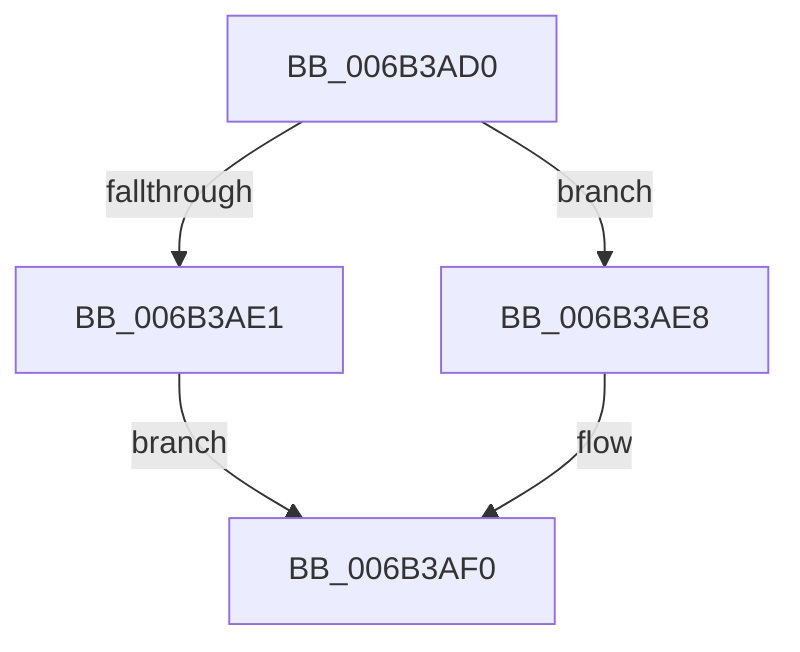

# KiInterruptSubDispatchNoLockNoEtw

- RVA: `0x006B3AD0`–`0x006B3B24` (길이 `84` bytes)
- VA: `0x00000001406B3AD0`
- 실행 섹션: `.text`
- PDB 이름 있음: `예`; PDB Function 태그: `아니요`
- unwind 정보 RVA: `0x000C1FDC`
- 디코드: `22`개 명령, `84/84` bytes 표시
- 미해석 바이트: `0` (있으면 어셈블리에 `.byte`로 보존)

> 이 문서는 커널 이미지의 기계어와 PDB 기호를 분석해 생성했습니다. 4번과 5번은 함수 원형과 자료형을 바이너리 사용 방식에서 추정한 C 해석이며 원본 소스 복구 결과는 아닙니다.

## 1. Dependencies

- 직접 호출 지점: **3**; 고유 호출 대상: **3**
- 직접 호출자로 확인된 함수: **1**
- RIP 상대 이미지 참조: **1**

### Outgoing calls
- `0x006B3AE1` → [KzSetIrqlUnsafe](../5B/KzSetIrqlUnsafe_function_005B8AE0.md) (function, `0x005B8AE0`)
- `0x006B3B03` → [KiStartInterruptCycleAccumulation](../37/KiStartInterruptCycleAccumulation_function_0037B410.md) (function, `0x0037B410`)
- `0x006B3B19` → [KiCallInterruptServiceRoutine](../20/KiCallInterruptServiceRoutine_function_00208970.md) (function, `0x00208970`)

### Direct callers
- [KiInterruptDispatchNoLockNoEtw](KiInterruptDispatchNoLockNoEtw_function_006B42F0.md) at `0x006B4327`

### Static image references
- `0x006B3AD8` → RVA `0x00FC6D20` (`ALMOSTRO`; read)

## 2. Other-region calls and transfers

- 다른 실행 섹션으로 향하는 call: **0**
- 별도 외부 분기/꼬리 이동을 확인하지 못했습니다.

## 3. Assembly (complete function range)

```asm
006B3AD0  48 83 EC 28                     sub rsp, 0x28
006B3AD4  0F B6 4E 5D                     movzx ecx, byte ptr [rsi + 0x5d]
006B3AD8  83 3D 41 32 91 00 00            cmp dword ptr [rip + 0x913241], 0
006B3ADF  74 07                           je 0x1406b3ae8
006B3AE1  E8 FA 4F F0 FF                  call 0x1405b8ae0
006B3AE6  EB 08                           jmp 0x1406b3af0
006B3AE8  44 0F 20 C0                     mov rax, cr8
006B3AEC  44 0F 22 C1                     mov cr8, rcx
006B3AF0  88 45 A9                        mov byte ptr [rbp - 0x57], al
006B3AF3  65 48 8B 0C 25 20 00 00 00      mov rcx, qword ptr gs:[0x20]
006B3AFC  33 D2                           xor edx, edx
006B3AFE  BA 01 00 00 00                  mov edx, 1
006B3B03  E8 08 79 CC FF                  call 0x14037b410
006B3B08  FB                              sti
006B3B09  48 8D 45 80                     lea rax, [rbp - 0x80]
006B3B0D  48 89 86 88 00 00 00            mov qword ptr [rsi + 0x88], rax
006B3B14  33 D2                           xor edx, edx
006B3B16  48 8B CE                        mov rcx, rsi
006B3B19  E8 52 4E B5 FF                  call 0x140208970
006B3B1E  FA                              cli
006B3B1F  48 83 C4 28                     add rsp, 0x28
006B3B23  C3                              ret
```

## 4. C-style interpretation (structured pseudocode)

```c
__int64 __fastcall KiInterruptSubDispatchNoLockNoEtw(__int64 a1, int a2)
{
    __int64 result;
    __int64 v_rsp;

    v_rsp = (v_rsp) - (40);
    if ((*(unsigned int *)(v_rip + 9515585)) == 0) goto loc_006B3AE8;
    result = KzSetIrqlUnsafe(*(unsigned __int8 *)(v_rsi + 93), a2, a3, a4);
    goto loc_006B3AF0;
loc_006B3AE8:
loc_006B3AF0:
    *(unsigned __int8 *)(v_rbp - 87) = (unsigned __int8)(v_cr8);
    a2 = 0;
    result = KiStartInterruptCycleAccumulation(*(unsigned __int64 *)(gs_base + (0 + 32)), 1, a3, a4);
    *(unsigned __int64 *)(v_rsi + 136) = v_rbp - 128;
    a2 = 0;
    result = KiCallInterruptServiceRoutine(v_rsi, a2, a3, a4);
    v_rsp = (v_rsp) + (40);
    return result;
}
```

## 5. (Beta) C Style

```c
int64_t KiInterruptSubDispatchNoLockNoEtw(int64_t Arg1, int32_t Arg2)
{
    int64_t result;
    int64_t local_rsp;

    local_rsp = (local_rsp) - (40);
    if ((*(uint32_t *)(v_rip + 0x913241)) == 0) goto loc_006B3AE8;
    result = KzSetIrqlUnsafe(*(uint8_t *)(local_rsi + 0x5D), Arg2, a3, a4);
    goto loc_006B3AF0;
loc_006B3AE8:
loc_006B3AF0:
    *(uint8_t *)(local_rbp - 0x57) = (uint8_t)(v_cr8);
    Arg2 = 0;
    result = KiStartInterruptCycleAccumulation(*(uint64_t *)(gs_base + (0 + 0x20)), 1, a3, a4);
    *(uint64_t *)(local_rsi + 0x88) = local_rbp - 128;
    Arg2 = 0;
    result = KiCallInterruptServiceRoutine(local_rsi, Arg2, a3, a4);
    local_rsp = (local_rsp) + (40);
    return result;
}
```

## 6. Execution-region graph

[열기: 2D/3D 그래프와 함수 탐색 컨트롤 패널](../../../control-panel.html?section=text&rva=0x006B3AD0&view=graph)

- 2D 그래프는 위에서 아래로 흐르고, 3D 그래프는 빈 공간을 드래그해 회전합니다. Shift+드래그는 이동, 휠은 확대·축소, 함수 노드 선택은 대상 보고서 이동입니다.

### Static fallback


