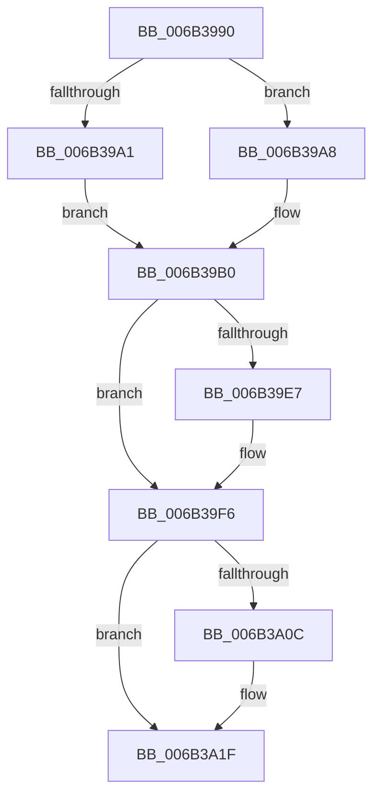

# KiInterruptSubDispatch

- RVA: `0x006B3990`–`0x006B3A25` (길이 `149` bytes)
- VA: `0x00000001406B3990`
- 실행 섹션: `.text`
- PDB 이름 있음: `예`; PDB Function 태그: `아니요`
- unwind 정보 RVA: `0x000C1FB4`
- 디코드: `35`개 명령, `149/149` bytes 표시
- 미해석 바이트: `0` (있으면 어셈블리에 `.byte`로 보존)

> 이 문서는 커널 이미지의 기계어와 PDB 기호를 분석해 생성했습니다. 4번과 5번은 함수 원형과 자료형을 바이너리 사용 방식에서 추정한 C 해석이며 원본 소스 복구 결과는 아닙니다.

## 1. Dependencies

- 직접 호출 지점: **5**; 고유 호출 대상: **5**
- 직접 호출자로 확인된 함수: **1**
- RIP 상대 이미지 참조: **2**

### Outgoing calls
- `0x006B39A1` → [KzSetIrqlUnsafe](../5B/KzSetIrqlUnsafe_function_005B8AE0.md) (function, `0x005B8AE0`)
- `0x006B39C3` → [KiStartInterruptCycleAccumulation](../37/KiStartInterruptCycleAccumulation_function_0037B410.md) (function, `0x0037B410`)
- `0x006B39F1` → [EtwGetKernelTraceTimestamp](../39/EtwGetKernelTraceTimestamp_function_0039FC50.md) (function, `0x0039FC50`)
- `0x006B39FE` → [KiCallInterruptServiceRoutine](../20/KiCallInterruptServiceRoutine_function_00208970.md) (function, `0x00208970`)
- `0x006B3A1A` → [PerfInfoLogInterrupt](../39/PerfInfoLogInterrupt_function_0039FB00.md) (function, `0x0039FB00`)

### Direct callers
- [KiInterruptDispatch](KiInterruptDispatch_function_006B3B30.md) at `0x006B3B67`

### Static image references
- `0x006B3998` → RVA `0x00FC6D20` (`ALMOSTRO`; read)
- `0x006B39D4` → RVA `0x00FC6B04` (`ALMOSTRO`; read)

## 2. Other-region calls and transfers

- 다른 실행 섹션으로 향하는 call: **0**
- 별도 외부 분기/꼬리 이동을 확인하지 못했습니다.

## 3. Assembly (complete function range)

```asm
006B3990  48 83 EC 48                     sub rsp, 0x48
006B3994  0F B6 4E 5D                     movzx ecx, byte ptr [rsi + 0x5d]
006B3998  83 3D 81 33 91 00 00            cmp dword ptr [rip + 0x913381], 0
006B399F  74 07                           je 0x1406b39a8
006B39A1  E8 3A 51 F0 FF                  call 0x1405b8ae0
006B39A6  EB 08                           jmp 0x1406b39b0
006B39A8  44 0F 20 C0                     mov rax, cr8
006B39AC  44 0F 22 C1                     mov cr8, rcx
006B39B0  88 45 A9                        mov byte ptr [rbp - 0x57], al
006B39B3  65 48 8B 0C 25 20 00 00 00      mov rcx, qword ptr gs:[0x20]
006B39BC  33 D2                           xor edx, edx
006B39BE  BA 01 00 00 00                  mov edx, 1
006B39C3  E8 48 7A CC FF                  call 0x14037b410
006B39C8  FB                              sti
006B39C9  48 8D 45 80                     lea rax, [rbp - 0x80]
006B39CD  48 89 86 88 00 00 00            mov qword ptr [rsi + 0x88], rax
006B39D4  F7 05 26 31 91 00 00 40 00 00   test dword ptr [rip + 0x913126], 0x4000
006B39DE  0F 95 85 F3 00 00 00            setne byte ptr [rbp + 0xf3]
006B39E5  74 0F                           je 0x1406b39f6
006B39E7  48 8D 4C 24 20                  lea rcx, [rsp + 0x20]
006B39EC  BA 00 40 00 20                  mov edx, 0x20004000
006B39F1  E8 5A C2 CE FF                  call 0x14039fc50
006B39F6  BA 01 00 00 00                  mov edx, 1
006B39FB  48 8B CE                        mov rcx, rsi
006B39FE  E8 6D 4F B5 FF                  call 0x140208970
006B3A03  F6 85 F3 00 00 00 FF            test byte ptr [rbp + 0xf3], 0xff
006B3A0A  74 13                           je 0x1406b3a1f
006B3A0C  4C 8D 44 24 20                  lea r8, [rsp + 0x20]
006B3A11  0F B6 D0                        movzx edx, al
006B3A14  8A 76 58                        mov dh, byte ptr [rsi + 0x58]
006B3A17  48 8B CE                        mov rcx, rsi
006B3A1A  E8 E1 C0 CE FF                  call 0x14039fb00
006B3A1F  FA                              cli
006B3A20  48 83 C4 48                     add rsp, 0x48
006B3A24  C3                              ret
```

## 4. C-style interpretation (structured pseudocode)

```c
__int64 __fastcall KiInterruptSubDispatch(__int64 a1, int a2)
{
    __int64 result;
    __int64 v_rsp;
    unsigned __int64 v_stack_m28;

    v_rsp = (v_rsp) - (72);
    if ((*(unsigned int *)(v_rip + 9515905)) == 0) goto loc_006B39A8;
    result = KzSetIrqlUnsafe(*(unsigned __int8 *)(v_rsi + 93), a2, a3, a4);
    goto loc_006B39B0;
loc_006B39A8:
loc_006B39B0:
    *(unsigned __int8 *)(v_rbp - 87) = (unsigned __int8)(v_cr8);
    a2 = 0;
    result = KiStartInterruptCycleAccumulation(*(unsigned __int64 *)(gs_base + (0 + 32)), 1, a3, a4);
    *(unsigned __int64 *)(v_rsi + 136) = v_rbp - 128;
    result = v_rbp - 128;
    if (((*(unsigned int *)(v_rip + 9515302)) & (0x4000ULL)) != 0) {
        a1 = v_stack_m28;
        a2 = 0x20004000ULL;
        result = EtwGetKernelTraceTimestamp(a1, a2, a3, a4);
    }
    result = KiCallInterruptServiceRoutine(v_rsi, 1, a3, a4);
    if (((*(unsigned __int8 *)(v_rbp + 243)) & (255)) != 0) {
        a3 = v_stack_m28;
        a2 = (unsigned __int8)(result);
        a2 = *(unsigned __int8 *)(v_rsi + 88);
        a1 = v_rsi;
        result = PerfInfoLogInterrupt(a1, a2, a3, a4);
    }
    v_rsp = (v_rsp) + (72);
    return result;
}
```

## 5. (Beta) C Style

```c
int64_t KiInterruptSubDispatch(int64_t Arg1, int32_t Arg2)
{
    int64_t result;
    int64_t local_rsp;
    uint64_t v_stack_m28;

    local_rsp = (local_rsp) - (72);
    if ((*(uint32_t *)(v_rip + 0x913381)) == 0) goto loc_006B39A8;
    result = KzSetIrqlUnsafe(*(uint8_t *)(local_rsi + 0x5D), Arg2, a3, a4);
    goto loc_006B39B0;
loc_006B39A8:
loc_006B39B0:
    *(uint8_t *)(local_rbp - 0x57) = (uint8_t)(v_cr8);
    Arg2 = 0;
    result = KiStartInterruptCycleAccumulation(*(uint64_t *)(gs_base + (0 + 0x20)), 1, a3, a4);
    *(uint64_t *)(local_rsi + 0x88) = local_rbp - 128;
    result = local_rbp - 128;
    if (((*(uint32_t *)(v_rip + 0x913126)) & (0x4000ULL)) != 0) {
        Arg1 = v_stack_m28;
        Arg2 = 0x20004000ULL;
        result = EtwGetKernelTraceTimestamp(Arg1, Arg2, a3, a4);
    }
    result = KiCallInterruptServiceRoutine(local_rsi, 1, a3, a4);
    if (((*(uint8_t *)(local_rbp + 0xF3)) & (255)) != 0) {
        a3 = v_stack_m28;
        Arg2 = (uint8_t)(result);
        Arg2 = *(uint8_t *)(local_rsi + 0x58);
        Arg1 = local_rsi;
        result = PerfInfoLogInterrupt(Arg1, Arg2, a3, a4);
    }
    local_rsp = (local_rsp) + (72);
    return result;
}
```

## 6. Execution-region graph

[열기: 2D/3D 그래프와 함수 탐색 컨트롤 패널](../../../control-panel.html?section=text&rva=0x006B3990&view=graph)

- 2D 그래프는 위에서 아래로 흐르고, 3D 그래프는 빈 공간을 드래그해 회전합니다. Shift+드래그는 이동, 휠은 확대·축소, 함수 노드 선택은 대상 보고서 이동입니다.

### Static fallback


