# KiInvalidTssFault

- RVA: `0x006BF8C0`–`0x006BFC21` (길이 `865` bytes)
- VA: `0x00000001406BF8C0`
- 실행 섹션: `.text`
- PDB 이름 있음: `예`; PDB Function 태그: `아니요`
- unwind 정보 RVA: `0x000C1C2C`
- 디코드: `186`개 명령, `865/865` bytes 표시
- 미해석 바이트: `0` (있으면 어셈블리에 `.byte`로 보존)

> 이 문서는 커널 이미지의 기계어와 PDB 기호를 분석해 생성했습니다. 4번과 5번은 함수 원형과 자료형을 바이너리 사용 방식에서 추정한 C 해석이며 원본 소스 복구 결과는 아닙니다.

## 1. Dependencies

- 직접 호출 지점: **36**; 고유 호출 대상: **36**
- 직접 호출자로 확인된 함수: **1**
- RIP 상대 이미지 참조: **3**

### Outgoing calls
- `0x006BFA12` → [KiInvalidTssFault + 0x265](KiInvalidTssFault_function_006BF8C0.md) (inside-function, `0x006BFB25`)
- `0x006BFA1B` → [KiInvalidTssFault + 0x26E](KiInvalidTssFault_function_006BF8C0.md) (inside-function, `0x006BFB2E`)
- `0x006BFA24` → [KiInvalidTssFault + 0x157](KiInvalidTssFault_function_006BF8C0.md) (inside-function, `0x006BFA17`)
- `0x006BFA2D` → [KiInvalidTssFault + 0x160](KiInvalidTssFault_function_006BF8C0.md) (inside-function, `0x006BFA20`)
- `0x006BFA36` → [KiInvalidTssFault + 0x169](KiInvalidTssFault_function_006BF8C0.md) (inside-function, `0x006BFA29`)
- `0x006BFA3F` → [KiInvalidTssFault + 0x172](KiInvalidTssFault_function_006BF8C0.md) (inside-function, `0x006BFA32`)
- `0x006BFA48` → [KiInvalidTssFault + 0x17B](KiInvalidTssFault_function_006BF8C0.md) (inside-function, `0x006BFA3B`)
- `0x006BFA51` → [KiInvalidTssFault + 0x184](KiInvalidTssFault_function_006BF8C0.md) (inside-function, `0x006BFA44`)
- `0x006BFA5A` → [KiInvalidTssFault + 0x18D](KiInvalidTssFault_function_006BF8C0.md) (inside-function, `0x006BFA4D`)
- `0x006BFA63` → [KiInvalidTssFault + 0x196](KiInvalidTssFault_function_006BF8C0.md) (inside-function, `0x006BFA56`)
- `0x006BFA6C` → [KiInvalidTssFault + 0x19F](KiInvalidTssFault_function_006BF8C0.md) (inside-function, `0x006BFA5F`)
- `0x006BFA75` → [KiInvalidTssFault + 0x1A8](KiInvalidTssFault_function_006BF8C0.md) (inside-function, `0x006BFA68`)
- `0x006BFA7E` → [KiInvalidTssFault + 0x1B1](KiInvalidTssFault_function_006BF8C0.md) (inside-function, `0x006BFA71`)
- `0x006BFA87` → [KiInvalidTssFault + 0x1BA](KiInvalidTssFault_function_006BF8C0.md) (inside-function, `0x006BFA7A`)
- `0x006BFA90` → [KiInvalidTssFault + 0x1C3](KiInvalidTssFault_function_006BF8C0.md) (inside-function, `0x006BFA83`)
- `0x006BFA99` → [KiInvalidTssFault + 0x1CC](KiInvalidTssFault_function_006BF8C0.md) (inside-function, `0x006BFA8C`)
- `0x006BFAA2` → [KiInvalidTssFault + 0x1D5](KiInvalidTssFault_function_006BF8C0.md) (inside-function, `0x006BFA95`)
- `0x006BFAAB` → [KiInvalidTssFault + 0x1DE](KiInvalidTssFault_function_006BF8C0.md) (inside-function, `0x006BFA9E`)
- `0x006BFAB4` → [KiInvalidTssFault + 0x1E7](KiInvalidTssFault_function_006BF8C0.md) (inside-function, `0x006BFAA7`)
- `0x006BFABD` → [KiInvalidTssFault + 0x1F0](KiInvalidTssFault_function_006BF8C0.md) (inside-function, `0x006BFAB0`)
- `0x006BFAC6` → [KiInvalidTssFault + 0x1F9](KiInvalidTssFault_function_006BF8C0.md) (inside-function, `0x006BFAB9`)
- `0x006BFACF` → [KiInvalidTssFault + 0x202](KiInvalidTssFault_function_006BF8C0.md) (inside-function, `0x006BFAC2`)
- `0x006BFAD8` → [KiInvalidTssFault + 0x20B](KiInvalidTssFault_function_006BF8C0.md) (inside-function, `0x006BFACB`)
- `0x006BFAE1` → [KiInvalidTssFault + 0x214](KiInvalidTssFault_function_006BF8C0.md) (inside-function, `0x006BFAD4`)
- `0x006BFAEA` → [KiInvalidTssFault + 0x21D](KiInvalidTssFault_function_006BF8C0.md) (inside-function, `0x006BFADD`)
- `0x006BFAF3` → [KiInvalidTssFault + 0x226](KiInvalidTssFault_function_006BF8C0.md) (inside-function, `0x006BFAE6`)
- `0x006BFAFC` → [KiInvalidTssFault + 0x22F](KiInvalidTssFault_function_006BF8C0.md) (inside-function, `0x006BFAEF`)
- `0x006BFB05` → [KiInvalidTssFault + 0x238](KiInvalidTssFault_function_006BF8C0.md) (inside-function, `0x006BFAF8`)
- `0x006BFB0E` → [KiInvalidTssFault + 0x241](KiInvalidTssFault_function_006BF8C0.md) (inside-function, `0x006BFB01`)
- `0x006BFB17` → [KiInvalidTssFault + 0x24A](KiInvalidTssFault_function_006BF8C0.md) (inside-function, `0x006BFB0A`)
- `0x006BFB20` → [KiInvalidTssFault + 0x253](KiInvalidTssFault_function_006BF8C0.md) (inside-function, `0x006BFB13`)
- `0x006BFB29` → [KiInvalidTssFault + 0x25C](KiInvalidTssFault_function_006BF8C0.md) (inside-function, `0x006BFB1C`)
- `0x006BFB54` → [KiFlushBhbDuringTrapEntryOrExit](../6C/KiFlushBhbDuringTrapEntryOrExit_function_006C6340.md) (function, `0x006C6340`)
- `0x006BFB9D` → [KiSaveDebugRegisterState](../4F/KiSaveDebugRegisterState_function_004FD960.md) (function, `0x004FD960`)
- `0x006BFBD1` → [KiSynchronizeUserIsolationDomainExit](../41/KiSynchronizeUserIsolationDomainExit_function_0041BFA0.md) (function, `0x0041BFA0`)
- `0x006BFC1A` → [KiBugCheckDispatch](../6C/KiBugCheckDispatch_function_006C5880.md) (function, `0x006C5880`)

### Direct callers
- [KiInvalidTssFault](KiInvalidTssFault_function_006BF8C0.md) at `0x006BFA12`
- [KiInvalidTssFault](KiInvalidTssFault_function_006BF8C0.md) at `0x006BFA1B`
- [KiInvalidTssFault](KiInvalidTssFault_function_006BF8C0.md) at `0x006BFA24`
- [KiInvalidTssFault](KiInvalidTssFault_function_006BF8C0.md) at `0x006BFA2D`
- [KiInvalidTssFault](KiInvalidTssFault_function_006BF8C0.md) at `0x006BFA36`
- [KiInvalidTssFault](KiInvalidTssFault_function_006BF8C0.md) at `0x006BFA3F`
- [KiInvalidTssFault](KiInvalidTssFault_function_006BF8C0.md) at `0x006BFA48`
- [KiInvalidTssFault](KiInvalidTssFault_function_006BF8C0.md) at `0x006BFA51`
- [KiInvalidTssFault](KiInvalidTssFault_function_006BF8C0.md) at `0x006BFA5A`
- [KiInvalidTssFault](KiInvalidTssFault_function_006BF8C0.md) at `0x006BFA63`
- [KiInvalidTssFault](KiInvalidTssFault_function_006BF8C0.md) at `0x006BFA6C`
- [KiInvalidTssFault](KiInvalidTssFault_function_006BF8C0.md) at `0x006BFA75`
- [KiInvalidTssFault](KiInvalidTssFault_function_006BF8C0.md) at `0x006BFA7E`
- [KiInvalidTssFault](KiInvalidTssFault_function_006BF8C0.md) at `0x006BFA87`
- [KiInvalidTssFault](KiInvalidTssFault_function_006BF8C0.md) at `0x006BFA90`
- [KiInvalidTssFault](KiInvalidTssFault_function_006BF8C0.md) at `0x006BFA99`
- [KiInvalidTssFault](KiInvalidTssFault_function_006BF8C0.md) at `0x006BFAA2`
- [KiInvalidTssFault](KiInvalidTssFault_function_006BF8C0.md) at `0x006BFAAB`
- [KiInvalidTssFault](KiInvalidTssFault_function_006BF8C0.md) at `0x006BFAB4`
- [KiInvalidTssFault](KiInvalidTssFault_function_006BF8C0.md) at `0x006BFABD`
- [KiInvalidTssFault](KiInvalidTssFault_function_006BF8C0.md) at `0x006BFAC6`
- [KiInvalidTssFault](KiInvalidTssFault_function_006BF8C0.md) at `0x006BFACF`
- [KiInvalidTssFault](KiInvalidTssFault_function_006BF8C0.md) at `0x006BFAD8`
- [KiInvalidTssFault](KiInvalidTssFault_function_006BF8C0.md) at `0x006BFAE1`
- [KiInvalidTssFault](KiInvalidTssFault_function_006BF8C0.md) at `0x006BFAEA`
- [KiInvalidTssFault](KiInvalidTssFault_function_006BF8C0.md) at `0x006BFAF3`
- [KiInvalidTssFault](KiInvalidTssFault_function_006BF8C0.md) at `0x006BFAFC`
- [KiInvalidTssFault](KiInvalidTssFault_function_006BF8C0.md) at `0x006BFB05`
- [KiInvalidTssFault](KiInvalidTssFault_function_006BF8C0.md) at `0x006BFB0E`
- [KiInvalidTssFault](KiInvalidTssFault_function_006BF8C0.md) at `0x006BFB17`
- [KiInvalidTssFault](KiInvalidTssFault_function_006BF8C0.md) at `0x006BFB20`
- [KiInvalidTssFault](KiInvalidTssFault_function_006BF8C0.md) at `0x006BFB29`

### Static image references
- `0x006BF931` → RVA `0x01201840` (`CFGRO`; read)
- `0x006BFB65` → RVA `0x00FC7264` (`ALMOSTRO`; read)
- `0x006BFBD6` → RVA `0x00FC6BF0` (`ALMOSTRO`; read)

## 2. Other-region calls and transfers

- 다른 실행 섹션으로 향하는 call: **0**
- 별도 외부 분기/꼬리 이동을 확인하지 못했습니다.

## 3. Assembly (complete function range)

```asm
006BF8C0  55                              push rbp
006BF8C1  48 81 EC 58 01 00 00            sub rsp, 0x158
006BF8C8  48 8D AC 24 80 00 00 00         lea rbp, [rsp + 0x80]
006BF8D0  C6 45 AB 01                     mov byte ptr [rbp - 0x55], 1
006BF8D4  48 89 45 B0                     mov qword ptr [rbp - 0x50], rax
006BF8D8  48 89 4D B8                     mov qword ptr [rbp - 0x48], rcx
006BF8DC  48 89 55 C0                     mov qword ptr [rbp - 0x40], rdx
006BF8E0  4C 89 45 C8                     mov qword ptr [rbp - 0x38], r8
006BF8E4  4C 89 4D D0                     mov qword ptr [rbp - 0x30], r9
006BF8E8  4C 89 55 D8                     mov qword ptr [rbp - 0x28], r10
006BF8EC  4C 89 5D E0                     mov qword ptr [rbp - 0x20], r11
006BF8F0  F6 85 F0 00 00 00 01            test byte ptr [rbp + 0xf0], 1
006BF8F7  75 38                           jne 0x1406bf931
006BF8F9  33 D2                           xor edx, edx
006BF8FB  F3 48 0F 1E CA                  rdsspq rdx
006BF900  48 89 55 58                     mov qword ptr [rbp + 0x58], rdx
006BF904  0F AE E8                        lfence
006BF907  65 F6 04 25 58 08 00 00 01      test byte ptr gs:[0x858], 1
006BF910  75 08                           jne 0x1406bf91a
006BF912  0F AE E8                        lfence
006BF915  E9 88 02 00 00                  jmp 0x1406bfba2
006BF91A  65 0F B7 04 25 66 08 00 00      movzx eax, word ptr gs:[0x866]
006BF923  B9 48 00 00 00                  mov ecx, 0x48
006BF928  33 D2                           xor edx, edx
006BF92A  0F 30                           wrmsr
006BF92C  E9 71 02 00 00                  jmp 0x1406bfba2
006BF931  F6 05 08 1F B4 00 01            test byte ptr [rip + 0xb41f08], 1
006BF938  75 03                           jne 0x1406bf93d
006BF93A  0F 01 F8                        swapgs
006BF93D  0F AE E8                        lfence
006BF940  65 48 8B 0C 25 28 9D 00 00      mov rcx, qword ptr gs:[0x9d28]
006BF949  48 85 C9                        test rcx, rcx
006BF94C  74 1F                           je 0x1406bf96d
006BF94E  F3 48 0F 1E CA                  rdsspq rdx
006BF953  65 4C 8B 14 25 20 9D 00 00      mov r10, qword ptr gs:[0x9d20]
006BF95C  49 83 C2 08                     add r10, 8
006BF960  49 3B D2                        cmp rdx, r10
006BF963  75 08                           jne 0x1406bf96d
006BF965  F3 0F 01 29                     rstorssp dword ptr [rcx]
006BF969  F3 0F 01 EA                     saveprevssp
006BF96D  65 4C 8B 14 25 88 01 00 00      mov r10, qword ptr gs:[0x188]
006BF976  65 48 8B 0C 25 88 01 00 00      mov rcx, qword ptr gs:[0x188]
006BF97F  48 8B 89 20 02 00 00            mov rcx, qword ptr [rcx + 0x220]
006BF986  48 8B 89 60 07 00 00            mov rcx, qword ptr [rcx + 0x760]
006BF98D  65 48 89 0C 25 50 08 00 00      mov qword ptr gs:[0x850], rcx
006BF996  66 65 8B 0C 25 62 08 00 00      mov cx, word ptr gs:[0x862]
006BF99F  66 65 89 0C 25 64 08 00 00      mov word ptr gs:[0x864], cx
006BF9A8  65 8A 0C 25 58 08 00 00         mov cl, byte ptr gs:[0x858]
006BF9B0  65 88 0C 25 5A 08 00 00         mov byte ptr gs:[0x85a], cl
006BF9B8  65 0F B7 04 25 68 08 00 00      movzx eax, word ptr gs:[0x868]
006BF9C1  66 65 39 04 25 66 08 00 00      cmp word ptr gs:[0x866], ax
006BF9CA  74 12                           je 0x1406bf9de
006BF9CC  66 65 89 04 25 66 08 00 00      mov word ptr gs:[0x866], ax
006BF9D5  B9 48 00 00 00                  mov ecx, 0x48
006BF9DA  33 D2                           xor edx, edx
006BF9DC  0F 30                           wrmsr
006BF9DE  65 0F B6 14 25 58 08 00 00      movzx edx, byte ptr gs:[0x858]
006BF9E7  F7 C2 08 00 00 00               test edx, 8
006BF9ED  74 17                           je 0x1406bfa06
006BF9EF  B8 01 00 00 00                  mov eax, 1
006BF9F4  33 D2                           xor edx, edx
006BF9F6  B9 49 00 00 00                  mov ecx, 0x49
006BF9FB  0F 30                           wrmsr
006BF9FD  65 0F B6 14 25 58 08 00 00      movzx edx, byte ptr gs:[0x858]
006BFA06  F7 C2 02 00 00 00               test edx, 2
006BFA0C  0F 84 37 01 00 00               je 0x1406bfb49
006BFA12  E8 0E 01 00 00                  call 0x1406bfb25
006BFA17  48 83 C4 08                     add rsp, 8
006BFA1B  E8 0E 01 00 00                  call 0x1406bfb2e
006BFA20  48 83 C4 08                     add rsp, 8
006BFA24  E8 EE FF FF FF                  call 0x1406bfa17
006BFA29  48 83 C4 08                     add rsp, 8
006BFA2D  E8 EE FF FF FF                  call 0x1406bfa20
006BFA32  48 83 C4 08                     add rsp, 8
006BFA36  E8 EE FF FF FF                  call 0x1406bfa29
006BFA3B  48 83 C4 08                     add rsp, 8
006BFA3F  E8 EE FF FF FF                  call 0x1406bfa32
006BFA44  48 83 C4 08                     add rsp, 8
006BFA48  E8 EE FF FF FF                  call 0x1406bfa3b
006BFA4D  48 83 C4 08                     add rsp, 8
006BFA51  E8 EE FF FF FF                  call 0x1406bfa44
006BFA56  48 83 C4 08                     add rsp, 8
006BFA5A  E8 EE FF FF FF                  call 0x1406bfa4d
006BFA5F  48 83 C4 08                     add rsp, 8
006BFA63  E8 EE FF FF FF                  call 0x1406bfa56
006BFA68  48 83 C4 08                     add rsp, 8
006BFA6C  E8 EE FF FF FF                  call 0x1406bfa5f
006BFA71  48 83 C4 08                     add rsp, 8
006BFA75  E8 EE FF FF FF                  call 0x1406bfa68
006BFA7A  48 83 C4 08                     add rsp, 8
006BFA7E  E8 EE FF FF FF                  call 0x1406bfa71
006BFA83  48 83 C4 08                     add rsp, 8
006BFA87  E8 EE FF FF FF                  call 0x1406bfa7a
006BFA8C  48 83 C4 08                     add rsp, 8
006BFA90  E8 EE FF FF FF                  call 0x1406bfa83
006BFA95  48 83 C4 08                     add rsp, 8
006BFA99  E8 EE FF FF FF                  call 0x1406bfa8c
006BFA9E  48 83 C4 08                     add rsp, 8
006BFAA2  E8 EE FF FF FF                  call 0x1406bfa95
006BFAA7  48 83 C4 08                     add rsp, 8
006BFAAB  E8 EE FF FF FF                  call 0x1406bfa9e
006BFAB0  48 83 C4 08                     add rsp, 8
006BFAB4  E8 EE FF FF FF                  call 0x1406bfaa7
006BFAB9  48 83 C4 08                     add rsp, 8
006BFABD  E8 EE FF FF FF                  call 0x1406bfab0
006BFAC2  48 83 C4 08                     add rsp, 8
006BFAC6  E8 EE FF FF FF                  call 0x1406bfab9
006BFACB  48 83 C4 08                     add rsp, 8
006BFACF  E8 EE FF FF FF                  call 0x1406bfac2
006BFAD4  48 83 C4 08                     add rsp, 8
006BFAD8  E8 EE FF FF FF                  call 0x1406bfacb
006BFADD  48 83 C4 08                     add rsp, 8
006BFAE1  E8 EE FF FF FF                  call 0x1406bfad4
006BFAE6  48 83 C4 08                     add rsp, 8
006BFAEA  E8 EE FF FF FF                  call 0x1406bfadd
006BFAEF  48 83 C4 08                     add rsp, 8
006BFAF3  E8 EE FF FF FF                  call 0x1406bfae6
006BFAF8  48 83 C4 08                     add rsp, 8
006BFAFC  E8 EE FF FF FF                  call 0x1406bfaef
006BFB01  48 83 C4 08                     add rsp, 8
006BFB05  E8 EE FF FF FF                  call 0x1406bfaf8
006BFB0A  48 83 C4 08                     add rsp, 8
006BFB0E  E8 EE FF FF FF                  call 0x1406bfb01
006BFB13  48 83 C4 08                     add rsp, 8
006BFB17  E8 EE FF FF FF                  call 0x1406bfb0a
006BFB1C  48 83 C4 08                     add rsp, 8
006BFB20  E8 EE FF FF FF                  call 0x1406bfb13
006BFB25  48 83 C4 08                     add rsp, 8
006BFB29  E8 EE FF FF FF                  call 0x1406bfb1c
006BFB2E  48 83 C4 08                     add rsp, 8
006BFB32  B8 DA DA 00 00                  mov eax, 0xdada
006BFB37  65 F6 04 25 5C 08 00 00 08      test byte ptr gs:[0x85c], 8
006BFB40  74 07                           je 0x1406bfb49
006BFB42  B0 20                           mov al, 0x20
006BFB44  F3 48 0F AE E8                  incsspq rax
006BFB49  F7 C2 80 00 00 00               test edx, 0x80
006BFB4F  74 08                           je 0x1406bfb59
006BFB51  0F AE E8                        lfence
006BFB54  E8 E7 67 00 00                  call 0x1406c6340
006BFB59  0F AE E8                        lfence
006BFB5C  65 C6 04 25 5E 08 00 00 00      mov byte ptr gs:[0x85e], 0
006BFB65  83 3D F8 76 90 00 00            cmp dword ptr [rip + 0x9076f8], 0
006BFB6C  74 1F                           je 0x1406bfb8d
006BFB6E  B9 A7 06 00 00                  mov ecx, 0x6a7
006BFB73  0F 32                           rdmsr
006BFB75  83 FA 00                        cmp edx, 0
006BFB78  74 13                           je 0x1406bfb8d
006BFB7A  8B CA                           mov ecx, edx
006BFB7C  23 15 E2 76 90 00               and edx, dword ptr [rip + 0x9076e2]
006BFB82  3B D1                           cmp edx, ecx
006BFB84  74 07                           je 0x1406bfb8d
006BFB86  B9 A7 06 00 00                  mov ecx, 0x6a7
006BFB8B  0F 30                           wrmsr
006BFB8D  41 F6 42 03 03                  test byte ptr [r10 + 3], 3
006BFB92  66 C7 85 80 00 00 00 00 00      mov word ptr [rbp + 0x80], 0
006BFB9B  74 05                           je 0x1406bfba2
006BFB9D  E8 BE DD E3 FF                  call 0x1404fd960
006BFBA2  FC                              cld
006BFBA3  0F AE 5D AC                     stmxcsr dword ptr [rbp - 0x54]
006BFBA7  65 0F AE 14 25 80 01 00 00      ldmxcsr dword ptr gs:[0x180]
006BFBB0  0F 29 45 F0                     movaps xmmword ptr [rbp - 0x10], xmm0
006BFBB4  0F 29 4D 00                     movaps xmmword ptr [rbp], xmm1
006BFBB8  0F 29 55 10                     movaps xmmword ptr [rbp + 0x10], xmm2
006BFBBC  0F 29 5D 20                     movaps xmmword ptr [rbp + 0x20], xmm3
006BFBC0  0F 29 65 30                     movaps xmmword ptr [rbp + 0x30], xmm4
006BFBC4  0F 29 6D 40                     movaps xmmword ptr [rbp + 0x40], xmm5
006BFBC8  F6 85 F0 00 00 00 01            test byte ptr [rbp + 0xf0], 1
006BFBCF  74 05                           je 0x1406bfbd6
006BFBD1  E8 CA C3 D5 FF                  call 0x14041bfa0
006BFBD6  F6 05 13 70 90 00 FF            test byte ptr [rip + 0x907013], 0xff
006BFBDD  74 0C                           je 0x1406bfbeb
006BFBDF  F6 85 F0 00 00 00 01            test byte ptr [rbp + 0xf0], 1
006BFBE6  74 03                           je 0x1406bfbeb
006BFBE8  0F 01 CB                        stac
006BFBEB  8B 85 E0 00 00 00               mov eax, dword ptr [rbp + 0xe0]
006BFBF1  F7 85 F8 00 00 00 00 02 00 00   test dword ptr [rbp + 0xf8], 0x200
006BFBFB  74 01                           je 0x1406bfbfe
006BFBFD  FB                              sti
006BFBFE  4C 8B 95 E8 00 00 00            mov r10, qword ptr [rbp + 0xe8]
006BFC05  44 8B 8D E0 00 00 00            mov r9d, dword ptr [rbp + 0xe0]
006BFC0C  41 0F 20 C0                     mov r8, cr0
006BFC10  BA 0A 00 00 00                  mov edx, 0xa
006BFC15  B9 7F 00 00 00                  mov ecx, 0x7f
006BFC1A  E8 61 5C 00 00                  call 0x1406c5880
006BFC1F  90                              nop
006BFC20  C3                              ret
```

## 4. C-style interpretation (structured pseudocode)

```c
__int64 __fastcall KiInvalidTssFault(__int64 a1, __int64 a2, __int64 a3, __int64 a4)
{
    __int64 result;
    __int64 v_r10;
    __int64 v_rsp;
    unsigned __int64 v_stack_m100;
    unsigned __int64 v_stack_m108;
    unsigned __int64 v_stack_m110;
    unsigned __int64 v_stack_m118;
    unsigned __int64 v_stack_m120;
    unsigned __int64 v_stack_m128;
    unsigned __int64 v_stack_m130;
    unsigned int v_stack_m134;
    unsigned __int8 v_stack_m135;
    unsigned __int16 v_stack_m60;
    unsigned __int64 v_stack_m88;
    unsigned __int64 v_stack_mA0;
    unsigned __int64 v_stack_mB0;
    unsigned __int64 v_stack_mC0;
    unsigned __int64 v_stack_mD0;
    unsigned __int64 v_stack_mE0;
    unsigned __int64 v_stack_mF0;
    unsigned int v_stack_p0;
    unsigned __int8 v_stack_p10;
    unsigned int v_stack_p18;
    unsigned __int64 v_stack_p8;

    v_rsp = (v_rsp) - (344);
    v_stack_m135 = 1;
    v_stack_m130 = result;
    v_stack_m128 = a1;
    v_stack_m120 = a2;
    v_stack_m118 = a3;
    v_stack_m110 = a4;
    v_stack_m108 = v_r10;
    v_stack_m100 = v_r11;
    if (((v_stack_p10) & (1)) != 0) goto loc_006BF931;
    a2 = 0;
    v_stack_m88 = 0;
    if (((*(unsigned __int8 *)(gs_base + (0 + 2136))) & (1)) != 0) goto loc_006BF91A;
    goto loc_006BFBA2;
loc_006BF91A:
    a2 = 0;
    goto loc_006BFBA2;
loc_006BF931:
    if (((*(unsigned __int8 *)(v_rip + 11804424)) & (1)) == 0) {
    }
    if (*(unsigned __int64 *)(gs_base + (0 + 40232)) == 0) goto loc_006BF96D;
    v_r10 = (*(unsigned __int64 *)(gs_base + (0 + 40224))) + (8);
    if (0 == v_r10) {
    }
    *(unsigned __int64 *)(gs_base + (0 + 2128)) = *(unsigned __int64 *)(*(unsigned __int64 *)(*(unsigned __int64 *)(gs_base + (0 + 392)) + 544) + 1888);
    *(unsigned __int16 *)(gs_base + (0 + 2148)) = (unsigned __int16)(*(unsigned __int16 *)(gs_base + (0 + 2146)));
    *(unsigned __int8 *)(gs_base + (0 + 2138)) = (unsigned __int8)(*(unsigned __int8 *)(gs_base + (0 + 2136)));
    if ((*(unsigned __int16 *)(gs_base + (0 + 2150))) != ((unsigned __int16)(*(unsigned __int16 *)(gs_base + (0 + 2152))))) {
        *(unsigned __int16 *)(gs_base + (0 + 2150)) = (unsigned __int16)(*(unsigned __int16 *)(gs_base + (0 + 2152)));
        a1 = 72;
        a2 = 0;
    }
    result = *(unsigned __int16 *)(gs_base + (0 + 2152));
    if ((((unsigned int)(*(unsigned __int8 *)(gs_base + (0 + 2136)))) & (8)) != 0) {
        result = 1;
        a2 = 0;
        a1 = 73;
        a2 = *(unsigned __int8 *)(gs_base + (0 + 2136));
    }
    if ((((unsigned int)(a2)) & (2)) == 0) goto loc_006BFB49;
    result = KiInvalidTssFault___0x265(a1, a2, a3, a4);
    v_rsp = (v_rsp) + (8);
    result = KiInvalidTssFault___0x26E(a1, a2, a3, a4);
    v_rsp = (v_rsp) + (8);
    result = KiInvalidTssFault___0x157(a1, a2, a3, a4);
    v_rsp = (v_rsp) + (8);
    result = KiInvalidTssFault___0x160(a1, a2, a3, a4);
    v_rsp = (v_rsp) + (8);
    result = KiInvalidTssFault___0x169(a1, a2, a3, a4);
    v_rsp = (v_rsp) + (8);
    result = KiInvalidTssFault___0x172(a1, a2, a3, a4);
    v_rsp = (v_rsp) + (8);
    result = KiInvalidTssFault___0x17B(a1, a2, a3, a4);
    v_rsp = (v_rsp) + (8);
    result = KiInvalidTssFault___0x184(a1, a2, a3, a4);
    v_rsp = (v_rsp) + (8);
    result = KiInvalidTssFault___0x18D(a1, a2, a3, a4);
    v_rsp = (v_rsp) + (8);
    result = KiInvalidTssFault___0x196(a1, a2, a3, a4);
    v_rsp = (v_rsp) + (8);
    result = KiInvalidTssFault___0x19F(a1, a2, a3, a4);
    v_rsp = (v_rsp) + (8);
    result = KiInvalidTssFault___0x1A8(a1, a2, a3, a4);
    v_rsp = (v_rsp) + (8);
    result = KiInvalidTssFault___0x1B1(a1, a2, a3, a4);
    v_rsp = (v_rsp) + (8);
    result = KiInvalidTssFault___0x1BA(a1, a2, a3, a4);
    v_rsp = (v_rsp) + (8);
    result = KiInvalidTssFault___0x1C3(a1, a2, a3, a4);
    v_rsp = (v_rsp) + (8);
    result = KiInvalidTssFault___0x1CC(a1, a2, a3, a4);
    v_rsp = (v_rsp) + (8);
    result = KiInvalidTssFault___0x1D5(a1, a2, a3, a4);
    v_rsp = (v_rsp) + (8);
    result = KiInvalidTssFault___0x1DE(a1, a2, a3, a4);
    v_rsp = (v_rsp) + (8);
    result = KiInvalidTssFault___0x1E7(a1, a2, a3, a4);
    v_rsp = (v_rsp) + (8);
    result = KiInvalidTssFault___0x1F0(a1, a2, a3, a4);
    v_rsp = (v_rsp) + (8);
    result = KiInvalidTssFault___0x1F9(a1, a2, a3, a4);
    v_rsp = (v_rsp) + (8);
    result = KiInvalidTssFault___0x202(a1, a2, a3, a4);
    v_rsp = (v_rsp) + (8);
    result = KiInvalidTssFault___0x20B(a1, a2, a3, a4);
    v_rsp = (v_rsp) + (8);
    result = KiInvalidTssFault___0x214(a1, a2, a3, a4);
    v_rsp = (v_rsp) + (8);
    result = KiInvalidTssFault___0x21D(a1, a2, a3, a4);
    v_rsp = (v_rsp) + (8);
    result = KiInvalidTssFault___0x226(a1, a2, a3, a4);
    v_rsp = (v_rsp) + (8);
    result = KiInvalidTssFault___0x22F(a1, a2, a3, a4);
    v_rsp = (v_rsp) + (8);
    result = KiInvalidTssFault___0x238(a1, a2, a3, a4);
    v_rsp = (v_rsp) + (8);
    result = KiInvalidTssFault___0x241(a1, a2, a3, a4);
    v_rsp = (v_rsp) + (8);
    result = KiInvalidTssFault___0x24A(a1, a2, a3, a4);
    v_rsp = (v_rsp) + (8);
    result = KiInvalidTssFault___0x253(a1, a2, a3, a4);
    v_rsp = (v_rsp) + (8);
    result = KiInvalidTssFault___0x25C(a1, a2, a3, a4);
    v_rsp = (v_rsp) + (8);
    result = (unsigned int)(0xDADAULL);
    if (((*(unsigned __int8 *)(gs_base + (0 + 2140))) & (8)) != 0) {
        result = 32;
    }
    if ((((unsigned int)(a2)) & (128)) != 0) {
        result = KiFlushBhbDuringTrapEntryOrExit(a1, a2, a3, a4);
    }
    *(unsigned __int8 *)(gs_base + (0 + 2142)) = 0;
    if ((*(unsigned int *)(v_rip + 9467640)) == 0) goto loc_006BFB8D;
    if (((unsigned int)(a2)) == 0) goto loc_006BFB8D;
    a2 = (unsigned int)((a2) & (*(unsigned int *)(v_rip + 9467618)));
    if (((unsigned int)(a2)) != ((unsigned int)((unsigned int)((unsigned int)(a2))))) {
        a1 = 0x6A7ULL;
    }
    v_stack_m60 = 0;
    if (((*(unsigned __int8 *)(*(unsigned __int64 *)(gs_base + (0 + 392)) + 3)) & (3)) != 0) {
        result = KiSaveDebugRegisterState(a1, a2, a3, a4);
    }
    v_stack_mF0 = v_xmm0;
    v_stack_mE0 = v_xmm1;
    v_stack_mD0 = v_xmm2;
    v_stack_mC0 = v_xmm3;
    v_stack_mB0 = v_xmm4;
    v_stack_mA0 = v_xmm5;
    if (((v_stack_p10) & (1)) != 0) {
        result = KiSynchronizeUserIsolationDomainExit(a1, a2, a3, a4);
    }
    if (((*(unsigned __int8 *)(v_rip + 9465875)) & (255)) == 0) goto loc_006BFBEB;
    if (((v_stack_p10) & (1)) != 0) {
    }
    if (((v_stack_p18) & (512)) != 0) {
    }
    result = KiBugCheckDispatch(127, 10, v_cr0, (unsigned int)(v_stack_p0));
    return result;
}
```

## 5. (Beta) C Style

```c
int64_t KiInvalidTssFault(int64_t Arg1, int64_t Arg2, int64_t Arg3, int64_t Arg4)
{
    int64_t result;
    int64_t local_r10;
    int64_t local_rsp;
    uint64_t v_stack_m100;
    uint64_t v_stack_m108;
    uint64_t v_stack_m110;
    uint64_t v_stack_m118;
    uint64_t v_stack_m120;
    uint64_t v_stack_m128;
    uint64_t v_stack_m130;
    uint32_t v_stack_m134;
    uint8_t v_stack_m135;
    uint16_t v_stack_m60;
    uint64_t v_stack_m88;
    uint64_t v_stack_mA0;
    uint64_t v_stack_mB0;
    uint64_t v_stack_mC0;
    uint64_t v_stack_mD0;
    uint64_t v_stack_mE0;
    uint64_t v_stack_mF0;
    uint32_t v_stack_p0;
    uint8_t v_stack_p10;
    uint32_t v_stack_p18;
    uint64_t v_stack_p8;

    local_rsp = (local_rsp) - (344);
    v_stack_m135 = 1;
    v_stack_m130 = result;
    v_stack_m128 = Arg1;
    v_stack_m120 = Arg2;
    v_stack_m118 = Arg3;
    v_stack_m110 = Arg4;
    v_stack_m108 = local_r10;
    v_stack_m100 = local_r11;
    if (((v_stack_p10) & (1)) != 0) goto loc_006BF931;
    Arg2 = 0;
    v_stack_m88 = 0;
    if (((*(uint8_t *)(gs_base + (0 + 0x858))) & (1)) != 0) goto loc_006BF91A;
    goto loc_006BFBA2;
loc_006BF91A:
    Arg2 = 0;
    goto loc_006BFBA2;
loc_006BF931:
    if (((*(uint8_t *)(v_rip + 0xB41F08)) & (1)) == 0) {
    }
    if (*(uint64_t *)(gs_base + (0 + 0x9D28)) == 0) goto loc_006BF96D;
    local_r10 = (*(uint64_t *)(gs_base + (0 + 0x9D20))) + (8);
    if (0 == local_r10) {
    }
    *(uint64_t *)(gs_base + (0 + 0x850)) = *(uint64_t *)(*(uint64_t *)(*(uint64_t *)(gs_base + (0 + 0x188)) + 0x220) + 0x760);
    *(uint16_t *)(gs_base + (0 + 0x864)) = (uint16_t)(*(uint16_t *)(gs_base + (0 + 0x862)));
    *(uint8_t *)(gs_base + (0 + 0x85A)) = (uint8_t)(*(uint8_t *)(gs_base + (0 + 0x858)));
    if ((*(uint16_t *)(gs_base + (0 + 0x866))) != ((uint16_t)(*(uint16_t *)(gs_base + (0 + 0x868))))) {
        *(uint16_t *)(gs_base + (0 + 0x866)) = (uint16_t)(*(uint16_t *)(gs_base + (0 + 0x868)));
        Arg1 = 72;
        Arg2 = 0;
    }
    result = *(uint16_t *)(gs_base + (0 + 0x868));
    if ((((uint32_t)(*(uint8_t *)(gs_base + (0 + 0x858)))) & (8)) != 0) {
        result = 1;
        Arg2 = 0;
        Arg1 = 73;
        Arg2 = *(uint8_t *)(gs_base + (0 + 0x858));
    }
    if ((((uint32_t)(Arg2)) & (2)) == 0) goto loc_006BFB49;
    result = KiInvalidTssFault___0x265(Arg1, Arg2, Arg3, Arg4);
    local_rsp = (local_rsp) + (8);
    result = KiInvalidTssFault___0x26E(Arg1, Arg2, Arg3, Arg4);
    local_rsp = (local_rsp) + (8);
    result = KiInvalidTssFault___0x157(Arg1, Arg2, Arg3, Arg4);
    local_rsp = (local_rsp) + (8);
    result = KiInvalidTssFault___0x160(Arg1, Arg2, Arg3, Arg4);
    local_rsp = (local_rsp) + (8);
    result = KiInvalidTssFault___0x169(Arg1, Arg2, Arg3, Arg4);
    local_rsp = (local_rsp) + (8);
    result = KiInvalidTssFault___0x172(Arg1, Arg2, Arg3, Arg4);
    local_rsp = (local_rsp) + (8);
    result = KiInvalidTssFault___0x17B(Arg1, Arg2, Arg3, Arg4);
    local_rsp = (local_rsp) + (8);
    result = KiInvalidTssFault___0x184(Arg1, Arg2, Arg3, Arg4);
    local_rsp = (local_rsp) + (8);
    result = KiInvalidTssFault___0x18D(Arg1, Arg2, Arg3, Arg4);
    local_rsp = (local_rsp) + (8);
    result = KiInvalidTssFault___0x196(Arg1, Arg2, Arg3, Arg4);
    local_rsp = (local_rsp) + (8);
    result = KiInvalidTssFault___0x19F(Arg1, Arg2, Arg3, Arg4);
    local_rsp = (local_rsp) + (8);
    result = KiInvalidTssFault___0x1A8(Arg1, Arg2, Arg3, Arg4);
    local_rsp = (local_rsp) + (8);
    result = KiInvalidTssFault___0x1B1(Arg1, Arg2, Arg3, Arg4);
    local_rsp = (local_rsp) + (8);
    result = KiInvalidTssFault___0x1BA(Arg1, Arg2, Arg3, Arg4);
    local_rsp = (local_rsp) + (8);
    result = KiInvalidTssFault___0x1C3(Arg1, Arg2, Arg3, Arg4);
    local_rsp = (local_rsp) + (8);
    result = KiInvalidTssFault___0x1CC(Arg1, Arg2, Arg3, Arg4);
    local_rsp = (local_rsp) + (8);
    result = KiInvalidTssFault___0x1D5(Arg1, Arg2, Arg3, Arg4);
    local_rsp = (local_rsp) + (8);
    result = KiInvalidTssFault___0x1DE(Arg1, Arg2, Arg3, Arg4);
    local_rsp = (local_rsp) + (8);
    result = KiInvalidTssFault___0x1E7(Arg1, Arg2, Arg3, Arg4);
    local_rsp = (local_rsp) + (8);
    result = KiInvalidTssFault___0x1F0(Arg1, Arg2, Arg3, Arg4);
    local_rsp = (local_rsp) + (8);
    result = KiInvalidTssFault___0x1F9(Arg1, Arg2, Arg3, Arg4);
    local_rsp = (local_rsp) + (8);
    result = KiInvalidTssFault___0x202(Arg1, Arg2, Arg3, Arg4);
    local_rsp = (local_rsp) + (8);
    result = KiInvalidTssFault___0x20B(Arg1, Arg2, Arg3, Arg4);
    local_rsp = (local_rsp) + (8);
    result = KiInvalidTssFault___0x214(Arg1, Arg2, Arg3, Arg4);
    local_rsp = (local_rsp) + (8);
    result = KiInvalidTssFault___0x21D(Arg1, Arg2, Arg3, Arg4);
    local_rsp = (local_rsp) + (8);
    result = KiInvalidTssFault___0x226(Arg1, Arg2, Arg3, Arg4);
    local_rsp = (local_rsp) + (8);
    result = KiInvalidTssFault___0x22F(Arg1, Arg2, Arg3, Arg4);
    local_rsp = (local_rsp) + (8);
    result = KiInvalidTssFault___0x238(Arg1, Arg2, Arg3, Arg4);
    local_rsp = (local_rsp) + (8);
    result = KiInvalidTssFault___0x241(Arg1, Arg2, Arg3, Arg4);
    local_rsp = (local_rsp) + (8);
    result = KiInvalidTssFault___0x24A(Arg1, Arg2, Arg3, Arg4);
    local_rsp = (local_rsp) + (8);
    result = KiInvalidTssFault___0x253(Arg1, Arg2, Arg3, Arg4);
    local_rsp = (local_rsp) + (8);
    result = KiInvalidTssFault___0x25C(Arg1, Arg2, Arg3, Arg4);
    local_rsp = (local_rsp) + (8);
    result = (uint32_t)(0xDADAULL);
    if (((*(uint8_t *)(gs_base + (0 + 0x85C))) & (8)) != 0) {
        result = 32;
    }
    if ((((uint32_t)(Arg2)) & (128)) != 0) {
        result = KiFlushBhbDuringTrapEntryOrExit(Arg1, Arg2, Arg3, Arg4);
    }
    *(uint8_t *)(gs_base + (0 + 0x85E)) = 0;
    if ((*(uint32_t *)(v_rip + 0x9076F8)) == 0) goto loc_006BFB8D;
    if (((uint32_t)(Arg2)) == 0) goto loc_006BFB8D;
    Arg2 = (uint32_t)((Arg2) & (*(uint32_t *)(v_rip + 0x9076E2)));
    if (((uint32_t)(Arg2)) != ((uint32_t)((uint32_t)((uint32_t)(Arg2))))) {
        Arg1 = 0x6A7ULL;
    }
    v_stack_m60 = 0;
    if (((*(uint8_t *)(*(uint64_t *)(gs_base + (0 + 0x188)) + 0x3)) & (3)) != 0) {
        result = KiSaveDebugRegisterState(Arg1, Arg2, Arg3, Arg4);
    }
    v_stack_mF0 = v_xmm0;
    v_stack_mE0 = v_xmm1;
    v_stack_mD0 = v_xmm2;
    v_stack_mC0 = v_xmm3;
    v_stack_mB0 = v_xmm4;
    v_stack_mA0 = v_xmm5;
    if (((v_stack_p10) & (1)) != 0) {
        result = KiSynchronizeUserIsolationDomainExit(Arg1, Arg2, Arg3, Arg4);
    }
    if (((*(uint8_t *)(v_rip + 0x907013)) & (255)) == 0) goto loc_006BFBEB;
    if (((v_stack_p10) & (1)) != 0) {
    }
    if (((v_stack_p18) & (512)) != 0) {
    }
    result = KiBugCheckDispatch(127, 10, v_cr0, (uint32_t)(v_stack_p0));
    return result;
}
```

## 6. Execution-region graph

[열기: 2D/3D 그래프와 함수 탐색 컨트롤 패널](../../../control-panel.html?section=text&rva=0x006BF8C0&view=graph)

- 2D 그래프는 위에서 아래로 흐르고, 3D 그래프는 빈 공간을 드래그해 회전합니다. Shift+드래그는 이동, 휠은 확대·축소, 함수 노드 선택은 대상 보고서 이동입니다.

### Static fallback

```mermaid
flowchart TD
  bb_006BF8C0[BB_006BF8C0]
  bb_006BF8F9[BB_006BF8F9]
  bb_006BF912[BB_006BF912]
  bb_006BF91A[BB_006BF91A]
  bb_006BF931[BB_006BF931]
  bb_006BF93A[BB_006BF93A]
  bb_006BF93D[BB_006BF93D]
  bb_006BF94E[BB_006BF94E]
  bb_006BF965[BB_006BF965]
  bb_006BF96D[BB_006BF96D]
  bb_006BF9CC[BB_006BF9CC]
  bb_006BF9DE[BB_006BF9DE]
  bb_006BF9EF[BB_006BF9EF]
  bb_006BFA06[BB_006BFA06]
  bb_006BFA12[BB_006BFA12]
  bb_006BFB42[BB_006BFB42]
  bb_006BFB49[BB_006BFB49]
  bb_006BFB51[BB_006BFB51]
  bb_006BFB59[BB_006BFB59]
  bb_006BFB6E[BB_006BFB6E]
  bb_006BFB7A[BB_006BFB7A]
  bb_006BFB86[BB_006BFB86]
  bb_006BFB8D[BB_006BFB8D]
  bb_006BFB9D[BB_006BFB9D]
  bb_006BFBA2[BB_006BFBA2]
  bb_006BFBD1[BB_006BFBD1]
  bb_006BFBD6[BB_006BFBD6]
  bb_006BFBDF[BB_006BFBDF]
  bb_006BFBE8[BB_006BFBE8]
  bb_006BFBEB[BB_006BFBEB]
  bb_006BFBFD[BB_006BFBFD]
  bb_006BFBFE[BB_006BFBFE]
  bb_006BF8C0 -->|branch| bb_006BF931
  bb_006BF8C0 -->|fallthrough| bb_006BF8F9
  bb_006BF8F9 -->|branch| bb_006BF91A
  bb_006BF8F9 -->|fallthrough| bb_006BF912
  bb_006BF912 -->|branch| bb_006BFBA2
  bb_006BF91A -->|branch| bb_006BFBA2
  bb_006BF931 -->|branch| bb_006BF93D
  bb_006BF931 -->|fallthrough| bb_006BF93A
  bb_006BF93A -->|flow| bb_006BF93D
  bb_006BF93D -->|branch| bb_006BF96D
  bb_006BF93D -->|fallthrough| bb_006BF94E
  bb_006BF94E -->|branch| bb_006BF96D
  bb_006BF94E -->|fallthrough| bb_006BF965
  bb_006BF965 -->|flow| bb_006BF96D
  bb_006BF96D -->|branch| bb_006BF9DE
  bb_006BF96D -->|fallthrough| bb_006BF9CC
  bb_006BF9CC -->|flow| bb_006BF9DE
  bb_006BF9DE -->|branch| bb_006BFA06
  bb_006BF9DE -->|fallthrough| bb_006BF9EF
  bb_006BF9EF -->|flow| bb_006BFA06
  bb_006BFA06 -->|branch| bb_006BFB49
  bb_006BFA06 -->|fallthrough| bb_006BFA12
  bb_006BFA12 -->|branch| bb_006BFB49
  bb_006BFA12 -->|fallthrough| bb_006BFB42
  bb_006BFB42 -->|flow| bb_006BFB49
  bb_006BFB49 -->|branch| bb_006BFB59
  bb_006BFB49 -->|fallthrough| bb_006BFB51
  bb_006BFB51 -->|flow| bb_006BFB59
  bb_006BFB59 -->|branch| bb_006BFB8D
  bb_006BFB59 -->|fallthrough| bb_006BFB6E
  bb_006BFB6E -->|branch| bb_006BFB8D
  bb_006BFB6E -->|fallthrough| bb_006BFB7A
  bb_006BFB7A -->|branch| bb_006BFB8D
  bb_006BFB7A -->|fallthrough| bb_006BFB86
  bb_006BFB86 -->|flow| bb_006BFB8D
  bb_006BFB8D -->|branch| bb_006BFBA2
  bb_006BFB8D -->|fallthrough| bb_006BFB9D
  bb_006BFB9D -->|flow| bb_006BFBA2
  bb_006BFBA2 -->|branch| bb_006BFBD6
  bb_006BFBA2 -->|fallthrough| bb_006BFBD1
  bb_006BFBD1 -->|flow| bb_006BFBD6
  bb_006BFBD6 -->|branch| bb_006BFBEB
  bb_006BFBD6 -->|fallthrough| bb_006BFBDF
  bb_006BFBDF -->|branch| bb_006BFBEB
  bb_006BFBDF -->|fallthrough| bb_006BFBE8
  bb_006BFBE8 -->|flow| bb_006BFBEB
  bb_006BFBEB -->|branch| bb_006BFBFE
  bb_006BFBEB -->|fallthrough| bb_006BFBFD
  bb_006BFBFD -->|flow| bb_006BFBFE
```


