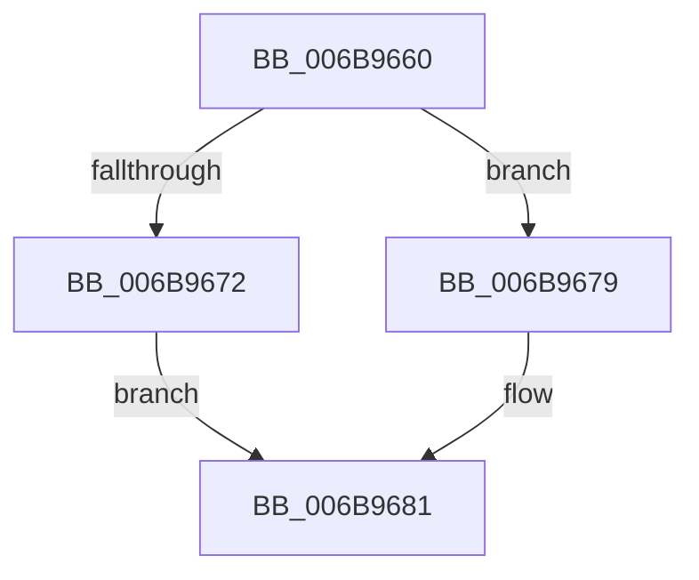

# KiIpiInterruptSubDispatch

- RVA: `0x006B9660`–`0x006B96A6` (길이 `70` bytes)
- VA: `0x00000001406B9660`
- 실행 섹션: `.text`
- PDB 이름 있음: `예`; PDB Function 태그: `아니요`
- unwind 정보 RVA: `0x000C22EC`
- 디코드: `19`개 명령, `70/70` bytes 표시
- 미해석 바이트: `0` (있으면 어셈블리에 `.byte`로 보존)

> 이 문서는 커널 이미지의 기계어와 PDB 기호를 분석해 생성했습니다. 4번과 5번은 함수 원형과 자료형을 바이너리 사용 방식에서 추정한 C 해석이며 원본 소스 복구 결과는 아닙니다.

## 1. Dependencies

- 직접 호출 지점: **3**; 고유 호출 대상: **3**
- 직접 호출자로 확인된 함수: **1**
- RIP 상대 이미지 참조: **1**

### Outgoing calls
- `0x006B9672` → [KzSetIrqlUnsafe](../5B/KzSetIrqlUnsafe_function_005B8AE0.md) (function, `0x005B8AE0`)
- `0x006B968F` → [KiStartInterruptCycleAccumulation](../37/KiStartInterruptCycleAccumulation_function_0037B410.md) (function, `0x0037B410`)
- `0x006B969B` → [KiIpiProcessRequests](../3A/KiIpiProcessRequests_function_003A3A90.md) (function, `0x003A3A90`)

### Direct callers
- [KiIpiInterrupt](KiIpiInterrupt_function_006B8F20.md) at `0x006B92B5`

### Static image references
- `0x006B9669` → RVA `0x00FC6D20` (`ALMOSTRO`; read)

## 2. Other-region calls and transfers

- 다른 실행 섹션으로 향하는 call: **0**
- 별도 외부 분기/꼬리 이동을 확인하지 못했습니다.

## 3. Assembly (complete function range)

```asm
006B9660  48 83 EC 28                     sub rsp, 0x28
006B9664  B9 0E 00 00 00                  mov ecx, 0xe
006B9669  83 3D B0 D6 90 00 00            cmp dword ptr [rip + 0x90d6b0], 0
006B9670  74 07                           je 0x1406b9679
006B9672  E8 69 F4 EF FF                  call 0x1405b8ae0
006B9677  EB 08                           jmp 0x1406b9681
006B9679  44 0F 20 C0                     mov rax, cr8
006B967D  44 0F 22 C1                     mov cr8, rcx
006B9681  88 45 A9                        mov byte ptr [rbp - 0x57], al
006B9684  65 48 8B 0C 25 20 00 00 00      mov rcx, qword ptr gs:[0x20]
006B968D  33 D2                           xor edx, edx
006B968F  E8 7C 1D CC FF                  call 0x14037b410
006B9694  FB                              sti
006B9695  48 8D 4D 80                     lea rcx, [rbp - 0x80]
006B9699  33 D2                           xor edx, edx
006B969B  E8 F0 A3 CE FF                  call 0x1403a3a90
006B96A0  FA                              cli
006B96A1  48 83 C4 28                     add rsp, 0x28
006B96A5  C3                              ret
```

## 4. C-style interpretation (structured pseudocode)

```c
__int64 __fastcall KiIpiInterruptSubDispatch(__int64 a1, int a2)
{
    __int64 result;
    __int64 v_rsp;

    v_rsp = (v_rsp) - (40);
    if ((*(unsigned int *)(v_rip + 9492144)) == 0) goto loc_006B9679;
    result = KzSetIrqlUnsafe(14, a2, a3, a4);
    goto loc_006B9681;
loc_006B9679:
loc_006B9681:
    *(unsigned __int8 *)(v_rbp - 87) = (unsigned __int8)(v_cr8);
    a2 = 0;
    result = KiStartInterruptCycleAccumulation(*(unsigned __int64 *)(gs_base + (0 + 32)), a2, a3, a4);
    a2 = 0;
    result = KiIpiProcessRequests(v_rbp - 128, a2, a3, a4);
    v_rsp = (v_rsp) + (40);
    return result;
}
```

## 5. (Beta) C Style

```c
int64_t KiIpiInterruptSubDispatch(int64_t Arg1, int32_t Arg2)
{
    int64_t result;
    int64_t local_rsp;

    local_rsp = (local_rsp) - (40);
    if ((*(uint32_t *)(v_rip + 0x90D6B0)) == 0) goto loc_006B9679;
    result = KzSetIrqlUnsafe(14, Arg2, a3, a4);
    goto loc_006B9681;
loc_006B9679:
loc_006B9681:
    *(uint8_t *)(local_rbp - 0x57) = (uint8_t)(v_cr8);
    Arg2 = 0;
    result = KiStartInterruptCycleAccumulation(*(uint64_t *)(gs_base + (0 + 0x20)), Arg2, a3, a4);
    Arg2 = 0;
    result = KiIpiProcessRequests(local_rbp - 128, Arg2, a3, a4);
    local_rsp = (local_rsp) + (40);
    return result;
}
```

## 6. Execution-region graph

[열기: 2D/3D 그래프와 함수 탐색 컨트롤 패널](../../../control-panel.html?section=text&rva=0x006B9660&view=graph)

- 2D 그래프는 위에서 아래로 흐르고, 3D 그래프는 빈 공간을 드래그해 회전합니다. Shift+드래그는 이동, 휠은 확대·축소, 함수 노드 선택은 대상 보고서 이동입니다.

### Static fallback


