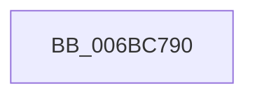

# KiMcaDeferredRecoveryService

- RVA: `0x006BC790`–`0x006BC7B3` (길이 `35` bytes)
- VA: `0x00000001406BC790`
- 실행 섹션: `.text`
- PDB 이름 있음: `예`; PDB Function 태그: `아니요`
- unwind 정보 RVA: `0x000C2F74`
- 디코드: `12`개 명령, `35/35` bytes 표시
- 미해석 바이트: `0` (있으면 어셈블리에 `.byte`로 보존)

> 이 문서는 커널 이미지의 기계어와 PDB 기호를 분석해 생성했습니다. 4번과 5번은 함수 원형과 자료형을 바이너리 사용 방식에서 추정한 C 해석이며 원본 소스 복구 결과는 아닙니다.

## 1. Dependencies

- 직접 호출 지점: **0**; 고유 호출 대상: **0**
- 직접 호출자로 확인된 함수: **2**
- RIP 상대 이미지 참조: **0**

### Outgoing calls
- 직접 디코드된 call 명령이 없습니다.

### Direct callers
- [KiScanQueues](../69/KiScanQueues_function_0069BE90.md) at `0x0069BEAC`
- [KiSchedulerDpc](../69/KiSchedulerDpc_function_0069BEC0.md) at `0x0069BF88`

### Static image references
- 디코드된 RIP-relative 메모리 참조가 없습니다.

## 2. Other-region calls and transfers

- 다른 실행 섹션으로 향하는 call: **0**
- call이 아닌 외부 분기/꼬리 이동: **1**
  - `0x006BC7AE` → [KeBugCheckEx](../4F/KeBugCheckEx_function_004FD660.md) (`tail-transfer`)

## 3. Assembly (complete function range)

```asm
006BC790  33 C0                           xor eax, eax
006BC792  8B D8                           mov ebx, eax
006BC794  8B F8                           mov edi, eax
006BC796  8B E8                           mov ebp, eax
006BC798  4C 8B D0                        mov r10, rax
006BC79B  4C 8B D8                        mov r11, rax
006BC79E  4C 8B E0                        mov r12, rax
006BC7A1  4C 8B E8                        mov r13, rax
006BC7A4  4C 8B F0                        mov r14, rax
006BC7A7  4C 8B F8                        mov r15, rax
006BC7AA  48 89 04 24                     mov qword ptr [rsp], rax
006BC7AE  E9 AD 0E E4 FF                  jmp 0x1404fd660
```

## 4. C-style interpretation (structured pseudocode)

```c
__int64 __fastcall KiMcaDeferredRecoveryService(void)
{
    __int64 result;
    unsigned __int64 v_stack_p0;

    result = 0;
    v_stack_p0 = 0;
}
```

## 5. (Beta) C Style

```c
void KiMcaDeferredRecoveryService(void)
{
    int64_t result;
    uint64_t v_stack_p0;

    result = 0;
    v_stack_p0 = 0;
}
```

## 6. Execution-region graph

[열기: 2D/3D 그래프와 함수 탐색 컨트롤 패널](../../../control-panel.html?section=text&rva=0x006BC790&view=graph)

- 2D 그래프는 위에서 아래로 흐르고, 3D 그래프는 빈 공간을 드래그해 회전합니다. Shift+드래그는 이동, 휠은 확대·축소, 함수 노드 선택은 대상 보고서 이동입니다.

### Static fallback


