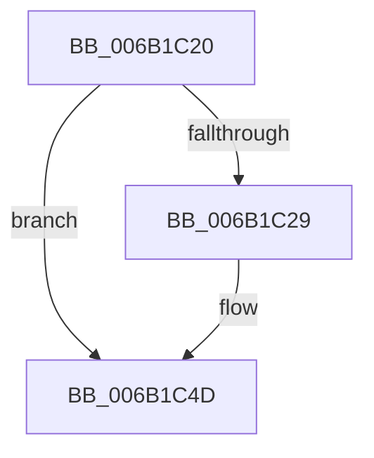

# KiMcheckExit

- RVA: `0x006B1C20`–`0x006B1C94` (길이 `116` bytes)
- VA: `0x00000001406B1C20`
- 실행 섹션: `.text`
- PDB 이름 있음: `예`; PDB Function 태그: `아니요`
- unwind 정보 RVA: `0x000C16EC`
- 디코드: `49`개 명령, `116/116` bytes 표시
- 미해석 바이트: `0` (있으면 어셈블리에 `.byte`로 보존)

> 이 문서는 커널 이미지의 기계어와 PDB 기호를 분석해 생성했습니다. 4번과 5번은 함수 원형과 자료형을 바이너리 사용 방식에서 추정한 C 해석이며 원본 소스 복구 결과는 아닙니다.

## 1. Dependencies

- 직접 호출 지점: **0**; 고유 호출 대상: **0**
- 직접 호출자로 확인된 함수: **0**
- RIP 상대 이미지 참조: **0**

### Outgoing calls
- 직접 디코드된 call 명령이 없습니다.

### Direct callers
- 이 함수 시작 RVA로 연결되는 직접 call은 확인되지 않았습니다. 간접 호출은 완전히 역산할 수 없습니다.

### Static image references
- 디코드된 RIP-relative 메모리 참조가 없습니다.

## 2. Other-region calls and transfers

- 다른 실행 섹션으로 향하는 call: **0**
- 별도 외부 분기/꼬리 이동을 확인하지 못했습니다.

## 3. Assembly (complete function range)

```asm
006B1C20  66 F7 44 24 20 04 00            test word ptr [rsp + 0x20], 4
006B1C27  75 24                           jne 0x1406b1c4d
006B1C29  50                              push rax
006B1C2A  51                              push rcx
006B1C2B  52                              push rdx
006B1C2C  33 C0                           xor eax, eax
006B1C2E  33 D2                           xor edx, edx
006B1C30  B9 7A 01 00 00                  mov ecx, 0x17a
006B1C35  0F 30                           wrmsr
006B1C37  5A                              pop rdx
006B1C38  59                              pop rcx
006B1C39  58                              pop rax
006B1C3A  6A 00                           push 0
006B1C3C  6A 00                           push 0
006B1C3E  6A 00                           push 0
006B1C40  6A 00                           push 0
006B1C42  48 83 C4 20                     add rsp, 0x20
006B1C46  0F 00 6C 24 20                  verw word ptr [rsp + 0x20]
006B1C4B  48 CF                           iretq
006B1C4D  50                              push rax
006B1C4E  FF 74 24 18                     push qword ptr [rsp + 0x18]
006B1C52  9D                              popfq
006B1C53  48 8B C4                        mov rax, rsp
006B1C56  6A 00                           push 0
006B1C58  6A 00                           push 0
006B1C5A  6A 00                           push 0
006B1C5C  6A 00                           push 0
006B1C5E  48 83 C4 20                     add rsp, 0x20
006B1C62  48 8B 64 24 20                  mov rsp, qword ptr [rsp + 0x20]
006B1C67  FF 70 10                        push qword ptr [rax + 0x10]
006B1C6A  FF 70 08                        push qword ptr [rax + 8]
006B1C6D  48 8B 00                        mov rax, qword ptr [rax]
006B1C70  50                              push rax
006B1C71  51                              push rcx
006B1C72  52                              push rdx
006B1C73  33 C0                           xor eax, eax
006B1C75  33 D2                           xor edx, edx
006B1C77  B9 7A 01 00 00                  mov ecx, 0x17a
006B1C7C  0F 30                           wrmsr
006B1C7E  5A                              pop rdx
006B1C7F  59                              pop rcx
006B1C80  58                              pop rax
006B1C81  6A 00                           push 0
006B1C83  6A 00                           push 0
006B1C85  6A 00                           push 0
006B1C87  6A 00                           push 0
006B1C89  48 83 C4 20                     add rsp, 0x20
006B1C8D  0F 00 6C 24 08                  verw word ptr [rsp + 8]
006B1C92  48 CB                           retfq
```

## 4. C-style interpretation (structured pseudocode)

```c
__int64 __fastcall KiMcheckExit(__int64 a1, __int64 a2)
{
    __int64 result;
    __int64 v_rsp;
    unsigned __int16 v_stack_m10;
    unsigned __int64 v_stack_p10;
    unsigned __int64 v_stack_p18;
    unsigned __int16 v_stack_p20;

    if (((v_stack_p20) & (4)) == 0) {
        result = 0;
        a2 = 0;
        a1 = 378;
        v_rsp = (v_rsp) + (32);
    }
    v_rsp = (v_rsp) + (32);
    result = 0;
    a2 = 0;
    v_rsp = (v_stack_p18) + (32);
    return result;
}
```

## 5. (Beta) C Style

```c
int64_t KiMcheckExit(int64_t Arg1, int64_t Arg2)
{
    int64_t result;
    int64_t local_rsp;
    uint16_t v_stack_m10;
    uint64_t v_stack_p10;
    uint64_t v_stack_p18;
    uint16_t v_stack_p20;

    if (((v_stack_p20) & (4)) == 0) {
        result = 0;
        Arg2 = 0;
        Arg1 = 378;
        local_rsp = (local_rsp) + (32);
    }
    local_rsp = (local_rsp) + (32);
    result = 0;
    Arg2 = 0;
    local_rsp = (v_stack_p18) + (32);
    return result;
}
```

## 6. Execution-region graph

[열기: 2D/3D 그래프와 함수 탐색 컨트롤 패널](../../../control-panel.html?section=text&rva=0x006B1C20&view=graph)

- 2D 그래프는 위에서 아래로 흐르고, 3D 그래프는 빈 공간을 드래그해 회전합니다. Shift+드래그는 이동, 휠은 확대·축소, 함수 노드 선택은 대상 보고서 이동입니다.

### Static fallback


