# KiNpxNotAvailableFault

- RVA: `0x006BEE00`–`0x006BF1B3` (길이 `947` bytes)
- VA: `0x00000001406BEE00`
- 실행 섹션: `.text`
- PDB 이름 있음: `예`; PDB Function 태그: `아니요`
- unwind 정보 RVA: `0x000C1BF0`
- 디코드: `209`개 명령, `947/947` bytes 표시
- 미해석 바이트: `0` (있으면 어셈블리에 `.byte`로 보존)

> 이 문서는 커널 이미지의 기계어와 PDB 기호를 분석해 생성했습니다. 4번과 5번은 함수 원형과 자료형을 바이너리 사용 방식에서 추정한 C 해석이며 원본 소스 복구 결과는 아닙니다.

## 1. Dependencies

- 직접 호출 지점: **37**; 고유 호출 대상: **37**
- 직접 호출자로 확인된 함수: **1**
- RIP 상대 이미지 참조: **4**

### Outgoing calls
- `0x006BEF56` → [KiNpxNotAvailableFault + 0x269](KiNpxNotAvailableFault_function_006BEE00.md) (inside-function, `0x006BF069`)
- `0x006BEF5F` → [KiNpxNotAvailableFault + 0x272](KiNpxNotAvailableFault_function_006BEE00.md) (inside-function, `0x006BF072`)
- `0x006BEF68` → [KiNpxNotAvailableFault + 0x15B](KiNpxNotAvailableFault_function_006BEE00.md) (inside-function, `0x006BEF5B`)
- `0x006BEF71` → [KiNpxNotAvailableFault + 0x164](KiNpxNotAvailableFault_function_006BEE00.md) (inside-function, `0x006BEF64`)
- `0x006BEF7A` → [KiNpxNotAvailableFault + 0x16D](KiNpxNotAvailableFault_function_006BEE00.md) (inside-function, `0x006BEF6D`)
- `0x006BEF83` → [KiNpxNotAvailableFault + 0x176](KiNpxNotAvailableFault_function_006BEE00.md) (inside-function, `0x006BEF76`)
- `0x006BEF8C` → [KiNpxNotAvailableFault + 0x17F](KiNpxNotAvailableFault_function_006BEE00.md) (inside-function, `0x006BEF7F`)
- `0x006BEF95` → [KiNpxNotAvailableFault + 0x188](KiNpxNotAvailableFault_function_006BEE00.md) (inside-function, `0x006BEF88`)
- `0x006BEF9E` → [KiNpxNotAvailableFault + 0x191](KiNpxNotAvailableFault_function_006BEE00.md) (inside-function, `0x006BEF91`)
- `0x006BEFA7` → [KiNpxNotAvailableFault + 0x19A](KiNpxNotAvailableFault_function_006BEE00.md) (inside-function, `0x006BEF9A`)
- `0x006BEFB0` → [KiNpxNotAvailableFault + 0x1A3](KiNpxNotAvailableFault_function_006BEE00.md) (inside-function, `0x006BEFA3`)
- `0x006BEFB9` → [KiNpxNotAvailableFault + 0x1AC](KiNpxNotAvailableFault_function_006BEE00.md) (inside-function, `0x006BEFAC`)
- `0x006BEFC2` → [KiNpxNotAvailableFault + 0x1B5](KiNpxNotAvailableFault_function_006BEE00.md) (inside-function, `0x006BEFB5`)
- `0x006BEFCB` → [KiNpxNotAvailableFault + 0x1BE](KiNpxNotAvailableFault_function_006BEE00.md) (inside-function, `0x006BEFBE`)
- `0x006BEFD4` → [KiNpxNotAvailableFault + 0x1C7](KiNpxNotAvailableFault_function_006BEE00.md) (inside-function, `0x006BEFC7`)
- `0x006BEFDD` → [KiNpxNotAvailableFault + 0x1D0](KiNpxNotAvailableFault_function_006BEE00.md) (inside-function, `0x006BEFD0`)
- `0x006BEFE6` → [KiNpxNotAvailableFault + 0x1D9](KiNpxNotAvailableFault_function_006BEE00.md) (inside-function, `0x006BEFD9`)
- `0x006BEFEF` → [KiNpxNotAvailableFault + 0x1E2](KiNpxNotAvailableFault_function_006BEE00.md) (inside-function, `0x006BEFE2`)
- `0x006BEFF8` → [KiNpxNotAvailableFault + 0x1EB](KiNpxNotAvailableFault_function_006BEE00.md) (inside-function, `0x006BEFEB`)
- `0x006BF001` → [KiNpxNotAvailableFault + 0x1F4](KiNpxNotAvailableFault_function_006BEE00.md) (inside-function, `0x006BEFF4`)
- `0x006BF00A` → [KiNpxNotAvailableFault + 0x1FD](KiNpxNotAvailableFault_function_006BEE00.md) (inside-function, `0x006BEFFD`)
- `0x006BF013` → [KiNpxNotAvailableFault + 0x206](KiNpxNotAvailableFault_function_006BEE00.md) (inside-function, `0x006BF006`)
- `0x006BF01C` → [KiNpxNotAvailableFault + 0x20F](KiNpxNotAvailableFault_function_006BEE00.md) (inside-function, `0x006BF00F`)
- `0x006BF025` → [KiNpxNotAvailableFault + 0x218](KiNpxNotAvailableFault_function_006BEE00.md) (inside-function, `0x006BF018`)
- `0x006BF02E` → [KiNpxNotAvailableFault + 0x221](KiNpxNotAvailableFault_function_006BEE00.md) (inside-function, `0x006BF021`)
- `0x006BF037` → [KiNpxNotAvailableFault + 0x22A](KiNpxNotAvailableFault_function_006BEE00.md) (inside-function, `0x006BF02A`)
- `0x006BF040` → [KiNpxNotAvailableFault + 0x233](KiNpxNotAvailableFault_function_006BEE00.md) (inside-function, `0x006BF033`)
- `0x006BF049` → [KiNpxNotAvailableFault + 0x23C](KiNpxNotAvailableFault_function_006BEE00.md) (inside-function, `0x006BF03C`)
- `0x006BF052` → [KiNpxNotAvailableFault + 0x245](KiNpxNotAvailableFault_function_006BEE00.md) (inside-function, `0x006BF045`)
- `0x006BF05B` → [KiNpxNotAvailableFault + 0x24E](KiNpxNotAvailableFault_function_006BEE00.md) (inside-function, `0x006BF04E`)
- `0x006BF064` → [KiNpxNotAvailableFault + 0x257](KiNpxNotAvailableFault_function_006BEE00.md) (inside-function, `0x006BF057`)
- `0x006BF06D` → [KiNpxNotAvailableFault + 0x260](KiNpxNotAvailableFault_function_006BEE00.md) (inside-function, `0x006BF060`)
- `0x006BF098` → [KiFlushBhbDuringTrapEntryOrExit](../6C/KiFlushBhbDuringTrapEntryOrExit_function_006C6340.md) (function, `0x006C6340`)
- `0x006BF0E1` → [KiSaveDebugRegisterState](../4F/KiSaveDebugRegisterState_function_004FD960.md) (function, `0x004FD960`)
- `0x006BF115` → [KiSynchronizeUserIsolationDomainExit](../41/KiSynchronizeUserIsolationDomainExit_function_0041BFA0.md) (function, `0x0041BFA0`)
- `0x006BF18D` → [KiExceptionDispatch](../6C/KiExceptionDispatch_function_006C5900.md) (function, `0x006C5900`)
- `0x006BF1AC` → [KiBugCheckDispatch](../6C/KiBugCheckDispatch_function_006C5880.md) (function, `0x006C5880`)

### Direct callers
- [KiNpxNotAvailableFault](KiNpxNotAvailableFault_function_006BEE00.md) at `0x006BEF56`
- [KiNpxNotAvailableFault](KiNpxNotAvailableFault_function_006BEE00.md) at `0x006BEF5F`
- [KiNpxNotAvailableFault](KiNpxNotAvailableFault_function_006BEE00.md) at `0x006BEF68`
- [KiNpxNotAvailableFault](KiNpxNotAvailableFault_function_006BEE00.md) at `0x006BEF71`
- [KiNpxNotAvailableFault](KiNpxNotAvailableFault_function_006BEE00.md) at `0x006BEF7A`
- [KiNpxNotAvailableFault](KiNpxNotAvailableFault_function_006BEE00.md) at `0x006BEF83`
- [KiNpxNotAvailableFault](KiNpxNotAvailableFault_function_006BEE00.md) at `0x006BEF8C`
- [KiNpxNotAvailableFault](KiNpxNotAvailableFault_function_006BEE00.md) at `0x006BEF95`
- [KiNpxNotAvailableFault](KiNpxNotAvailableFault_function_006BEE00.md) at `0x006BEF9E`
- [KiNpxNotAvailableFault](KiNpxNotAvailableFault_function_006BEE00.md) at `0x006BEFA7`
- [KiNpxNotAvailableFault](KiNpxNotAvailableFault_function_006BEE00.md) at `0x006BEFB0`
- [KiNpxNotAvailableFault](KiNpxNotAvailableFault_function_006BEE00.md) at `0x006BEFB9`
- [KiNpxNotAvailableFault](KiNpxNotAvailableFault_function_006BEE00.md) at `0x006BEFC2`
- [KiNpxNotAvailableFault](KiNpxNotAvailableFault_function_006BEE00.md) at `0x006BEFCB`
- [KiNpxNotAvailableFault](KiNpxNotAvailableFault_function_006BEE00.md) at `0x006BEFD4`
- [KiNpxNotAvailableFault](KiNpxNotAvailableFault_function_006BEE00.md) at `0x006BEFDD`
- [KiNpxNotAvailableFault](KiNpxNotAvailableFault_function_006BEE00.md) at `0x006BEFE6`
- [KiNpxNotAvailableFault](KiNpxNotAvailableFault_function_006BEE00.md) at `0x006BEFEF`
- [KiNpxNotAvailableFault](KiNpxNotAvailableFault_function_006BEE00.md) at `0x006BEFF8`
- [KiNpxNotAvailableFault](KiNpxNotAvailableFault_function_006BEE00.md) at `0x006BF001`
- [KiNpxNotAvailableFault](KiNpxNotAvailableFault_function_006BEE00.md) at `0x006BF00A`
- [KiNpxNotAvailableFault](KiNpxNotAvailableFault_function_006BEE00.md) at `0x006BF013`
- [KiNpxNotAvailableFault](KiNpxNotAvailableFault_function_006BEE00.md) at `0x006BF01C`
- [KiNpxNotAvailableFault](KiNpxNotAvailableFault_function_006BEE00.md) at `0x006BF025`
- [KiNpxNotAvailableFault](KiNpxNotAvailableFault_function_006BEE00.md) at `0x006BF02E`
- [KiNpxNotAvailableFault](KiNpxNotAvailableFault_function_006BEE00.md) at `0x006BF037`
- [KiNpxNotAvailableFault](KiNpxNotAvailableFault_function_006BEE00.md) at `0x006BF040`
- [KiNpxNotAvailableFault](KiNpxNotAvailableFault_function_006BEE00.md) at `0x006BF049`
- [KiNpxNotAvailableFault](KiNpxNotAvailableFault_function_006BEE00.md) at `0x006BF052`
- [KiNpxNotAvailableFault](KiNpxNotAvailableFault_function_006BEE00.md) at `0x006BF05B`
- [KiNpxNotAvailableFault](KiNpxNotAvailableFault_function_006BEE00.md) at `0x006BF064`
- [KiNpxNotAvailableFault](KiNpxNotAvailableFault_function_006BEE00.md) at `0x006BF06D`

### Static image references
- `0x006BEE75` → RVA `0x01201840` (`CFGRO`; read)
- `0x006BF0A9` → RVA `0x00FC7264` (`ALMOSTRO`; read)
- `0x006BF11A` → RVA `0x00FC6BF0` (`ALMOSTRO`; read)
- `0x006BF12F` → RVA `0x00FC6B34` (`ALMOSTRO`; read)

## 2. Other-region calls and transfers

- 다른 실행 섹션으로 향하는 call: **0**
- 별도 외부 분기/꼬리 이동을 확인하지 못했습니다.

## 3. Assembly (complete function range)

```asm
006BEE00  48 83 EC 08                     sub rsp, 8
006BEE04  55                              push rbp
006BEE05  48 81 EC 58 01 00 00            sub rsp, 0x158
006BEE0C  48 8D AC 24 80 00 00 00         lea rbp, [rsp + 0x80]
006BEE14  C6 45 AB 01                     mov byte ptr [rbp - 0x55], 1
006BEE18  48 89 45 B0                     mov qword ptr [rbp - 0x50], rax
006BEE1C  48 89 4D B8                     mov qword ptr [rbp - 0x48], rcx
006BEE20  48 89 55 C0                     mov qword ptr [rbp - 0x40], rdx
006BEE24  4C 89 45 C8                     mov qword ptr [rbp - 0x38], r8
006BEE28  4C 89 4D D0                     mov qword ptr [rbp - 0x30], r9
006BEE2C  4C 89 55 D8                     mov qword ptr [rbp - 0x28], r10
006BEE30  4C 89 5D E0                     mov qword ptr [rbp - 0x20], r11
006BEE34  F6 85 F0 00 00 00 01            test byte ptr [rbp + 0xf0], 1
006BEE3B  75 38                           jne 0x1406bee75
006BEE3D  33 D2                           xor edx, edx
006BEE3F  F3 48 0F 1E CA                  rdsspq rdx
006BEE44  48 89 55 58                     mov qword ptr [rbp + 0x58], rdx
006BEE48  0F AE E8                        lfence
006BEE4B  65 F6 04 25 58 08 00 00 01      test byte ptr gs:[0x858], 1
006BEE54  75 08                           jne 0x1406bee5e
006BEE56  0F AE E8                        lfence
006BEE59  E9 88 02 00 00                  jmp 0x1406bf0e6
006BEE5E  65 0F B7 04 25 66 08 00 00      movzx eax, word ptr gs:[0x866]
006BEE67  B9 48 00 00 00                  mov ecx, 0x48
006BEE6C  33 D2                           xor edx, edx
006BEE6E  0F 30                           wrmsr
006BEE70  E9 71 02 00 00                  jmp 0x1406bf0e6
006BEE75  F6 05 C4 29 B4 00 01            test byte ptr [rip + 0xb429c4], 1
006BEE7C  75 03                           jne 0x1406bee81
006BEE7E  0F 01 F8                        swapgs
006BEE81  0F AE E8                        lfence
006BEE84  65 48 8B 0C 25 28 9D 00 00      mov rcx, qword ptr gs:[0x9d28]
006BEE8D  48 85 C9                        test rcx, rcx
006BEE90  74 1F                           je 0x1406beeb1
006BEE92  F3 48 0F 1E CA                  rdsspq rdx
006BEE97  65 4C 8B 14 25 20 9D 00 00      mov r10, qword ptr gs:[0x9d20]
006BEEA0  49 83 C2 08                     add r10, 8
006BEEA4  49 3B D2                        cmp rdx, r10
006BEEA7  75 08                           jne 0x1406beeb1
006BEEA9  F3 0F 01 29                     rstorssp dword ptr [rcx]
006BEEAD  F3 0F 01 EA                     saveprevssp
006BEEB1  65 4C 8B 14 25 88 01 00 00      mov r10, qword ptr gs:[0x188]
006BEEBA  65 48 8B 0C 25 88 01 00 00      mov rcx, qword ptr gs:[0x188]
006BEEC3  48 8B 89 20 02 00 00            mov rcx, qword ptr [rcx + 0x220]
006BEECA  48 8B 89 60 07 00 00            mov rcx, qword ptr [rcx + 0x760]
006BEED1  65 48 89 0C 25 50 08 00 00      mov qword ptr gs:[0x850], rcx
006BEEDA  66 65 8B 0C 25 62 08 00 00      mov cx, word ptr gs:[0x862]
006BEEE3  66 65 89 0C 25 64 08 00 00      mov word ptr gs:[0x864], cx
006BEEEC  65 8A 0C 25 58 08 00 00         mov cl, byte ptr gs:[0x858]
006BEEF4  65 88 0C 25 5A 08 00 00         mov byte ptr gs:[0x85a], cl
006BEEFC  65 0F B7 04 25 68 08 00 00      movzx eax, word ptr gs:[0x868]
006BEF05  66 65 39 04 25 66 08 00 00      cmp word ptr gs:[0x866], ax
006BEF0E  74 12                           je 0x1406bef22
006BEF10  66 65 89 04 25 66 08 00 00      mov word ptr gs:[0x866], ax
006BEF19  B9 48 00 00 00                  mov ecx, 0x48
006BEF1E  33 D2                           xor edx, edx
006BEF20  0F 30                           wrmsr
006BEF22  65 0F B6 14 25 58 08 00 00      movzx edx, byte ptr gs:[0x858]
006BEF2B  F7 C2 08 00 00 00               test edx, 8
006BEF31  74 17                           je 0x1406bef4a
006BEF33  B8 01 00 00 00                  mov eax, 1
006BEF38  33 D2                           xor edx, edx
006BEF3A  B9 49 00 00 00                  mov ecx, 0x49
006BEF3F  0F 30                           wrmsr
006BEF41  65 0F B6 14 25 58 08 00 00      movzx edx, byte ptr gs:[0x858]
006BEF4A  F7 C2 02 00 00 00               test edx, 2
006BEF50  0F 84 37 01 00 00               je 0x1406bf08d
006BEF56  E8 0E 01 00 00                  call 0x1406bf069
006BEF5B  48 83 C4 08                     add rsp, 8
006BEF5F  E8 0E 01 00 00                  call 0x1406bf072
006BEF64  48 83 C4 08                     add rsp, 8
006BEF68  E8 EE FF FF FF                  call 0x1406bef5b
006BEF6D  48 83 C4 08                     add rsp, 8
006BEF71  E8 EE FF FF FF                  call 0x1406bef64
006BEF76  48 83 C4 08                     add rsp, 8
006BEF7A  E8 EE FF FF FF                  call 0x1406bef6d
006BEF7F  48 83 C4 08                     add rsp, 8
006BEF83  E8 EE FF FF FF                  call 0x1406bef76
006BEF88  48 83 C4 08                     add rsp, 8
006BEF8C  E8 EE FF FF FF                  call 0x1406bef7f
006BEF91  48 83 C4 08                     add rsp, 8
006BEF95  E8 EE FF FF FF                  call 0x1406bef88
006BEF9A  48 83 C4 08                     add rsp, 8
006BEF9E  E8 EE FF FF FF                  call 0x1406bef91
006BEFA3  48 83 C4 08                     add rsp, 8
006BEFA7  E8 EE FF FF FF                  call 0x1406bef9a
006BEFAC  48 83 C4 08                     add rsp, 8
006BEFB0  E8 EE FF FF FF                  call 0x1406befa3
006BEFB5  48 83 C4 08                     add rsp, 8
006BEFB9  E8 EE FF FF FF                  call 0x1406befac
006BEFBE  48 83 C4 08                     add rsp, 8
006BEFC2  E8 EE FF FF FF                  call 0x1406befb5
006BEFC7  48 83 C4 08                     add rsp, 8
006BEFCB  E8 EE FF FF FF                  call 0x1406befbe
006BEFD0  48 83 C4 08                     add rsp, 8
006BEFD4  E8 EE FF FF FF                  call 0x1406befc7
006BEFD9  48 83 C4 08                     add rsp, 8
006BEFDD  E8 EE FF FF FF                  call 0x1406befd0
006BEFE2  48 83 C4 08                     add rsp, 8
006BEFE6  E8 EE FF FF FF                  call 0x1406befd9
006BEFEB  48 83 C4 08                     add rsp, 8
006BEFEF  E8 EE FF FF FF                  call 0x1406befe2
006BEFF4  48 83 C4 08                     add rsp, 8
006BEFF8  E8 EE FF FF FF                  call 0x1406befeb
006BEFFD  48 83 C4 08                     add rsp, 8
006BF001  E8 EE FF FF FF                  call 0x1406beff4
006BF006  48 83 C4 08                     add rsp, 8
006BF00A  E8 EE FF FF FF                  call 0x1406beffd
006BF00F  48 83 C4 08                     add rsp, 8
006BF013  E8 EE FF FF FF                  call 0x1406bf006
006BF018  48 83 C4 08                     add rsp, 8
006BF01C  E8 EE FF FF FF                  call 0x1406bf00f
006BF021  48 83 C4 08                     add rsp, 8
006BF025  E8 EE FF FF FF                  call 0x1406bf018
006BF02A  48 83 C4 08                     add rsp, 8
006BF02E  E8 EE FF FF FF                  call 0x1406bf021
006BF033  48 83 C4 08                     add rsp, 8
006BF037  E8 EE FF FF FF                  call 0x1406bf02a
006BF03C  48 83 C4 08                     add rsp, 8
006BF040  E8 EE FF FF FF                  call 0x1406bf033
006BF045  48 83 C4 08                     add rsp, 8
006BF049  E8 EE FF FF FF                  call 0x1406bf03c
006BF04E  48 83 C4 08                     add rsp, 8
006BF052  E8 EE FF FF FF                  call 0x1406bf045
006BF057  48 83 C4 08                     add rsp, 8
006BF05B  E8 EE FF FF FF                  call 0x1406bf04e
006BF060  48 83 C4 08                     add rsp, 8
006BF064  E8 EE FF FF FF                  call 0x1406bf057
006BF069  48 83 C4 08                     add rsp, 8
006BF06D  E8 EE FF FF FF                  call 0x1406bf060
006BF072  48 83 C4 08                     add rsp, 8
006BF076  B8 DA DA 00 00                  mov eax, 0xdada
006BF07B  65 F6 04 25 5C 08 00 00 08      test byte ptr gs:[0x85c], 8
006BF084  74 07                           je 0x1406bf08d
006BF086  B0 20                           mov al, 0x20
006BF088  F3 48 0F AE E8                  incsspq rax
006BF08D  F7 C2 80 00 00 00               test edx, 0x80
006BF093  74 08                           je 0x1406bf09d
006BF095  0F AE E8                        lfence
006BF098  E8 A3 72 00 00                  call 0x1406c6340
006BF09D  0F AE E8                        lfence
006BF0A0  65 C6 04 25 5E 08 00 00 00      mov byte ptr gs:[0x85e], 0
006BF0A9  83 3D B4 81 90 00 00            cmp dword ptr [rip + 0x9081b4], 0
006BF0B0  74 1F                           je 0x1406bf0d1
006BF0B2  B9 A7 06 00 00                  mov ecx, 0x6a7
006BF0B7  0F 32                           rdmsr
006BF0B9  83 FA 00                        cmp edx, 0
006BF0BC  74 13                           je 0x1406bf0d1
006BF0BE  8B CA                           mov ecx, edx
006BF0C0  23 15 9E 81 90 00               and edx, dword ptr [rip + 0x90819e]
006BF0C6  3B D1                           cmp edx, ecx
006BF0C8  74 07                           je 0x1406bf0d1
006BF0CA  B9 A7 06 00 00                  mov ecx, 0x6a7
006BF0CF  0F 30                           wrmsr
006BF0D1  41 F6 42 03 03                  test byte ptr [r10 + 3], 3
006BF0D6  66 C7 85 80 00 00 00 00 00      mov word ptr [rbp + 0x80], 0
006BF0DF  74 05                           je 0x1406bf0e6
006BF0E1  E8 7A E8 E3 FF                  call 0x1404fd960
006BF0E6  FC                              cld
006BF0E7  0F AE 5D AC                     stmxcsr dword ptr [rbp - 0x54]
006BF0EB  65 0F AE 14 25 80 01 00 00      ldmxcsr dword ptr gs:[0x180]
006BF0F4  0F 29 45 F0                     movaps xmmword ptr [rbp - 0x10], xmm0
006BF0F8  0F 29 4D 00                     movaps xmmword ptr [rbp], xmm1
006BF0FC  0F 29 55 10                     movaps xmmword ptr [rbp + 0x10], xmm2
006BF100  0F 29 5D 20                     movaps xmmword ptr [rbp + 0x20], xmm3
006BF104  0F 29 65 30                     movaps xmmword ptr [rbp + 0x30], xmm4
006BF108  0F 29 6D 40                     movaps xmmword ptr [rbp + 0x40], xmm5
006BF10C  F6 85 F0 00 00 00 01            test byte ptr [rbp + 0xf0], 1
006BF113  74 05                           je 0x1406bf11a
006BF115  E8 86 CE D5 FF                  call 0x14041bfa0
006BF11A  F6 05 CF 7A 90 00 FF            test byte ptr [rip + 0x907acf], 0xff
006BF121  74 0C                           je 0x1406bf12f
006BF123  F6 85 F0 00 00 00 01            test byte ptr [rbp + 0xf0], 1
006BF12A  74 03                           je 0x1406bf12f
006BF12C  0F 01 CB                        stac
006BF12F  F7 05 FB 79 90 00 00 00 80 00   test dword ptr [rip + 0x9079fb], 0x800000
006BF139  75 09                           jne 0x1406bf144
006BF13B  48 C7 C0 00 00 00 00            mov rax, 0
006BF142  EB 1A                           jmp 0x1406bf15e
006BF144  B9 C5 01 00 00                  mov ecx, 0x1c5
006BF149  0F 32                           rdmsr
006BF14B  48 C1 E2 20                     shl rdx, 0x20
006BF14F  48 0B C2                        or rax, rdx
006BF152  4C 8B C0                        mov r8, rax
006BF155  33 C0                           xor eax, eax
006BF157  33 D2                           xor edx, edx
006BF159  0F 30                           wrmsr
006BF15B  49 8B C0                        mov rax, r8
006BF15E  F7 85 F8 00 00 00 00 02 00 00   test dword ptr [rbp + 0xf8], 0x200
006BF168  74 01                           je 0x1406bf16b
006BF16A  FB                              sti
006BF16B  F6 85 F0 00 00 00 01            test byte ptr [rbp + 0xf0], 1
006BF172  74 1F                           je 0x1406bf193
006BF174  48 85 C0                        test rax, rax
006BF177  74 1A                           je 0x1406bf193
006BF179  B9 10 00 00 10                  mov ecx, 0x10000010
006BF17E  BA 01 00 00 00                  mov edx, 1
006BF183  4C 8B C8                        mov r9, rax
006BF186  4C 8B 85 E8 00 00 00            mov r8, qword ptr [rbp + 0xe8]
006BF18D  E8 6E 67 00 00                  call 0x1406c5900
006BF192  90                              nop
006BF193  4C 8B 95 E8 00 00 00            mov r10, qword ptr [rbp + 0xe8]
006BF19A  41 0F 20 E1                     mov r9, cr4
006BF19E  41 0F 20 C0                     mov r8, cr0
006BF1A2  BA 07 00 00 00                  mov edx, 7
006BF1A7  B9 7F 00 00 00                  mov ecx, 0x7f
006BF1AC  E8 CF 66 00 00                  call 0x1406c5880
006BF1B1  90                              nop
006BF1B2  C3                              ret
```

## 4. C-style interpretation (structured pseudocode)

```c
__int64 __fastcall KiNpxNotAvailableFault(__int64 a1, __int64 a2, __int64 a3, __int64 a4)
{
    __int64 result;
    __int64 v_r10;
    __int64 v_rsp;
    unsigned __int64 v_stack_m108;
    unsigned __int64 v_stack_m110;
    unsigned __int64 v_stack_m118;
    unsigned __int64 v_stack_m120;
    unsigned __int64 v_stack_m128;
    unsigned __int64 v_stack_m130;
    unsigned __int64 v_stack_m138;
    unsigned int v_stack_m13C;
    unsigned __int8 v_stack_m13D;
    unsigned __int16 v_stack_m68;
    unsigned __int64 v_stack_m90;
    unsigned __int64 v_stack_mA8;
    unsigned __int64 v_stack_mB8;
    unsigned __int64 v_stack_mC8;
    unsigned __int64 v_stack_mD8;
    unsigned __int64 v_stack_mE8;
    unsigned __int64 v_stack_mF8;
    unsigned __int64 v_stack_p0;
    unsigned int v_stack_p10;
    unsigned __int8 v_stack_p8;

    v_rsp = (v_rsp) - (8);
    v_rsp = (v_rsp) - (344);
    v_stack_m13D = 1;
    v_stack_m138 = result;
    v_stack_m130 = a1;
    v_stack_m128 = a2;
    v_stack_m120 = a3;
    v_stack_m118 = a4;
    v_stack_m110 = v_r10;
    v_stack_m108 = v_r11;
    if (((v_stack_p8) & (1)) != 0) goto loc_006BEE75;
    a2 = 0;
    v_stack_m90 = 0;
    if (((*(unsigned __int8 *)(gs_base + (0 + 2136))) & (1)) != 0) goto loc_006BEE5E;
    goto loc_006BF0E6;
loc_006BEE5E:
    a2 = 0;
    goto loc_006BF0E6;
loc_006BEE75:
    if (((*(unsigned __int8 *)(v_rip + 11807172)) & (1)) == 0) {
    }
    if (*(unsigned __int64 *)(gs_base + (0 + 40232)) == 0) goto loc_006BEEB1;
    v_r10 = (*(unsigned __int64 *)(gs_base + (0 + 40224))) + (8);
    if (0 == v_r10) {
    }
    *(unsigned __int64 *)(gs_base + (0 + 2128)) = *(unsigned __int64 *)(*(unsigned __int64 *)(*(unsigned __int64 *)(gs_base + (0 + 392)) + 544) + 1888);
    *(unsigned __int16 *)(gs_base + (0 + 2148)) = (unsigned __int16)(*(unsigned __int16 *)(gs_base + (0 + 2146)));
    *(unsigned __int8 *)(gs_base + (0 + 2138)) = (unsigned __int8)(*(unsigned __int8 *)(gs_base + (0 + 2136)));
    if ((*(unsigned __int16 *)(gs_base + (0 + 2150))) != ((unsigned __int16)(*(unsigned __int16 *)(gs_base + (0 + 2152))))) {
        *(unsigned __int16 *)(gs_base + (0 + 2150)) = (unsigned __int16)(*(unsigned __int16 *)(gs_base + (0 + 2152)));
        a1 = 72;
        a2 = 0;
    }
    result = *(unsigned __int16 *)(gs_base + (0 + 2152));
    if ((((unsigned int)(*(unsigned __int8 *)(gs_base + (0 + 2136)))) & (8)) != 0) {
        result = 1;
        a2 = 0;
        a1 = 73;
        a2 = *(unsigned __int8 *)(gs_base + (0 + 2136));
    }
    if ((((unsigned int)(a2)) & (2)) == 0) goto loc_006BF08D;
    result = KiNpxNotAvailableFault___0x269(a1, a2, a3, a4);
    v_rsp = (v_rsp) + (8);
    result = KiNpxNotAvailableFault___0x272(a1, a2, a3, a4);
    v_rsp = (v_rsp) + (8);
    result = KiNpxNotAvailableFault___0x15B(a1, a2, a3, a4);
    v_rsp = (v_rsp) + (8);
    result = KiNpxNotAvailableFault___0x164(a1, a2, a3, a4);
    v_rsp = (v_rsp) + (8);
    result = KiNpxNotAvailableFault___0x16D(a1, a2, a3, a4);
    v_rsp = (v_rsp) + (8);
    result = KiNpxNotAvailableFault___0x176(a1, a2, a3, a4);
    v_rsp = (v_rsp) + (8);
    result = KiNpxNotAvailableFault___0x17F(a1, a2, a3, a4);
    v_rsp = (v_rsp) + (8);
    result = KiNpxNotAvailableFault___0x188(a1, a2, a3, a4);
    v_rsp = (v_rsp) + (8);
    result = KiNpxNotAvailableFault___0x191(a1, a2, a3, a4);
    v_rsp = (v_rsp) + (8);
    result = KiNpxNotAvailableFault___0x19A(a1, a2, a3, a4);
    v_rsp = (v_rsp) + (8);
    result = KiNpxNotAvailableFault___0x1A3(a1, a2, a3, a4);
    v_rsp = (v_rsp) + (8);
    result = KiNpxNotAvailableFault___0x1AC(a1, a2, a3, a4);
    v_rsp = (v_rsp) + (8);
    result = KiNpxNotAvailableFault___0x1B5(a1, a2, a3, a4);
    v_rsp = (v_rsp) + (8);
    result = KiNpxNotAvailableFault___0x1BE(a1, a2, a3, a4);
    v_rsp = (v_rsp) + (8);
    result = KiNpxNotAvailableFault___0x1C7(a1, a2, a3, a4);
    v_rsp = (v_rsp) + (8);
    result = KiNpxNotAvailableFault___0x1D0(a1, a2, a3, a4);
    v_rsp = (v_rsp) + (8);
    result = KiNpxNotAvailableFault___0x1D9(a1, a2, a3, a4);
    v_rsp = (v_rsp) + (8);
    result = KiNpxNotAvailableFault___0x1E2(a1, a2, a3, a4);
    v_rsp = (v_rsp) + (8);
    result = KiNpxNotAvailableFault___0x1EB(a1, a2, a3, a4);
    v_rsp = (v_rsp) + (8);
    result = KiNpxNotAvailableFault___0x1F4(a1, a2, a3, a4);
    v_rsp = (v_rsp) + (8);
    result = KiNpxNotAvailableFault___0x1FD(a1, a2, a3, a4);
    v_rsp = (v_rsp) + (8);
    result = KiNpxNotAvailableFault___0x206(a1, a2, a3, a4);
    v_rsp = (v_rsp) + (8);
    result = KiNpxNotAvailableFault___0x20F(a1, a2, a3, a4);
    v_rsp = (v_rsp) + (8);
    result = KiNpxNotAvailableFault___0x218(a1, a2, a3, a4);
    v_rsp = (v_rsp) + (8);
    result = KiNpxNotAvailableFault___0x221(a1, a2, a3, a4);
    v_rsp = (v_rsp) + (8);
    result = KiNpxNotAvailableFault___0x22A(a1, a2, a3, a4);
    v_rsp = (v_rsp) + (8);
    result = KiNpxNotAvailableFault___0x233(a1, a2, a3, a4);
    v_rsp = (v_rsp) + (8);
    result = KiNpxNotAvailableFault___0x23C(a1, a2, a3, a4);
    v_rsp = (v_rsp) + (8);
    result = KiNpxNotAvailableFault___0x245(a1, a2, a3, a4);
    v_rsp = (v_rsp) + (8);
    result = KiNpxNotAvailableFault___0x24E(a1, a2, a3, a4);
    v_rsp = (v_rsp) + (8);
    result = KiNpxNotAvailableFault___0x257(a1, a2, a3, a4);
    v_rsp = (v_rsp) + (8);
    result = KiNpxNotAvailableFault___0x260(a1, a2, a3, a4);
    v_rsp = (v_rsp) + (8);
    result = (unsigned int)(0xDADAULL);
    if (((*(unsigned __int8 *)(gs_base + (0 + 2140))) & (8)) != 0) {
        result = 32;
    }
    if ((((unsigned int)(a2)) & (128)) != 0) {
        result = KiFlushBhbDuringTrapEntryOrExit(a1, a2, a3, a4);
    }
    *(unsigned __int8 *)(gs_base + (0 + 2142)) = 0;
    if ((*(unsigned int *)(v_rip + 9470388)) == 0) goto loc_006BF0D1;
    if (((unsigned int)(a2)) == 0) goto loc_006BF0D1;
    a2 = (unsigned int)((a2) & (*(unsigned int *)(v_rip + 9470366)));
    if (((unsigned int)(a2)) != ((unsigned int)((unsigned int)((unsigned int)(a2))))) {
        a1 = 0x6A7ULL;
    }
    v_stack_m68 = 0;
    if (((*(unsigned __int8 *)(*(unsigned __int64 *)(gs_base + (0 + 392)) + 3)) & (3)) != 0) {
        result = KiSaveDebugRegisterState(a1, a2, a3, a4);
    }
    v_stack_mF8 = v_xmm0;
    v_stack_mE8 = v_xmm1;
    v_stack_mD8 = v_xmm2;
    v_stack_mC8 = v_xmm3;
    v_stack_mB8 = v_xmm4;
    v_stack_mA8 = v_xmm5;
    if (((v_stack_p8) & (1)) != 0) {
        result = KiSynchronizeUserIsolationDomainExit(a1, a2, a3, a4);
    }
    if (((*(unsigned __int8 *)(v_rip + 9468623)) & (255)) == 0) goto loc_006BF12F;
    if (((v_stack_p8) & (1)) != 0) {
    }
    if (((*(unsigned int *)(v_rip + 9468411)) & (0x800000ULL)) != 0) goto loc_006BF144;
    goto loc_006BF15E;
loc_006BF144:
    a2 = (a2) << (32);
    result = (0) | (a2);
    result = 0;
    a2 = 0;
loc_006BF15E:
    if (((v_stack_p10) & (512)) != 0) {
    }
    if (((v_stack_p8) & (1)) == 0) goto loc_006BF193;
    result = 0;
    if (0 != 0) {
        a1 = 0x10000010ULL;
        a2 = 1;
        a4 = 0;
        a3 = v_stack_p0;
        result = KiExceptionDispatch(a1, a2, a3, a4);
    }
    result = KiBugCheckDispatch(127, 7, v_cr0, v_cr4);
    return result;
}
```

## 5. (Beta) C Style

```c
int64_t KiNpxNotAvailableFault(int64_t Arg1, int64_t Arg2, int64_t Arg3, int64_t Arg4)
{
    int64_t result;
    int64_t local_r10;
    int64_t local_rsp;
    uint64_t v_stack_m108;
    uint64_t v_stack_m110;
    uint64_t v_stack_m118;
    uint64_t v_stack_m120;
    uint64_t v_stack_m128;
    uint64_t v_stack_m130;
    uint64_t v_stack_m138;
    uint32_t v_stack_m13C;
    uint8_t v_stack_m13D;
    uint16_t v_stack_m68;
    uint64_t v_stack_m90;
    uint64_t v_stack_mA8;
    uint64_t v_stack_mB8;
    uint64_t v_stack_mC8;
    uint64_t v_stack_mD8;
    uint64_t v_stack_mE8;
    uint64_t v_stack_mF8;
    uint64_t v_stack_p0;
    uint32_t v_stack_p10;
    uint8_t v_stack_p8;

    local_rsp = (local_rsp) - (8);
    local_rsp = (local_rsp) - (344);
    v_stack_m13D = 1;
    v_stack_m138 = result;
    v_stack_m130 = Arg1;
    v_stack_m128 = Arg2;
    v_stack_m120 = Arg3;
    v_stack_m118 = Arg4;
    v_stack_m110 = local_r10;
    v_stack_m108 = local_r11;
    if (((v_stack_p8) & (1)) != 0) goto loc_006BEE75;
    Arg2 = 0;
    v_stack_m90 = 0;
    if (((*(uint8_t *)(gs_base + (0 + 0x858))) & (1)) != 0) goto loc_006BEE5E;
    goto loc_006BF0E6;
loc_006BEE5E:
    Arg2 = 0;
    goto loc_006BF0E6;
loc_006BEE75:
    if (((*(uint8_t *)(v_rip + 0xB429C4)) & (1)) == 0) {
    }
    if (*(uint64_t *)(gs_base + (0 + 0x9D28)) == 0) goto loc_006BEEB1;
    local_r10 = (*(uint64_t *)(gs_base + (0 + 0x9D20))) + (8);
    if (0 == local_r10) {
    }
    *(uint64_t *)(gs_base + (0 + 0x850)) = *(uint64_t *)(*(uint64_t *)(*(uint64_t *)(gs_base + (0 + 0x188)) + 0x220) + 0x760);
    *(uint16_t *)(gs_base + (0 + 0x864)) = (uint16_t)(*(uint16_t *)(gs_base + (0 + 0x862)));
    *(uint8_t *)(gs_base + (0 + 0x85A)) = (uint8_t)(*(uint8_t *)(gs_base + (0 + 0x858)));
    if ((*(uint16_t *)(gs_base + (0 + 0x866))) != ((uint16_t)(*(uint16_t *)(gs_base + (0 + 0x868))))) {
        *(uint16_t *)(gs_base + (0 + 0x866)) = (uint16_t)(*(uint16_t *)(gs_base + (0 + 0x868)));
        Arg1 = 72;
        Arg2 = 0;
    }
    result = *(uint16_t *)(gs_base + (0 + 0x868));
    if ((((uint32_t)(*(uint8_t *)(gs_base + (0 + 0x858)))) & (8)) != 0) {
        result = 1;
        Arg2 = 0;
        Arg1 = 73;
        Arg2 = *(uint8_t *)(gs_base + (0 + 0x858));
    }
    if ((((uint32_t)(Arg2)) & (2)) == 0) goto loc_006BF08D;
    result = KiNpxNotAvailableFault___0x269(Arg1, Arg2, Arg3, Arg4);
    local_rsp = (local_rsp) + (8);
    result = KiNpxNotAvailableFault___0x272(Arg1, Arg2, Arg3, Arg4);
    local_rsp = (local_rsp) + (8);
    result = KiNpxNotAvailableFault___0x15B(Arg1, Arg2, Arg3, Arg4);
    local_rsp = (local_rsp) + (8);
    result = KiNpxNotAvailableFault___0x164(Arg1, Arg2, Arg3, Arg4);
    local_rsp = (local_rsp) + (8);
    result = KiNpxNotAvailableFault___0x16D(Arg1, Arg2, Arg3, Arg4);
    local_rsp = (local_rsp) + (8);
    result = KiNpxNotAvailableFault___0x176(Arg1, Arg2, Arg3, Arg4);
    local_rsp = (local_rsp) + (8);
    result = KiNpxNotAvailableFault___0x17F(Arg1, Arg2, Arg3, Arg4);
    local_rsp = (local_rsp) + (8);
    result = KiNpxNotAvailableFault___0x188(Arg1, Arg2, Arg3, Arg4);
    local_rsp = (local_rsp) + (8);
    result = KiNpxNotAvailableFault___0x191(Arg1, Arg2, Arg3, Arg4);
    local_rsp = (local_rsp) + (8);
    result = KiNpxNotAvailableFault___0x19A(Arg1, Arg2, Arg3, Arg4);
    local_rsp = (local_rsp) + (8);
    result = KiNpxNotAvailableFault___0x1A3(Arg1, Arg2, Arg3, Arg4);
    local_rsp = (local_rsp) + (8);
    result = KiNpxNotAvailableFault___0x1AC(Arg1, Arg2, Arg3, Arg4);
    local_rsp = (local_rsp) + (8);
    result = KiNpxNotAvailableFault___0x1B5(Arg1, Arg2, Arg3, Arg4);
    local_rsp = (local_rsp) + (8);
    result = KiNpxNotAvailableFault___0x1BE(Arg1, Arg2, Arg3, Arg4);
    local_rsp = (local_rsp) + (8);
    result = KiNpxNotAvailableFault___0x1C7(Arg1, Arg2, Arg3, Arg4);
    local_rsp = (local_rsp) + (8);
    result = KiNpxNotAvailableFault___0x1D0(Arg1, Arg2, Arg3, Arg4);
    local_rsp = (local_rsp) + (8);
    result = KiNpxNotAvailableFault___0x1D9(Arg1, Arg2, Arg3, Arg4);
    local_rsp = (local_rsp) + (8);
    result = KiNpxNotAvailableFault___0x1E2(Arg1, Arg2, Arg3, Arg4);
    local_rsp = (local_rsp) + (8);
    result = KiNpxNotAvailableFault___0x1EB(Arg1, Arg2, Arg3, Arg4);
    local_rsp = (local_rsp) + (8);
    result = KiNpxNotAvailableFault___0x1F4(Arg1, Arg2, Arg3, Arg4);
    local_rsp = (local_rsp) + (8);
    result = KiNpxNotAvailableFault___0x1FD(Arg1, Arg2, Arg3, Arg4);
    local_rsp = (local_rsp) + (8);
    result = KiNpxNotAvailableFault___0x206(Arg1, Arg2, Arg3, Arg4);
    local_rsp = (local_rsp) + (8);
    result = KiNpxNotAvailableFault___0x20F(Arg1, Arg2, Arg3, Arg4);
    local_rsp = (local_rsp) + (8);
    result = KiNpxNotAvailableFault___0x218(Arg1, Arg2, Arg3, Arg4);
    local_rsp = (local_rsp) + (8);
    result = KiNpxNotAvailableFault___0x221(Arg1, Arg2, Arg3, Arg4);
    local_rsp = (local_rsp) + (8);
    result = KiNpxNotAvailableFault___0x22A(Arg1, Arg2, Arg3, Arg4);
    local_rsp = (local_rsp) + (8);
    result = KiNpxNotAvailableFault___0x233(Arg1, Arg2, Arg3, Arg4);
    local_rsp = (local_rsp) + (8);
    result = KiNpxNotAvailableFault___0x23C(Arg1, Arg2, Arg3, Arg4);
    local_rsp = (local_rsp) + (8);
    result = KiNpxNotAvailableFault___0x245(Arg1, Arg2, Arg3, Arg4);
    local_rsp = (local_rsp) + (8);
    result = KiNpxNotAvailableFault___0x24E(Arg1, Arg2, Arg3, Arg4);
    local_rsp = (local_rsp) + (8);
    result = KiNpxNotAvailableFault___0x257(Arg1, Arg2, Arg3, Arg4);
    local_rsp = (local_rsp) + (8);
    result = KiNpxNotAvailableFault___0x260(Arg1, Arg2, Arg3, Arg4);
    local_rsp = (local_rsp) + (8);
    result = (uint32_t)(0xDADAULL);
    if (((*(uint8_t *)(gs_base + (0 + 0x85C))) & (8)) != 0) {
        result = 32;
    }
    if ((((uint32_t)(Arg2)) & (128)) != 0) {
        result = KiFlushBhbDuringTrapEntryOrExit(Arg1, Arg2, Arg3, Arg4);
    }
    *(uint8_t *)(gs_base + (0 + 0x85E)) = 0;
    if ((*(uint32_t *)(v_rip + 0x9081B4)) == 0) goto loc_006BF0D1;
    if (((uint32_t)(Arg2)) == 0) goto loc_006BF0D1;
    Arg2 = (uint32_t)((Arg2) & (*(uint32_t *)(v_rip + 0x90819E)));
    if (((uint32_t)(Arg2)) != ((uint32_t)((uint32_t)((uint32_t)(Arg2))))) {
        Arg1 = 0x6A7ULL;
    }
    v_stack_m68 = 0;
    if (((*(uint8_t *)(*(uint64_t *)(gs_base + (0 + 0x188)) + 0x3)) & (3)) != 0) {
        result = KiSaveDebugRegisterState(Arg1, Arg2, Arg3, Arg4);
    }
    v_stack_mF8 = v_xmm0;
    v_stack_mE8 = v_xmm1;
    v_stack_mD8 = v_xmm2;
    v_stack_mC8 = v_xmm3;
    v_stack_mB8 = v_xmm4;
    v_stack_mA8 = v_xmm5;
    if (((v_stack_p8) & (1)) != 0) {
        result = KiSynchronizeUserIsolationDomainExit(Arg1, Arg2, Arg3, Arg4);
    }
    if (((*(uint8_t *)(v_rip + 0x907ACF)) & (255)) == 0) goto loc_006BF12F;
    if (((v_stack_p8) & (1)) != 0) {
    }
    if (((*(uint32_t *)(v_rip + 0x9079FB)) & (0x800000ULL)) != 0) goto loc_006BF144;
    goto loc_006BF15E;
loc_006BF144:
    Arg2 = (Arg2) << (32);
    result = (0) | (Arg2);
    result = 0;
    Arg2 = 0;
loc_006BF15E:
    if (((v_stack_p10) & (512)) != 0) {
    }
    if (((v_stack_p8) & (1)) == 0) goto loc_006BF193;
    result = 0;
    if (0 != 0) {
        Arg1 = 0x10000010ULL;
        Arg2 = 1;
        Arg4 = 0;
        Arg3 = v_stack_p0;
        result = KiExceptionDispatch(Arg1, Arg2, Arg3, Arg4);
    }
    result = KiBugCheckDispatch(127, 7, v_cr0, v_cr4);
    return result;
}
```

## 6. Execution-region graph

[열기: 2D/3D 그래프와 함수 탐색 컨트롤 패널](../../../control-panel.html?section=text&rva=0x006BEE00&view=graph)

- 2D 그래프는 위에서 아래로 흐르고, 3D 그래프는 빈 공간을 드래그해 회전합니다. Shift+드래그는 이동, 휠은 확대·축소, 함수 노드 선택은 대상 보고서 이동입니다.

### Static fallback

```mermaid
flowchart TD
  bb_006BEE00[BB_006BEE00]
  bb_006BEE3D[BB_006BEE3D]
  bb_006BEE56[BB_006BEE56]
  bb_006BEE5E[BB_006BEE5E]
  bb_006BEE75[BB_006BEE75]
  bb_006BEE7E[BB_006BEE7E]
  bb_006BEE81[BB_006BEE81]
  bb_006BEE92[BB_006BEE92]
  bb_006BEEA9[BB_006BEEA9]
  bb_006BEEB1[BB_006BEEB1]
  bb_006BEF10[BB_006BEF10]
  bb_006BEF22[BB_006BEF22]
  bb_006BEF33[BB_006BEF33]
  bb_006BEF4A[BB_006BEF4A]
  bb_006BEF56[BB_006BEF56]
  bb_006BF086[BB_006BF086]
  bb_006BF08D[BB_006BF08D]
  bb_006BF095[BB_006BF095]
  bb_006BF09D[BB_006BF09D]
  bb_006BF0B2[BB_006BF0B2]
  bb_006BF0BE[BB_006BF0BE]
  bb_006BF0CA[BB_006BF0CA]
  bb_006BF0D1[BB_006BF0D1]
  bb_006BF0E1[BB_006BF0E1]
  bb_006BF0E6[BB_006BF0E6]
  bb_006BF115[BB_006BF115]
  bb_006BF11A[BB_006BF11A]
  bb_006BF123[BB_006BF123]
  bb_006BF12C[BB_006BF12C]
  bb_006BF12F[BB_006BF12F]
  bb_006BF13B[BB_006BF13B]
  bb_006BF144[BB_006BF144]
  bb_006BF15E[BB_006BF15E]
  bb_006BF16A[BB_006BF16A]
  bb_006BF16B[BB_006BF16B]
  bb_006BF174[BB_006BF174]
  bb_006BF179[BB_006BF179]
  bb_006BF193[BB_006BF193]
  bb_006BEE00 -->|branch| bb_006BEE75
  bb_006BEE00 -->|fallthrough| bb_006BEE3D
  bb_006BEE3D -->|branch| bb_006BEE5E
  bb_006BEE3D -->|fallthrough| bb_006BEE56
  bb_006BEE56 -->|branch| bb_006BF0E6
  bb_006BEE5E -->|branch| bb_006BF0E6
  bb_006BEE75 -->|branch| bb_006BEE81
  bb_006BEE75 -->|fallthrough| bb_006BEE7E
  bb_006BEE7E -->|flow| bb_006BEE81
  bb_006BEE81 -->|branch| bb_006BEEB1
  bb_006BEE81 -->|fallthrough| bb_006BEE92
  bb_006BEE92 -->|branch| bb_006BEEB1
  bb_006BEE92 -->|fallthrough| bb_006BEEA9
  bb_006BEEA9 -->|flow| bb_006BEEB1
  bb_006BEEB1 -->|branch| bb_006BEF22
  bb_006BEEB1 -->|fallthrough| bb_006BEF10
  bb_006BEF10 -->|flow| bb_006BEF22
  bb_006BEF22 -->|branch| bb_006BEF4A
  bb_006BEF22 -->|fallthrough| bb_006BEF33
  bb_006BEF33 -->|flow| bb_006BEF4A
  bb_006BEF4A -->|branch| bb_006BF08D
  bb_006BEF4A -->|fallthrough| bb_006BEF56
  bb_006BEF56 -->|branch| bb_006BF08D
  bb_006BEF56 -->|fallthrough| bb_006BF086
  bb_006BF086 -->|flow| bb_006BF08D
  bb_006BF08D -->|branch| bb_006BF09D
  bb_006BF08D -->|fallthrough| bb_006BF095
  bb_006BF095 -->|flow| bb_006BF09D
  bb_006BF09D -->|branch| bb_006BF0D1
  bb_006BF09D -->|fallthrough| bb_006BF0B2
  bb_006BF0B2 -->|branch| bb_006BF0D1
  bb_006BF0B2 -->|fallthrough| bb_006BF0BE
  bb_006BF0BE -->|branch| bb_006BF0D1
  bb_006BF0BE -->|fallthrough| bb_006BF0CA
  bb_006BF0CA -->|flow| bb_006BF0D1
  bb_006BF0D1 -->|branch| bb_006BF0E6
  bb_006BF0D1 -->|fallthrough| bb_006BF0E1
  bb_006BF0E1 -->|flow| bb_006BF0E6
  bb_006BF0E6 -->|branch| bb_006BF11A
  bb_006BF0E6 -->|fallthrough| bb_006BF115
  bb_006BF115 -->|flow| bb_006BF11A
  bb_006BF11A -->|branch| bb_006BF12F
  bb_006BF11A -->|fallthrough| bb_006BF123
  bb_006BF123 -->|branch| bb_006BF12F
  bb_006BF123 -->|fallthrough| bb_006BF12C
  bb_006BF12C -->|flow| bb_006BF12F
  bb_006BF12F -->|branch| bb_006BF144
  bb_006BF12F -->|fallthrough| bb_006BF13B
  bb_006BF13B -->|branch| bb_006BF15E
  bb_006BF144 -->|flow| bb_006BF15E
  bb_006BF15E -->|branch| bb_006BF16B
  bb_006BF15E -->|fallthrough| bb_006BF16A
  bb_006BF16A -->|flow| bb_006BF16B
  bb_006BF16B -->|branch| bb_006BF193
  bb_006BF16B -->|fallthrough| bb_006BF174
  bb_006BF174 -->|branch| bb_006BF193
  bb_006BF174 -->|fallthrough| bb_006BF179
  bb_006BF179 -->|flow| bb_006BF193
```


