# KiNpxSegmentOverrunAbort

- RVA: `0x006BF540`–`0x006BF89C` (길이 `860` bytes)
- VA: `0x00000001406BF540`
- 실행 섹션: `.text`
- PDB 이름 있음: `예`; PDB Function 태그: `아니요`
- unwind 정보 RVA: `0x000C1C18`
- 디코드: `186`개 명령, `860/860` bytes 표시
- 미해석 바이트: `0` (있으면 어셈블리에 `.byte`로 보존)

> 이 문서는 커널 이미지의 기계어와 PDB 기호를 분석해 생성했습니다. 4번과 5번은 함수 원형과 자료형을 바이너리 사용 방식에서 추정한 C 해석이며 원본 소스 복구 결과는 아닙니다.

## 1. Dependencies

- 직접 호출 지점: **36**; 고유 호출 대상: **36**
- 직접 호출자로 확인된 함수: **1**
- RIP 상대 이미지 참조: **3**

### Outgoing calls
- `0x006BF696` → [KiNpxSegmentOverrunAbort + 0x269](KiNpxSegmentOverrunAbort_function_006BF540.md) (inside-function, `0x006BF7A9`)
- `0x006BF69F` → [KiNpxSegmentOverrunAbort + 0x272](KiNpxSegmentOverrunAbort_function_006BF540.md) (inside-function, `0x006BF7B2`)
- `0x006BF6A8` → [KiNpxSegmentOverrunAbort + 0x15B](KiNpxSegmentOverrunAbort_function_006BF540.md) (inside-function, `0x006BF69B`)
- `0x006BF6B1` → [KiNpxSegmentOverrunAbort + 0x164](KiNpxSegmentOverrunAbort_function_006BF540.md) (inside-function, `0x006BF6A4`)
- `0x006BF6BA` → [KiNpxSegmentOverrunAbort + 0x16D](KiNpxSegmentOverrunAbort_function_006BF540.md) (inside-function, `0x006BF6AD`)
- `0x006BF6C3` → [KiNpxSegmentOverrunAbort + 0x176](KiNpxSegmentOverrunAbort_function_006BF540.md) (inside-function, `0x006BF6B6`)
- `0x006BF6CC` → [KiNpxSegmentOverrunAbort + 0x17F](KiNpxSegmentOverrunAbort_function_006BF540.md) (inside-function, `0x006BF6BF`)
- `0x006BF6D5` → [KiNpxSegmentOverrunAbort + 0x188](KiNpxSegmentOverrunAbort_function_006BF540.md) (inside-function, `0x006BF6C8`)
- `0x006BF6DE` → [KiNpxSegmentOverrunAbort + 0x191](KiNpxSegmentOverrunAbort_function_006BF540.md) (inside-function, `0x006BF6D1`)
- `0x006BF6E7` → [KiNpxSegmentOverrunAbort + 0x19A](KiNpxSegmentOverrunAbort_function_006BF540.md) (inside-function, `0x006BF6DA`)
- `0x006BF6F0` → [KiNpxSegmentOverrunAbort + 0x1A3](KiNpxSegmentOverrunAbort_function_006BF540.md) (inside-function, `0x006BF6E3`)
- `0x006BF6F9` → [KiNpxSegmentOverrunAbort + 0x1AC](KiNpxSegmentOverrunAbort_function_006BF540.md) (inside-function, `0x006BF6EC`)
- `0x006BF702` → [KiNpxSegmentOverrunAbort + 0x1B5](KiNpxSegmentOverrunAbort_function_006BF540.md) (inside-function, `0x006BF6F5`)
- `0x006BF70B` → [KiNpxSegmentOverrunAbort + 0x1BE](KiNpxSegmentOverrunAbort_function_006BF540.md) (inside-function, `0x006BF6FE`)
- `0x006BF714` → [KiNpxSegmentOverrunAbort + 0x1C7](KiNpxSegmentOverrunAbort_function_006BF540.md) (inside-function, `0x006BF707`)
- `0x006BF71D` → [KiNpxSegmentOverrunAbort + 0x1D0](KiNpxSegmentOverrunAbort_function_006BF540.md) (inside-function, `0x006BF710`)
- `0x006BF726` → [KiNpxSegmentOverrunAbort + 0x1D9](KiNpxSegmentOverrunAbort_function_006BF540.md) (inside-function, `0x006BF719`)
- `0x006BF72F` → [KiNpxSegmentOverrunAbort + 0x1E2](KiNpxSegmentOverrunAbort_function_006BF540.md) (inside-function, `0x006BF722`)
- `0x006BF738` → [KiNpxSegmentOverrunAbort + 0x1EB](KiNpxSegmentOverrunAbort_function_006BF540.md) (inside-function, `0x006BF72B`)
- `0x006BF741` → [KiNpxSegmentOverrunAbort + 0x1F4](KiNpxSegmentOverrunAbort_function_006BF540.md) (inside-function, `0x006BF734`)
- `0x006BF74A` → [KiNpxSegmentOverrunAbort + 0x1FD](KiNpxSegmentOverrunAbort_function_006BF540.md) (inside-function, `0x006BF73D`)
- `0x006BF753` → [KiNpxSegmentOverrunAbort + 0x206](KiNpxSegmentOverrunAbort_function_006BF540.md) (inside-function, `0x006BF746`)
- `0x006BF75C` → [KiNpxSegmentOverrunAbort + 0x20F](KiNpxSegmentOverrunAbort_function_006BF540.md) (inside-function, `0x006BF74F`)
- `0x006BF765` → [KiNpxSegmentOverrunAbort + 0x218](KiNpxSegmentOverrunAbort_function_006BF540.md) (inside-function, `0x006BF758`)
- `0x006BF76E` → [KiNpxSegmentOverrunAbort + 0x221](KiNpxSegmentOverrunAbort_function_006BF540.md) (inside-function, `0x006BF761`)
- `0x006BF777` → [KiNpxSegmentOverrunAbort + 0x22A](KiNpxSegmentOverrunAbort_function_006BF540.md) (inside-function, `0x006BF76A`)
- `0x006BF780` → [KiNpxSegmentOverrunAbort + 0x233](KiNpxSegmentOverrunAbort_function_006BF540.md) (inside-function, `0x006BF773`)
- `0x006BF789` → [KiNpxSegmentOverrunAbort + 0x23C](KiNpxSegmentOverrunAbort_function_006BF540.md) (inside-function, `0x006BF77C`)
- `0x006BF792` → [KiNpxSegmentOverrunAbort + 0x245](KiNpxSegmentOverrunAbort_function_006BF540.md) (inside-function, `0x006BF785`)
- `0x006BF79B` → [KiNpxSegmentOverrunAbort + 0x24E](KiNpxSegmentOverrunAbort_function_006BF540.md) (inside-function, `0x006BF78E`)
- `0x006BF7A4` → [KiNpxSegmentOverrunAbort + 0x257](KiNpxSegmentOverrunAbort_function_006BF540.md) (inside-function, `0x006BF797`)
- `0x006BF7AD` → [KiNpxSegmentOverrunAbort + 0x260](KiNpxSegmentOverrunAbort_function_006BF540.md) (inside-function, `0x006BF7A0`)
- `0x006BF7D8` → [KiFlushBhbDuringTrapEntryOrExit](../6C/KiFlushBhbDuringTrapEntryOrExit_function_006C6340.md) (function, `0x006C6340`)
- `0x006BF821` → [KiSaveDebugRegisterState](../4F/KiSaveDebugRegisterState_function_004FD960.md) (function, `0x004FD960`)
- `0x006BF855` → [KiSynchronizeUserIsolationDomainExit](../41/KiSynchronizeUserIsolationDomainExit_function_0041BFA0.md) (function, `0x0041BFA0`)
- `0x006BF895` → [KiBugCheckDispatch](../6C/KiBugCheckDispatch_function_006C5880.md) (function, `0x006C5880`)

### Direct callers
- [KiNpxSegmentOverrunAbort](KiNpxSegmentOverrunAbort_function_006BF540.md) at `0x006BF696`
- [KiNpxSegmentOverrunAbort](KiNpxSegmentOverrunAbort_function_006BF540.md) at `0x006BF69F`
- [KiNpxSegmentOverrunAbort](KiNpxSegmentOverrunAbort_function_006BF540.md) at `0x006BF6A8`
- [KiNpxSegmentOverrunAbort](KiNpxSegmentOverrunAbort_function_006BF540.md) at `0x006BF6B1`
- [KiNpxSegmentOverrunAbort](KiNpxSegmentOverrunAbort_function_006BF540.md) at `0x006BF6BA`
- [KiNpxSegmentOverrunAbort](KiNpxSegmentOverrunAbort_function_006BF540.md) at `0x006BF6C3`
- [KiNpxSegmentOverrunAbort](KiNpxSegmentOverrunAbort_function_006BF540.md) at `0x006BF6CC`
- [KiNpxSegmentOverrunAbort](KiNpxSegmentOverrunAbort_function_006BF540.md) at `0x006BF6D5`
- [KiNpxSegmentOverrunAbort](KiNpxSegmentOverrunAbort_function_006BF540.md) at `0x006BF6DE`
- [KiNpxSegmentOverrunAbort](KiNpxSegmentOverrunAbort_function_006BF540.md) at `0x006BF6E7`
- [KiNpxSegmentOverrunAbort](KiNpxSegmentOverrunAbort_function_006BF540.md) at `0x006BF6F0`
- [KiNpxSegmentOverrunAbort](KiNpxSegmentOverrunAbort_function_006BF540.md) at `0x006BF6F9`
- [KiNpxSegmentOverrunAbort](KiNpxSegmentOverrunAbort_function_006BF540.md) at `0x006BF702`
- [KiNpxSegmentOverrunAbort](KiNpxSegmentOverrunAbort_function_006BF540.md) at `0x006BF70B`
- [KiNpxSegmentOverrunAbort](KiNpxSegmentOverrunAbort_function_006BF540.md) at `0x006BF714`
- [KiNpxSegmentOverrunAbort](KiNpxSegmentOverrunAbort_function_006BF540.md) at `0x006BF71D`
- [KiNpxSegmentOverrunAbort](KiNpxSegmentOverrunAbort_function_006BF540.md) at `0x006BF726`
- [KiNpxSegmentOverrunAbort](KiNpxSegmentOverrunAbort_function_006BF540.md) at `0x006BF72F`
- [KiNpxSegmentOverrunAbort](KiNpxSegmentOverrunAbort_function_006BF540.md) at `0x006BF738`
- [KiNpxSegmentOverrunAbort](KiNpxSegmentOverrunAbort_function_006BF540.md) at `0x006BF741`
- [KiNpxSegmentOverrunAbort](KiNpxSegmentOverrunAbort_function_006BF540.md) at `0x006BF74A`
- [KiNpxSegmentOverrunAbort](KiNpxSegmentOverrunAbort_function_006BF540.md) at `0x006BF753`
- [KiNpxSegmentOverrunAbort](KiNpxSegmentOverrunAbort_function_006BF540.md) at `0x006BF75C`
- [KiNpxSegmentOverrunAbort](KiNpxSegmentOverrunAbort_function_006BF540.md) at `0x006BF765`
- [KiNpxSegmentOverrunAbort](KiNpxSegmentOverrunAbort_function_006BF540.md) at `0x006BF76E`
- [KiNpxSegmentOverrunAbort](KiNpxSegmentOverrunAbort_function_006BF540.md) at `0x006BF777`
- [KiNpxSegmentOverrunAbort](KiNpxSegmentOverrunAbort_function_006BF540.md) at `0x006BF780`
- [KiNpxSegmentOverrunAbort](KiNpxSegmentOverrunAbort_function_006BF540.md) at `0x006BF789`
- [KiNpxSegmentOverrunAbort](KiNpxSegmentOverrunAbort_function_006BF540.md) at `0x006BF792`
- [KiNpxSegmentOverrunAbort](KiNpxSegmentOverrunAbort_function_006BF540.md) at `0x006BF79B`
- [KiNpxSegmentOverrunAbort](KiNpxSegmentOverrunAbort_function_006BF540.md) at `0x006BF7A4`
- [KiNpxSegmentOverrunAbort](KiNpxSegmentOverrunAbort_function_006BF540.md) at `0x006BF7AD`

### Static image references
- `0x006BF5B5` → RVA `0x01201840` (`CFGRO`; read)
- `0x006BF7E9` → RVA `0x00FC7264` (`ALMOSTRO`; read)
- `0x006BF85A` → RVA `0x00FC6BF0` (`ALMOSTRO`; read)

## 2. Other-region calls and transfers

- 다른 실행 섹션으로 향하는 call: **0**
- 별도 외부 분기/꼬리 이동을 확인하지 못했습니다.

## 3. Assembly (complete function range)

```asm
006BF540  48 83 EC 08                     sub rsp, 8
006BF544  55                              push rbp
006BF545  48 81 EC 58 01 00 00            sub rsp, 0x158
006BF54C  48 8D AC 24 80 00 00 00         lea rbp, [rsp + 0x80]
006BF554  C6 45 AB 01                     mov byte ptr [rbp - 0x55], 1
006BF558  48 89 45 B0                     mov qword ptr [rbp - 0x50], rax
006BF55C  48 89 4D B8                     mov qword ptr [rbp - 0x48], rcx
006BF560  48 89 55 C0                     mov qword ptr [rbp - 0x40], rdx
006BF564  4C 89 45 C8                     mov qword ptr [rbp - 0x38], r8
006BF568  4C 89 4D D0                     mov qword ptr [rbp - 0x30], r9
006BF56C  4C 89 55 D8                     mov qword ptr [rbp - 0x28], r10
006BF570  4C 89 5D E0                     mov qword ptr [rbp - 0x20], r11
006BF574  F6 85 F0 00 00 00 01            test byte ptr [rbp + 0xf0], 1
006BF57B  75 38                           jne 0x1406bf5b5
006BF57D  33 D2                           xor edx, edx
006BF57F  F3 48 0F 1E CA                  rdsspq rdx
006BF584  48 89 55 58                     mov qword ptr [rbp + 0x58], rdx
006BF588  0F AE E8                        lfence
006BF58B  65 F6 04 25 58 08 00 00 01      test byte ptr gs:[0x858], 1
006BF594  75 08                           jne 0x1406bf59e
006BF596  0F AE E8                        lfence
006BF599  E9 88 02 00 00                  jmp 0x1406bf826
006BF59E  65 0F B7 04 25 66 08 00 00      movzx eax, word ptr gs:[0x866]
006BF5A7  B9 48 00 00 00                  mov ecx, 0x48
006BF5AC  33 D2                           xor edx, edx
006BF5AE  0F 30                           wrmsr
006BF5B0  E9 71 02 00 00                  jmp 0x1406bf826
006BF5B5  F6 05 84 22 B4 00 01            test byte ptr [rip + 0xb42284], 1
006BF5BC  75 03                           jne 0x1406bf5c1
006BF5BE  0F 01 F8                        swapgs
006BF5C1  0F AE E8                        lfence
006BF5C4  65 48 8B 0C 25 28 9D 00 00      mov rcx, qword ptr gs:[0x9d28]
006BF5CD  48 85 C9                        test rcx, rcx
006BF5D0  74 1F                           je 0x1406bf5f1
006BF5D2  F3 48 0F 1E CA                  rdsspq rdx
006BF5D7  65 4C 8B 14 25 20 9D 00 00      mov r10, qword ptr gs:[0x9d20]
006BF5E0  49 83 C2 08                     add r10, 8
006BF5E4  49 3B D2                        cmp rdx, r10
006BF5E7  75 08                           jne 0x1406bf5f1
006BF5E9  F3 0F 01 29                     rstorssp dword ptr [rcx]
006BF5ED  F3 0F 01 EA                     saveprevssp
006BF5F1  65 4C 8B 14 25 88 01 00 00      mov r10, qword ptr gs:[0x188]
006BF5FA  65 48 8B 0C 25 88 01 00 00      mov rcx, qword ptr gs:[0x188]
006BF603  48 8B 89 20 02 00 00            mov rcx, qword ptr [rcx + 0x220]
006BF60A  48 8B 89 60 07 00 00            mov rcx, qword ptr [rcx + 0x760]
006BF611  65 48 89 0C 25 50 08 00 00      mov qword ptr gs:[0x850], rcx
006BF61A  66 65 8B 0C 25 62 08 00 00      mov cx, word ptr gs:[0x862]
006BF623  66 65 89 0C 25 64 08 00 00      mov word ptr gs:[0x864], cx
006BF62C  65 8A 0C 25 58 08 00 00         mov cl, byte ptr gs:[0x858]
006BF634  65 88 0C 25 5A 08 00 00         mov byte ptr gs:[0x85a], cl
006BF63C  65 0F B7 04 25 68 08 00 00      movzx eax, word ptr gs:[0x868]
006BF645  66 65 39 04 25 66 08 00 00      cmp word ptr gs:[0x866], ax
006BF64E  74 12                           je 0x1406bf662
006BF650  66 65 89 04 25 66 08 00 00      mov word ptr gs:[0x866], ax
006BF659  B9 48 00 00 00                  mov ecx, 0x48
006BF65E  33 D2                           xor edx, edx
006BF660  0F 30                           wrmsr
006BF662  65 0F B6 14 25 58 08 00 00      movzx edx, byte ptr gs:[0x858]
006BF66B  F7 C2 08 00 00 00               test edx, 8
006BF671  74 17                           je 0x1406bf68a
006BF673  B8 01 00 00 00                  mov eax, 1
006BF678  33 D2                           xor edx, edx
006BF67A  B9 49 00 00 00                  mov ecx, 0x49
006BF67F  0F 30                           wrmsr
006BF681  65 0F B6 14 25 58 08 00 00      movzx edx, byte ptr gs:[0x858]
006BF68A  F7 C2 02 00 00 00               test edx, 2
006BF690  0F 84 37 01 00 00               je 0x1406bf7cd
006BF696  E8 0E 01 00 00                  call 0x1406bf7a9
006BF69B  48 83 C4 08                     add rsp, 8
006BF69F  E8 0E 01 00 00                  call 0x1406bf7b2
006BF6A4  48 83 C4 08                     add rsp, 8
006BF6A8  E8 EE FF FF FF                  call 0x1406bf69b
006BF6AD  48 83 C4 08                     add rsp, 8
006BF6B1  E8 EE FF FF FF                  call 0x1406bf6a4
006BF6B6  48 83 C4 08                     add rsp, 8
006BF6BA  E8 EE FF FF FF                  call 0x1406bf6ad
006BF6BF  48 83 C4 08                     add rsp, 8
006BF6C3  E8 EE FF FF FF                  call 0x1406bf6b6
006BF6C8  48 83 C4 08                     add rsp, 8
006BF6CC  E8 EE FF FF FF                  call 0x1406bf6bf
006BF6D1  48 83 C4 08                     add rsp, 8
006BF6D5  E8 EE FF FF FF                  call 0x1406bf6c8
006BF6DA  48 83 C4 08                     add rsp, 8
006BF6DE  E8 EE FF FF FF                  call 0x1406bf6d1
006BF6E3  48 83 C4 08                     add rsp, 8
006BF6E7  E8 EE FF FF FF                  call 0x1406bf6da
006BF6EC  48 83 C4 08                     add rsp, 8
006BF6F0  E8 EE FF FF FF                  call 0x1406bf6e3
006BF6F5  48 83 C4 08                     add rsp, 8
006BF6F9  E8 EE FF FF FF                  call 0x1406bf6ec
006BF6FE  48 83 C4 08                     add rsp, 8
006BF702  E8 EE FF FF FF                  call 0x1406bf6f5
006BF707  48 83 C4 08                     add rsp, 8
006BF70B  E8 EE FF FF FF                  call 0x1406bf6fe
006BF710  48 83 C4 08                     add rsp, 8
006BF714  E8 EE FF FF FF                  call 0x1406bf707
006BF719  48 83 C4 08                     add rsp, 8
006BF71D  E8 EE FF FF FF                  call 0x1406bf710
006BF722  48 83 C4 08                     add rsp, 8
006BF726  E8 EE FF FF FF                  call 0x1406bf719
006BF72B  48 83 C4 08                     add rsp, 8
006BF72F  E8 EE FF FF FF                  call 0x1406bf722
006BF734  48 83 C4 08                     add rsp, 8
006BF738  E8 EE FF FF FF                  call 0x1406bf72b
006BF73D  48 83 C4 08                     add rsp, 8
006BF741  E8 EE FF FF FF                  call 0x1406bf734
006BF746  48 83 C4 08                     add rsp, 8
006BF74A  E8 EE FF FF FF                  call 0x1406bf73d
006BF74F  48 83 C4 08                     add rsp, 8
006BF753  E8 EE FF FF FF                  call 0x1406bf746
006BF758  48 83 C4 08                     add rsp, 8
006BF75C  E8 EE FF FF FF                  call 0x1406bf74f
006BF761  48 83 C4 08                     add rsp, 8
006BF765  E8 EE FF FF FF                  call 0x1406bf758
006BF76A  48 83 C4 08                     add rsp, 8
006BF76E  E8 EE FF FF FF                  call 0x1406bf761
006BF773  48 83 C4 08                     add rsp, 8
006BF777  E8 EE FF FF FF                  call 0x1406bf76a
006BF77C  48 83 C4 08                     add rsp, 8
006BF780  E8 EE FF FF FF                  call 0x1406bf773
006BF785  48 83 C4 08                     add rsp, 8
006BF789  E8 EE FF FF FF                  call 0x1406bf77c
006BF78E  48 83 C4 08                     add rsp, 8
006BF792  E8 EE FF FF FF                  call 0x1406bf785
006BF797  48 83 C4 08                     add rsp, 8
006BF79B  E8 EE FF FF FF                  call 0x1406bf78e
006BF7A0  48 83 C4 08                     add rsp, 8
006BF7A4  E8 EE FF FF FF                  call 0x1406bf797
006BF7A9  48 83 C4 08                     add rsp, 8
006BF7AD  E8 EE FF FF FF                  call 0x1406bf7a0
006BF7B2  48 83 C4 08                     add rsp, 8
006BF7B6  B8 DA DA 00 00                  mov eax, 0xdada
006BF7BB  65 F6 04 25 5C 08 00 00 08      test byte ptr gs:[0x85c], 8
006BF7C4  74 07                           je 0x1406bf7cd
006BF7C6  B0 20                           mov al, 0x20
006BF7C8  F3 48 0F AE E8                  incsspq rax
006BF7CD  F7 C2 80 00 00 00               test edx, 0x80
006BF7D3  74 08                           je 0x1406bf7dd
006BF7D5  0F AE E8                        lfence
006BF7D8  E8 63 6B 00 00                  call 0x1406c6340
006BF7DD  0F AE E8                        lfence
006BF7E0  65 C6 04 25 5E 08 00 00 00      mov byte ptr gs:[0x85e], 0
006BF7E9  83 3D 74 7A 90 00 00            cmp dword ptr [rip + 0x907a74], 0
006BF7F0  74 1F                           je 0x1406bf811
006BF7F2  B9 A7 06 00 00                  mov ecx, 0x6a7
006BF7F7  0F 32                           rdmsr
006BF7F9  83 FA 00                        cmp edx, 0
006BF7FC  74 13                           je 0x1406bf811
006BF7FE  8B CA                           mov ecx, edx
006BF800  23 15 5E 7A 90 00               and edx, dword ptr [rip + 0x907a5e]
006BF806  3B D1                           cmp edx, ecx
006BF808  74 07                           je 0x1406bf811
006BF80A  B9 A7 06 00 00                  mov ecx, 0x6a7
006BF80F  0F 30                           wrmsr
006BF811  41 F6 42 03 03                  test byte ptr [r10 + 3], 3
006BF816  66 C7 85 80 00 00 00 00 00      mov word ptr [rbp + 0x80], 0
006BF81F  74 05                           je 0x1406bf826
006BF821  E8 3A E1 E3 FF                  call 0x1404fd960
006BF826  FC                              cld
006BF827  0F AE 5D AC                     stmxcsr dword ptr [rbp - 0x54]
006BF82B  65 0F AE 14 25 80 01 00 00      ldmxcsr dword ptr gs:[0x180]
006BF834  0F 29 45 F0                     movaps xmmword ptr [rbp - 0x10], xmm0
006BF838  0F 29 4D 00                     movaps xmmword ptr [rbp], xmm1
006BF83C  0F 29 55 10                     movaps xmmword ptr [rbp + 0x10], xmm2
006BF840  0F 29 5D 20                     movaps xmmword ptr [rbp + 0x20], xmm3
006BF844  0F 29 65 30                     movaps xmmword ptr [rbp + 0x30], xmm4
006BF848  0F 29 6D 40                     movaps xmmword ptr [rbp + 0x40], xmm5
006BF84C  F6 85 F0 00 00 00 01            test byte ptr [rbp + 0xf0], 1
006BF853  74 05                           je 0x1406bf85a
006BF855  E8 46 C7 D5 FF                  call 0x14041bfa0
006BF85A  F6 05 8F 73 90 00 FF            test byte ptr [rip + 0x90738f], 0xff
006BF861  74 0C                           je 0x1406bf86f
006BF863  F6 85 F0 00 00 00 01            test byte ptr [rbp + 0xf0], 1
006BF86A  74 03                           je 0x1406bf86f
006BF86C  0F 01 CB                        stac
006BF86F  F7 85 F8 00 00 00 00 02 00 00   test dword ptr [rbp + 0xf8], 0x200
006BF879  74 01                           je 0x1406bf87c
006BF87B  FB                              sti
006BF87C  4C 8B 95 E8 00 00 00            mov r10, qword ptr [rbp + 0xe8]
006BF883  41 0F 20 E1                     mov r9, cr4
006BF887  41 0F 20 C0                     mov r8, cr0
006BF88B  BA 09 00 00 00                  mov edx, 9
006BF890  B9 7F 00 00 00                  mov ecx, 0x7f
006BF895  E8 E6 5F 00 00                  call 0x1406c5880
006BF89A  90                              nop
006BF89B  C3                              ret
```

## 4. C-style interpretation (structured pseudocode)

```c
__int64 __fastcall KiNpxSegmentOverrunAbort(__int64 a1, __int64 a2, __int64 a3, __int64 a4)
{
    __int64 result;
    __int64 v_r10;
    __int64 v_rsp;
    unsigned __int64 v_stack_m108;
    unsigned __int64 v_stack_m110;
    unsigned __int64 v_stack_m118;
    unsigned __int64 v_stack_m120;
    unsigned __int64 v_stack_m128;
    unsigned __int64 v_stack_m130;
    unsigned __int64 v_stack_m138;
    unsigned int v_stack_m13C;
    unsigned __int8 v_stack_m13D;
    unsigned __int16 v_stack_m68;
    unsigned __int64 v_stack_m90;
    unsigned __int64 v_stack_mA8;
    unsigned __int64 v_stack_mB8;
    unsigned __int64 v_stack_mC8;
    unsigned __int64 v_stack_mD8;
    unsigned __int64 v_stack_mE8;
    unsigned __int64 v_stack_mF8;
    unsigned __int64 v_stack_p0;
    unsigned int v_stack_p10;
    unsigned __int8 v_stack_p8;

    v_rsp = (v_rsp) - (8);
    v_rsp = (v_rsp) - (344);
    v_stack_m13D = 1;
    v_stack_m138 = result;
    v_stack_m130 = a1;
    v_stack_m128 = a2;
    v_stack_m120 = a3;
    v_stack_m118 = a4;
    v_stack_m110 = v_r10;
    v_stack_m108 = v_r11;
    if (((v_stack_p8) & (1)) != 0) goto loc_006BF5B5;
    a2 = 0;
    v_stack_m90 = 0;
    if (((*(unsigned __int8 *)(gs_base + (0 + 2136))) & (1)) != 0) goto loc_006BF59E;
    goto loc_006BF826;
loc_006BF59E:
    a2 = 0;
    goto loc_006BF826;
loc_006BF5B5:
    if (((*(unsigned __int8 *)(v_rip + 11805316)) & (1)) == 0) {
    }
    if (*(unsigned __int64 *)(gs_base + (0 + 40232)) == 0) goto loc_006BF5F1;
    v_r10 = (*(unsigned __int64 *)(gs_base + (0 + 40224))) + (8);
    if (0 == v_r10) {
    }
    *(unsigned __int64 *)(gs_base + (0 + 2128)) = *(unsigned __int64 *)(*(unsigned __int64 *)(*(unsigned __int64 *)(gs_base + (0 + 392)) + 544) + 1888);
    *(unsigned __int16 *)(gs_base + (0 + 2148)) = (unsigned __int16)(*(unsigned __int16 *)(gs_base + (0 + 2146)));
    *(unsigned __int8 *)(gs_base + (0 + 2138)) = (unsigned __int8)(*(unsigned __int8 *)(gs_base + (0 + 2136)));
    if ((*(unsigned __int16 *)(gs_base + (0 + 2150))) != ((unsigned __int16)(*(unsigned __int16 *)(gs_base + (0 + 2152))))) {
        *(unsigned __int16 *)(gs_base + (0 + 2150)) = (unsigned __int16)(*(unsigned __int16 *)(gs_base + (0 + 2152)));
        a1 = 72;
        a2 = 0;
    }
    result = *(unsigned __int16 *)(gs_base + (0 + 2152));
    if ((((unsigned int)(*(unsigned __int8 *)(gs_base + (0 + 2136)))) & (8)) != 0) {
        result = 1;
        a2 = 0;
        a1 = 73;
        a2 = *(unsigned __int8 *)(gs_base + (0 + 2136));
    }
    if ((((unsigned int)(a2)) & (2)) == 0) goto loc_006BF7CD;
    result = KiNpxSegmentOverrunAbort___0x269(a1, a2, a3, a4);
    v_rsp = (v_rsp) + (8);
    result = KiNpxSegmentOverrunAbort___0x272(a1, a2, a3, a4);
    v_rsp = (v_rsp) + (8);
    result = KiNpxSegmentOverrunAbort___0x15B(a1, a2, a3, a4);
    v_rsp = (v_rsp) + (8);
    result = KiNpxSegmentOverrunAbort___0x164(a1, a2, a3, a4);
    v_rsp = (v_rsp) + (8);
    result = KiNpxSegmentOverrunAbort___0x16D(a1, a2, a3, a4);
    v_rsp = (v_rsp) + (8);
    result = KiNpxSegmentOverrunAbort___0x176(a1, a2, a3, a4);
    v_rsp = (v_rsp) + (8);
    result = KiNpxSegmentOverrunAbort___0x17F(a1, a2, a3, a4);
    v_rsp = (v_rsp) + (8);
    result = KiNpxSegmentOverrunAbort___0x188(a1, a2, a3, a4);
    v_rsp = (v_rsp) + (8);
    result = KiNpxSegmentOverrunAbort___0x191(a1, a2, a3, a4);
    v_rsp = (v_rsp) + (8);
    result = KiNpxSegmentOverrunAbort___0x19A(a1, a2, a3, a4);
    v_rsp = (v_rsp) + (8);
    result = KiNpxSegmentOverrunAbort___0x1A3(a1, a2, a3, a4);
    v_rsp = (v_rsp) + (8);
    result = KiNpxSegmentOverrunAbort___0x1AC(a1, a2, a3, a4);
    v_rsp = (v_rsp) + (8);
    result = KiNpxSegmentOverrunAbort___0x1B5(a1, a2, a3, a4);
    v_rsp = (v_rsp) + (8);
    result = KiNpxSegmentOverrunAbort___0x1BE(a1, a2, a3, a4);
    v_rsp = (v_rsp) + (8);
    result = KiNpxSegmentOverrunAbort___0x1C7(a1, a2, a3, a4);
    v_rsp = (v_rsp) + (8);
    result = KiNpxSegmentOverrunAbort___0x1D0(a1, a2, a3, a4);
    v_rsp = (v_rsp) + (8);
    result = KiNpxSegmentOverrunAbort___0x1D9(a1, a2, a3, a4);
    v_rsp = (v_rsp) + (8);
    result = KiNpxSegmentOverrunAbort___0x1E2(a1, a2, a3, a4);
    v_rsp = (v_rsp) + (8);
    result = KiNpxSegmentOverrunAbort___0x1EB(a1, a2, a3, a4);
    v_rsp = (v_rsp) + (8);
    result = KiNpxSegmentOverrunAbort___0x1F4(a1, a2, a3, a4);
    v_rsp = (v_rsp) + (8);
    result = KiNpxSegmentOverrunAbort___0x1FD(a1, a2, a3, a4);
    v_rsp = (v_rsp) + (8);
    result = KiNpxSegmentOverrunAbort___0x206(a1, a2, a3, a4);
    v_rsp = (v_rsp) + (8);
    result = KiNpxSegmentOverrunAbort___0x20F(a1, a2, a3, a4);
    v_rsp = (v_rsp) + (8);
    result = KiNpxSegmentOverrunAbort___0x218(a1, a2, a3, a4);
    v_rsp = (v_rsp) + (8);
    result = KiNpxSegmentOverrunAbort___0x221(a1, a2, a3, a4);
    v_rsp = (v_rsp) + (8);
    result = KiNpxSegmentOverrunAbort___0x22A(a1, a2, a3, a4);
    v_rsp = (v_rsp) + (8);
    result = KiNpxSegmentOverrunAbort___0x233(a1, a2, a3, a4);
    v_rsp = (v_rsp) + (8);
    result = KiNpxSegmentOverrunAbort___0x23C(a1, a2, a3, a4);
    v_rsp = (v_rsp) + (8);
    result = KiNpxSegmentOverrunAbort___0x245(a1, a2, a3, a4);
    v_rsp = (v_rsp) + (8);
    result = KiNpxSegmentOverrunAbort___0x24E(a1, a2, a3, a4);
    v_rsp = (v_rsp) + (8);
    result = KiNpxSegmentOverrunAbort___0x257(a1, a2, a3, a4);
    v_rsp = (v_rsp) + (8);
    result = KiNpxSegmentOverrunAbort___0x260(a1, a2, a3, a4);
    v_rsp = (v_rsp) + (8);
    result = (unsigned int)(0xDADAULL);
    if (((*(unsigned __int8 *)(gs_base + (0 + 2140))) & (8)) != 0) {
        result = 32;
    }
    if ((((unsigned int)(a2)) & (128)) != 0) {
        result = KiFlushBhbDuringTrapEntryOrExit(a1, a2, a3, a4);
    }
    *(unsigned __int8 *)(gs_base + (0 + 2142)) = 0;
    if ((*(unsigned int *)(v_rip + 9468532)) == 0) goto loc_006BF811;
    if (((unsigned int)(a2)) == 0) goto loc_006BF811;
    a2 = (unsigned int)((a2) & (*(unsigned int *)(v_rip + 9468510)));
    if (((unsigned int)(a2)) != ((unsigned int)((unsigned int)((unsigned int)(a2))))) {
        a1 = 0x6A7ULL;
    }
    v_stack_m68 = 0;
    if (((*(unsigned __int8 *)(*(unsigned __int64 *)(gs_base + (0 + 392)) + 3)) & (3)) != 0) {
        result = KiSaveDebugRegisterState(a1, a2, a3, a4);
    }
    v_stack_mF8 = v_xmm0;
    v_stack_mE8 = v_xmm1;
    v_stack_mD8 = v_xmm2;
    v_stack_mC8 = v_xmm3;
    v_stack_mB8 = v_xmm4;
    v_stack_mA8 = v_xmm5;
    if (((v_stack_p8) & (1)) != 0) {
        result = KiSynchronizeUserIsolationDomainExit(a1, a2, a3, a4);
    }
    if (((*(unsigned __int8 *)(v_rip + 9466767)) & (255)) == 0) goto loc_006BF86F;
    if (((v_stack_p8) & (1)) != 0) {
    }
    if (((v_stack_p10) & (512)) != 0) {
    }
    result = KiBugCheckDispatch(127, 9, v_cr0, v_cr4);
    return result;
}
```

## 5. (Beta) C Style

```c
int64_t KiNpxSegmentOverrunAbort(int64_t Arg1, int64_t Arg2, int64_t Arg3, int64_t Arg4)
{
    int64_t result;
    int64_t local_r10;
    int64_t local_rsp;
    uint64_t v_stack_m108;
    uint64_t v_stack_m110;
    uint64_t v_stack_m118;
    uint64_t v_stack_m120;
    uint64_t v_stack_m128;
    uint64_t v_stack_m130;
    uint64_t v_stack_m138;
    uint32_t v_stack_m13C;
    uint8_t v_stack_m13D;
    uint16_t v_stack_m68;
    uint64_t v_stack_m90;
    uint64_t v_stack_mA8;
    uint64_t v_stack_mB8;
    uint64_t v_stack_mC8;
    uint64_t v_stack_mD8;
    uint64_t v_stack_mE8;
    uint64_t v_stack_mF8;
    uint64_t v_stack_p0;
    uint32_t v_stack_p10;
    uint8_t v_stack_p8;

    local_rsp = (local_rsp) - (8);
    local_rsp = (local_rsp) - (344);
    v_stack_m13D = 1;
    v_stack_m138 = result;
    v_stack_m130 = Arg1;
    v_stack_m128 = Arg2;
    v_stack_m120 = Arg3;
    v_stack_m118 = Arg4;
    v_stack_m110 = local_r10;
    v_stack_m108 = local_r11;
    if (((v_stack_p8) & (1)) != 0) goto loc_006BF5B5;
    Arg2 = 0;
    v_stack_m90 = 0;
    if (((*(uint8_t *)(gs_base + (0 + 0x858))) & (1)) != 0) goto loc_006BF59E;
    goto loc_006BF826;
loc_006BF59E:
    Arg2 = 0;
    goto loc_006BF826;
loc_006BF5B5:
    if (((*(uint8_t *)(v_rip + 0xB42284)) & (1)) == 0) {
    }
    if (*(uint64_t *)(gs_base + (0 + 0x9D28)) == 0) goto loc_006BF5F1;
    local_r10 = (*(uint64_t *)(gs_base + (0 + 0x9D20))) + (8);
    if (0 == local_r10) {
    }
    *(uint64_t *)(gs_base + (0 + 0x850)) = *(uint64_t *)(*(uint64_t *)(*(uint64_t *)(gs_base + (0 + 0x188)) + 0x220) + 0x760);
    *(uint16_t *)(gs_base + (0 + 0x864)) = (uint16_t)(*(uint16_t *)(gs_base + (0 + 0x862)));
    *(uint8_t *)(gs_base + (0 + 0x85A)) = (uint8_t)(*(uint8_t *)(gs_base + (0 + 0x858)));
    if ((*(uint16_t *)(gs_base + (0 + 0x866))) != ((uint16_t)(*(uint16_t *)(gs_base + (0 + 0x868))))) {
        *(uint16_t *)(gs_base + (0 + 0x866)) = (uint16_t)(*(uint16_t *)(gs_base + (0 + 0x868)));
        Arg1 = 72;
        Arg2 = 0;
    }
    result = *(uint16_t *)(gs_base + (0 + 0x868));
    if ((((uint32_t)(*(uint8_t *)(gs_base + (0 + 0x858)))) & (8)) != 0) {
        result = 1;
        Arg2 = 0;
        Arg1 = 73;
        Arg2 = *(uint8_t *)(gs_base + (0 + 0x858));
    }
    if ((((uint32_t)(Arg2)) & (2)) == 0) goto loc_006BF7CD;
    result = KiNpxSegmentOverrunAbort___0x269(Arg1, Arg2, Arg3, Arg4);
    local_rsp = (local_rsp) + (8);
    result = KiNpxSegmentOverrunAbort___0x272(Arg1, Arg2, Arg3, Arg4);
    local_rsp = (local_rsp) + (8);
    result = KiNpxSegmentOverrunAbort___0x15B(Arg1, Arg2, Arg3, Arg4);
    local_rsp = (local_rsp) + (8);
    result = KiNpxSegmentOverrunAbort___0x164(Arg1, Arg2, Arg3, Arg4);
    local_rsp = (local_rsp) + (8);
    result = KiNpxSegmentOverrunAbort___0x16D(Arg1, Arg2, Arg3, Arg4);
    local_rsp = (local_rsp) + (8);
    result = KiNpxSegmentOverrunAbort___0x176(Arg1, Arg2, Arg3, Arg4);
    local_rsp = (local_rsp) + (8);
    result = KiNpxSegmentOverrunAbort___0x17F(Arg1, Arg2, Arg3, Arg4);
    local_rsp = (local_rsp) + (8);
    result = KiNpxSegmentOverrunAbort___0x188(Arg1, Arg2, Arg3, Arg4);
    local_rsp = (local_rsp) + (8);
    result = KiNpxSegmentOverrunAbort___0x191(Arg1, Arg2, Arg3, Arg4);
    local_rsp = (local_rsp) + (8);
    result = KiNpxSegmentOverrunAbort___0x19A(Arg1, Arg2, Arg3, Arg4);
    local_rsp = (local_rsp) + (8);
    result = KiNpxSegmentOverrunAbort___0x1A3(Arg1, Arg2, Arg3, Arg4);
    local_rsp = (local_rsp) + (8);
    result = KiNpxSegmentOverrunAbort___0x1AC(Arg1, Arg2, Arg3, Arg4);
    local_rsp = (local_rsp) + (8);
    result = KiNpxSegmentOverrunAbort___0x1B5(Arg1, Arg2, Arg3, Arg4);
    local_rsp = (local_rsp) + (8);
    result = KiNpxSegmentOverrunAbort___0x1BE(Arg1, Arg2, Arg3, Arg4);
    local_rsp = (local_rsp) + (8);
    result = KiNpxSegmentOverrunAbort___0x1C7(Arg1, Arg2, Arg3, Arg4);
    local_rsp = (local_rsp) + (8);
    result = KiNpxSegmentOverrunAbort___0x1D0(Arg1, Arg2, Arg3, Arg4);
    local_rsp = (local_rsp) + (8);
    result = KiNpxSegmentOverrunAbort___0x1D9(Arg1, Arg2, Arg3, Arg4);
    local_rsp = (local_rsp) + (8);
    result = KiNpxSegmentOverrunAbort___0x1E2(Arg1, Arg2, Arg3, Arg4);
    local_rsp = (local_rsp) + (8);
    result = KiNpxSegmentOverrunAbort___0x1EB(Arg1, Arg2, Arg3, Arg4);
    local_rsp = (local_rsp) + (8);
    result = KiNpxSegmentOverrunAbort___0x1F4(Arg1, Arg2, Arg3, Arg4);
    local_rsp = (local_rsp) + (8);
    result = KiNpxSegmentOverrunAbort___0x1FD(Arg1, Arg2, Arg3, Arg4);
    local_rsp = (local_rsp) + (8);
    result = KiNpxSegmentOverrunAbort___0x206(Arg1, Arg2, Arg3, Arg4);
    local_rsp = (local_rsp) + (8);
    result = KiNpxSegmentOverrunAbort___0x20F(Arg1, Arg2, Arg3, Arg4);
    local_rsp = (local_rsp) + (8);
    result = KiNpxSegmentOverrunAbort___0x218(Arg1, Arg2, Arg3, Arg4);
    local_rsp = (local_rsp) + (8);
    result = KiNpxSegmentOverrunAbort___0x221(Arg1, Arg2, Arg3, Arg4);
    local_rsp = (local_rsp) + (8);
    result = KiNpxSegmentOverrunAbort___0x22A(Arg1, Arg2, Arg3, Arg4);
    local_rsp = (local_rsp) + (8);
    result = KiNpxSegmentOverrunAbort___0x233(Arg1, Arg2, Arg3, Arg4);
    local_rsp = (local_rsp) + (8);
    result = KiNpxSegmentOverrunAbort___0x23C(Arg1, Arg2, Arg3, Arg4);
    local_rsp = (local_rsp) + (8);
    result = KiNpxSegmentOverrunAbort___0x245(Arg1, Arg2, Arg3, Arg4);
    local_rsp = (local_rsp) + (8);
    result = KiNpxSegmentOverrunAbort___0x24E(Arg1, Arg2, Arg3, Arg4);
    local_rsp = (local_rsp) + (8);
    result = KiNpxSegmentOverrunAbort___0x257(Arg1, Arg2, Arg3, Arg4);
    local_rsp = (local_rsp) + (8);
    result = KiNpxSegmentOverrunAbort___0x260(Arg1, Arg2, Arg3, Arg4);
    local_rsp = (local_rsp) + (8);
    result = (uint32_t)(0xDADAULL);
    if (((*(uint8_t *)(gs_base + (0 + 0x85C))) & (8)) != 0) {
        result = 32;
    }
    if ((((uint32_t)(Arg2)) & (128)) != 0) {
        result = KiFlushBhbDuringTrapEntryOrExit(Arg1, Arg2, Arg3, Arg4);
    }
    *(uint8_t *)(gs_base + (0 + 0x85E)) = 0;
    if ((*(uint32_t *)(v_rip + 0x907A74)) == 0) goto loc_006BF811;
    if (((uint32_t)(Arg2)) == 0) goto loc_006BF811;
    Arg2 = (uint32_t)((Arg2) & (*(uint32_t *)(v_rip + 0x907A5E)));
    if (((uint32_t)(Arg2)) != ((uint32_t)((uint32_t)((uint32_t)(Arg2))))) {
        Arg1 = 0x6A7ULL;
    }
    v_stack_m68 = 0;
    if (((*(uint8_t *)(*(uint64_t *)(gs_base + (0 + 0x188)) + 0x3)) & (3)) != 0) {
        result = KiSaveDebugRegisterState(Arg1, Arg2, Arg3, Arg4);
    }
    v_stack_mF8 = v_xmm0;
    v_stack_mE8 = v_xmm1;
    v_stack_mD8 = v_xmm2;
    v_stack_mC8 = v_xmm3;
    v_stack_mB8 = v_xmm4;
    v_stack_mA8 = v_xmm5;
    if (((v_stack_p8) & (1)) != 0) {
        result = KiSynchronizeUserIsolationDomainExit(Arg1, Arg2, Arg3, Arg4);
    }
    if (((*(uint8_t *)(v_rip + 0x90738F)) & (255)) == 0) goto loc_006BF86F;
    if (((v_stack_p8) & (1)) != 0) {
    }
    if (((v_stack_p10) & (512)) != 0) {
    }
    result = KiBugCheckDispatch(127, 9, v_cr0, v_cr4);
    return result;
}
```

## 6. Execution-region graph

[열기: 2D/3D 그래프와 함수 탐색 컨트롤 패널](../../../control-panel.html?section=text&rva=0x006BF540&view=graph)

- 2D 그래프는 위에서 아래로 흐르고, 3D 그래프는 빈 공간을 드래그해 회전합니다. Shift+드래그는 이동, 휠은 확대·축소, 함수 노드 선택은 대상 보고서 이동입니다.

### Static fallback

```mermaid
flowchart TD
  bb_006BF540[BB_006BF540]
  bb_006BF57D[BB_006BF57D]
  bb_006BF596[BB_006BF596]
  bb_006BF59E[BB_006BF59E]
  bb_006BF5B5[BB_006BF5B5]
  bb_006BF5BE[BB_006BF5BE]
  bb_006BF5C1[BB_006BF5C1]
  bb_006BF5D2[BB_006BF5D2]
  bb_006BF5E9[BB_006BF5E9]
  bb_006BF5F1[BB_006BF5F1]
  bb_006BF650[BB_006BF650]
  bb_006BF662[BB_006BF662]
  bb_006BF673[BB_006BF673]
  bb_006BF68A[BB_006BF68A]
  bb_006BF696[BB_006BF696]
  bb_006BF7C6[BB_006BF7C6]
  bb_006BF7CD[BB_006BF7CD]
  bb_006BF7D5[BB_006BF7D5]
  bb_006BF7DD[BB_006BF7DD]
  bb_006BF7F2[BB_006BF7F2]
  bb_006BF7FE[BB_006BF7FE]
  bb_006BF80A[BB_006BF80A]
  bb_006BF811[BB_006BF811]
  bb_006BF821[BB_006BF821]
  bb_006BF826[BB_006BF826]
  bb_006BF855[BB_006BF855]
  bb_006BF85A[BB_006BF85A]
  bb_006BF863[BB_006BF863]
  bb_006BF86C[BB_006BF86C]
  bb_006BF86F[BB_006BF86F]
  bb_006BF87B[BB_006BF87B]
  bb_006BF87C[BB_006BF87C]
  bb_006BF540 -->|branch| bb_006BF5B5
  bb_006BF540 -->|fallthrough| bb_006BF57D
  bb_006BF57D -->|branch| bb_006BF59E
  bb_006BF57D -->|fallthrough| bb_006BF596
  bb_006BF596 -->|branch| bb_006BF826
  bb_006BF59E -->|branch| bb_006BF826
  bb_006BF5B5 -->|branch| bb_006BF5C1
  bb_006BF5B5 -->|fallthrough| bb_006BF5BE
  bb_006BF5BE -->|flow| bb_006BF5C1
  bb_006BF5C1 -->|branch| bb_006BF5F1
  bb_006BF5C1 -->|fallthrough| bb_006BF5D2
  bb_006BF5D2 -->|branch| bb_006BF5F1
  bb_006BF5D2 -->|fallthrough| bb_006BF5E9
  bb_006BF5E9 -->|flow| bb_006BF5F1
  bb_006BF5F1 -->|branch| bb_006BF662
  bb_006BF5F1 -->|fallthrough| bb_006BF650
  bb_006BF650 -->|flow| bb_006BF662
  bb_006BF662 -->|branch| bb_006BF68A
  bb_006BF662 -->|fallthrough| bb_006BF673
  bb_006BF673 -->|flow| bb_006BF68A
  bb_006BF68A -->|branch| bb_006BF7CD
  bb_006BF68A -->|fallthrough| bb_006BF696
  bb_006BF696 -->|branch| bb_006BF7CD
  bb_006BF696 -->|fallthrough| bb_006BF7C6
  bb_006BF7C6 -->|flow| bb_006BF7CD
  bb_006BF7CD -->|branch| bb_006BF7DD
  bb_006BF7CD -->|fallthrough| bb_006BF7D5
  bb_006BF7D5 -->|flow| bb_006BF7DD
  bb_006BF7DD -->|branch| bb_006BF811
  bb_006BF7DD -->|fallthrough| bb_006BF7F2
  bb_006BF7F2 -->|branch| bb_006BF811
  bb_006BF7F2 -->|fallthrough| bb_006BF7FE
  bb_006BF7FE -->|branch| bb_006BF811
  bb_006BF7FE -->|fallthrough| bb_006BF80A
  bb_006BF80A -->|flow| bb_006BF811
  bb_006BF811 -->|branch| bb_006BF826
  bb_006BF811 -->|fallthrough| bb_006BF821
  bb_006BF821 -->|flow| bb_006BF826
  bb_006BF826 -->|branch| bb_006BF85A
  bb_006BF826 -->|fallthrough| bb_006BF855
  bb_006BF855 -->|flow| bb_006BF85A
  bb_006BF85A -->|branch| bb_006BF86F
  bb_006BF85A -->|fallthrough| bb_006BF863
  bb_006BF863 -->|branch| bb_006BF86F
  bb_006BF863 -->|fallthrough| bb_006BF86C
  bb_006BF86C -->|flow| bb_006BF86F
  bb_006BF86F -->|branch| bb_006BF87C
  bb_006BF86F -->|fallthrough| bb_006BF87B
  bb_006BF87B -->|flow| bb_006BF87C
```


