# KiOverflowTrap

- RVA: `0x006BDCC0`–`0x006BE014` (길이 `852` bytes)
- VA: `0x00000001406BDCC0`
- 실행 섹션: `.text`
- PDB 이름 있음: `예`; PDB Function 태그: `아니요`
- unwind 정보 RVA: `0x000C1BAC`
- 디코드: `185`개 명령, `852/852` bytes 표시
- 미해석 바이트: `0` (있으면 어셈블리에 `.byte`로 보존)

> 이 문서는 커널 이미지의 기계어와 PDB 기호를 분석해 생성했습니다. 4번과 5번은 함수 원형과 자료형을 바이너리 사용 방식에서 추정한 C 해석이며 원본 소스 복구 결과는 아닙니다.

## 1. Dependencies

- 직접 호출 지점: **36**; 고유 호출 대상: **36**
- 직접 호출자로 확인된 함수: **1**
- RIP 상대 이미지 참조: **3**

### Outgoing calls
- `0x006BDE16` → [KiOverflowTrap + 0x269](KiOverflowTrap_function_006BDCC0.md) (inside-function, `0x006BDF29`)
- `0x006BDE1F` → [KiOverflowTrap + 0x272](KiOverflowTrap_function_006BDCC0.md) (inside-function, `0x006BDF32`)
- `0x006BDE28` → [KiOverflowTrap + 0x15B](KiOverflowTrap_function_006BDCC0.md) (inside-function, `0x006BDE1B`)
- `0x006BDE31` → [KiOverflowTrap + 0x164](KiOverflowTrap_function_006BDCC0.md) (inside-function, `0x006BDE24`)
- `0x006BDE3A` → [KiOverflowTrap + 0x16D](KiOverflowTrap_function_006BDCC0.md) (inside-function, `0x006BDE2D`)
- `0x006BDE43` → [KiOverflowTrap + 0x176](KiOverflowTrap_function_006BDCC0.md) (inside-function, `0x006BDE36`)
- `0x006BDE4C` → [KiOverflowTrap + 0x17F](KiOverflowTrap_function_006BDCC0.md) (inside-function, `0x006BDE3F`)
- `0x006BDE55` → [KiOverflowTrap + 0x188](KiOverflowTrap_function_006BDCC0.md) (inside-function, `0x006BDE48`)
- `0x006BDE5E` → [KiOverflowTrap + 0x191](KiOverflowTrap_function_006BDCC0.md) (inside-function, `0x006BDE51`)
- `0x006BDE67` → [KiOverflowTrap + 0x19A](KiOverflowTrap_function_006BDCC0.md) (inside-function, `0x006BDE5A`)
- `0x006BDE70` → [KiOverflowTrap + 0x1A3](KiOverflowTrap_function_006BDCC0.md) (inside-function, `0x006BDE63`)
- `0x006BDE79` → [KiOverflowTrap + 0x1AC](KiOverflowTrap_function_006BDCC0.md) (inside-function, `0x006BDE6C`)
- `0x006BDE82` → [KiOverflowTrap + 0x1B5](KiOverflowTrap_function_006BDCC0.md) (inside-function, `0x006BDE75`)
- `0x006BDE8B` → [KiOverflowTrap + 0x1BE](KiOverflowTrap_function_006BDCC0.md) (inside-function, `0x006BDE7E`)
- `0x006BDE94` → [KiOverflowTrap + 0x1C7](KiOverflowTrap_function_006BDCC0.md) (inside-function, `0x006BDE87`)
- `0x006BDE9D` → [KiOverflowTrap + 0x1D0](KiOverflowTrap_function_006BDCC0.md) (inside-function, `0x006BDE90`)
- `0x006BDEA6` → [KiOverflowTrap + 0x1D9](KiOverflowTrap_function_006BDCC0.md) (inside-function, `0x006BDE99`)
- `0x006BDEAF` → [KiOverflowTrap + 0x1E2](KiOverflowTrap_function_006BDCC0.md) (inside-function, `0x006BDEA2`)
- `0x006BDEB8` → [KiOverflowTrap + 0x1EB](KiOverflowTrap_function_006BDCC0.md) (inside-function, `0x006BDEAB`)
- `0x006BDEC1` → [KiOverflowTrap + 0x1F4](KiOverflowTrap_function_006BDCC0.md) (inside-function, `0x006BDEB4`)
- `0x006BDECA` → [KiOverflowTrap + 0x1FD](KiOverflowTrap_function_006BDCC0.md) (inside-function, `0x006BDEBD`)
- `0x006BDED3` → [KiOverflowTrap + 0x206](KiOverflowTrap_function_006BDCC0.md) (inside-function, `0x006BDEC6`)
- `0x006BDEDC` → [KiOverflowTrap + 0x20F](KiOverflowTrap_function_006BDCC0.md) (inside-function, `0x006BDECF`)
- `0x006BDEE5` → [KiOverflowTrap + 0x218](KiOverflowTrap_function_006BDCC0.md) (inside-function, `0x006BDED8`)
- `0x006BDEEE` → [KiOverflowTrap + 0x221](KiOverflowTrap_function_006BDCC0.md) (inside-function, `0x006BDEE1`)
- `0x006BDEF7` → [KiOverflowTrap + 0x22A](KiOverflowTrap_function_006BDCC0.md) (inside-function, `0x006BDEEA`)
- `0x006BDF00` → [KiOverflowTrap + 0x233](KiOverflowTrap_function_006BDCC0.md) (inside-function, `0x006BDEF3`)
- `0x006BDF09` → [KiOverflowTrap + 0x23C](KiOverflowTrap_function_006BDCC0.md) (inside-function, `0x006BDEFC`)
- `0x006BDF12` → [KiOverflowTrap + 0x245](KiOverflowTrap_function_006BDCC0.md) (inside-function, `0x006BDF05`)
- `0x006BDF1B` → [KiOverflowTrap + 0x24E](KiOverflowTrap_function_006BDCC0.md) (inside-function, `0x006BDF0E`)
- `0x006BDF24` → [KiOverflowTrap + 0x257](KiOverflowTrap_function_006BDCC0.md) (inside-function, `0x006BDF17`)
- `0x006BDF2D` → [KiOverflowTrap + 0x260](KiOverflowTrap_function_006BDCC0.md) (inside-function, `0x006BDF20`)
- `0x006BDF58` → [KiFlushBhbDuringTrapEntryOrExit](../6C/KiFlushBhbDuringTrapEntryOrExit_function_006C6340.md) (function, `0x006C6340`)
- `0x006BDFA1` → [KiSaveDebugRegisterState](../4F/KiSaveDebugRegisterState_function_004FD960.md) (function, `0x004FD960`)
- `0x006BDFD5` → [KiSynchronizeUserIsolationDomainExit](../41/KiSynchronizeUserIsolationDomainExit_function_0041BFA0.md) (function, `0x0041BFA0`)
- `0x006BE00D` → [KiExceptionDispatch](../6C/KiExceptionDispatch_function_006C5900.md) (function, `0x006C5900`)

### Direct callers
- [KiOverflowTrap](KiOverflowTrap_function_006BDCC0.md) at `0x006BDE16`
- [KiOverflowTrap](KiOverflowTrap_function_006BDCC0.md) at `0x006BDE1F`
- [KiOverflowTrap](KiOverflowTrap_function_006BDCC0.md) at `0x006BDE28`
- [KiOverflowTrap](KiOverflowTrap_function_006BDCC0.md) at `0x006BDE31`
- [KiOverflowTrap](KiOverflowTrap_function_006BDCC0.md) at `0x006BDE3A`
- [KiOverflowTrap](KiOverflowTrap_function_006BDCC0.md) at `0x006BDE43`
- [KiOverflowTrap](KiOverflowTrap_function_006BDCC0.md) at `0x006BDE4C`
- [KiOverflowTrap](KiOverflowTrap_function_006BDCC0.md) at `0x006BDE55`
- [KiOverflowTrap](KiOverflowTrap_function_006BDCC0.md) at `0x006BDE5E`
- [KiOverflowTrap](KiOverflowTrap_function_006BDCC0.md) at `0x006BDE67`
- [KiOverflowTrap](KiOverflowTrap_function_006BDCC0.md) at `0x006BDE70`
- [KiOverflowTrap](KiOverflowTrap_function_006BDCC0.md) at `0x006BDE79`
- [KiOverflowTrap](KiOverflowTrap_function_006BDCC0.md) at `0x006BDE82`
- [KiOverflowTrap](KiOverflowTrap_function_006BDCC0.md) at `0x006BDE8B`
- [KiOverflowTrap](KiOverflowTrap_function_006BDCC0.md) at `0x006BDE94`
- [KiOverflowTrap](KiOverflowTrap_function_006BDCC0.md) at `0x006BDE9D`
- [KiOverflowTrap](KiOverflowTrap_function_006BDCC0.md) at `0x006BDEA6`
- [KiOverflowTrap](KiOverflowTrap_function_006BDCC0.md) at `0x006BDEAF`
- [KiOverflowTrap](KiOverflowTrap_function_006BDCC0.md) at `0x006BDEB8`
- [KiOverflowTrap](KiOverflowTrap_function_006BDCC0.md) at `0x006BDEC1`
- [KiOverflowTrap](KiOverflowTrap_function_006BDCC0.md) at `0x006BDECA`
- [KiOverflowTrap](KiOverflowTrap_function_006BDCC0.md) at `0x006BDED3`
- [KiOverflowTrap](KiOverflowTrap_function_006BDCC0.md) at `0x006BDEDC`
- [KiOverflowTrap](KiOverflowTrap_function_006BDCC0.md) at `0x006BDEE5`
- [KiOverflowTrap](KiOverflowTrap_function_006BDCC0.md) at `0x006BDEEE`
- [KiOverflowTrap](KiOverflowTrap_function_006BDCC0.md) at `0x006BDEF7`
- [KiOverflowTrap](KiOverflowTrap_function_006BDCC0.md) at `0x006BDF00`
- [KiOverflowTrap](KiOverflowTrap_function_006BDCC0.md) at `0x006BDF09`
- [KiOverflowTrap](KiOverflowTrap_function_006BDCC0.md) at `0x006BDF12`
- [KiOverflowTrap](KiOverflowTrap_function_006BDCC0.md) at `0x006BDF1B`
- [KiOverflowTrap](KiOverflowTrap_function_006BDCC0.md) at `0x006BDF24`
- [KiOverflowTrap](KiOverflowTrap_function_006BDCC0.md) at `0x006BDF2D`

### Static image references
- `0x006BDD35` → RVA `0x01201840` (`CFGRO`; read)
- `0x006BDF69` → RVA `0x00FC7264` (`ALMOSTRO`; read)
- `0x006BDFDA` → RVA `0x00FC6BF0` (`ALMOSTRO`; read)

## 2. Other-region calls and transfers

- 다른 실행 섹션으로 향하는 call: **0**
- 별도 외부 분기/꼬리 이동을 확인하지 못했습니다.

## 3. Assembly (complete function range)

```asm
006BDCC0  48 83 EC 08                     sub rsp, 8
006BDCC4  55                              push rbp
006BDCC5  48 81 EC 58 01 00 00            sub rsp, 0x158
006BDCCC  48 8D AC 24 80 00 00 00         lea rbp, [rsp + 0x80]
006BDCD4  C6 45 AB 01                     mov byte ptr [rbp - 0x55], 1
006BDCD8  48 89 45 B0                     mov qword ptr [rbp - 0x50], rax
006BDCDC  48 89 4D B8                     mov qword ptr [rbp - 0x48], rcx
006BDCE0  48 89 55 C0                     mov qword ptr [rbp - 0x40], rdx
006BDCE4  4C 89 45 C8                     mov qword ptr [rbp - 0x38], r8
006BDCE8  4C 89 4D D0                     mov qword ptr [rbp - 0x30], r9
006BDCEC  4C 89 55 D8                     mov qword ptr [rbp - 0x28], r10
006BDCF0  4C 89 5D E0                     mov qword ptr [rbp - 0x20], r11
006BDCF4  F6 85 F0 00 00 00 01            test byte ptr [rbp + 0xf0], 1
006BDCFB  75 38                           jne 0x1406bdd35
006BDCFD  33 D2                           xor edx, edx
006BDCFF  F3 48 0F 1E CA                  rdsspq rdx
006BDD04  48 89 55 58                     mov qword ptr [rbp + 0x58], rdx
006BDD08  0F AE E8                        lfence
006BDD0B  65 F6 04 25 58 08 00 00 01      test byte ptr gs:[0x858], 1
006BDD14  75 08                           jne 0x1406bdd1e
006BDD16  0F AE E8                        lfence
006BDD19  E9 88 02 00 00                  jmp 0x1406bdfa6
006BDD1E  65 0F B7 04 25 66 08 00 00      movzx eax, word ptr gs:[0x866]
006BDD27  B9 48 00 00 00                  mov ecx, 0x48
006BDD2C  33 D2                           xor edx, edx
006BDD2E  0F 30                           wrmsr
006BDD30  E9 71 02 00 00                  jmp 0x1406bdfa6
006BDD35  F6 05 04 3B B4 00 01            test byte ptr [rip + 0xb43b04], 1
006BDD3C  75 03                           jne 0x1406bdd41
006BDD3E  0F 01 F8                        swapgs
006BDD41  0F AE E8                        lfence
006BDD44  65 48 8B 0C 25 28 9D 00 00      mov rcx, qword ptr gs:[0x9d28]
006BDD4D  48 85 C9                        test rcx, rcx
006BDD50  74 1F                           je 0x1406bdd71
006BDD52  F3 48 0F 1E CA                  rdsspq rdx
006BDD57  65 4C 8B 14 25 20 9D 00 00      mov r10, qword ptr gs:[0x9d20]
006BDD60  49 83 C2 08                     add r10, 8
006BDD64  49 3B D2                        cmp rdx, r10
006BDD67  75 08                           jne 0x1406bdd71
006BDD69  F3 0F 01 29                     rstorssp dword ptr [rcx]
006BDD6D  F3 0F 01 EA                     saveprevssp
006BDD71  65 4C 8B 14 25 88 01 00 00      mov r10, qword ptr gs:[0x188]
006BDD7A  65 48 8B 0C 25 88 01 00 00      mov rcx, qword ptr gs:[0x188]
006BDD83  48 8B 89 20 02 00 00            mov rcx, qword ptr [rcx + 0x220]
006BDD8A  48 8B 89 60 07 00 00            mov rcx, qword ptr [rcx + 0x760]
006BDD91  65 48 89 0C 25 50 08 00 00      mov qword ptr gs:[0x850], rcx
006BDD9A  66 65 8B 0C 25 62 08 00 00      mov cx, word ptr gs:[0x862]
006BDDA3  66 65 89 0C 25 64 08 00 00      mov word ptr gs:[0x864], cx
006BDDAC  65 8A 0C 25 58 08 00 00         mov cl, byte ptr gs:[0x858]
006BDDB4  65 88 0C 25 5A 08 00 00         mov byte ptr gs:[0x85a], cl
006BDDBC  65 0F B7 04 25 68 08 00 00      movzx eax, word ptr gs:[0x868]
006BDDC5  66 65 39 04 25 66 08 00 00      cmp word ptr gs:[0x866], ax
006BDDCE  74 12                           je 0x1406bdde2
006BDDD0  66 65 89 04 25 66 08 00 00      mov word ptr gs:[0x866], ax
006BDDD9  B9 48 00 00 00                  mov ecx, 0x48
006BDDDE  33 D2                           xor edx, edx
006BDDE0  0F 30                           wrmsr
006BDDE2  65 0F B6 14 25 58 08 00 00      movzx edx, byte ptr gs:[0x858]
006BDDEB  F7 C2 08 00 00 00               test edx, 8
006BDDF1  74 17                           je 0x1406bde0a
006BDDF3  B8 01 00 00 00                  mov eax, 1
006BDDF8  33 D2                           xor edx, edx
006BDDFA  B9 49 00 00 00                  mov ecx, 0x49
006BDDFF  0F 30                           wrmsr
006BDE01  65 0F B6 14 25 58 08 00 00      movzx edx, byte ptr gs:[0x858]
006BDE0A  F7 C2 02 00 00 00               test edx, 2
006BDE10  0F 84 37 01 00 00               je 0x1406bdf4d
006BDE16  E8 0E 01 00 00                  call 0x1406bdf29
006BDE1B  48 83 C4 08                     add rsp, 8
006BDE1F  E8 0E 01 00 00                  call 0x1406bdf32
006BDE24  48 83 C4 08                     add rsp, 8
006BDE28  E8 EE FF FF FF                  call 0x1406bde1b
006BDE2D  48 83 C4 08                     add rsp, 8
006BDE31  E8 EE FF FF FF                  call 0x1406bde24
006BDE36  48 83 C4 08                     add rsp, 8
006BDE3A  E8 EE FF FF FF                  call 0x1406bde2d
006BDE3F  48 83 C4 08                     add rsp, 8
006BDE43  E8 EE FF FF FF                  call 0x1406bde36
006BDE48  48 83 C4 08                     add rsp, 8
006BDE4C  E8 EE FF FF FF                  call 0x1406bde3f
006BDE51  48 83 C4 08                     add rsp, 8
006BDE55  E8 EE FF FF FF                  call 0x1406bde48
006BDE5A  48 83 C4 08                     add rsp, 8
006BDE5E  E8 EE FF FF FF                  call 0x1406bde51
006BDE63  48 83 C4 08                     add rsp, 8
006BDE67  E8 EE FF FF FF                  call 0x1406bde5a
006BDE6C  48 83 C4 08                     add rsp, 8
006BDE70  E8 EE FF FF FF                  call 0x1406bde63
006BDE75  48 83 C4 08                     add rsp, 8
006BDE79  E8 EE FF FF FF                  call 0x1406bde6c
006BDE7E  48 83 C4 08                     add rsp, 8
006BDE82  E8 EE FF FF FF                  call 0x1406bde75
006BDE87  48 83 C4 08                     add rsp, 8
006BDE8B  E8 EE FF FF FF                  call 0x1406bde7e
006BDE90  48 83 C4 08                     add rsp, 8
006BDE94  E8 EE FF FF FF                  call 0x1406bde87
006BDE99  48 83 C4 08                     add rsp, 8
006BDE9D  E8 EE FF FF FF                  call 0x1406bde90
006BDEA2  48 83 C4 08                     add rsp, 8
006BDEA6  E8 EE FF FF FF                  call 0x1406bde99
006BDEAB  48 83 C4 08                     add rsp, 8
006BDEAF  E8 EE FF FF FF                  call 0x1406bdea2
006BDEB4  48 83 C4 08                     add rsp, 8
006BDEB8  E8 EE FF FF FF                  call 0x1406bdeab
006BDEBD  48 83 C4 08                     add rsp, 8
006BDEC1  E8 EE FF FF FF                  call 0x1406bdeb4
006BDEC6  48 83 C4 08                     add rsp, 8
006BDECA  E8 EE FF FF FF                  call 0x1406bdebd
006BDECF  48 83 C4 08                     add rsp, 8
006BDED3  E8 EE FF FF FF                  call 0x1406bdec6
006BDED8  48 83 C4 08                     add rsp, 8
006BDEDC  E8 EE FF FF FF                  call 0x1406bdecf
006BDEE1  48 83 C4 08                     add rsp, 8
006BDEE5  E8 EE FF FF FF                  call 0x1406bded8
006BDEEA  48 83 C4 08                     add rsp, 8
006BDEEE  E8 EE FF FF FF                  call 0x1406bdee1
006BDEF3  48 83 C4 08                     add rsp, 8
006BDEF7  E8 EE FF FF FF                  call 0x1406bdeea
006BDEFC  48 83 C4 08                     add rsp, 8
006BDF00  E8 EE FF FF FF                  call 0x1406bdef3
006BDF05  48 83 C4 08                     add rsp, 8
006BDF09  E8 EE FF FF FF                  call 0x1406bdefc
006BDF0E  48 83 C4 08                     add rsp, 8
006BDF12  E8 EE FF FF FF                  call 0x1406bdf05
006BDF17  48 83 C4 08                     add rsp, 8
006BDF1B  E8 EE FF FF FF                  call 0x1406bdf0e
006BDF20  48 83 C4 08                     add rsp, 8
006BDF24  E8 EE FF FF FF                  call 0x1406bdf17
006BDF29  48 83 C4 08                     add rsp, 8
006BDF2D  E8 EE FF FF FF                  call 0x1406bdf20
006BDF32  48 83 C4 08                     add rsp, 8
006BDF36  B8 DA DA 00 00                  mov eax, 0xdada
006BDF3B  65 F6 04 25 5C 08 00 00 08      test byte ptr gs:[0x85c], 8
006BDF44  74 07                           je 0x1406bdf4d
006BDF46  B0 20                           mov al, 0x20
006BDF48  F3 48 0F AE E8                  incsspq rax
006BDF4D  F7 C2 80 00 00 00               test edx, 0x80
006BDF53  74 08                           je 0x1406bdf5d
006BDF55  0F AE E8                        lfence
006BDF58  E8 E3 83 00 00                  call 0x1406c6340
006BDF5D  0F AE E8                        lfence
006BDF60  65 C6 04 25 5E 08 00 00 00      mov byte ptr gs:[0x85e], 0
006BDF69  83 3D F4 92 90 00 00            cmp dword ptr [rip + 0x9092f4], 0
006BDF70  74 1F                           je 0x1406bdf91
006BDF72  B9 A7 06 00 00                  mov ecx, 0x6a7
006BDF77  0F 32                           rdmsr
006BDF79  83 FA 00                        cmp edx, 0
006BDF7C  74 13                           je 0x1406bdf91
006BDF7E  8B CA                           mov ecx, edx
006BDF80  23 15 DE 92 90 00               and edx, dword ptr [rip + 0x9092de]
006BDF86  3B D1                           cmp edx, ecx
006BDF88  74 07                           je 0x1406bdf91
006BDF8A  B9 A7 06 00 00                  mov ecx, 0x6a7
006BDF8F  0F 30                           wrmsr
006BDF91  41 F6 42 03 03                  test byte ptr [r10 + 3], 3
006BDF96  66 C7 85 80 00 00 00 00 00      mov word ptr [rbp + 0x80], 0
006BDF9F  74 05                           je 0x1406bdfa6
006BDFA1  E8 BA F9 E3 FF                  call 0x1404fd960
006BDFA6  FC                              cld
006BDFA7  0F AE 5D AC                     stmxcsr dword ptr [rbp - 0x54]
006BDFAB  65 0F AE 14 25 80 01 00 00      ldmxcsr dword ptr gs:[0x180]
006BDFB4  0F 29 45 F0                     movaps xmmword ptr [rbp - 0x10], xmm0
006BDFB8  0F 29 4D 00                     movaps xmmword ptr [rbp], xmm1
006BDFBC  0F 29 55 10                     movaps xmmword ptr [rbp + 0x10], xmm2
006BDFC0  0F 29 5D 20                     movaps xmmword ptr [rbp + 0x20], xmm3
006BDFC4  0F 29 65 30                     movaps xmmword ptr [rbp + 0x30], xmm4
006BDFC8  0F 29 6D 40                     movaps xmmword ptr [rbp + 0x40], xmm5
006BDFCC  F6 85 F0 00 00 00 01            test byte ptr [rbp + 0xf0], 1
006BDFD3  74 05                           je 0x1406bdfda
006BDFD5  E8 C6 DF D5 FF                  call 0x14041bfa0
006BDFDA  F6 05 0F 8C 90 00 FF            test byte ptr [rip + 0x908c0f], 0xff
006BDFE1  74 0C                           je 0x1406bdfef
006BDFE3  F6 85 F0 00 00 00 01            test byte ptr [rbp + 0xf0], 1
006BDFEA  74 03                           je 0x1406bdfef
006BDFEC  0F 01 CB                        stac
006BDFEF  F7 85 F8 00 00 00 00 02 00 00   test dword ptr [rbp + 0xf8], 0x200
006BDFF9  74 01                           je 0x1406bdffc
006BDFFB  FB                              sti
006BDFFC  B9 95 00 00 C0                  mov ecx, 0xc0000095
006BE001  33 D2                           xor edx, edx
006BE003  4C 8B 85 E8 00 00 00            mov r8, qword ptr [rbp + 0xe8]
006BE00A  49 FF C8                        dec r8
006BE00D  E8 EE 78 00 00                  call 0x1406c5900
006BE012  90                              nop
006BE013  C3                              ret
```

## 4. C-style interpretation (structured pseudocode)

```c
__int64 __fastcall KiOverflowTrap(__int64 a1, __int64 a2, __int64 a3, __int64 a4)
{
    __int64 result;
    __int64 v_r10;
    __int64 v_rsp;
    unsigned __int64 v_stack_m108;
    unsigned __int64 v_stack_m110;
    unsigned __int64 v_stack_m118;
    unsigned __int64 v_stack_m120;
    unsigned __int64 v_stack_m128;
    unsigned __int64 v_stack_m130;
    unsigned __int64 v_stack_m138;
    unsigned int v_stack_m13C;
    unsigned __int8 v_stack_m13D;
    unsigned __int16 v_stack_m68;
    unsigned __int64 v_stack_m90;
    unsigned __int64 v_stack_mA8;
    unsigned __int64 v_stack_mB8;
    unsigned __int64 v_stack_mC8;
    unsigned __int64 v_stack_mD8;
    unsigned __int64 v_stack_mE8;
    unsigned __int64 v_stack_mF8;
    unsigned __int64 v_stack_p0;
    unsigned int v_stack_p10;
    unsigned __int8 v_stack_p8;

    v_rsp = (v_rsp) - (8);
    v_rsp = (v_rsp) - (344);
    v_stack_m13D = 1;
    v_stack_m138 = result;
    v_stack_m130 = a1;
    v_stack_m128 = a2;
    v_stack_m120 = a3;
    v_stack_m118 = a4;
    v_stack_m110 = v_r10;
    v_stack_m108 = v_r11;
    if (((v_stack_p8) & (1)) != 0) goto loc_006BDD35;
    a2 = 0;
    v_stack_m90 = 0;
    if (((*(unsigned __int8 *)(gs_base + (0 + 2136))) & (1)) != 0) goto loc_006BDD1E;
    goto loc_006BDFA6;
loc_006BDD1E:
    a2 = 0;
    goto loc_006BDFA6;
loc_006BDD35:
    if (((*(unsigned __int8 *)(v_rip + 11811588)) & (1)) == 0) {
    }
    if (*(unsigned __int64 *)(gs_base + (0 + 40232)) == 0) goto loc_006BDD71;
    v_r10 = (*(unsigned __int64 *)(gs_base + (0 + 40224))) + (8);
    if (0 == v_r10) {
    }
    *(unsigned __int64 *)(gs_base + (0 + 2128)) = *(unsigned __int64 *)(*(unsigned __int64 *)(*(unsigned __int64 *)(gs_base + (0 + 392)) + 544) + 1888);
    *(unsigned __int16 *)(gs_base + (0 + 2148)) = (unsigned __int16)(*(unsigned __int16 *)(gs_base + (0 + 2146)));
    *(unsigned __int8 *)(gs_base + (0 + 2138)) = (unsigned __int8)(*(unsigned __int8 *)(gs_base + (0 + 2136)));
    if ((*(unsigned __int16 *)(gs_base + (0 + 2150))) != ((unsigned __int16)(*(unsigned __int16 *)(gs_base + (0 + 2152))))) {
        *(unsigned __int16 *)(gs_base + (0 + 2150)) = (unsigned __int16)(*(unsigned __int16 *)(gs_base + (0 + 2152)));
        a1 = 72;
        a2 = 0;
    }
    result = *(unsigned __int16 *)(gs_base + (0 + 2152));
    if ((((unsigned int)(*(unsigned __int8 *)(gs_base + (0 + 2136)))) & (8)) != 0) {
        result = 1;
        a2 = 0;
        a1 = 73;
        a2 = *(unsigned __int8 *)(gs_base + (0 + 2136));
    }
    if ((((unsigned int)(a2)) & (2)) == 0) goto loc_006BDF4D;
    result = KiOverflowTrap___0x269(a1, a2, a3, a4);
    v_rsp = (v_rsp) + (8);
    result = KiOverflowTrap___0x272(a1, a2, a3, a4);
    v_rsp = (v_rsp) + (8);
    result = KiOverflowTrap___0x15B(a1, a2, a3, a4);
    v_rsp = (v_rsp) + (8);
    result = KiOverflowTrap___0x164(a1, a2, a3, a4);
    v_rsp = (v_rsp) + (8);
    result = KiOverflowTrap___0x16D(a1, a2, a3, a4);
    v_rsp = (v_rsp) + (8);
    result = KiOverflowTrap___0x176(a1, a2, a3, a4);
    v_rsp = (v_rsp) + (8);
    result = KiOverflowTrap___0x17F(a1, a2, a3, a4);
    v_rsp = (v_rsp) + (8);
    result = KiOverflowTrap___0x188(a1, a2, a3, a4);
    v_rsp = (v_rsp) + (8);
    result = KiOverflowTrap___0x191(a1, a2, a3, a4);
    v_rsp = (v_rsp) + (8);
    result = KiOverflowTrap___0x19A(a1, a2, a3, a4);
    v_rsp = (v_rsp) + (8);
    result = KiOverflowTrap___0x1A3(a1, a2, a3, a4);
    v_rsp = (v_rsp) + (8);
    result = KiOverflowTrap___0x1AC(a1, a2, a3, a4);
    v_rsp = (v_rsp) + (8);
    result = KiOverflowTrap___0x1B5(a1, a2, a3, a4);
    v_rsp = (v_rsp) + (8);
    result = KiOverflowTrap___0x1BE(a1, a2, a3, a4);
    v_rsp = (v_rsp) + (8);
    result = KiOverflowTrap___0x1C7(a1, a2, a3, a4);
    v_rsp = (v_rsp) + (8);
    result = KiOverflowTrap___0x1D0(a1, a2, a3, a4);
    v_rsp = (v_rsp) + (8);
    result = KiOverflowTrap___0x1D9(a1, a2, a3, a4);
    v_rsp = (v_rsp) + (8);
    result = KiOverflowTrap___0x1E2(a1, a2, a3, a4);
    v_rsp = (v_rsp) + (8);
    result = KiOverflowTrap___0x1EB(a1, a2, a3, a4);
    v_rsp = (v_rsp) + (8);
    result = KiOverflowTrap___0x1F4(a1, a2, a3, a4);
    v_rsp = (v_rsp) + (8);
    result = KiOverflowTrap___0x1FD(a1, a2, a3, a4);
    v_rsp = (v_rsp) + (8);
    result = KiOverflowTrap___0x206(a1, a2, a3, a4);
    v_rsp = (v_rsp) + (8);
    result = KiOverflowTrap___0x20F(a1, a2, a3, a4);
    v_rsp = (v_rsp) + (8);
    result = KiOverflowTrap___0x218(a1, a2, a3, a4);
    v_rsp = (v_rsp) + (8);
    result = KiOverflowTrap___0x221(a1, a2, a3, a4);
    v_rsp = (v_rsp) + (8);
    result = KiOverflowTrap___0x22A(a1, a2, a3, a4);
    v_rsp = (v_rsp) + (8);
    result = KiOverflowTrap___0x233(a1, a2, a3, a4);
    v_rsp = (v_rsp) + (8);
    result = KiOverflowTrap___0x23C(a1, a2, a3, a4);
    v_rsp = (v_rsp) + (8);
    result = KiOverflowTrap___0x245(a1, a2, a3, a4);
    v_rsp = (v_rsp) + (8);
    result = KiOverflowTrap___0x24E(a1, a2, a3, a4);
    v_rsp = (v_rsp) + (8);
    result = KiOverflowTrap___0x257(a1, a2, a3, a4);
    v_rsp = (v_rsp) + (8);
    result = KiOverflowTrap___0x260(a1, a2, a3, a4);
    v_rsp = (v_rsp) + (8);
    result = (unsigned int)(0xDADAULL);
    if (((*(unsigned __int8 *)(gs_base + (0 + 2140))) & (8)) != 0) {
        result = 32;
    }
    if ((((unsigned int)(a2)) & (128)) != 0) {
        result = KiFlushBhbDuringTrapEntryOrExit(a1, a2, a3, a4);
    }
    *(unsigned __int8 *)(gs_base + (0 + 2142)) = 0;
    if ((*(unsigned int *)(v_rip + 9474804)) == 0) goto loc_006BDF91;
    if (((unsigned int)(a2)) == 0) goto loc_006BDF91;
    a2 = (unsigned int)((a2) & (*(unsigned int *)(v_rip + 9474782)));
    if (((unsigned int)(a2)) != ((unsigned int)((unsigned int)((unsigned int)(a2))))) {
        a1 = 0x6A7ULL;
    }
    v_stack_m68 = 0;
    if (((*(unsigned __int8 *)(*(unsigned __int64 *)(gs_base + (0 + 392)) + 3)) & (3)) != 0) {
        result = KiSaveDebugRegisterState(a1, a2, a3, a4);
    }
    v_stack_mF8 = v_xmm0;
    v_stack_mE8 = v_xmm1;
    v_stack_mD8 = v_xmm2;
    v_stack_mC8 = v_xmm3;
    v_stack_mB8 = v_xmm4;
    v_stack_mA8 = v_xmm5;
    if (((v_stack_p8) & (1)) != 0) {
        result = KiSynchronizeUserIsolationDomainExit(a1, a2, a3, a4);
    }
    if (((*(unsigned __int8 *)(v_rip + 9473039)) & (255)) == 0) goto loc_006BDFEF;
    if (((v_stack_p8) & (1)) != 0) {
    }
    if (((v_stack_p10) & (512)) != 0) {
    }
    a2 = 0;
    a3 = (v_stack_p0) - 1;
    result = KiExceptionDispatch((unsigned int)(0xC0000095ULL), a2, a3, a4);
    return result;
}
```

## 5. (Beta) C Style

```c
int64_t KiOverflowTrap(int64_t Arg1, int64_t Arg2, int64_t Arg3, int64_t Arg4)
{
    int64_t result;
    int64_t local_r10;
    int64_t local_rsp;
    uint64_t v_stack_m108;
    uint64_t v_stack_m110;
    uint64_t v_stack_m118;
    uint64_t v_stack_m120;
    uint64_t v_stack_m128;
    uint64_t v_stack_m130;
    uint64_t v_stack_m138;
    uint32_t v_stack_m13C;
    uint8_t v_stack_m13D;
    uint16_t v_stack_m68;
    uint64_t v_stack_m90;
    uint64_t v_stack_mA8;
    uint64_t v_stack_mB8;
    uint64_t v_stack_mC8;
    uint64_t v_stack_mD8;
    uint64_t v_stack_mE8;
    uint64_t v_stack_mF8;
    uint64_t v_stack_p0;
    uint32_t v_stack_p10;
    uint8_t v_stack_p8;

    local_rsp = (local_rsp) - (8);
    local_rsp = (local_rsp) - (344);
    v_stack_m13D = 1;
    v_stack_m138 = result;
    v_stack_m130 = Arg1;
    v_stack_m128 = Arg2;
    v_stack_m120 = Arg3;
    v_stack_m118 = Arg4;
    v_stack_m110 = local_r10;
    v_stack_m108 = local_r11;
    if (((v_stack_p8) & (1)) != 0) goto loc_006BDD35;
    Arg2 = 0;
    v_stack_m90 = 0;
    if (((*(uint8_t *)(gs_base + (0 + 0x858))) & (1)) != 0) goto loc_006BDD1E;
    goto loc_006BDFA6;
loc_006BDD1E:
    Arg2 = 0;
    goto loc_006BDFA6;
loc_006BDD35:
    if (((*(uint8_t *)(v_rip + 0xB43B04)) & (1)) == 0) {
    }
    if (*(uint64_t *)(gs_base + (0 + 0x9D28)) == 0) goto loc_006BDD71;
    local_r10 = (*(uint64_t *)(gs_base + (0 + 0x9D20))) + (8);
    if (0 == local_r10) {
    }
    *(uint64_t *)(gs_base + (0 + 0x850)) = *(uint64_t *)(*(uint64_t *)(*(uint64_t *)(gs_base + (0 + 0x188)) + 0x220) + 0x760);
    *(uint16_t *)(gs_base + (0 + 0x864)) = (uint16_t)(*(uint16_t *)(gs_base + (0 + 0x862)));
    *(uint8_t *)(gs_base + (0 + 0x85A)) = (uint8_t)(*(uint8_t *)(gs_base + (0 + 0x858)));
    if ((*(uint16_t *)(gs_base + (0 + 0x866))) != ((uint16_t)(*(uint16_t *)(gs_base + (0 + 0x868))))) {
        *(uint16_t *)(gs_base + (0 + 0x866)) = (uint16_t)(*(uint16_t *)(gs_base + (0 + 0x868)));
        Arg1 = 72;
        Arg2 = 0;
    }
    result = *(uint16_t *)(gs_base + (0 + 0x868));
    if ((((uint32_t)(*(uint8_t *)(gs_base + (0 + 0x858)))) & (8)) != 0) {
        result = 1;
        Arg2 = 0;
        Arg1 = 73;
        Arg2 = *(uint8_t *)(gs_base + (0 + 0x858));
    }
    if ((((uint32_t)(Arg2)) & (2)) == 0) goto loc_006BDF4D;
    result = KiOverflowTrap___0x269(Arg1, Arg2, Arg3, Arg4);
    local_rsp = (local_rsp) + (8);
    result = KiOverflowTrap___0x272(Arg1, Arg2, Arg3, Arg4);
    local_rsp = (local_rsp) + (8);
    result = KiOverflowTrap___0x15B(Arg1, Arg2, Arg3, Arg4);
    local_rsp = (local_rsp) + (8);
    result = KiOverflowTrap___0x164(Arg1, Arg2, Arg3, Arg4);
    local_rsp = (local_rsp) + (8);
    result = KiOverflowTrap___0x16D(Arg1, Arg2, Arg3, Arg4);
    local_rsp = (local_rsp) + (8);
    result = KiOverflowTrap___0x176(Arg1, Arg2, Arg3, Arg4);
    local_rsp = (local_rsp) + (8);
    result = KiOverflowTrap___0x17F(Arg1, Arg2, Arg3, Arg4);
    local_rsp = (local_rsp) + (8);
    result = KiOverflowTrap___0x188(Arg1, Arg2, Arg3, Arg4);
    local_rsp = (local_rsp) + (8);
    result = KiOverflowTrap___0x191(Arg1, Arg2, Arg3, Arg4);
    local_rsp = (local_rsp) + (8);
    result = KiOverflowTrap___0x19A(Arg1, Arg2, Arg3, Arg4);
    local_rsp = (local_rsp) + (8);
    result = KiOverflowTrap___0x1A3(Arg1, Arg2, Arg3, Arg4);
    local_rsp = (local_rsp) + (8);
    result = KiOverflowTrap___0x1AC(Arg1, Arg2, Arg3, Arg4);
    local_rsp = (local_rsp) + (8);
    result = KiOverflowTrap___0x1B5(Arg1, Arg2, Arg3, Arg4);
    local_rsp = (local_rsp) + (8);
    result = KiOverflowTrap___0x1BE(Arg1, Arg2, Arg3, Arg4);
    local_rsp = (local_rsp) + (8);
    result = KiOverflowTrap___0x1C7(Arg1, Arg2, Arg3, Arg4);
    local_rsp = (local_rsp) + (8);
    result = KiOverflowTrap___0x1D0(Arg1, Arg2, Arg3, Arg4);
    local_rsp = (local_rsp) + (8);
    result = KiOverflowTrap___0x1D9(Arg1, Arg2, Arg3, Arg4);
    local_rsp = (local_rsp) + (8);
    result = KiOverflowTrap___0x1E2(Arg1, Arg2, Arg3, Arg4);
    local_rsp = (local_rsp) + (8);
    result = KiOverflowTrap___0x1EB(Arg1, Arg2, Arg3, Arg4);
    local_rsp = (local_rsp) + (8);
    result = KiOverflowTrap___0x1F4(Arg1, Arg2, Arg3, Arg4);
    local_rsp = (local_rsp) + (8);
    result = KiOverflowTrap___0x1FD(Arg1, Arg2, Arg3, Arg4);
    local_rsp = (local_rsp) + (8);
    result = KiOverflowTrap___0x206(Arg1, Arg2, Arg3, Arg4);
    local_rsp = (local_rsp) + (8);
    result = KiOverflowTrap___0x20F(Arg1, Arg2, Arg3, Arg4);
    local_rsp = (local_rsp) + (8);
    result = KiOverflowTrap___0x218(Arg1, Arg2, Arg3, Arg4);
    local_rsp = (local_rsp) + (8);
    result = KiOverflowTrap___0x221(Arg1, Arg2, Arg3, Arg4);
    local_rsp = (local_rsp) + (8);
    result = KiOverflowTrap___0x22A(Arg1, Arg2, Arg3, Arg4);
    local_rsp = (local_rsp) + (8);
    result = KiOverflowTrap___0x233(Arg1, Arg2, Arg3, Arg4);
    local_rsp = (local_rsp) + (8);
    result = KiOverflowTrap___0x23C(Arg1, Arg2, Arg3, Arg4);
    local_rsp = (local_rsp) + (8);
    result = KiOverflowTrap___0x245(Arg1, Arg2, Arg3, Arg4);
    local_rsp = (local_rsp) + (8);
    result = KiOverflowTrap___0x24E(Arg1, Arg2, Arg3, Arg4);
    local_rsp = (local_rsp) + (8);
    result = KiOverflowTrap___0x257(Arg1, Arg2, Arg3, Arg4);
    local_rsp = (local_rsp) + (8);
    result = KiOverflowTrap___0x260(Arg1, Arg2, Arg3, Arg4);
    local_rsp = (local_rsp) + (8);
    result = (uint32_t)(0xDADAULL);
    if (((*(uint8_t *)(gs_base + (0 + 0x85C))) & (8)) != 0) {
        result = 32;
    }
    if ((((uint32_t)(Arg2)) & (128)) != 0) {
        result = KiFlushBhbDuringTrapEntryOrExit(Arg1, Arg2, Arg3, Arg4);
    }
    *(uint8_t *)(gs_base + (0 + 0x85E)) = 0;
    if ((*(uint32_t *)(v_rip + 0x9092F4)) == 0) goto loc_006BDF91;
    if (((uint32_t)(Arg2)) == 0) goto loc_006BDF91;
    Arg2 = (uint32_t)((Arg2) & (*(uint32_t *)(v_rip + 0x9092DE)));
    if (((uint32_t)(Arg2)) != ((uint32_t)((uint32_t)((uint32_t)(Arg2))))) {
        Arg1 = 0x6A7ULL;
    }
    v_stack_m68 = 0;
    if (((*(uint8_t *)(*(uint64_t *)(gs_base + (0 + 0x188)) + 0x3)) & (3)) != 0) {
        result = KiSaveDebugRegisterState(Arg1, Arg2, Arg3, Arg4);
    }
    v_stack_mF8 = v_xmm0;
    v_stack_mE8 = v_xmm1;
    v_stack_mD8 = v_xmm2;
    v_stack_mC8 = v_xmm3;
    v_stack_mB8 = v_xmm4;
    v_stack_mA8 = v_xmm5;
    if (((v_stack_p8) & (1)) != 0) {
        result = KiSynchronizeUserIsolationDomainExit(Arg1, Arg2, Arg3, Arg4);
    }
    if (((*(uint8_t *)(v_rip + 0x908C0F)) & (255)) == 0) goto loc_006BDFEF;
    if (((v_stack_p8) & (1)) != 0) {
    }
    if (((v_stack_p10) & (512)) != 0) {
    }
    Arg2 = 0;
    Arg3 = (v_stack_p0) - 1;
    result = KiExceptionDispatch((uint32_t)(0xC0000095ULL), Arg2, Arg3, Arg4);
    return result;
}
```

## 6. Execution-region graph

[열기: 2D/3D 그래프와 함수 탐색 컨트롤 패널](../../../control-panel.html?section=text&rva=0x006BDCC0&view=graph)

- 2D 그래프는 위에서 아래로 흐르고, 3D 그래프는 빈 공간을 드래그해 회전합니다. Shift+드래그는 이동, 휠은 확대·축소, 함수 노드 선택은 대상 보고서 이동입니다.

### Static fallback

```mermaid
flowchart TD
  bb_006BDCC0[BB_006BDCC0]
  bb_006BDCFD[BB_006BDCFD]
  bb_006BDD16[BB_006BDD16]
  bb_006BDD1E[BB_006BDD1E]
  bb_006BDD35[BB_006BDD35]
  bb_006BDD3E[BB_006BDD3E]
  bb_006BDD41[BB_006BDD41]
  bb_006BDD52[BB_006BDD52]
  bb_006BDD69[BB_006BDD69]
  bb_006BDD71[BB_006BDD71]
  bb_006BDDD0[BB_006BDDD0]
  bb_006BDDE2[BB_006BDDE2]
  bb_006BDDF3[BB_006BDDF3]
  bb_006BDE0A[BB_006BDE0A]
  bb_006BDE16[BB_006BDE16]
  bb_006BDF46[BB_006BDF46]
  bb_006BDF4D[BB_006BDF4D]
  bb_006BDF55[BB_006BDF55]
  bb_006BDF5D[BB_006BDF5D]
  bb_006BDF72[BB_006BDF72]
  bb_006BDF7E[BB_006BDF7E]
  bb_006BDF8A[BB_006BDF8A]
  bb_006BDF91[BB_006BDF91]
  bb_006BDFA1[BB_006BDFA1]
  bb_006BDFA6[BB_006BDFA6]
  bb_006BDFD5[BB_006BDFD5]
  bb_006BDFDA[BB_006BDFDA]
  bb_006BDFE3[BB_006BDFE3]
  bb_006BDFEC[BB_006BDFEC]
  bb_006BDFEF[BB_006BDFEF]
  bb_006BDFFB[BB_006BDFFB]
  bb_006BDFFC[BB_006BDFFC]
  bb_006BDCC0 -->|branch| bb_006BDD35
  bb_006BDCC0 -->|fallthrough| bb_006BDCFD
  bb_006BDCFD -->|branch| bb_006BDD1E
  bb_006BDCFD -->|fallthrough| bb_006BDD16
  bb_006BDD16 -->|branch| bb_006BDFA6
  bb_006BDD1E -->|branch| bb_006BDFA6
  bb_006BDD35 -->|branch| bb_006BDD41
  bb_006BDD35 -->|fallthrough| bb_006BDD3E
  bb_006BDD3E -->|flow| bb_006BDD41
  bb_006BDD41 -->|branch| bb_006BDD71
  bb_006BDD41 -->|fallthrough| bb_006BDD52
  bb_006BDD52 -->|branch| bb_006BDD71
  bb_006BDD52 -->|fallthrough| bb_006BDD69
  bb_006BDD69 -->|flow| bb_006BDD71
  bb_006BDD71 -->|branch| bb_006BDDE2
  bb_006BDD71 -->|fallthrough| bb_006BDDD0
  bb_006BDDD0 -->|flow| bb_006BDDE2
  bb_006BDDE2 -->|branch| bb_006BDE0A
  bb_006BDDE2 -->|fallthrough| bb_006BDDF3
  bb_006BDDF3 -->|flow| bb_006BDE0A
  bb_006BDE0A -->|branch| bb_006BDF4D
  bb_006BDE0A -->|fallthrough| bb_006BDE16
  bb_006BDE16 -->|branch| bb_006BDF4D
  bb_006BDE16 -->|fallthrough| bb_006BDF46
  bb_006BDF46 -->|flow| bb_006BDF4D
  bb_006BDF4D -->|branch| bb_006BDF5D
  bb_006BDF4D -->|fallthrough| bb_006BDF55
  bb_006BDF55 -->|flow| bb_006BDF5D
  bb_006BDF5D -->|branch| bb_006BDF91
  bb_006BDF5D -->|fallthrough| bb_006BDF72
  bb_006BDF72 -->|branch| bb_006BDF91
  bb_006BDF72 -->|fallthrough| bb_006BDF7E
  bb_006BDF7E -->|branch| bb_006BDF91
  bb_006BDF7E -->|fallthrough| bb_006BDF8A
  bb_006BDF8A -->|flow| bb_006BDF91
  bb_006BDF91 -->|branch| bb_006BDFA6
  bb_006BDF91 -->|fallthrough| bb_006BDFA1
  bb_006BDFA1 -->|flow| bb_006BDFA6
  bb_006BDFA6 -->|branch| bb_006BDFDA
  bb_006BDFA6 -->|fallthrough| bb_006BDFD5
  bb_006BDFD5 -->|flow| bb_006BDFDA
  bb_006BDFDA -->|branch| bb_006BDFEF
  bb_006BDFDA -->|fallthrough| bb_006BDFE3
  bb_006BDFE3 -->|branch| bb_006BDFEF
  bb_006BDFE3 -->|fallthrough| bb_006BDFEC
  bb_006BDFEC -->|flow| bb_006BDFEF
  bb_006BDFEF -->|branch| bb_006BDFFC
  bb_006BDFEF -->|fallthrough| bb_006BDFFB
  bb_006BDFFB -->|flow| bb_006BDFFC
```


