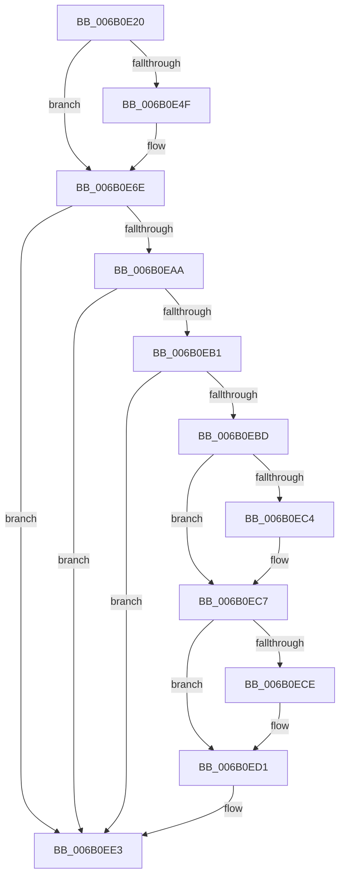

# KiRestoreProcessorControlState

- RVA: `0x006B0E20`–`0x006B0EE4` (길이 `196` bytes)
- VA: `0x00000001406B0E20`
- 실행 섹션: `.text`
- PDB 이름 있음: `예`; PDB Function 태그: `아니요`
- unwind 정보 RVA: `0x000C15DC`
- 디코드: `54`개 명령, `196/196` bytes 표시
- 미해석 바이트: `0` (있으면 어셈블리에 `.byte`로 보존)

> 이 문서는 커널 이미지의 기계어와 PDB 기호를 분석해 생성했습니다. 4번과 5번은 함수 원형과 자료형을 바이너리 사용 방식에서 추정한 C 해석이며 원본 소스 복구 결과는 아닙니다.

## 1. Dependencies

- 직접 호출 지점: **0**; 고유 호출 대상: **0**
- 직접 호출자로 확인된 함수: **5**
- RIP 상대 이미지 참조: **3**

### Outgoing calls
- 직접 디코드된 call 명령이 없습니다.

### Direct callers
- [KdpReport](../4D/KdpReport_function_004DF360.md) at `0x004DF48A`
- [KiFreezeTargetExecution](../5C/KiFreezeTargetExecution_function_005C30A0.md) at `0x005C327E`
- [KiRestoreProcessorState](../5C/KiRestoreProcessorState_function_005CB87C.md) at `0x005CB916`
- [KdpCommandString](../../pagekd/B8/KdpCommandString_function_00B88E2C.md) at `0x00B88EDA`
- [KdpSymbol](../../pagekd/B8/KdpSymbol_function_00B89220.md) at `0x00B892D8`

### Static image references
- `0x006B0E3F` → RVA `0x00FC6A84` (`ALMOSTRO`; read)
- `0x006B0E45` → RVA `0x00FC6BEA` (`ALMOSTRO`; read)
- `0x006B0EB1` → RVA `0x00F475C0` (`.data`; read)

## 2. Other-region calls and transfers

- 다른 실행 섹션으로 향하는 call: **0**
- 별도 외부 분기/꼬리 이동을 확인하지 못했습니다.

## 3. Assembly (complete function range)

```asm
006B0E20  48 8B 01                        mov rax, qword ptr [rcx]
006B0E23  0F 22 C0                        mov cr0, rax
006B0E26  48 8B 41 10                     mov rax, qword ptr [rcx + 0x10]
006B0E2A  0F 22 D8                        mov cr3, rax
006B0E2D  48 8B 41 18                     mov rax, qword ptr [rcx + 0x18]
006B0E31  0F 22 E0                        mov cr4, rax
006B0E34  48 8B 81 A0 00 00 00            mov rax, qword ptr [rcx + 0xa0]
006B0E3B  44 0F 22 C0                     mov cr8, rax
006B0E3F  8A 05 3F 5C 91 00               mov al, byte ptr [rip + 0x915c3f]
006B0E45  0A 05 9F 5D 91 00               or al, byte ptr [rip + 0x915d9f]
006B0E4B  84 C0                           test al, al
006B0E4D  75 1F                           jne 0x1406b0e6e
006B0E4F  0F 01 51 56                     lgdt [rcx + 0x56]
006B0E53  0F 01 59 66                     lidt [rcx + 0x66]
006B0E57  0F B7 41 70                     movzx eax, word ptr [rcx + 0x70]
006B0E5B  48 03 41 58                     add rax, qword ptr [rcx + 0x58]
006B0E5F  80 60 05 FD                     and byte ptr [rax + 5], 0xfd
006B0E63  0F 00 59 70                     ltr word ptr [rcx + 0x70]
006B0E67  66 8B 41 72                     mov ax, word ptr [rcx + 0x72]
006B0E6B  0F 00 D0                        lldt ax
006B0E6E  0F AE 51 74                     ldmxcsr dword ptr [rcx + 0x74]
006B0E72  33 D2                           xor edx, edx
006B0E74  0F 23 FA                        mov dr7, rdx
006B0E77  48 8B 41 20                     mov rax, qword ptr [rcx + 0x20]
006B0E7B  48 8B 51 28                     mov rdx, qword ptr [rcx + 0x28]
006B0E7F  0F 23 C0                        mov dr0, rax
006B0E82  0F 23 CA                        mov dr1, rdx
006B0E85  48 8B 41 30                     mov rax, qword ptr [rcx + 0x30]
006B0E89  48 8B 51 38                     mov rdx, qword ptr [rcx + 0x38]
006B0E8D  0F 23 D0                        mov dr2, rax
006B0E90  0F 23 DA                        mov dr3, rdx
006B0E93  48 8B 51 48                     mov rdx, qword ptr [rcx + 0x48]
006B0E97  33 C0                           xor eax, eax
006B0E99  0F 23 F0                        mov dr6, rax
006B0E9C  0F 23 FA                        mov dr7, rdx
006B0E9F  65 F6 04 25 22 91 00 00 02      test byte ptr gs:[0x9122], 2
006B0EA8  74 39                           je 0x1406b0ee3
006B0EAA  66 F7 C2 00 03                  test dx, 0x300
006B0EAF  74 32                           je 0x1406b0ee3
006B0EB1  F7 05 05 67 89 00 02 00 00 00   test dword ptr [rip + 0x896705], 2
006B0EBB  75 26                           jne 0x1406b0ee3
006B0EBD  66 F7 C2 00 02                  test dx, 0x200
006B0EC2  74 03                           je 0x1406b0ec7
006B0EC4  83 C8 02                        or eax, 2
006B0EC7  66 F7 C2 00 01                  test dx, 0x100
006B0ECC  74 03                           je 0x1406b0ed1
006B0ECE  83 C8 01                        or eax, 1
006B0ED1  44 8B C0                        mov r8d, eax
006B0ED4  B9 D9 01 00 00                  mov ecx, 0x1d9
006B0ED9  0F 32                           rdmsr
006B0EDB  83 E0 FC                        and eax, 0xfffffffc
006B0EDE  41 0B C0                        or eax, r8d
006B0EE1  0F 30                           wrmsr
006B0EE3  C3                              ret
```

## 4. C-style interpretation (structured pseudocode)

```c
__int64 __fastcall KiRestoreProcessorControlState(__int64 a1, int a2)
{
    __int64 result;

    result = (unsigned __int8)((*(unsigned __int8 *)(v_rip + 9526335)) | (*(unsigned __int8 *)(v_rip + 9526687)));
    if ((unsigned __int8)(result) == 0) {
        result = *(unsigned __int16 *)(a1 + 112);
        result = (result) + (*(unsigned __int64 *)(a1 + 88));
        result = *(unsigned __int16 *)(a1 + 114);
    }
    a2 = 0;
    result = 0;
    if (((*(unsigned __int8 *)(gs_base + (0 + 37154))) & (2)) == 0) goto loc_006B0EE3;
    if ((((unsigned __int16)(*(unsigned __int64 *)(a1 + 72))) & (768)) == 0) goto loc_006B0EE3;
    if (((*(unsigned int *)(v_rip + 9004805)) & (2)) != 0) goto loc_006B0EE3;
    if ((((unsigned __int16)(*(unsigned __int64 *)(a1 + 72))) & (512)) != 0) {
        result = (unsigned int)((result) | (2));
    }
    if ((((unsigned __int16)(*(unsigned __int64 *)(a1 + 72))) & (256)) != 0) {
        result = (unsigned int)((result) | (1));
    }
    result = (unsigned int)((result) & (0xFFFFFFFCULL));
    result = (unsigned int)((result) | ((unsigned int)((unsigned int)((unsigned int)(result)))));
loc_006B0EE3:
    return result;
}
```

## 5. (Beta) C Style

```c
int64_t KiRestoreProcessorControlState(void *Arg1, int32_t Arg2)
{
    uint8_t *arg1 = (uint8_t *)Arg1;

    int64_t result;

    result = (uint8_t)((*(uint8_t *)(v_rip + 0x915C3F)) | (*(uint8_t *)(v_rip + 0x915D9F)));
    if ((uint8_t)(result) == 0) {
        result = *(uint16_t *)(arg1 + 0x70);
        result = (result) + (*(uint64_t *)(arg1 + 0x58));
        result = *(uint16_t *)(arg1 + 0x72);
    }
    Arg2 = 0;
    result = 0;
    if (((*(uint8_t *)(gs_base + (0 + 0x9122))) & (2)) == 0) goto loc_006B0EE3;
    if ((((uint16_t)(*(uint64_t *)(arg1 + 0x48))) & (768)) == 0) goto loc_006B0EE3;
    if (((*(uint32_t *)(v_rip + 0x896705)) & (2)) != 0) goto loc_006B0EE3;
    if ((((uint16_t)(*(uint64_t *)(arg1 + 0x48))) & (512)) != 0) {
        result = (uint32_t)((result) | (2));
    }
    if ((((uint16_t)(*(uint64_t *)(arg1 + 0x48))) & (256)) != 0) {
        result = (uint32_t)((result) | (1));
    }
    result = (uint32_t)((result) & (0xFFFFFFFCULL));
    result = (uint32_t)((result) | ((uint32_t)((uint32_t)((uint32_t)(result)))));
loc_006B0EE3:
    return result;
}
```

### 관측된 메모리 오프셋

구조체 형식이 확인되지 않은 접근은 인자 기준의 오프셋으로만 기록했습니다.

| 기준 인자 | 오프셋 표현 | 폭 (bit) | 접근 |
|---|---:|---:|---|
| `Arg1` | `+ 0x0` | `64` | `R` |
| `Arg1` | `+ 0x10` | `64` | `R` |
| `Arg1` | `+ 0x18` | `64` | `R` |
| `Arg1` | `+ 0x20` | `64` | `R` |
| `Arg1` | `+ 0x28` | `64` | `R` |
| `Arg1` | `+ 0x30` | `64` | `R` |
| `Arg1` | `+ 0x38` | `64` | `R` |
| `Arg1` | `+ 0x48` | `64` | `R` |
| `Arg1` | `+ 0x56` | `80` | `R` |
| `Arg1` | `+ 0x58` | `64` | `R` |
| `Arg1` | `+ 0x66` | `80` | `R` |
| `Arg1` | `+ 0x70` | `16` | `R` |
| `Arg1` | `+ 0x72` | `16` | `R` |
| `Arg1` | `+ 0x74` | `32` | `R` |
| `Arg1` | `+ 0xA0` | `64` | `R` |

## 6. Execution-region graph

[열기: 2D/3D 그래프와 함수 탐색 컨트롤 패널](../../../control-panel.html?section=text&rva=0x006B0E20&view=graph)

- 2D 그래프는 위에서 아래로 흐르고, 3D 그래프는 빈 공간을 드래그해 회전합니다. Shift+드래그는 이동, 휠은 확대·축소, 함수 노드 선택은 대상 보고서 이동입니다.

### Static fallback


