# KiRestoreSetContextState

- RVA: `0x006B1CA0`–`0x006B20B9` (길이 `1,049` bytes)
- VA: `0x00000001406B1CA0`
- 실행 섹션: `.text`
- PDB 이름 있음: `예`; PDB Function 태그: `아니요`
- unwind 정보 RVA: `0x000C16F8`
- 디코드: `225`개 명령, `1,049/1,049` bytes 표시
- 미해석 바이트: `0` (있으면 어셈블리에 `.byte`로 보존)

> 이 문서는 커널 이미지의 기계어와 PDB 기호를 분석해 생성했습니다. 4번과 5번은 함수 원형과 자료형을 바이너리 사용 방식에서 추정한 C 해석이며 원본 소스 복구 결과는 아닙니다.

## 1. Dependencies

- 직접 호출 지점: **36**; 고유 호출 대상: **36**
- 직접 호출자로 확인된 함수: **27**
- RIP 상대 이미지 참조: **2**

### Outgoing calls
- `0x006B1D30` → [KeContextToKframes](../4F/KeContextToKframes_function_004FD790.md) (function, `0x004FD790`)
- `0x006B1DB2` → [KiUpdateStibpPairing](../3E/KiUpdateStibpPairing_function_003E71C0.md) (function, `0x003E71C0`)
- `0x006B1DFD` → [KiCopyCounters](../5C/KiCopyCounters_function_005C0710.md) (function, `0x005C0710`)
- `0x006B1E19` → [KiRestoreDebugRegisterState](../4F/KiRestoreDebugRegisterState_function_004FD8E0.md) (function, `0x004FD8E0`)
- `0x006B1EB3` → [KiRestoreSetContextState + 0x326](KiRestoreSetContextState_function_006B1CA0.md) (inside-function, `0x006B1FC6`)
- `0x006B1EBC` → [KiRestoreSetContextState + 0x32F](KiRestoreSetContextState_function_006B1CA0.md) (inside-function, `0x006B1FCF`)
- `0x006B1EC5` → [KiRestoreSetContextState + 0x218](KiRestoreSetContextState_function_006B1CA0.md) (inside-function, `0x006B1EB8`)
- `0x006B1ECE` → [KiRestoreSetContextState + 0x221](KiRestoreSetContextState_function_006B1CA0.md) (inside-function, `0x006B1EC1`)
- `0x006B1ED7` → [KiRestoreSetContextState + 0x22A](KiRestoreSetContextState_function_006B1CA0.md) (inside-function, `0x006B1ECA`)
- `0x006B1EE0` → [KiRestoreSetContextState + 0x233](KiRestoreSetContextState_function_006B1CA0.md) (inside-function, `0x006B1ED3`)
- `0x006B1EE9` → [KiRestoreSetContextState + 0x23C](KiRestoreSetContextState_function_006B1CA0.md) (inside-function, `0x006B1EDC`)
- `0x006B1EF2` → [KiRestoreSetContextState + 0x245](KiRestoreSetContextState_function_006B1CA0.md) (inside-function, `0x006B1EE5`)
- `0x006B1EFB` → [KiRestoreSetContextState + 0x24E](KiRestoreSetContextState_function_006B1CA0.md) (inside-function, `0x006B1EEE`)
- `0x006B1F04` → [KiRestoreSetContextState + 0x257](KiRestoreSetContextState_function_006B1CA0.md) (inside-function, `0x006B1EF7`)
- `0x006B1F0D` → [KiRestoreSetContextState + 0x260](KiRestoreSetContextState_function_006B1CA0.md) (inside-function, `0x006B1F00`)
- `0x006B1F16` → [KiRestoreSetContextState + 0x269](KiRestoreSetContextState_function_006B1CA0.md) (inside-function, `0x006B1F09`)
- `0x006B1F1F` → [KiRestoreSetContextState + 0x272](KiRestoreSetContextState_function_006B1CA0.md) (inside-function, `0x006B1F12`)
- `0x006B1F28` → [KiRestoreSetContextState + 0x27B](KiRestoreSetContextState_function_006B1CA0.md) (inside-function, `0x006B1F1B`)
- `0x006B1F31` → [KiRestoreSetContextState + 0x284](KiRestoreSetContextState_function_006B1CA0.md) (inside-function, `0x006B1F24`)
- `0x006B1F3A` → [KiRestoreSetContextState + 0x28D](KiRestoreSetContextState_function_006B1CA0.md) (inside-function, `0x006B1F2D`)
- `0x006B1F43` → [KiRestoreSetContextState + 0x296](KiRestoreSetContextState_function_006B1CA0.md) (inside-function, `0x006B1F36`)
- `0x006B1F4C` → [KiRestoreSetContextState + 0x29F](KiRestoreSetContextState_function_006B1CA0.md) (inside-function, `0x006B1F3F`)
- `0x006B1F55` → [KiRestoreSetContextState + 0x2A8](KiRestoreSetContextState_function_006B1CA0.md) (inside-function, `0x006B1F48`)
- `0x006B1F5E` → [KiRestoreSetContextState + 0x2B1](KiRestoreSetContextState_function_006B1CA0.md) (inside-function, `0x006B1F51`)
- `0x006B1F67` → [KiRestoreSetContextState + 0x2BA](KiRestoreSetContextState_function_006B1CA0.md) (inside-function, `0x006B1F5A`)
- `0x006B1F70` → [KiRestoreSetContextState + 0x2C3](KiRestoreSetContextState_function_006B1CA0.md) (inside-function, `0x006B1F63`)
- `0x006B1F79` → [KiRestoreSetContextState + 0x2CC](KiRestoreSetContextState_function_006B1CA0.md) (inside-function, `0x006B1F6C`)
- `0x006B1F82` → [KiRestoreSetContextState + 0x2D5](KiRestoreSetContextState_function_006B1CA0.md) (inside-function, `0x006B1F75`)
- `0x006B1F8B` → [KiRestoreSetContextState + 0x2DE](KiRestoreSetContextState_function_006B1CA0.md) (inside-function, `0x006B1F7E`)
- `0x006B1F94` → [KiRestoreSetContextState + 0x2E7](KiRestoreSetContextState_function_006B1CA0.md) (inside-function, `0x006B1F87`)
- `0x006B1F9D` → [KiRestoreSetContextState + 0x2F0](KiRestoreSetContextState_function_006B1CA0.md) (inside-function, `0x006B1F90`)
- `0x006B1FA6` → [KiRestoreSetContextState + 0x2F9](KiRestoreSetContextState_function_006B1CA0.md) (inside-function, `0x006B1F99`)
- `0x006B1FAF` → [KiRestoreSetContextState + 0x302](KiRestoreSetContextState_function_006B1CA0.md) (inside-function, `0x006B1FA2`)
- `0x006B1FB8` → [KiRestoreSetContextState + 0x30B](KiRestoreSetContextState_function_006B1CA0.md) (inside-function, `0x006B1FAB`)
- `0x006B1FC1` → [KiRestoreSetContextState + 0x314](KiRestoreSetContextState_function_006B1CA0.md) (inside-function, `0x006B1FB4`)
- `0x006B1FCA` → [KiRestoreSetContextState + 0x31D](KiRestoreSetContextState_function_006B1CA0.md) (inside-function, `0x006B1FBD`)

### Direct callers
- [NtContinueEx](NtContinueEx_function_006B10D0.md) at `0x006B126C`
- [NtRaiseException](NtRaiseException_function_006B1560.md) at `0x006B170C`
- [KiRestoreSetContextState](KiRestoreSetContextState_function_006B1CA0.md) at `0x006B1EB3`
- [KiRestoreSetContextState](KiRestoreSetContextState_function_006B1CA0.md) at `0x006B1EBC`
- [KiRestoreSetContextState](KiRestoreSetContextState_function_006B1CA0.md) at `0x006B1EC5`
- [KiRestoreSetContextState](KiRestoreSetContextState_function_006B1CA0.md) at `0x006B1ECE`
- [KiRestoreSetContextState](KiRestoreSetContextState_function_006B1CA0.md) at `0x006B1ED7`
- [KiRestoreSetContextState](KiRestoreSetContextState_function_006B1CA0.md) at `0x006B1EE0`
- [KiRestoreSetContextState](KiRestoreSetContextState_function_006B1CA0.md) at `0x006B1EE9`
- [KiRestoreSetContextState](KiRestoreSetContextState_function_006B1CA0.md) at `0x006B1EF2`
- [KiRestoreSetContextState](KiRestoreSetContextState_function_006B1CA0.md) at `0x006B1EFB`
- [KiRestoreSetContextState](KiRestoreSetContextState_function_006B1CA0.md) at `0x006B1F04`
- [KiRestoreSetContextState](KiRestoreSetContextState_function_006B1CA0.md) at `0x006B1F0D`
- [KiRestoreSetContextState](KiRestoreSetContextState_function_006B1CA0.md) at `0x006B1F16`
- [KiRestoreSetContextState](KiRestoreSetContextState_function_006B1CA0.md) at `0x006B1F1F`
- [KiRestoreSetContextState](KiRestoreSetContextState_function_006B1CA0.md) at `0x006B1F28`
- [KiRestoreSetContextState](KiRestoreSetContextState_function_006B1CA0.md) at `0x006B1F31`
- [KiRestoreSetContextState](KiRestoreSetContextState_function_006B1CA0.md) at `0x006B1F3A`
- [KiRestoreSetContextState](KiRestoreSetContextState_function_006B1CA0.md) at `0x006B1F43`
- [KiRestoreSetContextState](KiRestoreSetContextState_function_006B1CA0.md) at `0x006B1F4C`
- [KiRestoreSetContextState](KiRestoreSetContextState_function_006B1CA0.md) at `0x006B1F55`
- [KiRestoreSetContextState](KiRestoreSetContextState_function_006B1CA0.md) at `0x006B1F5E`
- [KiRestoreSetContextState](KiRestoreSetContextState_function_006B1CA0.md) at `0x006B1F67`
- [KiRestoreSetContextState](KiRestoreSetContextState_function_006B1CA0.md) at `0x006B1F70`
- [KiRestoreSetContextState](KiRestoreSetContextState_function_006B1CA0.md) at `0x006B1F79`
- [KiRestoreSetContextState](KiRestoreSetContextState_function_006B1CA0.md) at `0x006B1F82`
- [KiRestoreSetContextState](KiRestoreSetContextState_function_006B1CA0.md) at `0x006B1F8B`
- [KiRestoreSetContextState](KiRestoreSetContextState_function_006B1CA0.md) at `0x006B1F94`
- [KiRestoreSetContextState](KiRestoreSetContextState_function_006B1CA0.md) at `0x006B1F9D`
- [KiRestoreSetContextState](KiRestoreSetContextState_function_006B1CA0.md) at `0x006B1FA6`
- [KiRestoreSetContextState](KiRestoreSetContextState_function_006B1CA0.md) at `0x006B1FAF`
- [KiRestoreSetContextState](KiRestoreSetContextState_function_006B1CA0.md) at `0x006B1FB8`
- [KiRestoreSetContextState](KiRestoreSetContextState_function_006B1CA0.md) at `0x006B1FC1`
- [KiRestoreSetContextState](KiRestoreSetContextState_function_006B1CA0.md) at `0x006B1FCA`
- [KxStartUserThread](KxStartUserThread_function_006B2E50.md) at `0x006B2FA7`
- [KiChainedDispatch](KiChainedDispatch_function_006B3480.md) at `0x006B3579`
- [KiInterruptDispatch](KiInterruptDispatch_function_006B3B30.md) at `0x006B3C29`
- [KiInterruptDispatchNoLock](KiInterruptDispatchNoLock_function_006B3F10.md) at `0x006B4009`
- [KiInterruptDispatchNoLockNoEtw](KiInterruptDispatchNoLockNoEtw_function_006B42F0.md) at `0x006B43E9`
- [KiInterruptDispatchNoEOI](KiInterruptDispatchNoEOI_function_006B46D0.md) at `0x006B47C1`
- [KiSpuriousDispatchNoEOI](KiSpuriousDispatchNoEOI_function_006B4AA0.md) at `0x006B4B86`
- [KxIsrLinkage](KxIsrLinkage_function_006B5680.md) at `0x006B5B35`
- [KiApcInterrupt](KiApcInterrupt_function_006B5E20.md) at `0x006B6262`
- [KiHvInterruptDispatch](KiHvInterruptDispatch_function_006B7750.md) at `0x006B7857`
- [KiVmbusInterruptDispatch](KiVmbusInterruptDispatch_function_006B7B40.md) at `0x006B7C33`
- [KiSwInterrupt](KiSwInterrupt_function_006B8070.md) at `0x006B84CE`
- [KiDpcInterrupt](KiDpcInterrupt_function_006B87C0.md) at `0x006B8BF6`
- [KiIpiInterrupt](KiIpiInterrupt_function_006B8F20.md) at `0x006B9377`
- [NtCallEnclave](NtCallEnclave_function_006BABA0.md) at `0x006BAC7E`
- [KiBoundFault](KiBoundFault_function_006BE040.md) at `0x006BE451`
- [KiInvalidOpcodeFault](KiInvalidOpcodeFault_function_006BE740.md) at `0x006BEB07`
- [KiPageFault](../6C/KiPageFault_function_006C0740.md) at `0x006C0C68`
- [KxMcheckAlternateReturn](../6C/KxMcheckAlternateReturn_function_006C1E00.md) at `0x006C21F6`
- [KiVirtualizationException](../6C/KiVirtualizationException_function_006C2900.md) at `0x006C2D18`
- [KiControlProtectionFault](../6C/KiControlProtectionFault_function_006C3040.md) at `0x006C34BA`
- [KiSystemCall64](../6C/KiSystemCall64_function_006C4A40.md) at `0x006C5093`
- [KiSystemCall64](../6C/KiSystemCall64_function_006C4A40.md) at `0x006C542E`
- [KiExceptionDispatch](../6C/KiExceptionDispatch_function_006C5900.md) at `0x006C5B2A`
- [KiFastFailDispatch](../6C/KiFastFailDispatch_function_006C5E40.md) at `0x006C5FEB`

### Static image references
- `0x006B1DDA` → RVA `0x00FC6BF0` (`ALMOSTRO`; read)
- `0x006B2048` → RVA `0x01201840` (`CFGRO`; read)

## 2. Other-region calls and transfers

- 다른 실행 섹션으로 향하는 call: **0**
- call이 아닌 외부 분기/꼬리 이동: **1**
  - `0x006B2051` → [KiKernelExit](../../kvascode/BC/KiKernelExit_function_00BCCB80.md) (`tail-transfer`)

## 3. Assembly (complete function range)

```asm
006B1CA0  48 81 EC 38 01 00 00            sub rsp, 0x138
006B1CA7  48 8D 84 24 00 01 00 00         lea rax, [rsp + 0x100]
006B1CAF  0F 29 74 24 30                  movaps xmmword ptr [rsp + 0x30], xmm6
006B1CB4  0F 29 7C 24 40                  movaps xmmword ptr [rsp + 0x40], xmm7
006B1CB9  44 0F 29 44 24 50               movaps xmmword ptr [rsp + 0x50], xmm8
006B1CBF  44 0F 29 4C 24 60               movaps xmmword ptr [rsp + 0x60], xmm9
006B1CC5  44 0F 29 54 24 70               movaps xmmword ptr [rsp + 0x70], xmm10
006B1CCB  44 0F 29 58 80                  movaps xmmword ptr [rax - 0x80], xmm11
006B1CD0  44 0F 29 60 90                  movaps xmmword ptr [rax - 0x70], xmm12
006B1CD5  44 0F 29 68 A0                  movaps xmmword ptr [rax - 0x60], xmm13
006B1CDA  44 0F 29 70 B0                  movaps xmmword ptr [rax - 0x50], xmm14
006B1CDF  44 0F 29 78 C0                  movaps xmmword ptr [rax - 0x40], xmm15
006B1CE4  48 89 18                        mov qword ptr [rax], rbx
006B1CE7  48 89 78 08                     mov qword ptr [rax + 8], rdi
006B1CEB  48 89 70 10                     mov qword ptr [rax + 0x10], rsi
006B1CEF  4C 89 60 18                     mov qword ptr [rax + 0x18], r12
006B1CF3  4C 89 68 20                     mov qword ptr [rax + 0x20], r13
006B1CF7  4C 89 70 28                     mov qword ptr [rax + 0x28], r14
006B1CFB  4C 89 78 30                     mov qword ptr [rax + 0x30], r15
006B1CFF  B9 01 00 00 00                  mov ecx, 1
006B1D04  44 0F 22 C1                     mov cr8, rcx
006B1D08  FB                              sti
006B1D09  65 48 8B 0C 25 88 01 00 00      mov rcx, qword ptr gs:[0x188]
006B1D12  48 8B 89 A8 06 00 00            mov rcx, qword ptr [rcx + 0x6a8]
006B1D19  48 C7 44 24 20 01 00 00 00      mov qword ptr [rsp + 0x20], 1
006B1D22  44 8B 49 30                     mov r9d, dword ptr [rcx + 0x30]
006B1D26  4C 8B C1                        mov r8, rcx
006B1D29  48 8B D4                        mov rdx, rsp
006B1D2C  48 8D 4D 80                     lea rcx, [rbp - 0x80]
006B1D30  E8 5B BA E4 FF                  call 0x1404fd790
006B1D35  FA                              cli
006B1D36  B9 00 00 00 00                  mov ecx, 0
006B1D3B  44 0F 22 C1                     mov cr8, rcx
006B1D3F  65 48 8B 0C 25 88 01 00 00      mov rcx, qword ptr gs:[0x188]
006B1D48  F0 0F BA 31 1B                  lock btr dword ptr [rcx], 0x1b
006B1D4D  48 8D 8C 24 00 01 00 00         lea rcx, [rsp + 0x100]
006B1D55  0F 28 74 24 30                  movaps xmm6, xmmword ptr [rsp + 0x30]
006B1D5A  0F 28 7C 24 40                  movaps xmm7, xmmword ptr [rsp + 0x40]
006B1D5F  44 0F 28 44 24 50               movaps xmm8, xmmword ptr [rsp + 0x50]
006B1D65  44 0F 28 4C 24 60               movaps xmm9, xmmword ptr [rsp + 0x60]
006B1D6B  44 0F 28 54 24 70               movaps xmm10, xmmword ptr [rsp + 0x70]
006B1D71  44 0F 28 59 80                  movaps xmm11, xmmword ptr [rcx - 0x80]
006B1D76  44 0F 28 61 90                  movaps xmm12, xmmword ptr [rcx - 0x70]
006B1D7B  44 0F 28 69 A0                  movaps xmm13, xmmword ptr [rcx - 0x60]
006B1D80  44 0F 28 71 B0                  movaps xmm14, xmmword ptr [rcx - 0x50]
006B1D85  44 0F 28 79 C0                  movaps xmm15, xmmword ptr [rcx - 0x40]
006B1D8A  48 8B 19                        mov rbx, qword ptr [rcx]
006B1D8D  48 8B 79 08                     mov rdi, qword ptr [rcx + 8]
006B1D91  48 8B 71 10                     mov rsi, qword ptr [rcx + 0x10]
006B1D95  4C 8B 61 18                     mov r12, qword ptr [rcx + 0x18]
006B1D99  4C 8B 69 20                     mov r13, qword ptr [rcx + 0x20]
006B1D9D  4C 8B 71 28                     mov r14, qword ptr [rcx + 0x28]
006B1DA1  4C 8B 79 30                     mov r15, qword ptr [rcx + 0x30]
006B1DA5  65 F6 04 25 60 08 00 00 02      test byte ptr gs:[0x860], 2
006B1DAE  74 07                           je 0x1406b1db7
006B1DB0  33 C9                           xor ecx, ecx
006B1DB2  E8 09 54 D3 FF                  call 0x1403e71c0
006B1DB7  33 C9                           xor ecx, ecx
006B1DB9  F3 48 0F 1E C9                  rdsspq rcx
006B1DBE  48 85 C9                        test rcx, rcx
006B1DC1  74 0A                           je 0x1406b1dcd
006B1DC3  B9 01 00 00 00                  mov ecx, 1
006B1DC8  F3 48 0F AE E9                  incsspq rcx
006B1DCD  F6 85 F0 00 00 00 01            test byte ptr [rbp + 0xf0], 1
006B1DD4  0F 84 93 02 00 00               je 0x1406b206d
006B1DDA  F6 05 0F 4E 91 00 FF            test byte ptr [rip + 0x914e0f], 0xff
006B1DE1  74 03                           je 0x1406b1de6
006B1DE3  0F 01 CB                        stac
006B1DE6  65 48 8B 0C 25 88 01 00 00      mov rcx, qword ptr gs:[0x188]
006B1DEF  F7 01 00 00 01 00               test dword ptr [rcx], 0x10000
006B1DF5  74 14                           je 0x1406b1e0b
006B1DF7  F6 41 02 01                     test byte ptr [rcx + 2], 1
006B1DFB  74 0E                           je 0x1406b1e0b
006B1DFD  E8 0E E9 F0 FF                  call 0x1405c0710
006B1E02  65 48 8B 0C 25 88 01 00 00      mov rcx, qword ptr gs:[0x188]
006B1E0B  0F AE 55 AC                     ldmxcsr dword ptr [rbp - 0x54]
006B1E0F  66 83 BD 80 00 00 00 00         cmp word ptr [rbp + 0x80], 0
006B1E17  74 05                           je 0x1406b1e1e
006B1E19  E8 C2 BA E4 FF                  call 0x1404fd8e0
006B1E1E  65 48 8B 0C 25 88 01 00 00      mov rcx, qword ptr gs:[0x188]
006B1E27  0F BA 61 74 16                  bt dword ptr [rcx + 0x74], 0x16
006B1E2C  73 2A                           jae 0x1406b1e58
006B1E2E  33 C9                           xor ecx, ecx
006B1E30  F3 48 0F 1E C9                  rdsspq rcx
006B1E35  65 4C 8B 04 25 28 9D 00 00      mov r8, qword ptr gs:[0x9d28]
006B1E3E  49 83 C0 08                     add r8, 8
006B1E42  49 3B C8                        cmp rcx, r8
006B1E45  75 11                           jne 0x1406b1e58
006B1E47  65 48 8B 0C 25 20 9D 00 00      mov rcx, qword ptr gs:[0x9d20]
006B1E50  F3 0F 01 29                     rstorssp dword ptr [rcx]
006B1E54  F3 0F 01 EA                     saveprevssp
006B1E58  65 C6 04 25 5E 08 00 00 00      mov byte ptr gs:[0x85e], 0
006B1E61  65 0F B7 04 25 6C 08 00 00      movzx eax, word ptr gs:[0x86c]
006B1E6A  66 65 39 04 25 66 08 00 00      cmp word ptr gs:[0x866], ax
006B1E73  74 12                           je 0x1406b1e87
006B1E75  66 65 89 04 25 66 08 00 00      mov word ptr gs:[0x866], ax
006B1E7E  B9 48 00 00 00                  mov ecx, 0x48
006B1E83  33 D2                           xor edx, edx
006B1E85  0F 30                           wrmsr
006B1E87  66 65 0F BA 34 25 58 08 00 00 02  btr word ptr gs:[0x858], 2
006B1E92  73 0E                           jae 0x1406b1ea2
006B1E94  B8 01 00 00 00                  mov eax, 1
006B1E99  33 D2                           xor edx, edx
006B1E9B  B9 49 00 00 00                  mov ecx, 0x49
006B1EA0  0F 30                           wrmsr
006B1EA2  66 65 0F BA 34 25 58 08 00 00 05  btr word ptr gs:[0x858], 5
006B1EAD  0F 83 37 01 00 00               jae 0x1406b1fea
006B1EB3  E8 0E 01 00 00                  call 0x1406b1fc6
006B1EB8  48 83 C4 08                     add rsp, 8
006B1EBC  E8 0E 01 00 00                  call 0x1406b1fcf
006B1EC1  48 83 C4 08                     add rsp, 8
006B1EC5  E8 EE FF FF FF                  call 0x1406b1eb8
006B1ECA  48 83 C4 08                     add rsp, 8
006B1ECE  E8 EE FF FF FF                  call 0x1406b1ec1
006B1ED3  48 83 C4 08                     add rsp, 8
006B1ED7  E8 EE FF FF FF                  call 0x1406b1eca
006B1EDC  48 83 C4 08                     add rsp, 8
006B1EE0  E8 EE FF FF FF                  call 0x1406b1ed3
006B1EE5  48 83 C4 08                     add rsp, 8
006B1EE9  E8 EE FF FF FF                  call 0x1406b1edc
006B1EEE  48 83 C4 08                     add rsp, 8
006B1EF2  E8 EE FF FF FF                  call 0x1406b1ee5
006B1EF7  48 83 C4 08                     add rsp, 8
006B1EFB  E8 EE FF FF FF                  call 0x1406b1eee
006B1F00  48 83 C4 08                     add rsp, 8
006B1F04  E8 EE FF FF FF                  call 0x1406b1ef7
006B1F09  48 83 C4 08                     add rsp, 8
006B1F0D  E8 EE FF FF FF                  call 0x1406b1f00
006B1F12  48 83 C4 08                     add rsp, 8
006B1F16  E8 EE FF FF FF                  call 0x1406b1f09
006B1F1B  48 83 C4 08                     add rsp, 8
006B1F1F  E8 EE FF FF FF                  call 0x1406b1f12
006B1F24  48 83 C4 08                     add rsp, 8
006B1F28  E8 EE FF FF FF                  call 0x1406b1f1b
006B1F2D  48 83 C4 08                     add rsp, 8
006B1F31  E8 EE FF FF FF                  call 0x1406b1f24
006B1F36  48 83 C4 08                     add rsp, 8
006B1F3A  E8 EE FF FF FF                  call 0x1406b1f2d
006B1F3F  48 83 C4 08                     add rsp, 8
006B1F43  E8 EE FF FF FF                  call 0x1406b1f36
006B1F48  48 83 C4 08                     add rsp, 8
006B1F4C  E8 EE FF FF FF                  call 0x1406b1f3f
006B1F51  48 83 C4 08                     add rsp, 8
006B1F55  E8 EE FF FF FF                  call 0x1406b1f48
006B1F5A  48 83 C4 08                     add rsp, 8
006B1F5E  E8 EE FF FF FF                  call 0x1406b1f51
006B1F63  48 83 C4 08                     add rsp, 8
006B1F67  E8 EE FF FF FF                  call 0x1406b1f5a
006B1F6C  48 83 C4 08                     add rsp, 8
006B1F70  E8 EE FF FF FF                  call 0x1406b1f63
006B1F75  48 83 C4 08                     add rsp, 8
006B1F79  E8 EE FF FF FF                  call 0x1406b1f6c
006B1F7E  48 83 C4 08                     add rsp, 8
006B1F82  E8 EE FF FF FF                  call 0x1406b1f75
006B1F87  48 83 C4 08                     add rsp, 8
006B1F8B  E8 EE FF FF FF                  call 0x1406b1f7e
006B1F90  48 83 C4 08                     add rsp, 8
006B1F94  E8 EE FF FF FF                  call 0x1406b1f87
006B1F99  48 83 C4 08                     add rsp, 8
006B1F9D  E8 EE FF FF FF                  call 0x1406b1f90
006B1FA2  48 83 C4 08                     add rsp, 8
006B1FA6  E8 EE FF FF FF                  call 0x1406b1f99
006B1FAB  48 83 C4 08                     add rsp, 8
006B1FAF  E8 EE FF FF FF                  call 0x1406b1fa2
006B1FB4  48 83 C4 08                     add rsp, 8
006B1FB8  E8 EE FF FF FF                  call 0x1406b1fab
006B1FBD  48 83 C4 08                     add rsp, 8
006B1FC1  E8 EE FF FF FF                  call 0x1406b1fb4
006B1FC6  48 83 C4 08                     add rsp, 8
006B1FCA  E8 EE FF FF FF                  call 0x1406b1fbd
006B1FCF  48 83 C4 08                     add rsp, 8
006B1FD3  B8 DA DA 00 00                  mov eax, 0xdada
006B1FD8  65 F6 04 25 5C 08 00 00 08      test byte ptr gs:[0x85c], 8
006B1FE1  74 07                           je 0x1406b1fea
006B1FE3  B0 20                           mov al, 0x20
006B1FE5  F3 48 0F AE E8                  incsspq rax
006B1FEA  66 65 F7 04 25 58 08 00 00 00 01  test word ptr gs:[0x858], 0x100
006B1FF5  74 0C                           je 0x1406b2003
006B1FF7  33 C0                           xor eax, eax
006B1FF9  33 D2                           xor edx, edx
006B1FFB  B9 01 00 00 00                  mov ecx, 1
006B2000  48 F7 F1                        div rcx
006B2003  0F 28 45 F0                     movaps xmm0, xmmword ptr [rbp - 0x10]
006B2007  0F 28 4D 00                     movaps xmm1, xmmword ptr [rbp]
006B200B  0F 28 55 10                     movaps xmm2, xmmword ptr [rbp + 0x10]
006B200F  0F 28 5D 20                     movaps xmm3, xmmword ptr [rbp + 0x20]
006B2013  0F 28 65 30                     movaps xmm4, xmmword ptr [rbp + 0x30]
006B2017  0F 28 6D 40                     movaps xmm5, xmmword ptr [rbp + 0x40]
006B201B  4C 8B 5D E0                     mov r11, qword ptr [rbp - 0x20]
006B201F  4C 8B 55 D8                     mov r10, qword ptr [rbp - 0x28]
006B2023  4C 8B 4D D0                     mov r9, qword ptr [rbp - 0x30]
006B2027  4C 8B 45 C8                     mov r8, qword ptr [rbp - 0x38]
006B202B  48 8B 55 C0                     mov rdx, qword ptr [rbp - 0x40]
006B202F  48 8B 4D B8                     mov rcx, qword ptr [rbp - 0x48]
006B2033  48 8B 45 B0                     mov rax, qword ptr [rbp - 0x50]
006B2037  48 8B E5                        mov rsp, rbp
006B203A  48 8B AD D8 00 00 00            mov rbp, qword ptr [rbp + 0xd8]
006B2041  48 81 C4 E8 00 00 00            add rsp, 0xe8
006B2048  F6 05 F1 F7 B4 00 01            test byte ptr [rip + 0xb4f7f1], 1
006B204F  74 05                           je 0x1406b2056
006B2051  E9 2A AB 51 00                  jmp 0x140bccb80
006B2056  66 65 F7 04 25 58 08 00 00 00 02  test word ptr gs:[0x858], 0x200
006B2061  74 05                           je 0x1406b2068
006B2063  0F 00 6C 24 20                  verw word ptr [rsp + 0x20]
006B2068  0F 01 F8                        swapgs
006B206B  48 CF                           iretq
006B206D  0F AE 55 AC                     ldmxcsr dword ptr [rbp - 0x54]
006B2071  0F 28 45 F0                     movaps xmm0, xmmword ptr [rbp - 0x10]
006B2075  0F 28 4D 00                     movaps xmm1, xmmword ptr [rbp]
006B2079  0F 28 55 10                     movaps xmm2, xmmword ptr [rbp + 0x10]
006B207D  0F 28 5D 20                     movaps xmm3, xmmword ptr [rbp + 0x20]
006B2081  0F 28 65 30                     movaps xmm4, xmmword ptr [rbp + 0x30]
006B2085  0F 28 6D 40                     movaps xmm5, xmmword ptr [rbp + 0x40]
006B2089  4C 8B 5D E0                     mov r11, qword ptr [rbp - 0x20]
006B208D  4C 8B 55 D8                     mov r10, qword ptr [rbp - 0x28]
006B2091  4C 8B 4D D0                     mov r9, qword ptr [rbp - 0x30]
006B2095  4C 8B 45 C8                     mov r8, qword ptr [rbp - 0x38]
006B2099  48 8B 55 C0                     mov rdx, qword ptr [rbp - 0x40]
006B209D  48 8B 4D B8                     mov rcx, qword ptr [rbp - 0x48]
006B20A1  48 8B 45 B0                     mov rax, qword ptr [rbp - 0x50]
006B20A5  48 8B E5                        mov rsp, rbp
006B20A8  48 8B AD D8 00 00 00            mov rbp, qword ptr [rbp + 0xd8]
006B20AF  48 81 C4 E8 00 00 00            add rsp, 0xe8
006B20B6  48 CF                           iretq
006B20B8  C3                              ret
```

## 4. C-style interpretation (structured pseudocode)

```c
__int64 __fastcall KiRestoreSetContextState(void)
{
    __int64 result;
    __int64 v_rsp;
    unsigned __int64 v_stack_m108;
    unsigned __int64 v_stack_m118;
    unsigned __int64 v_stack_m38;
    unsigned __int64 v_stack_mC8;
    unsigned __int64 v_stack_mD8;
    unsigned __int64 v_stack_mE8;
    unsigned __int64 v_stack_mF8;
    unsigned __int16 v_stack_pD0;

    v_rsp = (v_rsp) - (312);
    v_stack_m108 = v_xmm6;
    v_stack_mF8 = v_xmm7;
    v_stack_mE8 = v_xmm8;
    v_stack_mD8 = v_xmm9;
    v_stack_mC8 = v_xmm10;
    *(unsigned __int64 *)(v_stack_m38 - 128) = v_xmm11;
    *(unsigned __int64 *)(v_stack_m38 - 112) = v_xmm12;
    *(unsigned __int64 *)(v_stack_m38 - 96) = v_xmm13;
    *(unsigned __int64 *)(v_stack_m38 - 80) = v_xmm14;
    *(unsigned __int64 *)(v_stack_m38 - 64) = v_xmm15;
    *(unsigned __int64 *)(v_stack_m38) = v_rbx;
    *(unsigned __int64 *)(v_stack_m38 + 8) = v_rdi;
    *(unsigned __int64 *)(v_stack_m38 + 16) = v_rsi;
    *(unsigned __int64 *)(v_stack_m38 + 24) = v_r12;
    *(unsigned __int64 *)(v_stack_m38 + 32) = v_r13;
    *(unsigned __int64 *)(v_stack_m38 + 40) = v_r14;
    *(unsigned __int64 *)(v_stack_m38 + 48) = v_r15;
    v_stack_m118 = 1;
    result = KeContextToKframes(v_rbp - 128, v_rsp, *(unsigned __int64 *)(*(unsigned __int64 *)(gs_base + (0 + 392)) + 1704), (unsigned int)(*(unsigned int *)(*(unsigned __int64 *)(*(unsigned __int64 *)(gs_base + (0 + 392)) + 1704) + 48)));
    if (((*(unsigned __int8 *)(gs_base + (0 + 2144))) & (2)) != 0) {
        a1 = 0;
        result = KiUpdateStibpPairing(a1, v_rsp, *(unsigned __int64 *)(*(unsigned __int64 *)(gs_base + (0 + 392)) + 1704), (unsigned int)(*(unsigned int *)(*(unsigned __int64 *)(*(unsigned __int64 *)(gs_base + (0 + 392)) + 1704) + 48)));
    }
    a1 = 0;
    if (0 != 0) {
        a1 = 1;
    }
    if (((*(unsigned __int8 *)(v_rbp + 240)) & (1)) == 0) goto loc_006B206D;
    if (((*(unsigned __int8 *)(v_rip + 9522703)) & (255)) != 0) {
    }
    if (((*(unsigned int *)(*(unsigned __int64 *)(gs_base + (0 + 392)))) & (0x10000ULL)) == 0) goto loc_006B1E0B;
    if (((*(unsigned __int8 *)(*(unsigned __int64 *)(gs_base + (0 + 392)) + 2)) & (1)) != 0) {
        result = KiCopyCounters(*(unsigned __int64 *)(gs_base + (0 + 392)), v_rsp, *(unsigned __int64 *)(*(unsigned __int64 *)(gs_base + (0 + 392)) + 1704), (unsigned int)(*(unsigned int *)(*(unsigned __int64 *)(*(unsigned __int64 *)(gs_base + (0 + 392)) + 1704) + 48)));
        a1 = *(unsigned __int64 *)(gs_base + (0 + 392));
    }
    if ((*(unsigned __int16 *)(v_rbp + 128)) != 0) {
        result = KiRestoreDebugRegisterState(a1, v_rsp, *(unsigned __int64 *)(*(unsigned __int64 *)(gs_base + (0 + 392)) + 1704), (unsigned int)(*(unsigned int *)(*(unsigned __int64 *)(*(unsigned __int64 *)(gs_base + (0 + 392)) + 1704) + 48)));
    }
    if ((*(unsigned __int16 *)(v_rbp + 128)) >= 0) goto loc_006B1E58;
    a1 = 0;
    a3 = (*(unsigned __int64 *)(gs_base + (0 + 40232))) + (8);
    if (0 == a3) {
        a1 = *(unsigned __int64 *)(gs_base + (0 + 40224));
    }
    *(unsigned __int8 *)(gs_base + (0 + 2142)) = 0;
    if ((*(unsigned __int16 *)(gs_base + (0 + 2150))) != ((unsigned __int16)(*(unsigned __int16 *)(gs_base + (0 + 2156))))) {
        *(unsigned __int16 *)(gs_base + (0 + 2150)) = (unsigned __int16)(*(unsigned __int16 *)(gs_base + (0 + 2156)));
        a1 = 72;
        a2 = 0;
    }
    result = *(unsigned __int16 *)(gs_base + (0 + 2156));
    if (!(condition_is_above_or_equal)) {
        result = 1;
        a2 = 0;
        a1 = 73;
    }
    if (condition_is_above_or_equal) goto loc_006B1FEA;
    result = KiRestoreSetContextState___0x326(a1, a2, a3, (unsigned int)(*(unsigned int *)(*(unsigned __int64 *)(*(unsigned __int64 *)(gs_base + (0 + 392)) + 1704) + 48)));
    v_rsp = (v_rsp) + (8);
    result = KiRestoreSetContextState___0x32F(a1, a2, a3, (unsigned int)(*(unsigned int *)(*(unsigned __int64 *)(*(unsigned __int64 *)(gs_base + (0 + 392)) + 1704) + 48)));
    v_rsp = (v_rsp) + (8);
    result = KiRestoreSetContextState___0x218(a1, a2, a3, (unsigned int)(*(unsigned int *)(*(unsigned __int64 *)(*(unsigned __int64 *)(gs_base + (0 + 392)) + 1704) + 48)));
    v_rsp = (v_rsp) + (8);
    result = KiRestoreSetContextState___0x221(a1, a2, a3, (unsigned int)(*(unsigned int *)(*(unsigned __int64 *)(*(unsigned __int64 *)(gs_base + (0 + 392)) + 1704) + 48)));
    v_rsp = (v_rsp) + (8);
    result = KiRestoreSetContextState___0x22A(a1, a2, a3, (unsigned int)(*(unsigned int *)(*(unsigned __int64 *)(*(unsigned __int64 *)(gs_base + (0 + 392)) + 1704) + 48)));
    v_rsp = (v_rsp) + (8);
    result = KiRestoreSetContextState___0x233(a1, a2, a3, (unsigned int)(*(unsigned int *)(*(unsigned __int64 *)(*(unsigned __int64 *)(gs_base + (0 + 392)) + 1704) + 48)));
    v_rsp = (v_rsp) + (8);
    result = KiRestoreSetContextState___0x23C(a1, a2, a3, (unsigned int)(*(unsigned int *)(*(unsigned __int64 *)(*(unsigned __int64 *)(gs_base + (0 + 392)) + 1704) + 48)));
    v_rsp = (v_rsp) + (8);
    result = KiRestoreSetContextState___0x245(a1, a2, a3, (unsigned int)(*(unsigned int *)(*(unsigned __int64 *)(*(unsigned __int64 *)(gs_base + (0 + 392)) + 1704) + 48)));
    v_rsp = (v_rsp) + (8);
    result = KiRestoreSetContextState___0x24E(a1, a2, a3, (unsigned int)(*(unsigned int *)(*(unsigned __int64 *)(*(unsigned __int64 *)(gs_base + (0 + 392)) + 1704) + 48)));
    v_rsp = (v_rsp) + (8);
    result = KiRestoreSetContextState___0x257(a1, a2, a3, (unsigned int)(*(unsigned int *)(*(unsigned __int64 *)(*(unsigned __int64 *)(gs_base + (0 + 392)) + 1704) + 48)));
    v_rsp = (v_rsp) + (8);
    result = KiRestoreSetContextState___0x260(a1, a2, a3, (unsigned int)(*(unsigned int *)(*(unsigned __int64 *)(*(unsigned __int64 *)(gs_base + (0 + 392)) + 1704) + 48)));
    v_rsp = (v_rsp) + (8);
    result = KiRestoreSetContextState___0x269(a1, a2, a3, (unsigned int)(*(unsigned int *)(*(unsigned __int64 *)(*(unsigned __int64 *)(gs_base + (0 + 392)) + 1704) + 48)));
    v_rsp = (v_rsp) + (8);
    result = KiRestoreSetContextState___0x272(a1, a2, a3, (unsigned int)(*(unsigned int *)(*(unsigned __int64 *)(*(unsigned __int64 *)(gs_base + (0 + 392)) + 1704) + 48)));
    v_rsp = (v_rsp) + (8);
    result = KiRestoreSetContextState___0x27B(a1, a2, a3, (unsigned int)(*(unsigned int *)(*(unsigned __int64 *)(*(unsigned __int64 *)(gs_base + (0 + 392)) + 1704) + 48)));
    v_rsp = (v_rsp) + (8);
    result = KiRestoreSetContextState___0x284(a1, a2, a3, (unsigned int)(*(unsigned int *)(*(unsigned __int64 *)(*(unsigned __int64 *)(gs_base + (0 + 392)) + 1704) + 48)));
    v_rsp = (v_rsp) + (8);
    result = KiRestoreSetContextState___0x28D(a1, a2, a3, (unsigned int)(*(unsigned int *)(*(unsigned __int64 *)(*(unsigned __int64 *)(gs_base + (0 + 392)) + 1704) + 48)));
    v_rsp = (v_rsp) + (8);
    result = KiRestoreSetContextState___0x296(a1, a2, a3, (unsigned int)(*(unsigned int *)(*(unsigned __int64 *)(*(unsigned __int64 *)(gs_base + (0 + 392)) + 1704) + 48)));
    v_rsp = (v_rsp) + (8);
    result = KiRestoreSetContextState___0x29F(a1, a2, a3, (unsigned int)(*(unsigned int *)(*(unsigned __int64 *)(*(unsigned __int64 *)(gs_base + (0 + 392)) + 1704) + 48)));
    v_rsp = (v_rsp) + (8);
    result = KiRestoreSetContextState___0x2A8(a1, a2, a3, (unsigned int)(*(unsigned int *)(*(unsigned __int64 *)(*(unsigned __int64 *)(gs_base + (0 + 392)) + 1704) + 48)));
    v_rsp = (v_rsp) + (8);
    result = KiRestoreSetContextState___0x2B1(a1, a2, a3, (unsigned int)(*(unsigned int *)(*(unsigned __int64 *)(*(unsigned __int64 *)(gs_base + (0 + 392)) + 1704) + 48)));
    v_rsp = (v_rsp) + (8);
    result = KiRestoreSetContextState___0x2BA(a1, a2, a3, (unsigned int)(*(unsigned int *)(*(unsigned __int64 *)(*(unsigned __int64 *)(gs_base + (0 + 392)) + 1704) + 48)));
    v_rsp = (v_rsp) + (8);
    result = KiRestoreSetContextState___0x2C3(a1, a2, a3, (unsigned int)(*(unsigned int *)(*(unsigned __int64 *)(*(unsigned __int64 *)(gs_base + (0 + 392)) + 1704) + 48)));
    v_rsp = (v_rsp) + (8);
    result = KiRestoreSetContextState___0x2CC(a1, a2, a3, (unsigned int)(*(unsigned int *)(*(unsigned __int64 *)(*(unsigned __int64 *)(gs_base + (0 + 392)) + 1704) + 48)));
    v_rsp = (v_rsp) + (8);
    result = KiRestoreSetContextState___0x2D5(a1, a2, a3, (unsigned int)(*(unsigned int *)(*(unsigned __int64 *)(*(unsigned __int64 *)(gs_base + (0 + 392)) + 1704) + 48)));
    v_rsp = (v_rsp) + (8);
    result = KiRestoreSetContextState___0x2DE(a1, a2, a3, (unsigned int)(*(unsigned int *)(*(unsigned __int64 *)(*(unsigned __int64 *)(gs_base + (0 + 392)) + 1704) + 48)));
    v_rsp = (v_rsp) + (8);
    result = KiRestoreSetContextState___0x2E7(a1, a2, a3, (unsigned int)(*(unsigned int *)(*(unsigned __int64 *)(*(unsigned __int64 *)(gs_base + (0 + 392)) + 1704) + 48)));
    v_rsp = (v_rsp) + (8);
    result = KiRestoreSetContextState___0x2F0(a1, a2, a3, (unsigned int)(*(unsigned int *)(*(unsigned __int64 *)(*(unsigned __int64 *)(gs_base + (0 + 392)) + 1704) + 48)));
    v_rsp = (v_rsp) + (8);
    result = KiRestoreSetContextState___0x2F9(a1, a2, a3, (unsigned int)(*(unsigned int *)(*(unsigned __int64 *)(*(unsigned __int64 *)(gs_base + (0 + 392)) + 1704) + 48)));
    v_rsp = (v_rsp) + (8);
    result = KiRestoreSetContextState___0x302(a1, a2, a3, (unsigned int)(*(unsigned int *)(*(unsigned __int64 *)(*(unsigned __int64 *)(gs_base + (0 + 392)) + 1704) + 48)));
    v_rsp = (v_rsp) + (8);
    result = KiRestoreSetContextState___0x30B(a1, a2, a3, (unsigned int)(*(unsigned int *)(*(unsigned __int64 *)(*(unsigned __int64 *)(gs_base + (0 + 392)) + 1704) + 48)));
    v_rsp = (v_rsp) + (8);
    result = KiRestoreSetContextState___0x314(a1, a2, a3, (unsigned int)(*(unsigned int *)(*(unsigned __int64 *)(*(unsigned __int64 *)(gs_base + (0 + 392)) + 1704) + 48)));
    v_rsp = (v_rsp) + (8);
    result = KiRestoreSetContextState___0x31D(a1, a2, a3, (unsigned int)(*(unsigned int *)(*(unsigned __int64 *)(*(unsigned __int64 *)(gs_base + (0 + 392)) + 1704) + 48)));
    v_rsp = (v_rsp) + (8);
    result = (unsigned int)(0xDADAULL);
    if (((*(unsigned __int8 *)(gs_base + (0 + 2140))) & (8)) != 0) {
        result = 32;
    }
    if (((*(unsigned __int16 *)(gs_base + (0 + 2136))) & (256)) != 0) {
        result = 0;
        a2 = 0;
        a1 = 1;
    }
    v_rsp = (v_rbp) + (232);
    if (((*(unsigned __int8 *)(v_rip + 11859953)) & (1)) == 0) goto loc_006B2056;
loc_006B2056:
    if (((*(unsigned __int16 *)(gs_base + (0 + 2136))) & (512)) != 0) {
    }
loc_006B206D:
    v_rsp = (*(unsigned __int64 *)(v_rbp + 216)) + (232);
    return *(unsigned __int64 *)(*(unsigned __int64 *)(v_rbp + 216) - 80);
}
```

## 5. (Beta) C Style

```c
void KiRestoreSetContextState(void)
{
    int64_t result;
    int64_t local_rsp;
    uint64_t v_stack_m108;
    uint64_t v_stack_m118;
    uint64_t v_stack_m38;
    uint64_t v_stack_mC8;
    uint64_t v_stack_mD8;
    uint64_t v_stack_mE8;
    uint64_t v_stack_mF8;
    uint16_t v_stack_pD0;

    local_rsp = (local_rsp) - (312);
    v_stack_m108 = v_xmm6;
    v_stack_mF8 = v_xmm7;
    v_stack_mE8 = v_xmm8;
    v_stack_mD8 = v_xmm9;
    v_stack_mC8 = v_xmm10;
    *(uint64_t *)(v_stack_m38 - 0x80) = v_xmm11;
    *(uint64_t *)(v_stack_m38 - 0x70) = v_xmm12;
    *(uint64_t *)(v_stack_m38 - 0x60) = v_xmm13;
    *(uint64_t *)(v_stack_m38 - 0x50) = v_xmm14;
    *(uint64_t *)(v_stack_m38 - 0x40) = v_xmm15;
    *(uint64_t *)(v_stack_m38) = local_rbx;
    *(uint64_t *)(v_stack_m38 + 0x8) = local_rdi;
    *(uint64_t *)(v_stack_m38 + 0x10) = local_rsi;
    *(uint64_t *)(v_stack_m38 + 0x18) = local_r12;
    *(uint64_t *)(v_stack_m38 + 0x20) = local_r13;
    *(uint64_t *)(v_stack_m38 + 0x28) = local_r14;
    *(uint64_t *)(v_stack_m38 + 0x30) = local_r15;
    v_stack_m118 = 1;
    result = KeContextToKframes(local_rbp - 128, local_rsp, *(uint64_t *)(*(uint64_t *)(gs_base + (0 + 0x188)) + 0x6A8), (uint32_t)(*(uint32_t *)(*(uint64_t *)(*(uint64_t *)(gs_base + (0 + 0x188)) + 0x6A8) + 0x30)));
    if (((*(uint8_t *)(gs_base + (0 + 0x860))) & (2)) != 0) {
        a1 = 0;
        result = KiUpdateStibpPairing(a1, local_rsp, *(uint64_t *)(*(uint64_t *)(gs_base + (0 + 0x188)) + 0x6A8), (uint32_t)(*(uint32_t *)(*(uint64_t *)(*(uint64_t *)(gs_base + (0 + 0x188)) + 0x6A8) + 0x30)));
    }
    a1 = 0;
    if (0 != 0) {
        a1 = 1;
    }
    if (((*(uint8_t *)(local_rbp + 0xF0)) & (1)) == 0) goto loc_006B206D;
    if (((*(uint8_t *)(v_rip + 0x914E0F)) & (255)) != 0) {
    }
    if (((*(uint32_t *)(*(uint64_t *)(gs_base + (0 + 0x188)))) & (0x10000ULL)) == 0) goto loc_006B1E0B;
    if (((*(uint8_t *)(*(uint64_t *)(gs_base + (0 + 0x188)) + 0x2)) & (1)) != 0) {
        result = KiCopyCounters(*(uint64_t *)(gs_base + (0 + 0x188)), local_rsp, *(uint64_t *)(*(uint64_t *)(gs_base + (0 + 0x188)) + 0x6A8), (uint32_t)(*(uint32_t *)(*(uint64_t *)(*(uint64_t *)(gs_base + (0 + 0x188)) + 0x6A8) + 0x30)));
        a1 = *(uint64_t *)(gs_base + (0 + 0x188));
    }
    if ((*(uint16_t *)(local_rbp + 0x80)) != 0) {
        result = KiRestoreDebugRegisterState(a1, local_rsp, *(uint64_t *)(*(uint64_t *)(gs_base + (0 + 0x188)) + 0x6A8), (uint32_t)(*(uint32_t *)(*(uint64_t *)(*(uint64_t *)(gs_base + (0 + 0x188)) + 0x6A8) + 0x30)));
    }
    if ((*(uint16_t *)(local_rbp + 0x80)) >= 0) goto loc_006B1E58;
    a1 = 0;
    a3 = (*(uint64_t *)(gs_base + (0 + 0x9D28))) + (8);
    if (0 == a3) {
        a1 = *(uint64_t *)(gs_base + (0 + 0x9D20));
    }
    *(uint8_t *)(gs_base + (0 + 0x85E)) = 0;
    if ((*(uint16_t *)(gs_base + (0 + 0x866))) != ((uint16_t)(*(uint16_t *)(gs_base + (0 + 0x86C))))) {
        *(uint16_t *)(gs_base + (0 + 0x866)) = (uint16_t)(*(uint16_t *)(gs_base + (0 + 0x86C)));
        a1 = 72;
        a2 = 0;
    }
    result = *(uint16_t *)(gs_base + (0 + 0x86C));
    if (!(condition_is_above_or_equal)) {
        result = 1;
        a2 = 0;
        a1 = 73;
    }
    if (condition_is_above_or_equal) goto loc_006B1FEA;
    result = KiRestoreSetContextState___0x326(a1, a2, a3, (uint32_t)(*(uint32_t *)(*(uint64_t *)(*(uint64_t *)(gs_base + (0 + 0x188)) + 0x6A8) + 0x30)));
    local_rsp = (local_rsp) + (8);
    result = KiRestoreSetContextState___0x32F(a1, a2, a3, (uint32_t)(*(uint32_t *)(*(uint64_t *)(*(uint64_t *)(gs_base + (0 + 0x188)) + 0x6A8) + 0x30)));
    local_rsp = (local_rsp) + (8);
    result = KiRestoreSetContextState___0x218(a1, a2, a3, (uint32_t)(*(uint32_t *)(*(uint64_t *)(*(uint64_t *)(gs_base + (0 + 0x188)) + 0x6A8) + 0x30)));
    local_rsp = (local_rsp) + (8);
    result = KiRestoreSetContextState___0x221(a1, a2, a3, (uint32_t)(*(uint32_t *)(*(uint64_t *)(*(uint64_t *)(gs_base + (0 + 0x188)) + 0x6A8) + 0x30)));
    local_rsp = (local_rsp) + (8);
    result = KiRestoreSetContextState___0x22A(a1, a2, a3, (uint32_t)(*(uint32_t *)(*(uint64_t *)(*(uint64_t *)(gs_base + (0 + 0x188)) + 0x6A8) + 0x30)));
    local_rsp = (local_rsp) + (8);
    result = KiRestoreSetContextState___0x233(a1, a2, a3, (uint32_t)(*(uint32_t *)(*(uint64_t *)(*(uint64_t *)(gs_base + (0 + 0x188)) + 0x6A8) + 0x30)));
    local_rsp = (local_rsp) + (8);
    result = KiRestoreSetContextState___0x23C(a1, a2, a3, (uint32_t)(*(uint32_t *)(*(uint64_t *)(*(uint64_t *)(gs_base + (0 + 0x188)) + 0x6A8) + 0x30)));
    local_rsp = (local_rsp) + (8);
    result = KiRestoreSetContextState___0x245(a1, a2, a3, (uint32_t)(*(uint32_t *)(*(uint64_t *)(*(uint64_t *)(gs_base + (0 + 0x188)) + 0x6A8) + 0x30)));
    local_rsp = (local_rsp) + (8);
    result = KiRestoreSetContextState___0x24E(a1, a2, a3, (uint32_t)(*(uint32_t *)(*(uint64_t *)(*(uint64_t *)(gs_base + (0 + 0x188)) + 0x6A8) + 0x30)));
    local_rsp = (local_rsp) + (8);
    result = KiRestoreSetContextState___0x257(a1, a2, a3, (uint32_t)(*(uint32_t *)(*(uint64_t *)(*(uint64_t *)(gs_base + (0 + 0x188)) + 0x6A8) + 0x30)));
    local_rsp = (local_rsp) + (8);
    result = KiRestoreSetContextState___0x260(a1, a2, a3, (uint32_t)(*(uint32_t *)(*(uint64_t *)(*(uint64_t *)(gs_base + (0 + 0x188)) + 0x6A8) + 0x30)));
    local_rsp = (local_rsp) + (8);
    result = KiRestoreSetContextState___0x269(a1, a2, a3, (uint32_t)(*(uint32_t *)(*(uint64_t *)(*(uint64_t *)(gs_base + (0 + 0x188)) + 0x6A8) + 0x30)));
    local_rsp = (local_rsp) + (8);
    result = KiRestoreSetContextState___0x272(a1, a2, a3, (uint32_t)(*(uint32_t *)(*(uint64_t *)(*(uint64_t *)(gs_base + (0 + 0x188)) + 0x6A8) + 0x30)));
    local_rsp = (local_rsp) + (8);
    result = KiRestoreSetContextState___0x27B(a1, a2, a3, (uint32_t)(*(uint32_t *)(*(uint64_t *)(*(uint64_t *)(gs_base + (0 + 0x188)) + 0x6A8) + 0x30)));
    local_rsp = (local_rsp) + (8);
    result = KiRestoreSetContextState___0x284(a1, a2, a3, (uint32_t)(*(uint32_t *)(*(uint64_t *)(*(uint64_t *)(gs_base + (0 + 0x188)) + 0x6A8) + 0x30)));
    local_rsp = (local_rsp) + (8);
    result = KiRestoreSetContextState___0x28D(a1, a2, a3, (uint32_t)(*(uint32_t *)(*(uint64_t *)(*(uint64_t *)(gs_base + (0 + 0x188)) + 0x6A8) + 0x30)));
    local_rsp = (local_rsp) + (8);
    result = KiRestoreSetContextState___0x296(a1, a2, a3, (uint32_t)(*(uint32_t *)(*(uint64_t *)(*(uint64_t *)(gs_base + (0 + 0x188)) + 0x6A8) + 0x30)));
    local_rsp = (local_rsp) + (8);
    result = KiRestoreSetContextState___0x29F(a1, a2, a3, (uint32_t)(*(uint32_t *)(*(uint64_t *)(*(uint64_t *)(gs_base + (0 + 0x188)) + 0x6A8) + 0x30)));
    local_rsp = (local_rsp) + (8);
    result = KiRestoreSetContextState___0x2A8(a1, a2, a3, (uint32_t)(*(uint32_t *)(*(uint64_t *)(*(uint64_t *)(gs_base + (0 + 0x188)) + 0x6A8) + 0x30)));
    local_rsp = (local_rsp) + (8);
    result = KiRestoreSetContextState___0x2B1(a1, a2, a3, (uint32_t)(*(uint32_t *)(*(uint64_t *)(*(uint64_t *)(gs_base + (0 + 0x188)) + 0x6A8) + 0x30)));
    local_rsp = (local_rsp) + (8);
    result = KiRestoreSetContextState___0x2BA(a1, a2, a3, (uint32_t)(*(uint32_t *)(*(uint64_t *)(*(uint64_t *)(gs_base + (0 + 0x188)) + 0x6A8) + 0x30)));
    local_rsp = (local_rsp) + (8);
    result = KiRestoreSetContextState___0x2C3(a1, a2, a3, (uint32_t)(*(uint32_t *)(*(uint64_t *)(*(uint64_t *)(gs_base + (0 + 0x188)) + 0x6A8) + 0x30)));
    local_rsp = (local_rsp) + (8);
    result = KiRestoreSetContextState___0x2CC(a1, a2, a3, (uint32_t)(*(uint32_t *)(*(uint64_t *)(*(uint64_t *)(gs_base + (0 + 0x188)) + 0x6A8) + 0x30)));
    local_rsp = (local_rsp) + (8);
    result = KiRestoreSetContextState___0x2D5(a1, a2, a3, (uint32_t)(*(uint32_t *)(*(uint64_t *)(*(uint64_t *)(gs_base + (0 + 0x188)) + 0x6A8) + 0x30)));
    local_rsp = (local_rsp) + (8);
    result = KiRestoreSetContextState___0x2DE(a1, a2, a3, (uint32_t)(*(uint32_t *)(*(uint64_t *)(*(uint64_t *)(gs_base + (0 + 0x188)) + 0x6A8) + 0x30)));
    local_rsp = (local_rsp) + (8);
    result = KiRestoreSetContextState___0x2E7(a1, a2, a3, (uint32_t)(*(uint32_t *)(*(uint64_t *)(*(uint64_t *)(gs_base + (0 + 0x188)) + 0x6A8) + 0x30)));
    local_rsp = (local_rsp) + (8);
    result = KiRestoreSetContextState___0x2F0(a1, a2, a3, (uint32_t)(*(uint32_t *)(*(uint64_t *)(*(uint64_t *)(gs_base + (0 + 0x188)) + 0x6A8) + 0x30)));
    local_rsp = (local_rsp) + (8);
    result = KiRestoreSetContextState___0x2F9(a1, a2, a3, (uint32_t)(*(uint32_t *)(*(uint64_t *)(*(uint64_t *)(gs_base + (0 + 0x188)) + 0x6A8) + 0x30)));
    local_rsp = (local_rsp) + (8);
    result = KiRestoreSetContextState___0x302(a1, a2, a3, (uint32_t)(*(uint32_t *)(*(uint64_t *)(*(uint64_t *)(gs_base + (0 + 0x188)) + 0x6A8) + 0x30)));
    local_rsp = (local_rsp) + (8);
    result = KiRestoreSetContextState___0x30B(a1, a2, a3, (uint32_t)(*(uint32_t *)(*(uint64_t *)(*(uint64_t *)(gs_base + (0 + 0x188)) + 0x6A8) + 0x30)));
    local_rsp = (local_rsp) + (8);
    result = KiRestoreSetContextState___0x314(a1, a2, a3, (uint32_t)(*(uint32_t *)(*(uint64_t *)(*(uint64_t *)(gs_base + (0 + 0x188)) + 0x6A8) + 0x30)));
    local_rsp = (local_rsp) + (8);
    result = KiRestoreSetContextState___0x31D(a1, a2, a3, (uint32_t)(*(uint32_t *)(*(uint64_t *)(*(uint64_t *)(gs_base + (0 + 0x188)) + 0x6A8) + 0x30)));
    local_rsp = (local_rsp) + (8);
    result = (uint32_t)(0xDADAULL);
    if (((*(uint8_t *)(gs_base + (0 + 0x85C))) & (8)) != 0) {
        result = 32;
    }
    if (((*(uint16_t *)(gs_base + (0 + 0x858))) & (256)) != 0) {
        result = 0;
        a2 = 0;
        a1 = 1;
    }
    local_rsp = (local_rbp) + (232);
    if (((*(uint8_t *)(v_rip + 0xB4F7F1)) & (1)) == 0) goto loc_006B2056;
loc_006B2056:
    if (((*(uint16_t *)(gs_base + (0 + 0x858))) & (512)) != 0) {
    }
loc_006B206D:
    local_rsp = (*(uint64_t *)(local_rbp + 0xD8)) + (232);
    return *(uint64_t *)(*(uint64_t *)(local_rbp + 0xD8) - 0x50);
}
```

## 6. Execution-region graph

[열기: 2D/3D 그래프와 함수 탐색 컨트롤 패널](../../../control-panel.html?section=text&rva=0x006B1CA0&view=graph)

- 2D 그래프는 위에서 아래로 흐르고, 3D 그래프는 빈 공간을 드래그해 회전합니다. Shift+드래그는 이동, 휠은 확대·축소, 함수 노드 선택은 대상 보고서 이동입니다.

### Static fallback

```mermaid
flowchart TD
  bb_006B1CA0[BB_006B1CA0]
  bb_006B1DB0[BB_006B1DB0]
  bb_006B1DB7[BB_006B1DB7]
  bb_006B1DC3[BB_006B1DC3]
  bb_006B1DCD[BB_006B1DCD]
  bb_006B1DDA[BB_006B1DDA]
  bb_006B1DE3[BB_006B1DE3]
  bb_006B1DE6[BB_006B1DE6]
  bb_006B1DF7[BB_006B1DF7]
  bb_006B1DFD[BB_006B1DFD]
  bb_006B1E0B[BB_006B1E0B]
  bb_006B1E19[BB_006B1E19]
  bb_006B1E1E[BB_006B1E1E]
  bb_006B1E2E[BB_006B1E2E]
  bb_006B1E47[BB_006B1E47]
  bb_006B1E58[BB_006B1E58]
  bb_006B1E75[BB_006B1E75]
  bb_006B1E87[BB_006B1E87]
  bb_006B1E94[BB_006B1E94]
  bb_006B1EA2[BB_006B1EA2]
  bb_006B1EB3[BB_006B1EB3]
  bb_006B1FE3[BB_006B1FE3]
  bb_006B1FEA[BB_006B1FEA]
  bb_006B1FF7[BB_006B1FF7]
  bb_006B2003[BB_006B2003]
  bb_006B2051[BB_006B2051]
  bb_006B2056[BB_006B2056]
  bb_006B2063[BB_006B2063]
  bb_006B2068[BB_006B2068]
  bb_006B206D[BB_006B206D]
  bb_006B1CA0 -->|branch| bb_006B1DB7
  bb_006B1CA0 -->|fallthrough| bb_006B1DB0
  bb_006B1DB0 -->|flow| bb_006B1DB7
  bb_006B1DB7 -->|branch| bb_006B1DCD
  bb_006B1DB7 -->|fallthrough| bb_006B1DC3
  bb_006B1DC3 -->|flow| bb_006B1DCD
  bb_006B1DCD -->|branch| bb_006B206D
  bb_006B1DCD -->|fallthrough| bb_006B1DDA
  bb_006B1DDA -->|branch| bb_006B1DE6
  bb_006B1DDA -->|fallthrough| bb_006B1DE3
  bb_006B1DE3 -->|flow| bb_006B1DE6
  bb_006B1DE6 -->|branch| bb_006B1E0B
  bb_006B1DE6 -->|fallthrough| bb_006B1DF7
  bb_006B1DF7 -->|branch| bb_006B1E0B
  bb_006B1DF7 -->|fallthrough| bb_006B1DFD
  bb_006B1DFD -->|flow| bb_006B1E0B
  bb_006B1E0B -->|branch| bb_006B1E1E
  bb_006B1E0B -->|fallthrough| bb_006B1E19
  bb_006B1E19 -->|flow| bb_006B1E1E
  bb_006B1E1E -->|branch| bb_006B1E58
  bb_006B1E1E -->|fallthrough| bb_006B1E2E
  bb_006B1E2E -->|branch| bb_006B1E58
  bb_006B1E2E -->|fallthrough| bb_006B1E47
  bb_006B1E47 -->|flow| bb_006B1E58
  bb_006B1E58 -->|branch| bb_006B1E87
  bb_006B1E58 -->|fallthrough| bb_006B1E75
  bb_006B1E75 -->|flow| bb_006B1E87
  bb_006B1E87 -->|branch| bb_006B1EA2
  bb_006B1E87 -->|fallthrough| bb_006B1E94
  bb_006B1E94 -->|flow| bb_006B1EA2
  bb_006B1EA2 -->|branch| bb_006B1FEA
  bb_006B1EA2 -->|fallthrough| bb_006B1EB3
  bb_006B1EB3 -->|branch| bb_006B1FEA
  bb_006B1EB3 -->|fallthrough| bb_006B1FE3
  bb_006B1FE3 -->|flow| bb_006B1FEA
  bb_006B1FEA -->|branch| bb_006B2003
  bb_006B1FEA -->|fallthrough| bb_006B1FF7
  bb_006B1FF7 -->|flow| bb_006B2003
  bb_006B2003 -->|branch| bb_006B2056
  bb_006B2003 -->|fallthrough| bb_006B2051
  bb_006B2056 -->|branch| bb_006B2068
  bb_006B2056 -->|fallthrough| bb_006B2063
  bb_006B2063 -->|flow| bb_006B2068
  bb_006B2068 -->|flow| bb_006B206D
```


