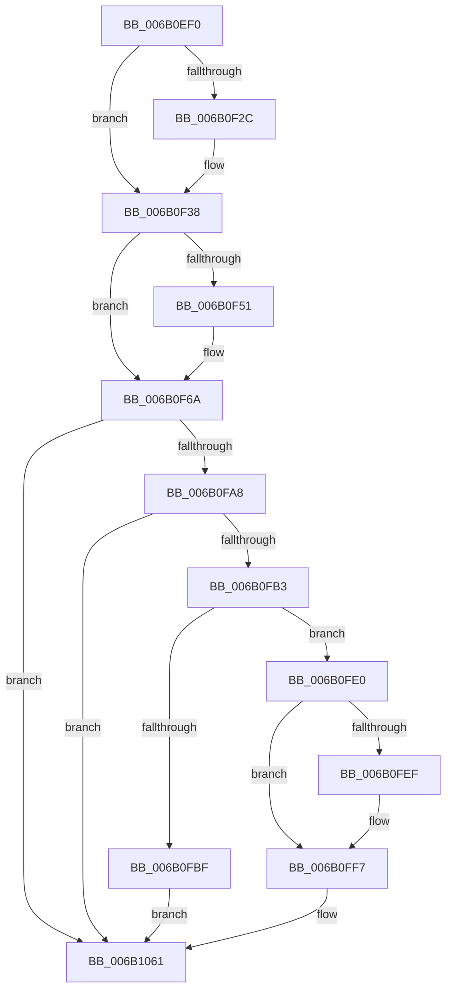

# KiSaveProcessorControlState

- RVA: `0x006B0EF0`–`0x006B1062` (길이 `370` bytes)
- VA: `0x00000001406B0EF0`
- 실행 섹션: `.text`
- PDB 이름 있음: `예`; PDB Function 태그: `아니요`
- unwind 정보 RVA: `0x000C15E0`
- 디코드: `84`개 명령, `370/370` bytes 표시
- 미해석 바이트: `0` (있으면 어셈블리에 `.byte`로 보존)

> 이 문서는 커널 이미지의 기계어와 PDB 기호를 분석해 생성했습니다. 4번과 5번은 함수 원형과 자료형을 바이너리 사용 방식에서 추정한 C 해석이며 원본 소스 복구 결과는 아닙니다.

## 1. Dependencies

- 직접 호출 지점: **0**; 고유 호출 대상: **0**
- 직접 호출자로 확인된 함수: **10**
- RIP 상대 이미지 참조: **8**

### Outgoing calls
- 직접 디코드된 call 명령이 없습니다.

### Direct callers
- [KdpReport](../4D/KdpReport_function_004DF360.md) at `0x004DF413`
- [KeBugCheckEx](../4F/KeBugCheckEx_function_004FD660.md) at `0x004FD69F`
- [ExpSystemErrorHandler](../4F/ExpSystemErrorHandler_function_004FEDF0.md) at `0x004FEE45`
- [IopLiveDumpCollectPages](../59/IopLiveDumpCollectPages_function_0059B328.md) at `0x0059B3DB`
- [IopLiveDumpCollectPages](../59/IopLiveDumpCollectPages_function_0059B328.md) at `0x0059B408`
- [IopLiveDumpCorralDpc](../59/IopLiveDumpCorralDpc_function_0059B6B0.md) at `0x0059B6F3`
- [KiFreezeTargetExecution](../5C/KiFreezeTargetExecution_function_005C30A0.md) at `0x005C319F`
- [KiSaveProcessorState](../5C/KiSaveProcessorState_function_005CB940.md) at `0x005CBA20`
- [KeSaveStateForHibernate](KeSaveStateForHibernate_function_006B1A50.md) at `0x006B1B3A`
- [KdpCommandString](../../pagekd/B8/KdpCommandString_function_00B88E2C.md) at `0x00B88E88`
- [KdpSymbol](../../pagekd/B8/KdpSymbol_function_00B89220.md) at `0x00B89281`

### Static image references
- `0x006B0F1C` → RVA `0x00FC6A84` (`ALMOSTRO`; read)
- `0x006B0F22` → RVA `0x00FC6BEA` (`ALMOSTRO`; read)
- `0x006B0FB3` → RVA `0x00F475C0` (`.data`; read)
- `0x006B0FE0` → RVA `0x00FC6FCC` (`ALMOSTRO`; read)
- `0x006B0FF7` → RVA `0x00FC6CFC` (`ALMOSTRO`; read)
- `0x006B1009` → RVA `0x00FC6D58` (`ALMOSTRO`; read)
- `0x006B1029` → RVA `0x00FC6E60` (`ALMOSTRO`; read)
- `0x006B103F` → RVA `0x00FC6E64` (`ALMOSTRO`; read)

## 2. Other-region calls and transfers

- 다른 실행 섹션으로 향하는 call: **0**
- 별도 외부 분기/꼬리 이동을 확인하지 못했습니다.

## 3. Assembly (complete function range)

```asm
006B0EF0  0F 20 C0                        mov rax, cr0
006B0EF3  48 89 01                        mov qword ptr [rcx], rax
006B0EF6  0F 20 D0                        mov rax, cr2
006B0EF9  48 89 41 08                     mov qword ptr [rcx + 8], rax
006B0EFD  0F 20 D8                        mov rax, cr3
006B0F00  48 89 41 10                     mov qword ptr [rcx + 0x10], rax
006B0F04  0F 20 E0                        mov rax, cr4
006B0F07  48 89 41 18                     mov qword ptr [rcx + 0x18], rax
006B0F0B  44 0F 20 C0                     mov rax, cr8
006B0F0F  48 89 81 A0 00 00 00            mov qword ptr [rcx + 0xa0], rax
006B0F16  33 C0                           xor eax, eax
006B0F18  66 89 41 72                     mov word ptr [rcx + 0x72], ax
006B0F1C  8A 05 62 5B 91 00               mov al, byte ptr [rip + 0x915b62]
006B0F22  0A 05 C2 5C 91 00               or al, byte ptr [rip + 0x915cc2]
006B0F28  84 C0                           test al, al
006B0F2A  75 0C                           jne 0x1406b0f38
006B0F2C  0F 01 41 56                     sgdt [rcx + 0x56]
006B0F30  0F 01 49 66                     sidt [rcx + 0x66]
006B0F34  0F 00 49 70                     str word ptr [rcx + 0x70]
006B0F38  0F AE 59 74                     stmxcsr dword ptr [rcx + 0x74]
006B0F3C  48 C7 81 D8 00 00 00 00 00 00 00  mov qword ptr [rcx + 0xd8], 0
006B0F47  48 F7 41 18 00 00 04 00         test qword ptr [rcx + 0x18], 0x40000
006B0F4F  74 19                           je 0x1406b0f6a
006B0F51  4C 8B C1                        mov r8, rcx
006B0F54  33 C9                           xor ecx, ecx
006B0F56  0F 01 D0                        xgetbv
006B0F59  41 89 80 D8 00 00 00            mov dword ptr [r8 + 0xd8], eax
006B0F60  41 89 90 DC 00 00 00            mov dword ptr [r8 + 0xdc], edx
006B0F67  49 8B C8                        mov rcx, r8
006B0F6A  0F 21 C0                        mov rax, dr0
006B0F6D  0F 21 CA                        mov rdx, dr1
006B0F70  48 89 41 20                     mov qword ptr [rcx + 0x20], rax
006B0F74  48 89 51 28                     mov qword ptr [rcx + 0x28], rdx
006B0F78  0F 21 D0                        mov rax, dr2
006B0F7B  0F 21 DA                        mov rdx, dr3
006B0F7E  48 89 41 30                     mov qword ptr [rcx + 0x30], rax
006B0F82  48 89 51 38                     mov qword ptr [rcx + 0x38], rdx
006B0F86  0F 21 F0                        mov rax, dr6
006B0F89  0F 21 FA                        mov rdx, dr7
006B0F8C  48 89 41 40                     mov qword ptr [rcx + 0x40], rax
006B0F90  48 89 51 48                     mov qword ptr [rcx + 0x48], rdx
006B0F94  33 C0                           xor eax, eax
006B0F96  0F 23 F8                        mov dr7, rax
006B0F99  65 F6 04 25 22 91 00 00 02      test byte ptr gs:[0x9122], 2
006B0FA2  0F 84 B9 00 00 00               je 0x1406b1061
006B0FA8  66 F7 C2 00 03                  test dx, 0x300
006B0FAD  0F 84 AE 00 00 00               je 0x1406b1061
006B0FB3  F7 05 03 66 89 00 02 00 00 00   test dword ptr [rip + 0x896603], 2
006B0FBD  74 21                           je 0x1406b0fe0
006B0FBF  48 89 81 88 00 00 00            mov qword ptr [rcx + 0x88], rax
006B0FC6  48 89 81 80 00 00 00            mov qword ptr [rcx + 0x80], rax
006B0FCD  48 89 81 98 00 00 00            mov qword ptr [rcx + 0x98], rax
006B0FD4  48 89 81 90 00 00 00            mov qword ptr [rcx + 0x90], rax
006B0FDB  E9 81 00 00 00                  jmp 0x1406b1061
006B0FE0  44 8B 0D E5 5F 91 00            mov r9d, dword ptr [rip + 0x915fe5]
006B0FE7  4C 8B C1                        mov r8, rcx
006B0FEA  45 0B C9                        or r9d, r9d
006B0FED  74 08                           je 0x1406b0ff7
006B0FEF  41 8B C9                        mov ecx, r9d
006B0FF2  0F 32                           rdmsr
006B0FF4  44 8B C8                        mov r9d, eax
006B0FF7  8B 0D FF 5C 91 00               mov ecx, dword ptr [rip + 0x915cff]
006B0FFD  41 03 C9                        add ecx, r9d
006B1000  0F 32                           rdmsr
006B1002  41 89 80 88 00 00 00            mov dword ptr [r8 + 0x88], eax
006B1009  8B 0D 49 5D 91 00               mov ecx, dword ptr [rip + 0x915d49]
006B100F  41 89 90 8C 00 00 00            mov dword ptr [r8 + 0x8c], edx
006B1016  41 03 C9                        add ecx, r9d
006B1019  0F 32                           rdmsr
006B101B  41 89 80 80 00 00 00            mov dword ptr [r8 + 0x80], eax
006B1022  41 89 90 84 00 00 00            mov dword ptr [r8 + 0x84], edx
006B1029  8B 0D 31 5E 91 00               mov ecx, dword ptr [rip + 0x915e31]
006B102F  0F 32                           rdmsr
006B1031  41 89 80 98 00 00 00            mov dword ptr [r8 + 0x98], eax
006B1038  41 89 90 9C 00 00 00            mov dword ptr [r8 + 0x9c], edx
006B103F  8B 0D 1F 5E 91 00               mov ecx, dword ptr [rip + 0x915e1f]
006B1045  0F 32                           rdmsr
006B1047  41 89 80 90 00 00 00            mov dword ptr [r8 + 0x90], eax
006B104E  41 89 90 94 00 00 00            mov dword ptr [r8 + 0x94], edx
006B1055  B9 D9 01 00 00                  mov ecx, 0x1d9
006B105A  0F 32                           rdmsr
006B105C  83 E0 FC                        and eax, 0xfffffffc
006B105F  0F 30                           wrmsr
006B1061  C3                              ret
```

## 4. C-style interpretation (structured pseudocode)

```c
__int64 __fastcall KiSaveProcessorControlState(__int64 a1, int a2)
{
    __int64 result;

    *(unsigned __int64 *)(a1) = v_cr0;
    *(unsigned __int64 *)(a1 + 8) = v_cr2;
    *(unsigned __int64 *)(a1 + 16) = v_cr3;
    *(unsigned __int64 *)(a1 + 24) = v_cr4;
    *(unsigned __int64 *)(a1 + 160) = v_cr8;
    result = 0;
    *(unsigned __int16 *)(a1 + 114) = 0;
    result = (unsigned __int8)((*(unsigned __int8 *)(v_rip + 9526114)) | (*(unsigned __int8 *)(v_rip + 9526466)));
    if ((unsigned __int8)(result) == 0) {
    }
    *(unsigned __int64 *)(a1 + 216) = 0;
    if (((*(unsigned __int64 *)(a1 + 24)) & (0x40000ULL)) != 0) {
        a3 = a1;
        a1 = 0;
        *(unsigned int *)(a3 + 216) = (unsigned int)(result);
        *(unsigned int *)(a3 + 220) = a2;
        a1 = a3;
    }
    *(unsigned __int64 *)(a1 + 32) = v_dr0;
    *(unsigned __int64 *)(a1 + 40) = v_dr1;
    *(unsigned __int64 *)(a1 + 48) = v_dr2;
    *(unsigned __int64 *)(a1 + 56) = v_dr3;
    *(unsigned __int64 *)(a1 + 64) = v_dr6;
    *(unsigned __int64 *)(a1 + 72) = v_dr7;
    result = 0;
    if (((*(unsigned __int8 *)(gs_base + (0 + 37154))) & (2)) == 0) goto loc_006B1061;
    if ((((unsigned __int16)(v_dr7)) & (768)) == 0) goto loc_006B1061;
    if (((*(unsigned int *)(v_rip + 9004547)) & (2)) == 0) goto loc_006B0FE0;
    *(unsigned __int64 *)(a1 + 136) = 0;
    *(unsigned __int64 *)(a1 + 128) = 0;
    *(unsigned __int64 *)(a1 + 152) = 0;
    *(unsigned __int64 *)(a1 + 144) = 0;
    goto loc_006B1061;
loc_006B0FE0:
    a4 = (unsigned int)(((unsigned int)(*(unsigned int *)(v_rip + 9527269))) | ((unsigned int)((unsigned int)(*(unsigned int *)(v_rip + 9527269)))));
    if (!(condition_is_equal)) {
        a1 = (unsigned int)(a4);
        a4 = 0;
    }
    a1 = (unsigned int)(((unsigned int)(*(unsigned int *)(v_rip + 9526527))) + ((unsigned int)(a4)));
    *(unsigned int *)(a1 + 136) = 0;
    *(unsigned int *)(a1 + 140) = (unsigned int)(v_dr7);
    a1 = (unsigned int)(((unsigned int)(*(unsigned int *)(v_rip + 9526601))) + ((unsigned int)(a4)));
    *(unsigned int *)(a1 + 128) = 0;
    *(unsigned int *)(a1 + 132) = (unsigned int)(v_dr7);
    *(unsigned int *)(a1 + 152) = 0;
    *(unsigned int *)(a1 + 156) = (unsigned int)(v_dr7);
    *(unsigned int *)(a1 + 144) = 0;
    *(unsigned int *)(a1 + 148) = (unsigned int)(v_dr7);
    result = (unsigned int)((result) & (0xFFFFFFFCULL));
loc_006B1061:
    return result;
}
```

## 5. (Beta) C Style

```c
int64_t KiSaveProcessorControlState(void *Arg1, int32_t Arg2)
{
    uint8_t *arg1 = (uint8_t *)Arg1;

    int64_t result;

    *(uint64_t *)(arg1) = v_cr0;
    *(uint64_t *)(arg1 + 0x8) = v_cr2;
    *(uint64_t *)(arg1 + 0x10) = v_cr3;
    *(uint64_t *)(arg1 + 0x18) = v_cr4;
    *(uint64_t *)(arg1 + 0xA0) = v_cr8;
    result = 0;
    *(uint16_t *)(arg1 + 0x72) = 0;
    result = (uint8_t)((*(uint8_t *)(v_rip + 0x915B62)) | (*(uint8_t *)(v_rip + 0x915CC2)));
    if ((uint8_t)(result) == 0) {
    }
    *(uint64_t *)(arg1 + 0xD8) = 0;
    if (((*(uint64_t *)(arg1 + 0x18)) & (0x40000ULL)) != 0) {
        a3 = Arg1;
        Arg1 = 0;
        *(uint32_t *)(a3 + 0xD8) = (uint32_t)(result);
        *(uint32_t *)(a3 + 0xDC) = Arg2;
        Arg1 = a3;
    }
    *(uint64_t *)(arg1 + 0x20) = v_dr0;
    *(uint64_t *)(arg1 + 0x28) = v_dr1;
    *(uint64_t *)(arg1 + 0x30) = v_dr2;
    *(uint64_t *)(arg1 + 0x38) = v_dr3;
    *(uint64_t *)(arg1 + 0x40) = v_dr6;
    *(uint64_t *)(arg1 + 0x48) = v_dr7;
    result = 0;
    if (((*(uint8_t *)(gs_base + (0 + 0x9122))) & (2)) == 0) goto loc_006B1061;
    if ((((uint16_t)(v_dr7)) & (768)) == 0) goto loc_006B1061;
    if (((*(uint32_t *)(v_rip + 0x896603)) & (2)) == 0) goto loc_006B0FE0;
    *(uint64_t *)(arg1 + 0x88) = 0;
    *(uint64_t *)(arg1 + 0x80) = 0;
    *(uint64_t *)(arg1 + 0x98) = 0;
    *(uint64_t *)(arg1 + 0x90) = 0;
    goto loc_006B1061;
loc_006B0FE0:
    a4 = (uint32_t)(((uint32_t)(*(uint32_t *)(v_rip + 0x915FE5))) | ((uint32_t)((uint32_t)(*(uint32_t *)(v_rip + 0x915FE5)))));
    if (!(condition_is_equal)) {
        Arg1 = (uint32_t)(a4);
        a4 = 0;
    }
    Arg1 = (uint32_t)(((uint32_t)(*(uint32_t *)(v_rip + 0x915CFF))) + ((uint32_t)(a4)));
    *(uint32_t *)(arg1 + 0x88) = 0;
    *(uint32_t *)(arg1 + 0x8C) = (uint32_t)(v_dr7);
    Arg1 = (uint32_t)(((uint32_t)(*(uint32_t *)(v_rip + 0x915D49))) + ((uint32_t)(a4)));
    *(uint32_t *)(arg1 + 0x80) = 0;
    *(uint32_t *)(arg1 + 0x84) = (uint32_t)(v_dr7);
    *(uint32_t *)(arg1 + 0x98) = 0;
    *(uint32_t *)(arg1 + 0x9C) = (uint32_t)(v_dr7);
    *(uint32_t *)(arg1 + 0x90) = 0;
    *(uint32_t *)(arg1 + 0x94) = (uint32_t)(v_dr7);
    result = (uint32_t)((result) & (0xFFFFFFFCULL));
loc_006B1061:
    return result;
}
```

### 관측된 메모리 오프셋

구조체 형식이 확인되지 않은 접근은 인자 기준의 오프셋으로만 기록했습니다.

| 기준 인자 | 오프셋 표현 | 폭 (bit) | 접근 |
|---|---:|---:|---|
| `Arg1` | `+ 0x0` | `64` | `W` |
| `Arg1` | `+ 0x8` | `64` | `W` |
| `Arg1` | `+ 0x10` | `64` | `W` |
| `Arg1` | `+ 0x18` | `64` | `R` |
| `Arg1` | `+ 0x18` | `64` | `W` |
| `Arg1` | `+ 0x20` | `64` | `W` |
| `Arg1` | `+ 0x28` | `64` | `W` |
| `Arg1` | `+ 0x30` | `64` | `W` |
| `Arg1` | `+ 0x38` | `64` | `W` |
| `Arg1` | `+ 0x40` | `64` | `W` |
| `Arg1` | `+ 0x48` | `64` | `W` |
| `Arg1` | `+ 0x56` | `80` | `W` |
| `Arg1` | `+ 0x66` | `80` | `W` |
| `Arg1` | `+ 0x70` | `16` | `W` |
| `Arg1` | `+ 0x72` | `16` | `W` |
| `Arg1` | `+ 0x74` | `32` | `R` |
| `Arg1` | `+ 0x80` | `32` | `W` |
| `Arg1` | `+ 0x80` | `64` | `W` |
| `Arg1` | `+ 0x84` | `32` | `W` |
| `Arg1` | `+ 0x88` | `32` | `W` |
| `Arg1` | `+ 0x88` | `64` | `W` |
| `Arg1` | `+ 0x8C` | `32` | `W` |
| `Arg1` | `+ 0x90` | `32` | `W` |
| `Arg1` | `+ 0x90` | `64` | `W` |
| `Arg1` | `+ 0x94` | `32` | `W` |
| `Arg1` | `+ 0x98` | `32` | `W` |
| `Arg1` | `+ 0x98` | `64` | `W` |
| `Arg1` | `+ 0x9C` | `32` | `W` |
| `Arg1` | `+ 0xA0` | `64` | `W` |
| `Arg1` | `+ 0xD8` | `32` | `W` |
| `Arg1` | `+ 0xD8` | `64` | `W` |
| `Arg1` | `+ 0xDC` | `32` | `W` |

## 6. Execution-region graph

[열기: 2D/3D 그래프와 함수 탐색 컨트롤 패널](../../../control-panel.html?section=text&rva=0x006B0EF0&view=graph)

- 2D 그래프는 위에서 아래로 흐르고, 3D 그래프는 빈 공간을 드래그해 회전합니다. Shift+드래그는 이동, 휠은 확대·축소, 함수 노드 선택은 대상 보고서 이동입니다.

### Static fallback


