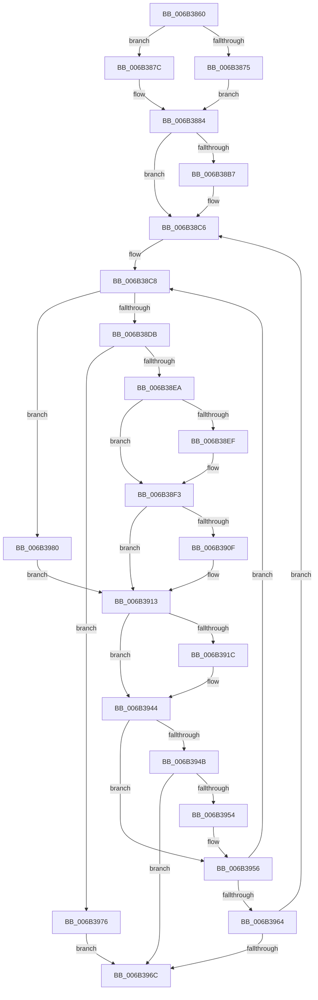

# KiScanInterruptObjectList

- RVA: `0x006B3860`–`0x006B3987` (길이 `295` bytes)
- VA: `0x00000001406B3860`
- 실행 섹션: `.text`
- PDB 이름 있음: `예`; PDB Function 태그: `아니요`
- unwind 정보 RVA: `0x000C1FA0`
- 디코드: `75`개 명령, `295/295` bytes 표시
- 미해석 바이트: `0` (있으면 어셈블리에 `.byte`로 보존)

> 이 문서는 커널 이미지의 기계어와 PDB 기호를 분석해 생성했습니다. 4번과 5번은 함수 원형과 자료형을 바이너리 사용 방식에서 추정한 C 해석이며 원본 소스 복구 결과는 아닙니다.

## 1. Dependencies

- 직접 호출 지점: **7**; 고유 호출 대상: **6**
- 직접 호출자로 확인된 함수: **1**
- RIP 상대 이미지 참조: **2**

### Outgoing calls
- `0x006B3875` → [KzSetIrqlUnsafe](../5B/KzSetIrqlUnsafe_function_005B8AE0.md) (function, `0x005B8AE0`)
- `0x006B3897` → [KiStartInterruptCycleAccumulation](../37/KiStartInterruptCycleAccumulation_function_0037B410.md) (function, `0x0037B410`)
- `0x006B38C1` → [EtwGetKernelTraceTimestamp](../39/EtwGetKernelTraceTimestamp_function_0039FC50.md) (function, `0x0039FC50`)
- `0x006B38FB` → [KiCallInterruptServiceRoutine](../20/KiCallInterruptServiceRoutine_function_00208970.md) (function, `0x00208970`)
- `0x006B3930` → [PerfInfoLogInterrupt](../39/PerfInfoLogInterrupt_function_0039FB00.md) (function, `0x0039FB00`)
- `0x006B393F` → [EtwGetKernelTraceTimestamp](../39/EtwGetKernelTraceTimestamp_function_0039FC50.md) (function, `0x0039FC50`)
- `0x006B3979` → [KiDispatchPassiveInterrupts](../4C/KiDispatchPassiveInterrupts_function_004C7610.md) (function, `0x004C7610`)

### Direct callers
- [KiChainedDispatch](KiChainedDispatch_function_006B3480.md) at `0x006B34B7`

### Static image references
- `0x006B386C` → RVA `0x00FC6D20` (`ALMOSTRO`; read)
- `0x006B38A4` → RVA `0x00FC6B04` (`ALMOSTRO`; read)

## 2. Other-region calls and transfers

- 다른 실행 섹션으로 향하는 call: **0**
- 별도 외부 분기/꼬리 이동을 확인하지 못했습니다.

## 3. Assembly (complete function range)

```asm
006B3860  41 54                           push r12
006B3862  57                              push rdi
006B3863  53                              push rbx
006B3864  48 83 EC 50                     sub rsp, 0x50
006B3868  0F B6 4E 5C                     movzx ecx, byte ptr [rsi + 0x5c]
006B386C  83 3D AD 34 91 00 00            cmp dword ptr [rip + 0x9134ad], 0
006B3873  74 07                           je 0x1406b387c
006B3875  E8 66 52 F0 FF                  call 0x1405b8ae0
006B387A  EB 08                           jmp 0x1406b3884
006B387C  44 0F 20 C0                     mov rax, cr8
006B3880  44 0F 22 C1                     mov cr8, rcx
006B3884  88 45 A9                        mov byte ptr [rbp - 0x57], al
006B3887  65 48 8B 0C 25 20 00 00 00      mov rcx, qword ptr gs:[0x20]
006B3890  33 D2                           xor edx, edx
006B3892  BA 01 00 00 00                  mov edx, 1
006B3897  E8 74 7B CC FF                  call 0x14037b410
006B389C  FB                              sti
006B389D  48 8D 5E 08                     lea rbx, [rsi + 8]
006B38A1  4C 8B E3                        mov r12, rbx
006B38A4  F7 05 56 32 91 00 00 40 00 00   test dword ptr [rip + 0x913256], 0x4000
006B38AE  0F 95 85 F3 00 00 00            setne byte ptr [rbp + 0xf3]
006B38B5  74 0F                           je 0x1406b38c6
006B38B7  48 8D 4C 24 28                  lea rcx, [rsp + 0x28]
006B38BC  BA 00 40 00 20                  mov edx, 0x20004000
006B38C1  E8 8A C3 CE FF                  call 0x14039fc50
006B38C6  33 FF                           xor edi, edi
006B38C8  49 83 EC 08                     sub r12, 8
006B38CC  41 F7 44 24 68 01 00 00 00      test dword ptr [r12 + 0x68], 1
006B38D5  0F 85 A5 00 00 00               jne 0x1406b3980
006B38DB  41 0F B6 4C 24 5D               movzx ecx, byte ptr [r12 + 0x5d]
006B38E1  80 F9 00                        cmp cl, 0
006B38E4  0F 84 8C 00 00 00               je 0x1406b3976
006B38EA  3A 4E 5C                        cmp cl, byte ptr [rsi + 0x5c]
006B38ED  74 04                           je 0x1406b38f3
006B38EF  44 0F 22 C1                     mov cr8, rcx
006B38F3  BA 01 00 00 00                  mov edx, 1
006B38F8  49 8B CC                        mov rcx, r12
006B38FB  E8 70 50 B5 FF                  call 0x140208970
006B3900  88 44 24 20                     mov byte ptr [rsp + 0x20], al
006B3904  0F B6 4E 5C                     movzx ecx, byte ptr [rsi + 0x5c]
006B3908  41 3A 4C 24 5D                  cmp cl, byte ptr [r12 + 0x5d]
006B390D  74 04                           je 0x1406b3913
006B390F  44 0F 22 C1                     mov cr8, rcx
006B3913  F6 85 F3 00 00 00 FF            test byte ptr [rbp + 0xf3], 0xff
006B391A  74 28                           je 0x1406b3944
006B391C  4C 8D 44 24 28                  lea r8, [rsp + 0x28]
006B3921  0F B6 54 24 20                  movzx edx, byte ptr [rsp + 0x20]
006B3926  41 8A 44 24 58                  mov al, byte ptr [r12 + 0x58]
006B392B  8A F0                           mov dh, al
006B392D  49 8B CC                        mov rcx, r12
006B3930  E8 CB C1 CE FF                  call 0x14039fb00
006B3935  48 8D 4C 24 28                  lea rcx, [rsp + 0x28]
006B393A  BA 00 40 00 20                  mov edx, 0x20004000
006B393F  E8 0C C3 CE FF                  call 0x14039fc50
006B3944  F6 44 24 20 FF                  test byte ptr [rsp + 0x20], 0xff
006B3949  74 0B                           je 0x1406b3956
006B394B  66 41 83 7C 24 6C 01            cmp word ptr [r12 + 0x6c], 1
006B3952  75 18                           jne 0x1406b396c
006B3954  FF C7                           inc edi
006B3956  4D 8B 64 24 08                  mov r12, qword ptr [r12 + 8]
006B395B  4C 3B E3                        cmp r12, rbx
006B395E  0F 85 64 FF FF FF               jne 0x1406b38c8
006B3964  85 FF                           test edi, edi
006B3966  0F 85 5A FF FF FF               jne 0x1406b38c6
006B396C  FA                              cli
006B396D  48 83 C4 50                     add rsp, 0x50
006B3971  5B                              pop rbx
006B3972  5F                              pop rdi
006B3973  41 5C                           pop r12
006B3975  C3                              ret
006B3976  49 8B CC                        mov rcx, r12
006B3979  E8 92 3C E1 FF                  call 0x1404c7610
006B397E  EB EC                           jmp 0x1406b396c
006B3980  C6 44 24 20 00                  mov byte ptr [rsp + 0x20], 0
006B3985  EB 8C                           jmp 0x1406b3913
```

## 4. C-style interpretation (structured pseudocode)

```c
__int64 __fastcall KiScanInterruptObjectList(__int64 a1, int a2)
{
    __int64 result;
    __int64 v_cr8;
    __int64 v_r12;
    __int64 v_rdi;
    __int64 v_rsp;
    unsigned __int64 v_stack_m40;
    unsigned __int8 v_stack_m48;
    unsigned __int8 v_stack_p20;

    v_rsp = (v_rsp) - (80);
    if ((*(unsigned int *)(v_rip + 9516205)) == 0) goto loc_006B387C;
    result = KzSetIrqlUnsafe(*(unsigned __int8 *)(v_rsi + 92), a2, a3, a4);
    goto loc_006B3884;
loc_006B387C:
loc_006B3884:
    *(unsigned __int8 *)(v_rbp - 87) = (unsigned __int8)(v_cr8);
    a2 = 0;
    result = KiStartInterruptCycleAccumulation(*(unsigned __int64 *)(gs_base + (0 + 32)), 1, a3, a4);
    if (((*(unsigned int *)(v_rip + 9515606)) & (0x4000ULL)) != 0) {
        a1 = v_stack_m40;
        a2 = 0x20004000ULL;
        result = EtwGetKernelTraceTimestamp(a1, a2, a3, a4);
    }
    v_rdi = 0;
loc_006B38C8:
    v_r12 = (v_rsi + 8) - (8);
    if (((*(unsigned int *)(v_r12 + 104)) & (1)) != 0) goto loc_006B3980;
    if (((unsigned __int8)(*(unsigned __int8 *)(v_r12 + 93))) == 0) goto loc_006B3976;
    v_cr8 = *(unsigned __int8 *)(v_rsi + 92);
    if (((unsigned __int8)(*(unsigned __int8 *)(v_r12 + 93))) != (*(unsigned __int8 *)(v_rsi + 92))) {
        v_cr8 = *(unsigned __int8 *)(v_r12 + 93);
    }
    result = KiCallInterruptServiceRoutine(v_r12, 1, a3, a4);
    v_stack_m48 = (unsigned __int8)(result);
    if (((unsigned __int8)(*(unsigned __int8 *)(v_rsi + 92))) != (*(unsigned __int8 *)(v_r12 + 93))) {
        v_cr8 = *(unsigned __int8 *)(v_rsi + 92);
    }
    if (((*(unsigned __int8 *)(v_rbp + 243)) & (255)) != 0) {
        a3 = v_stack_m40;
        a2 = v_stack_m48;
        result = *(unsigned __int8 *)(v_r12 + 88);
        a2 = (unsigned __int8)(result);
        a1 = v_r12;
        result = PerfInfoLogInterrupt(a1, a2, a3, a4);
        a1 = v_stack_m40;
        a2 = 0x20004000ULL;
        result = EtwGetKernelTraceTimestamp(a1, a2, a3, a4);
    }
    if (((v_stack_m48) & (255)) == 0) goto loc_006B3956;
    if ((*(unsigned __int16 *)(v_r12 + 108)) != 1) goto loc_006B396C;
    v_rdi = (unsigned int)((v_rdi) + 1);
loc_006B3956:
    if ((*(unsigned __int64 *)(v_r12 + 8)) != (v_rsi + 8)) goto loc_006B38C8;
    if ((unsigned int)(v_rdi) != 0) goto loc_006B38C6;
loc_006B396C:
    v_rsp = (v_rsp) + (80);
    return result;
loc_006B3976:
    result = KiDispatchPassiveInterrupts(*(unsigned __int64 *)(v_r12 + 8), a2, a3, a4);
    goto loc_006B396C;
loc_006B3980:
    v_stack_p20 = 0;
    goto loc_006B3913;
}
```

## 5. (Beta) C Style

```c
int64_t KiScanInterruptObjectList(int64_t Arg1, int32_t Arg2)
{
    int64_t result;
    int64_t v_cr8;
    int64_t local_r12;
    int64_t local_rdi;
    int64_t local_rsp;
    uint64_t v_stack_m40;
    uint8_t v_stack_m48;
    uint8_t v_stack_p20;

    local_rsp = (local_rsp) - (80);
    if ((*(uint32_t *)(v_rip + 0x9134AD)) == 0) goto loc_006B387C;
    result = KzSetIrqlUnsafe(*(uint8_t *)(local_rsi + 0x5C), Arg2, a3, a4);
    goto loc_006B3884;
loc_006B387C:
loc_006B3884:
    *(uint8_t *)(local_rbp - 0x57) = (uint8_t)(v_cr8);
    Arg2 = 0;
    result = KiStartInterruptCycleAccumulation(*(uint64_t *)(gs_base + (0 + 0x20)), 1, a3, a4);
    if (((*(uint32_t *)(v_rip + 0x913256)) & (0x4000ULL)) != 0) {
        Arg1 = v_stack_m40;
        Arg2 = 0x20004000ULL;
        result = EtwGetKernelTraceTimestamp(Arg1, Arg2, a3, a4);
    }
    local_rdi = 0;
loc_006B38C8:
    local_r12 = (local_rsi + 8) - (8);
    if (((*(uint32_t *)(local_r12 + 0x68)) & (1)) != 0) goto loc_006B3980;
    if (((uint8_t)(*(uint8_t *)(local_r12 + 0x5D))) == 0) goto loc_006B3976;
    v_cr8 = *(uint8_t *)(local_rsi + 0x5C);
    if (((uint8_t)(*(uint8_t *)(local_r12 + 0x5D))) != (*(uint8_t *)(local_rsi + 0x5C))) {
        v_cr8 = *(uint8_t *)(local_r12 + 0x5D);
    }
    result = KiCallInterruptServiceRoutine(local_r12, 1, a3, a4);
    v_stack_m48 = (uint8_t)(result);
    if (((uint8_t)(*(uint8_t *)(local_rsi + 0x5C))) != (*(uint8_t *)(local_r12 + 0x5D))) {
        v_cr8 = *(uint8_t *)(local_rsi + 0x5C);
    }
    if (((*(uint8_t *)(local_rbp + 0xF3)) & (255)) != 0) {
        a3 = v_stack_m40;
        Arg2 = v_stack_m48;
        result = *(uint8_t *)(local_r12 + 0x58);
        Arg2 = (uint8_t)(result);
        Arg1 = local_r12;
        result = PerfInfoLogInterrupt(Arg1, Arg2, a3, a4);
        Arg1 = v_stack_m40;
        Arg2 = 0x20004000ULL;
        result = EtwGetKernelTraceTimestamp(Arg1, Arg2, a3, a4);
    }
    if (((v_stack_m48) & (255)) == 0) goto loc_006B3956;
    if ((*(uint16_t *)(local_r12 + 0x6C)) != 1) goto loc_006B396C;
    local_rdi = (uint32_t)((local_rdi) + 1);
loc_006B3956:
    if ((*(uint64_t *)(local_r12 + 0x8)) != (local_rsi + 8)) goto loc_006B38C8;
    if ((uint32_t)(local_rdi) != 0) goto loc_006B38C6;
loc_006B396C:
    local_rsp = (local_rsp) + (80);
    return result;
loc_006B3976:
    result = KiDispatchPassiveInterrupts(*(uint64_t *)(local_r12 + 0x8), Arg2, a3, a4);
    goto loc_006B396C;
loc_006B3980:
    v_stack_p20 = 0;
    goto loc_006B3913;
}
```

## 6. Execution-region graph

[열기: 2D/3D 그래프와 함수 탐색 컨트롤 패널](../../../control-panel.html?section=text&rva=0x006B3860&view=graph)

- 2D 그래프는 위에서 아래로 흐르고, 3D 그래프는 빈 공간을 드래그해 회전합니다. Shift+드래그는 이동, 휠은 확대·축소, 함수 노드 선택은 대상 보고서 이동입니다.

### Static fallback


