# KiSegmentNotPresentFault

- RVA: `0x006BFC40`–`0x006C001A` (길이 `986` bytes)
- VA: `0x00000001406BFC40`
- 실행 섹션: `.text`
- PDB 이름 있음: `예`; PDB Function 태그: `아니요`
- unwind 정보 RVA: `0x000C1C40`
- 디코드: `212`개 명령, `986/986` bytes 표시
- 미해석 바이트: `0` (있으면 어셈블리에 `.byte`로 보존)

> 이 문서는 커널 이미지의 기계어와 PDB 기호를 분석해 생성했습니다. 4번과 5번은 함수 원형과 자료형을 바이너리 사용 방식에서 추정한 C 해석이며 원본 소스 복구 결과는 아닙니다.

## 1. Dependencies

- 직접 호출 지점: **38**; 고유 호출 대상: **37**
- 직접 호출자로 확인된 함수: **1**
- RIP 상대 이미지 참조: **3**

### Outgoing calls
- `0x006BFD92` → [KiSegmentNotPresentFault + 0x265](KiSegmentNotPresentFault_function_006BFC40.md) (inside-function, `0x006BFEA5`)
- `0x006BFD9B` → [KiSegmentNotPresentFault + 0x26E](KiSegmentNotPresentFault_function_006BFC40.md) (inside-function, `0x006BFEAE`)
- `0x006BFDA4` → [KiSegmentNotPresentFault + 0x157](KiSegmentNotPresentFault_function_006BFC40.md) (inside-function, `0x006BFD97`)
- `0x006BFDAD` → [KiSegmentNotPresentFault + 0x160](KiSegmentNotPresentFault_function_006BFC40.md) (inside-function, `0x006BFDA0`)
- `0x006BFDB6` → [KiSegmentNotPresentFault + 0x169](KiSegmentNotPresentFault_function_006BFC40.md) (inside-function, `0x006BFDA9`)
- `0x006BFDBF` → [KiSegmentNotPresentFault + 0x172](KiSegmentNotPresentFault_function_006BFC40.md) (inside-function, `0x006BFDB2`)
- `0x006BFDC8` → [KiSegmentNotPresentFault + 0x17B](KiSegmentNotPresentFault_function_006BFC40.md) (inside-function, `0x006BFDBB`)
- `0x006BFDD1` → [KiSegmentNotPresentFault + 0x184](KiSegmentNotPresentFault_function_006BFC40.md) (inside-function, `0x006BFDC4`)
- `0x006BFDDA` → [KiSegmentNotPresentFault + 0x18D](KiSegmentNotPresentFault_function_006BFC40.md) (inside-function, `0x006BFDCD`)
- `0x006BFDE3` → [KiSegmentNotPresentFault + 0x196](KiSegmentNotPresentFault_function_006BFC40.md) (inside-function, `0x006BFDD6`)
- `0x006BFDEC` → [KiSegmentNotPresentFault + 0x19F](KiSegmentNotPresentFault_function_006BFC40.md) (inside-function, `0x006BFDDF`)
- `0x006BFDF5` → [KiSegmentNotPresentFault + 0x1A8](KiSegmentNotPresentFault_function_006BFC40.md) (inside-function, `0x006BFDE8`)
- `0x006BFDFE` → [KiSegmentNotPresentFault + 0x1B1](KiSegmentNotPresentFault_function_006BFC40.md) (inside-function, `0x006BFDF1`)
- `0x006BFE07` → [KiSegmentNotPresentFault + 0x1BA](KiSegmentNotPresentFault_function_006BFC40.md) (inside-function, `0x006BFDFA`)
- `0x006BFE10` → [KiSegmentNotPresentFault + 0x1C3](KiSegmentNotPresentFault_function_006BFC40.md) (inside-function, `0x006BFE03`)
- `0x006BFE19` → [KiSegmentNotPresentFault + 0x1CC](KiSegmentNotPresentFault_function_006BFC40.md) (inside-function, `0x006BFE0C`)
- `0x006BFE22` → [KiSegmentNotPresentFault + 0x1D5](KiSegmentNotPresentFault_function_006BFC40.md) (inside-function, `0x006BFE15`)
- `0x006BFE2B` → [KiSegmentNotPresentFault + 0x1DE](KiSegmentNotPresentFault_function_006BFC40.md) (inside-function, `0x006BFE1E`)
- `0x006BFE34` → [KiSegmentNotPresentFault + 0x1E7](KiSegmentNotPresentFault_function_006BFC40.md) (inside-function, `0x006BFE27`)
- `0x006BFE3D` → [KiSegmentNotPresentFault + 0x1F0](KiSegmentNotPresentFault_function_006BFC40.md) (inside-function, `0x006BFE30`)
- `0x006BFE46` → [KiSegmentNotPresentFault + 0x1F9](KiSegmentNotPresentFault_function_006BFC40.md) (inside-function, `0x006BFE39`)
- `0x006BFE4F` → [KiSegmentNotPresentFault + 0x202](KiSegmentNotPresentFault_function_006BFC40.md) (inside-function, `0x006BFE42`)
- `0x006BFE58` → [KiSegmentNotPresentFault + 0x20B](KiSegmentNotPresentFault_function_006BFC40.md) (inside-function, `0x006BFE4B`)
- `0x006BFE61` → [KiSegmentNotPresentFault + 0x214](KiSegmentNotPresentFault_function_006BFC40.md) (inside-function, `0x006BFE54`)
- `0x006BFE6A` → [KiSegmentNotPresentFault + 0x21D](KiSegmentNotPresentFault_function_006BFC40.md) (inside-function, `0x006BFE5D`)
- `0x006BFE73` → [KiSegmentNotPresentFault + 0x226](KiSegmentNotPresentFault_function_006BFC40.md) (inside-function, `0x006BFE66`)
- `0x006BFE7C` → [KiSegmentNotPresentFault + 0x22F](KiSegmentNotPresentFault_function_006BFC40.md) (inside-function, `0x006BFE6F`)
- `0x006BFE85` → [KiSegmentNotPresentFault + 0x238](KiSegmentNotPresentFault_function_006BFC40.md) (inside-function, `0x006BFE78`)
- `0x006BFE8E` → [KiSegmentNotPresentFault + 0x241](KiSegmentNotPresentFault_function_006BFC40.md) (inside-function, `0x006BFE81`)
- `0x006BFE97` → [KiSegmentNotPresentFault + 0x24A](KiSegmentNotPresentFault_function_006BFC40.md) (inside-function, `0x006BFE8A`)
- `0x006BFEA0` → [KiSegmentNotPresentFault + 0x253](KiSegmentNotPresentFault_function_006BFC40.md) (inside-function, `0x006BFE93`)
- `0x006BFEA9` → [KiSegmentNotPresentFault + 0x25C](KiSegmentNotPresentFault_function_006BFC40.md) (inside-function, `0x006BFE9C`)
- `0x006BFED4` → [KiFlushBhbDuringTrapEntryOrExit](../6C/KiFlushBhbDuringTrapEntryOrExit_function_006C6340.md) (function, `0x006C6340`)
- `0x006BFF1D` → [KiSaveDebugRegisterState](../4F/KiSaveDebugRegisterState_function_004FD960.md) (function, `0x004FD960`)
- `0x006BFF51` → [KiSynchronizeUserIsolationDomainExit](../41/KiSynchronizeUserIsolationDomainExit_function_0041BFA0.md) (function, `0x0041BFA0`)
- `0x006BFFC1` → [KiExceptionDispatch](../6C/KiExceptionDispatch_function_006C5900.md) (function, `0x006C5900`)
- `0x006BFFF6` → [KiExceptionDispatch](../6C/KiExceptionDispatch_function_006C5900.md) (function, `0x006C5900`)
- `0x006C0013` → [KiBugCheckDispatch](../6C/KiBugCheckDispatch_function_006C5880.md) (function, `0x006C5880`)

### Direct callers
- [KiSegmentNotPresentFault](KiSegmentNotPresentFault_function_006BFC40.md) at `0x006BFD92`
- [KiSegmentNotPresentFault](KiSegmentNotPresentFault_function_006BFC40.md) at `0x006BFD9B`
- [KiSegmentNotPresentFault](KiSegmentNotPresentFault_function_006BFC40.md) at `0x006BFDA4`
- [KiSegmentNotPresentFault](KiSegmentNotPresentFault_function_006BFC40.md) at `0x006BFDAD`
- [KiSegmentNotPresentFault](KiSegmentNotPresentFault_function_006BFC40.md) at `0x006BFDB6`
- [KiSegmentNotPresentFault](KiSegmentNotPresentFault_function_006BFC40.md) at `0x006BFDBF`
- [KiSegmentNotPresentFault](KiSegmentNotPresentFault_function_006BFC40.md) at `0x006BFDC8`
- [KiSegmentNotPresentFault](KiSegmentNotPresentFault_function_006BFC40.md) at `0x006BFDD1`
- [KiSegmentNotPresentFault](KiSegmentNotPresentFault_function_006BFC40.md) at `0x006BFDDA`
- [KiSegmentNotPresentFault](KiSegmentNotPresentFault_function_006BFC40.md) at `0x006BFDE3`
- [KiSegmentNotPresentFault](KiSegmentNotPresentFault_function_006BFC40.md) at `0x006BFDEC`
- [KiSegmentNotPresentFault](KiSegmentNotPresentFault_function_006BFC40.md) at `0x006BFDF5`
- [KiSegmentNotPresentFault](KiSegmentNotPresentFault_function_006BFC40.md) at `0x006BFDFE`
- [KiSegmentNotPresentFault](KiSegmentNotPresentFault_function_006BFC40.md) at `0x006BFE07`
- [KiSegmentNotPresentFault](KiSegmentNotPresentFault_function_006BFC40.md) at `0x006BFE10`
- [KiSegmentNotPresentFault](KiSegmentNotPresentFault_function_006BFC40.md) at `0x006BFE19`
- [KiSegmentNotPresentFault](KiSegmentNotPresentFault_function_006BFC40.md) at `0x006BFE22`
- [KiSegmentNotPresentFault](KiSegmentNotPresentFault_function_006BFC40.md) at `0x006BFE2B`
- [KiSegmentNotPresentFault](KiSegmentNotPresentFault_function_006BFC40.md) at `0x006BFE34`
- [KiSegmentNotPresentFault](KiSegmentNotPresentFault_function_006BFC40.md) at `0x006BFE3D`
- [KiSegmentNotPresentFault](KiSegmentNotPresentFault_function_006BFC40.md) at `0x006BFE46`
- [KiSegmentNotPresentFault](KiSegmentNotPresentFault_function_006BFC40.md) at `0x006BFE4F`
- [KiSegmentNotPresentFault](KiSegmentNotPresentFault_function_006BFC40.md) at `0x006BFE58`
- [KiSegmentNotPresentFault](KiSegmentNotPresentFault_function_006BFC40.md) at `0x006BFE61`
- [KiSegmentNotPresentFault](KiSegmentNotPresentFault_function_006BFC40.md) at `0x006BFE6A`
- [KiSegmentNotPresentFault](KiSegmentNotPresentFault_function_006BFC40.md) at `0x006BFE73`
- [KiSegmentNotPresentFault](KiSegmentNotPresentFault_function_006BFC40.md) at `0x006BFE7C`
- [KiSegmentNotPresentFault](KiSegmentNotPresentFault_function_006BFC40.md) at `0x006BFE85`
- [KiSegmentNotPresentFault](KiSegmentNotPresentFault_function_006BFC40.md) at `0x006BFE8E`
- [KiSegmentNotPresentFault](KiSegmentNotPresentFault_function_006BFC40.md) at `0x006BFE97`
- [KiSegmentNotPresentFault](KiSegmentNotPresentFault_function_006BFC40.md) at `0x006BFEA0`
- [KiSegmentNotPresentFault](KiSegmentNotPresentFault_function_006BFC40.md) at `0x006BFEA9`

### Static image references
- `0x006BFCB1` → RVA `0x01201840` (`CFGRO`; read)
- `0x006BFEE5` → RVA `0x00FC7264` (`ALMOSTRO`; read)
- `0x006BFF56` → RVA `0x00FC6BF0` (`ALMOSTRO`; read)

## 2. Other-region calls and transfers

- 다른 실행 섹션으로 향하는 call: **0**
- 별도 외부 분기/꼬리 이동을 확인하지 못했습니다.

## 3. Assembly (complete function range)

```asm
006BFC40  55                              push rbp
006BFC41  48 81 EC 58 01 00 00            sub rsp, 0x158
006BFC48  48 8D AC 24 80 00 00 00         lea rbp, [rsp + 0x80]
006BFC50  C6 45 AB 01                     mov byte ptr [rbp - 0x55], 1
006BFC54  48 89 45 B0                     mov qword ptr [rbp - 0x50], rax
006BFC58  48 89 4D B8                     mov qword ptr [rbp - 0x48], rcx
006BFC5C  48 89 55 C0                     mov qword ptr [rbp - 0x40], rdx
006BFC60  4C 89 45 C8                     mov qword ptr [rbp - 0x38], r8
006BFC64  4C 89 4D D0                     mov qword ptr [rbp - 0x30], r9
006BFC68  4C 89 55 D8                     mov qword ptr [rbp - 0x28], r10
006BFC6C  4C 89 5D E0                     mov qword ptr [rbp - 0x20], r11
006BFC70  F6 85 F0 00 00 00 01            test byte ptr [rbp + 0xf0], 1
006BFC77  75 38                           jne 0x1406bfcb1
006BFC79  33 D2                           xor edx, edx
006BFC7B  F3 48 0F 1E CA                  rdsspq rdx
006BFC80  48 89 55 58                     mov qword ptr [rbp + 0x58], rdx
006BFC84  0F AE E8                        lfence
006BFC87  65 F6 04 25 58 08 00 00 01      test byte ptr gs:[0x858], 1
006BFC90  75 08                           jne 0x1406bfc9a
006BFC92  0F AE E8                        lfence
006BFC95  E9 88 02 00 00                  jmp 0x1406bff22
006BFC9A  65 0F B7 04 25 66 08 00 00      movzx eax, word ptr gs:[0x866]
006BFCA3  B9 48 00 00 00                  mov ecx, 0x48
006BFCA8  33 D2                           xor edx, edx
006BFCAA  0F 30                           wrmsr
006BFCAC  E9 71 02 00 00                  jmp 0x1406bff22
006BFCB1  F6 05 88 1B B4 00 01            test byte ptr [rip + 0xb41b88], 1
006BFCB8  75 03                           jne 0x1406bfcbd
006BFCBA  0F 01 F8                        swapgs
006BFCBD  0F AE E8                        lfence
006BFCC0  65 48 8B 0C 25 28 9D 00 00      mov rcx, qword ptr gs:[0x9d28]
006BFCC9  48 85 C9                        test rcx, rcx
006BFCCC  74 1F                           je 0x1406bfced
006BFCCE  F3 48 0F 1E CA                  rdsspq rdx
006BFCD3  65 4C 8B 14 25 20 9D 00 00      mov r10, qword ptr gs:[0x9d20]
006BFCDC  49 83 C2 08                     add r10, 8
006BFCE0  49 3B D2                        cmp rdx, r10
006BFCE3  75 08                           jne 0x1406bfced
006BFCE5  F3 0F 01 29                     rstorssp dword ptr [rcx]
006BFCE9  F3 0F 01 EA                     saveprevssp
006BFCED  65 4C 8B 14 25 88 01 00 00      mov r10, qword ptr gs:[0x188]
006BFCF6  65 48 8B 0C 25 88 01 00 00      mov rcx, qword ptr gs:[0x188]
006BFCFF  48 8B 89 20 02 00 00            mov rcx, qword ptr [rcx + 0x220]
006BFD06  48 8B 89 60 07 00 00            mov rcx, qword ptr [rcx + 0x760]
006BFD0D  65 48 89 0C 25 50 08 00 00      mov qword ptr gs:[0x850], rcx
006BFD16  66 65 8B 0C 25 62 08 00 00      mov cx, word ptr gs:[0x862]
006BFD1F  66 65 89 0C 25 64 08 00 00      mov word ptr gs:[0x864], cx
006BFD28  65 8A 0C 25 58 08 00 00         mov cl, byte ptr gs:[0x858]
006BFD30  65 88 0C 25 5A 08 00 00         mov byte ptr gs:[0x85a], cl
006BFD38  65 0F B7 04 25 68 08 00 00      movzx eax, word ptr gs:[0x868]
006BFD41  66 65 39 04 25 66 08 00 00      cmp word ptr gs:[0x866], ax
006BFD4A  74 12                           je 0x1406bfd5e
006BFD4C  66 65 89 04 25 66 08 00 00      mov word ptr gs:[0x866], ax
006BFD55  B9 48 00 00 00                  mov ecx, 0x48
006BFD5A  33 D2                           xor edx, edx
006BFD5C  0F 30                           wrmsr
006BFD5E  65 0F B6 14 25 58 08 00 00      movzx edx, byte ptr gs:[0x858]
006BFD67  F7 C2 08 00 00 00               test edx, 8
006BFD6D  74 17                           je 0x1406bfd86
006BFD6F  B8 01 00 00 00                  mov eax, 1
006BFD74  33 D2                           xor edx, edx
006BFD76  B9 49 00 00 00                  mov ecx, 0x49
006BFD7B  0F 30                           wrmsr
006BFD7D  65 0F B6 14 25 58 08 00 00      movzx edx, byte ptr gs:[0x858]
006BFD86  F7 C2 02 00 00 00               test edx, 2
006BFD8C  0F 84 37 01 00 00               je 0x1406bfec9
006BFD92  E8 0E 01 00 00                  call 0x1406bfea5
006BFD97  48 83 C4 08                     add rsp, 8
006BFD9B  E8 0E 01 00 00                  call 0x1406bfeae
006BFDA0  48 83 C4 08                     add rsp, 8
006BFDA4  E8 EE FF FF FF                  call 0x1406bfd97
006BFDA9  48 83 C4 08                     add rsp, 8
006BFDAD  E8 EE FF FF FF                  call 0x1406bfda0
006BFDB2  48 83 C4 08                     add rsp, 8
006BFDB6  E8 EE FF FF FF                  call 0x1406bfda9
006BFDBB  48 83 C4 08                     add rsp, 8
006BFDBF  E8 EE FF FF FF                  call 0x1406bfdb2
006BFDC4  48 83 C4 08                     add rsp, 8
006BFDC8  E8 EE FF FF FF                  call 0x1406bfdbb
006BFDCD  48 83 C4 08                     add rsp, 8
006BFDD1  E8 EE FF FF FF                  call 0x1406bfdc4
006BFDD6  48 83 C4 08                     add rsp, 8
006BFDDA  E8 EE FF FF FF                  call 0x1406bfdcd
006BFDDF  48 83 C4 08                     add rsp, 8
006BFDE3  E8 EE FF FF FF                  call 0x1406bfdd6
006BFDE8  48 83 C4 08                     add rsp, 8
006BFDEC  E8 EE FF FF FF                  call 0x1406bfddf
006BFDF1  48 83 C4 08                     add rsp, 8
006BFDF5  E8 EE FF FF FF                  call 0x1406bfde8
006BFDFA  48 83 C4 08                     add rsp, 8
006BFDFE  E8 EE FF FF FF                  call 0x1406bfdf1
006BFE03  48 83 C4 08                     add rsp, 8
006BFE07  E8 EE FF FF FF                  call 0x1406bfdfa
006BFE0C  48 83 C4 08                     add rsp, 8
006BFE10  E8 EE FF FF FF                  call 0x1406bfe03
006BFE15  48 83 C4 08                     add rsp, 8
006BFE19  E8 EE FF FF FF                  call 0x1406bfe0c
006BFE1E  48 83 C4 08                     add rsp, 8
006BFE22  E8 EE FF FF FF                  call 0x1406bfe15
006BFE27  48 83 C4 08                     add rsp, 8
006BFE2B  E8 EE FF FF FF                  call 0x1406bfe1e
006BFE30  48 83 C4 08                     add rsp, 8
006BFE34  E8 EE FF FF FF                  call 0x1406bfe27
006BFE39  48 83 C4 08                     add rsp, 8
006BFE3D  E8 EE FF FF FF                  call 0x1406bfe30
006BFE42  48 83 C4 08                     add rsp, 8
006BFE46  E8 EE FF FF FF                  call 0x1406bfe39
006BFE4B  48 83 C4 08                     add rsp, 8
006BFE4F  E8 EE FF FF FF                  call 0x1406bfe42
006BFE54  48 83 C4 08                     add rsp, 8
006BFE58  E8 EE FF FF FF                  call 0x1406bfe4b
006BFE5D  48 83 C4 08                     add rsp, 8
006BFE61  E8 EE FF FF FF                  call 0x1406bfe54
006BFE66  48 83 C4 08                     add rsp, 8
006BFE6A  E8 EE FF FF FF                  call 0x1406bfe5d
006BFE6F  48 83 C4 08                     add rsp, 8
006BFE73  E8 EE FF FF FF                  call 0x1406bfe66
006BFE78  48 83 C4 08                     add rsp, 8
006BFE7C  E8 EE FF FF FF                  call 0x1406bfe6f
006BFE81  48 83 C4 08                     add rsp, 8
006BFE85  E8 EE FF FF FF                  call 0x1406bfe78
006BFE8A  48 83 C4 08                     add rsp, 8
006BFE8E  E8 EE FF FF FF                  call 0x1406bfe81
006BFE93  48 83 C4 08                     add rsp, 8
006BFE97  E8 EE FF FF FF                  call 0x1406bfe8a
006BFE9C  48 83 C4 08                     add rsp, 8
006BFEA0  E8 EE FF FF FF                  call 0x1406bfe93
006BFEA5  48 83 C4 08                     add rsp, 8
006BFEA9  E8 EE FF FF FF                  call 0x1406bfe9c
006BFEAE  48 83 C4 08                     add rsp, 8
006BFEB2  B8 DA DA 00 00                  mov eax, 0xdada
006BFEB7  65 F6 04 25 5C 08 00 00 08      test byte ptr gs:[0x85c], 8
006BFEC0  74 07                           je 0x1406bfec9
006BFEC2  B0 20                           mov al, 0x20
006BFEC4  F3 48 0F AE E8                  incsspq rax
006BFEC9  F7 C2 80 00 00 00               test edx, 0x80
006BFECF  74 08                           je 0x1406bfed9
006BFED1  0F AE E8                        lfence
006BFED4  E8 67 64 00 00                  call 0x1406c6340
006BFED9  0F AE E8                        lfence
006BFEDC  65 C6 04 25 5E 08 00 00 00      mov byte ptr gs:[0x85e], 0
006BFEE5  83 3D 78 73 90 00 00            cmp dword ptr [rip + 0x907378], 0
006BFEEC  74 1F                           je 0x1406bff0d
006BFEEE  B9 A7 06 00 00                  mov ecx, 0x6a7
006BFEF3  0F 32                           rdmsr
006BFEF5  83 FA 00                        cmp edx, 0
006BFEF8  74 13                           je 0x1406bff0d
006BFEFA  8B CA                           mov ecx, edx
006BFEFC  23 15 62 73 90 00               and edx, dword ptr [rip + 0x907362]
006BFF02  3B D1                           cmp edx, ecx
006BFF04  74 07                           je 0x1406bff0d
006BFF06  B9 A7 06 00 00                  mov ecx, 0x6a7
006BFF0B  0F 30                           wrmsr
006BFF0D  41 F6 42 03 03                  test byte ptr [r10 + 3], 3
006BFF12  66 C7 85 80 00 00 00 00 00      mov word ptr [rbp + 0x80], 0
006BFF1B  74 05                           je 0x1406bff22
006BFF1D  E8 3E DA E3 FF                  call 0x1404fd960
006BFF22  FC                              cld
006BFF23  0F AE 5D AC                     stmxcsr dword ptr [rbp - 0x54]
006BFF27  65 0F AE 14 25 80 01 00 00      ldmxcsr dword ptr gs:[0x180]
006BFF30  0F 29 45 F0                     movaps xmmword ptr [rbp - 0x10], xmm0
006BFF34  0F 29 4D 00                     movaps xmmword ptr [rbp], xmm1
006BFF38  0F 29 55 10                     movaps xmmword ptr [rbp + 0x10], xmm2
006BFF3C  0F 29 5D 20                     movaps xmmword ptr [rbp + 0x20], xmm3
006BFF40  0F 29 65 30                     movaps xmmword ptr [rbp + 0x30], xmm4
006BFF44  0F 29 6D 40                     movaps xmmword ptr [rbp + 0x40], xmm5
006BFF48  F6 85 F0 00 00 00 01            test byte ptr [rbp + 0xf0], 1
006BFF4F  74 05                           je 0x1406bff56
006BFF51  E8 4A C0 D5 FF                  call 0x14041bfa0
006BFF56  F6 05 93 6C 90 00 FF            test byte ptr [rip + 0x906c93], 0xff
006BFF5D  74 0C                           je 0x1406bff6b
006BFF5F  F6 85 F0 00 00 00 01            test byte ptr [rbp + 0xf0], 1
006BFF66  74 03                           je 0x1406bff6b
006BFF68  0F 01 CB                        stac
006BFF6B  8B 85 E0 00 00 00               mov eax, dword ptr [rbp + 0xe0]
006BFF71  66 A9 04 00                     test ax, 4
006BFF75  74 1D                           je 0x1406bff94
006BFF77  33 C9                           xor ecx, ecx
006BFF79  65 4C 8B 04 25 78 95 00 00      mov r8, qword ptr gs:[0x9578]
006BFF82  65 48 8B 14 25 70 95 00 00      mov rdx, qword ptr gs:[0x9570]
006BFF8B  65 48 87 0C 25 68 95 00 00      xchg qword ptr gs:[0x9568], rcx
006BFF94  F7 85 F8 00 00 00 00 02 00 00   test dword ptr [rbp + 0xf8], 0x200
006BFF9E  74 01                           je 0x1406bffa1
006BFFA0  FB                              sti
006BFFA1  66 A9 04 00                     test ax, 4
006BFFA5  74 20                           je 0x1406bffc7
006BFFA7  4C 8B C9                        mov r9, rcx
006BFFAA  4C 8B D2                        mov r10, rdx
006BFFAD  4D 8B D8                        mov r11, r8
006BFFB0  B9 06 00 00 10                  mov ecx, 0x10000006
006BFFB5  BA 03 00 00 00                  mov edx, 3
006BFFBA  4C 8B 85 E8 00 00 00            mov r8, qword ptr [rbp + 0xe8]
006BFFC1  E8 3A 59 00 00                  call 0x1406c5900
006BFFC6  90                              nop
006BFFC7  4C 8B 85 E8 00 00 00            mov r8, qword ptr [rbp + 0xe8]
006BFFCE  F6 85 F0 00 00 00 01            test byte ptr [rbp + 0xf0], 1
006BFFD5  74 24                           je 0x1406bfffb
006BFFD7  B9 07 00 00 10                  mov ecx, 0x10000007
006BFFDC  BA 02 00 00 00                  mov edx, 2
006BFFE1  44 8B 8D E0 00 00 00            mov r9d, dword ptr [rbp + 0xe0]
006BFFE8  41 83 C9 03                     or r9d, 3
006BFFEC  41 81 E1 FF FF 00 00            and r9d, 0xffff
006BFFF3  4D 33 D2                        xor r10, r10
006BFFF6  E8 05 59 00 00                  call 0x1406c5900
006BFFFB  4D 8B D0                        mov r10, r8
006BFFFE  44 8B 8D E0 00 00 00            mov r9d, dword ptr [rbp + 0xe0]
006C0005  41 0F 20 C0                     mov r8, cr0
006C0009  BA 0B 00 00 00                  mov edx, 0xb
006C000E  B9 7F 00 00 00                  mov ecx, 0x7f
006C0013  E8 68 58 00 00                  call 0x1406c5880
006C0018  90                              nop
006C0019  C3                              ret
```

## 4. C-style interpretation (structured pseudocode)

```c
__int64 __fastcall KiSegmentNotPresentFault(__int64 a1, __int64 a2, __int64 a3, __int64 a4)
{
    __int64 result;
    __int64 v_r10;
    __int64 v_r11;
    __int64 v_rsp;
    unsigned __int64 v_stack_m100;
    unsigned __int64 v_stack_m108;
    unsigned __int64 v_stack_m110;
    unsigned __int64 v_stack_m118;
    unsigned __int64 v_stack_m120;
    unsigned __int64 v_stack_m128;
    unsigned __int64 v_stack_m130;
    unsigned int v_stack_m134;
    unsigned __int8 v_stack_m135;
    unsigned __int16 v_stack_m60;
    unsigned __int64 v_stack_m88;
    unsigned __int64 v_stack_mA0;
    unsigned __int64 v_stack_mB0;
    unsigned __int64 v_stack_mC0;
    unsigned __int64 v_stack_mD0;
    unsigned __int64 v_stack_mE0;
    unsigned __int64 v_stack_mF0;
    unsigned int v_stack_p0;
    unsigned __int8 v_stack_p10;
    unsigned int v_stack_p18;
    unsigned __int64 v_stack_p8;

    v_rsp = (v_rsp) - (344);
    v_stack_m135 = 1;
    v_stack_m130 = result;
    v_stack_m128 = a1;
    v_stack_m120 = a2;
    v_stack_m118 = a3;
    v_stack_m110 = a4;
    v_stack_m108 = v_r10;
    v_stack_m100 = v_r11;
    if (((v_stack_p10) & (1)) != 0) goto loc_006BFCB1;
    a2 = 0;
    v_stack_m88 = 0;
    if (((*(unsigned __int8 *)(gs_base + (0 + 2136))) & (1)) != 0) goto loc_006BFC9A;
    goto loc_006BFF22;
loc_006BFC9A:
    a2 = 0;
    goto loc_006BFF22;
loc_006BFCB1:
    if (((*(unsigned __int8 *)(v_rip + 11803528)) & (1)) == 0) {
    }
    if (*(unsigned __int64 *)(gs_base + (0 + 40232)) == 0) goto loc_006BFCED;
    v_r10 = (*(unsigned __int64 *)(gs_base + (0 + 40224))) + (8);
    if (0 == v_r10) {
    }
    *(unsigned __int64 *)(gs_base + (0 + 2128)) = *(unsigned __int64 *)(*(unsigned __int64 *)(*(unsigned __int64 *)(gs_base + (0 + 392)) + 544) + 1888);
    *(unsigned __int16 *)(gs_base + (0 + 2148)) = (unsigned __int16)(*(unsigned __int16 *)(gs_base + (0 + 2146)));
    *(unsigned __int8 *)(gs_base + (0 + 2138)) = (unsigned __int8)(*(unsigned __int8 *)(gs_base + (0 + 2136)));
    if ((*(unsigned __int16 *)(gs_base + (0 + 2150))) != ((unsigned __int16)(*(unsigned __int16 *)(gs_base + (0 + 2152))))) {
        *(unsigned __int16 *)(gs_base + (0 + 2150)) = (unsigned __int16)(*(unsigned __int16 *)(gs_base + (0 + 2152)));
        a1 = 72;
        a2 = 0;
    }
    result = *(unsigned __int16 *)(gs_base + (0 + 2152));
    if ((((unsigned int)(*(unsigned __int8 *)(gs_base + (0 + 2136)))) & (8)) != 0) {
        result = 1;
        a2 = 0;
        a1 = 73;
        a2 = *(unsigned __int8 *)(gs_base + (0 + 2136));
    }
    if ((((unsigned int)(a2)) & (2)) == 0) goto loc_006BFEC9;
    result = KiSegmentNotPresentFault___0x265(a1, a2, a3, a4);
    v_rsp = (v_rsp) + (8);
    result = KiSegmentNotPresentFault___0x26E(a1, a2, a3, a4);
    v_rsp = (v_rsp) + (8);
    result = KiSegmentNotPresentFault___0x157(a1, a2, a3, a4);
    v_rsp = (v_rsp) + (8);
    result = KiSegmentNotPresentFault___0x160(a1, a2, a3, a4);
    v_rsp = (v_rsp) + (8);
    result = KiSegmentNotPresentFault___0x169(a1, a2, a3, a4);
    v_rsp = (v_rsp) + (8);
    result = KiSegmentNotPresentFault___0x172(a1, a2, a3, a4);
    v_rsp = (v_rsp) + (8);
    result = KiSegmentNotPresentFault___0x17B(a1, a2, a3, a4);
    v_rsp = (v_rsp) + (8);
    result = KiSegmentNotPresentFault___0x184(a1, a2, a3, a4);
    v_rsp = (v_rsp) + (8);
    result = KiSegmentNotPresentFault___0x18D(a1, a2, a3, a4);
    v_rsp = (v_rsp) + (8);
    result = KiSegmentNotPresentFault___0x196(a1, a2, a3, a4);
    v_rsp = (v_rsp) + (8);
    result = KiSegmentNotPresentFault___0x19F(a1, a2, a3, a4);
    v_rsp = (v_rsp) + (8);
    result = KiSegmentNotPresentFault___0x1A8(a1, a2, a3, a4);
    v_rsp = (v_rsp) + (8);
    result = KiSegmentNotPresentFault___0x1B1(a1, a2, a3, a4);
    v_rsp = (v_rsp) + (8);
    result = KiSegmentNotPresentFault___0x1BA(a1, a2, a3, a4);
    v_rsp = (v_rsp) + (8);
    result = KiSegmentNotPresentFault___0x1C3(a1, a2, a3, a4);
    v_rsp = (v_rsp) + (8);
    result = KiSegmentNotPresentFault___0x1CC(a1, a2, a3, a4);
    v_rsp = (v_rsp) + (8);
    result = KiSegmentNotPresentFault___0x1D5(a1, a2, a3, a4);
    v_rsp = (v_rsp) + (8);
    result = KiSegmentNotPresentFault___0x1DE(a1, a2, a3, a4);
    v_rsp = (v_rsp) + (8);
    result = KiSegmentNotPresentFault___0x1E7(a1, a2, a3, a4);
    v_rsp = (v_rsp) + (8);
    result = KiSegmentNotPresentFault___0x1F0(a1, a2, a3, a4);
    v_rsp = (v_rsp) + (8);
    result = KiSegmentNotPresentFault___0x1F9(a1, a2, a3, a4);
    v_rsp = (v_rsp) + (8);
    result = KiSegmentNotPresentFault___0x202(a1, a2, a3, a4);
    v_rsp = (v_rsp) + (8);
    result = KiSegmentNotPresentFault___0x20B(a1, a2, a3, a4);
    v_rsp = (v_rsp) + (8);
    result = KiSegmentNotPresentFault___0x214(a1, a2, a3, a4);
    v_rsp = (v_rsp) + (8);
    result = KiSegmentNotPresentFault___0x21D(a1, a2, a3, a4);
    v_rsp = (v_rsp) + (8);
    result = KiSegmentNotPresentFault___0x226(a1, a2, a3, a4);
    v_rsp = (v_rsp) + (8);
    result = KiSegmentNotPresentFault___0x22F(a1, a2, a3, a4);
    v_rsp = (v_rsp) + (8);
    result = KiSegmentNotPresentFault___0x238(a1, a2, a3, a4);
    v_rsp = (v_rsp) + (8);
    result = KiSegmentNotPresentFault___0x241(a1, a2, a3, a4);
    v_rsp = (v_rsp) + (8);
    result = KiSegmentNotPresentFault___0x24A(a1, a2, a3, a4);
    v_rsp = (v_rsp) + (8);
    result = KiSegmentNotPresentFault___0x253(a1, a2, a3, a4);
    v_rsp = (v_rsp) + (8);
    result = KiSegmentNotPresentFault___0x25C(a1, a2, a3, a4);
    v_rsp = (v_rsp) + (8);
    result = (unsigned int)(0xDADAULL);
    if (((*(unsigned __int8 *)(gs_base + (0 + 2140))) & (8)) != 0) {
        result = 32;
    }
    if ((((unsigned int)(a2)) & (128)) != 0) {
        result = KiFlushBhbDuringTrapEntryOrExit(a1, a2, a3, a4);
    }
    *(unsigned __int8 *)(gs_base + (0 + 2142)) = 0;
    if ((*(unsigned int *)(v_rip + 9466744)) == 0) goto loc_006BFF0D;
    if (((unsigned int)(a2)) == 0) goto loc_006BFF0D;
    a2 = (unsigned int)((a2) & (*(unsigned int *)(v_rip + 9466722)));
    if (((unsigned int)(a2)) != ((unsigned int)((unsigned int)((unsigned int)(a2))))) {
        a1 = 0x6A7ULL;
    }
    v_stack_m60 = 0;
    if (((*(unsigned __int8 *)(*(unsigned __int64 *)(gs_base + (0 + 392)) + 3)) & (3)) != 0) {
        result = KiSaveDebugRegisterState(a1, a2, a3, a4);
    }
    v_stack_mF0 = v_xmm0;
    v_stack_mE0 = v_xmm1;
    v_stack_mD0 = v_xmm2;
    v_stack_mC0 = v_xmm3;
    v_stack_mB0 = v_xmm4;
    v_stack_mA0 = v_xmm5;
    if (((v_stack_p10) & (1)) != 0) {
        result = KiSynchronizeUserIsolationDomainExit(a1, a2, a3, a4);
    }
    if (((*(unsigned __int8 *)(v_rip + 9464979)) & (255)) == 0) goto loc_006BFF6B;
    if (((v_stack_p10) & (1)) != 0) {
    }
    if ((((unsigned __int16)((unsigned int)(v_stack_p0))) & (4)) != 0) {
        a1 = 0;
        a3 = *(unsigned __int64 *)(gs_base + (0 + 38264));
        a2 = *(unsigned __int64 *)(gs_base + (0 + 38256));
    }
    if (((v_stack_p18) & (512)) != 0) {
    }
    result = (unsigned int)(v_stack_p0);
    v_r10 = *(unsigned __int64 *)(gs_base + (0 + 392));
    if ((((unsigned __int16)((unsigned int)(v_stack_p0))) & (4)) != 0) {
        a4 = 0;
        v_r10 = a2;
        v_r11 = a3;
        a1 = 0x10000006ULL;
        a2 = 3;
        a3 = v_stack_p8;
        result = KiExceptionDispatch(a1, a2, a3, a4);
    }
    if (((v_stack_p10) & (1)) != 0) {
        a1 = 0x10000007ULL;
        a2 = 2;
        a4 = v_stack_p0;
        a4 = (unsigned int)((a4) | (3));
        a4 = (unsigned int)((a4) & (0xFFFFULL));
        v_r10 = 0;
        result = KiExceptionDispatch(a1, a2, v_stack_p8, a4);
    }
    result = KiBugCheckDispatch(127, 11, v_cr0, (unsigned int)(v_stack_p0));
    return result;
}
```

## 5. (Beta) C Style

```c
int64_t KiSegmentNotPresentFault(int64_t Arg1, int64_t Arg2, int64_t Arg3, int64_t Arg4)
{
    int64_t result;
    int64_t local_r10;
    int64_t local_r11;
    int64_t local_rsp;
    uint64_t v_stack_m100;
    uint64_t v_stack_m108;
    uint64_t v_stack_m110;
    uint64_t v_stack_m118;
    uint64_t v_stack_m120;
    uint64_t v_stack_m128;
    uint64_t v_stack_m130;
    uint32_t v_stack_m134;
    uint8_t v_stack_m135;
    uint16_t v_stack_m60;
    uint64_t v_stack_m88;
    uint64_t v_stack_mA0;
    uint64_t v_stack_mB0;
    uint64_t v_stack_mC0;
    uint64_t v_stack_mD0;
    uint64_t v_stack_mE0;
    uint64_t v_stack_mF0;
    uint32_t v_stack_p0;
    uint8_t v_stack_p10;
    uint32_t v_stack_p18;
    uint64_t v_stack_p8;

    local_rsp = (local_rsp) - (344);
    v_stack_m135 = 1;
    v_stack_m130 = result;
    v_stack_m128 = Arg1;
    v_stack_m120 = Arg2;
    v_stack_m118 = Arg3;
    v_stack_m110 = Arg4;
    v_stack_m108 = local_r10;
    v_stack_m100 = local_r11;
    if (((v_stack_p10) & (1)) != 0) goto loc_006BFCB1;
    Arg2 = 0;
    v_stack_m88 = 0;
    if (((*(uint8_t *)(gs_base + (0 + 0x858))) & (1)) != 0) goto loc_006BFC9A;
    goto loc_006BFF22;
loc_006BFC9A:
    Arg2 = 0;
    goto loc_006BFF22;
loc_006BFCB1:
    if (((*(uint8_t *)(v_rip + 0xB41B88)) & (1)) == 0) {
    }
    if (*(uint64_t *)(gs_base + (0 + 0x9D28)) == 0) goto loc_006BFCED;
    local_r10 = (*(uint64_t *)(gs_base + (0 + 0x9D20))) + (8);
    if (0 == local_r10) {
    }
    *(uint64_t *)(gs_base + (0 + 0x850)) = *(uint64_t *)(*(uint64_t *)(*(uint64_t *)(gs_base + (0 + 0x188)) + 0x220) + 0x760);
    *(uint16_t *)(gs_base + (0 + 0x864)) = (uint16_t)(*(uint16_t *)(gs_base + (0 + 0x862)));
    *(uint8_t *)(gs_base + (0 + 0x85A)) = (uint8_t)(*(uint8_t *)(gs_base + (0 + 0x858)));
    if ((*(uint16_t *)(gs_base + (0 + 0x866))) != ((uint16_t)(*(uint16_t *)(gs_base + (0 + 0x868))))) {
        *(uint16_t *)(gs_base + (0 + 0x866)) = (uint16_t)(*(uint16_t *)(gs_base + (0 + 0x868)));
        Arg1 = 72;
        Arg2 = 0;
    }
    result = *(uint16_t *)(gs_base + (0 + 0x868));
    if ((((uint32_t)(*(uint8_t *)(gs_base + (0 + 0x858)))) & (8)) != 0) {
        result = 1;
        Arg2 = 0;
        Arg1 = 73;
        Arg2 = *(uint8_t *)(gs_base + (0 + 0x858));
    }
    if ((((uint32_t)(Arg2)) & (2)) == 0) goto loc_006BFEC9;
    result = KiSegmentNotPresentFault___0x265(Arg1, Arg2, Arg3, Arg4);
    local_rsp = (local_rsp) + (8);
    result = KiSegmentNotPresentFault___0x26E(Arg1, Arg2, Arg3, Arg4);
    local_rsp = (local_rsp) + (8);
    result = KiSegmentNotPresentFault___0x157(Arg1, Arg2, Arg3, Arg4);
    local_rsp = (local_rsp) + (8);
    result = KiSegmentNotPresentFault___0x160(Arg1, Arg2, Arg3, Arg4);
    local_rsp = (local_rsp) + (8);
    result = KiSegmentNotPresentFault___0x169(Arg1, Arg2, Arg3, Arg4);
    local_rsp = (local_rsp) + (8);
    result = KiSegmentNotPresentFault___0x172(Arg1, Arg2, Arg3, Arg4);
    local_rsp = (local_rsp) + (8);
    result = KiSegmentNotPresentFault___0x17B(Arg1, Arg2, Arg3, Arg4);
    local_rsp = (local_rsp) + (8);
    result = KiSegmentNotPresentFault___0x184(Arg1, Arg2, Arg3, Arg4);
    local_rsp = (local_rsp) + (8);
    result = KiSegmentNotPresentFault___0x18D(Arg1, Arg2, Arg3, Arg4);
    local_rsp = (local_rsp) + (8);
    result = KiSegmentNotPresentFault___0x196(Arg1, Arg2, Arg3, Arg4);
    local_rsp = (local_rsp) + (8);
    result = KiSegmentNotPresentFault___0x19F(Arg1, Arg2, Arg3, Arg4);
    local_rsp = (local_rsp) + (8);
    result = KiSegmentNotPresentFault___0x1A8(Arg1, Arg2, Arg3, Arg4);
    local_rsp = (local_rsp) + (8);
    result = KiSegmentNotPresentFault___0x1B1(Arg1, Arg2, Arg3, Arg4);
    local_rsp = (local_rsp) + (8);
    result = KiSegmentNotPresentFault___0x1BA(Arg1, Arg2, Arg3, Arg4);
    local_rsp = (local_rsp) + (8);
    result = KiSegmentNotPresentFault___0x1C3(Arg1, Arg2, Arg3, Arg4);
    local_rsp = (local_rsp) + (8);
    result = KiSegmentNotPresentFault___0x1CC(Arg1, Arg2, Arg3, Arg4);
    local_rsp = (local_rsp) + (8);
    result = KiSegmentNotPresentFault___0x1D5(Arg1, Arg2, Arg3, Arg4);
    local_rsp = (local_rsp) + (8);
    result = KiSegmentNotPresentFault___0x1DE(Arg1, Arg2, Arg3, Arg4);
    local_rsp = (local_rsp) + (8);
    result = KiSegmentNotPresentFault___0x1E7(Arg1, Arg2, Arg3, Arg4);
    local_rsp = (local_rsp) + (8);
    result = KiSegmentNotPresentFault___0x1F0(Arg1, Arg2, Arg3, Arg4);
    local_rsp = (local_rsp) + (8);
    result = KiSegmentNotPresentFault___0x1F9(Arg1, Arg2, Arg3, Arg4);
    local_rsp = (local_rsp) + (8);
    result = KiSegmentNotPresentFault___0x202(Arg1, Arg2, Arg3, Arg4);
    local_rsp = (local_rsp) + (8);
    result = KiSegmentNotPresentFault___0x20B(Arg1, Arg2, Arg3, Arg4);
    local_rsp = (local_rsp) + (8);
    result = KiSegmentNotPresentFault___0x214(Arg1, Arg2, Arg3, Arg4);
    local_rsp = (local_rsp) + (8);
    result = KiSegmentNotPresentFault___0x21D(Arg1, Arg2, Arg3, Arg4);
    local_rsp = (local_rsp) + (8);
    result = KiSegmentNotPresentFault___0x226(Arg1, Arg2, Arg3, Arg4);
    local_rsp = (local_rsp) + (8);
    result = KiSegmentNotPresentFault___0x22F(Arg1, Arg2, Arg3, Arg4);
    local_rsp = (local_rsp) + (8);
    result = KiSegmentNotPresentFault___0x238(Arg1, Arg2, Arg3, Arg4);
    local_rsp = (local_rsp) + (8);
    result = KiSegmentNotPresentFault___0x241(Arg1, Arg2, Arg3, Arg4);
    local_rsp = (local_rsp) + (8);
    result = KiSegmentNotPresentFault___0x24A(Arg1, Arg2, Arg3, Arg4);
    local_rsp = (local_rsp) + (8);
    result = KiSegmentNotPresentFault___0x253(Arg1, Arg2, Arg3, Arg4);
    local_rsp = (local_rsp) + (8);
    result = KiSegmentNotPresentFault___0x25C(Arg1, Arg2, Arg3, Arg4);
    local_rsp = (local_rsp) + (8);
    result = (uint32_t)(0xDADAULL);
    if (((*(uint8_t *)(gs_base + (0 + 0x85C))) & (8)) != 0) {
        result = 32;
    }
    if ((((uint32_t)(Arg2)) & (128)) != 0) {
        result = KiFlushBhbDuringTrapEntryOrExit(Arg1, Arg2, Arg3, Arg4);
    }
    *(uint8_t *)(gs_base + (0 + 0x85E)) = 0;
    if ((*(uint32_t *)(v_rip + 0x907378)) == 0) goto loc_006BFF0D;
    if (((uint32_t)(Arg2)) == 0) goto loc_006BFF0D;
    Arg2 = (uint32_t)((Arg2) & (*(uint32_t *)(v_rip + 0x907362)));
    if (((uint32_t)(Arg2)) != ((uint32_t)((uint32_t)((uint32_t)(Arg2))))) {
        Arg1 = 0x6A7ULL;
    }
    v_stack_m60 = 0;
    if (((*(uint8_t *)(*(uint64_t *)(gs_base + (0 + 0x188)) + 0x3)) & (3)) != 0) {
        result = KiSaveDebugRegisterState(Arg1, Arg2, Arg3, Arg4);
    }
    v_stack_mF0 = v_xmm0;
    v_stack_mE0 = v_xmm1;
    v_stack_mD0 = v_xmm2;
    v_stack_mC0 = v_xmm3;
    v_stack_mB0 = v_xmm4;
    v_stack_mA0 = v_xmm5;
    if (((v_stack_p10) & (1)) != 0) {
        result = KiSynchronizeUserIsolationDomainExit(Arg1, Arg2, Arg3, Arg4);
    }
    if (((*(uint8_t *)(v_rip + 0x906C93)) & (255)) == 0) goto loc_006BFF6B;
    if (((v_stack_p10) & (1)) != 0) {
    }
    if ((((uint16_t)((uint32_t)(v_stack_p0))) & (4)) != 0) {
        Arg1 = 0;
        Arg3 = *(uint64_t *)(gs_base + (0 + 0x9578));
        Arg2 = *(uint64_t *)(gs_base + (0 + 0x9570));
    }
    if (((v_stack_p18) & (512)) != 0) {
    }
    result = (uint32_t)(v_stack_p0);
    local_r10 = *(uint64_t *)(gs_base + (0 + 0x188));
    if ((((uint16_t)((uint32_t)(v_stack_p0))) & (4)) != 0) {
        Arg4 = 0;
        local_r10 = Arg2;
        local_r11 = Arg3;
        Arg1 = 0x10000006ULL;
        Arg2 = 3;
        Arg3 = v_stack_p8;
        result = KiExceptionDispatch(Arg1, Arg2, Arg3, Arg4);
    }
    if (((v_stack_p10) & (1)) != 0) {
        Arg1 = 0x10000007ULL;
        Arg2 = 2;
        Arg4 = v_stack_p0;
        Arg4 = (uint32_t)((Arg4) | (3));
        Arg4 = (uint32_t)((Arg4) & (0xFFFFULL));
        local_r10 = 0;
        result = KiExceptionDispatch(Arg1, Arg2, v_stack_p8, Arg4);
    }
    result = KiBugCheckDispatch(127, 11, v_cr0, (uint32_t)(v_stack_p0));
    return result;
}
```

## 6. Execution-region graph

[열기: 2D/3D 그래프와 함수 탐색 컨트롤 패널](../../../control-panel.html?section=text&rva=0x006BFC40&view=graph)

- 2D 그래프는 위에서 아래로 흐르고, 3D 그래프는 빈 공간을 드래그해 회전합니다. Shift+드래그는 이동, 휠은 확대·축소, 함수 노드 선택은 대상 보고서 이동입니다.

### Static fallback

```mermaid
flowchart TD
  bb_006BFC40[BB_006BFC40]
  bb_006BFC79[BB_006BFC79]
  bb_006BFC92[BB_006BFC92]
  bb_006BFC9A[BB_006BFC9A]
  bb_006BFCB1[BB_006BFCB1]
  bb_006BFCBA[BB_006BFCBA]
  bb_006BFCBD[BB_006BFCBD]
  bb_006BFCCE[BB_006BFCCE]
  bb_006BFCE5[BB_006BFCE5]
  bb_006BFCED[BB_006BFCED]
  bb_006BFD4C[BB_006BFD4C]
  bb_006BFD5E[BB_006BFD5E]
  bb_006BFD6F[BB_006BFD6F]
  bb_006BFD86[BB_006BFD86]
  bb_006BFD92[BB_006BFD92]
  bb_006BFEC2[BB_006BFEC2]
  bb_006BFEC9[BB_006BFEC9]
  bb_006BFED1[BB_006BFED1]
  bb_006BFED9[BB_006BFED9]
  bb_006BFEEE[BB_006BFEEE]
  bb_006BFEFA[BB_006BFEFA]
  bb_006BFF06[BB_006BFF06]
  bb_006BFF0D[BB_006BFF0D]
  bb_006BFF1D[BB_006BFF1D]
  bb_006BFF22[BB_006BFF22]
  bb_006BFF51[BB_006BFF51]
  bb_006BFF56[BB_006BFF56]
  bb_006BFF5F[BB_006BFF5F]
  bb_006BFF68[BB_006BFF68]
  bb_006BFF6B[BB_006BFF6B]
  bb_006BFF77[BB_006BFF77]
  bb_006BFF94[BB_006BFF94]
  bb_006BFFA0[BB_006BFFA0]
  bb_006BFFA1[BB_006BFFA1]
  bb_006BFFA7[BB_006BFFA7]
  bb_006BFFC7[BB_006BFFC7]
  bb_006BFFD7[BB_006BFFD7]
  bb_006BFFFB[BB_006BFFFB]
  bb_006BFC40 -->|branch| bb_006BFCB1
  bb_006BFC40 -->|fallthrough| bb_006BFC79
  bb_006BFC79 -->|branch| bb_006BFC9A
  bb_006BFC79 -->|fallthrough| bb_006BFC92
  bb_006BFC92 -->|branch| bb_006BFF22
  bb_006BFC9A -->|branch| bb_006BFF22
  bb_006BFCB1 -->|branch| bb_006BFCBD
  bb_006BFCB1 -->|fallthrough| bb_006BFCBA
  bb_006BFCBA -->|flow| bb_006BFCBD
  bb_006BFCBD -->|branch| bb_006BFCED
  bb_006BFCBD -->|fallthrough| bb_006BFCCE
  bb_006BFCCE -->|branch| bb_006BFCED
  bb_006BFCCE -->|fallthrough| bb_006BFCE5
  bb_006BFCE5 -->|flow| bb_006BFCED
  bb_006BFCED -->|branch| bb_006BFD5E
  bb_006BFCED -->|fallthrough| bb_006BFD4C
  bb_006BFD4C -->|flow| bb_006BFD5E
  bb_006BFD5E -->|branch| bb_006BFD86
  bb_006BFD5E -->|fallthrough| bb_006BFD6F
  bb_006BFD6F -->|flow| bb_006BFD86
  bb_006BFD86 -->|branch| bb_006BFEC9
  bb_006BFD86 -->|fallthrough| bb_006BFD92
  bb_006BFD92 -->|branch| bb_006BFEC9
  bb_006BFD92 -->|fallthrough| bb_006BFEC2
  bb_006BFEC2 -->|flow| bb_006BFEC9
  bb_006BFEC9 -->|branch| bb_006BFED9
  bb_006BFEC9 -->|fallthrough| bb_006BFED1
  bb_006BFED1 -->|flow| bb_006BFED9
  bb_006BFED9 -->|branch| bb_006BFF0D
  bb_006BFED9 -->|fallthrough| bb_006BFEEE
  bb_006BFEEE -->|branch| bb_006BFF0D
  bb_006BFEEE -->|fallthrough| bb_006BFEFA
  bb_006BFEFA -->|branch| bb_006BFF0D
  bb_006BFEFA -->|fallthrough| bb_006BFF06
  bb_006BFF06 -->|flow| bb_006BFF0D
  bb_006BFF0D -->|branch| bb_006BFF22
  bb_006BFF0D -->|fallthrough| bb_006BFF1D
  bb_006BFF1D -->|flow| bb_006BFF22
  bb_006BFF22 -->|branch| bb_006BFF56
  bb_006BFF22 -->|fallthrough| bb_006BFF51
  bb_006BFF51 -->|flow| bb_006BFF56
  bb_006BFF56 -->|branch| bb_006BFF6B
  bb_006BFF56 -->|fallthrough| bb_006BFF5F
  bb_006BFF5F -->|branch| bb_006BFF6B
  bb_006BFF5F -->|fallthrough| bb_006BFF68
  bb_006BFF68 -->|flow| bb_006BFF6B
  bb_006BFF6B -->|branch| bb_006BFF94
  bb_006BFF6B -->|fallthrough| bb_006BFF77
  bb_006BFF77 -->|flow| bb_006BFF94
  bb_006BFF94 -->|branch| bb_006BFFA1
  bb_006BFF94 -->|fallthrough| bb_006BFFA0
  bb_006BFFA0 -->|flow| bb_006BFFA1
  bb_006BFFA1 -->|branch| bb_006BFFC7
  bb_006BFFA1 -->|fallthrough| bb_006BFFA7
  bb_006BFFA7 -->|flow| bb_006BFFC7
  bb_006BFFC7 -->|branch| bb_006BFFFB
  bb_006BFFC7 -->|fallthrough| bb_006BFFD7
  bb_006BFFD7 -->|flow| bb_006BFFFB
```


