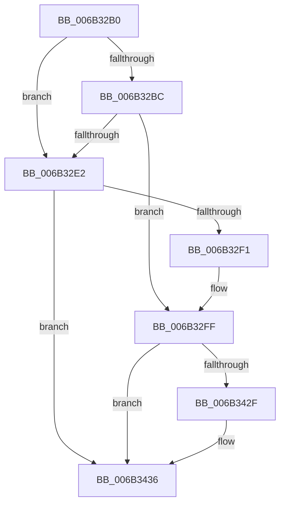

# KiSetSpecCtrlNmi

- RVA: `0x006B32B0`–`0x006B344F` (길이 `415` bytes)
- VA: `0x00000001406B32B0`
- 실행 섹션: `.text`
- PDB 이름 있음: `예`; PDB Function 태그: `아니요`
- unwind 정보 RVA: `0x000C1F54`
- 디코드: `91`개 명령, `415/415` bytes 표시
- 미해석 바이트: `0` (있으면 어셈블리에 `.byte`로 보존)

> 이 문서는 커널 이미지의 기계어와 PDB 기호를 분석해 생성했습니다. 4번과 5번은 함수 원형과 자료형을 바이너리 사용 방식에서 추정한 C 해석이며 원본 소스 복구 결과는 아닙니다.

## 1. Dependencies

- 직접 호출 지점: **32**; 고유 호출 대상: **32**
- 직접 호출자로 확인된 함수: **3**
- RIP 상대 이미지 참조: **0**

### Outgoing calls
- `0x006B32FF` → [KiSetSpecCtrlNmi + 0x162](KiSetSpecCtrlNmi_function_006B32B0.md) (inside-function, `0x006B3412`)
- `0x006B3308` → [KiSetSpecCtrlNmi + 0x16B](KiSetSpecCtrlNmi_function_006B32B0.md) (inside-function, `0x006B341B`)
- `0x006B3311` → [KiSetSpecCtrlNmi + 0x54](KiSetSpecCtrlNmi_function_006B32B0.md) (inside-function, `0x006B3304`)
- `0x006B331A` → [KiSetSpecCtrlNmi + 0x5D](KiSetSpecCtrlNmi_function_006B32B0.md) (inside-function, `0x006B330D`)
- `0x006B3323` → [KiSetSpecCtrlNmi + 0x66](KiSetSpecCtrlNmi_function_006B32B0.md) (inside-function, `0x006B3316`)
- `0x006B332C` → [KiSetSpecCtrlNmi + 0x6F](KiSetSpecCtrlNmi_function_006B32B0.md) (inside-function, `0x006B331F`)
- `0x006B3335` → [KiSetSpecCtrlNmi + 0x78](KiSetSpecCtrlNmi_function_006B32B0.md) (inside-function, `0x006B3328`)
- `0x006B333E` → [KiSetSpecCtrlNmi + 0x81](KiSetSpecCtrlNmi_function_006B32B0.md) (inside-function, `0x006B3331`)
- `0x006B3347` → [KiSetSpecCtrlNmi + 0x8A](KiSetSpecCtrlNmi_function_006B32B0.md) (inside-function, `0x006B333A`)
- `0x006B3350` → [KiSetSpecCtrlNmi + 0x93](KiSetSpecCtrlNmi_function_006B32B0.md) (inside-function, `0x006B3343`)
- `0x006B3359` → [KiSetSpecCtrlNmi + 0x9C](KiSetSpecCtrlNmi_function_006B32B0.md) (inside-function, `0x006B334C`)
- `0x006B3362` → [KiSetSpecCtrlNmi + 0xA5](KiSetSpecCtrlNmi_function_006B32B0.md) (inside-function, `0x006B3355`)
- `0x006B336B` → [KiSetSpecCtrlNmi + 0xAE](KiSetSpecCtrlNmi_function_006B32B0.md) (inside-function, `0x006B335E`)
- `0x006B3374` → [KiSetSpecCtrlNmi + 0xB7](KiSetSpecCtrlNmi_function_006B32B0.md) (inside-function, `0x006B3367`)
- `0x006B337D` → [KiSetSpecCtrlNmi + 0xC0](KiSetSpecCtrlNmi_function_006B32B0.md) (inside-function, `0x006B3370`)
- `0x006B3386` → [KiSetSpecCtrlNmi + 0xC9](KiSetSpecCtrlNmi_function_006B32B0.md) (inside-function, `0x006B3379`)
- `0x006B338F` → [KiSetSpecCtrlNmi + 0xD2](KiSetSpecCtrlNmi_function_006B32B0.md) (inside-function, `0x006B3382`)
- `0x006B3398` → [KiSetSpecCtrlNmi + 0xDB](KiSetSpecCtrlNmi_function_006B32B0.md) (inside-function, `0x006B338B`)
- `0x006B33A1` → [KiSetSpecCtrlNmi + 0xE4](KiSetSpecCtrlNmi_function_006B32B0.md) (inside-function, `0x006B3394`)
- `0x006B33AA` → [KiSetSpecCtrlNmi + 0xED](KiSetSpecCtrlNmi_function_006B32B0.md) (inside-function, `0x006B339D`)
- `0x006B33B3` → [KiSetSpecCtrlNmi + 0xF6](KiSetSpecCtrlNmi_function_006B32B0.md) (inside-function, `0x006B33A6`)
- `0x006B33BC` → [KiSetSpecCtrlNmi + 0xFF](KiSetSpecCtrlNmi_function_006B32B0.md) (inside-function, `0x006B33AF`)
- `0x006B33C5` → [KiSetSpecCtrlNmi + 0x108](KiSetSpecCtrlNmi_function_006B32B0.md) (inside-function, `0x006B33B8`)
- `0x006B33CE` → [KiSetSpecCtrlNmi + 0x111](KiSetSpecCtrlNmi_function_006B32B0.md) (inside-function, `0x006B33C1`)
- `0x006B33D7` → [KiSetSpecCtrlNmi + 0x11A](KiSetSpecCtrlNmi_function_006B32B0.md) (inside-function, `0x006B33CA`)
- `0x006B33E0` → [KiSetSpecCtrlNmi + 0x123](KiSetSpecCtrlNmi_function_006B32B0.md) (inside-function, `0x006B33D3`)
- `0x006B33E9` → [KiSetSpecCtrlNmi + 0x12C](KiSetSpecCtrlNmi_function_006B32B0.md) (inside-function, `0x006B33DC`)
- `0x006B33F2` → [KiSetSpecCtrlNmi + 0x135](KiSetSpecCtrlNmi_function_006B32B0.md) (inside-function, `0x006B33E5`)
- `0x006B33FB` → [KiSetSpecCtrlNmi + 0x13E](KiSetSpecCtrlNmi_function_006B32B0.md) (inside-function, `0x006B33EE`)
- `0x006B3404` → [KiSetSpecCtrlNmi + 0x147](KiSetSpecCtrlNmi_function_006B32B0.md) (inside-function, `0x006B33F7`)
- `0x006B340D` → [KiSetSpecCtrlNmi + 0x150](KiSetSpecCtrlNmi_function_006B32B0.md) (inside-function, `0x006B3400`)
- `0x006B3416` → [KiSetSpecCtrlNmi + 0x159](KiSetSpecCtrlNmi_function_006B32B0.md) (inside-function, `0x006B3409`)

### Direct callers
- [KiSetSpecCtrlNmi](KiSetSpecCtrlNmi_function_006B32B0.md) at `0x006B32FF`
- [KiSetSpecCtrlNmi](KiSetSpecCtrlNmi_function_006B32B0.md) at `0x006B3308`
- [KiSetSpecCtrlNmi](KiSetSpecCtrlNmi_function_006B32B0.md) at `0x006B3311`
- [KiSetSpecCtrlNmi](KiSetSpecCtrlNmi_function_006B32B0.md) at `0x006B331A`
- [KiSetSpecCtrlNmi](KiSetSpecCtrlNmi_function_006B32B0.md) at `0x006B3323`
- [KiSetSpecCtrlNmi](KiSetSpecCtrlNmi_function_006B32B0.md) at `0x006B332C`
- [KiSetSpecCtrlNmi](KiSetSpecCtrlNmi_function_006B32B0.md) at `0x006B3335`
- [KiSetSpecCtrlNmi](KiSetSpecCtrlNmi_function_006B32B0.md) at `0x006B333E`
- [KiSetSpecCtrlNmi](KiSetSpecCtrlNmi_function_006B32B0.md) at `0x006B3347`
- [KiSetSpecCtrlNmi](KiSetSpecCtrlNmi_function_006B32B0.md) at `0x006B3350`
- [KiSetSpecCtrlNmi](KiSetSpecCtrlNmi_function_006B32B0.md) at `0x006B3359`
- [KiSetSpecCtrlNmi](KiSetSpecCtrlNmi_function_006B32B0.md) at `0x006B3362`
- [KiSetSpecCtrlNmi](KiSetSpecCtrlNmi_function_006B32B0.md) at `0x006B336B`
- [KiSetSpecCtrlNmi](KiSetSpecCtrlNmi_function_006B32B0.md) at `0x006B3374`
- [KiSetSpecCtrlNmi](KiSetSpecCtrlNmi_function_006B32B0.md) at `0x006B337D`
- [KiSetSpecCtrlNmi](KiSetSpecCtrlNmi_function_006B32B0.md) at `0x006B3386`
- [KiSetSpecCtrlNmi](KiSetSpecCtrlNmi_function_006B32B0.md) at `0x006B338F`
- [KiSetSpecCtrlNmi](KiSetSpecCtrlNmi_function_006B32B0.md) at `0x006B3398`
- [KiSetSpecCtrlNmi](KiSetSpecCtrlNmi_function_006B32B0.md) at `0x006B33A1`
- [KiSetSpecCtrlNmi](KiSetSpecCtrlNmi_function_006B32B0.md) at `0x006B33AA`
- [KiSetSpecCtrlNmi](KiSetSpecCtrlNmi_function_006B32B0.md) at `0x006B33B3`
- [KiSetSpecCtrlNmi](KiSetSpecCtrlNmi_function_006B32B0.md) at `0x006B33BC`
- [KiSetSpecCtrlNmi](KiSetSpecCtrlNmi_function_006B32B0.md) at `0x006B33C5`
- [KiSetSpecCtrlNmi](KiSetSpecCtrlNmi_function_006B32B0.md) at `0x006B33CE`
- [KiSetSpecCtrlNmi](KiSetSpecCtrlNmi_function_006B32B0.md) at `0x006B33D7`
- [KiSetSpecCtrlNmi](KiSetSpecCtrlNmi_function_006B32B0.md) at `0x006B33E0`
- [KiSetSpecCtrlNmi](KiSetSpecCtrlNmi_function_006B32B0.md) at `0x006B33E9`
- [KiSetSpecCtrlNmi](KiSetSpecCtrlNmi_function_006B32B0.md) at `0x006B33F2`
- [KiSetSpecCtrlNmi](KiSetSpecCtrlNmi_function_006B32B0.md) at `0x006B33FB`
- [KiSetSpecCtrlNmi](KiSetSpecCtrlNmi_function_006B32B0.md) at `0x006B3404`
- [KiSetSpecCtrlNmi](KiSetSpecCtrlNmi_function_006B32B0.md) at `0x006B340D`
- [KiSetSpecCtrlNmi](KiSetSpecCtrlNmi_function_006B32B0.md) at `0x006B3416`
- [KiNmiInterrupt](KiNmiInterrupt_function_006BD3C0.md) at `0x006BD496`
- [KiNmiInterrupt](KiNmiInterrupt_function_006BD3C0.md) at `0x006BD4E5`
- [KiMcheckAbort](../6C/KiMcheckAbort_function_006C16C0.md) at `0x006C1796`
- [KiMcheckAbort](../6C/KiMcheckAbort_function_006C16C0.md) at `0x006C17E5`

### Static image references
- 디코드된 RIP-relative 메모리 참조가 없습니다.

## 2. Other-region calls and transfers

- 다른 실행 섹션으로 향하는 call: **0**
- 별도 외부 분기/꼬리 이동을 확인하지 못했습니다.

## 3. Assembly (complete function range)

```asm
006B32B0  66 65 83 3C 25 6A 08 00 00 00   cmp word ptr gs:[0x86a], 0
006B32BA  74 26                           je 0x1406b32e2
006B32BC  B9 48 00 00 00                  mov ecx, 0x48
006B32C1  0F 32                           rdmsr
006B32C3  89 85 C0 00 00 00               mov dword ptr [rbp + 0xc0], eax
006B32C9  65 0F B7 04 25 6A 08 00 00      movzx eax, word ptr gs:[0x86a]
006B32D2  B9 48 00 00 00                  mov ecx, 0x48
006B32D7  33 D2                           xor edx, edx
006B32D9  0F 30                           wrmsr
006B32DB  A9 01 00 00 00                  test eax, 1
006B32E0  75 1D                           jne 0x1406b32ff
006B32E2  65 F6 04 25 5C 08 00 00 02      test byte ptr gs:[0x85c], 2
006B32EB  0F 84 45 01 00 00               je 0x1406b3436
006B32F1  B8 01 00 00 00                  mov eax, 1
006B32F6  33 D2                           xor edx, edx
006B32F8  B9 49 00 00 00                  mov ecx, 0x49
006B32FD  0F 30                           wrmsr
006B32FF  E8 0E 01 00 00                  call 0x1406b3412
006B3304  48 83 C4 08                     add rsp, 8
006B3308  E8 0E 01 00 00                  call 0x1406b341b
006B330D  48 83 C4 08                     add rsp, 8
006B3311  E8 EE FF FF FF                  call 0x1406b3304
006B3316  48 83 C4 08                     add rsp, 8
006B331A  E8 EE FF FF FF                  call 0x1406b330d
006B331F  48 83 C4 08                     add rsp, 8
006B3323  E8 EE FF FF FF                  call 0x1406b3316
006B3328  48 83 C4 08                     add rsp, 8
006B332C  E8 EE FF FF FF                  call 0x1406b331f
006B3331  48 83 C4 08                     add rsp, 8
006B3335  E8 EE FF FF FF                  call 0x1406b3328
006B333A  48 83 C4 08                     add rsp, 8
006B333E  E8 EE FF FF FF                  call 0x1406b3331
006B3343  48 83 C4 08                     add rsp, 8
006B3347  E8 EE FF FF FF                  call 0x1406b333a
006B334C  48 83 C4 08                     add rsp, 8
006B3350  E8 EE FF FF FF                  call 0x1406b3343
006B3355  48 83 C4 08                     add rsp, 8
006B3359  E8 EE FF FF FF                  call 0x1406b334c
006B335E  48 83 C4 08                     add rsp, 8
006B3362  E8 EE FF FF FF                  call 0x1406b3355
006B3367  48 83 C4 08                     add rsp, 8
006B336B  E8 EE FF FF FF                  call 0x1406b335e
006B3370  48 83 C4 08                     add rsp, 8
006B3374  E8 EE FF FF FF                  call 0x1406b3367
006B3379  48 83 C4 08                     add rsp, 8
006B337D  E8 EE FF FF FF                  call 0x1406b3370
006B3382  48 83 C4 08                     add rsp, 8
006B3386  E8 EE FF FF FF                  call 0x1406b3379
006B338B  48 83 C4 08                     add rsp, 8
006B338F  E8 EE FF FF FF                  call 0x1406b3382
006B3394  48 83 C4 08                     add rsp, 8
006B3398  E8 EE FF FF FF                  call 0x1406b338b
006B339D  48 83 C4 08                     add rsp, 8
006B33A1  E8 EE FF FF FF                  call 0x1406b3394
006B33A6  48 83 C4 08                     add rsp, 8
006B33AA  E8 EE FF FF FF                  call 0x1406b339d
006B33AF  48 83 C4 08                     add rsp, 8
006B33B3  E8 EE FF FF FF                  call 0x1406b33a6
006B33B8  48 83 C4 08                     add rsp, 8
006B33BC  E8 EE FF FF FF                  call 0x1406b33af
006B33C1  48 83 C4 08                     add rsp, 8
006B33C5  E8 EE FF FF FF                  call 0x1406b33b8
006B33CA  48 83 C4 08                     add rsp, 8
006B33CE  E8 EE FF FF FF                  call 0x1406b33c1
006B33D3  48 83 C4 08                     add rsp, 8
006B33D7  E8 EE FF FF FF                  call 0x1406b33ca
006B33DC  48 83 C4 08                     add rsp, 8
006B33E0  E8 EE FF FF FF                  call 0x1406b33d3
006B33E5  48 83 C4 08                     add rsp, 8
006B33E9  E8 EE FF FF FF                  call 0x1406b33dc
006B33EE  48 83 C4 08                     add rsp, 8
006B33F2  E8 EE FF FF FF                  call 0x1406b33e5
006B33F7  48 83 C4 08                     add rsp, 8
006B33FB  E8 EE FF FF FF                  call 0x1406b33ee
006B3400  48 83 C4 08                     add rsp, 8
006B3404  E8 EE FF FF FF                  call 0x1406b33f7
006B3409  48 83 C4 08                     add rsp, 8
006B340D  E8 EE FF FF FF                  call 0x1406b3400
006B3412  48 83 C4 08                     add rsp, 8
006B3416  E8 EE FF FF FF                  call 0x1406b3409
006B341B  48 83 C4 08                     add rsp, 8
006B341F  B8 DA DA 00 00                  mov eax, 0xdada
006B3424  65 F6 04 25 5C 08 00 00 08      test byte ptr gs:[0x85c], 8
006B342D  74 07                           je 0x1406b3436
006B342F  B0 20                           mov al, 0x20
006B3431  F3 48 0F AE E8                  incsspq rax
006B3436  0F AE E8                        lfence
006B3439  65 0F B6 04 25 5E 08 00 00      movzx eax, byte ptr gs:[0x85e]
006B3442  88 45 A8                        mov byte ptr [rbp - 0x58], al
006B3445  65 80 0C 25 5E 08 00 00 02      or byte ptr gs:[0x85e], 2
006B344E  C3                              ret
```

## 4. C-style interpretation (structured pseudocode)

```c
__int64 __fastcall KiSetSpecCtrlNmi(__int64 a1, int a2)
{
    __int64 result;
    __int64 v_rsp;

    if ((*(unsigned __int16 *)(gs_base + (0 + 2154))) == 0) goto loc_006B32E2;
    *(unsigned int *)(v_rbp + 192) = (unsigned int)(result);
    a2 = 0;
    if ((((unsigned int)(*(unsigned __int16 *)(gs_base + (0 + 2154)))) & (1)) != 0) goto loc_006B32FF;
loc_006B32E2:
    if (((*(unsigned __int8 *)(gs_base + (0 + 2140))) & (2)) == 0) goto loc_006B3436;
    a2 = 0;
loc_006B32FF:
    result = KiSetSpecCtrlNmi___0x162(73, a2, a3, a4);
    v_rsp = (v_rsp) + (8);
    result = KiSetSpecCtrlNmi___0x16B(73, a2, a3, a4);
    v_rsp = (v_rsp) + (8);
    result = KiSetSpecCtrlNmi___0x54(73, a2, a3, a4);
    v_rsp = (v_rsp) + (8);
    result = KiSetSpecCtrlNmi___0x5D(73, a2, a3, a4);
    v_rsp = (v_rsp) + (8);
    result = KiSetSpecCtrlNmi___0x66(73, a2, a3, a4);
    v_rsp = (v_rsp) + (8);
    result = KiSetSpecCtrlNmi___0x6F(73, a2, a3, a4);
    v_rsp = (v_rsp) + (8);
    result = KiSetSpecCtrlNmi___0x78(73, a2, a3, a4);
    v_rsp = (v_rsp) + (8);
    result = KiSetSpecCtrlNmi___0x81(73, a2, a3, a4);
    v_rsp = (v_rsp) + (8);
    result = KiSetSpecCtrlNmi___0x8A(73, a2, a3, a4);
    v_rsp = (v_rsp) + (8);
    result = KiSetSpecCtrlNmi___0x93(73, a2, a3, a4);
    v_rsp = (v_rsp) + (8);
    result = KiSetSpecCtrlNmi___0x9C(73, a2, a3, a4);
    v_rsp = (v_rsp) + (8);
    result = KiSetSpecCtrlNmi___0xA5(73, a2, a3, a4);
    v_rsp = (v_rsp) + (8);
    result = KiSetSpecCtrlNmi___0xAE(73, a2, a3, a4);
    v_rsp = (v_rsp) + (8);
    result = KiSetSpecCtrlNmi___0xB7(73, a2, a3, a4);
    v_rsp = (v_rsp) + (8);
    result = KiSetSpecCtrlNmi___0xC0(73, a2, a3, a4);
    v_rsp = (v_rsp) + (8);
    result = KiSetSpecCtrlNmi___0xC9(73, a2, a3, a4);
    v_rsp = (v_rsp) + (8);
    result = KiSetSpecCtrlNmi___0xD2(73, a2, a3, a4);
    v_rsp = (v_rsp) + (8);
    result = KiSetSpecCtrlNmi___0xDB(73, a2, a3, a4);
    v_rsp = (v_rsp) + (8);
    result = KiSetSpecCtrlNmi___0xE4(73, a2, a3, a4);
    v_rsp = (v_rsp) + (8);
    result = KiSetSpecCtrlNmi___0xED(73, a2, a3, a4);
    v_rsp = (v_rsp) + (8);
    result = KiSetSpecCtrlNmi___0xF6(73, a2, a3, a4);
    v_rsp = (v_rsp) + (8);
    result = KiSetSpecCtrlNmi___0xFF(73, a2, a3, a4);
    v_rsp = (v_rsp) + (8);
    result = KiSetSpecCtrlNmi___0x108(73, a2, a3, a4);
    v_rsp = (v_rsp) + (8);
    result = KiSetSpecCtrlNmi___0x111(73, a2, a3, a4);
    v_rsp = (v_rsp) + (8);
    result = KiSetSpecCtrlNmi___0x11A(73, a2, a3, a4);
    v_rsp = (v_rsp) + (8);
    result = KiSetSpecCtrlNmi___0x123(73, a2, a3, a4);
    v_rsp = (v_rsp) + (8);
    result = KiSetSpecCtrlNmi___0x12C(73, a2, a3, a4);
    v_rsp = (v_rsp) + (8);
    result = KiSetSpecCtrlNmi___0x135(73, a2, a3, a4);
    v_rsp = (v_rsp) + (8);
    result = KiSetSpecCtrlNmi___0x13E(73, a2, a3, a4);
    v_rsp = (v_rsp) + (8);
    result = KiSetSpecCtrlNmi___0x147(73, a2, a3, a4);
    v_rsp = (v_rsp) + (8);
    result = KiSetSpecCtrlNmi___0x150(73, a2, a3, a4);
    v_rsp = (v_rsp) + (8);
    result = KiSetSpecCtrlNmi___0x159(73, a2, a3, a4);
    v_rsp = (v_rsp) + (8);
    result = (unsigned int)(0xDADAULL);
    if (((*(unsigned __int8 *)(gs_base + (0 + 2140))) & (8)) != 0) {
        result = 32;
    }
    *(unsigned __int8 *)(v_rbp - 88) = (unsigned __int8)(*(unsigned __int8 *)(gs_base + (0 + 2142)));
    return *(unsigned __int8 *)(gs_base + (0 + 2142));
}
```

## 5. (Beta) C Style

```c
int64_t KiSetSpecCtrlNmi(int64_t Arg1, int32_t Arg2)
{
    int64_t result;
    int64_t local_rsp;

    if ((*(uint16_t *)(gs_base + (0 + 0x86A))) == 0) goto loc_006B32E2;
    *(uint32_t *)(local_rbp + 0xC0) = (uint32_t)(result);
    Arg2 = 0;
    if ((((uint32_t)(*(uint16_t *)(gs_base + (0 + 0x86A)))) & (1)) != 0) goto loc_006B32FF;
loc_006B32E2:
    if (((*(uint8_t *)(gs_base + (0 + 0x85C))) & (2)) == 0) goto loc_006B3436;
    Arg2 = 0;
loc_006B32FF:
    result = KiSetSpecCtrlNmi___0x162(73, Arg2, a3, a4);
    local_rsp = (local_rsp) + (8);
    result = KiSetSpecCtrlNmi___0x16B(73, Arg2, a3, a4);
    local_rsp = (local_rsp) + (8);
    result = KiSetSpecCtrlNmi___0x54(73, Arg2, a3, a4);
    local_rsp = (local_rsp) + (8);
    result = KiSetSpecCtrlNmi___0x5D(73, Arg2, a3, a4);
    local_rsp = (local_rsp) + (8);
    result = KiSetSpecCtrlNmi___0x66(73, Arg2, a3, a4);
    local_rsp = (local_rsp) + (8);
    result = KiSetSpecCtrlNmi___0x6F(73, Arg2, a3, a4);
    local_rsp = (local_rsp) + (8);
    result = KiSetSpecCtrlNmi___0x78(73, Arg2, a3, a4);
    local_rsp = (local_rsp) + (8);
    result = KiSetSpecCtrlNmi___0x81(73, Arg2, a3, a4);
    local_rsp = (local_rsp) + (8);
    result = KiSetSpecCtrlNmi___0x8A(73, Arg2, a3, a4);
    local_rsp = (local_rsp) + (8);
    result = KiSetSpecCtrlNmi___0x93(73, Arg2, a3, a4);
    local_rsp = (local_rsp) + (8);
    result = KiSetSpecCtrlNmi___0x9C(73, Arg2, a3, a4);
    local_rsp = (local_rsp) + (8);
    result = KiSetSpecCtrlNmi___0xA5(73, Arg2, a3, a4);
    local_rsp = (local_rsp) + (8);
    result = KiSetSpecCtrlNmi___0xAE(73, Arg2, a3, a4);
    local_rsp = (local_rsp) + (8);
    result = KiSetSpecCtrlNmi___0xB7(73, Arg2, a3, a4);
    local_rsp = (local_rsp) + (8);
    result = KiSetSpecCtrlNmi___0xC0(73, Arg2, a3, a4);
    local_rsp = (local_rsp) + (8);
    result = KiSetSpecCtrlNmi___0xC9(73, Arg2, a3, a4);
    local_rsp = (local_rsp) + (8);
    result = KiSetSpecCtrlNmi___0xD2(73, Arg2, a3, a4);
    local_rsp = (local_rsp) + (8);
    result = KiSetSpecCtrlNmi___0xDB(73, Arg2, a3, a4);
    local_rsp = (local_rsp) + (8);
    result = KiSetSpecCtrlNmi___0xE4(73, Arg2, a3, a4);
    local_rsp = (local_rsp) + (8);
    result = KiSetSpecCtrlNmi___0xED(73, Arg2, a3, a4);
    local_rsp = (local_rsp) + (8);
    result = KiSetSpecCtrlNmi___0xF6(73, Arg2, a3, a4);
    local_rsp = (local_rsp) + (8);
    result = KiSetSpecCtrlNmi___0xFF(73, Arg2, a3, a4);
    local_rsp = (local_rsp) + (8);
    result = KiSetSpecCtrlNmi___0x108(73, Arg2, a3, a4);
    local_rsp = (local_rsp) + (8);
    result = KiSetSpecCtrlNmi___0x111(73, Arg2, a3, a4);
    local_rsp = (local_rsp) + (8);
    result = KiSetSpecCtrlNmi___0x11A(73, Arg2, a3, a4);
    local_rsp = (local_rsp) + (8);
    result = KiSetSpecCtrlNmi___0x123(73, Arg2, a3, a4);
    local_rsp = (local_rsp) + (8);
    result = KiSetSpecCtrlNmi___0x12C(73, Arg2, a3, a4);
    local_rsp = (local_rsp) + (8);
    result = KiSetSpecCtrlNmi___0x135(73, Arg2, a3, a4);
    local_rsp = (local_rsp) + (8);
    result = KiSetSpecCtrlNmi___0x13E(73, Arg2, a3, a4);
    local_rsp = (local_rsp) + (8);
    result = KiSetSpecCtrlNmi___0x147(73, Arg2, a3, a4);
    local_rsp = (local_rsp) + (8);
    result = KiSetSpecCtrlNmi___0x150(73, Arg2, a3, a4);
    local_rsp = (local_rsp) + (8);
    result = KiSetSpecCtrlNmi___0x159(73, Arg2, a3, a4);
    local_rsp = (local_rsp) + (8);
    result = (uint32_t)(0xDADAULL);
    if (((*(uint8_t *)(gs_base + (0 + 0x85C))) & (8)) != 0) {
        result = 32;
    }
    *(uint8_t *)(local_rbp - 0x58) = (uint8_t)(*(uint8_t *)(gs_base + (0 + 0x85E)));
    return *(uint8_t *)(gs_base + (0 + 0x85E));
}
```

## 6. Execution-region graph

[열기: 2D/3D 그래프와 함수 탐색 컨트롤 패널](../../../control-panel.html?section=text&rva=0x006B32B0&view=graph)

- 2D 그래프는 위에서 아래로 흐르고, 3D 그래프는 빈 공간을 드래그해 회전합니다. Shift+드래그는 이동, 휠은 확대·축소, 함수 노드 선택은 대상 보고서 이동입니다.

### Static fallback


