# KiSpuriousDispatchNoEOI

- RVA: `0x006B4AA0`–`0x006B4E5D` (길이 `957` bytes)
- VA: `0x00000001406B4AA0`
- 실행 섹션: `.text`
- PDB 이름 있음: `예`; PDB Function 태그: `아니요`
- unwind 정보 RVA: `0x000C2070`
- 디코드: `212`개 명령, `957/957` bytes 표시
- 미해석 바이트: `0` (있으면 어셈블리에 `.byte`로 보존)

> 이 문서는 커널 이미지의 기계어와 PDB 기호를 분석해 생성했습니다. 4번과 5번은 함수 원형과 자료형을 바이너리 사용 방식에서 추정한 C 해석이며 원본 소스 복구 결과는 아닙니다.

## 1. Dependencies

- 직접 호출 지점: **43**; 고유 호출 대상: **42**
- 직접 호출자로 확인된 함수: **1**
- RIP 상대 이미지 참조: **3**

### Outgoing calls
- `0x006B4AAE` → [KzSetIrqlUnsafe](../5B/KzSetIrqlUnsafe_function_005B8AE0.md) (function, `0x005B8AE0`)
- `0x006B4ACB` → [KiStartInterruptCycleAccumulation](../37/KiStartInterruptCycleAccumulation_function_0037B410.md) (function, `0x0037B410`)
- `0x006B4AE2` → [KiEndInterruptCycleAccumulation](../3F/KiEndInterruptCycleAccumulation_function_003FAAE0.md) (function, `0x003FAAE0`)
- `0x006B4AEB` → [KiDpcInterruptBypass](KiDpcInterruptBypass_function_006B8EE0.md) (function, `0x006B8EE0`)
- `0x006B4AFD` → [KzSetIrqlUnsafe](../5B/KzSetIrqlUnsafe_function_005B8AE0.md) (function, `0x005B8AE0`)
- `0x006B4B45` → [KiInitiateUserApc](KiInitiateUserApc_function_006B6540.md) (function, `0x006B6540`)
- `0x006B4B56` → [KiSynchronizeUserIsolationDomainEntry](../26/KiSynchronizeUserIsolationDomainEntry_function_00263F60.md) (function, `0x00263F60`)
- `0x006B4B70` → [KiUpdateStibpPairing](../3E/KiUpdateStibpPairing_function_003E71C0.md) (function, `0x003E71C0`)
- `0x006B4B86` → [KiRestoreSetContextState](KiRestoreSetContextState_function_006B1CA0.md) (function, `0x006B1CA0`)
- `0x006B4BA2` → [KiCopyCounters](../5C/KiCopyCounters_function_005C0710.md) (function, `0x005C0710`)
- `0x006B4BBE` → [KiRestoreDebugRegisterState](../4F/KiRestoreDebugRegisterState_function_004FD8E0.md) (function, `0x004FD8E0`)
- `0x006B4C58` → [KiSpuriousDispatchNoEOI + 0x2CB](KiSpuriousDispatchNoEOI_function_006B4AA0.md) (inside-function, `0x006B4D6B`)
- `0x006B4C61` → [KiSpuriousDispatchNoEOI + 0x2D4](KiSpuriousDispatchNoEOI_function_006B4AA0.md) (inside-function, `0x006B4D74`)
- `0x006B4C6A` → [KiSpuriousDispatchNoEOI + 0x1BD](KiSpuriousDispatchNoEOI_function_006B4AA0.md) (inside-function, `0x006B4C5D`)
- `0x006B4C73` → [KiSpuriousDispatchNoEOI + 0x1C6](KiSpuriousDispatchNoEOI_function_006B4AA0.md) (inside-function, `0x006B4C66`)
- `0x006B4C7C` → [KiSpuriousDispatchNoEOI + 0x1CF](KiSpuriousDispatchNoEOI_function_006B4AA0.md) (inside-function, `0x006B4C6F`)
- `0x006B4C85` → [KiSpuriousDispatchNoEOI + 0x1D8](KiSpuriousDispatchNoEOI_function_006B4AA0.md) (inside-function, `0x006B4C78`)
- `0x006B4C8E` → [KiSpuriousDispatchNoEOI + 0x1E1](KiSpuriousDispatchNoEOI_function_006B4AA0.md) (inside-function, `0x006B4C81`)
- `0x006B4C97` → [KiSpuriousDispatchNoEOI + 0x1EA](KiSpuriousDispatchNoEOI_function_006B4AA0.md) (inside-function, `0x006B4C8A`)
- `0x006B4CA0` → [KiSpuriousDispatchNoEOI + 0x1F3](KiSpuriousDispatchNoEOI_function_006B4AA0.md) (inside-function, `0x006B4C93`)
- `0x006B4CA9` → [KiSpuriousDispatchNoEOI + 0x1FC](KiSpuriousDispatchNoEOI_function_006B4AA0.md) (inside-function, `0x006B4C9C`)
- `0x006B4CB2` → [KiSpuriousDispatchNoEOI + 0x205](KiSpuriousDispatchNoEOI_function_006B4AA0.md) (inside-function, `0x006B4CA5`)
- `0x006B4CBB` → [KiSpuriousDispatchNoEOI + 0x20E](KiSpuriousDispatchNoEOI_function_006B4AA0.md) (inside-function, `0x006B4CAE`)
- `0x006B4CC4` → [KiSpuriousDispatchNoEOI + 0x217](KiSpuriousDispatchNoEOI_function_006B4AA0.md) (inside-function, `0x006B4CB7`)
- `0x006B4CCD` → [KiSpuriousDispatchNoEOI + 0x220](KiSpuriousDispatchNoEOI_function_006B4AA0.md) (inside-function, `0x006B4CC0`)
- `0x006B4CD6` → [KiSpuriousDispatchNoEOI + 0x229](KiSpuriousDispatchNoEOI_function_006B4AA0.md) (inside-function, `0x006B4CC9`)
- `0x006B4CDF` → [KiSpuriousDispatchNoEOI + 0x232](KiSpuriousDispatchNoEOI_function_006B4AA0.md) (inside-function, `0x006B4CD2`)
- `0x006B4CE8` → [KiSpuriousDispatchNoEOI + 0x23B](KiSpuriousDispatchNoEOI_function_006B4AA0.md) (inside-function, `0x006B4CDB`)
- `0x006B4CF1` → [KiSpuriousDispatchNoEOI + 0x244](KiSpuriousDispatchNoEOI_function_006B4AA0.md) (inside-function, `0x006B4CE4`)
- `0x006B4CFA` → [KiSpuriousDispatchNoEOI + 0x24D](KiSpuriousDispatchNoEOI_function_006B4AA0.md) (inside-function, `0x006B4CED`)
- `0x006B4D03` → [KiSpuriousDispatchNoEOI + 0x256](KiSpuriousDispatchNoEOI_function_006B4AA0.md) (inside-function, `0x006B4CF6`)
- `0x006B4D0C` → [KiSpuriousDispatchNoEOI + 0x25F](KiSpuriousDispatchNoEOI_function_006B4AA0.md) (inside-function, `0x006B4CFF`)
- `0x006B4D15` → [KiSpuriousDispatchNoEOI + 0x268](KiSpuriousDispatchNoEOI_function_006B4AA0.md) (inside-function, `0x006B4D08`)
- `0x006B4D1E` → [KiSpuriousDispatchNoEOI + 0x271](KiSpuriousDispatchNoEOI_function_006B4AA0.md) (inside-function, `0x006B4D11`)
- `0x006B4D27` → [KiSpuriousDispatchNoEOI + 0x27A](KiSpuriousDispatchNoEOI_function_006B4AA0.md) (inside-function, `0x006B4D1A`)
- `0x006B4D30` → [KiSpuriousDispatchNoEOI + 0x283](KiSpuriousDispatchNoEOI_function_006B4AA0.md) (inside-function, `0x006B4D23`)
- `0x006B4D39` → [KiSpuriousDispatchNoEOI + 0x28C](KiSpuriousDispatchNoEOI_function_006B4AA0.md) (inside-function, `0x006B4D2C`)
- `0x006B4D42` → [KiSpuriousDispatchNoEOI + 0x295](KiSpuriousDispatchNoEOI_function_006B4AA0.md) (inside-function, `0x006B4D35`)
- `0x006B4D4B` → [KiSpuriousDispatchNoEOI + 0x29E](KiSpuriousDispatchNoEOI_function_006B4AA0.md) (inside-function, `0x006B4D3E`)
- `0x006B4D54` → [KiSpuriousDispatchNoEOI + 0x2A7](KiSpuriousDispatchNoEOI_function_006B4AA0.md) (inside-function, `0x006B4D47`)
- `0x006B4D5D` → [KiSpuriousDispatchNoEOI + 0x2B0](KiSpuriousDispatchNoEOI_function_006B4AA0.md) (inside-function, `0x006B4D50`)
- `0x006B4D66` → [KiSpuriousDispatchNoEOI + 0x2B9](KiSpuriousDispatchNoEOI_function_006B4AA0.md) (inside-function, `0x006B4D59`)
- `0x006B4D6F` → [KiSpuriousDispatchNoEOI + 0x2C2](KiSpuriousDispatchNoEOI_function_006B4AA0.md) (inside-function, `0x006B4D62`)

### Direct callers
- [KiSpuriousDispatchNoEOI](KiSpuriousDispatchNoEOI_function_006B4AA0.md) at `0x006B4C58`
- [KiSpuriousDispatchNoEOI](KiSpuriousDispatchNoEOI_function_006B4AA0.md) at `0x006B4C61`
- [KiSpuriousDispatchNoEOI](KiSpuriousDispatchNoEOI_function_006B4AA0.md) at `0x006B4C6A`
- [KiSpuriousDispatchNoEOI](KiSpuriousDispatchNoEOI_function_006B4AA0.md) at `0x006B4C73`
- [KiSpuriousDispatchNoEOI](KiSpuriousDispatchNoEOI_function_006B4AA0.md) at `0x006B4C7C`
- [KiSpuriousDispatchNoEOI](KiSpuriousDispatchNoEOI_function_006B4AA0.md) at `0x006B4C85`
- [KiSpuriousDispatchNoEOI](KiSpuriousDispatchNoEOI_function_006B4AA0.md) at `0x006B4C8E`
- [KiSpuriousDispatchNoEOI](KiSpuriousDispatchNoEOI_function_006B4AA0.md) at `0x006B4C97`
- [KiSpuriousDispatchNoEOI](KiSpuriousDispatchNoEOI_function_006B4AA0.md) at `0x006B4CA0`
- [KiSpuriousDispatchNoEOI](KiSpuriousDispatchNoEOI_function_006B4AA0.md) at `0x006B4CA9`
- [KiSpuriousDispatchNoEOI](KiSpuriousDispatchNoEOI_function_006B4AA0.md) at `0x006B4CB2`
- [KiSpuriousDispatchNoEOI](KiSpuriousDispatchNoEOI_function_006B4AA0.md) at `0x006B4CBB`
- [KiSpuriousDispatchNoEOI](KiSpuriousDispatchNoEOI_function_006B4AA0.md) at `0x006B4CC4`
- [KiSpuriousDispatchNoEOI](KiSpuriousDispatchNoEOI_function_006B4AA0.md) at `0x006B4CCD`
- [KiSpuriousDispatchNoEOI](KiSpuriousDispatchNoEOI_function_006B4AA0.md) at `0x006B4CD6`
- [KiSpuriousDispatchNoEOI](KiSpuriousDispatchNoEOI_function_006B4AA0.md) at `0x006B4CDF`
- [KiSpuriousDispatchNoEOI](KiSpuriousDispatchNoEOI_function_006B4AA0.md) at `0x006B4CE8`
- [KiSpuriousDispatchNoEOI](KiSpuriousDispatchNoEOI_function_006B4AA0.md) at `0x006B4CF1`
- [KiSpuriousDispatchNoEOI](KiSpuriousDispatchNoEOI_function_006B4AA0.md) at `0x006B4CFA`
- [KiSpuriousDispatchNoEOI](KiSpuriousDispatchNoEOI_function_006B4AA0.md) at `0x006B4D03`
- [KiSpuriousDispatchNoEOI](KiSpuriousDispatchNoEOI_function_006B4AA0.md) at `0x006B4D0C`
- [KiSpuriousDispatchNoEOI](KiSpuriousDispatchNoEOI_function_006B4AA0.md) at `0x006B4D15`
- [KiSpuriousDispatchNoEOI](KiSpuriousDispatchNoEOI_function_006B4AA0.md) at `0x006B4D1E`
- [KiSpuriousDispatchNoEOI](KiSpuriousDispatchNoEOI_function_006B4AA0.md) at `0x006B4D27`
- [KiSpuriousDispatchNoEOI](KiSpuriousDispatchNoEOI_function_006B4AA0.md) at `0x006B4D30`
- [KiSpuriousDispatchNoEOI](KiSpuriousDispatchNoEOI_function_006B4AA0.md) at `0x006B4D39`
- [KiSpuriousDispatchNoEOI](KiSpuriousDispatchNoEOI_function_006B4AA0.md) at `0x006B4D42`
- [KiSpuriousDispatchNoEOI](KiSpuriousDispatchNoEOI_function_006B4AA0.md) at `0x006B4D4B`
- [KiSpuriousDispatchNoEOI](KiSpuriousDispatchNoEOI_function_006B4AA0.md) at `0x006B4D54`
- [KiSpuriousDispatchNoEOI](KiSpuriousDispatchNoEOI_function_006B4AA0.md) at `0x006B4D5D`
- [KiSpuriousDispatchNoEOI](KiSpuriousDispatchNoEOI_function_006B4AA0.md) at `0x006B4D66`
- [KiSpuriousDispatchNoEOI](KiSpuriousDispatchNoEOI_function_006B4AA0.md) at `0x006B4D6F`

### Static image references
- `0x006B4AA5` → RVA `0x00FC6D20` (`ALMOSTRO`; read)
- `0x006B4B1D` → RVA `0x00FC6BF0` (`ALMOSTRO`; read)
- `0x006B4DED` → RVA `0x01201840` (`CFGRO`; read)

## 2. Other-region calls and transfers

- 다른 실행 섹션으로 향하는 call: **0**
- call이 아닌 외부 분기/꼬리 이동: **1**
  - `0x006B4DF6` → [KiKernelExit](../../kvascode/BC/KiKernelExit_function_00BCCB80.md) (`tail-transfer`)

## 3. Assembly (complete function range)

```asm
006B4AA0  B9 0F 00 00 00                  mov ecx, 0xf
006B4AA5  83 3D 74 22 91 00 00            cmp dword ptr [rip + 0x912274], 0
006B4AAC  74 07                           je 0x1406b4ab5
006B4AAE  E8 2D 40 F0 FF                  call 0x1405b8ae0
006B4AB3  EB 08                           jmp 0x1406b4abd
006B4AB5  44 0F 20 C0                     mov rax, cr8
006B4AB9  44 0F 22 C1                     mov cr8, rcx
006B4ABD  88 45 A9                        mov byte ptr [rbp - 0x57], al
006B4AC0  65 48 8B 0C 25 20 00 00 00      mov rcx, qword ptr gs:[0x20]
006B4AC9  33 D2                           xor edx, edx
006B4ACB  E8 40 69 CC FF                  call 0x14037b410
006B4AD0  FB                              sti
006B4AD1  FF 46 74                        inc dword ptr [rsi + 0x74]
006B4AD4  FA                              cli
006B4AD5  65 48 8B 0C 25 20 00 00 00      mov rcx, qword ptr gs:[0x20]
006B4ADE  0F B6 55 A9                     movzx edx, byte ptr [rbp - 0x57]
006B4AE2  E8 F9 5F D4 FF                  call 0x1403faae0
006B4AE7  84 C0                           test al, al
006B4AE9  74 05                           je 0x1406b4af0
006B4AEB  E8 F0 43 00 00                  call 0x1406b8ee0
006B4AF0  0F B6 4D A9                     movzx ecx, byte ptr [rbp - 0x57]
006B4AF4  83 3D 25 22 91 00 00            cmp dword ptr [rip + 0x912225], 0
006B4AFB  74 07                           je 0x1406b4b04
006B4AFD  E8 DE 3F F0 FF                  call 0x1405b8ae0
006B4B02  EB 04                           jmp 0x1406b4b08
006B4B04  44 0F 22 C1                     mov cr8, rcx
006B4B08  48 8B B5 D0 00 00 00            mov rsi, qword ptr [rbp + 0xd0]
006B4B0F  FA                              cli
006B4B10  F6 85 F0 00 00 00 01            test byte ptr [rbp + 0xf0], 1
006B4B17  0F 84 F5 02 00 00               je 0x1406b4e12
006B4B1D  F6 05 CC 20 91 00 FF            test byte ptr [rip + 0x9120cc], 0xff
006B4B24  74 03                           je 0x1406b4b29
006B4B26  0F 01 CB                        stac
006B4B29  65 48 8B 0C 25 88 01 00 00      mov rcx, qword ptr gs:[0x188]
006B4B32  F6 81 C2 00 00 00 03            test byte ptr [rcx + 0xc2], 3
006B4B39  74 1B                           je 0x1406b4b56
006B4B3B  B9 01 00 00 00                  mov ecx, 1
006B4B40  44 0F 22 C1                     mov cr8, rcx
006B4B44  FB                              sti
006B4B45  E8 F6 19 00 00                  call 0x1406b6540
006B4B4A  FA                              cli
006B4B4B  B9 00 00 00 00                  mov ecx, 0
006B4B50  44 0F 22 C1                     mov cr8, rcx
006B4B54  EB D3                           jmp 0x1406b4b29
006B4B56  E8 05 F4 BA FF                  call 0x140263f60
006B4B5B  85 C0                           test eax, eax
006B4B5D  48 8B 45 B0                     mov rax, qword ptr [rbp - 0x50]
006B4B61  75 C6                           jne 0x1406b4b29
006B4B63  65 F6 04 25 60 08 00 00 02      test byte ptr gs:[0x860], 2
006B4B6C  74 07                           je 0x1406b4b75
006B4B6E  33 C9                           xor ecx, ecx
006B4B70  E8 4B 26 D3 FF                  call 0x1403e71c0
006B4B75  65 48 8B 0C 25 88 01 00 00      mov rcx, qword ptr gs:[0x188]
006B4B7E  F7 01 00 00 00 08               test dword ptr [rcx], 0x8000000
006B4B84  74 05                           je 0x1406b4b8b
006B4B86  E8 15 D1 FF FF                  call 0x1406b1ca0
006B4B8B  65 48 8B 0C 25 88 01 00 00      mov rcx, qword ptr gs:[0x188]
006B4B94  F7 01 00 00 01 00               test dword ptr [rcx], 0x10000
006B4B9A  74 14                           je 0x1406b4bb0
006B4B9C  F6 41 02 01                     test byte ptr [rcx + 2], 1
006B4BA0  74 0E                           je 0x1406b4bb0
006B4BA2  E8 69 BB F0 FF                  call 0x1405c0710
006B4BA7  65 48 8B 0C 25 88 01 00 00      mov rcx, qword ptr gs:[0x188]
006B4BB0  0F AE 55 AC                     ldmxcsr dword ptr [rbp - 0x54]
006B4BB4  66 83 BD 80 00 00 00 00         cmp word ptr [rbp + 0x80], 0
006B4BBC  74 05                           je 0x1406b4bc3
006B4BBE  E8 1D 8D E4 FF                  call 0x1404fd8e0
006B4BC3  65 48 8B 0C 25 88 01 00 00      mov rcx, qword ptr gs:[0x188]
006B4BCC  0F BA 61 74 16                  bt dword ptr [rcx + 0x74], 0x16
006B4BD1  73 2A                           jae 0x1406b4bfd
006B4BD3  33 C9                           xor ecx, ecx
006B4BD5  F3 48 0F 1E C9                  rdsspq rcx
006B4BDA  65 4C 8B 04 25 28 9D 00 00      mov r8, qword ptr gs:[0x9d28]
006B4BE3  49 83 C0 08                     add r8, 8
006B4BE7  49 3B C8                        cmp rcx, r8
006B4BEA  75 11                           jne 0x1406b4bfd
006B4BEC  65 48 8B 0C 25 20 9D 00 00      mov rcx, qword ptr gs:[0x9d20]
006B4BF5  F3 0F 01 29                     rstorssp dword ptr [rcx]
006B4BF9  F3 0F 01 EA                     saveprevssp
006B4BFD  65 C6 04 25 5E 08 00 00 00      mov byte ptr gs:[0x85e], 0
006B4C06  65 0F B7 04 25 6C 08 00 00      movzx eax, word ptr gs:[0x86c]
006B4C0F  66 65 39 04 25 66 08 00 00      cmp word ptr gs:[0x866], ax
006B4C18  74 12                           je 0x1406b4c2c
006B4C1A  66 65 89 04 25 66 08 00 00      mov word ptr gs:[0x866], ax
006B4C23  B9 48 00 00 00                  mov ecx, 0x48
006B4C28  33 D2                           xor edx, edx
006B4C2A  0F 30                           wrmsr
006B4C2C  66 65 0F BA 34 25 58 08 00 00 02  btr word ptr gs:[0x858], 2
006B4C37  73 0E                           jae 0x1406b4c47
006B4C39  B8 01 00 00 00                  mov eax, 1
006B4C3E  33 D2                           xor edx, edx
006B4C40  B9 49 00 00 00                  mov ecx, 0x49
006B4C45  0F 30                           wrmsr
006B4C47  66 65 0F BA 34 25 58 08 00 00 05  btr word ptr gs:[0x858], 5
006B4C52  0F 83 37 01 00 00               jae 0x1406b4d8f
006B4C58  E8 0E 01 00 00                  call 0x1406b4d6b
006B4C5D  48 83 C4 08                     add rsp, 8
006B4C61  E8 0E 01 00 00                  call 0x1406b4d74
006B4C66  48 83 C4 08                     add rsp, 8
006B4C6A  E8 EE FF FF FF                  call 0x1406b4c5d
006B4C6F  48 83 C4 08                     add rsp, 8
006B4C73  E8 EE FF FF FF                  call 0x1406b4c66
006B4C78  48 83 C4 08                     add rsp, 8
006B4C7C  E8 EE FF FF FF                  call 0x1406b4c6f
006B4C81  48 83 C4 08                     add rsp, 8
006B4C85  E8 EE FF FF FF                  call 0x1406b4c78
006B4C8A  48 83 C4 08                     add rsp, 8
006B4C8E  E8 EE FF FF FF                  call 0x1406b4c81
006B4C93  48 83 C4 08                     add rsp, 8
006B4C97  E8 EE FF FF FF                  call 0x1406b4c8a
006B4C9C  48 83 C4 08                     add rsp, 8
006B4CA0  E8 EE FF FF FF                  call 0x1406b4c93
006B4CA5  48 83 C4 08                     add rsp, 8
006B4CA9  E8 EE FF FF FF                  call 0x1406b4c9c
006B4CAE  48 83 C4 08                     add rsp, 8
006B4CB2  E8 EE FF FF FF                  call 0x1406b4ca5
006B4CB7  48 83 C4 08                     add rsp, 8
006B4CBB  E8 EE FF FF FF                  call 0x1406b4cae
006B4CC0  48 83 C4 08                     add rsp, 8
006B4CC4  E8 EE FF FF FF                  call 0x1406b4cb7
006B4CC9  48 83 C4 08                     add rsp, 8
006B4CCD  E8 EE FF FF FF                  call 0x1406b4cc0
006B4CD2  48 83 C4 08                     add rsp, 8
006B4CD6  E8 EE FF FF FF                  call 0x1406b4cc9
006B4CDB  48 83 C4 08                     add rsp, 8
006B4CDF  E8 EE FF FF FF                  call 0x1406b4cd2
006B4CE4  48 83 C4 08                     add rsp, 8
006B4CE8  E8 EE FF FF FF                  call 0x1406b4cdb
006B4CED  48 83 C4 08                     add rsp, 8
006B4CF1  E8 EE FF FF FF                  call 0x1406b4ce4
006B4CF6  48 83 C4 08                     add rsp, 8
006B4CFA  E8 EE FF FF FF                  call 0x1406b4ced
006B4CFF  48 83 C4 08                     add rsp, 8
006B4D03  E8 EE FF FF FF                  call 0x1406b4cf6
006B4D08  48 83 C4 08                     add rsp, 8
006B4D0C  E8 EE FF FF FF                  call 0x1406b4cff
006B4D11  48 83 C4 08                     add rsp, 8
006B4D15  E8 EE FF FF FF                  call 0x1406b4d08
006B4D1A  48 83 C4 08                     add rsp, 8
006B4D1E  E8 EE FF FF FF                  call 0x1406b4d11
006B4D23  48 83 C4 08                     add rsp, 8
006B4D27  E8 EE FF FF FF                  call 0x1406b4d1a
006B4D2C  48 83 C4 08                     add rsp, 8
006B4D30  E8 EE FF FF FF                  call 0x1406b4d23
006B4D35  48 83 C4 08                     add rsp, 8
006B4D39  E8 EE FF FF FF                  call 0x1406b4d2c
006B4D3E  48 83 C4 08                     add rsp, 8
006B4D42  E8 EE FF FF FF                  call 0x1406b4d35
006B4D47  48 83 C4 08                     add rsp, 8
006B4D4B  E8 EE FF FF FF                  call 0x1406b4d3e
006B4D50  48 83 C4 08                     add rsp, 8
006B4D54  E8 EE FF FF FF                  call 0x1406b4d47
006B4D59  48 83 C4 08                     add rsp, 8
006B4D5D  E8 EE FF FF FF                  call 0x1406b4d50
006B4D62  48 83 C4 08                     add rsp, 8
006B4D66  E8 EE FF FF FF                  call 0x1406b4d59
006B4D6B  48 83 C4 08                     add rsp, 8
006B4D6F  E8 EE FF FF FF                  call 0x1406b4d62
006B4D74  48 83 C4 08                     add rsp, 8
006B4D78  B8 DA DA 00 00                  mov eax, 0xdada
006B4D7D  65 F6 04 25 5C 08 00 00 08      test byte ptr gs:[0x85c], 8
006B4D86  74 07                           je 0x1406b4d8f
006B4D88  B0 20                           mov al, 0x20
006B4D8A  F3 48 0F AE E8                  incsspq rax
006B4D8F  66 65 F7 04 25 58 08 00 00 00 01  test word ptr gs:[0x858], 0x100
006B4D9A  74 0C                           je 0x1406b4da8
006B4D9C  33 C0                           xor eax, eax
006B4D9E  33 D2                           xor edx, edx
006B4DA0  B9 01 00 00 00                  mov ecx, 1
006B4DA5  48 F7 F1                        div rcx
006B4DA8  0F 28 45 F0                     movaps xmm0, xmmword ptr [rbp - 0x10]
006B4DAC  0F 28 4D 00                     movaps xmm1, xmmword ptr [rbp]
006B4DB0  0F 28 55 10                     movaps xmm2, xmmword ptr [rbp + 0x10]
006B4DB4  0F 28 5D 20                     movaps xmm3, xmmword ptr [rbp + 0x20]
006B4DB8  0F 28 65 30                     movaps xmm4, xmmword ptr [rbp + 0x30]
006B4DBC  0F 28 6D 40                     movaps xmm5, xmmword ptr [rbp + 0x40]
006B4DC0  4C 8B 5D E0                     mov r11, qword ptr [rbp - 0x20]
006B4DC4  4C 8B 55 D8                     mov r10, qword ptr [rbp - 0x28]
006B4DC8  4C 8B 4D D0                     mov r9, qword ptr [rbp - 0x30]
006B4DCC  4C 8B 45 C8                     mov r8, qword ptr [rbp - 0x38]
006B4DD0  48 8B 55 C0                     mov rdx, qword ptr [rbp - 0x40]
006B4DD4  48 8B 4D B8                     mov rcx, qword ptr [rbp - 0x48]
006B4DD8  48 8B 45 B0                     mov rax, qword ptr [rbp - 0x50]
006B4DDC  48 8B E5                        mov rsp, rbp
006B4DDF  48 8B AD D8 00 00 00            mov rbp, qword ptr [rbp + 0xd8]
006B4DE6  48 81 C4 E8 00 00 00            add rsp, 0xe8
006B4DED  F6 05 4C CA B4 00 01            test byte ptr [rip + 0xb4ca4c], 1
006B4DF4  74 05                           je 0x1406b4dfb
006B4DF6  E9 85 7D 51 00                  jmp 0x140bccb80
006B4DFB  66 65 F7 04 25 58 08 00 00 00 02  test word ptr gs:[0x858], 0x200
006B4E06  74 05                           je 0x1406b4e0d
006B4E08  0F 00 6C 24 20                  verw word ptr [rsp + 0x20]
006B4E0D  0F 01 F8                        swapgs
006B4E10  48 CF                           iretq
006B4E12  0F AE 55 AC                     ldmxcsr dword ptr [rbp - 0x54]
006B4E16  0F 28 45 F0                     movaps xmm0, xmmword ptr [rbp - 0x10]
006B4E1A  0F 28 4D 00                     movaps xmm1, xmmword ptr [rbp]
006B4E1E  0F 28 55 10                     movaps xmm2, xmmword ptr [rbp + 0x10]
006B4E22  0F 28 5D 20                     movaps xmm3, xmmword ptr [rbp + 0x20]
006B4E26  0F 28 65 30                     movaps xmm4, xmmword ptr [rbp + 0x30]
006B4E2A  0F 28 6D 40                     movaps xmm5, xmmword ptr [rbp + 0x40]
006B4E2E  4C 8B 5D E0                     mov r11, qword ptr [rbp - 0x20]
006B4E32  4C 8B 55 D8                     mov r10, qword ptr [rbp - 0x28]
006B4E36  4C 8B 4D D0                     mov r9, qword ptr [rbp - 0x30]
006B4E3A  4C 8B 45 C8                     mov r8, qword ptr [rbp - 0x38]
006B4E3E  48 8B 55 C0                     mov rdx, qword ptr [rbp - 0x40]
006B4E42  48 8B 4D B8                     mov rcx, qword ptr [rbp - 0x48]
006B4E46  48 8B 45 B0                     mov rax, qword ptr [rbp - 0x50]
006B4E4A  48 8B E5                        mov rsp, rbp
006B4E4D  48 8B AD D8 00 00 00            mov rbp, qword ptr [rbp + 0xd8]
006B4E54  48 81 C4 E8 00 00 00            add rsp, 0xe8
006B4E5B  48 CF                           iretq
```

## 4. C-style interpretation (structured pseudocode)

```c
__int64 __fastcall KiSpuriousDispatchNoEOI(__int64 a1, int a2)
{
    __int64 result;
    __int64 v_rsp;
    unsigned __int16 v_stack_p208;

    if ((*(unsigned int *)(v_rip + 9511540)) == 0) goto loc_006B4AB5;
    result = KzSetIrqlUnsafe(15, a2, a3, a4);
    goto loc_006B4ABD;
loc_006B4AB5:
loc_006B4ABD:
    *(unsigned __int8 *)(v_rbp - 87) = (unsigned __int8)(v_cr8);
    a2 = 0;
    result = KiStartInterruptCycleAccumulation(*(unsigned __int64 *)(gs_base + (0 + 32)), a2, a3, a4);
    result = KiEndInterruptCycleAccumulation(*(unsigned __int64 *)(gs_base + (0 + 32)), *(unsigned __int8 *)(v_rbp - 87), a3, a4);
    if ((unsigned __int8)(result) != 0) {
        result = KiDpcInterruptBypass(*(unsigned __int64 *)(gs_base + (0 + 32)), *(unsigned __int8 *)(v_rbp - 87), a3, a4);
    }
    if ((*(unsigned int *)(v_rip + 9511461)) == 0) goto loc_006B4B04;
    result = KzSetIrqlUnsafe(*(unsigned __int8 *)(v_rbp - 87), *(unsigned __int8 *)(v_rbp - 87), a3, a4);
    goto loc_006B4B08;
loc_006B4B04:
loc_006B4B08:
    if (((*(unsigned __int8 *)(v_rbp + 240)) & (1)) == 0) goto loc_006B4E12;
    if (((*(unsigned __int8 *)(v_rip + 9511116)) & (255)) != 0) {
    }
    if (((*(unsigned __int8 *)(*(unsigned __int64 *)(gs_base + (0 + 392)) + 194)) & (3)) == 0) goto loc_006B4B56;
    result = KiInitiateUserApc(1, *(unsigned __int8 *)(v_rbp - 87), a3, a4);
    goto loc_006B4B29;
loc_006B4B56:
    result = KiSynchronizeUserIsolationDomainEntry(0, *(unsigned __int8 *)(v_rbp - 87), a3, a4);
    if ((unsigned int)(result) != 0) goto loc_006B4B29;
    result = *(unsigned __int64 *)(v_rbp - 80);
    if (((*(unsigned __int8 *)(gs_base + (0 + 2144))) & (2)) != 0) {
        a1 = 0;
        result = KiUpdateStibpPairing(a1, *(unsigned __int8 *)(v_rbp - 87), a3, a4);
    }
    if (((*(unsigned int *)(*(unsigned __int64 *)(gs_base + (0 + 392)))) & (0x8000000ULL)) != 0) {
        result = KiRestoreSetContextState(*(unsigned __int64 *)(gs_base + (0 + 392)), *(unsigned __int8 *)(v_rbp - 87), a3, a4);
    }
    if (((*(unsigned int *)(*(unsigned __int64 *)(gs_base + (0 + 392)))) & (0x10000ULL)) == 0) goto loc_006B4BB0;
    if (((*(unsigned __int8 *)(*(unsigned __int64 *)(gs_base + (0 + 392)) + 2)) & (1)) != 0) {
        result = KiCopyCounters(*(unsigned __int64 *)(gs_base + (0 + 392)), *(unsigned __int8 *)(v_rbp - 87), a3, a4);
        a1 = *(unsigned __int64 *)(gs_base + (0 + 392));
    }
    if ((*(unsigned __int16 *)(v_rbp + 128)) != 0) {
        result = KiRestoreDebugRegisterState(a1, *(unsigned __int8 *)(v_rbp - 87), a3, a4);
    }
    if ((*(unsigned __int16 *)(v_rbp + 128)) >= 0) goto loc_006B4BFD;
    a1 = 0;
    a3 = (*(unsigned __int64 *)(gs_base + (0 + 40232))) + (8);
    if (0 == a3) {
        a1 = *(unsigned __int64 *)(gs_base + (0 + 40224));
    }
    *(unsigned __int8 *)(gs_base + (0 + 2142)) = 0;
    if ((*(unsigned __int16 *)(gs_base + (0 + 2150))) != ((unsigned __int16)(*(unsigned __int16 *)(gs_base + (0 + 2156))))) {
        *(unsigned __int16 *)(gs_base + (0 + 2150)) = (unsigned __int16)(*(unsigned __int16 *)(gs_base + (0 + 2156)));
        a1 = 72;
        a2 = 0;
    }
    result = *(unsigned __int16 *)(gs_base + (0 + 2156));
    if (!(condition_is_above_or_equal)) {
        result = 1;
        a2 = 0;
        a1 = 73;
    }
    if (condition_is_above_or_equal) goto loc_006B4D8F;
    result = KiSpuriousDispatchNoEOI___0x2CB(a1, a2, a3, a4);
    v_rsp = (v_rsp) + (8);
    result = KiSpuriousDispatchNoEOI___0x2D4(a1, a2, a3, a4);
    v_rsp = (v_rsp) + (8);
    result = KiSpuriousDispatchNoEOI___0x1BD(a1, a2, a3, a4);
    v_rsp = (v_rsp) + (8);
    result = KiSpuriousDispatchNoEOI___0x1C6(a1, a2, a3, a4);
    v_rsp = (v_rsp) + (8);
    result = KiSpuriousDispatchNoEOI___0x1CF(a1, a2, a3, a4);
    v_rsp = (v_rsp) + (8);
    result = KiSpuriousDispatchNoEOI___0x1D8(a1, a2, a3, a4);
    v_rsp = (v_rsp) + (8);
    result = KiSpuriousDispatchNoEOI___0x1E1(a1, a2, a3, a4);
    v_rsp = (v_rsp) + (8);
    result = KiSpuriousDispatchNoEOI___0x1EA(a1, a2, a3, a4);
    v_rsp = (v_rsp) + (8);
    result = KiSpuriousDispatchNoEOI___0x1F3(a1, a2, a3, a4);
    v_rsp = (v_rsp) + (8);
    result = KiSpuriousDispatchNoEOI___0x1FC(a1, a2, a3, a4);
    v_rsp = (v_rsp) + (8);
    result = KiSpuriousDispatchNoEOI___0x205(a1, a2, a3, a4);
    v_rsp = (v_rsp) + (8);
    result = KiSpuriousDispatchNoEOI___0x20E(a1, a2, a3, a4);
    v_rsp = (v_rsp) + (8);
    result = KiSpuriousDispatchNoEOI___0x217(a1, a2, a3, a4);
    v_rsp = (v_rsp) + (8);
    result = KiSpuriousDispatchNoEOI___0x220(a1, a2, a3, a4);
    v_rsp = (v_rsp) + (8);
    result = KiSpuriousDispatchNoEOI___0x229(a1, a2, a3, a4);
    v_rsp = (v_rsp) + (8);
    result = KiSpuriousDispatchNoEOI___0x232(a1, a2, a3, a4);
    v_rsp = (v_rsp) + (8);
    result = KiSpuriousDispatchNoEOI___0x23B(a1, a2, a3, a4);
    v_rsp = (v_rsp) + (8);
    result = KiSpuriousDispatchNoEOI___0x244(a1, a2, a3, a4);
    v_rsp = (v_rsp) + (8);
    result = KiSpuriousDispatchNoEOI___0x24D(a1, a2, a3, a4);
    v_rsp = (v_rsp) + (8);
    result = KiSpuriousDispatchNoEOI___0x256(a1, a2, a3, a4);
    v_rsp = (v_rsp) + (8);
    result = KiSpuriousDispatchNoEOI___0x25F(a1, a2, a3, a4);
    v_rsp = (v_rsp) + (8);
    result = KiSpuriousDispatchNoEOI___0x268(a1, a2, a3, a4);
    v_rsp = (v_rsp) + (8);
    result = KiSpuriousDispatchNoEOI___0x271(a1, a2, a3, a4);
    v_rsp = (v_rsp) + (8);
    result = KiSpuriousDispatchNoEOI___0x27A(a1, a2, a3, a4);
    v_rsp = (v_rsp) + (8);
    result = KiSpuriousDispatchNoEOI___0x283(a1, a2, a3, a4);
    v_rsp = (v_rsp) + (8);
    result = KiSpuriousDispatchNoEOI___0x28C(a1, a2, a3, a4);
    v_rsp = (v_rsp) + (8);
    result = KiSpuriousDispatchNoEOI___0x295(a1, a2, a3, a4);
    v_rsp = (v_rsp) + (8);
    result = KiSpuriousDispatchNoEOI___0x29E(a1, a2, a3, a4);
    v_rsp = (v_rsp) + (8);
    result = KiSpuriousDispatchNoEOI___0x2A7(a1, a2, a3, a4);
    v_rsp = (v_rsp) + (8);
    result = KiSpuriousDispatchNoEOI___0x2B0(a1, a2, a3, a4);
    v_rsp = (v_rsp) + (8);
    result = KiSpuriousDispatchNoEOI___0x2B9(a1, a2, a3, a4);
    v_rsp = (v_rsp) + (8);
    result = KiSpuriousDispatchNoEOI___0x2C2(a1, a2, a3, a4);
    v_rsp = (v_rsp) + (8);
    result = (unsigned int)(0xDADAULL);
    if (((*(unsigned __int8 *)(gs_base + (0 + 2140))) & (8)) != 0) {
        result = 32;
    }
    if (((*(unsigned __int16 *)(gs_base + (0 + 2136))) & (256)) != 0) {
        result = 0;
        a2 = 0;
        a1 = 1;
    }
    v_rsp = (v_rbp) + (232);
    if (((*(unsigned __int8 *)(v_rip + 11848268)) & (1)) == 0) goto loc_006B4DFB;
loc_006B4DFB:
    if (((*(unsigned __int16 *)(gs_base + (0 + 2136))) & (512)) != 0) {
    }
loc_006B4E12:
    v_rsp = (*(unsigned __int64 *)(v_rbp + 216)) + (232);
    return *(unsigned __int64 *)(*(unsigned __int64 *)(v_rbp + 216) - 80);
}
```

## 5. (Beta) C Style

```c
int64_t KiSpuriousDispatchNoEOI(int64_t Arg1, int32_t Arg2)
{
    int64_t result;
    int64_t local_rsp;
    uint16_t v_stack_p208;

    if ((*(uint32_t *)(v_rip + 0x912274)) == 0) goto loc_006B4AB5;
    result = KzSetIrqlUnsafe(15, Arg2, a3, a4);
    goto loc_006B4ABD;
loc_006B4AB5:
loc_006B4ABD:
    *(uint8_t *)(local_rbp - 0x57) = (uint8_t)(v_cr8);
    Arg2 = 0;
    result = KiStartInterruptCycleAccumulation(*(uint64_t *)(gs_base + (0 + 0x20)), Arg2, a3, a4);
    result = KiEndInterruptCycleAccumulation(*(uint64_t *)(gs_base + (0 + 0x20)), *(uint8_t *)(local_rbp - 0x57), a3, a4);
    if ((uint8_t)(result) != 0) {
        result = KiDpcInterruptBypass(*(uint64_t *)(gs_base + (0 + 0x20)), *(uint8_t *)(local_rbp - 0x57), a3, a4);
    }
    if ((*(uint32_t *)(v_rip + 0x912225)) == 0) goto loc_006B4B04;
    result = KzSetIrqlUnsafe(*(uint8_t *)(local_rbp - 0x57), *(uint8_t *)(local_rbp - 0x57), a3, a4);
    goto loc_006B4B08;
loc_006B4B04:
loc_006B4B08:
    if (((*(uint8_t *)(local_rbp + 0xF0)) & (1)) == 0) goto loc_006B4E12;
    if (((*(uint8_t *)(v_rip + 0x9120CC)) & (255)) != 0) {
    }
    if (((*(uint8_t *)(*(uint64_t *)(gs_base + (0 + 0x188)) + 0xC2)) & (3)) == 0) goto loc_006B4B56;
    result = KiInitiateUserApc(1, *(uint8_t *)(local_rbp - 0x57), a3, a4);
    goto loc_006B4B29;
loc_006B4B56:
    result = KiSynchronizeUserIsolationDomainEntry(0, *(uint8_t *)(local_rbp - 0x57), a3, a4);
    if ((uint32_t)(result) != 0) goto loc_006B4B29;
    result = *(uint64_t *)(local_rbp - 0x50);
    if (((*(uint8_t *)(gs_base + (0 + 0x860))) & (2)) != 0) {
        Arg1 = 0;
        result = KiUpdateStibpPairing(Arg1, *(uint8_t *)(local_rbp - 0x57), a3, a4);
    }
    if (((*(uint32_t *)(*(uint64_t *)(gs_base + (0 + 0x188)))) & (0x8000000ULL)) != 0) {
        result = KiRestoreSetContextState(*(uint64_t *)(gs_base + (0 + 0x188)), *(uint8_t *)(local_rbp - 0x57), a3, a4);
    }
    if (((*(uint32_t *)(*(uint64_t *)(gs_base + (0 + 0x188)))) & (0x10000ULL)) == 0) goto loc_006B4BB0;
    if (((*(uint8_t *)(*(uint64_t *)(gs_base + (0 + 0x188)) + 0x2)) & (1)) != 0) {
        result = KiCopyCounters(*(uint64_t *)(gs_base + (0 + 0x188)), *(uint8_t *)(local_rbp - 0x57), a3, a4);
        Arg1 = *(uint64_t *)(gs_base + (0 + 0x188));
    }
    if ((*(uint16_t *)(local_rbp + 0x80)) != 0) {
        result = KiRestoreDebugRegisterState(Arg1, *(uint8_t *)(local_rbp - 0x57), a3, a4);
    }
    if ((*(uint16_t *)(local_rbp + 0x80)) >= 0) goto loc_006B4BFD;
    Arg1 = 0;
    a3 = (*(uint64_t *)(gs_base + (0 + 0x9D28))) + (8);
    if (0 == a3) {
        Arg1 = *(uint64_t *)(gs_base + (0 + 0x9D20));
    }
    *(uint8_t *)(gs_base + (0 + 0x85E)) = 0;
    if ((*(uint16_t *)(gs_base + (0 + 0x866))) != ((uint16_t)(*(uint16_t *)(gs_base + (0 + 0x86C))))) {
        *(uint16_t *)(gs_base + (0 + 0x866)) = (uint16_t)(*(uint16_t *)(gs_base + (0 + 0x86C)));
        Arg1 = 72;
        Arg2 = 0;
    }
    result = *(uint16_t *)(gs_base + (0 + 0x86C));
    if (!(condition_is_above_or_equal)) {
        result = 1;
        Arg2 = 0;
        Arg1 = 73;
    }
    if (condition_is_above_or_equal) goto loc_006B4D8F;
    result = KiSpuriousDispatchNoEOI___0x2CB(Arg1, Arg2, a3, a4);
    local_rsp = (local_rsp) + (8);
    result = KiSpuriousDispatchNoEOI___0x2D4(Arg1, Arg2, a3, a4);
    local_rsp = (local_rsp) + (8);
    result = KiSpuriousDispatchNoEOI___0x1BD(Arg1, Arg2, a3, a4);
    local_rsp = (local_rsp) + (8);
    result = KiSpuriousDispatchNoEOI___0x1C6(Arg1, Arg2, a3, a4);
    local_rsp = (local_rsp) + (8);
    result = KiSpuriousDispatchNoEOI___0x1CF(Arg1, Arg2, a3, a4);
    local_rsp = (local_rsp) + (8);
    result = KiSpuriousDispatchNoEOI___0x1D8(Arg1, Arg2, a3, a4);
    local_rsp = (local_rsp) + (8);
    result = KiSpuriousDispatchNoEOI___0x1E1(Arg1, Arg2, a3, a4);
    local_rsp = (local_rsp) + (8);
    result = KiSpuriousDispatchNoEOI___0x1EA(Arg1, Arg2, a3, a4);
    local_rsp = (local_rsp) + (8);
    result = KiSpuriousDispatchNoEOI___0x1F3(Arg1, Arg2, a3, a4);
    local_rsp = (local_rsp) + (8);
    result = KiSpuriousDispatchNoEOI___0x1FC(Arg1, Arg2, a3, a4);
    local_rsp = (local_rsp) + (8);
    result = KiSpuriousDispatchNoEOI___0x205(Arg1, Arg2, a3, a4);
    local_rsp = (local_rsp) + (8);
    result = KiSpuriousDispatchNoEOI___0x20E(Arg1, Arg2, a3, a4);
    local_rsp = (local_rsp) + (8);
    result = KiSpuriousDispatchNoEOI___0x217(Arg1, Arg2, a3, a4);
    local_rsp = (local_rsp) + (8);
    result = KiSpuriousDispatchNoEOI___0x220(Arg1, Arg2, a3, a4);
    local_rsp = (local_rsp) + (8);
    result = KiSpuriousDispatchNoEOI___0x229(Arg1, Arg2, a3, a4);
    local_rsp = (local_rsp) + (8);
    result = KiSpuriousDispatchNoEOI___0x232(Arg1, Arg2, a3, a4);
    local_rsp = (local_rsp) + (8);
    result = KiSpuriousDispatchNoEOI___0x23B(Arg1, Arg2, a3, a4);
    local_rsp = (local_rsp) + (8);
    result = KiSpuriousDispatchNoEOI___0x244(Arg1, Arg2, a3, a4);
    local_rsp = (local_rsp) + (8);
    result = KiSpuriousDispatchNoEOI___0x24D(Arg1, Arg2, a3, a4);
    local_rsp = (local_rsp) + (8);
    result = KiSpuriousDispatchNoEOI___0x256(Arg1, Arg2, a3, a4);
    local_rsp = (local_rsp) + (8);
    result = KiSpuriousDispatchNoEOI___0x25F(Arg1, Arg2, a3, a4);
    local_rsp = (local_rsp) + (8);
    result = KiSpuriousDispatchNoEOI___0x268(Arg1, Arg2, a3, a4);
    local_rsp = (local_rsp) + (8);
    result = KiSpuriousDispatchNoEOI___0x271(Arg1, Arg2, a3, a4);
    local_rsp = (local_rsp) + (8);
    result = KiSpuriousDispatchNoEOI___0x27A(Arg1, Arg2, a3, a4);
    local_rsp = (local_rsp) + (8);
    result = KiSpuriousDispatchNoEOI___0x283(Arg1, Arg2, a3, a4);
    local_rsp = (local_rsp) + (8);
    result = KiSpuriousDispatchNoEOI___0x28C(Arg1, Arg2, a3, a4);
    local_rsp = (local_rsp) + (8);
    result = KiSpuriousDispatchNoEOI___0x295(Arg1, Arg2, a3, a4);
    local_rsp = (local_rsp) + (8);
    result = KiSpuriousDispatchNoEOI___0x29E(Arg1, Arg2, a3, a4);
    local_rsp = (local_rsp) + (8);
    result = KiSpuriousDispatchNoEOI___0x2A7(Arg1, Arg2, a3, a4);
    local_rsp = (local_rsp) + (8);
    result = KiSpuriousDispatchNoEOI___0x2B0(Arg1, Arg2, a3, a4);
    local_rsp = (local_rsp) + (8);
    result = KiSpuriousDispatchNoEOI___0x2B9(Arg1, Arg2, a3, a4);
    local_rsp = (local_rsp) + (8);
    result = KiSpuriousDispatchNoEOI___0x2C2(Arg1, Arg2, a3, a4);
    local_rsp = (local_rsp) + (8);
    result = (uint32_t)(0xDADAULL);
    if (((*(uint8_t *)(gs_base + (0 + 0x85C))) & (8)) != 0) {
        result = 32;
    }
    if (((*(uint16_t *)(gs_base + (0 + 0x858))) & (256)) != 0) {
        result = 0;
        Arg2 = 0;
        Arg1 = 1;
    }
    local_rsp = (local_rbp) + (232);
    if (((*(uint8_t *)(v_rip + 0xB4CA4C)) & (1)) == 0) goto loc_006B4DFB;
loc_006B4DFB:
    if (((*(uint16_t *)(gs_base + (0 + 0x858))) & (512)) != 0) {
    }
loc_006B4E12:
    local_rsp = (*(uint64_t *)(local_rbp + 0xD8)) + (232);
    return *(uint64_t *)(*(uint64_t *)(local_rbp + 0xD8) - 0x50);
}
```

## 6. Execution-region graph

[열기: 2D/3D 그래프와 함수 탐색 컨트롤 패널](../../../control-panel.html?section=text&rva=0x006B4AA0&view=graph)

- 2D 그래프는 위에서 아래로 흐르고, 3D 그래프는 빈 공간을 드래그해 회전합니다. Shift+드래그는 이동, 휠은 확대·축소, 함수 노드 선택은 대상 보고서 이동입니다.

### Static fallback

```mermaid
flowchart TD
  bb_006B4AA0[BB_006B4AA0]
  bb_006B4AAE[BB_006B4AAE]
  bb_006B4AB5[BB_006B4AB5]
  bb_006B4ABD[BB_006B4ABD]
  bb_006B4AEB[BB_006B4AEB]
  bb_006B4AF0[BB_006B4AF0]
  bb_006B4AFD[BB_006B4AFD]
  bb_006B4B04[BB_006B4B04]
  bb_006B4B08[BB_006B4B08]
  bb_006B4B1D[BB_006B4B1D]
  bb_006B4B26[BB_006B4B26]
  bb_006B4B29[BB_006B4B29]
  bb_006B4B3B[BB_006B4B3B]
  bb_006B4B56[BB_006B4B56]
  bb_006B4B63[BB_006B4B63]
  bb_006B4B6E[BB_006B4B6E]
  bb_006B4B75[BB_006B4B75]
  bb_006B4B86[BB_006B4B86]
  bb_006B4B8B[BB_006B4B8B]
  bb_006B4B9C[BB_006B4B9C]
  bb_006B4BA2[BB_006B4BA2]
  bb_006B4BB0[BB_006B4BB0]
  bb_006B4BBE[BB_006B4BBE]
  bb_006B4BC3[BB_006B4BC3]
  bb_006B4BD3[BB_006B4BD3]
  bb_006B4BEC[BB_006B4BEC]
  bb_006B4BFD[BB_006B4BFD]
  bb_006B4C1A[BB_006B4C1A]
  bb_006B4C2C[BB_006B4C2C]
  bb_006B4C39[BB_006B4C39]
  bb_006B4C47[BB_006B4C47]
  bb_006B4C58[BB_006B4C58]
  bb_006B4D88[BB_006B4D88]
  bb_006B4D8F[BB_006B4D8F]
  bb_006B4D9C[BB_006B4D9C]
  bb_006B4DA8[BB_006B4DA8]
  bb_006B4DF6[BB_006B4DF6]
  bb_006B4DFB[BB_006B4DFB]
  bb_006B4E08[BB_006B4E08]
  bb_006B4E0D[BB_006B4E0D]
  bb_006B4E12[BB_006B4E12]
  bb_006B4AA0 -->|branch| bb_006B4AB5
  bb_006B4AA0 -->|fallthrough| bb_006B4AAE
  bb_006B4AAE -->|branch| bb_006B4ABD
  bb_006B4AB5 -->|flow| bb_006B4ABD
  bb_006B4ABD -->|branch| bb_006B4AF0
  bb_006B4ABD -->|fallthrough| bb_006B4AEB
  bb_006B4AEB -->|flow| bb_006B4AF0
  bb_006B4AF0 -->|branch| bb_006B4B04
  bb_006B4AF0 -->|fallthrough| bb_006B4AFD
  bb_006B4AFD -->|branch| bb_006B4B08
  bb_006B4B04 -->|flow| bb_006B4B08
  bb_006B4B08 -->|branch| bb_006B4E12
  bb_006B4B08 -->|fallthrough| bb_006B4B1D
  bb_006B4B1D -->|branch| bb_006B4B29
  bb_006B4B1D -->|fallthrough| bb_006B4B26
  bb_006B4B26 -->|flow| bb_006B4B29
  bb_006B4B29 -->|branch| bb_006B4B56
  bb_006B4B29 -->|fallthrough| bb_006B4B3B
  bb_006B4B3B -->|branch| bb_006B4B29
  bb_006B4B56 -->|branch| bb_006B4B29
  bb_006B4B56 -->|fallthrough| bb_006B4B63
  bb_006B4B63 -->|branch| bb_006B4B75
  bb_006B4B63 -->|fallthrough| bb_006B4B6E
  bb_006B4B6E -->|flow| bb_006B4B75
  bb_006B4B75 -->|branch| bb_006B4B8B
  bb_006B4B75 -->|fallthrough| bb_006B4B86
  bb_006B4B86 -->|flow| bb_006B4B8B
  bb_006B4B8B -->|branch| bb_006B4BB0
  bb_006B4B8B -->|fallthrough| bb_006B4B9C
  bb_006B4B9C -->|branch| bb_006B4BB0
  bb_006B4B9C -->|fallthrough| bb_006B4BA2
  bb_006B4BA2 -->|flow| bb_006B4BB0
  bb_006B4BB0 -->|branch| bb_006B4BC3
  bb_006B4BB0 -->|fallthrough| bb_006B4BBE
  bb_006B4BBE -->|flow| bb_006B4BC3
  bb_006B4BC3 -->|branch| bb_006B4BFD
  bb_006B4BC3 -->|fallthrough| bb_006B4BD3
  bb_006B4BD3 -->|branch| bb_006B4BFD
  bb_006B4BD3 -->|fallthrough| bb_006B4BEC
  bb_006B4BEC -->|flow| bb_006B4BFD
  bb_006B4BFD -->|branch| bb_006B4C2C
  bb_006B4BFD -->|fallthrough| bb_006B4C1A
  bb_006B4C1A -->|flow| bb_006B4C2C
  bb_006B4C2C -->|branch| bb_006B4C47
  bb_006B4C2C -->|fallthrough| bb_006B4C39
  bb_006B4C39 -->|flow| bb_006B4C47
  bb_006B4C47 -->|branch| bb_006B4D8F
  bb_006B4C47 -->|fallthrough| bb_006B4C58
  bb_006B4C58 -->|branch| bb_006B4D8F
  bb_006B4C58 -->|fallthrough| bb_006B4D88
  bb_006B4D88 -->|flow| bb_006B4D8F
  bb_006B4D8F -->|branch| bb_006B4DA8
  bb_006B4D8F -->|fallthrough| bb_006B4D9C
  bb_006B4D9C -->|flow| bb_006B4DA8
  bb_006B4DA8 -->|branch| bb_006B4DFB
  bb_006B4DA8 -->|fallthrough| bb_006B4DF6
  bb_006B4DFB -->|branch| bb_006B4E0D
  bb_006B4DFB -->|fallthrough| bb_006B4E08
  bb_006B4E08 -->|flow| bb_006B4E0D
  bb_006B4E0D -->|flow| bb_006B4E12
```


