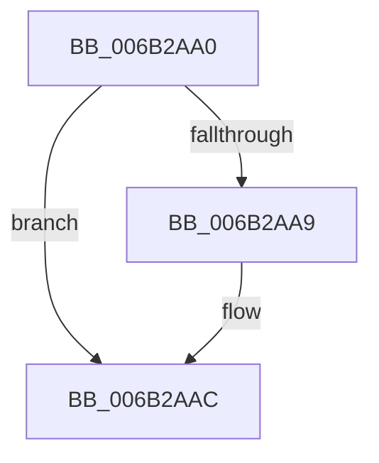

# KiStartSystemThread

- RVA: `0x006B2AA0`–`0x006B2AE2` (길이 `66` bytes)
- VA: `0x00000001406B2AA0`
- 실행 섹션: `.text`
- PDB 이름 있음: `예`; PDB Function 태그: `아니요`
- unwind 정보 RVA: `0x000C1A50`
- 디코드: `14`개 명령, `66/66` bytes 표시
- 미해석 바이트: `0` (있으면 어셈블리에 `.byte`로 보존)

> 이 문서는 커널 이미지의 기계어와 PDB 기호를 분석해 생성했습니다. 4번과 5번은 함수 원형과 자료형을 바이너리 사용 방식에서 추정한 C 해석이며 원본 소스 복구 결과는 아닙니다.

## 1. Dependencies

- 직접 호출 지점: **2**; 고유 호출 대상: **2**
- 직접 호출자로 확인된 함수: **0**
- RIP 상대 이미지 참조: **1**

### Outgoing calls
- `0x006B2ACF` → [guard_dispatch_icall](guard_dispatch_icall_function_006BAAD0.md) (function, `0x006BAAD0`)
- `0x006B2ADB` → [KeBugCheck](../4F/KeBugCheck_function_004FD640.md) (function, `0x004FD640`)

### Direct callers
- 이 함수 시작 RVA로 연결되는 직접 call은 확인되지 않았습니다. 간접 호출은 완전히 역산할 수 없습니다.

### Static image references
- `0x006B2AA0` → RVA `0x00FC6BF0` (`ALMOSTRO`; read)

## 2. Other-region calls and transfers

- 다른 실행 섹션으로 향하는 call: **0**
- 별도 외부 분기/꼬리 이동을 확인하지 못했습니다.

## 3. Assembly (complete function range)

```asm
006B2AA0  F6 05 49 41 91 00 FF            test byte ptr [rip + 0x914149], 0xff
006B2AA7  74 03                           je 0x1406b2aac
006B2AA9  0F 01 CB                        stac
006B2AAC  65 48 8B 0C 25 88 01 00 00      mov rcx, qword ptr gs:[0x188]
006B2AB5  48 0F B6 89 86 01 00 00         movzx rcx, byte ptr [rcx + 0x186]
006B2ABD  44 0F 22 C1                     mov cr8, rcx
006B2AC1  48 8B 14 24                     mov rdx, qword ptr [rsp]
006B2AC5  48 8B 4C 24 08                  mov rcx, qword ptr [rsp + 8]
006B2ACA  48 8B 44 24 10                  mov rax, qword ptr [rsp + 0x10]
006B2ACF  E8 FC 7F 00 00                  call 0x1406baad0
006B2AD4  48 C7 C1 0E 00 00 00            mov rcx, 0xe
006B2ADB  E8 60 AB E4 FF                  call 0x1404fd640
006B2AE0  90                              nop
006B2AE1  C3                              ret
```

## 4. C-style interpretation (structured pseudocode)

```c
__int64 __fastcall KiStartSystemThread(void)
{
    __int64 result;
    unsigned __int64 v_stack_p0;
    unsigned __int64 v_stack_p10;
    unsigned __int64 v_stack_p8;

    if (((*(unsigned __int8 *)(v_rip + 9519433)) & (255)) != 0) {
    }
    result = guard_dispatch_icall(v_stack_p8, v_stack_p0, a3, a4);
    result = KeBugCheck(14, v_stack_p0, a3, a4);
    return result;
}
```

## 5. (Beta) C Style

```c
void KiStartSystemThread(void)
{
    int64_t result;
    uint64_t v_stack_p0;
    uint64_t v_stack_p10;
    uint64_t v_stack_p8;

    if (((*(uint8_t *)(v_rip + 0x914149)) & (255)) != 0) {
    }
    result = guard_dispatch_icall(v_stack_p8, v_stack_p0, a3, a4);
    result = KeBugCheck(14, v_stack_p0, a3, a4);
    return result;
}
```

## 6. Execution-region graph

[열기: 2D/3D 그래프와 함수 탐색 컨트롤 패널](../../../control-panel.html?section=text&rva=0x006B2AA0&view=graph)

- 2D 그래프는 위에서 아래로 흐르고, 3D 그래프는 빈 공간을 드래그해 회전합니다. Shift+드래그는 이동, 휠은 확대·축소, 함수 노드 선택은 대상 보고서 이동입니다.

### Static fallback


