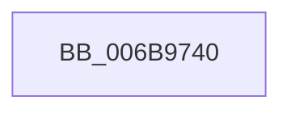

# KiSwapContext

- RVA: `0x006B9740`–`0x006B9816` (길이 `214` bytes)
- VA: `0x00000001406B9740`
- 실행 섹션: `.text`
- PDB 이름 있음: `예`; PDB Function 태그: `아니요`
- unwind 정보 RVA: `0x000C2348`
- 디코드: `44`개 명령, `214/214` bytes 표시
- 미해석 바이트: `0` (있으면 어셈블리에 `.byte`로 보존)

> 이 문서는 커널 이미지의 기계어와 PDB 기호를 분석해 생성했습니다. 4번과 5번은 함수 원형과 자료형을 바이너리 사용 방식에서 추정한 C 해석이며 원본 소스 복구 결과는 아닙니다.

## 1. Dependencies

- 직접 호출 지점: **1**; 고유 호출 대상: **1**
- 직접 호출자로 확인된 함수: **8**
- RIP 상대 이미지 참조: **0**

### Outgoing calls
- `0x006B97B1` → [SwapContext](SwapContext_function_006B9820.md) (function, `0x006B9820`)

### Direct callers
- [KiHandleDeferredPreemption](../20/KiHandleDeferredPreemption_function_00202ECC.md) at `0x00203163`
- [KeYieldExecution](../20/KeYieldExecution_function_00209FA0.md) at `0x0020A1BF`
- [sub_0021B896](../21/Unknown_function_0021B896.md) at `0x0021B961`
- [sub_0021C5F2](../21/Unknown_function_0021C5F2.md) at `0x0021C666`
- [KiCheckForThreadDispatch](../25/KiCheckForThreadDispatch_function_00250648.md) at `0x00250756`
- [sub_00251E24](../25/Unknown_function_00251E24.md) at `0x00251E9C`
- [KiSwapThread](../35/KiSwapThread_function_00355640.md) at `0x00355883`
- [KiSwapThread](../35/KiSwapThread_function_00355640.md) at `0x00355B33`
- [KiExecuteSmtIsolationThread](../5C/KiExecuteSmtIsolationThread_function_005C4070.md) at `0x005C415E`

### Static image references
- 디코드된 RIP-relative 메모리 참조가 없습니다.

## 2. Other-region calls and transfers

- 다른 실행 섹션으로 향하는 call: **0**
- 별도 외부 분기/꼬리 이동을 확인하지 못했습니다.

## 3. Assembly (complete function range)

```asm
006B9740  48 81 EC 38 01 00 00            sub rsp, 0x138
006B9747  48 8D 84 24 00 01 00 00         lea rax, [rsp + 0x100]
006B974F  0F 29 74 24 30                  movaps xmmword ptr [rsp + 0x30], xmm6
006B9754  0F 29 7C 24 40                  movaps xmmword ptr [rsp + 0x40], xmm7
006B9759  44 0F 29 44 24 50               movaps xmmword ptr [rsp + 0x50], xmm8
006B975F  44 0F 29 4C 24 60               movaps xmmword ptr [rsp + 0x60], xmm9
006B9765  44 0F 29 54 24 70               movaps xmmword ptr [rsp + 0x70], xmm10
006B976B  44 0F 29 58 80                  movaps xmmword ptr [rax - 0x80], xmm11
006B9770  44 0F 29 60 90                  movaps xmmword ptr [rax - 0x70], xmm12
006B9775  44 0F 29 68 A0                  movaps xmmword ptr [rax - 0x60], xmm13
006B977A  44 0F 29 70 B0                  movaps xmmword ptr [rax - 0x50], xmm14
006B977F  44 0F 29 78 C0                  movaps xmmword ptr [rax - 0x40], xmm15
006B9784  48 89 18                        mov qword ptr [rax], rbx
006B9787  48 89 78 08                     mov qword ptr [rax + 8], rdi
006B978B  48 89 70 10                     mov qword ptr [rax + 0x10], rsi
006B978F  4C 89 60 18                     mov qword ptr [rax + 0x18], r12
006B9793  4C 89 68 20                     mov qword ptr [rax + 0x20], r13
006B9797  4C 89 70 28                     mov qword ptr [rax + 0x28], r14
006B979B  4C 89 78 30                     mov qword ptr [rax + 0x30], r15
006B979F  65 48 8B 1C 25 20 00 00 00      mov rbx, qword ptr gs:[0x20]
006B97A8  48 8B F9                        mov rdi, rcx
006B97AB  48 8B F2                        mov rsi, rdx
006B97AE  41 8B C8                        mov ecx, r8d
006B97B1  E8 6A 00 00 00                  call 0x1406b9820
006B97B6  48 8D 8C 24 00 01 00 00         lea rcx, [rsp + 0x100]
006B97BE  0F 28 74 24 30                  movaps xmm6, xmmword ptr [rsp + 0x30]
006B97C3  0F 28 7C 24 40                  movaps xmm7, xmmword ptr [rsp + 0x40]
006B97C8  44 0F 28 44 24 50               movaps xmm8, xmmword ptr [rsp + 0x50]
006B97CE  44 0F 28 4C 24 60               movaps xmm9, xmmword ptr [rsp + 0x60]
006B97D4  44 0F 28 54 24 70               movaps xmm10, xmmword ptr [rsp + 0x70]
006B97DA  44 0F 28 59 80                  movaps xmm11, xmmword ptr [rcx - 0x80]
006B97DF  44 0F 28 61 90                  movaps xmm12, xmmword ptr [rcx - 0x70]
006B97E4  44 0F 28 69 A0                  movaps xmm13, xmmword ptr [rcx - 0x60]
006B97E9  44 0F 28 71 B0                  movaps xmm14, xmmword ptr [rcx - 0x50]
006B97EE  44 0F 28 79 C0                  movaps xmm15, xmmword ptr [rcx - 0x40]
006B97F3  48 8B 19                        mov rbx, qword ptr [rcx]
006B97F6  48 8B 79 08                     mov rdi, qword ptr [rcx + 8]
006B97FA  48 8B 71 10                     mov rsi, qword ptr [rcx + 0x10]
006B97FE  4C 8B 61 18                     mov r12, qword ptr [rcx + 0x18]
006B9802  4C 8B 69 20                     mov r13, qword ptr [rcx + 0x20]
006B9806  4C 8B 71 28                     mov r14, qword ptr [rcx + 0x28]
006B980A  4C 8B 79 30                     mov r15, qword ptr [rcx + 0x30]
006B980E  48 81 C4 38 01 00 00            add rsp, 0x138
006B9815  C3                              ret
```

## 4. C-style interpretation (structured pseudocode)

```c
__int64 __fastcall KiSwapContext(__int64 a1, __int64 a2, int a3)
{
    __int64 result;
    __int64 v_rsp;
    unsigned __int64 v_stack_m108;
    unsigned __int64 v_stack_m38;
    unsigned __int64 v_stack_mC8;
    unsigned __int64 v_stack_mD8;
    unsigned __int64 v_stack_mE8;
    unsigned __int64 v_stack_mF8;

    v_rsp = (v_rsp) - (312);
    v_stack_m108 = v_xmm6;
    v_stack_mF8 = v_xmm7;
    v_stack_mE8 = v_xmm8;
    v_stack_mD8 = v_xmm9;
    v_stack_mC8 = v_xmm10;
    *(unsigned __int64 *)(v_stack_m38 - 128) = v_xmm11;
    *(unsigned __int64 *)(v_stack_m38 - 112) = v_xmm12;
    *(unsigned __int64 *)(v_stack_m38 - 96) = v_xmm13;
    *(unsigned __int64 *)(v_stack_m38 - 80) = v_xmm14;
    *(unsigned __int64 *)(v_stack_m38 - 64) = v_xmm15;
    *(unsigned __int64 *)(v_stack_m38) = v_rbx;
    *(unsigned __int64 *)(v_stack_m38 + 8) = v_rdi;
    *(unsigned __int64 *)(v_stack_m38 + 16) = v_rsi;
    *(unsigned __int64 *)(v_stack_m38 + 24) = v_r12;
    *(unsigned __int64 *)(v_stack_m38 + 32) = v_r13;
    *(unsigned __int64 *)(v_stack_m38 + 40) = v_r14;
    *(unsigned __int64 *)(v_stack_m38 + 48) = v_r15;
    result = SwapContext((unsigned int)(a3), a2, a3, a4);
    v_rsp = (v_rsp) + (312);
    return result;
}
```

## 5. (Beta) C Style

```c
int64_t KiSwapContext(int64_t Arg1, int64_t Arg2, int32_t Arg3)
{
    int64_t result;
    int64_t local_rsp;
    uint64_t v_stack_m108;
    uint64_t v_stack_m38;
    uint64_t v_stack_mC8;
    uint64_t v_stack_mD8;
    uint64_t v_stack_mE8;
    uint64_t v_stack_mF8;

    local_rsp = (local_rsp) - (312);
    v_stack_m108 = v_xmm6;
    v_stack_mF8 = v_xmm7;
    v_stack_mE8 = v_xmm8;
    v_stack_mD8 = v_xmm9;
    v_stack_mC8 = v_xmm10;
    *(uint64_t *)(v_stack_m38 - 0x80) = v_xmm11;
    *(uint64_t *)(v_stack_m38 - 0x70) = v_xmm12;
    *(uint64_t *)(v_stack_m38 - 0x60) = v_xmm13;
    *(uint64_t *)(v_stack_m38 - 0x50) = v_xmm14;
    *(uint64_t *)(v_stack_m38 - 0x40) = v_xmm15;
    *(uint64_t *)(v_stack_m38) = local_rbx;
    *(uint64_t *)(v_stack_m38 + 0x8) = local_rdi;
    *(uint64_t *)(v_stack_m38 + 0x10) = local_rsi;
    *(uint64_t *)(v_stack_m38 + 0x18) = local_r12;
    *(uint64_t *)(v_stack_m38 + 0x20) = local_r13;
    *(uint64_t *)(v_stack_m38 + 0x28) = local_r14;
    *(uint64_t *)(v_stack_m38 + 0x30) = local_r15;
    result = SwapContext((uint32_t)(Arg3), Arg2, Arg3, a4);
    local_rsp = (local_rsp) + (312);
    return result;
}
```

## 6. Execution-region graph

[열기: 2D/3D 그래프와 함수 탐색 컨트롤 패널](../../../control-panel.html?section=text&rva=0x006B9740&view=graph)

- 2D 그래프는 위에서 아래로 흐르고, 3D 그래프는 빈 공간을 드래그해 회전합니다. Shift+드래그는 이동, 휠은 확대·축소, 함수 노드 선택은 대상 보고서 이동입니다.

### Static fallback


