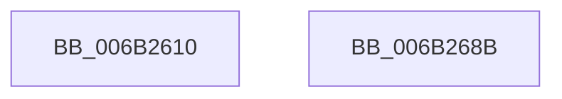

# KiSwitchKernelStackAndCallout

- RVA: `0x006B2610`–`0x006B2690` (길이 `128` bytes)
- VA: `0x00000001406B2610`
- 실행 섹션: `.text`
- PDB 이름 있음: `예`; PDB Function 태그: `아니요`
- unwind 정보 RVA: `0x000C17C0`
- 디코드: `34`개 명령, `128/128` bytes 표시
- 미해석 바이트: `0` (있으면 어셈블리에 `.byte`로 보존)

> 이 문서는 커널 이미지의 기계어와 PDB 기호를 분석해 생성했습니다. 4번과 5번은 함수 원형과 자료형을 바이너리 사용 방식에서 추정한 C 해석이며 원본 소스 복구 결과는 아닙니다.

## 1. Dependencies

- 직접 호출 지점: **0**; 고유 호출 대상: **0**
- 직접 호출자로 확인된 함수: **2**
- RIP 상대 이미지 참조: **4**

### Outgoing calls
- 직접 디코드된 call 명령이 없습니다.

### Direct callers
- [sub_002F8911](../2F/Unknown_function_002F8911.md) at `0x002F8AF5`
- [sub_002F8BF2](../2F/Unknown_function_002F8BF2.md) at `0x002F8C9F`

### Static image references
- `0x006B2633` → RVA `0x006B268B` (`KiSwitchKernelStackContinue`; read)
- `0x006B2661` → RVA `0x00FC5088` (`ALMOSTRO`; read)
- `0x006B2667` → RVA `0x00FC51B4` (`ALMOSTRO`; read)
- `0x006B2677` → RVA `0x00FC5020` (`ALMOSTRO`; read)

## 2. Other-region calls and transfers

- 다른 실행 섹션으로 향하는 call: **0**
- call이 아닌 외부 분기/꼬리 이동: **1**
  - `0x006B2689` → [KxSwitchKernelStackCallout](KxSwitchKernelStackCallout_function_006B26A0.md) (`tail-transfer`)

## 3. Assembly (complete function range)

```asm
006B2610  48 56                           push rsi
006B2612  57                              push rdi
006B2613  53                              push rbx
006B2614  49 8B D8                        mov rbx, r8
006B2617  49 83 E0 FC                     and r8, 0xfffffffffffffffc
006B261B  65 48 8B 34 25 88 01 00 00      mov rsi, qword ptr gs:[0x188]
006B2624  4D 8D 50 50                     lea r10, [r8 + 0x50]
006B2628  48 8B FC                        mov rdi, rsp
006B262B  49 89 78 20                     mov qword ptr [r8 + 0x20], rdi
006B262F  4D 8D 58 B0                     lea r11, [r8 - 0x50]
006B2633  48 8D 05 51 00 00 00            lea rax, [rip + 0x51]
006B263A  49 89 43 28                     mov qword ptr [r11 + 0x28], rax
006B263E  49 89 7B 40                     mov qword ptr [r11 + 0x40], rdi
006B2642  FA                              cli
006B2643  48 8B 46 30                     mov rax, qword ptr [rsi + 0x30]
006B2647  49 89 40 18                     mov qword ptr [r8 + 0x18], rax
006B264B  4C 89 46 28                     mov qword ptr [rsi + 0x28], r8
006B264F  65 4C 89 04 25 A8 01 00 00      mov qword ptr gs:[0x1a8], r8
006B2658  4C 89 56 38                     mov qword ptr [rsi + 0x38], r10
006B265C  48 0F BA E3 01                  bt rbx, 1
006B2661  8B 05 21 2A 91 00               mov eax, dword ptr [rip + 0x912a21]
006B2667  44 8B 05 46 2B 91 00            mov r8d, dword ptr [rip + 0x912b46]
006B266E  4C 0F 42 C0                     cmovb r8, rax
006B2672  48 0F BA E3 00                  bt rbx, 0
006B2677  44 0F 43 05 A1 29 91 00         cmovae r8d, dword ptr [rip + 0x9129a1]
006B267F  4D 2B D0                        sub r10, r8
006B2682  4C 89 56 30                     mov qword ptr [rsi + 0x30], r10
006B2686  49 8B E3                        mov rsp, r11
006B2689  EB 15                           jmp 0x1406b26a0
006B268B  FB                              sti
006B268C  5B                              pop rbx
006B268D  5F                              pop rdi
006B268E  5E                              pop rsi
006B268F  C3                              ret
```

## 4. C-style interpretation (structured pseudocode)

```c
__int64 __fastcall KiSwitchKernelStackAndCallout(__int64 a1, __int64 a2, __int64 a3)
{
    __int64 v_r10;

    a3 = (a3) & (-4);
    *(unsigned __int64 *)(a3 + 32) = v_rsp;
    *(unsigned __int64 *)(a3 - 80 + 40) = v_rip + 81;
    *(unsigned __int64 *)(a3 - 80 + 64) = v_rsp;
    *(unsigned __int64 *)(a3 + 24) = *(unsigned __int64 *)(*(unsigned __int64 *)(gs_base + (0 + 392)) + 48);
    *(unsigned __int64 *)(*(unsigned __int64 *)(gs_base + (0 + 392)) + 40) = a3;
    *(unsigned __int64 *)(gs_base + (0 + 424)) = a3;
    *(unsigned __int64 *)(*(unsigned __int64 *)(gs_base + (0 + 392)) + 56) = a3 + 80;
    a3 = (unsigned int)(*(unsigned int *)(v_rip + 9513798));
    if (condition_is_below) { a3 = (unsigned int)(*(unsigned int *)(v_rip + 9513505)); }
    if (condition_is_above_or_equal) { a3 = *(unsigned int *)(v_rip + 9513377); }
    v_r10 = (a3 + 80) - (a3);
    *(unsigned __int64 *)(*(unsigned __int64 *)(gs_base + (0 + 392)) + 48) = v_r10;
}
```

## 5. (Beta) C Style

```c
int64_t KiSwitchKernelStackAndCallout(int64_t Arg1, int64_t Arg2, void *Arg3)
{
    uint8_t *arg3 = (uint8_t *)Arg3;

    int64_t local_r10;

    Arg3 = (Arg3) & (-4);
    *(uint64_t *)(arg3 + 0x20) = local_rsp;
    *(uint64_t *)(arg3 - 0x50 + 0x28) = v_rip + 81;
    *(uint64_t *)(arg3 - 0x50 + 0x40) = local_rsp;
    *(uint64_t *)(arg3 + 0x18) = *(uint64_t *)(*(uint64_t *)(gs_base + (0 + 0x188)) + 0x30);
    *(void **)(*(uint64_t *)(gs_base + (0 + 0x188)) + 0x28) = Arg3;
    *(void **)(gs_base + (0 + 0x1A8)) = Arg3;
    *(void **)(*(uint64_t *)(gs_base + (0 + 0x188)) + 0x38) = Arg3 + 80;
    Arg3 = (uint32_t)(*(uint32_t *)(v_rip + 0x912B46));
    if (condition_is_below) { Arg3 = (uint32_t)(*(uint32_t *)(v_rip + 0x912A21)); }
    if (condition_is_above_or_equal) { Arg3 = *(uint32_t *)(v_rip + 0x9129A1); }
    local_r10 = (Arg3 + 80) - (Arg3);
    *(uint64_t *)(*(uint64_t *)(gs_base + (0 + 0x188)) + 0x30) = local_r10;
}
```

### 관측된 메모리 오프셋

구조체 형식이 확인되지 않은 접근은 인자 기준의 오프셋으로만 기록했습니다.

| 기준 인자 | 오프셋 표현 | 폭 (bit) | 접근 |
|---|---:|---:|---|
| `Arg3` | `- 0x50` | `64` | `R` |
| `Arg3` | `+ 0x18` | `64` | `W` |
| `Arg3` | `+ 0x20` | `64` | `W` |
| `Arg3` | `+ 0x28` | `64` | `W` |
| `Arg3` | `+ 0x40` | `64` | `W` |
| `Arg3` | `+ 0x50` | `64` | `R` |

## 6. Execution-region graph

[열기: 2D/3D 그래프와 함수 탐색 컨트롤 패널](../../../control-panel.html?section=text&rva=0x006B2610&view=graph)

- 2D 그래프는 위에서 아래로 흐르고, 3D 그래프는 빈 공간을 드래그해 회전합니다. Shift+드래그는 이동, 휠은 확대·축소, 함수 노드 선택은 대상 보고서 이동입니다.

### Static fallback


