# KiVmbusInterrupt0

- RVA: `0x006B6990`–`0x006B6CF1` (길이 `865` bytes)
- VA: `0x00000001406B6990`
- 실행 섹션: `.text`
- PDB 이름 있음: `예`; PDB Function 태그: `아니요`
- unwind 정보 RVA: `0x000C21E4`
- 디코드: `185`개 명령, `865/865` bytes 표시
- 미해석 바이트: `0` (있으면 어셈블리에 `.byte`로 보존)

> 이 문서는 커널 이미지의 기계어와 PDB 기호를 분석해 생성했습니다. 4번과 5번은 함수 원형과 자료형을 바이너리 사용 방식에서 추정한 C 해석이며 원본 소스 복구 결과는 아닙니다.

## 1. Dependencies

- 직접 호출 지점: **37**; 고유 호출 대상: **37**
- 직접 호출자로 확인된 함수: **1**
- RIP 상대 이미지 참조: **4**

### Outgoing calls
- `0x006B6AE5` → [KiVmbusInterrupt0 + 0x268](KiVmbusInterrupt0_function_006B6990.md) (inside-function, `0x006B6BF8`)
- `0x006B6AEE` → [KiVmbusInterrupt0 + 0x271](KiVmbusInterrupt0_function_006B6990.md) (inside-function, `0x006B6C01`)
- `0x006B6AF7` → [KiVmbusInterrupt0 + 0x15A](KiVmbusInterrupt0_function_006B6990.md) (inside-function, `0x006B6AEA`)
- `0x006B6B00` → [KiVmbusInterrupt0 + 0x163](KiVmbusInterrupt0_function_006B6990.md) (inside-function, `0x006B6AF3`)
- `0x006B6B09` → [KiVmbusInterrupt0 + 0x16C](KiVmbusInterrupt0_function_006B6990.md) (inside-function, `0x006B6AFC`)
- `0x006B6B12` → [KiVmbusInterrupt0 + 0x175](KiVmbusInterrupt0_function_006B6990.md) (inside-function, `0x006B6B05`)
- `0x006B6B1B` → [KiVmbusInterrupt0 + 0x17E](KiVmbusInterrupt0_function_006B6990.md) (inside-function, `0x006B6B0E`)
- `0x006B6B24` → [KiVmbusInterrupt0 + 0x187](KiVmbusInterrupt0_function_006B6990.md) (inside-function, `0x006B6B17`)
- `0x006B6B2D` → [KiVmbusInterrupt0 + 0x190](KiVmbusInterrupt0_function_006B6990.md) (inside-function, `0x006B6B20`)
- `0x006B6B36` → [KiVmbusInterrupt0 + 0x199](KiVmbusInterrupt0_function_006B6990.md) (inside-function, `0x006B6B29`)
- `0x006B6B3F` → [KiVmbusInterrupt0 + 0x1A2](KiVmbusInterrupt0_function_006B6990.md) (inside-function, `0x006B6B32`)
- `0x006B6B48` → [KiVmbusInterrupt0 + 0x1AB](KiVmbusInterrupt0_function_006B6990.md) (inside-function, `0x006B6B3B`)
- `0x006B6B51` → [KiVmbusInterrupt0 + 0x1B4](KiVmbusInterrupt0_function_006B6990.md) (inside-function, `0x006B6B44`)
- `0x006B6B5A` → [KiVmbusInterrupt0 + 0x1BD](KiVmbusInterrupt0_function_006B6990.md) (inside-function, `0x006B6B4D`)
- `0x006B6B63` → [KiVmbusInterrupt0 + 0x1C6](KiVmbusInterrupt0_function_006B6990.md) (inside-function, `0x006B6B56`)
- `0x006B6B6C` → [KiVmbusInterrupt0 + 0x1CF](KiVmbusInterrupt0_function_006B6990.md) (inside-function, `0x006B6B5F`)
- `0x006B6B75` → [KiVmbusInterrupt0 + 0x1D8](KiVmbusInterrupt0_function_006B6990.md) (inside-function, `0x006B6B68`)
- `0x006B6B7E` → [KiVmbusInterrupt0 + 0x1E1](KiVmbusInterrupt0_function_006B6990.md) (inside-function, `0x006B6B71`)
- `0x006B6B87` → [KiVmbusInterrupt0 + 0x1EA](KiVmbusInterrupt0_function_006B6990.md) (inside-function, `0x006B6B7A`)
- `0x006B6B90` → [KiVmbusInterrupt0 + 0x1F3](KiVmbusInterrupt0_function_006B6990.md) (inside-function, `0x006B6B83`)
- `0x006B6B99` → [KiVmbusInterrupt0 + 0x1FC](KiVmbusInterrupt0_function_006B6990.md) (inside-function, `0x006B6B8C`)
- `0x006B6BA2` → [KiVmbusInterrupt0 + 0x205](KiVmbusInterrupt0_function_006B6990.md) (inside-function, `0x006B6B95`)
- `0x006B6BAB` → [KiVmbusInterrupt0 + 0x20E](KiVmbusInterrupt0_function_006B6990.md) (inside-function, `0x006B6B9E`)
- `0x006B6BB4` → [KiVmbusInterrupt0 + 0x217](KiVmbusInterrupt0_function_006B6990.md) (inside-function, `0x006B6BA7`)
- `0x006B6BBD` → [KiVmbusInterrupt0 + 0x220](KiVmbusInterrupt0_function_006B6990.md) (inside-function, `0x006B6BB0`)
- `0x006B6BC6` → [KiVmbusInterrupt0 + 0x229](KiVmbusInterrupt0_function_006B6990.md) (inside-function, `0x006B6BB9`)
- `0x006B6BCF` → [KiVmbusInterrupt0 + 0x232](KiVmbusInterrupt0_function_006B6990.md) (inside-function, `0x006B6BC2`)
- `0x006B6BD8` → [KiVmbusInterrupt0 + 0x23B](KiVmbusInterrupt0_function_006B6990.md) (inside-function, `0x006B6BCB`)
- `0x006B6BE1` → [KiVmbusInterrupt0 + 0x244](KiVmbusInterrupt0_function_006B6990.md) (inside-function, `0x006B6BD4`)
- `0x006B6BEA` → [KiVmbusInterrupt0 + 0x24D](KiVmbusInterrupt0_function_006B6990.md) (inside-function, `0x006B6BDD`)
- `0x006B6BF3` → [KiVmbusInterrupt0 + 0x256](KiVmbusInterrupt0_function_006B6990.md) (inside-function, `0x006B6BE6`)
- `0x006B6BFC` → [KiVmbusInterrupt0 + 0x25F](KiVmbusInterrupt0_function_006B6990.md) (inside-function, `0x006B6BEF`)
- `0x006B6C27` → [KiFlushBhbDuringTrapEntryOrExit](../6C/KiFlushBhbDuringTrapEntryOrExit_function_006C6340.md) (function, `0x006C6340`)
- `0x006B6C70` → [KiSaveDebugRegisterState](../4F/KiSaveDebugRegisterState_function_004FD960.md) (function, `0x004FD960`)
- `0x006B6CA4` → [KiSynchronizeUserIsolationDomainExit](../41/KiSynchronizeUserIsolationDomainExit_function_0041BFA0.md) (function, `0x0041BFA0`)
- `0x006B6CB4` → [KeWakeProcessor](../5B/KeWakeProcessor_function_005BE080.md) (function, `0x005BE080`)
- `0x006B6CDD` → [KiCheckForSListAddress](../40/KiCheckForSListAddress_function_0040B810.md) (function, `0x0040B810`)

### Direct callers
- [KiVmbusInterrupt0](KiVmbusInterrupt0_function_006B6990.md) at `0x006B6AE5`
- [KiVmbusInterrupt0](KiVmbusInterrupt0_function_006B6990.md) at `0x006B6AEE`
- [KiVmbusInterrupt0](KiVmbusInterrupt0_function_006B6990.md) at `0x006B6AF7`
- [KiVmbusInterrupt0](KiVmbusInterrupt0_function_006B6990.md) at `0x006B6B00`
- [KiVmbusInterrupt0](KiVmbusInterrupt0_function_006B6990.md) at `0x006B6B09`
- [KiVmbusInterrupt0](KiVmbusInterrupt0_function_006B6990.md) at `0x006B6B12`
- [KiVmbusInterrupt0](KiVmbusInterrupt0_function_006B6990.md) at `0x006B6B1B`
- [KiVmbusInterrupt0](KiVmbusInterrupt0_function_006B6990.md) at `0x006B6B24`
- [KiVmbusInterrupt0](KiVmbusInterrupt0_function_006B6990.md) at `0x006B6B2D`
- [KiVmbusInterrupt0](KiVmbusInterrupt0_function_006B6990.md) at `0x006B6B36`
- [KiVmbusInterrupt0](KiVmbusInterrupt0_function_006B6990.md) at `0x006B6B3F`
- [KiVmbusInterrupt0](KiVmbusInterrupt0_function_006B6990.md) at `0x006B6B48`
- [KiVmbusInterrupt0](KiVmbusInterrupt0_function_006B6990.md) at `0x006B6B51`
- [KiVmbusInterrupt0](KiVmbusInterrupt0_function_006B6990.md) at `0x006B6B5A`
- [KiVmbusInterrupt0](KiVmbusInterrupt0_function_006B6990.md) at `0x006B6B63`
- [KiVmbusInterrupt0](KiVmbusInterrupt0_function_006B6990.md) at `0x006B6B6C`
- [KiVmbusInterrupt0](KiVmbusInterrupt0_function_006B6990.md) at `0x006B6B75`
- [KiVmbusInterrupt0](KiVmbusInterrupt0_function_006B6990.md) at `0x006B6B7E`
- [KiVmbusInterrupt0](KiVmbusInterrupt0_function_006B6990.md) at `0x006B6B87`
- [KiVmbusInterrupt0](KiVmbusInterrupt0_function_006B6990.md) at `0x006B6B90`
- [KiVmbusInterrupt0](KiVmbusInterrupt0_function_006B6990.md) at `0x006B6B99`
- [KiVmbusInterrupt0](KiVmbusInterrupt0_function_006B6990.md) at `0x006B6BA2`
- [KiVmbusInterrupt0](KiVmbusInterrupt0_function_006B6990.md) at `0x006B6BAB`
- [KiVmbusInterrupt0](KiVmbusInterrupt0_function_006B6990.md) at `0x006B6BB4`
- [KiVmbusInterrupt0](KiVmbusInterrupt0_function_006B6990.md) at `0x006B6BBD`
- [KiVmbusInterrupt0](KiVmbusInterrupt0_function_006B6990.md) at `0x006B6BC6`
- [KiVmbusInterrupt0](KiVmbusInterrupt0_function_006B6990.md) at `0x006B6BCF`
- [KiVmbusInterrupt0](KiVmbusInterrupt0_function_006B6990.md) at `0x006B6BD8`
- [KiVmbusInterrupt0](KiVmbusInterrupt0_function_006B6990.md) at `0x006B6BE1`
- [KiVmbusInterrupt0](KiVmbusInterrupt0_function_006B6990.md) at `0x006B6BEA`
- [KiVmbusInterrupt0](KiVmbusInterrupt0_function_006B6990.md) at `0x006B6BF3`
- [KiVmbusInterrupt0](KiVmbusInterrupt0_function_006B6990.md) at `0x006B6BFC`

### Static image references
- `0x006B6A04` → RVA `0x01201840` (`CFGRO`; read)
- `0x006B6C38` → RVA `0x00FC7264` (`ALMOSTRO`; read)
- `0x006B6CB9` → RVA `0x006BA577` (`ExpInterlockedPopEntrySListResume`; read)
- `0x006B6CC9` → RVA `0x006BA590` (`ExpInterlockedPopEntrySListEnd`; read)

## 2. Other-region calls and transfers

- 다른 실행 섹션으로 향하는 call: **0**
- call이 아닌 외부 분기/꼬리 이동: **1**
  - `0x006B6CEC` → [KiVmbusInterruptDispatch](KiVmbusInterruptDispatch_function_006B7B40.md) (`tail-transfer`)

## 3. Assembly (complete function range)

```asm
006B6990  6A 01                           push 1
006B6992  55                              push rbp
006B6993  56                              push rsi
006B6994  48 81 EC 50 01 00 00            sub rsp, 0x150
006B699B  48 8D AC 24 80 00 00 00         lea rbp, [rsp + 0x80]
006B69A3  C6 45 AB 00                     mov byte ptr [rbp - 0x55], 0
006B69A7  48 89 45 B0                     mov qword ptr [rbp - 0x50], rax
006B69AB  48 89 4D B8                     mov qword ptr [rbp - 0x48], rcx
006B69AF  48 89 55 C0                     mov qword ptr [rbp - 0x40], rdx
006B69B3  4C 89 45 C8                     mov qword ptr [rbp - 0x38], r8
006B69B7  4C 89 4D D0                     mov qword ptr [rbp - 0x30], r9
006B69BB  4C 89 55 D8                     mov qword ptr [rbp - 0x28], r10
006B69BF  4C 89 5D E0                     mov qword ptr [rbp - 0x20], r11
006B69C3  F6 85 F0 00 00 00 01            test byte ptr [rbp + 0xf0], 1
006B69CA  75 38                           jne 0x1406b6a04
006B69CC  33 D2                           xor edx, edx
006B69CE  F3 48 0F 1E CA                  rdsspq rdx
006B69D3  48 89 55 58                     mov qword ptr [rbp + 0x58], rdx
006B69D7  0F AE E8                        lfence
006B69DA  65 F6 04 25 58 08 00 00 01      test byte ptr gs:[0x858], 1
006B69E3  75 08                           jne 0x1406b69ed
006B69E5  0F AE E8                        lfence
006B69E8  E9 88 02 00 00                  jmp 0x1406b6c75
006B69ED  65 0F B7 04 25 66 08 00 00      movzx eax, word ptr gs:[0x866]
006B69F6  B9 48 00 00 00                  mov ecx, 0x48
006B69FB  33 D2                           xor edx, edx
006B69FD  0F 30                           wrmsr
006B69FF  E9 71 02 00 00                  jmp 0x1406b6c75
006B6A04  F6 05 35 AE B4 00 01            test byte ptr [rip + 0xb4ae35], 1
006B6A0B  75 03                           jne 0x1406b6a10
006B6A0D  0F 01 F8                        swapgs
006B6A10  0F AE E8                        lfence
006B6A13  65 48 8B 0C 25 28 9D 00 00      mov rcx, qword ptr gs:[0x9d28]
006B6A1C  48 85 C9                        test rcx, rcx
006B6A1F  74 1F                           je 0x1406b6a40
006B6A21  F3 48 0F 1E CA                  rdsspq rdx
006B6A26  65 4C 8B 14 25 20 9D 00 00      mov r10, qword ptr gs:[0x9d20]
006B6A2F  49 83 C2 08                     add r10, 8
006B6A33  49 3B D2                        cmp rdx, r10
006B6A36  75 08                           jne 0x1406b6a40
006B6A38  F3 0F 01 29                     rstorssp dword ptr [rcx]
006B6A3C  F3 0F 01 EA                     saveprevssp
006B6A40  65 4C 8B 14 25 88 01 00 00      mov r10, qword ptr gs:[0x188]
006B6A49  65 48 8B 0C 25 88 01 00 00      mov rcx, qword ptr gs:[0x188]
006B6A52  48 8B 89 20 02 00 00            mov rcx, qword ptr [rcx + 0x220]
006B6A59  48 8B 89 60 07 00 00            mov rcx, qword ptr [rcx + 0x760]
006B6A60  65 48 89 0C 25 50 08 00 00      mov qword ptr gs:[0x850], rcx
006B6A69  66 65 8B 0C 25 62 08 00 00      mov cx, word ptr gs:[0x862]
006B6A72  66 65 89 0C 25 64 08 00 00      mov word ptr gs:[0x864], cx
006B6A7B  65 8A 0C 25 58 08 00 00         mov cl, byte ptr gs:[0x858]
006B6A83  65 88 0C 25 5A 08 00 00         mov byte ptr gs:[0x85a], cl
006B6A8B  65 0F B7 04 25 68 08 00 00      movzx eax, word ptr gs:[0x868]
006B6A94  66 65 39 04 25 66 08 00 00      cmp word ptr gs:[0x866], ax
006B6A9D  74 12                           je 0x1406b6ab1
006B6A9F  66 65 89 04 25 66 08 00 00      mov word ptr gs:[0x866], ax
006B6AA8  B9 48 00 00 00                  mov ecx, 0x48
006B6AAD  33 D2                           xor edx, edx
006B6AAF  0F 30                           wrmsr
006B6AB1  65 0F B6 14 25 58 08 00 00      movzx edx, byte ptr gs:[0x858]
006B6ABA  F7 C2 08 00 00 00               test edx, 8
006B6AC0  74 17                           je 0x1406b6ad9
006B6AC2  B8 01 00 00 00                  mov eax, 1
006B6AC7  33 D2                           xor edx, edx
006B6AC9  B9 49 00 00 00                  mov ecx, 0x49
006B6ACE  0F 30                           wrmsr
006B6AD0  65 0F B6 14 25 58 08 00 00      movzx edx, byte ptr gs:[0x858]
006B6AD9  F7 C2 02 00 00 00               test edx, 2
006B6ADF  0F 84 37 01 00 00               je 0x1406b6c1c
006B6AE5  E8 0E 01 00 00                  call 0x1406b6bf8
006B6AEA  48 83 C4 08                     add rsp, 8
006B6AEE  E8 0E 01 00 00                  call 0x1406b6c01
006B6AF3  48 83 C4 08                     add rsp, 8
006B6AF7  E8 EE FF FF FF                  call 0x1406b6aea
006B6AFC  48 83 C4 08                     add rsp, 8
006B6B00  E8 EE FF FF FF                  call 0x1406b6af3
006B6B05  48 83 C4 08                     add rsp, 8
006B6B09  E8 EE FF FF FF                  call 0x1406b6afc
006B6B0E  48 83 C4 08                     add rsp, 8
006B6B12  E8 EE FF FF FF                  call 0x1406b6b05
006B6B17  48 83 C4 08                     add rsp, 8
006B6B1B  E8 EE FF FF FF                  call 0x1406b6b0e
006B6B20  48 83 C4 08                     add rsp, 8
006B6B24  E8 EE FF FF FF                  call 0x1406b6b17
006B6B29  48 83 C4 08                     add rsp, 8
006B6B2D  E8 EE FF FF FF                  call 0x1406b6b20
006B6B32  48 83 C4 08                     add rsp, 8
006B6B36  E8 EE FF FF FF                  call 0x1406b6b29
006B6B3B  48 83 C4 08                     add rsp, 8
006B6B3F  E8 EE FF FF FF                  call 0x1406b6b32
006B6B44  48 83 C4 08                     add rsp, 8
006B6B48  E8 EE FF FF FF                  call 0x1406b6b3b
006B6B4D  48 83 C4 08                     add rsp, 8
006B6B51  E8 EE FF FF FF                  call 0x1406b6b44
006B6B56  48 83 C4 08                     add rsp, 8
006B6B5A  E8 EE FF FF FF                  call 0x1406b6b4d
006B6B5F  48 83 C4 08                     add rsp, 8
006B6B63  E8 EE FF FF FF                  call 0x1406b6b56
006B6B68  48 83 C4 08                     add rsp, 8
006B6B6C  E8 EE FF FF FF                  call 0x1406b6b5f
006B6B71  48 83 C4 08                     add rsp, 8
006B6B75  E8 EE FF FF FF                  call 0x1406b6b68
006B6B7A  48 83 C4 08                     add rsp, 8
006B6B7E  E8 EE FF FF FF                  call 0x1406b6b71
006B6B83  48 83 C4 08                     add rsp, 8
006B6B87  E8 EE FF FF FF                  call 0x1406b6b7a
006B6B8C  48 83 C4 08                     add rsp, 8
006B6B90  E8 EE FF FF FF                  call 0x1406b6b83
006B6B95  48 83 C4 08                     add rsp, 8
006B6B99  E8 EE FF FF FF                  call 0x1406b6b8c
006B6B9E  48 83 C4 08                     add rsp, 8
006B6BA2  E8 EE FF FF FF                  call 0x1406b6b95
006B6BA7  48 83 C4 08                     add rsp, 8
006B6BAB  E8 EE FF FF FF                  call 0x1406b6b9e
006B6BB0  48 83 C4 08                     add rsp, 8
006B6BB4  E8 EE FF FF FF                  call 0x1406b6ba7
006B6BB9  48 83 C4 08                     add rsp, 8
006B6BBD  E8 EE FF FF FF                  call 0x1406b6bb0
006B6BC2  48 83 C4 08                     add rsp, 8
006B6BC6  E8 EE FF FF FF                  call 0x1406b6bb9
006B6BCB  48 83 C4 08                     add rsp, 8
006B6BCF  E8 EE FF FF FF                  call 0x1406b6bc2
006B6BD4  48 83 C4 08                     add rsp, 8
006B6BD8  E8 EE FF FF FF                  call 0x1406b6bcb
006B6BDD  48 83 C4 08                     add rsp, 8
006B6BE1  E8 EE FF FF FF                  call 0x1406b6bd4
006B6BE6  48 83 C4 08                     add rsp, 8
006B6BEA  E8 EE FF FF FF                  call 0x1406b6bdd
006B6BEF  48 83 C4 08                     add rsp, 8
006B6BF3  E8 EE FF FF FF                  call 0x1406b6be6
006B6BF8  48 83 C4 08                     add rsp, 8
006B6BFC  E8 EE FF FF FF                  call 0x1406b6bef
006B6C01  48 83 C4 08                     add rsp, 8
006B6C05  B8 DA DA 00 00                  mov eax, 0xdada
006B6C0A  65 F6 04 25 5C 08 00 00 08      test byte ptr gs:[0x85c], 8
006B6C13  74 07                           je 0x1406b6c1c
006B6C15  B0 20                           mov al, 0x20
006B6C17  F3 48 0F AE E8                  incsspq rax
006B6C1C  F7 C2 80 00 00 00               test edx, 0x80
006B6C22  74 08                           je 0x1406b6c2c
006B6C24  0F AE E8                        lfence
006B6C27  E8 14 F7 00 00                  call 0x1406c6340
006B6C2C  0F AE E8                        lfence
006B6C2F  65 C6 04 25 5E 08 00 00 00      mov byte ptr gs:[0x85e], 0
006B6C38  83 3D 25 06 91 00 00            cmp dword ptr [rip + 0x910625], 0
006B6C3F  74 1F                           je 0x1406b6c60
006B6C41  B9 A7 06 00 00                  mov ecx, 0x6a7
006B6C46  0F 32                           rdmsr
006B6C48  83 FA 00                        cmp edx, 0
006B6C4B  74 13                           je 0x1406b6c60
006B6C4D  8B CA                           mov ecx, edx
006B6C4F  23 15 0F 06 91 00               and edx, dword ptr [rip + 0x91060f]
006B6C55  3B D1                           cmp edx, ecx
006B6C57  74 07                           je 0x1406b6c60
006B6C59  B9 A7 06 00 00                  mov ecx, 0x6a7
006B6C5E  0F 30                           wrmsr
006B6C60  41 F6 42 03 03                  test byte ptr [r10 + 3], 3
006B6C65  66 C7 85 80 00 00 00 00 00      mov word ptr [rbp + 0x80], 0
006B6C6E  74 05                           je 0x1406b6c75
006B6C70  E8 EB 6C E4 FF                  call 0x1404fd960
006B6C75  FC                              cld
006B6C76  0F AE 5D AC                     stmxcsr dword ptr [rbp - 0x54]
006B6C7A  65 0F AE 14 25 80 01 00 00      ldmxcsr dword ptr gs:[0x180]
006B6C83  0F 29 45 F0                     movaps xmmword ptr [rbp - 0x10], xmm0
006B6C87  0F 29 4D 00                     movaps xmmword ptr [rbp], xmm1
006B6C8B  0F 29 55 10                     movaps xmmword ptr [rbp + 0x10], xmm2
006B6C8F  0F 29 5D 20                     movaps xmmword ptr [rbp + 0x20], xmm3
006B6C93  0F 29 65 30                     movaps xmmword ptr [rbp + 0x30], xmm4
006B6C97  0F 29 6D 40                     movaps xmmword ptr [rbp + 0x40], xmm5
006B6C9B  F6 85 F0 00 00 00 01            test byte ptr [rbp + 0xf0], 1
006B6CA2  74 05                           je 0x1406b6ca9
006B6CA4  E8 F7 52 D6 FF                  call 0x14041bfa0
006B6CA9  65 80 3C 25 DA 87 00 00 00      cmp byte ptr gs:[0x87da], 0
006B6CB2  74 05                           je 0x1406b6cb9
006B6CB4  E8 C7 73 F0 FF                  call 0x1405be080
006B6CB9  48 8D 05 B7 38 00 00            lea rax, [rip + 0x38b7]
006B6CC0  48 3B 85 E8 00 00 00            cmp rax, qword ptr [rbp + 0xe8]
006B6CC7  73 19                           jae 0x1406b6ce2
006B6CC9  48 8D 05 C0 38 00 00            lea rax, [rip + 0x38c0]
006B6CD0  48 3B 85 E8 00 00 00            cmp rax, qword ptr [rbp + 0xe8]
006B6CD7  72 09                           jb 0x1406b6ce2
006B6CD9  48 8D 4D 80                     lea rcx, [rbp - 0x80]
006B6CDD  E8 2E 4B D5 FF                  call 0x14040b810
006B6CE2  33 F6                           xor esi, esi
006B6CE4  65 FF 04 25 C0 87 00 00         inc dword ptr gs:[0x87c0]
006B6CEC  E9 4F 0E 00 00                  jmp 0x1406b7b40
```

## 4. C-style interpretation (structured pseudocode)

```c
__int64 __fastcall KiVmbusInterrupt0(__int64 a1, __int64 a2, __int64 a3, __int64 a4)
{
    __int64 result;
    __int64 v_r10;
    __int64 v_rsi;
    __int64 v_rsp;
    unsigned __int64 v_stack_m108;
    unsigned __int64 v_stack_m110;
    unsigned __int64 v_stack_m118;
    unsigned __int64 v_stack_m120;
    unsigned __int64 v_stack_m128;
    unsigned __int64 v_stack_m130;
    unsigned __int64 v_stack_m138;
    unsigned int v_stack_m13C;
    unsigned __int8 v_stack_m13D;
    unsigned __int64 v_stack_m168;
    unsigned __int16 v_stack_m68;
    unsigned __int64 v_stack_m90;
    unsigned __int64 v_stack_mA8;
    unsigned __int64 v_stack_mB8;
    unsigned __int64 v_stack_mC8;
    unsigned __int64 v_stack_mD8;
    unsigned __int64 v_stack_mE8;
    unsigned __int64 v_stack_mF8;
    unsigned __int64 v_stack_p0;
    unsigned __int8 v_stack_p8;

    v_rsp = (v_rsp) - (336);
    v_stack_m13D = 0;
    v_stack_m138 = result;
    v_stack_m130 = a1;
    v_stack_m128 = a2;
    v_stack_m120 = a3;
    v_stack_m118 = a4;
    v_stack_m110 = v_r10;
    v_stack_m108 = v_r11;
    if (((v_stack_p8) & (1)) != 0) goto loc_006B6A04;
    a2 = 0;
    v_stack_m90 = 0;
    if (((*(unsigned __int8 *)(gs_base + (0 + 2136))) & (1)) != 0) goto loc_006B69ED;
    goto loc_006B6C75;
loc_006B69ED:
    a2 = 0;
    goto loc_006B6C75;
loc_006B6A04:
    if (((*(unsigned __int8 *)(v_rip + 11841077)) & (1)) == 0) {
    }
    if (*(unsigned __int64 *)(gs_base + (0 + 40232)) == 0) goto loc_006B6A40;
    v_r10 = (*(unsigned __int64 *)(gs_base + (0 + 40224))) + (8);
    if (0 == v_r10) {
    }
    *(unsigned __int64 *)(gs_base + (0 + 2128)) = *(unsigned __int64 *)(*(unsigned __int64 *)(*(unsigned __int64 *)(gs_base + (0 + 392)) + 544) + 1888);
    *(unsigned __int16 *)(gs_base + (0 + 2148)) = (unsigned __int16)(*(unsigned __int16 *)(gs_base + (0 + 2146)));
    *(unsigned __int8 *)(gs_base + (0 + 2138)) = (unsigned __int8)(*(unsigned __int8 *)(gs_base + (0 + 2136)));
    if ((*(unsigned __int16 *)(gs_base + (0 + 2150))) != ((unsigned __int16)(*(unsigned __int16 *)(gs_base + (0 + 2152))))) {
        *(unsigned __int16 *)(gs_base + (0 + 2150)) = (unsigned __int16)(*(unsigned __int16 *)(gs_base + (0 + 2152)));
        a1 = 72;
        a2 = 0;
    }
    result = *(unsigned __int16 *)(gs_base + (0 + 2152));
    if ((((unsigned int)(*(unsigned __int8 *)(gs_base + (0 + 2136)))) & (8)) != 0) {
        result = 1;
        a2 = 0;
        a1 = 73;
        a2 = *(unsigned __int8 *)(gs_base + (0 + 2136));
    }
    if ((((unsigned int)(a2)) & (2)) == 0) goto loc_006B6C1C;
    result = KiVmbusInterrupt0___0x268(a1, a2, a3, a4);
    v_rsp = (v_rsp) + (8);
    result = KiVmbusInterrupt0___0x271(a1, a2, a3, a4);
    v_rsp = (v_rsp) + (8);
    result = KiVmbusInterrupt0___0x15A(a1, a2, a3, a4);
    v_rsp = (v_rsp) + (8);
    result = KiVmbusInterrupt0___0x163(a1, a2, a3, a4);
    v_rsp = (v_rsp) + (8);
    result = KiVmbusInterrupt0___0x16C(a1, a2, a3, a4);
    v_rsp = (v_rsp) + (8);
    result = KiVmbusInterrupt0___0x175(a1, a2, a3, a4);
    v_rsp = (v_rsp) + (8);
    result = KiVmbusInterrupt0___0x17E(a1, a2, a3, a4);
    v_rsp = (v_rsp) + (8);
    result = KiVmbusInterrupt0___0x187(a1, a2, a3, a4);
    v_rsp = (v_rsp) + (8);
    result = KiVmbusInterrupt0___0x190(a1, a2, a3, a4);
    v_rsp = (v_rsp) + (8);
    result = KiVmbusInterrupt0___0x199(a1, a2, a3, a4);
    v_rsp = (v_rsp) + (8);
    result = KiVmbusInterrupt0___0x1A2(a1, a2, a3, a4);
    v_rsp = (v_rsp) + (8);
    result = KiVmbusInterrupt0___0x1AB(a1, a2, a3, a4);
    v_rsp = (v_rsp) + (8);
    result = KiVmbusInterrupt0___0x1B4(a1, a2, a3, a4);
    v_rsp = (v_rsp) + (8);
    result = KiVmbusInterrupt0___0x1BD(a1, a2, a3, a4);
    v_rsp = (v_rsp) + (8);
    result = KiVmbusInterrupt0___0x1C6(a1, a2, a3, a4);
    v_rsp = (v_rsp) + (8);
    result = KiVmbusInterrupt0___0x1CF(a1, a2, a3, a4);
    v_rsp = (v_rsp) + (8);
    result = KiVmbusInterrupt0___0x1D8(a1, a2, a3, a4);
    v_rsp = (v_rsp) + (8);
    result = KiVmbusInterrupt0___0x1E1(a1, a2, a3, a4);
    v_rsp = (v_rsp) + (8);
    result = KiVmbusInterrupt0___0x1EA(a1, a2, a3, a4);
    v_rsp = (v_rsp) + (8);
    result = KiVmbusInterrupt0___0x1F3(a1, a2, a3, a4);
    v_rsp = (v_rsp) + (8);
    result = KiVmbusInterrupt0___0x1FC(a1, a2, a3, a4);
    v_rsp = (v_rsp) + (8);
    result = KiVmbusInterrupt0___0x205(a1, a2, a3, a4);
    v_rsp = (v_rsp) + (8);
    result = KiVmbusInterrupt0___0x20E(a1, a2, a3, a4);
    v_rsp = (v_rsp) + (8);
    result = KiVmbusInterrupt0___0x217(a1, a2, a3, a4);
    v_rsp = (v_rsp) + (8);
    result = KiVmbusInterrupt0___0x220(a1, a2, a3, a4);
    v_rsp = (v_rsp) + (8);
    result = KiVmbusInterrupt0___0x229(a1, a2, a3, a4);
    v_rsp = (v_rsp) + (8);
    result = KiVmbusInterrupt0___0x232(a1, a2, a3, a4);
    v_rsp = (v_rsp) + (8);
    result = KiVmbusInterrupt0___0x23B(a1, a2, a3, a4);
    v_rsp = (v_rsp) + (8);
    result = KiVmbusInterrupt0___0x244(a1, a2, a3, a4);
    v_rsp = (v_rsp) + (8);
    result = KiVmbusInterrupt0___0x24D(a1, a2, a3, a4);
    v_rsp = (v_rsp) + (8);
    result = KiVmbusInterrupt0___0x256(a1, a2, a3, a4);
    v_rsp = (v_rsp) + (8);
    result = KiVmbusInterrupt0___0x25F(a1, a2, a3, a4);
    v_rsp = (v_rsp) + (8);
    result = (unsigned int)(0xDADAULL);
    if (((*(unsigned __int8 *)(gs_base + (0 + 2140))) & (8)) != 0) {
        result = 32;
    }
    if ((((unsigned int)(a2)) & (128)) != 0) {
        result = KiFlushBhbDuringTrapEntryOrExit(a1, a2, a3, a4);
    }
    *(unsigned __int8 *)(gs_base + (0 + 2142)) = 0;
    if ((*(unsigned int *)(v_rip + 9504293)) == 0) goto loc_006B6C60;
    if (((unsigned int)(a2)) == 0) goto loc_006B6C60;
    a2 = (unsigned int)((a2) & (*(unsigned int *)(v_rip + 9504271)));
    if (((unsigned int)(a2)) != ((unsigned int)((unsigned int)((unsigned int)(a2))))) {
        a1 = 0x6A7ULL;
    }
    v_stack_m68 = 0;
    if (((*(unsigned __int8 *)(*(unsigned __int64 *)(gs_base + (0 + 392)) + 3)) & (3)) != 0) {
        result = KiSaveDebugRegisterState(a1, a2, a3, a4);
    }
    v_stack_mF8 = v_xmm0;
    v_stack_mE8 = v_xmm1;
    v_stack_mD8 = v_xmm2;
    v_stack_mC8 = v_xmm3;
    v_stack_mB8 = v_xmm4;
    v_stack_mA8 = v_xmm5;
    if (((v_stack_p8) & (1)) != 0) {
        result = KiSynchronizeUserIsolationDomainExit(a1, a2, a3, a4);
    }
    if ((*(unsigned __int8 *)(gs_base + (0 + 34778))) != 0) {
        result = KeWakeProcessor(a1, a2, a3, a4);
    }
    if ((v_rip + 14519) >= v_stack_p0) goto loc_006B6CE2;
    result = v_rip + 14528;
    if ((v_rip + 14528) >= v_stack_p0) {
        a1 = v_stack_m168;
        result = KiCheckForSListAddress(a1, a2, a3, a4);
    }
    v_rsi = 0;
}
```

## 5. (Beta) C Style

```c
int64_t KiVmbusInterrupt0(int64_t Arg1, int64_t Arg2, int64_t Arg3, int64_t Arg4)
{
    int64_t result;
    int64_t local_r10;
    int64_t local_rsi;
    int64_t local_rsp;
    uint64_t v_stack_m108;
    uint64_t v_stack_m110;
    uint64_t v_stack_m118;
    uint64_t v_stack_m120;
    uint64_t v_stack_m128;
    uint64_t v_stack_m130;
    uint64_t v_stack_m138;
    uint32_t v_stack_m13C;
    uint8_t v_stack_m13D;
    uint64_t v_stack_m168;
    uint16_t v_stack_m68;
    uint64_t v_stack_m90;
    uint64_t v_stack_mA8;
    uint64_t v_stack_mB8;
    uint64_t v_stack_mC8;
    uint64_t v_stack_mD8;
    uint64_t v_stack_mE8;
    uint64_t v_stack_mF8;
    uint64_t v_stack_p0;
    uint8_t v_stack_p8;

    local_rsp = (local_rsp) - (336);
    v_stack_m13D = 0;
    v_stack_m138 = result;
    v_stack_m130 = Arg1;
    v_stack_m128 = Arg2;
    v_stack_m120 = Arg3;
    v_stack_m118 = Arg4;
    v_stack_m110 = local_r10;
    v_stack_m108 = local_r11;
    if (((v_stack_p8) & (1)) != 0) goto loc_006B6A04;
    Arg2 = 0;
    v_stack_m90 = 0;
    if (((*(uint8_t *)(gs_base + (0 + 0x858))) & (1)) != 0) goto loc_006B69ED;
    goto loc_006B6C75;
loc_006B69ED:
    Arg2 = 0;
    goto loc_006B6C75;
loc_006B6A04:
    if (((*(uint8_t *)(v_rip + 0xB4AE35)) & (1)) == 0) {
    }
    if (*(uint64_t *)(gs_base + (0 + 0x9D28)) == 0) goto loc_006B6A40;
    local_r10 = (*(uint64_t *)(gs_base + (0 + 0x9D20))) + (8);
    if (0 == local_r10) {
    }
    *(uint64_t *)(gs_base + (0 + 0x850)) = *(uint64_t *)(*(uint64_t *)(*(uint64_t *)(gs_base + (0 + 0x188)) + 0x220) + 0x760);
    *(uint16_t *)(gs_base + (0 + 0x864)) = (uint16_t)(*(uint16_t *)(gs_base + (0 + 0x862)));
    *(uint8_t *)(gs_base + (0 + 0x85A)) = (uint8_t)(*(uint8_t *)(gs_base + (0 + 0x858)));
    if ((*(uint16_t *)(gs_base + (0 + 0x866))) != ((uint16_t)(*(uint16_t *)(gs_base + (0 + 0x868))))) {
        *(uint16_t *)(gs_base + (0 + 0x866)) = (uint16_t)(*(uint16_t *)(gs_base + (0 + 0x868)));
        Arg1 = 72;
        Arg2 = 0;
    }
    result = *(uint16_t *)(gs_base + (0 + 0x868));
    if ((((uint32_t)(*(uint8_t *)(gs_base + (0 + 0x858)))) & (8)) != 0) {
        result = 1;
        Arg2 = 0;
        Arg1 = 73;
        Arg2 = *(uint8_t *)(gs_base + (0 + 0x858));
    }
    if ((((uint32_t)(Arg2)) & (2)) == 0) goto loc_006B6C1C;
    result = KiVmbusInterrupt0___0x268(Arg1, Arg2, Arg3, Arg4);
    local_rsp = (local_rsp) + (8);
    result = KiVmbusInterrupt0___0x271(Arg1, Arg2, Arg3, Arg4);
    local_rsp = (local_rsp) + (8);
    result = KiVmbusInterrupt0___0x15A(Arg1, Arg2, Arg3, Arg4);
    local_rsp = (local_rsp) + (8);
    result = KiVmbusInterrupt0___0x163(Arg1, Arg2, Arg3, Arg4);
    local_rsp = (local_rsp) + (8);
    result = KiVmbusInterrupt0___0x16C(Arg1, Arg2, Arg3, Arg4);
    local_rsp = (local_rsp) + (8);
    result = KiVmbusInterrupt0___0x175(Arg1, Arg2, Arg3, Arg4);
    local_rsp = (local_rsp) + (8);
    result = KiVmbusInterrupt0___0x17E(Arg1, Arg2, Arg3, Arg4);
    local_rsp = (local_rsp) + (8);
    result = KiVmbusInterrupt0___0x187(Arg1, Arg2, Arg3, Arg4);
    local_rsp = (local_rsp) + (8);
    result = KiVmbusInterrupt0___0x190(Arg1, Arg2, Arg3, Arg4);
    local_rsp = (local_rsp) + (8);
    result = KiVmbusInterrupt0___0x199(Arg1, Arg2, Arg3, Arg4);
    local_rsp = (local_rsp) + (8);
    result = KiVmbusInterrupt0___0x1A2(Arg1, Arg2, Arg3, Arg4);
    local_rsp = (local_rsp) + (8);
    result = KiVmbusInterrupt0___0x1AB(Arg1, Arg2, Arg3, Arg4);
    local_rsp = (local_rsp) + (8);
    result = KiVmbusInterrupt0___0x1B4(Arg1, Arg2, Arg3, Arg4);
    local_rsp = (local_rsp) + (8);
    result = KiVmbusInterrupt0___0x1BD(Arg1, Arg2, Arg3, Arg4);
    local_rsp = (local_rsp) + (8);
    result = KiVmbusInterrupt0___0x1C6(Arg1, Arg2, Arg3, Arg4);
    local_rsp = (local_rsp) + (8);
    result = KiVmbusInterrupt0___0x1CF(Arg1, Arg2, Arg3, Arg4);
    local_rsp = (local_rsp) + (8);
    result = KiVmbusInterrupt0___0x1D8(Arg1, Arg2, Arg3, Arg4);
    local_rsp = (local_rsp) + (8);
    result = KiVmbusInterrupt0___0x1E1(Arg1, Arg2, Arg3, Arg4);
    local_rsp = (local_rsp) + (8);
    result = KiVmbusInterrupt0___0x1EA(Arg1, Arg2, Arg3, Arg4);
    local_rsp = (local_rsp) + (8);
    result = KiVmbusInterrupt0___0x1F3(Arg1, Arg2, Arg3, Arg4);
    local_rsp = (local_rsp) + (8);
    result = KiVmbusInterrupt0___0x1FC(Arg1, Arg2, Arg3, Arg4);
    local_rsp = (local_rsp) + (8);
    result = KiVmbusInterrupt0___0x205(Arg1, Arg2, Arg3, Arg4);
    local_rsp = (local_rsp) + (8);
    result = KiVmbusInterrupt0___0x20E(Arg1, Arg2, Arg3, Arg4);
    local_rsp = (local_rsp) + (8);
    result = KiVmbusInterrupt0___0x217(Arg1, Arg2, Arg3, Arg4);
    local_rsp = (local_rsp) + (8);
    result = KiVmbusInterrupt0___0x220(Arg1, Arg2, Arg3, Arg4);
    local_rsp = (local_rsp) + (8);
    result = KiVmbusInterrupt0___0x229(Arg1, Arg2, Arg3, Arg4);
    local_rsp = (local_rsp) + (8);
    result = KiVmbusInterrupt0___0x232(Arg1, Arg2, Arg3, Arg4);
    local_rsp = (local_rsp) + (8);
    result = KiVmbusInterrupt0___0x23B(Arg1, Arg2, Arg3, Arg4);
    local_rsp = (local_rsp) + (8);
    result = KiVmbusInterrupt0___0x244(Arg1, Arg2, Arg3, Arg4);
    local_rsp = (local_rsp) + (8);
    result = KiVmbusInterrupt0___0x24D(Arg1, Arg2, Arg3, Arg4);
    local_rsp = (local_rsp) + (8);
    result = KiVmbusInterrupt0___0x256(Arg1, Arg2, Arg3, Arg4);
    local_rsp = (local_rsp) + (8);
    result = KiVmbusInterrupt0___0x25F(Arg1, Arg2, Arg3, Arg4);
    local_rsp = (local_rsp) + (8);
    result = (uint32_t)(0xDADAULL);
    if (((*(uint8_t *)(gs_base + (0 + 0x85C))) & (8)) != 0) {
        result = 32;
    }
    if ((((uint32_t)(Arg2)) & (128)) != 0) {
        result = KiFlushBhbDuringTrapEntryOrExit(Arg1, Arg2, Arg3, Arg4);
    }
    *(uint8_t *)(gs_base + (0 + 0x85E)) = 0;
    if ((*(uint32_t *)(v_rip + 0x910625)) == 0) goto loc_006B6C60;
    if (((uint32_t)(Arg2)) == 0) goto loc_006B6C60;
    Arg2 = (uint32_t)((Arg2) & (*(uint32_t *)(v_rip + 0x91060F)));
    if (((uint32_t)(Arg2)) != ((uint32_t)((uint32_t)((uint32_t)(Arg2))))) {
        Arg1 = 0x6A7ULL;
    }
    v_stack_m68 = 0;
    if (((*(uint8_t *)(*(uint64_t *)(gs_base + (0 + 0x188)) + 0x3)) & (3)) != 0) {
        result = KiSaveDebugRegisterState(Arg1, Arg2, Arg3, Arg4);
    }
    v_stack_mF8 = v_xmm0;
    v_stack_mE8 = v_xmm1;
    v_stack_mD8 = v_xmm2;
    v_stack_mC8 = v_xmm3;
    v_stack_mB8 = v_xmm4;
    v_stack_mA8 = v_xmm5;
    if (((v_stack_p8) & (1)) != 0) {
        result = KiSynchronizeUserIsolationDomainExit(Arg1, Arg2, Arg3, Arg4);
    }
    if ((*(uint8_t *)(gs_base + (0 + 0x87DA))) != 0) {
        result = KeWakeProcessor(Arg1, Arg2, Arg3, Arg4);
    }
    if ((v_rip + 14519) >= v_stack_p0) goto loc_006B6CE2;
    result = v_rip + 14528;
    if ((v_rip + 14528) >= v_stack_p0) {
        Arg1 = v_stack_m168;
        result = KiCheckForSListAddress(Arg1, Arg2, Arg3, Arg4);
    }
    local_rsi = 0;
}
```

## 6. Execution-region graph

[열기: 2D/3D 그래프와 함수 탐색 컨트롤 패널](../../../control-panel.html?section=text&rva=0x006B6990&view=graph)

- 2D 그래프는 위에서 아래로 흐르고, 3D 그래프는 빈 공간을 드래그해 회전합니다. Shift+드래그는 이동, 휠은 확대·축소, 함수 노드 선택은 대상 보고서 이동입니다.

### Static fallback

```mermaid
flowchart TD
  bb_006B6990[BB_006B6990]
  bb_006B69CC[BB_006B69CC]
  bb_006B69E5[BB_006B69E5]
  bb_006B69ED[BB_006B69ED]
  bb_006B6A04[BB_006B6A04]
  bb_006B6A0D[BB_006B6A0D]
  bb_006B6A10[BB_006B6A10]
  bb_006B6A21[BB_006B6A21]
  bb_006B6A38[BB_006B6A38]
  bb_006B6A40[BB_006B6A40]
  bb_006B6A9F[BB_006B6A9F]
  bb_006B6AB1[BB_006B6AB1]
  bb_006B6AC2[BB_006B6AC2]
  bb_006B6AD9[BB_006B6AD9]
  bb_006B6AE5[BB_006B6AE5]
  bb_006B6C15[BB_006B6C15]
  bb_006B6C1C[BB_006B6C1C]
  bb_006B6C24[BB_006B6C24]
  bb_006B6C2C[BB_006B6C2C]
  bb_006B6C41[BB_006B6C41]
  bb_006B6C4D[BB_006B6C4D]
  bb_006B6C59[BB_006B6C59]
  bb_006B6C60[BB_006B6C60]
  bb_006B6C70[BB_006B6C70]
  bb_006B6C75[BB_006B6C75]
  bb_006B6CA4[BB_006B6CA4]
  bb_006B6CA9[BB_006B6CA9]
  bb_006B6CB4[BB_006B6CB4]
  bb_006B6CB9[BB_006B6CB9]
  bb_006B6CC9[BB_006B6CC9]
  bb_006B6CD9[BB_006B6CD9]
  bb_006B6CE2[BB_006B6CE2]
  bb_006B6990 -->|branch| bb_006B6A04
  bb_006B6990 -->|fallthrough| bb_006B69CC
  bb_006B69CC -->|branch| bb_006B69ED
  bb_006B69CC -->|fallthrough| bb_006B69E5
  bb_006B69E5 -->|branch| bb_006B6C75
  bb_006B69ED -->|branch| bb_006B6C75
  bb_006B6A04 -->|branch| bb_006B6A10
  bb_006B6A04 -->|fallthrough| bb_006B6A0D
  bb_006B6A0D -->|flow| bb_006B6A10
  bb_006B6A10 -->|branch| bb_006B6A40
  bb_006B6A10 -->|fallthrough| bb_006B6A21
  bb_006B6A21 -->|branch| bb_006B6A40
  bb_006B6A21 -->|fallthrough| bb_006B6A38
  bb_006B6A38 -->|flow| bb_006B6A40
  bb_006B6A40 -->|branch| bb_006B6AB1
  bb_006B6A40 -->|fallthrough| bb_006B6A9F
  bb_006B6A9F -->|flow| bb_006B6AB1
  bb_006B6AB1 -->|branch| bb_006B6AD9
  bb_006B6AB1 -->|fallthrough| bb_006B6AC2
  bb_006B6AC2 -->|flow| bb_006B6AD9
  bb_006B6AD9 -->|branch| bb_006B6C1C
  bb_006B6AD9 -->|fallthrough| bb_006B6AE5
  bb_006B6AE5 -->|branch| bb_006B6C1C
  bb_006B6AE5 -->|fallthrough| bb_006B6C15
  bb_006B6C15 -->|flow| bb_006B6C1C
  bb_006B6C1C -->|branch| bb_006B6C2C
  bb_006B6C1C -->|fallthrough| bb_006B6C24
  bb_006B6C24 -->|flow| bb_006B6C2C
  bb_006B6C2C -->|branch| bb_006B6C60
  bb_006B6C2C -->|fallthrough| bb_006B6C41
  bb_006B6C41 -->|branch| bb_006B6C60
  bb_006B6C41 -->|fallthrough| bb_006B6C4D
  bb_006B6C4D -->|branch| bb_006B6C60
  bb_006B6C4D -->|fallthrough| bb_006B6C59
  bb_006B6C59 -->|flow| bb_006B6C60
  bb_006B6C60 -->|branch| bb_006B6C75
  bb_006B6C60 -->|fallthrough| bb_006B6C70
  bb_006B6C70 -->|flow| bb_006B6C75
  bb_006B6C75 -->|branch| bb_006B6CA9
  bb_006B6C75 -->|fallthrough| bb_006B6CA4
  bb_006B6CA4 -->|flow| bb_006B6CA9
  bb_006B6CA9 -->|branch| bb_006B6CB9
  bb_006B6CA9 -->|fallthrough| bb_006B6CB4
  bb_006B6CB4 -->|flow| bb_006B6CB9
  bb_006B6CB9 -->|branch| bb_006B6CE2
  bb_006B6CB9 -->|fallthrough| bb_006B6CC9
  bb_006B6CC9 -->|branch| bb_006B6CE2
  bb_006B6CC9 -->|fallthrough| bb_006B6CD9
  bb_006B6CD9 -->|flow| bb_006B6CE2
```


