# KiVmbusInterrupt1

- RVA: `0x006B6D00`–`0x006B7061` (길이 `865` bytes)
- VA: `0x00000001406B6D00`
- 실행 섹션: `.text`
- PDB 이름 있음: `예`; PDB Function 태그: `아니요`
- unwind 정보 RVA: `0x000C21F8`
- 디코드: `185`개 명령, `865/865` bytes 표시
- 미해석 바이트: `0` (있으면 어셈블리에 `.byte`로 보존)

> 이 문서는 커널 이미지의 기계어와 PDB 기호를 분석해 생성했습니다. 4번과 5번은 함수 원형과 자료형을 바이너리 사용 방식에서 추정한 C 해석이며 원본 소스 복구 결과는 아닙니다.

## 1. Dependencies

- 직접 호출 지점: **37**; 고유 호출 대상: **37**
- 직접 호출자로 확인된 함수: **1**
- RIP 상대 이미지 참조: **4**

### Outgoing calls
- `0x006B6E55` → [KiVmbusInterrupt1 + 0x268](KiVmbusInterrupt1_function_006B6D00.md) (inside-function, `0x006B6F68`)
- `0x006B6E5E` → [KiVmbusInterrupt1 + 0x271](KiVmbusInterrupt1_function_006B6D00.md) (inside-function, `0x006B6F71`)
- `0x006B6E67` → [KiVmbusInterrupt1 + 0x15A](KiVmbusInterrupt1_function_006B6D00.md) (inside-function, `0x006B6E5A`)
- `0x006B6E70` → [KiVmbusInterrupt1 + 0x163](KiVmbusInterrupt1_function_006B6D00.md) (inside-function, `0x006B6E63`)
- `0x006B6E79` → [KiVmbusInterrupt1 + 0x16C](KiVmbusInterrupt1_function_006B6D00.md) (inside-function, `0x006B6E6C`)
- `0x006B6E82` → [KiVmbusInterrupt1 + 0x175](KiVmbusInterrupt1_function_006B6D00.md) (inside-function, `0x006B6E75`)
- `0x006B6E8B` → [KiVmbusInterrupt1 + 0x17E](KiVmbusInterrupt1_function_006B6D00.md) (inside-function, `0x006B6E7E`)
- `0x006B6E94` → [KiVmbusInterrupt1 + 0x187](KiVmbusInterrupt1_function_006B6D00.md) (inside-function, `0x006B6E87`)
- `0x006B6E9D` → [KiVmbusInterrupt1 + 0x190](KiVmbusInterrupt1_function_006B6D00.md) (inside-function, `0x006B6E90`)
- `0x006B6EA6` → [KiVmbusInterrupt1 + 0x199](KiVmbusInterrupt1_function_006B6D00.md) (inside-function, `0x006B6E99`)
- `0x006B6EAF` → [KiVmbusInterrupt1 + 0x1A2](KiVmbusInterrupt1_function_006B6D00.md) (inside-function, `0x006B6EA2`)
- `0x006B6EB8` → [KiVmbusInterrupt1 + 0x1AB](KiVmbusInterrupt1_function_006B6D00.md) (inside-function, `0x006B6EAB`)
- `0x006B6EC1` → [KiVmbusInterrupt1 + 0x1B4](KiVmbusInterrupt1_function_006B6D00.md) (inside-function, `0x006B6EB4`)
- `0x006B6ECA` → [KiVmbusInterrupt1 + 0x1BD](KiVmbusInterrupt1_function_006B6D00.md) (inside-function, `0x006B6EBD`)
- `0x006B6ED3` → [KiVmbusInterrupt1 + 0x1C6](KiVmbusInterrupt1_function_006B6D00.md) (inside-function, `0x006B6EC6`)
- `0x006B6EDC` → [KiVmbusInterrupt1 + 0x1CF](KiVmbusInterrupt1_function_006B6D00.md) (inside-function, `0x006B6ECF`)
- `0x006B6EE5` → [KiVmbusInterrupt1 + 0x1D8](KiVmbusInterrupt1_function_006B6D00.md) (inside-function, `0x006B6ED8`)
- `0x006B6EEE` → [KiVmbusInterrupt1 + 0x1E1](KiVmbusInterrupt1_function_006B6D00.md) (inside-function, `0x006B6EE1`)
- `0x006B6EF7` → [KiVmbusInterrupt1 + 0x1EA](KiVmbusInterrupt1_function_006B6D00.md) (inside-function, `0x006B6EEA`)
- `0x006B6F00` → [KiVmbusInterrupt1 + 0x1F3](KiVmbusInterrupt1_function_006B6D00.md) (inside-function, `0x006B6EF3`)
- `0x006B6F09` → [KiVmbusInterrupt1 + 0x1FC](KiVmbusInterrupt1_function_006B6D00.md) (inside-function, `0x006B6EFC`)
- `0x006B6F12` → [KiVmbusInterrupt1 + 0x205](KiVmbusInterrupt1_function_006B6D00.md) (inside-function, `0x006B6F05`)
- `0x006B6F1B` → [KiVmbusInterrupt1 + 0x20E](KiVmbusInterrupt1_function_006B6D00.md) (inside-function, `0x006B6F0E`)
- `0x006B6F24` → [KiVmbusInterrupt1 + 0x217](KiVmbusInterrupt1_function_006B6D00.md) (inside-function, `0x006B6F17`)
- `0x006B6F2D` → [KiVmbusInterrupt1 + 0x220](KiVmbusInterrupt1_function_006B6D00.md) (inside-function, `0x006B6F20`)
- `0x006B6F36` → [KiVmbusInterrupt1 + 0x229](KiVmbusInterrupt1_function_006B6D00.md) (inside-function, `0x006B6F29`)
- `0x006B6F3F` → [KiVmbusInterrupt1 + 0x232](KiVmbusInterrupt1_function_006B6D00.md) (inside-function, `0x006B6F32`)
- `0x006B6F48` → [KiVmbusInterrupt1 + 0x23B](KiVmbusInterrupt1_function_006B6D00.md) (inside-function, `0x006B6F3B`)
- `0x006B6F51` → [KiVmbusInterrupt1 + 0x244](KiVmbusInterrupt1_function_006B6D00.md) (inside-function, `0x006B6F44`)
- `0x006B6F5A` → [KiVmbusInterrupt1 + 0x24D](KiVmbusInterrupt1_function_006B6D00.md) (inside-function, `0x006B6F4D`)
- `0x006B6F63` → [KiVmbusInterrupt1 + 0x256](KiVmbusInterrupt1_function_006B6D00.md) (inside-function, `0x006B6F56`)
- `0x006B6F6C` → [KiVmbusInterrupt1 + 0x25F](KiVmbusInterrupt1_function_006B6D00.md) (inside-function, `0x006B6F5F`)
- `0x006B6F97` → [KiFlushBhbDuringTrapEntryOrExit](../6C/KiFlushBhbDuringTrapEntryOrExit_function_006C6340.md) (function, `0x006C6340`)
- `0x006B6FE0` → [KiSaveDebugRegisterState](../4F/KiSaveDebugRegisterState_function_004FD960.md) (function, `0x004FD960`)
- `0x006B7014` → [KiSynchronizeUserIsolationDomainExit](../41/KiSynchronizeUserIsolationDomainExit_function_0041BFA0.md) (function, `0x0041BFA0`)
- `0x006B7024` → [KeWakeProcessor](../5B/KeWakeProcessor_function_005BE080.md) (function, `0x005BE080`)
- `0x006B704D` → [KiCheckForSListAddress](../40/KiCheckForSListAddress_function_0040B810.md) (function, `0x0040B810`)

### Direct callers
- [KiVmbusInterrupt1](KiVmbusInterrupt1_function_006B6D00.md) at `0x006B6E55`
- [KiVmbusInterrupt1](KiVmbusInterrupt1_function_006B6D00.md) at `0x006B6E5E`
- [KiVmbusInterrupt1](KiVmbusInterrupt1_function_006B6D00.md) at `0x006B6E67`
- [KiVmbusInterrupt1](KiVmbusInterrupt1_function_006B6D00.md) at `0x006B6E70`
- [KiVmbusInterrupt1](KiVmbusInterrupt1_function_006B6D00.md) at `0x006B6E79`
- [KiVmbusInterrupt1](KiVmbusInterrupt1_function_006B6D00.md) at `0x006B6E82`
- [KiVmbusInterrupt1](KiVmbusInterrupt1_function_006B6D00.md) at `0x006B6E8B`
- [KiVmbusInterrupt1](KiVmbusInterrupt1_function_006B6D00.md) at `0x006B6E94`
- [KiVmbusInterrupt1](KiVmbusInterrupt1_function_006B6D00.md) at `0x006B6E9D`
- [KiVmbusInterrupt1](KiVmbusInterrupt1_function_006B6D00.md) at `0x006B6EA6`
- [KiVmbusInterrupt1](KiVmbusInterrupt1_function_006B6D00.md) at `0x006B6EAF`
- [KiVmbusInterrupt1](KiVmbusInterrupt1_function_006B6D00.md) at `0x006B6EB8`
- [KiVmbusInterrupt1](KiVmbusInterrupt1_function_006B6D00.md) at `0x006B6EC1`
- [KiVmbusInterrupt1](KiVmbusInterrupt1_function_006B6D00.md) at `0x006B6ECA`
- [KiVmbusInterrupt1](KiVmbusInterrupt1_function_006B6D00.md) at `0x006B6ED3`
- [KiVmbusInterrupt1](KiVmbusInterrupt1_function_006B6D00.md) at `0x006B6EDC`
- [KiVmbusInterrupt1](KiVmbusInterrupt1_function_006B6D00.md) at `0x006B6EE5`
- [KiVmbusInterrupt1](KiVmbusInterrupt1_function_006B6D00.md) at `0x006B6EEE`
- [KiVmbusInterrupt1](KiVmbusInterrupt1_function_006B6D00.md) at `0x006B6EF7`
- [KiVmbusInterrupt1](KiVmbusInterrupt1_function_006B6D00.md) at `0x006B6F00`
- [KiVmbusInterrupt1](KiVmbusInterrupt1_function_006B6D00.md) at `0x006B6F09`
- [KiVmbusInterrupt1](KiVmbusInterrupt1_function_006B6D00.md) at `0x006B6F12`
- [KiVmbusInterrupt1](KiVmbusInterrupt1_function_006B6D00.md) at `0x006B6F1B`
- [KiVmbusInterrupt1](KiVmbusInterrupt1_function_006B6D00.md) at `0x006B6F24`
- [KiVmbusInterrupt1](KiVmbusInterrupt1_function_006B6D00.md) at `0x006B6F2D`
- [KiVmbusInterrupt1](KiVmbusInterrupt1_function_006B6D00.md) at `0x006B6F36`
- [KiVmbusInterrupt1](KiVmbusInterrupt1_function_006B6D00.md) at `0x006B6F3F`
- [KiVmbusInterrupt1](KiVmbusInterrupt1_function_006B6D00.md) at `0x006B6F48`
- [KiVmbusInterrupt1](KiVmbusInterrupt1_function_006B6D00.md) at `0x006B6F51`
- [KiVmbusInterrupt1](KiVmbusInterrupt1_function_006B6D00.md) at `0x006B6F5A`
- [KiVmbusInterrupt1](KiVmbusInterrupt1_function_006B6D00.md) at `0x006B6F63`
- [KiVmbusInterrupt1](KiVmbusInterrupt1_function_006B6D00.md) at `0x006B6F6C`

### Static image references
- `0x006B6D74` → RVA `0x01201840` (`CFGRO`; read)
- `0x006B6FA8` → RVA `0x00FC7264` (`ALMOSTRO`; read)
- `0x006B7029` → RVA `0x006BA577` (`ExpInterlockedPopEntrySListResume`; read)
- `0x006B7039` → RVA `0x006BA590` (`ExpInterlockedPopEntrySListEnd`; read)

## 2. Other-region calls and transfers

- 다른 실행 섹션으로 향하는 call: **0**
- call이 아닌 외부 분기/꼬리 이동: **1**
  - `0x006B705C` → [KiVmbusInterruptDispatch](KiVmbusInterruptDispatch_function_006B7B40.md) (`tail-transfer`)

## 3. Assembly (complete function range)

```asm
006B6D00  6A 02                           push 2
006B6D02  55                              push rbp
006B6D03  56                              push rsi
006B6D04  48 81 EC 50 01 00 00            sub rsp, 0x150
006B6D0B  48 8D AC 24 80 00 00 00         lea rbp, [rsp + 0x80]
006B6D13  C6 45 AB 00                     mov byte ptr [rbp - 0x55], 0
006B6D17  48 89 45 B0                     mov qword ptr [rbp - 0x50], rax
006B6D1B  48 89 4D B8                     mov qword ptr [rbp - 0x48], rcx
006B6D1F  48 89 55 C0                     mov qword ptr [rbp - 0x40], rdx
006B6D23  4C 89 45 C8                     mov qword ptr [rbp - 0x38], r8
006B6D27  4C 89 4D D0                     mov qword ptr [rbp - 0x30], r9
006B6D2B  4C 89 55 D8                     mov qword ptr [rbp - 0x28], r10
006B6D2F  4C 89 5D E0                     mov qword ptr [rbp - 0x20], r11
006B6D33  F6 85 F0 00 00 00 01            test byte ptr [rbp + 0xf0], 1
006B6D3A  75 38                           jne 0x1406b6d74
006B6D3C  33 D2                           xor edx, edx
006B6D3E  F3 48 0F 1E CA                  rdsspq rdx
006B6D43  48 89 55 58                     mov qword ptr [rbp + 0x58], rdx
006B6D47  0F AE E8                        lfence
006B6D4A  65 F6 04 25 58 08 00 00 01      test byte ptr gs:[0x858], 1
006B6D53  75 08                           jne 0x1406b6d5d
006B6D55  0F AE E8                        lfence
006B6D58  E9 88 02 00 00                  jmp 0x1406b6fe5
006B6D5D  65 0F B7 04 25 66 08 00 00      movzx eax, word ptr gs:[0x866]
006B6D66  B9 48 00 00 00                  mov ecx, 0x48
006B6D6B  33 D2                           xor edx, edx
006B6D6D  0F 30                           wrmsr
006B6D6F  E9 71 02 00 00                  jmp 0x1406b6fe5
006B6D74  F6 05 C5 AA B4 00 01            test byte ptr [rip + 0xb4aac5], 1
006B6D7B  75 03                           jne 0x1406b6d80
006B6D7D  0F 01 F8                        swapgs
006B6D80  0F AE E8                        lfence
006B6D83  65 48 8B 0C 25 28 9D 00 00      mov rcx, qword ptr gs:[0x9d28]
006B6D8C  48 85 C9                        test rcx, rcx
006B6D8F  74 1F                           je 0x1406b6db0
006B6D91  F3 48 0F 1E CA                  rdsspq rdx
006B6D96  65 4C 8B 14 25 20 9D 00 00      mov r10, qword ptr gs:[0x9d20]
006B6D9F  49 83 C2 08                     add r10, 8
006B6DA3  49 3B D2                        cmp rdx, r10
006B6DA6  75 08                           jne 0x1406b6db0
006B6DA8  F3 0F 01 29                     rstorssp dword ptr [rcx]
006B6DAC  F3 0F 01 EA                     saveprevssp
006B6DB0  65 4C 8B 14 25 88 01 00 00      mov r10, qword ptr gs:[0x188]
006B6DB9  65 48 8B 0C 25 88 01 00 00      mov rcx, qword ptr gs:[0x188]
006B6DC2  48 8B 89 20 02 00 00            mov rcx, qword ptr [rcx + 0x220]
006B6DC9  48 8B 89 60 07 00 00            mov rcx, qword ptr [rcx + 0x760]
006B6DD0  65 48 89 0C 25 50 08 00 00      mov qword ptr gs:[0x850], rcx
006B6DD9  66 65 8B 0C 25 62 08 00 00      mov cx, word ptr gs:[0x862]
006B6DE2  66 65 89 0C 25 64 08 00 00      mov word ptr gs:[0x864], cx
006B6DEB  65 8A 0C 25 58 08 00 00         mov cl, byte ptr gs:[0x858]
006B6DF3  65 88 0C 25 5A 08 00 00         mov byte ptr gs:[0x85a], cl
006B6DFB  65 0F B7 04 25 68 08 00 00      movzx eax, word ptr gs:[0x868]
006B6E04  66 65 39 04 25 66 08 00 00      cmp word ptr gs:[0x866], ax
006B6E0D  74 12                           je 0x1406b6e21
006B6E0F  66 65 89 04 25 66 08 00 00      mov word ptr gs:[0x866], ax
006B6E18  B9 48 00 00 00                  mov ecx, 0x48
006B6E1D  33 D2                           xor edx, edx
006B6E1F  0F 30                           wrmsr
006B6E21  65 0F B6 14 25 58 08 00 00      movzx edx, byte ptr gs:[0x858]
006B6E2A  F7 C2 08 00 00 00               test edx, 8
006B6E30  74 17                           je 0x1406b6e49
006B6E32  B8 01 00 00 00                  mov eax, 1
006B6E37  33 D2                           xor edx, edx
006B6E39  B9 49 00 00 00                  mov ecx, 0x49
006B6E3E  0F 30                           wrmsr
006B6E40  65 0F B6 14 25 58 08 00 00      movzx edx, byte ptr gs:[0x858]
006B6E49  F7 C2 02 00 00 00               test edx, 2
006B6E4F  0F 84 37 01 00 00               je 0x1406b6f8c
006B6E55  E8 0E 01 00 00                  call 0x1406b6f68
006B6E5A  48 83 C4 08                     add rsp, 8
006B6E5E  E8 0E 01 00 00                  call 0x1406b6f71
006B6E63  48 83 C4 08                     add rsp, 8
006B6E67  E8 EE FF FF FF                  call 0x1406b6e5a
006B6E6C  48 83 C4 08                     add rsp, 8
006B6E70  E8 EE FF FF FF                  call 0x1406b6e63
006B6E75  48 83 C4 08                     add rsp, 8
006B6E79  E8 EE FF FF FF                  call 0x1406b6e6c
006B6E7E  48 83 C4 08                     add rsp, 8
006B6E82  E8 EE FF FF FF                  call 0x1406b6e75
006B6E87  48 83 C4 08                     add rsp, 8
006B6E8B  E8 EE FF FF FF                  call 0x1406b6e7e
006B6E90  48 83 C4 08                     add rsp, 8
006B6E94  E8 EE FF FF FF                  call 0x1406b6e87
006B6E99  48 83 C4 08                     add rsp, 8
006B6E9D  E8 EE FF FF FF                  call 0x1406b6e90
006B6EA2  48 83 C4 08                     add rsp, 8
006B6EA6  E8 EE FF FF FF                  call 0x1406b6e99
006B6EAB  48 83 C4 08                     add rsp, 8
006B6EAF  E8 EE FF FF FF                  call 0x1406b6ea2
006B6EB4  48 83 C4 08                     add rsp, 8
006B6EB8  E8 EE FF FF FF                  call 0x1406b6eab
006B6EBD  48 83 C4 08                     add rsp, 8
006B6EC1  E8 EE FF FF FF                  call 0x1406b6eb4
006B6EC6  48 83 C4 08                     add rsp, 8
006B6ECA  E8 EE FF FF FF                  call 0x1406b6ebd
006B6ECF  48 83 C4 08                     add rsp, 8
006B6ED3  E8 EE FF FF FF                  call 0x1406b6ec6
006B6ED8  48 83 C4 08                     add rsp, 8
006B6EDC  E8 EE FF FF FF                  call 0x1406b6ecf
006B6EE1  48 83 C4 08                     add rsp, 8
006B6EE5  E8 EE FF FF FF                  call 0x1406b6ed8
006B6EEA  48 83 C4 08                     add rsp, 8
006B6EEE  E8 EE FF FF FF                  call 0x1406b6ee1
006B6EF3  48 83 C4 08                     add rsp, 8
006B6EF7  E8 EE FF FF FF                  call 0x1406b6eea
006B6EFC  48 83 C4 08                     add rsp, 8
006B6F00  E8 EE FF FF FF                  call 0x1406b6ef3
006B6F05  48 83 C4 08                     add rsp, 8
006B6F09  E8 EE FF FF FF                  call 0x1406b6efc
006B6F0E  48 83 C4 08                     add rsp, 8
006B6F12  E8 EE FF FF FF                  call 0x1406b6f05
006B6F17  48 83 C4 08                     add rsp, 8
006B6F1B  E8 EE FF FF FF                  call 0x1406b6f0e
006B6F20  48 83 C4 08                     add rsp, 8
006B6F24  E8 EE FF FF FF                  call 0x1406b6f17
006B6F29  48 83 C4 08                     add rsp, 8
006B6F2D  E8 EE FF FF FF                  call 0x1406b6f20
006B6F32  48 83 C4 08                     add rsp, 8
006B6F36  E8 EE FF FF FF                  call 0x1406b6f29
006B6F3B  48 83 C4 08                     add rsp, 8
006B6F3F  E8 EE FF FF FF                  call 0x1406b6f32
006B6F44  48 83 C4 08                     add rsp, 8
006B6F48  E8 EE FF FF FF                  call 0x1406b6f3b
006B6F4D  48 83 C4 08                     add rsp, 8
006B6F51  E8 EE FF FF FF                  call 0x1406b6f44
006B6F56  48 83 C4 08                     add rsp, 8
006B6F5A  E8 EE FF FF FF                  call 0x1406b6f4d
006B6F5F  48 83 C4 08                     add rsp, 8
006B6F63  E8 EE FF FF FF                  call 0x1406b6f56
006B6F68  48 83 C4 08                     add rsp, 8
006B6F6C  E8 EE FF FF FF                  call 0x1406b6f5f
006B6F71  48 83 C4 08                     add rsp, 8
006B6F75  B8 DA DA 00 00                  mov eax, 0xdada
006B6F7A  65 F6 04 25 5C 08 00 00 08      test byte ptr gs:[0x85c], 8
006B6F83  74 07                           je 0x1406b6f8c
006B6F85  B0 20                           mov al, 0x20
006B6F87  F3 48 0F AE E8                  incsspq rax
006B6F8C  F7 C2 80 00 00 00               test edx, 0x80
006B6F92  74 08                           je 0x1406b6f9c
006B6F94  0F AE E8                        lfence
006B6F97  E8 A4 F3 00 00                  call 0x1406c6340
006B6F9C  0F AE E8                        lfence
006B6F9F  65 C6 04 25 5E 08 00 00 00      mov byte ptr gs:[0x85e], 0
006B6FA8  83 3D B5 02 91 00 00            cmp dword ptr [rip + 0x9102b5], 0
006B6FAF  74 1F                           je 0x1406b6fd0
006B6FB1  B9 A7 06 00 00                  mov ecx, 0x6a7
006B6FB6  0F 32                           rdmsr
006B6FB8  83 FA 00                        cmp edx, 0
006B6FBB  74 13                           je 0x1406b6fd0
006B6FBD  8B CA                           mov ecx, edx
006B6FBF  23 15 9F 02 91 00               and edx, dword ptr [rip + 0x91029f]
006B6FC5  3B D1                           cmp edx, ecx
006B6FC7  74 07                           je 0x1406b6fd0
006B6FC9  B9 A7 06 00 00                  mov ecx, 0x6a7
006B6FCE  0F 30                           wrmsr
006B6FD0  41 F6 42 03 03                  test byte ptr [r10 + 3], 3
006B6FD5  66 C7 85 80 00 00 00 00 00      mov word ptr [rbp + 0x80], 0
006B6FDE  74 05                           je 0x1406b6fe5
006B6FE0  E8 7B 69 E4 FF                  call 0x1404fd960
006B6FE5  FC                              cld
006B6FE6  0F AE 5D AC                     stmxcsr dword ptr [rbp - 0x54]
006B6FEA  65 0F AE 14 25 80 01 00 00      ldmxcsr dword ptr gs:[0x180]
006B6FF3  0F 29 45 F0                     movaps xmmword ptr [rbp - 0x10], xmm0
006B6FF7  0F 29 4D 00                     movaps xmmword ptr [rbp], xmm1
006B6FFB  0F 29 55 10                     movaps xmmword ptr [rbp + 0x10], xmm2
006B6FFF  0F 29 5D 20                     movaps xmmword ptr [rbp + 0x20], xmm3
006B7003  0F 29 65 30                     movaps xmmword ptr [rbp + 0x30], xmm4
006B7007  0F 29 6D 40                     movaps xmmword ptr [rbp + 0x40], xmm5
006B700B  F6 85 F0 00 00 00 01            test byte ptr [rbp + 0xf0], 1
006B7012  74 05                           je 0x1406b7019
006B7014  E8 87 4F D6 FF                  call 0x14041bfa0
006B7019  65 80 3C 25 DA 87 00 00 00      cmp byte ptr gs:[0x87da], 0
006B7022  74 05                           je 0x1406b7029
006B7024  E8 57 70 F0 FF                  call 0x1405be080
006B7029  48 8D 05 47 35 00 00            lea rax, [rip + 0x3547]
006B7030  48 3B 85 E8 00 00 00            cmp rax, qword ptr [rbp + 0xe8]
006B7037  73 19                           jae 0x1406b7052
006B7039  48 8D 05 50 35 00 00            lea rax, [rip + 0x3550]
006B7040  48 3B 85 E8 00 00 00            cmp rax, qword ptr [rbp + 0xe8]
006B7047  72 09                           jb 0x1406b7052
006B7049  48 8D 4D 80                     lea rcx, [rbp - 0x80]
006B704D  E8 BE 47 D5 FF                  call 0x14040b810
006B7052  33 F6                           xor esi, esi
006B7054  65 FF 04 25 C0 87 00 00         inc dword ptr gs:[0x87c0]
006B705C  E9 DF 0A 00 00                  jmp 0x1406b7b40
```

## 4. C-style interpretation (structured pseudocode)

```c
__int64 __fastcall KiVmbusInterrupt1(__int64 a1, __int64 a2, __int64 a3, __int64 a4)
{
    __int64 result;
    __int64 v_r10;
    __int64 v_rsi;
    __int64 v_rsp;
    unsigned __int64 v_stack_m108;
    unsigned __int64 v_stack_m110;
    unsigned __int64 v_stack_m118;
    unsigned __int64 v_stack_m120;
    unsigned __int64 v_stack_m128;
    unsigned __int64 v_stack_m130;
    unsigned __int64 v_stack_m138;
    unsigned int v_stack_m13C;
    unsigned __int8 v_stack_m13D;
    unsigned __int64 v_stack_m168;
    unsigned __int16 v_stack_m68;
    unsigned __int64 v_stack_m90;
    unsigned __int64 v_stack_mA8;
    unsigned __int64 v_stack_mB8;
    unsigned __int64 v_stack_mC8;
    unsigned __int64 v_stack_mD8;
    unsigned __int64 v_stack_mE8;
    unsigned __int64 v_stack_mF8;
    unsigned __int64 v_stack_p0;
    unsigned __int8 v_stack_p8;

    v_rsp = (v_rsp) - (336);
    v_stack_m13D = 0;
    v_stack_m138 = result;
    v_stack_m130 = a1;
    v_stack_m128 = a2;
    v_stack_m120 = a3;
    v_stack_m118 = a4;
    v_stack_m110 = v_r10;
    v_stack_m108 = v_r11;
    if (((v_stack_p8) & (1)) != 0) goto loc_006B6D74;
    a2 = 0;
    v_stack_m90 = 0;
    if (((*(unsigned __int8 *)(gs_base + (0 + 2136))) & (1)) != 0) goto loc_006B6D5D;
    goto loc_006B6FE5;
loc_006B6D5D:
    a2 = 0;
    goto loc_006B6FE5;
loc_006B6D74:
    if (((*(unsigned __int8 *)(v_rip + 11840197)) & (1)) == 0) {
    }
    if (*(unsigned __int64 *)(gs_base + (0 + 40232)) == 0) goto loc_006B6DB0;
    v_r10 = (*(unsigned __int64 *)(gs_base + (0 + 40224))) + (8);
    if (0 == v_r10) {
    }
    *(unsigned __int64 *)(gs_base + (0 + 2128)) = *(unsigned __int64 *)(*(unsigned __int64 *)(*(unsigned __int64 *)(gs_base + (0 + 392)) + 544) + 1888);
    *(unsigned __int16 *)(gs_base + (0 + 2148)) = (unsigned __int16)(*(unsigned __int16 *)(gs_base + (0 + 2146)));
    *(unsigned __int8 *)(gs_base + (0 + 2138)) = (unsigned __int8)(*(unsigned __int8 *)(gs_base + (0 + 2136)));
    if ((*(unsigned __int16 *)(gs_base + (0 + 2150))) != ((unsigned __int16)(*(unsigned __int16 *)(gs_base + (0 + 2152))))) {
        *(unsigned __int16 *)(gs_base + (0 + 2150)) = (unsigned __int16)(*(unsigned __int16 *)(gs_base + (0 + 2152)));
        a1 = 72;
        a2 = 0;
    }
    result = *(unsigned __int16 *)(gs_base + (0 + 2152));
    if ((((unsigned int)(*(unsigned __int8 *)(gs_base + (0 + 2136)))) & (8)) != 0) {
        result = 1;
        a2 = 0;
        a1 = 73;
        a2 = *(unsigned __int8 *)(gs_base + (0 + 2136));
    }
    if ((((unsigned int)(a2)) & (2)) == 0) goto loc_006B6F8C;
    result = KiVmbusInterrupt1___0x268(a1, a2, a3, a4);
    v_rsp = (v_rsp) + (8);
    result = KiVmbusInterrupt1___0x271(a1, a2, a3, a4);
    v_rsp = (v_rsp) + (8);
    result = KiVmbusInterrupt1___0x15A(a1, a2, a3, a4);
    v_rsp = (v_rsp) + (8);
    result = KiVmbusInterrupt1___0x163(a1, a2, a3, a4);
    v_rsp = (v_rsp) + (8);
    result = KiVmbusInterrupt1___0x16C(a1, a2, a3, a4);
    v_rsp = (v_rsp) + (8);
    result = KiVmbusInterrupt1___0x175(a1, a2, a3, a4);
    v_rsp = (v_rsp) + (8);
    result = KiVmbusInterrupt1___0x17E(a1, a2, a3, a4);
    v_rsp = (v_rsp) + (8);
    result = KiVmbusInterrupt1___0x187(a1, a2, a3, a4);
    v_rsp = (v_rsp) + (8);
    result = KiVmbusInterrupt1___0x190(a1, a2, a3, a4);
    v_rsp = (v_rsp) + (8);
    result = KiVmbusInterrupt1___0x199(a1, a2, a3, a4);
    v_rsp = (v_rsp) + (8);
    result = KiVmbusInterrupt1___0x1A2(a1, a2, a3, a4);
    v_rsp = (v_rsp) + (8);
    result = KiVmbusInterrupt1___0x1AB(a1, a2, a3, a4);
    v_rsp = (v_rsp) + (8);
    result = KiVmbusInterrupt1___0x1B4(a1, a2, a3, a4);
    v_rsp = (v_rsp) + (8);
    result = KiVmbusInterrupt1___0x1BD(a1, a2, a3, a4);
    v_rsp = (v_rsp) + (8);
    result = KiVmbusInterrupt1___0x1C6(a1, a2, a3, a4);
    v_rsp = (v_rsp) + (8);
    result = KiVmbusInterrupt1___0x1CF(a1, a2, a3, a4);
    v_rsp = (v_rsp) + (8);
    result = KiVmbusInterrupt1___0x1D8(a1, a2, a3, a4);
    v_rsp = (v_rsp) + (8);
    result = KiVmbusInterrupt1___0x1E1(a1, a2, a3, a4);
    v_rsp = (v_rsp) + (8);
    result = KiVmbusInterrupt1___0x1EA(a1, a2, a3, a4);
    v_rsp = (v_rsp) + (8);
    result = KiVmbusInterrupt1___0x1F3(a1, a2, a3, a4);
    v_rsp = (v_rsp) + (8);
    result = KiVmbusInterrupt1___0x1FC(a1, a2, a3, a4);
    v_rsp = (v_rsp) + (8);
    result = KiVmbusInterrupt1___0x205(a1, a2, a3, a4);
    v_rsp = (v_rsp) + (8);
    result = KiVmbusInterrupt1___0x20E(a1, a2, a3, a4);
    v_rsp = (v_rsp) + (8);
    result = KiVmbusInterrupt1___0x217(a1, a2, a3, a4);
    v_rsp = (v_rsp) + (8);
    result = KiVmbusInterrupt1___0x220(a1, a2, a3, a4);
    v_rsp = (v_rsp) + (8);
    result = KiVmbusInterrupt1___0x229(a1, a2, a3, a4);
    v_rsp = (v_rsp) + (8);
    result = KiVmbusInterrupt1___0x232(a1, a2, a3, a4);
    v_rsp = (v_rsp) + (8);
    result = KiVmbusInterrupt1___0x23B(a1, a2, a3, a4);
    v_rsp = (v_rsp) + (8);
    result = KiVmbusInterrupt1___0x244(a1, a2, a3, a4);
    v_rsp = (v_rsp) + (8);
    result = KiVmbusInterrupt1___0x24D(a1, a2, a3, a4);
    v_rsp = (v_rsp) + (8);
    result = KiVmbusInterrupt1___0x256(a1, a2, a3, a4);
    v_rsp = (v_rsp) + (8);
    result = KiVmbusInterrupt1___0x25F(a1, a2, a3, a4);
    v_rsp = (v_rsp) + (8);
    result = (unsigned int)(0xDADAULL);
    if (((*(unsigned __int8 *)(gs_base + (0 + 2140))) & (8)) != 0) {
        result = 32;
    }
    if ((((unsigned int)(a2)) & (128)) != 0) {
        result = KiFlushBhbDuringTrapEntryOrExit(a1, a2, a3, a4);
    }
    *(unsigned __int8 *)(gs_base + (0 + 2142)) = 0;
    if ((*(unsigned int *)(v_rip + 9503413)) == 0) goto loc_006B6FD0;
    if (((unsigned int)(a2)) == 0) goto loc_006B6FD0;
    a2 = (unsigned int)((a2) & (*(unsigned int *)(v_rip + 9503391)));
    if (((unsigned int)(a2)) != ((unsigned int)((unsigned int)((unsigned int)(a2))))) {
        a1 = 0x6A7ULL;
    }
    v_stack_m68 = 0;
    if (((*(unsigned __int8 *)(*(unsigned __int64 *)(gs_base + (0 + 392)) + 3)) & (3)) != 0) {
        result = KiSaveDebugRegisterState(a1, a2, a3, a4);
    }
    v_stack_mF8 = v_xmm0;
    v_stack_mE8 = v_xmm1;
    v_stack_mD8 = v_xmm2;
    v_stack_mC8 = v_xmm3;
    v_stack_mB8 = v_xmm4;
    v_stack_mA8 = v_xmm5;
    if (((v_stack_p8) & (1)) != 0) {
        result = KiSynchronizeUserIsolationDomainExit(a1, a2, a3, a4);
    }
    if ((*(unsigned __int8 *)(gs_base + (0 + 34778))) != 0) {
        result = KeWakeProcessor(a1, a2, a3, a4);
    }
    if ((v_rip + 13639) >= v_stack_p0) goto loc_006B7052;
    result = v_rip + 13648;
    if ((v_rip + 13648) >= v_stack_p0) {
        a1 = v_stack_m168;
        result = KiCheckForSListAddress(a1, a2, a3, a4);
    }
    v_rsi = 0;
}
```

## 5. (Beta) C Style

```c
int64_t KiVmbusInterrupt1(int64_t Arg1, int64_t Arg2, int64_t Arg3, int64_t Arg4)
{
    int64_t result;
    int64_t local_r10;
    int64_t local_rsi;
    int64_t local_rsp;
    uint64_t v_stack_m108;
    uint64_t v_stack_m110;
    uint64_t v_stack_m118;
    uint64_t v_stack_m120;
    uint64_t v_stack_m128;
    uint64_t v_stack_m130;
    uint64_t v_stack_m138;
    uint32_t v_stack_m13C;
    uint8_t v_stack_m13D;
    uint64_t v_stack_m168;
    uint16_t v_stack_m68;
    uint64_t v_stack_m90;
    uint64_t v_stack_mA8;
    uint64_t v_stack_mB8;
    uint64_t v_stack_mC8;
    uint64_t v_stack_mD8;
    uint64_t v_stack_mE8;
    uint64_t v_stack_mF8;
    uint64_t v_stack_p0;
    uint8_t v_stack_p8;

    local_rsp = (local_rsp) - (336);
    v_stack_m13D = 0;
    v_stack_m138 = result;
    v_stack_m130 = Arg1;
    v_stack_m128 = Arg2;
    v_stack_m120 = Arg3;
    v_stack_m118 = Arg4;
    v_stack_m110 = local_r10;
    v_stack_m108 = local_r11;
    if (((v_stack_p8) & (1)) != 0) goto loc_006B6D74;
    Arg2 = 0;
    v_stack_m90 = 0;
    if (((*(uint8_t *)(gs_base + (0 + 0x858))) & (1)) != 0) goto loc_006B6D5D;
    goto loc_006B6FE5;
loc_006B6D5D:
    Arg2 = 0;
    goto loc_006B6FE5;
loc_006B6D74:
    if (((*(uint8_t *)(v_rip + 0xB4AAC5)) & (1)) == 0) {
    }
    if (*(uint64_t *)(gs_base + (0 + 0x9D28)) == 0) goto loc_006B6DB0;
    local_r10 = (*(uint64_t *)(gs_base + (0 + 0x9D20))) + (8);
    if (0 == local_r10) {
    }
    *(uint64_t *)(gs_base + (0 + 0x850)) = *(uint64_t *)(*(uint64_t *)(*(uint64_t *)(gs_base + (0 + 0x188)) + 0x220) + 0x760);
    *(uint16_t *)(gs_base + (0 + 0x864)) = (uint16_t)(*(uint16_t *)(gs_base + (0 + 0x862)));
    *(uint8_t *)(gs_base + (0 + 0x85A)) = (uint8_t)(*(uint8_t *)(gs_base + (0 + 0x858)));
    if ((*(uint16_t *)(gs_base + (0 + 0x866))) != ((uint16_t)(*(uint16_t *)(gs_base + (0 + 0x868))))) {
        *(uint16_t *)(gs_base + (0 + 0x866)) = (uint16_t)(*(uint16_t *)(gs_base + (0 + 0x868)));
        Arg1 = 72;
        Arg2 = 0;
    }
    result = *(uint16_t *)(gs_base + (0 + 0x868));
    if ((((uint32_t)(*(uint8_t *)(gs_base + (0 + 0x858)))) & (8)) != 0) {
        result = 1;
        Arg2 = 0;
        Arg1 = 73;
        Arg2 = *(uint8_t *)(gs_base + (0 + 0x858));
    }
    if ((((uint32_t)(Arg2)) & (2)) == 0) goto loc_006B6F8C;
    result = KiVmbusInterrupt1___0x268(Arg1, Arg2, Arg3, Arg4);
    local_rsp = (local_rsp) + (8);
    result = KiVmbusInterrupt1___0x271(Arg1, Arg2, Arg3, Arg4);
    local_rsp = (local_rsp) + (8);
    result = KiVmbusInterrupt1___0x15A(Arg1, Arg2, Arg3, Arg4);
    local_rsp = (local_rsp) + (8);
    result = KiVmbusInterrupt1___0x163(Arg1, Arg2, Arg3, Arg4);
    local_rsp = (local_rsp) + (8);
    result = KiVmbusInterrupt1___0x16C(Arg1, Arg2, Arg3, Arg4);
    local_rsp = (local_rsp) + (8);
    result = KiVmbusInterrupt1___0x175(Arg1, Arg2, Arg3, Arg4);
    local_rsp = (local_rsp) + (8);
    result = KiVmbusInterrupt1___0x17E(Arg1, Arg2, Arg3, Arg4);
    local_rsp = (local_rsp) + (8);
    result = KiVmbusInterrupt1___0x187(Arg1, Arg2, Arg3, Arg4);
    local_rsp = (local_rsp) + (8);
    result = KiVmbusInterrupt1___0x190(Arg1, Arg2, Arg3, Arg4);
    local_rsp = (local_rsp) + (8);
    result = KiVmbusInterrupt1___0x199(Arg1, Arg2, Arg3, Arg4);
    local_rsp = (local_rsp) + (8);
    result = KiVmbusInterrupt1___0x1A2(Arg1, Arg2, Arg3, Arg4);
    local_rsp = (local_rsp) + (8);
    result = KiVmbusInterrupt1___0x1AB(Arg1, Arg2, Arg3, Arg4);
    local_rsp = (local_rsp) + (8);
    result = KiVmbusInterrupt1___0x1B4(Arg1, Arg2, Arg3, Arg4);
    local_rsp = (local_rsp) + (8);
    result = KiVmbusInterrupt1___0x1BD(Arg1, Arg2, Arg3, Arg4);
    local_rsp = (local_rsp) + (8);
    result = KiVmbusInterrupt1___0x1C6(Arg1, Arg2, Arg3, Arg4);
    local_rsp = (local_rsp) + (8);
    result = KiVmbusInterrupt1___0x1CF(Arg1, Arg2, Arg3, Arg4);
    local_rsp = (local_rsp) + (8);
    result = KiVmbusInterrupt1___0x1D8(Arg1, Arg2, Arg3, Arg4);
    local_rsp = (local_rsp) + (8);
    result = KiVmbusInterrupt1___0x1E1(Arg1, Arg2, Arg3, Arg4);
    local_rsp = (local_rsp) + (8);
    result = KiVmbusInterrupt1___0x1EA(Arg1, Arg2, Arg3, Arg4);
    local_rsp = (local_rsp) + (8);
    result = KiVmbusInterrupt1___0x1F3(Arg1, Arg2, Arg3, Arg4);
    local_rsp = (local_rsp) + (8);
    result = KiVmbusInterrupt1___0x1FC(Arg1, Arg2, Arg3, Arg4);
    local_rsp = (local_rsp) + (8);
    result = KiVmbusInterrupt1___0x205(Arg1, Arg2, Arg3, Arg4);
    local_rsp = (local_rsp) + (8);
    result = KiVmbusInterrupt1___0x20E(Arg1, Arg2, Arg3, Arg4);
    local_rsp = (local_rsp) + (8);
    result = KiVmbusInterrupt1___0x217(Arg1, Arg2, Arg3, Arg4);
    local_rsp = (local_rsp) + (8);
    result = KiVmbusInterrupt1___0x220(Arg1, Arg2, Arg3, Arg4);
    local_rsp = (local_rsp) + (8);
    result = KiVmbusInterrupt1___0x229(Arg1, Arg2, Arg3, Arg4);
    local_rsp = (local_rsp) + (8);
    result = KiVmbusInterrupt1___0x232(Arg1, Arg2, Arg3, Arg4);
    local_rsp = (local_rsp) + (8);
    result = KiVmbusInterrupt1___0x23B(Arg1, Arg2, Arg3, Arg4);
    local_rsp = (local_rsp) + (8);
    result = KiVmbusInterrupt1___0x244(Arg1, Arg2, Arg3, Arg4);
    local_rsp = (local_rsp) + (8);
    result = KiVmbusInterrupt1___0x24D(Arg1, Arg2, Arg3, Arg4);
    local_rsp = (local_rsp) + (8);
    result = KiVmbusInterrupt1___0x256(Arg1, Arg2, Arg3, Arg4);
    local_rsp = (local_rsp) + (8);
    result = KiVmbusInterrupt1___0x25F(Arg1, Arg2, Arg3, Arg4);
    local_rsp = (local_rsp) + (8);
    result = (uint32_t)(0xDADAULL);
    if (((*(uint8_t *)(gs_base + (0 + 0x85C))) & (8)) != 0) {
        result = 32;
    }
    if ((((uint32_t)(Arg2)) & (128)) != 0) {
        result = KiFlushBhbDuringTrapEntryOrExit(Arg1, Arg2, Arg3, Arg4);
    }
    *(uint8_t *)(gs_base + (0 + 0x85E)) = 0;
    if ((*(uint32_t *)(v_rip + 0x9102B5)) == 0) goto loc_006B6FD0;
    if (((uint32_t)(Arg2)) == 0) goto loc_006B6FD0;
    Arg2 = (uint32_t)((Arg2) & (*(uint32_t *)(v_rip + 0x91029F)));
    if (((uint32_t)(Arg2)) != ((uint32_t)((uint32_t)((uint32_t)(Arg2))))) {
        Arg1 = 0x6A7ULL;
    }
    v_stack_m68 = 0;
    if (((*(uint8_t *)(*(uint64_t *)(gs_base + (0 + 0x188)) + 0x3)) & (3)) != 0) {
        result = KiSaveDebugRegisterState(Arg1, Arg2, Arg3, Arg4);
    }
    v_stack_mF8 = v_xmm0;
    v_stack_mE8 = v_xmm1;
    v_stack_mD8 = v_xmm2;
    v_stack_mC8 = v_xmm3;
    v_stack_mB8 = v_xmm4;
    v_stack_mA8 = v_xmm5;
    if (((v_stack_p8) & (1)) != 0) {
        result = KiSynchronizeUserIsolationDomainExit(Arg1, Arg2, Arg3, Arg4);
    }
    if ((*(uint8_t *)(gs_base + (0 + 0x87DA))) != 0) {
        result = KeWakeProcessor(Arg1, Arg2, Arg3, Arg4);
    }
    if ((v_rip + 13639) >= v_stack_p0) goto loc_006B7052;
    result = v_rip + 13648;
    if ((v_rip + 13648) >= v_stack_p0) {
        Arg1 = v_stack_m168;
        result = KiCheckForSListAddress(Arg1, Arg2, Arg3, Arg4);
    }
    local_rsi = 0;
}
```

## 6. Execution-region graph

[열기: 2D/3D 그래프와 함수 탐색 컨트롤 패널](../../../control-panel.html?section=text&rva=0x006B6D00&view=graph)

- 2D 그래프는 위에서 아래로 흐르고, 3D 그래프는 빈 공간을 드래그해 회전합니다. Shift+드래그는 이동, 휠은 확대·축소, 함수 노드 선택은 대상 보고서 이동입니다.

### Static fallback

```mermaid
flowchart TD
  bb_006B6D00[BB_006B6D00]
  bb_006B6D3C[BB_006B6D3C]
  bb_006B6D55[BB_006B6D55]
  bb_006B6D5D[BB_006B6D5D]
  bb_006B6D74[BB_006B6D74]
  bb_006B6D7D[BB_006B6D7D]
  bb_006B6D80[BB_006B6D80]
  bb_006B6D91[BB_006B6D91]
  bb_006B6DA8[BB_006B6DA8]
  bb_006B6DB0[BB_006B6DB0]
  bb_006B6E0F[BB_006B6E0F]
  bb_006B6E21[BB_006B6E21]
  bb_006B6E32[BB_006B6E32]
  bb_006B6E49[BB_006B6E49]
  bb_006B6E55[BB_006B6E55]
  bb_006B6F85[BB_006B6F85]
  bb_006B6F8C[BB_006B6F8C]
  bb_006B6F94[BB_006B6F94]
  bb_006B6F9C[BB_006B6F9C]
  bb_006B6FB1[BB_006B6FB1]
  bb_006B6FBD[BB_006B6FBD]
  bb_006B6FC9[BB_006B6FC9]
  bb_006B6FD0[BB_006B6FD0]
  bb_006B6FE0[BB_006B6FE0]
  bb_006B6FE5[BB_006B6FE5]
  bb_006B7014[BB_006B7014]
  bb_006B7019[BB_006B7019]
  bb_006B7024[BB_006B7024]
  bb_006B7029[BB_006B7029]
  bb_006B7039[BB_006B7039]
  bb_006B7049[BB_006B7049]
  bb_006B7052[BB_006B7052]
  bb_006B6D00 -->|branch| bb_006B6D74
  bb_006B6D00 -->|fallthrough| bb_006B6D3C
  bb_006B6D3C -->|branch| bb_006B6D5D
  bb_006B6D3C -->|fallthrough| bb_006B6D55
  bb_006B6D55 -->|branch| bb_006B6FE5
  bb_006B6D5D -->|branch| bb_006B6FE5
  bb_006B6D74 -->|branch| bb_006B6D80
  bb_006B6D74 -->|fallthrough| bb_006B6D7D
  bb_006B6D7D -->|flow| bb_006B6D80
  bb_006B6D80 -->|branch| bb_006B6DB0
  bb_006B6D80 -->|fallthrough| bb_006B6D91
  bb_006B6D91 -->|branch| bb_006B6DB0
  bb_006B6D91 -->|fallthrough| bb_006B6DA8
  bb_006B6DA8 -->|flow| bb_006B6DB0
  bb_006B6DB0 -->|branch| bb_006B6E21
  bb_006B6DB0 -->|fallthrough| bb_006B6E0F
  bb_006B6E0F -->|flow| bb_006B6E21
  bb_006B6E21 -->|branch| bb_006B6E49
  bb_006B6E21 -->|fallthrough| bb_006B6E32
  bb_006B6E32 -->|flow| bb_006B6E49
  bb_006B6E49 -->|branch| bb_006B6F8C
  bb_006B6E49 -->|fallthrough| bb_006B6E55
  bb_006B6E55 -->|branch| bb_006B6F8C
  bb_006B6E55 -->|fallthrough| bb_006B6F85
  bb_006B6F85 -->|flow| bb_006B6F8C
  bb_006B6F8C -->|branch| bb_006B6F9C
  bb_006B6F8C -->|fallthrough| bb_006B6F94
  bb_006B6F94 -->|flow| bb_006B6F9C
  bb_006B6F9C -->|branch| bb_006B6FD0
  bb_006B6F9C -->|fallthrough| bb_006B6FB1
  bb_006B6FB1 -->|branch| bb_006B6FD0
  bb_006B6FB1 -->|fallthrough| bb_006B6FBD
  bb_006B6FBD -->|branch| bb_006B6FD0
  bb_006B6FBD -->|fallthrough| bb_006B6FC9
  bb_006B6FC9 -->|flow| bb_006B6FD0
  bb_006B6FD0 -->|branch| bb_006B6FE5
  bb_006B6FD0 -->|fallthrough| bb_006B6FE0
  bb_006B6FE0 -->|flow| bb_006B6FE5
  bb_006B6FE5 -->|branch| bb_006B7019
  bb_006B6FE5 -->|fallthrough| bb_006B7014
  bb_006B7014 -->|flow| bb_006B7019
  bb_006B7019 -->|branch| bb_006B7029
  bb_006B7019 -->|fallthrough| bb_006B7024
  bb_006B7024 -->|flow| bb_006B7029
  bb_006B7029 -->|branch| bb_006B7052
  bb_006B7029 -->|fallthrough| bb_006B7039
  bb_006B7039 -->|branch| bb_006B7052
  bb_006B7039 -->|fallthrough| bb_006B7049
  bb_006B7049 -->|flow| bb_006B7052
```


