# KiVmbusInterrupt2

- RVA: `0x006B7070`–`0x006B73D1` (길이 `865` bytes)
- VA: `0x00000001406B7070`
- 실행 섹션: `.text`
- PDB 이름 있음: `예`; PDB Function 태그: `아니요`
- unwind 정보 RVA: `0x000C220C`
- 디코드: `185`개 명령, `865/865` bytes 표시
- 미해석 바이트: `0` (있으면 어셈블리에 `.byte`로 보존)

> 이 문서는 커널 이미지의 기계어와 PDB 기호를 분석해 생성했습니다. 4번과 5번은 함수 원형과 자료형을 바이너리 사용 방식에서 추정한 C 해석이며 원본 소스 복구 결과는 아닙니다.

## 1. Dependencies

- 직접 호출 지점: **37**; 고유 호출 대상: **37**
- 직접 호출자로 확인된 함수: **1**
- RIP 상대 이미지 참조: **4**

### Outgoing calls
- `0x006B71C5` → [KiVmbusInterrupt2 + 0x268](KiVmbusInterrupt2_function_006B7070.md) (inside-function, `0x006B72D8`)
- `0x006B71CE` → [KiVmbusInterrupt2 + 0x271](KiVmbusInterrupt2_function_006B7070.md) (inside-function, `0x006B72E1`)
- `0x006B71D7` → [KiVmbusInterrupt2 + 0x15A](KiVmbusInterrupt2_function_006B7070.md) (inside-function, `0x006B71CA`)
- `0x006B71E0` → [KiVmbusInterrupt2 + 0x163](KiVmbusInterrupt2_function_006B7070.md) (inside-function, `0x006B71D3`)
- `0x006B71E9` → [KiVmbusInterrupt2 + 0x16C](KiVmbusInterrupt2_function_006B7070.md) (inside-function, `0x006B71DC`)
- `0x006B71F2` → [KiVmbusInterrupt2 + 0x175](KiVmbusInterrupt2_function_006B7070.md) (inside-function, `0x006B71E5`)
- `0x006B71FB` → [KiVmbusInterrupt2 + 0x17E](KiVmbusInterrupt2_function_006B7070.md) (inside-function, `0x006B71EE`)
- `0x006B7204` → [KiVmbusInterrupt2 + 0x187](KiVmbusInterrupt2_function_006B7070.md) (inside-function, `0x006B71F7`)
- `0x006B720D` → [KiVmbusInterrupt2 + 0x190](KiVmbusInterrupt2_function_006B7070.md) (inside-function, `0x006B7200`)
- `0x006B7216` → [KiVmbusInterrupt2 + 0x199](KiVmbusInterrupt2_function_006B7070.md) (inside-function, `0x006B7209`)
- `0x006B721F` → [KiVmbusInterrupt2 + 0x1A2](KiVmbusInterrupt2_function_006B7070.md) (inside-function, `0x006B7212`)
- `0x006B7228` → [KiVmbusInterrupt2 + 0x1AB](KiVmbusInterrupt2_function_006B7070.md) (inside-function, `0x006B721B`)
- `0x006B7231` → [KiVmbusInterrupt2 + 0x1B4](KiVmbusInterrupt2_function_006B7070.md) (inside-function, `0x006B7224`)
- `0x006B723A` → [KiVmbusInterrupt2 + 0x1BD](KiVmbusInterrupt2_function_006B7070.md) (inside-function, `0x006B722D`)
- `0x006B7243` → [KiVmbusInterrupt2 + 0x1C6](KiVmbusInterrupt2_function_006B7070.md) (inside-function, `0x006B7236`)
- `0x006B724C` → [KiVmbusInterrupt2 + 0x1CF](KiVmbusInterrupt2_function_006B7070.md) (inside-function, `0x006B723F`)
- `0x006B7255` → [KiVmbusInterrupt2 + 0x1D8](KiVmbusInterrupt2_function_006B7070.md) (inside-function, `0x006B7248`)
- `0x006B725E` → [KiVmbusInterrupt2 + 0x1E1](KiVmbusInterrupt2_function_006B7070.md) (inside-function, `0x006B7251`)
- `0x006B7267` → [KiVmbusInterrupt2 + 0x1EA](KiVmbusInterrupt2_function_006B7070.md) (inside-function, `0x006B725A`)
- `0x006B7270` → [KiVmbusInterrupt2 + 0x1F3](KiVmbusInterrupt2_function_006B7070.md) (inside-function, `0x006B7263`)
- `0x006B7279` → [KiVmbusInterrupt2 + 0x1FC](KiVmbusInterrupt2_function_006B7070.md) (inside-function, `0x006B726C`)
- `0x006B7282` → [KiVmbusInterrupt2 + 0x205](KiVmbusInterrupt2_function_006B7070.md) (inside-function, `0x006B7275`)
- `0x006B728B` → [KiVmbusInterrupt2 + 0x20E](KiVmbusInterrupt2_function_006B7070.md) (inside-function, `0x006B727E`)
- `0x006B7294` → [KiVmbusInterrupt2 + 0x217](KiVmbusInterrupt2_function_006B7070.md) (inside-function, `0x006B7287`)
- `0x006B729D` → [KiVmbusInterrupt2 + 0x220](KiVmbusInterrupt2_function_006B7070.md) (inside-function, `0x006B7290`)
- `0x006B72A6` → [KiVmbusInterrupt2 + 0x229](KiVmbusInterrupt2_function_006B7070.md) (inside-function, `0x006B7299`)
- `0x006B72AF` → [KiVmbusInterrupt2 + 0x232](KiVmbusInterrupt2_function_006B7070.md) (inside-function, `0x006B72A2`)
- `0x006B72B8` → [KiVmbusInterrupt2 + 0x23B](KiVmbusInterrupt2_function_006B7070.md) (inside-function, `0x006B72AB`)
- `0x006B72C1` → [KiVmbusInterrupt2 + 0x244](KiVmbusInterrupt2_function_006B7070.md) (inside-function, `0x006B72B4`)
- `0x006B72CA` → [KiVmbusInterrupt2 + 0x24D](KiVmbusInterrupt2_function_006B7070.md) (inside-function, `0x006B72BD`)
- `0x006B72D3` → [KiVmbusInterrupt2 + 0x256](KiVmbusInterrupt2_function_006B7070.md) (inside-function, `0x006B72C6`)
- `0x006B72DC` → [KiVmbusInterrupt2 + 0x25F](KiVmbusInterrupt2_function_006B7070.md) (inside-function, `0x006B72CF`)
- `0x006B7307` → [KiFlushBhbDuringTrapEntryOrExit](../6C/KiFlushBhbDuringTrapEntryOrExit_function_006C6340.md) (function, `0x006C6340`)
- `0x006B7350` → [KiSaveDebugRegisterState](../4F/KiSaveDebugRegisterState_function_004FD960.md) (function, `0x004FD960`)
- `0x006B7384` → [KiSynchronizeUserIsolationDomainExit](../41/KiSynchronizeUserIsolationDomainExit_function_0041BFA0.md) (function, `0x0041BFA0`)
- `0x006B7394` → [KeWakeProcessor](../5B/KeWakeProcessor_function_005BE080.md) (function, `0x005BE080`)
- `0x006B73BD` → [KiCheckForSListAddress](../40/KiCheckForSListAddress_function_0040B810.md) (function, `0x0040B810`)

### Direct callers
- [KiVmbusInterrupt2](KiVmbusInterrupt2_function_006B7070.md) at `0x006B71C5`
- [KiVmbusInterrupt2](KiVmbusInterrupt2_function_006B7070.md) at `0x006B71CE`
- [KiVmbusInterrupt2](KiVmbusInterrupt2_function_006B7070.md) at `0x006B71D7`
- [KiVmbusInterrupt2](KiVmbusInterrupt2_function_006B7070.md) at `0x006B71E0`
- [KiVmbusInterrupt2](KiVmbusInterrupt2_function_006B7070.md) at `0x006B71E9`
- [KiVmbusInterrupt2](KiVmbusInterrupt2_function_006B7070.md) at `0x006B71F2`
- [KiVmbusInterrupt2](KiVmbusInterrupt2_function_006B7070.md) at `0x006B71FB`
- [KiVmbusInterrupt2](KiVmbusInterrupt2_function_006B7070.md) at `0x006B7204`
- [KiVmbusInterrupt2](KiVmbusInterrupt2_function_006B7070.md) at `0x006B720D`
- [KiVmbusInterrupt2](KiVmbusInterrupt2_function_006B7070.md) at `0x006B7216`
- [KiVmbusInterrupt2](KiVmbusInterrupt2_function_006B7070.md) at `0x006B721F`
- [KiVmbusInterrupt2](KiVmbusInterrupt2_function_006B7070.md) at `0x006B7228`
- [KiVmbusInterrupt2](KiVmbusInterrupt2_function_006B7070.md) at `0x006B7231`
- [KiVmbusInterrupt2](KiVmbusInterrupt2_function_006B7070.md) at `0x006B723A`
- [KiVmbusInterrupt2](KiVmbusInterrupt2_function_006B7070.md) at `0x006B7243`
- [KiVmbusInterrupt2](KiVmbusInterrupt2_function_006B7070.md) at `0x006B724C`
- [KiVmbusInterrupt2](KiVmbusInterrupt2_function_006B7070.md) at `0x006B7255`
- [KiVmbusInterrupt2](KiVmbusInterrupt2_function_006B7070.md) at `0x006B725E`
- [KiVmbusInterrupt2](KiVmbusInterrupt2_function_006B7070.md) at `0x006B7267`
- [KiVmbusInterrupt2](KiVmbusInterrupt2_function_006B7070.md) at `0x006B7270`
- [KiVmbusInterrupt2](KiVmbusInterrupt2_function_006B7070.md) at `0x006B7279`
- [KiVmbusInterrupt2](KiVmbusInterrupt2_function_006B7070.md) at `0x006B7282`
- [KiVmbusInterrupt2](KiVmbusInterrupt2_function_006B7070.md) at `0x006B728B`
- [KiVmbusInterrupt2](KiVmbusInterrupt2_function_006B7070.md) at `0x006B7294`
- [KiVmbusInterrupt2](KiVmbusInterrupt2_function_006B7070.md) at `0x006B729D`
- [KiVmbusInterrupt2](KiVmbusInterrupt2_function_006B7070.md) at `0x006B72A6`
- [KiVmbusInterrupt2](KiVmbusInterrupt2_function_006B7070.md) at `0x006B72AF`
- [KiVmbusInterrupt2](KiVmbusInterrupt2_function_006B7070.md) at `0x006B72B8`
- [KiVmbusInterrupt2](KiVmbusInterrupt2_function_006B7070.md) at `0x006B72C1`
- [KiVmbusInterrupt2](KiVmbusInterrupt2_function_006B7070.md) at `0x006B72CA`
- [KiVmbusInterrupt2](KiVmbusInterrupt2_function_006B7070.md) at `0x006B72D3`
- [KiVmbusInterrupt2](KiVmbusInterrupt2_function_006B7070.md) at `0x006B72DC`

### Static image references
- `0x006B70E4` → RVA `0x01201840` (`CFGRO`; read)
- `0x006B7318` → RVA `0x00FC7264` (`ALMOSTRO`; read)
- `0x006B7399` → RVA `0x006BA577` (`ExpInterlockedPopEntrySListResume`; read)
- `0x006B73A9` → RVA `0x006BA590` (`ExpInterlockedPopEntrySListEnd`; read)

## 2. Other-region calls and transfers

- 다른 실행 섹션으로 향하는 call: **0**
- call이 아닌 외부 분기/꼬리 이동: **1**
  - `0x006B73CC` → [KiVmbusInterruptDispatch](KiVmbusInterruptDispatch_function_006B7B40.md) (`tail-transfer`)

## 3. Assembly (complete function range)

```asm
006B7070  6A 03                           push 3
006B7072  55                              push rbp
006B7073  56                              push rsi
006B7074  48 81 EC 50 01 00 00            sub rsp, 0x150
006B707B  48 8D AC 24 80 00 00 00         lea rbp, [rsp + 0x80]
006B7083  C6 45 AB 00                     mov byte ptr [rbp - 0x55], 0
006B7087  48 89 45 B0                     mov qword ptr [rbp - 0x50], rax
006B708B  48 89 4D B8                     mov qword ptr [rbp - 0x48], rcx
006B708F  48 89 55 C0                     mov qword ptr [rbp - 0x40], rdx
006B7093  4C 89 45 C8                     mov qword ptr [rbp - 0x38], r8
006B7097  4C 89 4D D0                     mov qword ptr [rbp - 0x30], r9
006B709B  4C 89 55 D8                     mov qword ptr [rbp - 0x28], r10
006B709F  4C 89 5D E0                     mov qword ptr [rbp - 0x20], r11
006B70A3  F6 85 F0 00 00 00 01            test byte ptr [rbp + 0xf0], 1
006B70AA  75 38                           jne 0x1406b70e4
006B70AC  33 D2                           xor edx, edx
006B70AE  F3 48 0F 1E CA                  rdsspq rdx
006B70B3  48 89 55 58                     mov qword ptr [rbp + 0x58], rdx
006B70B7  0F AE E8                        lfence
006B70BA  65 F6 04 25 58 08 00 00 01      test byte ptr gs:[0x858], 1
006B70C3  75 08                           jne 0x1406b70cd
006B70C5  0F AE E8                        lfence
006B70C8  E9 88 02 00 00                  jmp 0x1406b7355
006B70CD  65 0F B7 04 25 66 08 00 00      movzx eax, word ptr gs:[0x866]
006B70D6  B9 48 00 00 00                  mov ecx, 0x48
006B70DB  33 D2                           xor edx, edx
006B70DD  0F 30                           wrmsr
006B70DF  E9 71 02 00 00                  jmp 0x1406b7355
006B70E4  F6 05 55 A7 B4 00 01            test byte ptr [rip + 0xb4a755], 1
006B70EB  75 03                           jne 0x1406b70f0
006B70ED  0F 01 F8                        swapgs
006B70F0  0F AE E8                        lfence
006B70F3  65 48 8B 0C 25 28 9D 00 00      mov rcx, qword ptr gs:[0x9d28]
006B70FC  48 85 C9                        test rcx, rcx
006B70FF  74 1F                           je 0x1406b7120
006B7101  F3 48 0F 1E CA                  rdsspq rdx
006B7106  65 4C 8B 14 25 20 9D 00 00      mov r10, qword ptr gs:[0x9d20]
006B710F  49 83 C2 08                     add r10, 8
006B7113  49 3B D2                        cmp rdx, r10
006B7116  75 08                           jne 0x1406b7120
006B7118  F3 0F 01 29                     rstorssp dword ptr [rcx]
006B711C  F3 0F 01 EA                     saveprevssp
006B7120  65 4C 8B 14 25 88 01 00 00      mov r10, qword ptr gs:[0x188]
006B7129  65 48 8B 0C 25 88 01 00 00      mov rcx, qword ptr gs:[0x188]
006B7132  48 8B 89 20 02 00 00            mov rcx, qword ptr [rcx + 0x220]
006B7139  48 8B 89 60 07 00 00            mov rcx, qword ptr [rcx + 0x760]
006B7140  65 48 89 0C 25 50 08 00 00      mov qword ptr gs:[0x850], rcx
006B7149  66 65 8B 0C 25 62 08 00 00      mov cx, word ptr gs:[0x862]
006B7152  66 65 89 0C 25 64 08 00 00      mov word ptr gs:[0x864], cx
006B715B  65 8A 0C 25 58 08 00 00         mov cl, byte ptr gs:[0x858]
006B7163  65 88 0C 25 5A 08 00 00         mov byte ptr gs:[0x85a], cl
006B716B  65 0F B7 04 25 68 08 00 00      movzx eax, word ptr gs:[0x868]
006B7174  66 65 39 04 25 66 08 00 00      cmp word ptr gs:[0x866], ax
006B717D  74 12                           je 0x1406b7191
006B717F  66 65 89 04 25 66 08 00 00      mov word ptr gs:[0x866], ax
006B7188  B9 48 00 00 00                  mov ecx, 0x48
006B718D  33 D2                           xor edx, edx
006B718F  0F 30                           wrmsr
006B7191  65 0F B6 14 25 58 08 00 00      movzx edx, byte ptr gs:[0x858]
006B719A  F7 C2 08 00 00 00               test edx, 8
006B71A0  74 17                           je 0x1406b71b9
006B71A2  B8 01 00 00 00                  mov eax, 1
006B71A7  33 D2                           xor edx, edx
006B71A9  B9 49 00 00 00                  mov ecx, 0x49
006B71AE  0F 30                           wrmsr
006B71B0  65 0F B6 14 25 58 08 00 00      movzx edx, byte ptr gs:[0x858]
006B71B9  F7 C2 02 00 00 00               test edx, 2
006B71BF  0F 84 37 01 00 00               je 0x1406b72fc
006B71C5  E8 0E 01 00 00                  call 0x1406b72d8
006B71CA  48 83 C4 08                     add rsp, 8
006B71CE  E8 0E 01 00 00                  call 0x1406b72e1
006B71D3  48 83 C4 08                     add rsp, 8
006B71D7  E8 EE FF FF FF                  call 0x1406b71ca
006B71DC  48 83 C4 08                     add rsp, 8
006B71E0  E8 EE FF FF FF                  call 0x1406b71d3
006B71E5  48 83 C4 08                     add rsp, 8
006B71E9  E8 EE FF FF FF                  call 0x1406b71dc
006B71EE  48 83 C4 08                     add rsp, 8
006B71F2  E8 EE FF FF FF                  call 0x1406b71e5
006B71F7  48 83 C4 08                     add rsp, 8
006B71FB  E8 EE FF FF FF                  call 0x1406b71ee
006B7200  48 83 C4 08                     add rsp, 8
006B7204  E8 EE FF FF FF                  call 0x1406b71f7
006B7209  48 83 C4 08                     add rsp, 8
006B720D  E8 EE FF FF FF                  call 0x1406b7200
006B7212  48 83 C4 08                     add rsp, 8
006B7216  E8 EE FF FF FF                  call 0x1406b7209
006B721B  48 83 C4 08                     add rsp, 8
006B721F  E8 EE FF FF FF                  call 0x1406b7212
006B7224  48 83 C4 08                     add rsp, 8
006B7228  E8 EE FF FF FF                  call 0x1406b721b
006B722D  48 83 C4 08                     add rsp, 8
006B7231  E8 EE FF FF FF                  call 0x1406b7224
006B7236  48 83 C4 08                     add rsp, 8
006B723A  E8 EE FF FF FF                  call 0x1406b722d
006B723F  48 83 C4 08                     add rsp, 8
006B7243  E8 EE FF FF FF                  call 0x1406b7236
006B7248  48 83 C4 08                     add rsp, 8
006B724C  E8 EE FF FF FF                  call 0x1406b723f
006B7251  48 83 C4 08                     add rsp, 8
006B7255  E8 EE FF FF FF                  call 0x1406b7248
006B725A  48 83 C4 08                     add rsp, 8
006B725E  E8 EE FF FF FF                  call 0x1406b7251
006B7263  48 83 C4 08                     add rsp, 8
006B7267  E8 EE FF FF FF                  call 0x1406b725a
006B726C  48 83 C4 08                     add rsp, 8
006B7270  E8 EE FF FF FF                  call 0x1406b7263
006B7275  48 83 C4 08                     add rsp, 8
006B7279  E8 EE FF FF FF                  call 0x1406b726c
006B727E  48 83 C4 08                     add rsp, 8
006B7282  E8 EE FF FF FF                  call 0x1406b7275
006B7287  48 83 C4 08                     add rsp, 8
006B728B  E8 EE FF FF FF                  call 0x1406b727e
006B7290  48 83 C4 08                     add rsp, 8
006B7294  E8 EE FF FF FF                  call 0x1406b7287
006B7299  48 83 C4 08                     add rsp, 8
006B729D  E8 EE FF FF FF                  call 0x1406b7290
006B72A2  48 83 C4 08                     add rsp, 8
006B72A6  E8 EE FF FF FF                  call 0x1406b7299
006B72AB  48 83 C4 08                     add rsp, 8
006B72AF  E8 EE FF FF FF                  call 0x1406b72a2
006B72B4  48 83 C4 08                     add rsp, 8
006B72B8  E8 EE FF FF FF                  call 0x1406b72ab
006B72BD  48 83 C4 08                     add rsp, 8
006B72C1  E8 EE FF FF FF                  call 0x1406b72b4
006B72C6  48 83 C4 08                     add rsp, 8
006B72CA  E8 EE FF FF FF                  call 0x1406b72bd
006B72CF  48 83 C4 08                     add rsp, 8
006B72D3  E8 EE FF FF FF                  call 0x1406b72c6
006B72D8  48 83 C4 08                     add rsp, 8
006B72DC  E8 EE FF FF FF                  call 0x1406b72cf
006B72E1  48 83 C4 08                     add rsp, 8
006B72E5  B8 DA DA 00 00                  mov eax, 0xdada
006B72EA  65 F6 04 25 5C 08 00 00 08      test byte ptr gs:[0x85c], 8
006B72F3  74 07                           je 0x1406b72fc
006B72F5  B0 20                           mov al, 0x20
006B72F7  F3 48 0F AE E8                  incsspq rax
006B72FC  F7 C2 80 00 00 00               test edx, 0x80
006B7302  74 08                           je 0x1406b730c
006B7304  0F AE E8                        lfence
006B7307  E8 34 F0 00 00                  call 0x1406c6340
006B730C  0F AE E8                        lfence
006B730F  65 C6 04 25 5E 08 00 00 00      mov byte ptr gs:[0x85e], 0
006B7318  83 3D 45 FF 90 00 00            cmp dword ptr [rip + 0x90ff45], 0
006B731F  74 1F                           je 0x1406b7340
006B7321  B9 A7 06 00 00                  mov ecx, 0x6a7
006B7326  0F 32                           rdmsr
006B7328  83 FA 00                        cmp edx, 0
006B732B  74 13                           je 0x1406b7340
006B732D  8B CA                           mov ecx, edx
006B732F  23 15 2F FF 90 00               and edx, dword ptr [rip + 0x90ff2f]
006B7335  3B D1                           cmp edx, ecx
006B7337  74 07                           je 0x1406b7340
006B7339  B9 A7 06 00 00                  mov ecx, 0x6a7
006B733E  0F 30                           wrmsr
006B7340  41 F6 42 03 03                  test byte ptr [r10 + 3], 3
006B7345  66 C7 85 80 00 00 00 00 00      mov word ptr [rbp + 0x80], 0
006B734E  74 05                           je 0x1406b7355
006B7350  E8 0B 66 E4 FF                  call 0x1404fd960
006B7355  FC                              cld
006B7356  0F AE 5D AC                     stmxcsr dword ptr [rbp - 0x54]
006B735A  65 0F AE 14 25 80 01 00 00      ldmxcsr dword ptr gs:[0x180]
006B7363  0F 29 45 F0                     movaps xmmword ptr [rbp - 0x10], xmm0
006B7367  0F 29 4D 00                     movaps xmmword ptr [rbp], xmm1
006B736B  0F 29 55 10                     movaps xmmword ptr [rbp + 0x10], xmm2
006B736F  0F 29 5D 20                     movaps xmmword ptr [rbp + 0x20], xmm3
006B7373  0F 29 65 30                     movaps xmmword ptr [rbp + 0x30], xmm4
006B7377  0F 29 6D 40                     movaps xmmword ptr [rbp + 0x40], xmm5
006B737B  F6 85 F0 00 00 00 01            test byte ptr [rbp + 0xf0], 1
006B7382  74 05                           je 0x1406b7389
006B7384  E8 17 4C D6 FF                  call 0x14041bfa0
006B7389  65 80 3C 25 DA 87 00 00 00      cmp byte ptr gs:[0x87da], 0
006B7392  74 05                           je 0x1406b7399
006B7394  E8 E7 6C F0 FF                  call 0x1405be080
006B7399  48 8D 05 D7 31 00 00            lea rax, [rip + 0x31d7]
006B73A0  48 3B 85 E8 00 00 00            cmp rax, qword ptr [rbp + 0xe8]
006B73A7  73 19                           jae 0x1406b73c2
006B73A9  48 8D 05 E0 31 00 00            lea rax, [rip + 0x31e0]
006B73B0  48 3B 85 E8 00 00 00            cmp rax, qword ptr [rbp + 0xe8]
006B73B7  72 09                           jb 0x1406b73c2
006B73B9  48 8D 4D 80                     lea rcx, [rbp - 0x80]
006B73BD  E8 4E 44 D5 FF                  call 0x14040b810
006B73C2  33 F6                           xor esi, esi
006B73C4  65 FF 04 25 C0 87 00 00         inc dword ptr gs:[0x87c0]
006B73CC  E9 6F 07 00 00                  jmp 0x1406b7b40
```

## 4. C-style interpretation (structured pseudocode)

```c
__int64 __fastcall KiVmbusInterrupt2(__int64 a1, __int64 a2, __int64 a3, __int64 a4)
{
    __int64 result;
    __int64 v_r10;
    __int64 v_rsi;
    __int64 v_rsp;
    unsigned __int64 v_stack_m108;
    unsigned __int64 v_stack_m110;
    unsigned __int64 v_stack_m118;
    unsigned __int64 v_stack_m120;
    unsigned __int64 v_stack_m128;
    unsigned __int64 v_stack_m130;
    unsigned __int64 v_stack_m138;
    unsigned int v_stack_m13C;
    unsigned __int8 v_stack_m13D;
    unsigned __int64 v_stack_m168;
    unsigned __int16 v_stack_m68;
    unsigned __int64 v_stack_m90;
    unsigned __int64 v_stack_mA8;
    unsigned __int64 v_stack_mB8;
    unsigned __int64 v_stack_mC8;
    unsigned __int64 v_stack_mD8;
    unsigned __int64 v_stack_mE8;
    unsigned __int64 v_stack_mF8;
    unsigned __int64 v_stack_p0;
    unsigned __int8 v_stack_p8;

    v_rsp = (v_rsp) - (336);
    v_stack_m13D = 0;
    v_stack_m138 = result;
    v_stack_m130 = a1;
    v_stack_m128 = a2;
    v_stack_m120 = a3;
    v_stack_m118 = a4;
    v_stack_m110 = v_r10;
    v_stack_m108 = v_r11;
    if (((v_stack_p8) & (1)) != 0) goto loc_006B70E4;
    a2 = 0;
    v_stack_m90 = 0;
    if (((*(unsigned __int8 *)(gs_base + (0 + 2136))) & (1)) != 0) goto loc_006B70CD;
    goto loc_006B7355;
loc_006B70CD:
    a2 = 0;
    goto loc_006B7355;
loc_006B70E4:
    if (((*(unsigned __int8 *)(v_rip + 11839317)) & (1)) == 0) {
    }
    if (*(unsigned __int64 *)(gs_base + (0 + 40232)) == 0) goto loc_006B7120;
    v_r10 = (*(unsigned __int64 *)(gs_base + (0 + 40224))) + (8);
    if (0 == v_r10) {
    }
    *(unsigned __int64 *)(gs_base + (0 + 2128)) = *(unsigned __int64 *)(*(unsigned __int64 *)(*(unsigned __int64 *)(gs_base + (0 + 392)) + 544) + 1888);
    *(unsigned __int16 *)(gs_base + (0 + 2148)) = (unsigned __int16)(*(unsigned __int16 *)(gs_base + (0 + 2146)));
    *(unsigned __int8 *)(gs_base + (0 + 2138)) = (unsigned __int8)(*(unsigned __int8 *)(gs_base + (0 + 2136)));
    if ((*(unsigned __int16 *)(gs_base + (0 + 2150))) != ((unsigned __int16)(*(unsigned __int16 *)(gs_base + (0 + 2152))))) {
        *(unsigned __int16 *)(gs_base + (0 + 2150)) = (unsigned __int16)(*(unsigned __int16 *)(gs_base + (0 + 2152)));
        a1 = 72;
        a2 = 0;
    }
    result = *(unsigned __int16 *)(gs_base + (0 + 2152));
    if ((((unsigned int)(*(unsigned __int8 *)(gs_base + (0 + 2136)))) & (8)) != 0) {
        result = 1;
        a2 = 0;
        a1 = 73;
        a2 = *(unsigned __int8 *)(gs_base + (0 + 2136));
    }
    if ((((unsigned int)(a2)) & (2)) == 0) goto loc_006B72FC;
    result = KiVmbusInterrupt2___0x268(a1, a2, a3, a4);
    v_rsp = (v_rsp) + (8);
    result = KiVmbusInterrupt2___0x271(a1, a2, a3, a4);
    v_rsp = (v_rsp) + (8);
    result = KiVmbusInterrupt2___0x15A(a1, a2, a3, a4);
    v_rsp = (v_rsp) + (8);
    result = KiVmbusInterrupt2___0x163(a1, a2, a3, a4);
    v_rsp = (v_rsp) + (8);
    result = KiVmbusInterrupt2___0x16C(a1, a2, a3, a4);
    v_rsp = (v_rsp) + (8);
    result = KiVmbusInterrupt2___0x175(a1, a2, a3, a4);
    v_rsp = (v_rsp) + (8);
    result = KiVmbusInterrupt2___0x17E(a1, a2, a3, a4);
    v_rsp = (v_rsp) + (8);
    result = KiVmbusInterrupt2___0x187(a1, a2, a3, a4);
    v_rsp = (v_rsp) + (8);
    result = KiVmbusInterrupt2___0x190(a1, a2, a3, a4);
    v_rsp = (v_rsp) + (8);
    result = KiVmbusInterrupt2___0x199(a1, a2, a3, a4);
    v_rsp = (v_rsp) + (8);
    result = KiVmbusInterrupt2___0x1A2(a1, a2, a3, a4);
    v_rsp = (v_rsp) + (8);
    result = KiVmbusInterrupt2___0x1AB(a1, a2, a3, a4);
    v_rsp = (v_rsp) + (8);
    result = KiVmbusInterrupt2___0x1B4(a1, a2, a3, a4);
    v_rsp = (v_rsp) + (8);
    result = KiVmbusInterrupt2___0x1BD(a1, a2, a3, a4);
    v_rsp = (v_rsp) + (8);
    result = KiVmbusInterrupt2___0x1C6(a1, a2, a3, a4);
    v_rsp = (v_rsp) + (8);
    result = KiVmbusInterrupt2___0x1CF(a1, a2, a3, a4);
    v_rsp = (v_rsp) + (8);
    result = KiVmbusInterrupt2___0x1D8(a1, a2, a3, a4);
    v_rsp = (v_rsp) + (8);
    result = KiVmbusInterrupt2___0x1E1(a1, a2, a3, a4);
    v_rsp = (v_rsp) + (8);
    result = KiVmbusInterrupt2___0x1EA(a1, a2, a3, a4);
    v_rsp = (v_rsp) + (8);
    result = KiVmbusInterrupt2___0x1F3(a1, a2, a3, a4);
    v_rsp = (v_rsp) + (8);
    result = KiVmbusInterrupt2___0x1FC(a1, a2, a3, a4);
    v_rsp = (v_rsp) + (8);
    result = KiVmbusInterrupt2___0x205(a1, a2, a3, a4);
    v_rsp = (v_rsp) + (8);
    result = KiVmbusInterrupt2___0x20E(a1, a2, a3, a4);
    v_rsp = (v_rsp) + (8);
    result = KiVmbusInterrupt2___0x217(a1, a2, a3, a4);
    v_rsp = (v_rsp) + (8);
    result = KiVmbusInterrupt2___0x220(a1, a2, a3, a4);
    v_rsp = (v_rsp) + (8);
    result = KiVmbusInterrupt2___0x229(a1, a2, a3, a4);
    v_rsp = (v_rsp) + (8);
    result = KiVmbusInterrupt2___0x232(a1, a2, a3, a4);
    v_rsp = (v_rsp) + (8);
    result = KiVmbusInterrupt2___0x23B(a1, a2, a3, a4);
    v_rsp = (v_rsp) + (8);
    result = KiVmbusInterrupt2___0x244(a1, a2, a3, a4);
    v_rsp = (v_rsp) + (8);
    result = KiVmbusInterrupt2___0x24D(a1, a2, a3, a4);
    v_rsp = (v_rsp) + (8);
    result = KiVmbusInterrupt2___0x256(a1, a2, a3, a4);
    v_rsp = (v_rsp) + (8);
    result = KiVmbusInterrupt2___0x25F(a1, a2, a3, a4);
    v_rsp = (v_rsp) + (8);
    result = (unsigned int)(0xDADAULL);
    if (((*(unsigned __int8 *)(gs_base + (0 + 2140))) & (8)) != 0) {
        result = 32;
    }
    if ((((unsigned int)(a2)) & (128)) != 0) {
        result = KiFlushBhbDuringTrapEntryOrExit(a1, a2, a3, a4);
    }
    *(unsigned __int8 *)(gs_base + (0 + 2142)) = 0;
    if ((*(unsigned int *)(v_rip + 9502533)) == 0) goto loc_006B7340;
    if (((unsigned int)(a2)) == 0) goto loc_006B7340;
    a2 = (unsigned int)((a2) & (*(unsigned int *)(v_rip + 9502511)));
    if (((unsigned int)(a2)) != ((unsigned int)((unsigned int)((unsigned int)(a2))))) {
        a1 = 0x6A7ULL;
    }
    v_stack_m68 = 0;
    if (((*(unsigned __int8 *)(*(unsigned __int64 *)(gs_base + (0 + 392)) + 3)) & (3)) != 0) {
        result = KiSaveDebugRegisterState(a1, a2, a3, a4);
    }
    v_stack_mF8 = v_xmm0;
    v_stack_mE8 = v_xmm1;
    v_stack_mD8 = v_xmm2;
    v_stack_mC8 = v_xmm3;
    v_stack_mB8 = v_xmm4;
    v_stack_mA8 = v_xmm5;
    if (((v_stack_p8) & (1)) != 0) {
        result = KiSynchronizeUserIsolationDomainExit(a1, a2, a3, a4);
    }
    if ((*(unsigned __int8 *)(gs_base + (0 + 34778))) != 0) {
        result = KeWakeProcessor(a1, a2, a3, a4);
    }
    if ((v_rip + 12759) >= v_stack_p0) goto loc_006B73C2;
    result = v_rip + 12768;
    if ((v_rip + 12768) >= v_stack_p0) {
        a1 = v_stack_m168;
        result = KiCheckForSListAddress(a1, a2, a3, a4);
    }
    v_rsi = 0;
}
```

## 5. (Beta) C Style

```c
int64_t KiVmbusInterrupt2(int64_t Arg1, int64_t Arg2, int64_t Arg3, int64_t Arg4)
{
    int64_t result;
    int64_t local_r10;
    int64_t local_rsi;
    int64_t local_rsp;
    uint64_t v_stack_m108;
    uint64_t v_stack_m110;
    uint64_t v_stack_m118;
    uint64_t v_stack_m120;
    uint64_t v_stack_m128;
    uint64_t v_stack_m130;
    uint64_t v_stack_m138;
    uint32_t v_stack_m13C;
    uint8_t v_stack_m13D;
    uint64_t v_stack_m168;
    uint16_t v_stack_m68;
    uint64_t v_stack_m90;
    uint64_t v_stack_mA8;
    uint64_t v_stack_mB8;
    uint64_t v_stack_mC8;
    uint64_t v_stack_mD8;
    uint64_t v_stack_mE8;
    uint64_t v_stack_mF8;
    uint64_t v_stack_p0;
    uint8_t v_stack_p8;

    local_rsp = (local_rsp) - (336);
    v_stack_m13D = 0;
    v_stack_m138 = result;
    v_stack_m130 = Arg1;
    v_stack_m128 = Arg2;
    v_stack_m120 = Arg3;
    v_stack_m118 = Arg4;
    v_stack_m110 = local_r10;
    v_stack_m108 = local_r11;
    if (((v_stack_p8) & (1)) != 0) goto loc_006B70E4;
    Arg2 = 0;
    v_stack_m90 = 0;
    if (((*(uint8_t *)(gs_base + (0 + 0x858))) & (1)) != 0) goto loc_006B70CD;
    goto loc_006B7355;
loc_006B70CD:
    Arg2 = 0;
    goto loc_006B7355;
loc_006B70E4:
    if (((*(uint8_t *)(v_rip + 0xB4A755)) & (1)) == 0) {
    }
    if (*(uint64_t *)(gs_base + (0 + 0x9D28)) == 0) goto loc_006B7120;
    local_r10 = (*(uint64_t *)(gs_base + (0 + 0x9D20))) + (8);
    if (0 == local_r10) {
    }
    *(uint64_t *)(gs_base + (0 + 0x850)) = *(uint64_t *)(*(uint64_t *)(*(uint64_t *)(gs_base + (0 + 0x188)) + 0x220) + 0x760);
    *(uint16_t *)(gs_base + (0 + 0x864)) = (uint16_t)(*(uint16_t *)(gs_base + (0 + 0x862)));
    *(uint8_t *)(gs_base + (0 + 0x85A)) = (uint8_t)(*(uint8_t *)(gs_base + (0 + 0x858)));
    if ((*(uint16_t *)(gs_base + (0 + 0x866))) != ((uint16_t)(*(uint16_t *)(gs_base + (0 + 0x868))))) {
        *(uint16_t *)(gs_base + (0 + 0x866)) = (uint16_t)(*(uint16_t *)(gs_base + (0 + 0x868)));
        Arg1 = 72;
        Arg2 = 0;
    }
    result = *(uint16_t *)(gs_base + (0 + 0x868));
    if ((((uint32_t)(*(uint8_t *)(gs_base + (0 + 0x858)))) & (8)) != 0) {
        result = 1;
        Arg2 = 0;
        Arg1 = 73;
        Arg2 = *(uint8_t *)(gs_base + (0 + 0x858));
    }
    if ((((uint32_t)(Arg2)) & (2)) == 0) goto loc_006B72FC;
    result = KiVmbusInterrupt2___0x268(Arg1, Arg2, Arg3, Arg4);
    local_rsp = (local_rsp) + (8);
    result = KiVmbusInterrupt2___0x271(Arg1, Arg2, Arg3, Arg4);
    local_rsp = (local_rsp) + (8);
    result = KiVmbusInterrupt2___0x15A(Arg1, Arg2, Arg3, Arg4);
    local_rsp = (local_rsp) + (8);
    result = KiVmbusInterrupt2___0x163(Arg1, Arg2, Arg3, Arg4);
    local_rsp = (local_rsp) + (8);
    result = KiVmbusInterrupt2___0x16C(Arg1, Arg2, Arg3, Arg4);
    local_rsp = (local_rsp) + (8);
    result = KiVmbusInterrupt2___0x175(Arg1, Arg2, Arg3, Arg4);
    local_rsp = (local_rsp) + (8);
    result = KiVmbusInterrupt2___0x17E(Arg1, Arg2, Arg3, Arg4);
    local_rsp = (local_rsp) + (8);
    result = KiVmbusInterrupt2___0x187(Arg1, Arg2, Arg3, Arg4);
    local_rsp = (local_rsp) + (8);
    result = KiVmbusInterrupt2___0x190(Arg1, Arg2, Arg3, Arg4);
    local_rsp = (local_rsp) + (8);
    result = KiVmbusInterrupt2___0x199(Arg1, Arg2, Arg3, Arg4);
    local_rsp = (local_rsp) + (8);
    result = KiVmbusInterrupt2___0x1A2(Arg1, Arg2, Arg3, Arg4);
    local_rsp = (local_rsp) + (8);
    result = KiVmbusInterrupt2___0x1AB(Arg1, Arg2, Arg3, Arg4);
    local_rsp = (local_rsp) + (8);
    result = KiVmbusInterrupt2___0x1B4(Arg1, Arg2, Arg3, Arg4);
    local_rsp = (local_rsp) + (8);
    result = KiVmbusInterrupt2___0x1BD(Arg1, Arg2, Arg3, Arg4);
    local_rsp = (local_rsp) + (8);
    result = KiVmbusInterrupt2___0x1C6(Arg1, Arg2, Arg3, Arg4);
    local_rsp = (local_rsp) + (8);
    result = KiVmbusInterrupt2___0x1CF(Arg1, Arg2, Arg3, Arg4);
    local_rsp = (local_rsp) + (8);
    result = KiVmbusInterrupt2___0x1D8(Arg1, Arg2, Arg3, Arg4);
    local_rsp = (local_rsp) + (8);
    result = KiVmbusInterrupt2___0x1E1(Arg1, Arg2, Arg3, Arg4);
    local_rsp = (local_rsp) + (8);
    result = KiVmbusInterrupt2___0x1EA(Arg1, Arg2, Arg3, Arg4);
    local_rsp = (local_rsp) + (8);
    result = KiVmbusInterrupt2___0x1F3(Arg1, Arg2, Arg3, Arg4);
    local_rsp = (local_rsp) + (8);
    result = KiVmbusInterrupt2___0x1FC(Arg1, Arg2, Arg3, Arg4);
    local_rsp = (local_rsp) + (8);
    result = KiVmbusInterrupt2___0x205(Arg1, Arg2, Arg3, Arg4);
    local_rsp = (local_rsp) + (8);
    result = KiVmbusInterrupt2___0x20E(Arg1, Arg2, Arg3, Arg4);
    local_rsp = (local_rsp) + (8);
    result = KiVmbusInterrupt2___0x217(Arg1, Arg2, Arg3, Arg4);
    local_rsp = (local_rsp) + (8);
    result = KiVmbusInterrupt2___0x220(Arg1, Arg2, Arg3, Arg4);
    local_rsp = (local_rsp) + (8);
    result = KiVmbusInterrupt2___0x229(Arg1, Arg2, Arg3, Arg4);
    local_rsp = (local_rsp) + (8);
    result = KiVmbusInterrupt2___0x232(Arg1, Arg2, Arg3, Arg4);
    local_rsp = (local_rsp) + (8);
    result = KiVmbusInterrupt2___0x23B(Arg1, Arg2, Arg3, Arg4);
    local_rsp = (local_rsp) + (8);
    result = KiVmbusInterrupt2___0x244(Arg1, Arg2, Arg3, Arg4);
    local_rsp = (local_rsp) + (8);
    result = KiVmbusInterrupt2___0x24D(Arg1, Arg2, Arg3, Arg4);
    local_rsp = (local_rsp) + (8);
    result = KiVmbusInterrupt2___0x256(Arg1, Arg2, Arg3, Arg4);
    local_rsp = (local_rsp) + (8);
    result = KiVmbusInterrupt2___0x25F(Arg1, Arg2, Arg3, Arg4);
    local_rsp = (local_rsp) + (8);
    result = (uint32_t)(0xDADAULL);
    if (((*(uint8_t *)(gs_base + (0 + 0x85C))) & (8)) != 0) {
        result = 32;
    }
    if ((((uint32_t)(Arg2)) & (128)) != 0) {
        result = KiFlushBhbDuringTrapEntryOrExit(Arg1, Arg2, Arg3, Arg4);
    }
    *(uint8_t *)(gs_base + (0 + 0x85E)) = 0;
    if ((*(uint32_t *)(v_rip + 0x90FF45)) == 0) goto loc_006B7340;
    if (((uint32_t)(Arg2)) == 0) goto loc_006B7340;
    Arg2 = (uint32_t)((Arg2) & (*(uint32_t *)(v_rip + 0x90FF2F)));
    if (((uint32_t)(Arg2)) != ((uint32_t)((uint32_t)((uint32_t)(Arg2))))) {
        Arg1 = 0x6A7ULL;
    }
    v_stack_m68 = 0;
    if (((*(uint8_t *)(*(uint64_t *)(gs_base + (0 + 0x188)) + 0x3)) & (3)) != 0) {
        result = KiSaveDebugRegisterState(Arg1, Arg2, Arg3, Arg4);
    }
    v_stack_mF8 = v_xmm0;
    v_stack_mE8 = v_xmm1;
    v_stack_mD8 = v_xmm2;
    v_stack_mC8 = v_xmm3;
    v_stack_mB8 = v_xmm4;
    v_stack_mA8 = v_xmm5;
    if (((v_stack_p8) & (1)) != 0) {
        result = KiSynchronizeUserIsolationDomainExit(Arg1, Arg2, Arg3, Arg4);
    }
    if ((*(uint8_t *)(gs_base + (0 + 0x87DA))) != 0) {
        result = KeWakeProcessor(Arg1, Arg2, Arg3, Arg4);
    }
    if ((v_rip + 12759) >= v_stack_p0) goto loc_006B73C2;
    result = v_rip + 12768;
    if ((v_rip + 12768) >= v_stack_p0) {
        Arg1 = v_stack_m168;
        result = KiCheckForSListAddress(Arg1, Arg2, Arg3, Arg4);
    }
    local_rsi = 0;
}
```

## 6. Execution-region graph

[열기: 2D/3D 그래프와 함수 탐색 컨트롤 패널](../../../control-panel.html?section=text&rva=0x006B7070&view=graph)

- 2D 그래프는 위에서 아래로 흐르고, 3D 그래프는 빈 공간을 드래그해 회전합니다. Shift+드래그는 이동, 휠은 확대·축소, 함수 노드 선택은 대상 보고서 이동입니다.

### Static fallback

```mermaid
flowchart TD
  bb_006B7070[BB_006B7070]
  bb_006B70AC[BB_006B70AC]
  bb_006B70C5[BB_006B70C5]
  bb_006B70CD[BB_006B70CD]
  bb_006B70E4[BB_006B70E4]
  bb_006B70ED[BB_006B70ED]
  bb_006B70F0[BB_006B70F0]
  bb_006B7101[BB_006B7101]
  bb_006B7118[BB_006B7118]
  bb_006B7120[BB_006B7120]
  bb_006B717F[BB_006B717F]
  bb_006B7191[BB_006B7191]
  bb_006B71A2[BB_006B71A2]
  bb_006B71B9[BB_006B71B9]
  bb_006B71C5[BB_006B71C5]
  bb_006B72F5[BB_006B72F5]
  bb_006B72FC[BB_006B72FC]
  bb_006B7304[BB_006B7304]
  bb_006B730C[BB_006B730C]
  bb_006B7321[BB_006B7321]
  bb_006B732D[BB_006B732D]
  bb_006B7339[BB_006B7339]
  bb_006B7340[BB_006B7340]
  bb_006B7350[BB_006B7350]
  bb_006B7355[BB_006B7355]
  bb_006B7384[BB_006B7384]
  bb_006B7389[BB_006B7389]
  bb_006B7394[BB_006B7394]
  bb_006B7399[BB_006B7399]
  bb_006B73A9[BB_006B73A9]
  bb_006B73B9[BB_006B73B9]
  bb_006B73C2[BB_006B73C2]
  bb_006B7070 -->|branch| bb_006B70E4
  bb_006B7070 -->|fallthrough| bb_006B70AC
  bb_006B70AC -->|branch| bb_006B70CD
  bb_006B70AC -->|fallthrough| bb_006B70C5
  bb_006B70C5 -->|branch| bb_006B7355
  bb_006B70CD -->|branch| bb_006B7355
  bb_006B70E4 -->|branch| bb_006B70F0
  bb_006B70E4 -->|fallthrough| bb_006B70ED
  bb_006B70ED -->|flow| bb_006B70F0
  bb_006B70F0 -->|branch| bb_006B7120
  bb_006B70F0 -->|fallthrough| bb_006B7101
  bb_006B7101 -->|branch| bb_006B7120
  bb_006B7101 -->|fallthrough| bb_006B7118
  bb_006B7118 -->|flow| bb_006B7120
  bb_006B7120 -->|branch| bb_006B7191
  bb_006B7120 -->|fallthrough| bb_006B717F
  bb_006B717F -->|flow| bb_006B7191
  bb_006B7191 -->|branch| bb_006B71B9
  bb_006B7191 -->|fallthrough| bb_006B71A2
  bb_006B71A2 -->|flow| bb_006B71B9
  bb_006B71B9 -->|branch| bb_006B72FC
  bb_006B71B9 -->|fallthrough| bb_006B71C5
  bb_006B71C5 -->|branch| bb_006B72FC
  bb_006B71C5 -->|fallthrough| bb_006B72F5
  bb_006B72F5 -->|flow| bb_006B72FC
  bb_006B72FC -->|branch| bb_006B730C
  bb_006B72FC -->|fallthrough| bb_006B7304
  bb_006B7304 -->|flow| bb_006B730C
  bb_006B730C -->|branch| bb_006B7340
  bb_006B730C -->|fallthrough| bb_006B7321
  bb_006B7321 -->|branch| bb_006B7340
  bb_006B7321 -->|fallthrough| bb_006B732D
  bb_006B732D -->|branch| bb_006B7340
  bb_006B732D -->|fallthrough| bb_006B7339
  bb_006B7339 -->|flow| bb_006B7340
  bb_006B7340 -->|branch| bb_006B7355
  bb_006B7340 -->|fallthrough| bb_006B7350
  bb_006B7350 -->|flow| bb_006B7355
  bb_006B7355 -->|branch| bb_006B7389
  bb_006B7355 -->|fallthrough| bb_006B7384
  bb_006B7384 -->|flow| bb_006B7389
  bb_006B7389 -->|branch| bb_006B7399
  bb_006B7389 -->|fallthrough| bb_006B7394
  bb_006B7394 -->|flow| bb_006B7399
  bb_006B7399 -->|branch| bb_006B73C2
  bb_006B7399 -->|fallthrough| bb_006B73A9
  bb_006B73A9 -->|branch| bb_006B73C2
  bb_006B73A9 -->|fallthrough| bb_006B73B9
  bb_006B73B9 -->|flow| bb_006B73C2
```


