# KiVmbusInterrupt3

- RVA: `0x006B73E0`–`0x006B7741` (길이 `865` bytes)
- VA: `0x00000001406B73E0`
- 실행 섹션: `.text`
- PDB 이름 있음: `예`; PDB Function 태그: `아니요`
- unwind 정보 RVA: `0x000C2220`
- 디코드: `185`개 명령, `865/865` bytes 표시
- 미해석 바이트: `0` (있으면 어셈블리에 `.byte`로 보존)

> 이 문서는 커널 이미지의 기계어와 PDB 기호를 분석해 생성했습니다. 4번과 5번은 함수 원형과 자료형을 바이너리 사용 방식에서 추정한 C 해석이며 원본 소스 복구 결과는 아닙니다.

## 1. Dependencies

- 직접 호출 지점: **37**; 고유 호출 대상: **37**
- 직접 호출자로 확인된 함수: **1**
- RIP 상대 이미지 참조: **4**

### Outgoing calls
- `0x006B7535` → [KiVmbusInterrupt3 + 0x268](KiVmbusInterrupt3_function_006B73E0.md) (inside-function, `0x006B7648`)
- `0x006B753E` → [KiVmbusInterrupt3 + 0x271](KiVmbusInterrupt3_function_006B73E0.md) (inside-function, `0x006B7651`)
- `0x006B7547` → [KiVmbusInterrupt3 + 0x15A](KiVmbusInterrupt3_function_006B73E0.md) (inside-function, `0x006B753A`)
- `0x006B7550` → [KiVmbusInterrupt3 + 0x163](KiVmbusInterrupt3_function_006B73E0.md) (inside-function, `0x006B7543`)
- `0x006B7559` → [KiVmbusInterrupt3 + 0x16C](KiVmbusInterrupt3_function_006B73E0.md) (inside-function, `0x006B754C`)
- `0x006B7562` → [KiVmbusInterrupt3 + 0x175](KiVmbusInterrupt3_function_006B73E0.md) (inside-function, `0x006B7555`)
- `0x006B756B` → [KiVmbusInterrupt3 + 0x17E](KiVmbusInterrupt3_function_006B73E0.md) (inside-function, `0x006B755E`)
- `0x006B7574` → [KiVmbusInterrupt3 + 0x187](KiVmbusInterrupt3_function_006B73E0.md) (inside-function, `0x006B7567`)
- `0x006B757D` → [KiVmbusInterrupt3 + 0x190](KiVmbusInterrupt3_function_006B73E0.md) (inside-function, `0x006B7570`)
- `0x006B7586` → [KiVmbusInterrupt3 + 0x199](KiVmbusInterrupt3_function_006B73E0.md) (inside-function, `0x006B7579`)
- `0x006B758F` → [KiVmbusInterrupt3 + 0x1A2](KiVmbusInterrupt3_function_006B73E0.md) (inside-function, `0x006B7582`)
- `0x006B7598` → [KiVmbusInterrupt3 + 0x1AB](KiVmbusInterrupt3_function_006B73E0.md) (inside-function, `0x006B758B`)
- `0x006B75A1` → [KiVmbusInterrupt3 + 0x1B4](KiVmbusInterrupt3_function_006B73E0.md) (inside-function, `0x006B7594`)
- `0x006B75AA` → [KiVmbusInterrupt3 + 0x1BD](KiVmbusInterrupt3_function_006B73E0.md) (inside-function, `0x006B759D`)
- `0x006B75B3` → [KiVmbusInterrupt3 + 0x1C6](KiVmbusInterrupt3_function_006B73E0.md) (inside-function, `0x006B75A6`)
- `0x006B75BC` → [KiVmbusInterrupt3 + 0x1CF](KiVmbusInterrupt3_function_006B73E0.md) (inside-function, `0x006B75AF`)
- `0x006B75C5` → [KiVmbusInterrupt3 + 0x1D8](KiVmbusInterrupt3_function_006B73E0.md) (inside-function, `0x006B75B8`)
- `0x006B75CE` → [KiVmbusInterrupt3 + 0x1E1](KiVmbusInterrupt3_function_006B73E0.md) (inside-function, `0x006B75C1`)
- `0x006B75D7` → [KiVmbusInterrupt3 + 0x1EA](KiVmbusInterrupt3_function_006B73E0.md) (inside-function, `0x006B75CA`)
- `0x006B75E0` → [KiVmbusInterrupt3 + 0x1F3](KiVmbusInterrupt3_function_006B73E0.md) (inside-function, `0x006B75D3`)
- `0x006B75E9` → [KiVmbusInterrupt3 + 0x1FC](KiVmbusInterrupt3_function_006B73E0.md) (inside-function, `0x006B75DC`)
- `0x006B75F2` → [KiVmbusInterrupt3 + 0x205](KiVmbusInterrupt3_function_006B73E0.md) (inside-function, `0x006B75E5`)
- `0x006B75FB` → [KiVmbusInterrupt3 + 0x20E](KiVmbusInterrupt3_function_006B73E0.md) (inside-function, `0x006B75EE`)
- `0x006B7604` → [KiVmbusInterrupt3 + 0x217](KiVmbusInterrupt3_function_006B73E0.md) (inside-function, `0x006B75F7`)
- `0x006B760D` → [KiVmbusInterrupt3 + 0x220](KiVmbusInterrupt3_function_006B73E0.md) (inside-function, `0x006B7600`)
- `0x006B7616` → [KiVmbusInterrupt3 + 0x229](KiVmbusInterrupt3_function_006B73E0.md) (inside-function, `0x006B7609`)
- `0x006B761F` → [KiVmbusInterrupt3 + 0x232](KiVmbusInterrupt3_function_006B73E0.md) (inside-function, `0x006B7612`)
- `0x006B7628` → [KiVmbusInterrupt3 + 0x23B](KiVmbusInterrupt3_function_006B73E0.md) (inside-function, `0x006B761B`)
- `0x006B7631` → [KiVmbusInterrupt3 + 0x244](KiVmbusInterrupt3_function_006B73E0.md) (inside-function, `0x006B7624`)
- `0x006B763A` → [KiVmbusInterrupt3 + 0x24D](KiVmbusInterrupt3_function_006B73E0.md) (inside-function, `0x006B762D`)
- `0x006B7643` → [KiVmbusInterrupt3 + 0x256](KiVmbusInterrupt3_function_006B73E0.md) (inside-function, `0x006B7636`)
- `0x006B764C` → [KiVmbusInterrupt3 + 0x25F](KiVmbusInterrupt3_function_006B73E0.md) (inside-function, `0x006B763F`)
- `0x006B7677` → [KiFlushBhbDuringTrapEntryOrExit](../6C/KiFlushBhbDuringTrapEntryOrExit_function_006C6340.md) (function, `0x006C6340`)
- `0x006B76C0` → [KiSaveDebugRegisterState](../4F/KiSaveDebugRegisterState_function_004FD960.md) (function, `0x004FD960`)
- `0x006B76F4` → [KiSynchronizeUserIsolationDomainExit](../41/KiSynchronizeUserIsolationDomainExit_function_0041BFA0.md) (function, `0x0041BFA0`)
- `0x006B7704` → [KeWakeProcessor](../5B/KeWakeProcessor_function_005BE080.md) (function, `0x005BE080`)
- `0x006B772D` → [KiCheckForSListAddress](../40/KiCheckForSListAddress_function_0040B810.md) (function, `0x0040B810`)

### Direct callers
- [KiVmbusInterrupt3](KiVmbusInterrupt3_function_006B73E0.md) at `0x006B7535`
- [KiVmbusInterrupt3](KiVmbusInterrupt3_function_006B73E0.md) at `0x006B753E`
- [KiVmbusInterrupt3](KiVmbusInterrupt3_function_006B73E0.md) at `0x006B7547`
- [KiVmbusInterrupt3](KiVmbusInterrupt3_function_006B73E0.md) at `0x006B7550`
- [KiVmbusInterrupt3](KiVmbusInterrupt3_function_006B73E0.md) at `0x006B7559`
- [KiVmbusInterrupt3](KiVmbusInterrupt3_function_006B73E0.md) at `0x006B7562`
- [KiVmbusInterrupt3](KiVmbusInterrupt3_function_006B73E0.md) at `0x006B756B`
- [KiVmbusInterrupt3](KiVmbusInterrupt3_function_006B73E0.md) at `0x006B7574`
- [KiVmbusInterrupt3](KiVmbusInterrupt3_function_006B73E0.md) at `0x006B757D`
- [KiVmbusInterrupt3](KiVmbusInterrupt3_function_006B73E0.md) at `0x006B7586`
- [KiVmbusInterrupt3](KiVmbusInterrupt3_function_006B73E0.md) at `0x006B758F`
- [KiVmbusInterrupt3](KiVmbusInterrupt3_function_006B73E0.md) at `0x006B7598`
- [KiVmbusInterrupt3](KiVmbusInterrupt3_function_006B73E0.md) at `0x006B75A1`
- [KiVmbusInterrupt3](KiVmbusInterrupt3_function_006B73E0.md) at `0x006B75AA`
- [KiVmbusInterrupt3](KiVmbusInterrupt3_function_006B73E0.md) at `0x006B75B3`
- [KiVmbusInterrupt3](KiVmbusInterrupt3_function_006B73E0.md) at `0x006B75BC`
- [KiVmbusInterrupt3](KiVmbusInterrupt3_function_006B73E0.md) at `0x006B75C5`
- [KiVmbusInterrupt3](KiVmbusInterrupt3_function_006B73E0.md) at `0x006B75CE`
- [KiVmbusInterrupt3](KiVmbusInterrupt3_function_006B73E0.md) at `0x006B75D7`
- [KiVmbusInterrupt3](KiVmbusInterrupt3_function_006B73E0.md) at `0x006B75E0`
- [KiVmbusInterrupt3](KiVmbusInterrupt3_function_006B73E0.md) at `0x006B75E9`
- [KiVmbusInterrupt3](KiVmbusInterrupt3_function_006B73E0.md) at `0x006B75F2`
- [KiVmbusInterrupt3](KiVmbusInterrupt3_function_006B73E0.md) at `0x006B75FB`
- [KiVmbusInterrupt3](KiVmbusInterrupt3_function_006B73E0.md) at `0x006B7604`
- [KiVmbusInterrupt3](KiVmbusInterrupt3_function_006B73E0.md) at `0x006B760D`
- [KiVmbusInterrupt3](KiVmbusInterrupt3_function_006B73E0.md) at `0x006B7616`
- [KiVmbusInterrupt3](KiVmbusInterrupt3_function_006B73E0.md) at `0x006B761F`
- [KiVmbusInterrupt3](KiVmbusInterrupt3_function_006B73E0.md) at `0x006B7628`
- [KiVmbusInterrupt3](KiVmbusInterrupt3_function_006B73E0.md) at `0x006B7631`
- [KiVmbusInterrupt3](KiVmbusInterrupt3_function_006B73E0.md) at `0x006B763A`
- [KiVmbusInterrupt3](KiVmbusInterrupt3_function_006B73E0.md) at `0x006B7643`
- [KiVmbusInterrupt3](KiVmbusInterrupt3_function_006B73E0.md) at `0x006B764C`

### Static image references
- `0x006B7454` → RVA `0x01201840` (`CFGRO`; read)
- `0x006B7688` → RVA `0x00FC7264` (`ALMOSTRO`; read)
- `0x006B7709` → RVA `0x006BA577` (`ExpInterlockedPopEntrySListResume`; read)
- `0x006B7719` → RVA `0x006BA590` (`ExpInterlockedPopEntrySListEnd`; read)

## 2. Other-region calls and transfers

- 다른 실행 섹션으로 향하는 call: **0**
- call이 아닌 외부 분기/꼬리 이동: **1**
  - `0x006B773C` → [KiVmbusInterruptDispatch](KiVmbusInterruptDispatch_function_006B7B40.md) (`tail-transfer`)

## 3. Assembly (complete function range)

```asm
006B73E0  6A 04                           push 4
006B73E2  55                              push rbp
006B73E3  56                              push rsi
006B73E4  48 81 EC 50 01 00 00            sub rsp, 0x150
006B73EB  48 8D AC 24 80 00 00 00         lea rbp, [rsp + 0x80]
006B73F3  C6 45 AB 00                     mov byte ptr [rbp - 0x55], 0
006B73F7  48 89 45 B0                     mov qword ptr [rbp - 0x50], rax
006B73FB  48 89 4D B8                     mov qword ptr [rbp - 0x48], rcx
006B73FF  48 89 55 C0                     mov qword ptr [rbp - 0x40], rdx
006B7403  4C 89 45 C8                     mov qword ptr [rbp - 0x38], r8
006B7407  4C 89 4D D0                     mov qword ptr [rbp - 0x30], r9
006B740B  4C 89 55 D8                     mov qword ptr [rbp - 0x28], r10
006B740F  4C 89 5D E0                     mov qword ptr [rbp - 0x20], r11
006B7413  F6 85 F0 00 00 00 01            test byte ptr [rbp + 0xf0], 1
006B741A  75 38                           jne 0x1406b7454
006B741C  33 D2                           xor edx, edx
006B741E  F3 48 0F 1E CA                  rdsspq rdx
006B7423  48 89 55 58                     mov qword ptr [rbp + 0x58], rdx
006B7427  0F AE E8                        lfence
006B742A  65 F6 04 25 58 08 00 00 01      test byte ptr gs:[0x858], 1
006B7433  75 08                           jne 0x1406b743d
006B7435  0F AE E8                        lfence
006B7438  E9 88 02 00 00                  jmp 0x1406b76c5
006B743D  65 0F B7 04 25 66 08 00 00      movzx eax, word ptr gs:[0x866]
006B7446  B9 48 00 00 00                  mov ecx, 0x48
006B744B  33 D2                           xor edx, edx
006B744D  0F 30                           wrmsr
006B744F  E9 71 02 00 00                  jmp 0x1406b76c5
006B7454  F6 05 E5 A3 B4 00 01            test byte ptr [rip + 0xb4a3e5], 1
006B745B  75 03                           jne 0x1406b7460
006B745D  0F 01 F8                        swapgs
006B7460  0F AE E8                        lfence
006B7463  65 48 8B 0C 25 28 9D 00 00      mov rcx, qword ptr gs:[0x9d28]
006B746C  48 85 C9                        test rcx, rcx
006B746F  74 1F                           je 0x1406b7490
006B7471  F3 48 0F 1E CA                  rdsspq rdx
006B7476  65 4C 8B 14 25 20 9D 00 00      mov r10, qword ptr gs:[0x9d20]
006B747F  49 83 C2 08                     add r10, 8
006B7483  49 3B D2                        cmp rdx, r10
006B7486  75 08                           jne 0x1406b7490
006B7488  F3 0F 01 29                     rstorssp dword ptr [rcx]
006B748C  F3 0F 01 EA                     saveprevssp
006B7490  65 4C 8B 14 25 88 01 00 00      mov r10, qword ptr gs:[0x188]
006B7499  65 48 8B 0C 25 88 01 00 00      mov rcx, qword ptr gs:[0x188]
006B74A2  48 8B 89 20 02 00 00            mov rcx, qword ptr [rcx + 0x220]
006B74A9  48 8B 89 60 07 00 00            mov rcx, qword ptr [rcx + 0x760]
006B74B0  65 48 89 0C 25 50 08 00 00      mov qword ptr gs:[0x850], rcx
006B74B9  66 65 8B 0C 25 62 08 00 00      mov cx, word ptr gs:[0x862]
006B74C2  66 65 89 0C 25 64 08 00 00      mov word ptr gs:[0x864], cx
006B74CB  65 8A 0C 25 58 08 00 00         mov cl, byte ptr gs:[0x858]
006B74D3  65 88 0C 25 5A 08 00 00         mov byte ptr gs:[0x85a], cl
006B74DB  65 0F B7 04 25 68 08 00 00      movzx eax, word ptr gs:[0x868]
006B74E4  66 65 39 04 25 66 08 00 00      cmp word ptr gs:[0x866], ax
006B74ED  74 12                           je 0x1406b7501
006B74EF  66 65 89 04 25 66 08 00 00      mov word ptr gs:[0x866], ax
006B74F8  B9 48 00 00 00                  mov ecx, 0x48
006B74FD  33 D2                           xor edx, edx
006B74FF  0F 30                           wrmsr
006B7501  65 0F B6 14 25 58 08 00 00      movzx edx, byte ptr gs:[0x858]
006B750A  F7 C2 08 00 00 00               test edx, 8
006B7510  74 17                           je 0x1406b7529
006B7512  B8 01 00 00 00                  mov eax, 1
006B7517  33 D2                           xor edx, edx
006B7519  B9 49 00 00 00                  mov ecx, 0x49
006B751E  0F 30                           wrmsr
006B7520  65 0F B6 14 25 58 08 00 00      movzx edx, byte ptr gs:[0x858]
006B7529  F7 C2 02 00 00 00               test edx, 2
006B752F  0F 84 37 01 00 00               je 0x1406b766c
006B7535  E8 0E 01 00 00                  call 0x1406b7648
006B753A  48 83 C4 08                     add rsp, 8
006B753E  E8 0E 01 00 00                  call 0x1406b7651
006B7543  48 83 C4 08                     add rsp, 8
006B7547  E8 EE FF FF FF                  call 0x1406b753a
006B754C  48 83 C4 08                     add rsp, 8
006B7550  E8 EE FF FF FF                  call 0x1406b7543
006B7555  48 83 C4 08                     add rsp, 8
006B7559  E8 EE FF FF FF                  call 0x1406b754c
006B755E  48 83 C4 08                     add rsp, 8
006B7562  E8 EE FF FF FF                  call 0x1406b7555
006B7567  48 83 C4 08                     add rsp, 8
006B756B  E8 EE FF FF FF                  call 0x1406b755e
006B7570  48 83 C4 08                     add rsp, 8
006B7574  E8 EE FF FF FF                  call 0x1406b7567
006B7579  48 83 C4 08                     add rsp, 8
006B757D  E8 EE FF FF FF                  call 0x1406b7570
006B7582  48 83 C4 08                     add rsp, 8
006B7586  E8 EE FF FF FF                  call 0x1406b7579
006B758B  48 83 C4 08                     add rsp, 8
006B758F  E8 EE FF FF FF                  call 0x1406b7582
006B7594  48 83 C4 08                     add rsp, 8
006B7598  E8 EE FF FF FF                  call 0x1406b758b
006B759D  48 83 C4 08                     add rsp, 8
006B75A1  E8 EE FF FF FF                  call 0x1406b7594
006B75A6  48 83 C4 08                     add rsp, 8
006B75AA  E8 EE FF FF FF                  call 0x1406b759d
006B75AF  48 83 C4 08                     add rsp, 8
006B75B3  E8 EE FF FF FF                  call 0x1406b75a6
006B75B8  48 83 C4 08                     add rsp, 8
006B75BC  E8 EE FF FF FF                  call 0x1406b75af
006B75C1  48 83 C4 08                     add rsp, 8
006B75C5  E8 EE FF FF FF                  call 0x1406b75b8
006B75CA  48 83 C4 08                     add rsp, 8
006B75CE  E8 EE FF FF FF                  call 0x1406b75c1
006B75D3  48 83 C4 08                     add rsp, 8
006B75D7  E8 EE FF FF FF                  call 0x1406b75ca
006B75DC  48 83 C4 08                     add rsp, 8
006B75E0  E8 EE FF FF FF                  call 0x1406b75d3
006B75E5  48 83 C4 08                     add rsp, 8
006B75E9  E8 EE FF FF FF                  call 0x1406b75dc
006B75EE  48 83 C4 08                     add rsp, 8
006B75F2  E8 EE FF FF FF                  call 0x1406b75e5
006B75F7  48 83 C4 08                     add rsp, 8
006B75FB  E8 EE FF FF FF                  call 0x1406b75ee
006B7600  48 83 C4 08                     add rsp, 8
006B7604  E8 EE FF FF FF                  call 0x1406b75f7
006B7609  48 83 C4 08                     add rsp, 8
006B760D  E8 EE FF FF FF                  call 0x1406b7600
006B7612  48 83 C4 08                     add rsp, 8
006B7616  E8 EE FF FF FF                  call 0x1406b7609
006B761B  48 83 C4 08                     add rsp, 8
006B761F  E8 EE FF FF FF                  call 0x1406b7612
006B7624  48 83 C4 08                     add rsp, 8
006B7628  E8 EE FF FF FF                  call 0x1406b761b
006B762D  48 83 C4 08                     add rsp, 8
006B7631  E8 EE FF FF FF                  call 0x1406b7624
006B7636  48 83 C4 08                     add rsp, 8
006B763A  E8 EE FF FF FF                  call 0x1406b762d
006B763F  48 83 C4 08                     add rsp, 8
006B7643  E8 EE FF FF FF                  call 0x1406b7636
006B7648  48 83 C4 08                     add rsp, 8
006B764C  E8 EE FF FF FF                  call 0x1406b763f
006B7651  48 83 C4 08                     add rsp, 8
006B7655  B8 DA DA 00 00                  mov eax, 0xdada
006B765A  65 F6 04 25 5C 08 00 00 08      test byte ptr gs:[0x85c], 8
006B7663  74 07                           je 0x1406b766c
006B7665  B0 20                           mov al, 0x20
006B7667  F3 48 0F AE E8                  incsspq rax
006B766C  F7 C2 80 00 00 00               test edx, 0x80
006B7672  74 08                           je 0x1406b767c
006B7674  0F AE E8                        lfence
006B7677  E8 C4 EC 00 00                  call 0x1406c6340
006B767C  0F AE E8                        lfence
006B767F  65 C6 04 25 5E 08 00 00 00      mov byte ptr gs:[0x85e], 0
006B7688  83 3D D5 FB 90 00 00            cmp dword ptr [rip + 0x90fbd5], 0
006B768F  74 1F                           je 0x1406b76b0
006B7691  B9 A7 06 00 00                  mov ecx, 0x6a7
006B7696  0F 32                           rdmsr
006B7698  83 FA 00                        cmp edx, 0
006B769B  74 13                           je 0x1406b76b0
006B769D  8B CA                           mov ecx, edx
006B769F  23 15 BF FB 90 00               and edx, dword ptr [rip + 0x90fbbf]
006B76A5  3B D1                           cmp edx, ecx
006B76A7  74 07                           je 0x1406b76b0
006B76A9  B9 A7 06 00 00                  mov ecx, 0x6a7
006B76AE  0F 30                           wrmsr
006B76B0  41 F6 42 03 03                  test byte ptr [r10 + 3], 3
006B76B5  66 C7 85 80 00 00 00 00 00      mov word ptr [rbp + 0x80], 0
006B76BE  74 05                           je 0x1406b76c5
006B76C0  E8 9B 62 E4 FF                  call 0x1404fd960
006B76C5  FC                              cld
006B76C6  0F AE 5D AC                     stmxcsr dword ptr [rbp - 0x54]
006B76CA  65 0F AE 14 25 80 01 00 00      ldmxcsr dword ptr gs:[0x180]
006B76D3  0F 29 45 F0                     movaps xmmword ptr [rbp - 0x10], xmm0
006B76D7  0F 29 4D 00                     movaps xmmword ptr [rbp], xmm1
006B76DB  0F 29 55 10                     movaps xmmword ptr [rbp + 0x10], xmm2
006B76DF  0F 29 5D 20                     movaps xmmword ptr [rbp + 0x20], xmm3
006B76E3  0F 29 65 30                     movaps xmmword ptr [rbp + 0x30], xmm4
006B76E7  0F 29 6D 40                     movaps xmmword ptr [rbp + 0x40], xmm5
006B76EB  F6 85 F0 00 00 00 01            test byte ptr [rbp + 0xf0], 1
006B76F2  74 05                           je 0x1406b76f9
006B76F4  E8 A7 48 D6 FF                  call 0x14041bfa0
006B76F9  65 80 3C 25 DA 87 00 00 00      cmp byte ptr gs:[0x87da], 0
006B7702  74 05                           je 0x1406b7709
006B7704  E8 77 69 F0 FF                  call 0x1405be080
006B7709  48 8D 05 67 2E 00 00            lea rax, [rip + 0x2e67]
006B7710  48 3B 85 E8 00 00 00            cmp rax, qword ptr [rbp + 0xe8]
006B7717  73 19                           jae 0x1406b7732
006B7719  48 8D 05 70 2E 00 00            lea rax, [rip + 0x2e70]
006B7720  48 3B 85 E8 00 00 00            cmp rax, qword ptr [rbp + 0xe8]
006B7727  72 09                           jb 0x1406b7732
006B7729  48 8D 4D 80                     lea rcx, [rbp - 0x80]
006B772D  E8 DE 40 D5 FF                  call 0x14040b810
006B7732  33 F6                           xor esi, esi
006B7734  65 FF 04 25 C0 87 00 00         inc dword ptr gs:[0x87c0]
006B773C  E9 FF 03 00 00                  jmp 0x1406b7b40
```

## 4. C-style interpretation (structured pseudocode)

```c
__int64 __fastcall KiVmbusInterrupt3(__int64 a1, __int64 a2, __int64 a3, __int64 a4)
{
    __int64 result;
    __int64 v_r10;
    __int64 v_rsi;
    __int64 v_rsp;
    unsigned __int64 v_stack_m108;
    unsigned __int64 v_stack_m110;
    unsigned __int64 v_stack_m118;
    unsigned __int64 v_stack_m120;
    unsigned __int64 v_stack_m128;
    unsigned __int64 v_stack_m130;
    unsigned __int64 v_stack_m138;
    unsigned int v_stack_m13C;
    unsigned __int8 v_stack_m13D;
    unsigned __int64 v_stack_m168;
    unsigned __int16 v_stack_m68;
    unsigned __int64 v_stack_m90;
    unsigned __int64 v_stack_mA8;
    unsigned __int64 v_stack_mB8;
    unsigned __int64 v_stack_mC8;
    unsigned __int64 v_stack_mD8;
    unsigned __int64 v_stack_mE8;
    unsigned __int64 v_stack_mF8;
    unsigned __int64 v_stack_p0;
    unsigned __int8 v_stack_p8;

    v_rsp = (v_rsp) - (336);
    v_stack_m13D = 0;
    v_stack_m138 = result;
    v_stack_m130 = a1;
    v_stack_m128 = a2;
    v_stack_m120 = a3;
    v_stack_m118 = a4;
    v_stack_m110 = v_r10;
    v_stack_m108 = v_r11;
    if (((v_stack_p8) & (1)) != 0) goto loc_006B7454;
    a2 = 0;
    v_stack_m90 = 0;
    if (((*(unsigned __int8 *)(gs_base + (0 + 2136))) & (1)) != 0) goto loc_006B743D;
    goto loc_006B76C5;
loc_006B743D:
    a2 = 0;
    goto loc_006B76C5;
loc_006B7454:
    if (((*(unsigned __int8 *)(v_rip + 11838437)) & (1)) == 0) {
    }
    if (*(unsigned __int64 *)(gs_base + (0 + 40232)) == 0) goto loc_006B7490;
    v_r10 = (*(unsigned __int64 *)(gs_base + (0 + 40224))) + (8);
    if (0 == v_r10) {
    }
    *(unsigned __int64 *)(gs_base + (0 + 2128)) = *(unsigned __int64 *)(*(unsigned __int64 *)(*(unsigned __int64 *)(gs_base + (0 + 392)) + 544) + 1888);
    *(unsigned __int16 *)(gs_base + (0 + 2148)) = (unsigned __int16)(*(unsigned __int16 *)(gs_base + (0 + 2146)));
    *(unsigned __int8 *)(gs_base + (0 + 2138)) = (unsigned __int8)(*(unsigned __int8 *)(gs_base + (0 + 2136)));
    if ((*(unsigned __int16 *)(gs_base + (0 + 2150))) != ((unsigned __int16)(*(unsigned __int16 *)(gs_base + (0 + 2152))))) {
        *(unsigned __int16 *)(gs_base + (0 + 2150)) = (unsigned __int16)(*(unsigned __int16 *)(gs_base + (0 + 2152)));
        a1 = 72;
        a2 = 0;
    }
    result = *(unsigned __int16 *)(gs_base + (0 + 2152));
    if ((((unsigned int)(*(unsigned __int8 *)(gs_base + (0 + 2136)))) & (8)) != 0) {
        result = 1;
        a2 = 0;
        a1 = 73;
        a2 = *(unsigned __int8 *)(gs_base + (0 + 2136));
    }
    if ((((unsigned int)(a2)) & (2)) == 0) goto loc_006B766C;
    result = KiVmbusInterrupt3___0x268(a1, a2, a3, a4);
    v_rsp = (v_rsp) + (8);
    result = KiVmbusInterrupt3___0x271(a1, a2, a3, a4);
    v_rsp = (v_rsp) + (8);
    result = KiVmbusInterrupt3___0x15A(a1, a2, a3, a4);
    v_rsp = (v_rsp) + (8);
    result = KiVmbusInterrupt3___0x163(a1, a2, a3, a4);
    v_rsp = (v_rsp) + (8);
    result = KiVmbusInterrupt3___0x16C(a1, a2, a3, a4);
    v_rsp = (v_rsp) + (8);
    result = KiVmbusInterrupt3___0x175(a1, a2, a3, a4);
    v_rsp = (v_rsp) + (8);
    result = KiVmbusInterrupt3___0x17E(a1, a2, a3, a4);
    v_rsp = (v_rsp) + (8);
    result = KiVmbusInterrupt3___0x187(a1, a2, a3, a4);
    v_rsp = (v_rsp) + (8);
    result = KiVmbusInterrupt3___0x190(a1, a2, a3, a4);
    v_rsp = (v_rsp) + (8);
    result = KiVmbusInterrupt3___0x199(a1, a2, a3, a4);
    v_rsp = (v_rsp) + (8);
    result = KiVmbusInterrupt3___0x1A2(a1, a2, a3, a4);
    v_rsp = (v_rsp) + (8);
    result = KiVmbusInterrupt3___0x1AB(a1, a2, a3, a4);
    v_rsp = (v_rsp) + (8);
    result = KiVmbusInterrupt3___0x1B4(a1, a2, a3, a4);
    v_rsp = (v_rsp) + (8);
    result = KiVmbusInterrupt3___0x1BD(a1, a2, a3, a4);
    v_rsp = (v_rsp) + (8);
    result = KiVmbusInterrupt3___0x1C6(a1, a2, a3, a4);
    v_rsp = (v_rsp) + (8);
    result = KiVmbusInterrupt3___0x1CF(a1, a2, a3, a4);
    v_rsp = (v_rsp) + (8);
    result = KiVmbusInterrupt3___0x1D8(a1, a2, a3, a4);
    v_rsp = (v_rsp) + (8);
    result = KiVmbusInterrupt3___0x1E1(a1, a2, a3, a4);
    v_rsp = (v_rsp) + (8);
    result = KiVmbusInterrupt3___0x1EA(a1, a2, a3, a4);
    v_rsp = (v_rsp) + (8);
    result = KiVmbusInterrupt3___0x1F3(a1, a2, a3, a4);
    v_rsp = (v_rsp) + (8);
    result = KiVmbusInterrupt3___0x1FC(a1, a2, a3, a4);
    v_rsp = (v_rsp) + (8);
    result = KiVmbusInterrupt3___0x205(a1, a2, a3, a4);
    v_rsp = (v_rsp) + (8);
    result = KiVmbusInterrupt3___0x20E(a1, a2, a3, a4);
    v_rsp = (v_rsp) + (8);
    result = KiVmbusInterrupt3___0x217(a1, a2, a3, a4);
    v_rsp = (v_rsp) + (8);
    result = KiVmbusInterrupt3___0x220(a1, a2, a3, a4);
    v_rsp = (v_rsp) + (8);
    result = KiVmbusInterrupt3___0x229(a1, a2, a3, a4);
    v_rsp = (v_rsp) + (8);
    result = KiVmbusInterrupt3___0x232(a1, a2, a3, a4);
    v_rsp = (v_rsp) + (8);
    result = KiVmbusInterrupt3___0x23B(a1, a2, a3, a4);
    v_rsp = (v_rsp) + (8);
    result = KiVmbusInterrupt3___0x244(a1, a2, a3, a4);
    v_rsp = (v_rsp) + (8);
    result = KiVmbusInterrupt3___0x24D(a1, a2, a3, a4);
    v_rsp = (v_rsp) + (8);
    result = KiVmbusInterrupt3___0x256(a1, a2, a3, a4);
    v_rsp = (v_rsp) + (8);
    result = KiVmbusInterrupt3___0x25F(a1, a2, a3, a4);
    v_rsp = (v_rsp) + (8);
    result = (unsigned int)(0xDADAULL);
    if (((*(unsigned __int8 *)(gs_base + (0 + 2140))) & (8)) != 0) {
        result = 32;
    }
    if ((((unsigned int)(a2)) & (128)) != 0) {
        result = KiFlushBhbDuringTrapEntryOrExit(a1, a2, a3, a4);
    }
    *(unsigned __int8 *)(gs_base + (0 + 2142)) = 0;
    if ((*(unsigned int *)(v_rip + 9501653)) == 0) goto loc_006B76B0;
    if (((unsigned int)(a2)) == 0) goto loc_006B76B0;
    a2 = (unsigned int)((a2) & (*(unsigned int *)(v_rip + 9501631)));
    if (((unsigned int)(a2)) != ((unsigned int)((unsigned int)((unsigned int)(a2))))) {
        a1 = 0x6A7ULL;
    }
    v_stack_m68 = 0;
    if (((*(unsigned __int8 *)(*(unsigned __int64 *)(gs_base + (0 + 392)) + 3)) & (3)) != 0) {
        result = KiSaveDebugRegisterState(a1, a2, a3, a4);
    }
    v_stack_mF8 = v_xmm0;
    v_stack_mE8 = v_xmm1;
    v_stack_mD8 = v_xmm2;
    v_stack_mC8 = v_xmm3;
    v_stack_mB8 = v_xmm4;
    v_stack_mA8 = v_xmm5;
    if (((v_stack_p8) & (1)) != 0) {
        result = KiSynchronizeUserIsolationDomainExit(a1, a2, a3, a4);
    }
    if ((*(unsigned __int8 *)(gs_base + (0 + 34778))) != 0) {
        result = KeWakeProcessor(a1, a2, a3, a4);
    }
    if ((v_rip + 11879) >= v_stack_p0) goto loc_006B7732;
    result = v_rip + 11888;
    if ((v_rip + 11888) >= v_stack_p0) {
        a1 = v_stack_m168;
        result = KiCheckForSListAddress(a1, a2, a3, a4);
    }
    v_rsi = 0;
}
```

## 5. (Beta) C Style

```c
int64_t KiVmbusInterrupt3(int64_t Arg1, int64_t Arg2, int64_t Arg3, int64_t Arg4)
{
    int64_t result;
    int64_t local_r10;
    int64_t local_rsi;
    int64_t local_rsp;
    uint64_t v_stack_m108;
    uint64_t v_stack_m110;
    uint64_t v_stack_m118;
    uint64_t v_stack_m120;
    uint64_t v_stack_m128;
    uint64_t v_stack_m130;
    uint64_t v_stack_m138;
    uint32_t v_stack_m13C;
    uint8_t v_stack_m13D;
    uint64_t v_stack_m168;
    uint16_t v_stack_m68;
    uint64_t v_stack_m90;
    uint64_t v_stack_mA8;
    uint64_t v_stack_mB8;
    uint64_t v_stack_mC8;
    uint64_t v_stack_mD8;
    uint64_t v_stack_mE8;
    uint64_t v_stack_mF8;
    uint64_t v_stack_p0;
    uint8_t v_stack_p8;

    local_rsp = (local_rsp) - (336);
    v_stack_m13D = 0;
    v_stack_m138 = result;
    v_stack_m130 = Arg1;
    v_stack_m128 = Arg2;
    v_stack_m120 = Arg3;
    v_stack_m118 = Arg4;
    v_stack_m110 = local_r10;
    v_stack_m108 = local_r11;
    if (((v_stack_p8) & (1)) != 0) goto loc_006B7454;
    Arg2 = 0;
    v_stack_m90 = 0;
    if (((*(uint8_t *)(gs_base + (0 + 0x858))) & (1)) != 0) goto loc_006B743D;
    goto loc_006B76C5;
loc_006B743D:
    Arg2 = 0;
    goto loc_006B76C5;
loc_006B7454:
    if (((*(uint8_t *)(v_rip + 0xB4A3E5)) & (1)) == 0) {
    }
    if (*(uint64_t *)(gs_base + (0 + 0x9D28)) == 0) goto loc_006B7490;
    local_r10 = (*(uint64_t *)(gs_base + (0 + 0x9D20))) + (8);
    if (0 == local_r10) {
    }
    *(uint64_t *)(gs_base + (0 + 0x850)) = *(uint64_t *)(*(uint64_t *)(*(uint64_t *)(gs_base + (0 + 0x188)) + 0x220) + 0x760);
    *(uint16_t *)(gs_base + (0 + 0x864)) = (uint16_t)(*(uint16_t *)(gs_base + (0 + 0x862)));
    *(uint8_t *)(gs_base + (0 + 0x85A)) = (uint8_t)(*(uint8_t *)(gs_base + (0 + 0x858)));
    if ((*(uint16_t *)(gs_base + (0 + 0x866))) != ((uint16_t)(*(uint16_t *)(gs_base + (0 + 0x868))))) {
        *(uint16_t *)(gs_base + (0 + 0x866)) = (uint16_t)(*(uint16_t *)(gs_base + (0 + 0x868)));
        Arg1 = 72;
        Arg2 = 0;
    }
    result = *(uint16_t *)(gs_base + (0 + 0x868));
    if ((((uint32_t)(*(uint8_t *)(gs_base + (0 + 0x858)))) & (8)) != 0) {
        result = 1;
        Arg2 = 0;
        Arg1 = 73;
        Arg2 = *(uint8_t *)(gs_base + (0 + 0x858));
    }
    if ((((uint32_t)(Arg2)) & (2)) == 0) goto loc_006B766C;
    result = KiVmbusInterrupt3___0x268(Arg1, Arg2, Arg3, Arg4);
    local_rsp = (local_rsp) + (8);
    result = KiVmbusInterrupt3___0x271(Arg1, Arg2, Arg3, Arg4);
    local_rsp = (local_rsp) + (8);
    result = KiVmbusInterrupt3___0x15A(Arg1, Arg2, Arg3, Arg4);
    local_rsp = (local_rsp) + (8);
    result = KiVmbusInterrupt3___0x163(Arg1, Arg2, Arg3, Arg4);
    local_rsp = (local_rsp) + (8);
    result = KiVmbusInterrupt3___0x16C(Arg1, Arg2, Arg3, Arg4);
    local_rsp = (local_rsp) + (8);
    result = KiVmbusInterrupt3___0x175(Arg1, Arg2, Arg3, Arg4);
    local_rsp = (local_rsp) + (8);
    result = KiVmbusInterrupt3___0x17E(Arg1, Arg2, Arg3, Arg4);
    local_rsp = (local_rsp) + (8);
    result = KiVmbusInterrupt3___0x187(Arg1, Arg2, Arg3, Arg4);
    local_rsp = (local_rsp) + (8);
    result = KiVmbusInterrupt3___0x190(Arg1, Arg2, Arg3, Arg4);
    local_rsp = (local_rsp) + (8);
    result = KiVmbusInterrupt3___0x199(Arg1, Arg2, Arg3, Arg4);
    local_rsp = (local_rsp) + (8);
    result = KiVmbusInterrupt3___0x1A2(Arg1, Arg2, Arg3, Arg4);
    local_rsp = (local_rsp) + (8);
    result = KiVmbusInterrupt3___0x1AB(Arg1, Arg2, Arg3, Arg4);
    local_rsp = (local_rsp) + (8);
    result = KiVmbusInterrupt3___0x1B4(Arg1, Arg2, Arg3, Arg4);
    local_rsp = (local_rsp) + (8);
    result = KiVmbusInterrupt3___0x1BD(Arg1, Arg2, Arg3, Arg4);
    local_rsp = (local_rsp) + (8);
    result = KiVmbusInterrupt3___0x1C6(Arg1, Arg2, Arg3, Arg4);
    local_rsp = (local_rsp) + (8);
    result = KiVmbusInterrupt3___0x1CF(Arg1, Arg2, Arg3, Arg4);
    local_rsp = (local_rsp) + (8);
    result = KiVmbusInterrupt3___0x1D8(Arg1, Arg2, Arg3, Arg4);
    local_rsp = (local_rsp) + (8);
    result = KiVmbusInterrupt3___0x1E1(Arg1, Arg2, Arg3, Arg4);
    local_rsp = (local_rsp) + (8);
    result = KiVmbusInterrupt3___0x1EA(Arg1, Arg2, Arg3, Arg4);
    local_rsp = (local_rsp) + (8);
    result = KiVmbusInterrupt3___0x1F3(Arg1, Arg2, Arg3, Arg4);
    local_rsp = (local_rsp) + (8);
    result = KiVmbusInterrupt3___0x1FC(Arg1, Arg2, Arg3, Arg4);
    local_rsp = (local_rsp) + (8);
    result = KiVmbusInterrupt3___0x205(Arg1, Arg2, Arg3, Arg4);
    local_rsp = (local_rsp) + (8);
    result = KiVmbusInterrupt3___0x20E(Arg1, Arg2, Arg3, Arg4);
    local_rsp = (local_rsp) + (8);
    result = KiVmbusInterrupt3___0x217(Arg1, Arg2, Arg3, Arg4);
    local_rsp = (local_rsp) + (8);
    result = KiVmbusInterrupt3___0x220(Arg1, Arg2, Arg3, Arg4);
    local_rsp = (local_rsp) + (8);
    result = KiVmbusInterrupt3___0x229(Arg1, Arg2, Arg3, Arg4);
    local_rsp = (local_rsp) + (8);
    result = KiVmbusInterrupt3___0x232(Arg1, Arg2, Arg3, Arg4);
    local_rsp = (local_rsp) + (8);
    result = KiVmbusInterrupt3___0x23B(Arg1, Arg2, Arg3, Arg4);
    local_rsp = (local_rsp) + (8);
    result = KiVmbusInterrupt3___0x244(Arg1, Arg2, Arg3, Arg4);
    local_rsp = (local_rsp) + (8);
    result = KiVmbusInterrupt3___0x24D(Arg1, Arg2, Arg3, Arg4);
    local_rsp = (local_rsp) + (8);
    result = KiVmbusInterrupt3___0x256(Arg1, Arg2, Arg3, Arg4);
    local_rsp = (local_rsp) + (8);
    result = KiVmbusInterrupt3___0x25F(Arg1, Arg2, Arg3, Arg4);
    local_rsp = (local_rsp) + (8);
    result = (uint32_t)(0xDADAULL);
    if (((*(uint8_t *)(gs_base + (0 + 0x85C))) & (8)) != 0) {
        result = 32;
    }
    if ((((uint32_t)(Arg2)) & (128)) != 0) {
        result = KiFlushBhbDuringTrapEntryOrExit(Arg1, Arg2, Arg3, Arg4);
    }
    *(uint8_t *)(gs_base + (0 + 0x85E)) = 0;
    if ((*(uint32_t *)(v_rip + 0x90FBD5)) == 0) goto loc_006B76B0;
    if (((uint32_t)(Arg2)) == 0) goto loc_006B76B0;
    Arg2 = (uint32_t)((Arg2) & (*(uint32_t *)(v_rip + 0x90FBBF)));
    if (((uint32_t)(Arg2)) != ((uint32_t)((uint32_t)((uint32_t)(Arg2))))) {
        Arg1 = 0x6A7ULL;
    }
    v_stack_m68 = 0;
    if (((*(uint8_t *)(*(uint64_t *)(gs_base + (0 + 0x188)) + 0x3)) & (3)) != 0) {
        result = KiSaveDebugRegisterState(Arg1, Arg2, Arg3, Arg4);
    }
    v_stack_mF8 = v_xmm0;
    v_stack_mE8 = v_xmm1;
    v_stack_mD8 = v_xmm2;
    v_stack_mC8 = v_xmm3;
    v_stack_mB8 = v_xmm4;
    v_stack_mA8 = v_xmm5;
    if (((v_stack_p8) & (1)) != 0) {
        result = KiSynchronizeUserIsolationDomainExit(Arg1, Arg2, Arg3, Arg4);
    }
    if ((*(uint8_t *)(gs_base + (0 + 0x87DA))) != 0) {
        result = KeWakeProcessor(Arg1, Arg2, Arg3, Arg4);
    }
    if ((v_rip + 11879) >= v_stack_p0) goto loc_006B7732;
    result = v_rip + 11888;
    if ((v_rip + 11888) >= v_stack_p0) {
        Arg1 = v_stack_m168;
        result = KiCheckForSListAddress(Arg1, Arg2, Arg3, Arg4);
    }
    local_rsi = 0;
}
```

## 6. Execution-region graph

[열기: 2D/3D 그래프와 함수 탐색 컨트롤 패널](../../../control-panel.html?section=text&rva=0x006B73E0&view=graph)

- 2D 그래프는 위에서 아래로 흐르고, 3D 그래프는 빈 공간을 드래그해 회전합니다. Shift+드래그는 이동, 휠은 확대·축소, 함수 노드 선택은 대상 보고서 이동입니다.

### Static fallback

```mermaid
flowchart TD
  bb_006B73E0[BB_006B73E0]
  bb_006B741C[BB_006B741C]
  bb_006B7435[BB_006B7435]
  bb_006B743D[BB_006B743D]
  bb_006B7454[BB_006B7454]
  bb_006B745D[BB_006B745D]
  bb_006B7460[BB_006B7460]
  bb_006B7471[BB_006B7471]
  bb_006B7488[BB_006B7488]
  bb_006B7490[BB_006B7490]
  bb_006B74EF[BB_006B74EF]
  bb_006B7501[BB_006B7501]
  bb_006B7512[BB_006B7512]
  bb_006B7529[BB_006B7529]
  bb_006B7535[BB_006B7535]
  bb_006B7665[BB_006B7665]
  bb_006B766C[BB_006B766C]
  bb_006B7674[BB_006B7674]
  bb_006B767C[BB_006B767C]
  bb_006B7691[BB_006B7691]
  bb_006B769D[BB_006B769D]
  bb_006B76A9[BB_006B76A9]
  bb_006B76B0[BB_006B76B0]
  bb_006B76C0[BB_006B76C0]
  bb_006B76C5[BB_006B76C5]
  bb_006B76F4[BB_006B76F4]
  bb_006B76F9[BB_006B76F9]
  bb_006B7704[BB_006B7704]
  bb_006B7709[BB_006B7709]
  bb_006B7719[BB_006B7719]
  bb_006B7729[BB_006B7729]
  bb_006B7732[BB_006B7732]
  bb_006B73E0 -->|branch| bb_006B7454
  bb_006B73E0 -->|fallthrough| bb_006B741C
  bb_006B741C -->|branch| bb_006B743D
  bb_006B741C -->|fallthrough| bb_006B7435
  bb_006B7435 -->|branch| bb_006B76C5
  bb_006B743D -->|branch| bb_006B76C5
  bb_006B7454 -->|branch| bb_006B7460
  bb_006B7454 -->|fallthrough| bb_006B745D
  bb_006B745D -->|flow| bb_006B7460
  bb_006B7460 -->|branch| bb_006B7490
  bb_006B7460 -->|fallthrough| bb_006B7471
  bb_006B7471 -->|branch| bb_006B7490
  bb_006B7471 -->|fallthrough| bb_006B7488
  bb_006B7488 -->|flow| bb_006B7490
  bb_006B7490 -->|branch| bb_006B7501
  bb_006B7490 -->|fallthrough| bb_006B74EF
  bb_006B74EF -->|flow| bb_006B7501
  bb_006B7501 -->|branch| bb_006B7529
  bb_006B7501 -->|fallthrough| bb_006B7512
  bb_006B7512 -->|flow| bb_006B7529
  bb_006B7529 -->|branch| bb_006B766C
  bb_006B7529 -->|fallthrough| bb_006B7535
  bb_006B7535 -->|branch| bb_006B766C
  bb_006B7535 -->|fallthrough| bb_006B7665
  bb_006B7665 -->|flow| bb_006B766C
  bb_006B766C -->|branch| bb_006B767C
  bb_006B766C -->|fallthrough| bb_006B7674
  bb_006B7674 -->|flow| bb_006B767C
  bb_006B767C -->|branch| bb_006B76B0
  bb_006B767C -->|fallthrough| bb_006B7691
  bb_006B7691 -->|branch| bb_006B76B0
  bb_006B7691 -->|fallthrough| bb_006B769D
  bb_006B769D -->|branch| bb_006B76B0
  bb_006B769D -->|fallthrough| bb_006B76A9
  bb_006B76A9 -->|flow| bb_006B76B0
  bb_006B76B0 -->|branch| bb_006B76C5
  bb_006B76B0 -->|fallthrough| bb_006B76C0
  bb_006B76C0 -->|flow| bb_006B76C5
  bb_006B76C5 -->|branch| bb_006B76F9
  bb_006B76C5 -->|fallthrough| bb_006B76F4
  bb_006B76F4 -->|flow| bb_006B76F9
  bb_006B76F9 -->|branch| bb_006B7709
  bb_006B76F9 -->|fallthrough| bb_006B7704
  bb_006B7704 -->|flow| bb_006B7709
  bb_006B7709 -->|branch| bb_006B7732
  bb_006B7709 -->|fallthrough| bb_006B7719
  bb_006B7719 -->|branch| bb_006B7732
  bb_006B7719 -->|fallthrough| bb_006B7729
  bb_006B7729 -->|flow| bb_006B7732
```


