# KiVmbusInterruptDispatch

- RVA: `0x006B7B40`–`0x006B7F0A` (길이 `970` bytes)
- VA: `0x00000001406B7B40`
- 실행 섹션: `.text`
- PDB 이름 있음: `예`; PDB Function 태그: `아니요`
- unwind 정보 RVA: `0x000C2254`
- 디코드: `215`개 명령, `970/970` bytes 표시
- 미해석 바이트: `0` (있으면 어셈블리에 `.byte`로 보존)

> 이 문서는 커널 이미지의 기계어와 PDB 기호를 분석해 생성했습니다. 4번과 5번은 함수 원형과 자료형을 바이너리 사용 방식에서 추정한 C 해석이며 원본 소스 복구 결과는 아닙니다.

## 1. Dependencies

- 직접 호출 지점: **42**; 고유 호출 대상: **42**
- 직접 호출자로 확인된 함수: **1**
- RIP 상대 이미지 참조: **5**

### Outgoing calls
- `0x006B7B77` → [KiVmbusInterruptSubDispatch](KiVmbusInterruptSubDispatch_function_006B7FC0.md) (function, `0x006B7FC0`)
- `0x006B7B8F` → [KiEndInterruptCycleAccumulation](../3F/KiEndInterruptCycleAccumulation_function_003FAAE0.md) (function, `0x003FAAE0`)
- `0x006B7B98` → [KiDpcInterruptBypass](KiDpcInterruptBypass_function_006B8EE0.md) (function, `0x006B8EE0`)
- `0x006B7BAA` → [KzSetIrqlUnsafe](../5B/KzSetIrqlUnsafe_function_005B8AE0.md) (function, `0x005B8AE0`)
- `0x006B7BF2` → [KiInitiateUserApc](KiInitiateUserApc_function_006B6540.md) (function, `0x006B6540`)
- `0x006B7C03` → [KiSynchronizeUserIsolationDomainEntry](../26/KiSynchronizeUserIsolationDomainEntry_function_00263F60.md) (function, `0x00263F60`)
- `0x006B7C1D` → [KiUpdateStibpPairing](../3E/KiUpdateStibpPairing_function_003E71C0.md) (function, `0x003E71C0`)
- `0x006B7C33` → [KiRestoreSetContextState](KiRestoreSetContextState_function_006B1CA0.md) (function, `0x006B1CA0`)
- `0x006B7C4F` → [KiCopyCounters](../5C/KiCopyCounters_function_005C0710.md) (function, `0x005C0710`)
- `0x006B7C6B` → [KiRestoreDebugRegisterState](../4F/KiRestoreDebugRegisterState_function_004FD8E0.md) (function, `0x004FD8E0`)
- `0x006B7D05` → [KiVmbusInterruptDispatch + 0x2D8](KiVmbusInterruptDispatch_function_006B7B40.md) (inside-function, `0x006B7E18`)
- `0x006B7D0E` → [KiVmbusInterruptDispatch + 0x2E1](KiVmbusInterruptDispatch_function_006B7B40.md) (inside-function, `0x006B7E21`)
- `0x006B7D17` → [KiVmbusInterruptDispatch + 0x1CA](KiVmbusInterruptDispatch_function_006B7B40.md) (inside-function, `0x006B7D0A`)
- `0x006B7D20` → [KiVmbusInterruptDispatch + 0x1D3](KiVmbusInterruptDispatch_function_006B7B40.md) (inside-function, `0x006B7D13`)
- `0x006B7D29` → [KiVmbusInterruptDispatch + 0x1DC](KiVmbusInterruptDispatch_function_006B7B40.md) (inside-function, `0x006B7D1C`)
- `0x006B7D32` → [KiVmbusInterruptDispatch + 0x1E5](KiVmbusInterruptDispatch_function_006B7B40.md) (inside-function, `0x006B7D25`)
- `0x006B7D3B` → [KiVmbusInterruptDispatch + 0x1EE](KiVmbusInterruptDispatch_function_006B7B40.md) (inside-function, `0x006B7D2E`)
- `0x006B7D44` → [KiVmbusInterruptDispatch + 0x1F7](KiVmbusInterruptDispatch_function_006B7B40.md) (inside-function, `0x006B7D37`)
- `0x006B7D4D` → [KiVmbusInterruptDispatch + 0x200](KiVmbusInterruptDispatch_function_006B7B40.md) (inside-function, `0x006B7D40`)
- `0x006B7D56` → [KiVmbusInterruptDispatch + 0x209](KiVmbusInterruptDispatch_function_006B7B40.md) (inside-function, `0x006B7D49`)
- `0x006B7D5F` → [KiVmbusInterruptDispatch + 0x212](KiVmbusInterruptDispatch_function_006B7B40.md) (inside-function, `0x006B7D52`)
- `0x006B7D68` → [KiVmbusInterruptDispatch + 0x21B](KiVmbusInterruptDispatch_function_006B7B40.md) (inside-function, `0x006B7D5B`)
- `0x006B7D71` → [KiVmbusInterruptDispatch + 0x224](KiVmbusInterruptDispatch_function_006B7B40.md) (inside-function, `0x006B7D64`)
- `0x006B7D7A` → [KiVmbusInterruptDispatch + 0x22D](KiVmbusInterruptDispatch_function_006B7B40.md) (inside-function, `0x006B7D6D`)
- `0x006B7D83` → [KiVmbusInterruptDispatch + 0x236](KiVmbusInterruptDispatch_function_006B7B40.md) (inside-function, `0x006B7D76`)
- `0x006B7D8C` → [KiVmbusInterruptDispatch + 0x23F](KiVmbusInterruptDispatch_function_006B7B40.md) (inside-function, `0x006B7D7F`)
- `0x006B7D95` → [KiVmbusInterruptDispatch + 0x248](KiVmbusInterruptDispatch_function_006B7B40.md) (inside-function, `0x006B7D88`)
- `0x006B7D9E` → [KiVmbusInterruptDispatch + 0x251](KiVmbusInterruptDispatch_function_006B7B40.md) (inside-function, `0x006B7D91`)
- `0x006B7DA7` → [KiVmbusInterruptDispatch + 0x25A](KiVmbusInterruptDispatch_function_006B7B40.md) (inside-function, `0x006B7D9A`)
- `0x006B7DB0` → [KiVmbusInterruptDispatch + 0x263](KiVmbusInterruptDispatch_function_006B7B40.md) (inside-function, `0x006B7DA3`)
- `0x006B7DB9` → [KiVmbusInterruptDispatch + 0x26C](KiVmbusInterruptDispatch_function_006B7B40.md) (inside-function, `0x006B7DAC`)
- `0x006B7DC2` → [KiVmbusInterruptDispatch + 0x275](KiVmbusInterruptDispatch_function_006B7B40.md) (inside-function, `0x006B7DB5`)
- `0x006B7DCB` → [KiVmbusInterruptDispatch + 0x27E](KiVmbusInterruptDispatch_function_006B7B40.md) (inside-function, `0x006B7DBE`)
- `0x006B7DD4` → [KiVmbusInterruptDispatch + 0x287](KiVmbusInterruptDispatch_function_006B7B40.md) (inside-function, `0x006B7DC7`)
- `0x006B7DDD` → [KiVmbusInterruptDispatch + 0x290](KiVmbusInterruptDispatch_function_006B7B40.md) (inside-function, `0x006B7DD0`)
- `0x006B7DE6` → [KiVmbusInterruptDispatch + 0x299](KiVmbusInterruptDispatch_function_006B7B40.md) (inside-function, `0x006B7DD9`)
- `0x006B7DEF` → [KiVmbusInterruptDispatch + 0x2A2](KiVmbusInterruptDispatch_function_006B7B40.md) (inside-function, `0x006B7DE2`)
- `0x006B7DF8` → [KiVmbusInterruptDispatch + 0x2AB](KiVmbusInterruptDispatch_function_006B7B40.md) (inside-function, `0x006B7DEB`)
- `0x006B7E01` → [KiVmbusInterruptDispatch + 0x2B4](KiVmbusInterruptDispatch_function_006B7B40.md) (inside-function, `0x006B7DF4`)
- `0x006B7E0A` → [KiVmbusInterruptDispatch + 0x2BD](KiVmbusInterruptDispatch_function_006B7B40.md) (inside-function, `0x006B7DFD`)
- `0x006B7E13` → [KiVmbusInterruptDispatch + 0x2C6](KiVmbusInterruptDispatch_function_006B7B40.md) (inside-function, `0x006B7E06`)
- `0x006B7E1C` → [KiVmbusInterruptDispatch + 0x2CF](KiVmbusInterruptDispatch_function_006B7B40.md) (inside-function, `0x006B7E0F`)

### Direct callers
- [KiVmbusInterruptDispatch](KiVmbusInterruptDispatch_function_006B7B40.md) at `0x006B7D05`
- [KiVmbusInterruptDispatch](KiVmbusInterruptDispatch_function_006B7B40.md) at `0x006B7D0E`
- [KiVmbusInterruptDispatch](KiVmbusInterruptDispatch_function_006B7B40.md) at `0x006B7D17`
- [KiVmbusInterruptDispatch](KiVmbusInterruptDispatch_function_006B7B40.md) at `0x006B7D20`
- [KiVmbusInterruptDispatch](KiVmbusInterruptDispatch_function_006B7B40.md) at `0x006B7D29`
- [KiVmbusInterruptDispatch](KiVmbusInterruptDispatch_function_006B7B40.md) at `0x006B7D32`
- [KiVmbusInterruptDispatch](KiVmbusInterruptDispatch_function_006B7B40.md) at `0x006B7D3B`
- [KiVmbusInterruptDispatch](KiVmbusInterruptDispatch_function_006B7B40.md) at `0x006B7D44`
- [KiVmbusInterruptDispatch](KiVmbusInterruptDispatch_function_006B7B40.md) at `0x006B7D4D`
- [KiVmbusInterruptDispatch](KiVmbusInterruptDispatch_function_006B7B40.md) at `0x006B7D56`
- [KiVmbusInterruptDispatch](KiVmbusInterruptDispatch_function_006B7B40.md) at `0x006B7D5F`
- [KiVmbusInterruptDispatch](KiVmbusInterruptDispatch_function_006B7B40.md) at `0x006B7D68`
- [KiVmbusInterruptDispatch](KiVmbusInterruptDispatch_function_006B7B40.md) at `0x006B7D71`
- [KiVmbusInterruptDispatch](KiVmbusInterruptDispatch_function_006B7B40.md) at `0x006B7D7A`
- [KiVmbusInterruptDispatch](KiVmbusInterruptDispatch_function_006B7B40.md) at `0x006B7D83`
- [KiVmbusInterruptDispatch](KiVmbusInterruptDispatch_function_006B7B40.md) at `0x006B7D8C`
- [KiVmbusInterruptDispatch](KiVmbusInterruptDispatch_function_006B7B40.md) at `0x006B7D95`
- [KiVmbusInterruptDispatch](KiVmbusInterruptDispatch_function_006B7B40.md) at `0x006B7D9E`
- [KiVmbusInterruptDispatch](KiVmbusInterruptDispatch_function_006B7B40.md) at `0x006B7DA7`
- [KiVmbusInterruptDispatch](KiVmbusInterruptDispatch_function_006B7B40.md) at `0x006B7DB0`
- [KiVmbusInterruptDispatch](KiVmbusInterruptDispatch_function_006B7B40.md) at `0x006B7DB9`
- [KiVmbusInterruptDispatch](KiVmbusInterruptDispatch_function_006B7B40.md) at `0x006B7DC2`
- [KiVmbusInterruptDispatch](KiVmbusInterruptDispatch_function_006B7B40.md) at `0x006B7DCB`
- [KiVmbusInterruptDispatch](KiVmbusInterruptDispatch_function_006B7B40.md) at `0x006B7DD4`
- [KiVmbusInterruptDispatch](KiVmbusInterruptDispatch_function_006B7B40.md) at `0x006B7DDD`
- [KiVmbusInterruptDispatch](KiVmbusInterruptDispatch_function_006B7B40.md) at `0x006B7DE6`
- [KiVmbusInterruptDispatch](KiVmbusInterruptDispatch_function_006B7B40.md) at `0x006B7DEF`
- [KiVmbusInterruptDispatch](KiVmbusInterruptDispatch_function_006B7B40.md) at `0x006B7DF8`
- [KiVmbusInterruptDispatch](KiVmbusInterruptDispatch_function_006B7B40.md) at `0x006B7E01`
- [KiVmbusInterruptDispatch](KiVmbusInterruptDispatch_function_006B7B40.md) at `0x006B7E0A`
- [KiVmbusInterruptDispatch](KiVmbusInterruptDispatch_function_006B7B40.md) at `0x006B7E13`
- [KiVmbusInterruptDispatch](KiVmbusInterruptDispatch_function_006B7B40.md) at `0x006B7E1C`

### Static image references
- `0x006B7B4C` → RVA `0x00FC505C` (`ALMOSTRO`; read)
- `0x006B7B62` → RVA `0x00F4754C` (`.data`; read)
- `0x006B7BA1` → RVA `0x00FC6D20` (`ALMOSTRO`; read)
- `0x006B7BCA` → RVA `0x00FC6BF0` (`ALMOSTRO`; read)
- `0x006B7E9A` → RVA `0x01201840` (`CFGRO`; read)

## 2. Other-region calls and transfers

- 다른 실행 섹션으로 향하는 call: **0**
- call이 아닌 외부 분기/꼬리 이동: **1**
  - `0x006B7EA3` → [KiKernelExit](../../kvascode/BC/KiKernelExit_function_00BCCB80.md) (`tail-transfer`)

## 3. Assembly (complete function range)

```asm
006B7B40  65 48 8B 0C 25 58 91 00 00      mov rcx, qword ptr gs:[0x9158]
006B7B49  48 8B C1                        mov rax, rcx
006B7B4C  8B 15 0A D5 90 00               mov edx, dword ptr [rip + 0x90d50a]
006B7B52  48 2B C2                        sub rax, rdx
006B7B55  48 8B D4                        mov rdx, rsp
006B7B58  48 3B C4                        cmp rax, rsp
006B7B5B  77 05                           ja 0x1406b7b62
006B7B5D  48 3B E1                        cmp rsp, rcx
006B7B60  72 0C                           jb 0x1406b7b6e
006B7B62  83 3D E3 F9 88 00 00            cmp dword ptr [rip + 0x88f9e3], 0
006B7B69  75 03                           jne 0x1406b7b6e
006B7B6B  48 8B E1                        mov rsp, rcx
006B7B6E  48 83 EC 20                     sub rsp, 0x20
006B7B72  48 89 54 24 10                  mov qword ptr [rsp + 0x10], rdx
006B7B77  E8 44 04 00 00                  call 0x1406b7fc0
006B7B7C  48 8B 64 24 10                  mov rsp, qword ptr [rsp + 0x10]
006B7B81  FA                              cli
006B7B82  65 48 8B 0C 25 20 00 00 00      mov rcx, qword ptr gs:[0x20]
006B7B8B  0F B6 55 A9                     movzx edx, byte ptr [rbp - 0x57]
006B7B8F  E8 4C 2F D4 FF                  call 0x1403faae0
006B7B94  84 C0                           test al, al
006B7B96  74 05                           je 0x1406b7b9d
006B7B98  E8 43 13 00 00                  call 0x1406b8ee0
006B7B9D  0F B6 4D A9                     movzx ecx, byte ptr [rbp - 0x57]
006B7BA1  83 3D 78 F1 90 00 00            cmp dword ptr [rip + 0x90f178], 0
006B7BA8  74 07                           je 0x1406b7bb1
006B7BAA  E8 31 0F F0 FF                  call 0x1405b8ae0
006B7BAF  EB 04                           jmp 0x1406b7bb5
006B7BB1  44 0F 22 C1                     mov cr8, rcx
006B7BB5  48 8B B5 D0 00 00 00            mov rsi, qword ptr [rbp + 0xd0]
006B7BBC  FA                              cli
006B7BBD  F6 85 F0 00 00 00 01            test byte ptr [rbp + 0xf0], 1
006B7BC4  0F 84 F5 02 00 00               je 0x1406b7ebf
006B7BCA  F6 05 1F F0 90 00 FF            test byte ptr [rip + 0x90f01f], 0xff
006B7BD1  74 03                           je 0x1406b7bd6
006B7BD3  0F 01 CB                        stac
006B7BD6  65 48 8B 0C 25 88 01 00 00      mov rcx, qword ptr gs:[0x188]
006B7BDF  F6 81 C2 00 00 00 03            test byte ptr [rcx + 0xc2], 3
006B7BE6  74 1B                           je 0x1406b7c03
006B7BE8  B9 01 00 00 00                  mov ecx, 1
006B7BED  44 0F 22 C1                     mov cr8, rcx
006B7BF1  FB                              sti
006B7BF2  E8 49 E9 FF FF                  call 0x1406b6540
006B7BF7  FA                              cli
006B7BF8  B9 00 00 00 00                  mov ecx, 0
006B7BFD  44 0F 22 C1                     mov cr8, rcx
006B7C01  EB D3                           jmp 0x1406b7bd6
006B7C03  E8 58 C3 BA FF                  call 0x140263f60
006B7C08  85 C0                           test eax, eax
006B7C0A  48 8B 45 B0                     mov rax, qword ptr [rbp - 0x50]
006B7C0E  75 C6                           jne 0x1406b7bd6
006B7C10  65 F6 04 25 60 08 00 00 02      test byte ptr gs:[0x860], 2
006B7C19  74 07                           je 0x1406b7c22
006B7C1B  33 C9                           xor ecx, ecx
006B7C1D  E8 9E F5 D2 FF                  call 0x1403e71c0
006B7C22  65 48 8B 0C 25 88 01 00 00      mov rcx, qword ptr gs:[0x188]
006B7C2B  F7 01 00 00 00 08               test dword ptr [rcx], 0x8000000
006B7C31  74 05                           je 0x1406b7c38
006B7C33  E8 68 A0 FF FF                  call 0x1406b1ca0
006B7C38  65 48 8B 0C 25 88 01 00 00      mov rcx, qword ptr gs:[0x188]
006B7C41  F7 01 00 00 01 00               test dword ptr [rcx], 0x10000
006B7C47  74 14                           je 0x1406b7c5d
006B7C49  F6 41 02 01                     test byte ptr [rcx + 2], 1
006B7C4D  74 0E                           je 0x1406b7c5d
006B7C4F  E8 BC 8A F0 FF                  call 0x1405c0710
006B7C54  65 48 8B 0C 25 88 01 00 00      mov rcx, qword ptr gs:[0x188]
006B7C5D  0F AE 55 AC                     ldmxcsr dword ptr [rbp - 0x54]
006B7C61  66 83 BD 80 00 00 00 00         cmp word ptr [rbp + 0x80], 0
006B7C69  74 05                           je 0x1406b7c70
006B7C6B  E8 70 5C E4 FF                  call 0x1404fd8e0
006B7C70  65 48 8B 0C 25 88 01 00 00      mov rcx, qword ptr gs:[0x188]
006B7C79  0F BA 61 74 16                  bt dword ptr [rcx + 0x74], 0x16
006B7C7E  73 2A                           jae 0x1406b7caa
006B7C80  33 C9                           xor ecx, ecx
006B7C82  F3 48 0F 1E C9                  rdsspq rcx
006B7C87  65 4C 8B 04 25 28 9D 00 00      mov r8, qword ptr gs:[0x9d28]
006B7C90  49 83 C0 08                     add r8, 8
006B7C94  49 3B C8                        cmp rcx, r8
006B7C97  75 11                           jne 0x1406b7caa
006B7C99  65 48 8B 0C 25 20 9D 00 00      mov rcx, qword ptr gs:[0x9d20]
006B7CA2  F3 0F 01 29                     rstorssp dword ptr [rcx]
006B7CA6  F3 0F 01 EA                     saveprevssp
006B7CAA  65 C6 04 25 5E 08 00 00 00      mov byte ptr gs:[0x85e], 0
006B7CB3  65 0F B7 04 25 6C 08 00 00      movzx eax, word ptr gs:[0x86c]
006B7CBC  66 65 39 04 25 66 08 00 00      cmp word ptr gs:[0x866], ax
006B7CC5  74 12                           je 0x1406b7cd9
006B7CC7  66 65 89 04 25 66 08 00 00      mov word ptr gs:[0x866], ax
006B7CD0  B9 48 00 00 00                  mov ecx, 0x48
006B7CD5  33 D2                           xor edx, edx
006B7CD7  0F 30                           wrmsr
006B7CD9  66 65 0F BA 34 25 58 08 00 00 02  btr word ptr gs:[0x858], 2
006B7CE4  73 0E                           jae 0x1406b7cf4
006B7CE6  B8 01 00 00 00                  mov eax, 1
006B7CEB  33 D2                           xor edx, edx
006B7CED  B9 49 00 00 00                  mov ecx, 0x49
006B7CF2  0F 30                           wrmsr
006B7CF4  66 65 0F BA 34 25 58 08 00 00 05  btr word ptr gs:[0x858], 5
006B7CFF  0F 83 37 01 00 00               jae 0x1406b7e3c
006B7D05  E8 0E 01 00 00                  call 0x1406b7e18
006B7D0A  48 83 C4 08                     add rsp, 8
006B7D0E  E8 0E 01 00 00                  call 0x1406b7e21
006B7D13  48 83 C4 08                     add rsp, 8
006B7D17  E8 EE FF FF FF                  call 0x1406b7d0a
006B7D1C  48 83 C4 08                     add rsp, 8
006B7D20  E8 EE FF FF FF                  call 0x1406b7d13
006B7D25  48 83 C4 08                     add rsp, 8
006B7D29  E8 EE FF FF FF                  call 0x1406b7d1c
006B7D2E  48 83 C4 08                     add rsp, 8
006B7D32  E8 EE FF FF FF                  call 0x1406b7d25
006B7D37  48 83 C4 08                     add rsp, 8
006B7D3B  E8 EE FF FF FF                  call 0x1406b7d2e
006B7D40  48 83 C4 08                     add rsp, 8
006B7D44  E8 EE FF FF FF                  call 0x1406b7d37
006B7D49  48 83 C4 08                     add rsp, 8
006B7D4D  E8 EE FF FF FF                  call 0x1406b7d40
006B7D52  48 83 C4 08                     add rsp, 8
006B7D56  E8 EE FF FF FF                  call 0x1406b7d49
006B7D5B  48 83 C4 08                     add rsp, 8
006B7D5F  E8 EE FF FF FF                  call 0x1406b7d52
006B7D64  48 83 C4 08                     add rsp, 8
006B7D68  E8 EE FF FF FF                  call 0x1406b7d5b
006B7D6D  48 83 C4 08                     add rsp, 8
006B7D71  E8 EE FF FF FF                  call 0x1406b7d64
006B7D76  48 83 C4 08                     add rsp, 8
006B7D7A  E8 EE FF FF FF                  call 0x1406b7d6d
006B7D7F  48 83 C4 08                     add rsp, 8
006B7D83  E8 EE FF FF FF                  call 0x1406b7d76
006B7D88  48 83 C4 08                     add rsp, 8
006B7D8C  E8 EE FF FF FF                  call 0x1406b7d7f
006B7D91  48 83 C4 08                     add rsp, 8
006B7D95  E8 EE FF FF FF                  call 0x1406b7d88
006B7D9A  48 83 C4 08                     add rsp, 8
006B7D9E  E8 EE FF FF FF                  call 0x1406b7d91
006B7DA3  48 83 C4 08                     add rsp, 8
006B7DA7  E8 EE FF FF FF                  call 0x1406b7d9a
006B7DAC  48 83 C4 08                     add rsp, 8
006B7DB0  E8 EE FF FF FF                  call 0x1406b7da3
006B7DB5  48 83 C4 08                     add rsp, 8
006B7DB9  E8 EE FF FF FF                  call 0x1406b7dac
006B7DBE  48 83 C4 08                     add rsp, 8
006B7DC2  E8 EE FF FF FF                  call 0x1406b7db5
006B7DC7  48 83 C4 08                     add rsp, 8
006B7DCB  E8 EE FF FF FF                  call 0x1406b7dbe
006B7DD0  48 83 C4 08                     add rsp, 8
006B7DD4  E8 EE FF FF FF                  call 0x1406b7dc7
006B7DD9  48 83 C4 08                     add rsp, 8
006B7DDD  E8 EE FF FF FF                  call 0x1406b7dd0
006B7DE2  48 83 C4 08                     add rsp, 8
006B7DE6  E8 EE FF FF FF                  call 0x1406b7dd9
006B7DEB  48 83 C4 08                     add rsp, 8
006B7DEF  E8 EE FF FF FF                  call 0x1406b7de2
006B7DF4  48 83 C4 08                     add rsp, 8
006B7DF8  E8 EE FF FF FF                  call 0x1406b7deb
006B7DFD  48 83 C4 08                     add rsp, 8
006B7E01  E8 EE FF FF FF                  call 0x1406b7df4
006B7E06  48 83 C4 08                     add rsp, 8
006B7E0A  E8 EE FF FF FF                  call 0x1406b7dfd
006B7E0F  48 83 C4 08                     add rsp, 8
006B7E13  E8 EE FF FF FF                  call 0x1406b7e06
006B7E18  48 83 C4 08                     add rsp, 8
006B7E1C  E8 EE FF FF FF                  call 0x1406b7e0f
006B7E21  48 83 C4 08                     add rsp, 8
006B7E25  B8 DA DA 00 00                  mov eax, 0xdada
006B7E2A  65 F6 04 25 5C 08 00 00 08      test byte ptr gs:[0x85c], 8
006B7E33  74 07                           je 0x1406b7e3c
006B7E35  B0 20                           mov al, 0x20
006B7E37  F3 48 0F AE E8                  incsspq rax
006B7E3C  66 65 F7 04 25 58 08 00 00 00 01  test word ptr gs:[0x858], 0x100
006B7E47  74 0C                           je 0x1406b7e55
006B7E49  33 C0                           xor eax, eax
006B7E4B  33 D2                           xor edx, edx
006B7E4D  B9 01 00 00 00                  mov ecx, 1
006B7E52  48 F7 F1                        div rcx
006B7E55  0F 28 45 F0                     movaps xmm0, xmmword ptr [rbp - 0x10]
006B7E59  0F 28 4D 00                     movaps xmm1, xmmword ptr [rbp]
006B7E5D  0F 28 55 10                     movaps xmm2, xmmword ptr [rbp + 0x10]
006B7E61  0F 28 5D 20                     movaps xmm3, xmmword ptr [rbp + 0x20]
006B7E65  0F 28 65 30                     movaps xmm4, xmmword ptr [rbp + 0x30]
006B7E69  0F 28 6D 40                     movaps xmm5, xmmword ptr [rbp + 0x40]
006B7E6D  4C 8B 5D E0                     mov r11, qword ptr [rbp - 0x20]
006B7E71  4C 8B 55 D8                     mov r10, qword ptr [rbp - 0x28]
006B7E75  4C 8B 4D D0                     mov r9, qword ptr [rbp - 0x30]
006B7E79  4C 8B 45 C8                     mov r8, qword ptr [rbp - 0x38]
006B7E7D  48 8B 55 C0                     mov rdx, qword ptr [rbp - 0x40]
006B7E81  48 8B 4D B8                     mov rcx, qword ptr [rbp - 0x48]
006B7E85  48 8B 45 B0                     mov rax, qword ptr [rbp - 0x50]
006B7E89  48 8B E5                        mov rsp, rbp
006B7E8C  48 8B AD D8 00 00 00            mov rbp, qword ptr [rbp + 0xd8]
006B7E93  48 81 C4 E8 00 00 00            add rsp, 0xe8
006B7E9A  F6 05 9F 99 B4 00 01            test byte ptr [rip + 0xb4999f], 1
006B7EA1  74 05                           je 0x1406b7ea8
006B7EA3  E9 D8 4C 51 00                  jmp 0x140bccb80
006B7EA8  66 65 F7 04 25 58 08 00 00 00 02  test word ptr gs:[0x858], 0x200
006B7EB3  74 05                           je 0x1406b7eba
006B7EB5  0F 00 6C 24 20                  verw word ptr [rsp + 0x20]
006B7EBA  0F 01 F8                        swapgs
006B7EBD  48 CF                           iretq
006B7EBF  0F AE 55 AC                     ldmxcsr dword ptr [rbp - 0x54]
006B7EC3  0F 28 45 F0                     movaps xmm0, xmmword ptr [rbp - 0x10]
006B7EC7  0F 28 4D 00                     movaps xmm1, xmmword ptr [rbp]
006B7ECB  0F 28 55 10                     movaps xmm2, xmmword ptr [rbp + 0x10]
006B7ECF  0F 28 5D 20                     movaps xmm3, xmmword ptr [rbp + 0x20]
006B7ED3  0F 28 65 30                     movaps xmm4, xmmword ptr [rbp + 0x30]
006B7ED7  0F 28 6D 40                     movaps xmm5, xmmword ptr [rbp + 0x40]
006B7EDB  4C 8B 5D E0                     mov r11, qword ptr [rbp - 0x20]
006B7EDF  4C 8B 55 D8                     mov r10, qword ptr [rbp - 0x28]
006B7EE3  4C 8B 4D D0                     mov r9, qword ptr [rbp - 0x30]
006B7EE7  4C 8B 45 C8                     mov r8, qword ptr [rbp - 0x38]
006B7EEB  48 8B 55 C0                     mov rdx, qword ptr [rbp - 0x40]
006B7EEF  48 8B 4D B8                     mov rcx, qword ptr [rbp - 0x48]
006B7EF3  48 8B 45 B0                     mov rax, qword ptr [rbp - 0x50]
006B7EF7  48 8B E5                        mov rsp, rbp
006B7EFA  48 8B AD D8 00 00 00            mov rbp, qword ptr [rbp + 0xd8]
006B7F01  48 81 C4 E8 00 00 00            add rsp, 0xe8
006B7F08  48 CF                           iretq
```

## 4. C-style interpretation (structured pseudocode)

```c
__int64 __fastcall KiVmbusInterruptDispatch(void)
{
    __int64 result;
    __int64 v_rsp;
    unsigned __int64 v_stack_m10;
    unsigned __int16 v_stack_p1E8;

    result = (*(unsigned __int64 *)(gs_base + (0 + 37208))) - ((unsigned int)(*(unsigned int *)(v_rip + 9491722)));
    if (result > v_rsp) goto loc_006B7B62;
    if (v_rsp < (*(unsigned __int64 *)(gs_base + (0 + 37208)))) goto loc_006B7B6E;
loc_006B7B62:
    if ((*(unsigned int *)(v_rip + 8976867)) == 0) {
        v_rsp = *(unsigned __int64 *)(gs_base + (0 + 37208));
    }
    v_rsp = (v_rsp) - (32);
    v_stack_m10 = v_rsp;
    result = KiVmbusInterruptSubDispatch(*(unsigned __int64 *)(gs_base + (0 + 37208)), v_rsp, a3, a4);
    result = KiEndInterruptCycleAccumulation(*(unsigned __int64 *)(gs_base + (0 + 32)), *(unsigned __int8 *)(v_rbp - 87), a3, a4);
    if ((unsigned __int8)(result) != 0) {
        result = KiDpcInterruptBypass(*(unsigned __int64 *)(gs_base + (0 + 32)), *(unsigned __int8 *)(v_rbp - 87), a3, a4);
    }
    if ((*(unsigned int *)(v_rip + 9499000)) == 0) goto loc_006B7BB1;
    result = KzSetIrqlUnsafe(*(unsigned __int8 *)(v_rbp - 87), *(unsigned __int8 *)(v_rbp - 87), a3, a4);
    goto loc_006B7BB5;
loc_006B7BB1:
loc_006B7BB5:
    if (((*(unsigned __int8 *)(v_rbp + 240)) & (1)) == 0) goto loc_006B7EBF;
    if (((*(unsigned __int8 *)(v_rip + 9498655)) & (255)) != 0) {
    }
    if (((*(unsigned __int8 *)(*(unsigned __int64 *)(gs_base + (0 + 392)) + 194)) & (3)) == 0) goto loc_006B7C03;
    result = KiInitiateUserApc(1, *(unsigned __int8 *)(v_rbp - 87), a3, a4);
    goto loc_006B7BD6;
loc_006B7C03:
    result = KiSynchronizeUserIsolationDomainEntry(0, *(unsigned __int8 *)(v_rbp - 87), a3, a4);
    if ((unsigned int)(result) != 0) goto loc_006B7BD6;
    result = *(unsigned __int64 *)(v_rbp - 80);
    if (((*(unsigned __int8 *)(gs_base + (0 + 2144))) & (2)) != 0) {
        a1 = 0;
        result = KiUpdateStibpPairing(a1, *(unsigned __int8 *)(v_rbp - 87), a3, a4);
    }
    if (((*(unsigned int *)(*(unsigned __int64 *)(gs_base + (0 + 392)))) & (0x8000000ULL)) != 0) {
        result = KiRestoreSetContextState(*(unsigned __int64 *)(gs_base + (0 + 392)), *(unsigned __int8 *)(v_rbp - 87), a3, a4);
    }
    if (((*(unsigned int *)(*(unsigned __int64 *)(gs_base + (0 + 392)))) & (0x10000ULL)) == 0) goto loc_006B7C5D;
    if (((*(unsigned __int8 *)(*(unsigned __int64 *)(gs_base + (0 + 392)) + 2)) & (1)) != 0) {
        result = KiCopyCounters(*(unsigned __int64 *)(gs_base + (0 + 392)), *(unsigned __int8 *)(v_rbp - 87), a3, a4);
        a1 = *(unsigned __int64 *)(gs_base + (0 + 392));
    }
    if ((*(unsigned __int16 *)(v_rbp + 128)) != 0) {
        result = KiRestoreDebugRegisterState(a1, *(unsigned __int8 *)(v_rbp - 87), a3, a4);
    }
    if ((*(unsigned __int16 *)(v_rbp + 128)) >= 0) goto loc_006B7CAA;
    a1 = 0;
    a3 = (*(unsigned __int64 *)(gs_base + (0 + 40232))) + (8);
    if (0 == a3) {
        a1 = *(unsigned __int64 *)(gs_base + (0 + 40224));
    }
    *(unsigned __int8 *)(gs_base + (0 + 2142)) = 0;
    if ((*(unsigned __int16 *)(gs_base + (0 + 2150))) != ((unsigned __int16)(*(unsigned __int16 *)(gs_base + (0 + 2156))))) {
        *(unsigned __int16 *)(gs_base + (0 + 2150)) = (unsigned __int16)(*(unsigned __int16 *)(gs_base + (0 + 2156)));
        a1 = 72;
        a2 = 0;
    }
    result = *(unsigned __int16 *)(gs_base + (0 + 2156));
    if (!(condition_is_above_or_equal)) {
        result = 1;
        a2 = 0;
        a1 = 73;
    }
    if (condition_is_above_or_equal) goto loc_006B7E3C;
    result = KiVmbusInterruptDispatch___0x2D8(a1, a2, a3, a4);
    v_rsp = (v_stack_m10) + (8);
    result = KiVmbusInterruptDispatch___0x2E1(a1, a2, a3, a4);
    v_rsp = (v_rsp) + (8);
    result = KiVmbusInterruptDispatch___0x1CA(a1, a2, a3, a4);
    v_rsp = (v_rsp) + (8);
    result = KiVmbusInterruptDispatch___0x1D3(a1, a2, a3, a4);
    v_rsp = (v_rsp) + (8);
    result = KiVmbusInterruptDispatch___0x1DC(a1, a2, a3, a4);
    v_rsp = (v_rsp) + (8);
    result = KiVmbusInterruptDispatch___0x1E5(a1, a2, a3, a4);
    v_rsp = (v_rsp) + (8);
    result = KiVmbusInterruptDispatch___0x1EE(a1, a2, a3, a4);
    v_rsp = (v_rsp) + (8);
    result = KiVmbusInterruptDispatch___0x1F7(a1, a2, a3, a4);
    v_rsp = (v_rsp) + (8);
    result = KiVmbusInterruptDispatch___0x200(a1, a2, a3, a4);
    v_rsp = (v_rsp) + (8);
    result = KiVmbusInterruptDispatch___0x209(a1, a2, a3, a4);
    v_rsp = (v_rsp) + (8);
    result = KiVmbusInterruptDispatch___0x212(a1, a2, a3, a4);
    v_rsp = (v_rsp) + (8);
    result = KiVmbusInterruptDispatch___0x21B(a1, a2, a3, a4);
    v_rsp = (v_rsp) + (8);
    result = KiVmbusInterruptDispatch___0x224(a1, a2, a3, a4);
    v_rsp = (v_rsp) + (8);
    result = KiVmbusInterruptDispatch___0x22D(a1, a2, a3, a4);
    v_rsp = (v_rsp) + (8);
    result = KiVmbusInterruptDispatch___0x236(a1, a2, a3, a4);
    v_rsp = (v_rsp) + (8);
    result = KiVmbusInterruptDispatch___0x23F(a1, a2, a3, a4);
    v_rsp = (v_rsp) + (8);
    result = KiVmbusInterruptDispatch___0x248(a1, a2, a3, a4);
    v_rsp = (v_rsp) + (8);
    result = KiVmbusInterruptDispatch___0x251(a1, a2, a3, a4);
    v_rsp = (v_rsp) + (8);
    result = KiVmbusInterruptDispatch___0x25A(a1, a2, a3, a4);
    v_rsp = (v_rsp) + (8);
    result = KiVmbusInterruptDispatch___0x263(a1, a2, a3, a4);
    v_rsp = (v_rsp) + (8);
    result = KiVmbusInterruptDispatch___0x26C(a1, a2, a3, a4);
    v_rsp = (v_rsp) + (8);
    result = KiVmbusInterruptDispatch___0x275(a1, a2, a3, a4);
    v_rsp = (v_rsp) + (8);
    result = KiVmbusInterruptDispatch___0x27E(a1, a2, a3, a4);
    v_rsp = (v_rsp) + (8);
    result = KiVmbusInterruptDispatch___0x287(a1, a2, a3, a4);
    v_rsp = (v_rsp) + (8);
    result = KiVmbusInterruptDispatch___0x290(a1, a2, a3, a4);
    v_rsp = (v_rsp) + (8);
    result = KiVmbusInterruptDispatch___0x299(a1, a2, a3, a4);
    v_rsp = (v_rsp) + (8);
    result = KiVmbusInterruptDispatch___0x2A2(a1, a2, a3, a4);
    v_rsp = (v_rsp) + (8);
    result = KiVmbusInterruptDispatch___0x2AB(a1, a2, a3, a4);
    v_rsp = (v_rsp) + (8);
    result = KiVmbusInterruptDispatch___0x2B4(a1, a2, a3, a4);
    v_rsp = (v_rsp) + (8);
    result = KiVmbusInterruptDispatch___0x2BD(a1, a2, a3, a4);
    v_rsp = (v_rsp) + (8);
    result = KiVmbusInterruptDispatch___0x2C6(a1, a2, a3, a4);
    v_rsp = (v_rsp) + (8);
    result = KiVmbusInterruptDispatch___0x2CF(a1, a2, a3, a4);
    v_rsp = (v_rsp) + (8);
    result = (unsigned int)(0xDADAULL);
    if (((*(unsigned __int8 *)(gs_base + (0 + 2140))) & (8)) != 0) {
        result = 32;
    }
    if (((*(unsigned __int16 *)(gs_base + (0 + 2136))) & (256)) != 0) {
        result = 0;
        a2 = 0;
        a1 = 1;
    }
    v_rsp = (v_rbp) + (232);
    if (((*(unsigned __int8 *)(v_rip + 11835807)) & (1)) == 0) goto loc_006B7EA8;
loc_006B7EA8:
    if (((*(unsigned __int16 *)(gs_base + (0 + 2136))) & (512)) != 0) {
    }
loc_006B7EBF:
    v_rsp = (*(unsigned __int64 *)(v_rbp + 216)) + (232);
    return *(unsigned __int64 *)(*(unsigned __int64 *)(v_rbp + 216) - 80);
}
```

## 5. (Beta) C Style

```c
void KiVmbusInterruptDispatch(void)
{
    int64_t result;
    int64_t local_rsp;
    uint64_t v_stack_m10;
    uint16_t v_stack_p1E8;

    result = (*(uint64_t *)(gs_base + (0 + 0x9158))) - ((uint32_t)(*(uint32_t *)(v_rip + 0x90D50A)));
    if (result > local_rsp) goto loc_006B7B62;
    if (local_rsp < (*(uint64_t *)(gs_base + (0 + 0x9158)))) goto loc_006B7B6E;
loc_006B7B62:
    if ((*(uint32_t *)(v_rip + 0x88F9E3)) == 0) {
        local_rsp = *(uint64_t *)(gs_base + (0 + 0x9158));
    }
    local_rsp = (local_rsp) - (32);
    v_stack_m10 = local_rsp;
    result = KiVmbusInterruptSubDispatch(*(uint64_t *)(gs_base + (0 + 0x9158)), local_rsp, a3, a4);
    result = KiEndInterruptCycleAccumulation(*(uint64_t *)(gs_base + (0 + 0x20)), *(uint8_t *)(local_rbp - 0x57), a3, a4);
    if ((uint8_t)(result) != 0) {
        result = KiDpcInterruptBypass(*(uint64_t *)(gs_base + (0 + 0x20)), *(uint8_t *)(local_rbp - 0x57), a3, a4);
    }
    if ((*(uint32_t *)(v_rip + 0x90F178)) == 0) goto loc_006B7BB1;
    result = KzSetIrqlUnsafe(*(uint8_t *)(local_rbp - 0x57), *(uint8_t *)(local_rbp - 0x57), a3, a4);
    goto loc_006B7BB5;
loc_006B7BB1:
loc_006B7BB5:
    if (((*(uint8_t *)(local_rbp + 0xF0)) & (1)) == 0) goto loc_006B7EBF;
    if (((*(uint8_t *)(v_rip + 0x90F01F)) & (255)) != 0) {
    }
    if (((*(uint8_t *)(*(uint64_t *)(gs_base + (0 + 0x188)) + 0xC2)) & (3)) == 0) goto loc_006B7C03;
    result = KiInitiateUserApc(1, *(uint8_t *)(local_rbp - 0x57), a3, a4);
    goto loc_006B7BD6;
loc_006B7C03:
    result = KiSynchronizeUserIsolationDomainEntry(0, *(uint8_t *)(local_rbp - 0x57), a3, a4);
    if ((uint32_t)(result) != 0) goto loc_006B7BD6;
    result = *(uint64_t *)(local_rbp - 0x50);
    if (((*(uint8_t *)(gs_base + (0 + 0x860))) & (2)) != 0) {
        a1 = 0;
        result = KiUpdateStibpPairing(a1, *(uint8_t *)(local_rbp - 0x57), a3, a4);
    }
    if (((*(uint32_t *)(*(uint64_t *)(gs_base + (0 + 0x188)))) & (0x8000000ULL)) != 0) {
        result = KiRestoreSetContextState(*(uint64_t *)(gs_base + (0 + 0x188)), *(uint8_t *)(local_rbp - 0x57), a3, a4);
    }
    if (((*(uint32_t *)(*(uint64_t *)(gs_base + (0 + 0x188)))) & (0x10000ULL)) == 0) goto loc_006B7C5D;
    if (((*(uint8_t *)(*(uint64_t *)(gs_base + (0 + 0x188)) + 0x2)) & (1)) != 0) {
        result = KiCopyCounters(*(uint64_t *)(gs_base + (0 + 0x188)), *(uint8_t *)(local_rbp - 0x57), a3, a4);
        a1 = *(uint64_t *)(gs_base + (0 + 0x188));
    }
    if ((*(uint16_t *)(local_rbp + 0x80)) != 0) {
        result = KiRestoreDebugRegisterState(a1, *(uint8_t *)(local_rbp - 0x57), a3, a4);
    }
    if ((*(uint16_t *)(local_rbp + 0x80)) >= 0) goto loc_006B7CAA;
    a1 = 0;
    a3 = (*(uint64_t *)(gs_base + (0 + 0x9D28))) + (8);
    if (0 == a3) {
        a1 = *(uint64_t *)(gs_base + (0 + 0x9D20));
    }
    *(uint8_t *)(gs_base + (0 + 0x85E)) = 0;
    if ((*(uint16_t *)(gs_base + (0 + 0x866))) != ((uint16_t)(*(uint16_t *)(gs_base + (0 + 0x86C))))) {
        *(uint16_t *)(gs_base + (0 + 0x866)) = (uint16_t)(*(uint16_t *)(gs_base + (0 + 0x86C)));
        a1 = 72;
        a2 = 0;
    }
    result = *(uint16_t *)(gs_base + (0 + 0x86C));
    if (!(condition_is_above_or_equal)) {
        result = 1;
        a2 = 0;
        a1 = 73;
    }
    if (condition_is_above_or_equal) goto loc_006B7E3C;
    result = KiVmbusInterruptDispatch___0x2D8(a1, a2, a3, a4);
    local_rsp = (v_stack_m10) + (8);
    result = KiVmbusInterruptDispatch___0x2E1(a1, a2, a3, a4);
    local_rsp = (local_rsp) + (8);
    result = KiVmbusInterruptDispatch___0x1CA(a1, a2, a3, a4);
    local_rsp = (local_rsp) + (8);
    result = KiVmbusInterruptDispatch___0x1D3(a1, a2, a3, a4);
    local_rsp = (local_rsp) + (8);
    result = KiVmbusInterruptDispatch___0x1DC(a1, a2, a3, a4);
    local_rsp = (local_rsp) + (8);
    result = KiVmbusInterruptDispatch___0x1E5(a1, a2, a3, a4);
    local_rsp = (local_rsp) + (8);
    result = KiVmbusInterruptDispatch___0x1EE(a1, a2, a3, a4);
    local_rsp = (local_rsp) + (8);
    result = KiVmbusInterruptDispatch___0x1F7(a1, a2, a3, a4);
    local_rsp = (local_rsp) + (8);
    result = KiVmbusInterruptDispatch___0x200(a1, a2, a3, a4);
    local_rsp = (local_rsp) + (8);
    result = KiVmbusInterruptDispatch___0x209(a1, a2, a3, a4);
    local_rsp = (local_rsp) + (8);
    result = KiVmbusInterruptDispatch___0x212(a1, a2, a3, a4);
    local_rsp = (local_rsp) + (8);
    result = KiVmbusInterruptDispatch___0x21B(a1, a2, a3, a4);
    local_rsp = (local_rsp) + (8);
    result = KiVmbusInterruptDispatch___0x224(a1, a2, a3, a4);
    local_rsp = (local_rsp) + (8);
    result = KiVmbusInterruptDispatch___0x22D(a1, a2, a3, a4);
    local_rsp = (local_rsp) + (8);
    result = KiVmbusInterruptDispatch___0x236(a1, a2, a3, a4);
    local_rsp = (local_rsp) + (8);
    result = KiVmbusInterruptDispatch___0x23F(a1, a2, a3, a4);
    local_rsp = (local_rsp) + (8);
    result = KiVmbusInterruptDispatch___0x248(a1, a2, a3, a4);
    local_rsp = (local_rsp) + (8);
    result = KiVmbusInterruptDispatch___0x251(a1, a2, a3, a4);
    local_rsp = (local_rsp) + (8);
    result = KiVmbusInterruptDispatch___0x25A(a1, a2, a3, a4);
    local_rsp = (local_rsp) + (8);
    result = KiVmbusInterruptDispatch___0x263(a1, a2, a3, a4);
    local_rsp = (local_rsp) + (8);
    result = KiVmbusInterruptDispatch___0x26C(a1, a2, a3, a4);
    local_rsp = (local_rsp) + (8);
    result = KiVmbusInterruptDispatch___0x275(a1, a2, a3, a4);
    local_rsp = (local_rsp) + (8);
    result = KiVmbusInterruptDispatch___0x27E(a1, a2, a3, a4);
    local_rsp = (local_rsp) + (8);
    result = KiVmbusInterruptDispatch___0x287(a1, a2, a3, a4);
    local_rsp = (local_rsp) + (8);
    result = KiVmbusInterruptDispatch___0x290(a1, a2, a3, a4);
    local_rsp = (local_rsp) + (8);
    result = KiVmbusInterruptDispatch___0x299(a1, a2, a3, a4);
    local_rsp = (local_rsp) + (8);
    result = KiVmbusInterruptDispatch___0x2A2(a1, a2, a3, a4);
    local_rsp = (local_rsp) + (8);
    result = KiVmbusInterruptDispatch___0x2AB(a1, a2, a3, a4);
    local_rsp = (local_rsp) + (8);
    result = KiVmbusInterruptDispatch___0x2B4(a1, a2, a3, a4);
    local_rsp = (local_rsp) + (8);
    result = KiVmbusInterruptDispatch___0x2BD(a1, a2, a3, a4);
    local_rsp = (local_rsp) + (8);
    result = KiVmbusInterruptDispatch___0x2C6(a1, a2, a3, a4);
    local_rsp = (local_rsp) + (8);
    result = KiVmbusInterruptDispatch___0x2CF(a1, a2, a3, a4);
    local_rsp = (local_rsp) + (8);
    result = (uint32_t)(0xDADAULL);
    if (((*(uint8_t *)(gs_base + (0 + 0x85C))) & (8)) != 0) {
        result = 32;
    }
    if (((*(uint16_t *)(gs_base + (0 + 0x858))) & (256)) != 0) {
        result = 0;
        a2 = 0;
        a1 = 1;
    }
    local_rsp = (local_rbp) + (232);
    if (((*(uint8_t *)(v_rip + 0xB4999F)) & (1)) == 0) goto loc_006B7EA8;
loc_006B7EA8:
    if (((*(uint16_t *)(gs_base + (0 + 0x858))) & (512)) != 0) {
    }
loc_006B7EBF:
    local_rsp = (*(uint64_t *)(local_rbp + 0xD8)) + (232);
    return *(uint64_t *)(*(uint64_t *)(local_rbp + 0xD8) - 0x50);
}
```

## 6. Execution-region graph

[열기: 2D/3D 그래프와 함수 탐색 컨트롤 패널](../../../control-panel.html?section=text&rva=0x006B7B40&view=graph)

- 2D 그래프는 위에서 아래로 흐르고, 3D 그래프는 빈 공간을 드래그해 회전합니다. Shift+드래그는 이동, 휠은 확대·축소, 함수 노드 선택은 대상 보고서 이동입니다.

### Static fallback

```mermaid
flowchart TD
  bb_006B7B40[BB_006B7B40]
  bb_006B7B5D[BB_006B7B5D]
  bb_006B7B62[BB_006B7B62]
  bb_006B7B6B[BB_006B7B6B]
  bb_006B7B6E[BB_006B7B6E]
  bb_006B7B98[BB_006B7B98]
  bb_006B7B9D[BB_006B7B9D]
  bb_006B7BAA[BB_006B7BAA]
  bb_006B7BB1[BB_006B7BB1]
  bb_006B7BB5[BB_006B7BB5]
  bb_006B7BCA[BB_006B7BCA]
  bb_006B7BD3[BB_006B7BD3]
  bb_006B7BD6[BB_006B7BD6]
  bb_006B7BE8[BB_006B7BE8]
  bb_006B7C03[BB_006B7C03]
  bb_006B7C10[BB_006B7C10]
  bb_006B7C1B[BB_006B7C1B]
  bb_006B7C22[BB_006B7C22]
  bb_006B7C33[BB_006B7C33]
  bb_006B7C38[BB_006B7C38]
  bb_006B7C49[BB_006B7C49]
  bb_006B7C4F[BB_006B7C4F]
  bb_006B7C5D[BB_006B7C5D]
  bb_006B7C6B[BB_006B7C6B]
  bb_006B7C70[BB_006B7C70]
  bb_006B7C80[BB_006B7C80]
  bb_006B7C99[BB_006B7C99]
  bb_006B7CAA[BB_006B7CAA]
  bb_006B7CC7[BB_006B7CC7]
  bb_006B7CD9[BB_006B7CD9]
  bb_006B7CE6[BB_006B7CE6]
  bb_006B7CF4[BB_006B7CF4]
  bb_006B7D05[BB_006B7D05]
  bb_006B7E35[BB_006B7E35]
  bb_006B7E3C[BB_006B7E3C]
  bb_006B7E49[BB_006B7E49]
  bb_006B7E55[BB_006B7E55]
  bb_006B7EA3[BB_006B7EA3]
  bb_006B7EA8[BB_006B7EA8]
  bb_006B7EB5[BB_006B7EB5]
  bb_006B7EBA[BB_006B7EBA]
  bb_006B7EBF[BB_006B7EBF]
  bb_006B7B40 -->|branch| bb_006B7B62
  bb_006B7B40 -->|fallthrough| bb_006B7B5D
  bb_006B7B5D -->|branch| bb_006B7B6E
  bb_006B7B5D -->|fallthrough| bb_006B7B62
  bb_006B7B62 -->|branch| bb_006B7B6E
  bb_006B7B62 -->|fallthrough| bb_006B7B6B
  bb_006B7B6B -->|flow| bb_006B7B6E
  bb_006B7B6E -->|branch| bb_006B7B9D
  bb_006B7B6E -->|fallthrough| bb_006B7B98
  bb_006B7B98 -->|flow| bb_006B7B9D
  bb_006B7B9D -->|branch| bb_006B7BB1
  bb_006B7B9D -->|fallthrough| bb_006B7BAA
  bb_006B7BAA -->|branch| bb_006B7BB5
  bb_006B7BB1 -->|flow| bb_006B7BB5
  bb_006B7BB5 -->|branch| bb_006B7EBF
  bb_006B7BB5 -->|fallthrough| bb_006B7BCA
  bb_006B7BCA -->|branch| bb_006B7BD6
  bb_006B7BCA -->|fallthrough| bb_006B7BD3
  bb_006B7BD3 -->|flow| bb_006B7BD6
  bb_006B7BD6 -->|branch| bb_006B7C03
  bb_006B7BD6 -->|fallthrough| bb_006B7BE8
  bb_006B7BE8 -->|branch| bb_006B7BD6
  bb_006B7C03 -->|branch| bb_006B7BD6
  bb_006B7C03 -->|fallthrough| bb_006B7C10
  bb_006B7C10 -->|branch| bb_006B7C22
  bb_006B7C10 -->|fallthrough| bb_006B7C1B
  bb_006B7C1B -->|flow| bb_006B7C22
  bb_006B7C22 -->|branch| bb_006B7C38
  bb_006B7C22 -->|fallthrough| bb_006B7C33
  bb_006B7C33 -->|flow| bb_006B7C38
  bb_006B7C38 -->|branch| bb_006B7C5D
  bb_006B7C38 -->|fallthrough| bb_006B7C49
  bb_006B7C49 -->|branch| bb_006B7C5D
  bb_006B7C49 -->|fallthrough| bb_006B7C4F
  bb_006B7C4F -->|flow| bb_006B7C5D
  bb_006B7C5D -->|branch| bb_006B7C70
  bb_006B7C5D -->|fallthrough| bb_006B7C6B
  bb_006B7C6B -->|flow| bb_006B7C70
  bb_006B7C70 -->|branch| bb_006B7CAA
  bb_006B7C70 -->|fallthrough| bb_006B7C80
  bb_006B7C80 -->|branch| bb_006B7CAA
  bb_006B7C80 -->|fallthrough| bb_006B7C99
  bb_006B7C99 -->|flow| bb_006B7CAA
  bb_006B7CAA -->|branch| bb_006B7CD9
  bb_006B7CAA -->|fallthrough| bb_006B7CC7
  bb_006B7CC7 -->|flow| bb_006B7CD9
  bb_006B7CD9 -->|branch| bb_006B7CF4
  bb_006B7CD9 -->|fallthrough| bb_006B7CE6
  bb_006B7CE6 -->|flow| bb_006B7CF4
  bb_006B7CF4 -->|branch| bb_006B7E3C
  bb_006B7CF4 -->|fallthrough| bb_006B7D05
  bb_006B7D05 -->|branch| bb_006B7E3C
  bb_006B7D05 -->|fallthrough| bb_006B7E35
  bb_006B7E35 -->|flow| bb_006B7E3C
  bb_006B7E3C -->|branch| bb_006B7E55
  bb_006B7E3C -->|fallthrough| bb_006B7E49
  bb_006B7E49 -->|flow| bb_006B7E55
  bb_006B7E55 -->|branch| bb_006B7EA8
  bb_006B7E55 -->|fallthrough| bb_006B7EA3
  bb_006B7EA8 -->|branch| bb_006B7EBA
  bb_006B7EA8 -->|fallthrough| bb_006B7EB5
  bb_006B7EB5 -->|flow| bb_006B7EBA
  bb_006B7EBA -->|flow| bb_006B7EBF
```


