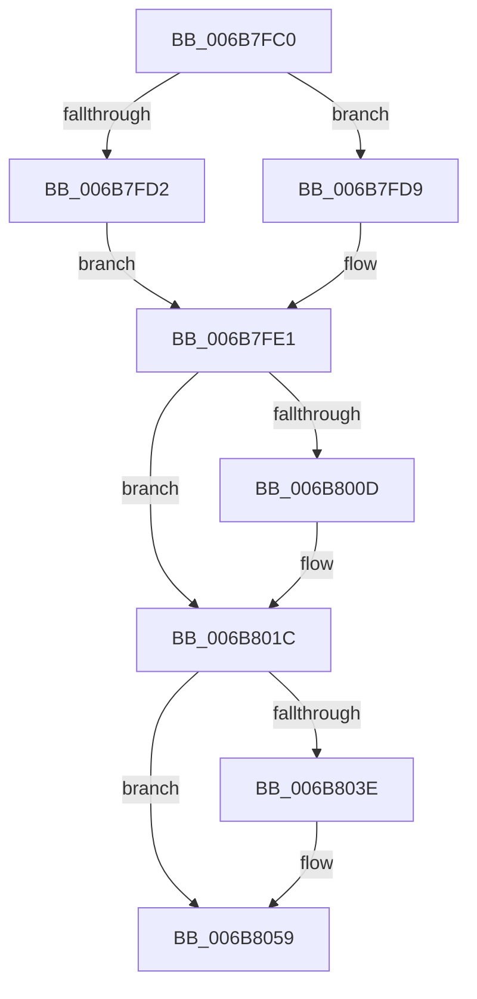

# KiVmbusInterruptSubDispatch

- RVA: `0x006B7FC0`–`0x006B805F` (길이 `159` bytes)
- VA: `0x00000001406B7FC0`
- 실행 섹션: `.text`
- PDB 이름 있음: `예`; PDB Function 태그: `아니요`
- unwind 정보 RVA: `0x000C2280`
- 디코드: `37`개 명령, `159/159` bytes 표시
- 미해석 바이트: `0` (있으면 어셈블리에 `.byte`로 보존)

> 이 문서는 커널 이미지의 기계어와 PDB 기호를 분석해 생성했습니다. 4번과 5번은 함수 원형과 자료형을 바이너리 사용 방식에서 추정한 C 해석이며 원본 소스 복구 결과는 아닙니다.

## 1. Dependencies

- 직접 호출 지점: **5**; 고유 호출 대상: **5**
- 직접 호출자로 확인된 함수: **1**
- RIP 상대 이미지 참조: **3**

### Outgoing calls
- `0x006B7FD2` → [KzSetIrqlUnsafe](../5B/KzSetIrqlUnsafe_function_005B8AE0.md) (function, `0x005B8AE0`)
- `0x006B7FF4` → [KiStartInterruptCycleAccumulation](../37/KiStartInterruptCycleAccumulation_function_0037B410.md) (function, `0x0037B410`)
- `0x006B8017` → [EtwGetKernelTraceTimestamp](../39/EtwGetKernelTraceTimestamp_function_0039FC50.md) (function, `0x0039FC50`)
- `0x006B8030` → [guard_dispatch_icall](guard_dispatch_icall_function_006BAAD0.md) (function, `0x006BAAD0`)
- `0x006B8054` → [PerfInfoLogInterruptHv](../45/PerfInfoLogInterruptHv_function_00450110.md) (function, `0x00450110`)

### Direct callers
- [KiVmbusInterruptDispatch](KiVmbusInterruptDispatch_function_006B7B40.md) at `0x006B7B77`

### Static image references
- `0x006B7FC9` → RVA `0x00FC6D20` (`ALMOSTRO`; read)
- `0x006B7FFA` → RVA `0x00FC6B04` (`ALMOSTRO`; read)
- `0x006B8022` → RVA `0x00FC5608` (`ALMOSTRO`; read)

## 2. Other-region calls and transfers

- 다른 실행 섹션으로 향하는 call: **0**
- 별도 외부 분기/꼬리 이동을 확인하지 못했습니다.

## 3. Assembly (complete function range)

```asm
006B7FC0  48 83 EC 48                     sub rsp, 0x48
006B7FC4  B9 03 00 00 00                  mov ecx, 3
006B7FC9  83 3D 50 ED 90 00 00            cmp dword ptr [rip + 0x90ed50], 0
006B7FD0  74 07                           je 0x1406b7fd9
006B7FD2  E8 09 0B F0 FF                  call 0x1405b8ae0
006B7FD7  EB 08                           jmp 0x1406b7fe1
006B7FD9  44 0F 20 C0                     mov rax, cr8
006B7FDD  44 0F 22 C1                     mov cr8, rcx
006B7FE1  88 45 A9                        mov byte ptr [rbp - 0x57], al
006B7FE4  65 48 8B 0C 25 20 00 00 00      mov rcx, qword ptr gs:[0x20]
006B7FED  33 D2                           xor edx, edx
006B7FEF  BA 01 00 00 00                  mov edx, 1
006B7FF4  E8 17 34 CC FF                  call 0x14037b410
006B7FF9  FB                              sti
006B7FFA  F7 05 00 EB 90 00 00 40 00 00   test dword ptr [rip + 0x90eb00], 0x4000
006B8004  0F 95 85 F3 00 00 00            setne byte ptr [rbp + 0xf3]
006B800B  74 0F                           je 0x1406b801c
006B800D  48 8D 4C 24 20                  lea rcx, [rsp + 0x20]
006B8012  BA 00 40 00 20                  mov edx, 0x20004000
006B8017  E8 34 7C CE FF                  call 0x14039fc50
006B801C  8B 8D E0 00 00 00               mov ecx, dword ptr [rbp + 0xe0]
006B8022  48 8D 05 DF D5 90 00            lea rax, [rip + 0x90d5df]
006B8029  48 8B 04 C8                     mov rax, qword ptr [rax + rcx*8]
006B802D  48 8B F0                        mov rsi, rax
006B8030  E8 9B 2A 00 00                  call 0x1406baad0
006B8035  F6 85 F3 00 00 00 FF            test byte ptr [rbp + 0xf3], 0xff
006B803C  74 1B                           je 0x1406b8059
006B803E  4C 8D 44 24 20                  lea r8, [rsp + 0x20]
006B8043  48 8B CE                        mov rcx, rsi
006B8046  8B 95 E0 00 00 00               mov edx, dword ptr [rbp + 0xe0]
006B804C  83 C2 30                        add edx, 0x30
006B804F  C1 E2 08                        shl edx, 8
006B8052  FF C2                           inc edx
006B8054  E8 B7 80 D9 FF                  call 0x140450110
006B8059  FA                              cli
006B805A  48 83 C4 48                     add rsp, 0x48
006B805E  C3                              ret
```

## 4. C-style interpretation (structured pseudocode)

```c
__int64 __fastcall KiVmbusInterruptSubDispatch(__int64 a1, int a2)
{
    __int64 result;
    __int64 v_rsp;
    unsigned __int64 v_stack_m28;

    v_rsp = (v_rsp) - (72);
    if ((*(unsigned int *)(v_rip + 9497936)) == 0) goto loc_006B7FD9;
    result = KzSetIrqlUnsafe(3, a2, a3, a4);
    goto loc_006B7FE1;
loc_006B7FD9:
loc_006B7FE1:
    *(unsigned __int8 *)(v_rbp - 87) = (unsigned __int8)(v_cr8);
    a2 = 0;
    result = KiStartInterruptCycleAccumulation(*(unsigned __int64 *)(gs_base + (0 + 32)), 1, a3, a4);
    if (((*(unsigned int *)(v_rip + 9497344)) & (0x4000ULL)) != 0) {
        a1 = v_stack_m28;
        a2 = 0x20004000ULL;
        result = EtwGetKernelTraceTimestamp(a1, a2, a3, a4);
    }
    result = guard_dispatch_icall((unsigned int)(*(unsigned int *)(v_rbp + 224)), a2, a3, a4);
    if (((*(unsigned __int8 *)(v_rbp + 243)) & (255)) != 0) {
        a3 = v_stack_m28;
        a1 = *(unsigned __int64 *)(v_rip + 9491935 + (unsigned int)(*(unsigned int *)(v_rbp + 224)) * 8);
        a2 = *(unsigned int *)(v_rbp + 224);
        a2 = (unsigned int)((a2) + (48));
        a2 = (unsigned int)((a2) << (8));
        a2 = (unsigned int)((a2) + 1);
        result = PerfInfoLogInterruptHv(a1, a2, a3, a4);
    }
    v_rsp = (v_rsp) + (72);
    return result;
}
```

## 5. (Beta) C Style

```c
int64_t KiVmbusInterruptSubDispatch(int64_t Arg1, int32_t Arg2)
{
    int64_t result;
    int64_t local_rsp;
    uint64_t v_stack_m28;

    local_rsp = (local_rsp) - (72);
    if ((*(uint32_t *)(v_rip + 0x90ED50)) == 0) goto loc_006B7FD9;
    result = KzSetIrqlUnsafe(3, Arg2, a3, a4);
    goto loc_006B7FE1;
loc_006B7FD9:
loc_006B7FE1:
    *(uint8_t *)(local_rbp - 0x57) = (uint8_t)(v_cr8);
    Arg2 = 0;
    result = KiStartInterruptCycleAccumulation(*(uint64_t *)(gs_base + (0 + 0x20)), 1, a3, a4);
    if (((*(uint32_t *)(v_rip + 0x90EB00)) & (0x4000ULL)) != 0) {
        Arg1 = v_stack_m28;
        Arg2 = 0x20004000ULL;
        result = EtwGetKernelTraceTimestamp(Arg1, Arg2, a3, a4);
    }
    result = guard_dispatch_icall((uint32_t)(*(uint32_t *)(local_rbp + 0xE0)), Arg2, a3, a4);
    if (((*(uint8_t *)(local_rbp + 0xF3)) & (255)) != 0) {
        a3 = v_stack_m28;
        Arg1 = *(uint64_t *)(v_rip + 0x90D5DF + (uint32_t)(*(uint32_t *)(local_rbp + 0xE0)) * 8);
        Arg2 = *(uint32_t *)(local_rbp + 0xE0);
        Arg2 = (uint32_t)((Arg2) + (48));
        Arg2 = (uint32_t)((Arg2) << (8));
        Arg2 = (uint32_t)((Arg2) + 1);
        result = PerfInfoLogInterruptHv(Arg1, Arg2, a3, a4);
    }
    local_rsp = (local_rsp) + (72);
    return result;
}
```

## 6. Execution-region graph

[열기: 2D/3D 그래프와 함수 탐색 컨트롤 패널](../../../control-panel.html?section=text&rva=0x006B7FC0&view=graph)

- 2D 그래프는 위에서 아래로 흐르고, 3D 그래프는 빈 공간을 드래그해 회전합니다. Shift+드래그는 이동, 휠은 확대·축소, 함수 노드 선택은 대상 보고서 이동입니다.

### Static fallback


