# KxDebugTrapOrFault

- RVA: `0x006BCF40`–`0x006BD387` (길이 `1,095` bytes)
- VA: `0x00000001406BCF40`
- 실행 섹션: `.text`
- PDB 이름 있음: `예`; PDB Function 태그: `아니요`
- unwind 정보 RVA: `0x000C1B14`
- 디코드: `237`개 명령, `1,095/1,095` bytes 표시
- 미해석 바이트: `0` (있으면 어셈블리에 `.byte`로 보존)

> 이 문서는 커널 이미지의 기계어와 PDB 기호를 분석해 생성했습니다. 4번과 5번은 함수 원형과 자료형을 바이너리 사용 방식에서 추정한 C 해석이며 원본 소스 복구 결과는 아닙니다.

## 1. Dependencies

- 직접 호출 지점: **36**; 고유 호출 대상: **36**
- 직접 호출자로 확인된 함수: **1**
- RIP 상대 이미지 참조: **8**

### Outgoing calls
- `0x006BD096` → [KxDebugTrapOrFault + 0x269](KxDebugTrapOrFault_function_006BCF40.md) (inside-function, `0x006BD1A9`)
- `0x006BD09F` → [KxDebugTrapOrFault + 0x272](KxDebugTrapOrFault_function_006BCF40.md) (inside-function, `0x006BD1B2`)
- `0x006BD0A8` → [KxDebugTrapOrFault + 0x15B](KxDebugTrapOrFault_function_006BCF40.md) (inside-function, `0x006BD09B`)
- `0x006BD0B1` → [KxDebugTrapOrFault + 0x164](KxDebugTrapOrFault_function_006BCF40.md) (inside-function, `0x006BD0A4`)
- `0x006BD0BA` → [KxDebugTrapOrFault + 0x16D](KxDebugTrapOrFault_function_006BCF40.md) (inside-function, `0x006BD0AD`)
- `0x006BD0C3` → [KxDebugTrapOrFault + 0x176](KxDebugTrapOrFault_function_006BCF40.md) (inside-function, `0x006BD0B6`)
- `0x006BD0CC` → [KxDebugTrapOrFault + 0x17F](KxDebugTrapOrFault_function_006BCF40.md) (inside-function, `0x006BD0BF`)
- `0x006BD0D5` → [KxDebugTrapOrFault + 0x188](KxDebugTrapOrFault_function_006BCF40.md) (inside-function, `0x006BD0C8`)
- `0x006BD0DE` → [KxDebugTrapOrFault + 0x191](KxDebugTrapOrFault_function_006BCF40.md) (inside-function, `0x006BD0D1`)
- `0x006BD0E7` → [KxDebugTrapOrFault + 0x19A](KxDebugTrapOrFault_function_006BCF40.md) (inside-function, `0x006BD0DA`)
- `0x006BD0F0` → [KxDebugTrapOrFault + 0x1A3](KxDebugTrapOrFault_function_006BCF40.md) (inside-function, `0x006BD0E3`)
- `0x006BD0F9` → [KxDebugTrapOrFault + 0x1AC](KxDebugTrapOrFault_function_006BCF40.md) (inside-function, `0x006BD0EC`)
- `0x006BD102` → [KxDebugTrapOrFault + 0x1B5](KxDebugTrapOrFault_function_006BCF40.md) (inside-function, `0x006BD0F5`)
- `0x006BD10B` → [KxDebugTrapOrFault + 0x1BE](KxDebugTrapOrFault_function_006BCF40.md) (inside-function, `0x006BD0FE`)
- `0x006BD114` → [KxDebugTrapOrFault + 0x1C7](KxDebugTrapOrFault_function_006BCF40.md) (inside-function, `0x006BD107`)
- `0x006BD11D` → [KxDebugTrapOrFault + 0x1D0](KxDebugTrapOrFault_function_006BCF40.md) (inside-function, `0x006BD110`)
- `0x006BD126` → [KxDebugTrapOrFault + 0x1D9](KxDebugTrapOrFault_function_006BCF40.md) (inside-function, `0x006BD119`)
- `0x006BD12F` → [KxDebugTrapOrFault + 0x1E2](KxDebugTrapOrFault_function_006BCF40.md) (inside-function, `0x006BD122`)
- `0x006BD138` → [KxDebugTrapOrFault + 0x1EB](KxDebugTrapOrFault_function_006BCF40.md) (inside-function, `0x006BD12B`)
- `0x006BD141` → [KxDebugTrapOrFault + 0x1F4](KxDebugTrapOrFault_function_006BCF40.md) (inside-function, `0x006BD134`)
- `0x006BD14A` → [KxDebugTrapOrFault + 0x1FD](KxDebugTrapOrFault_function_006BCF40.md) (inside-function, `0x006BD13D`)
- `0x006BD153` → [KxDebugTrapOrFault + 0x206](KxDebugTrapOrFault_function_006BCF40.md) (inside-function, `0x006BD146`)
- `0x006BD15C` → [KxDebugTrapOrFault + 0x20F](KxDebugTrapOrFault_function_006BCF40.md) (inside-function, `0x006BD14F`)
- `0x006BD165` → [KxDebugTrapOrFault + 0x218](KxDebugTrapOrFault_function_006BCF40.md) (inside-function, `0x006BD158`)
- `0x006BD16E` → [KxDebugTrapOrFault + 0x221](KxDebugTrapOrFault_function_006BCF40.md) (inside-function, `0x006BD161`)
- `0x006BD177` → [KxDebugTrapOrFault + 0x22A](KxDebugTrapOrFault_function_006BCF40.md) (inside-function, `0x006BD16A`)
- `0x006BD180` → [KxDebugTrapOrFault + 0x233](KxDebugTrapOrFault_function_006BCF40.md) (inside-function, `0x006BD173`)
- `0x006BD189` → [KxDebugTrapOrFault + 0x23C](KxDebugTrapOrFault_function_006BCF40.md) (inside-function, `0x006BD17C`)
- `0x006BD192` → [KxDebugTrapOrFault + 0x245](KxDebugTrapOrFault_function_006BCF40.md) (inside-function, `0x006BD185`)
- `0x006BD19B` → [KxDebugTrapOrFault + 0x24E](KxDebugTrapOrFault_function_006BCF40.md) (inside-function, `0x006BD18E`)
- `0x006BD1A4` → [KxDebugTrapOrFault + 0x257](KxDebugTrapOrFault_function_006BCF40.md) (inside-function, `0x006BD197`)
- `0x006BD1AD` → [KxDebugTrapOrFault + 0x260](KxDebugTrapOrFault_function_006BCF40.md) (inside-function, `0x006BD1A0`)
- `0x006BD1D8` → [KiFlushBhbDuringTrapEntryOrExit](../6C/KiFlushBhbDuringTrapEntryOrExit_function_006C6340.md) (function, `0x006C6340`)
- `0x006BD221` → [KiSaveDebugRegisterState](../4F/KiSaveDebugRegisterState_function_004FD960.md) (function, `0x004FD960`)
- `0x006BD255` → [KiSynchronizeUserIsolationDomainExit](../41/KiSynchronizeUserIsolationDomainExit_function_0041BFA0.md) (function, `0x0041BFA0`)
- `0x006BD380` → [KiExceptionDispatch](../6C/KiExceptionDispatch_function_006C5900.md) (function, `0x006C5900`)

### Direct callers
- [KxDebugTrapOrFault](KxDebugTrapOrFault_function_006BCF40.md) at `0x006BD096`
- [KxDebugTrapOrFault](KxDebugTrapOrFault_function_006BCF40.md) at `0x006BD09F`
- [KxDebugTrapOrFault](KxDebugTrapOrFault_function_006BCF40.md) at `0x006BD0A8`
- [KxDebugTrapOrFault](KxDebugTrapOrFault_function_006BCF40.md) at `0x006BD0B1`
- [KxDebugTrapOrFault](KxDebugTrapOrFault_function_006BCF40.md) at `0x006BD0BA`
- [KxDebugTrapOrFault](KxDebugTrapOrFault_function_006BCF40.md) at `0x006BD0C3`
- [KxDebugTrapOrFault](KxDebugTrapOrFault_function_006BCF40.md) at `0x006BD0CC`
- [KxDebugTrapOrFault](KxDebugTrapOrFault_function_006BCF40.md) at `0x006BD0D5`
- [KxDebugTrapOrFault](KxDebugTrapOrFault_function_006BCF40.md) at `0x006BD0DE`
- [KxDebugTrapOrFault](KxDebugTrapOrFault_function_006BCF40.md) at `0x006BD0E7`
- [KxDebugTrapOrFault](KxDebugTrapOrFault_function_006BCF40.md) at `0x006BD0F0`
- [KxDebugTrapOrFault](KxDebugTrapOrFault_function_006BCF40.md) at `0x006BD0F9`
- [KxDebugTrapOrFault](KxDebugTrapOrFault_function_006BCF40.md) at `0x006BD102`
- [KxDebugTrapOrFault](KxDebugTrapOrFault_function_006BCF40.md) at `0x006BD10B`
- [KxDebugTrapOrFault](KxDebugTrapOrFault_function_006BCF40.md) at `0x006BD114`
- [KxDebugTrapOrFault](KxDebugTrapOrFault_function_006BCF40.md) at `0x006BD11D`
- [KxDebugTrapOrFault](KxDebugTrapOrFault_function_006BCF40.md) at `0x006BD126`
- [KxDebugTrapOrFault](KxDebugTrapOrFault_function_006BCF40.md) at `0x006BD12F`
- [KxDebugTrapOrFault](KxDebugTrapOrFault_function_006BCF40.md) at `0x006BD138`
- [KxDebugTrapOrFault](KxDebugTrapOrFault_function_006BCF40.md) at `0x006BD141`
- [KxDebugTrapOrFault](KxDebugTrapOrFault_function_006BCF40.md) at `0x006BD14A`
- [KxDebugTrapOrFault](KxDebugTrapOrFault_function_006BCF40.md) at `0x006BD153`
- [KxDebugTrapOrFault](KxDebugTrapOrFault_function_006BCF40.md) at `0x006BD15C`
- [KxDebugTrapOrFault](KxDebugTrapOrFault_function_006BCF40.md) at `0x006BD165`
- [KxDebugTrapOrFault](KxDebugTrapOrFault_function_006BCF40.md) at `0x006BD16E`
- [KxDebugTrapOrFault](KxDebugTrapOrFault_function_006BCF40.md) at `0x006BD177`
- [KxDebugTrapOrFault](KxDebugTrapOrFault_function_006BCF40.md) at `0x006BD180`
- [KxDebugTrapOrFault](KxDebugTrapOrFault_function_006BCF40.md) at `0x006BD189`
- [KxDebugTrapOrFault](KxDebugTrapOrFault_function_006BCF40.md) at `0x006BD192`
- [KxDebugTrapOrFault](KxDebugTrapOrFault_function_006BCF40.md) at `0x006BD19B`
- [KxDebugTrapOrFault](KxDebugTrapOrFault_function_006BCF40.md) at `0x006BD1A4`
- [KxDebugTrapOrFault](KxDebugTrapOrFault_function_006BCF40.md) at `0x006BD1AD`

### Static image references
- `0x006BCFB5` → RVA `0x01201840` (`CFGRO`; read)
- `0x006BD1E9` → RVA `0x00FC7264` (`ALMOSTRO`; read)
- `0x006BD25A` → RVA `0x00FC6BF0` (`ALMOSTRO`; read)
- `0x006BD27C` → RVA `0x00F475C0` (`.data`; read)
- `0x006BD2DC` → RVA `0x00FC6FCC` (`ALMOSTRO`; read)
- `0x006BD2F0` → RVA `0x00FC6CFC` (`ALMOSTRO`; read)
- `0x006BD302` → RVA `0x00FC6D58` (`ALMOSTRO`; read)
- `0x006BD342` → RVA `0x0003AF68` (`.rdata`; read)

## 2. Other-region calls and transfers

- 다른 실행 섹션으로 향하는 call: **0**
- 별도 외부 분기/꼬리 이동을 확인하지 못했습니다.

## 3. Assembly (complete function range)

```asm
006BCF40  48 83 EC 08                     sub rsp, 8
006BCF44  55                              push rbp
006BCF45  48 81 EC 58 01 00 00            sub rsp, 0x158
006BCF4C  48 8D AC 24 80 00 00 00         lea rbp, [rsp + 0x80]
006BCF54  C6 45 AB 01                     mov byte ptr [rbp - 0x55], 1
006BCF58  48 89 45 B0                     mov qword ptr [rbp - 0x50], rax
006BCF5C  48 89 4D B8                     mov qword ptr [rbp - 0x48], rcx
006BCF60  48 89 55 C0                     mov qword ptr [rbp - 0x40], rdx
006BCF64  4C 89 45 C8                     mov qword ptr [rbp - 0x38], r8
006BCF68  4C 89 4D D0                     mov qword ptr [rbp - 0x30], r9
006BCF6C  4C 89 55 D8                     mov qword ptr [rbp - 0x28], r10
006BCF70  4C 89 5D E0                     mov qword ptr [rbp - 0x20], r11
006BCF74  F6 85 F0 00 00 00 01            test byte ptr [rbp + 0xf0], 1
006BCF7B  75 38                           jne 0x1406bcfb5
006BCF7D  33 D2                           xor edx, edx
006BCF7F  F3 48 0F 1E CA                  rdsspq rdx
006BCF84  48 89 55 58                     mov qword ptr [rbp + 0x58], rdx
006BCF88  0F AE E8                        lfence
006BCF8B  65 F6 04 25 58 08 00 00 01      test byte ptr gs:[0x858], 1
006BCF94  75 08                           jne 0x1406bcf9e
006BCF96  0F AE E8                        lfence
006BCF99  E9 88 02 00 00                  jmp 0x1406bd226
006BCF9E  65 0F B7 04 25 66 08 00 00      movzx eax, word ptr gs:[0x866]
006BCFA7  B9 48 00 00 00                  mov ecx, 0x48
006BCFAC  33 D2                           xor edx, edx
006BCFAE  0F 30                           wrmsr
006BCFB0  E9 71 02 00 00                  jmp 0x1406bd226
006BCFB5  F6 05 84 48 B4 00 01            test byte ptr [rip + 0xb44884], 1
006BCFBC  75 03                           jne 0x1406bcfc1
006BCFBE  0F 01 F8                        swapgs
006BCFC1  0F AE E8                        lfence
006BCFC4  65 48 8B 0C 25 28 9D 00 00      mov rcx, qword ptr gs:[0x9d28]
006BCFCD  48 85 C9                        test rcx, rcx
006BCFD0  74 1F                           je 0x1406bcff1
006BCFD2  F3 48 0F 1E CA                  rdsspq rdx
006BCFD7  65 4C 8B 14 25 20 9D 00 00      mov r10, qword ptr gs:[0x9d20]
006BCFE0  49 83 C2 08                     add r10, 8
006BCFE4  49 3B D2                        cmp rdx, r10
006BCFE7  75 08                           jne 0x1406bcff1
006BCFE9  F3 0F 01 29                     rstorssp dword ptr [rcx]
006BCFED  F3 0F 01 EA                     saveprevssp
006BCFF1  65 4C 8B 14 25 88 01 00 00      mov r10, qword ptr gs:[0x188]
006BCFFA  65 48 8B 0C 25 88 01 00 00      mov rcx, qword ptr gs:[0x188]
006BD003  48 8B 89 20 02 00 00            mov rcx, qword ptr [rcx + 0x220]
006BD00A  48 8B 89 60 07 00 00            mov rcx, qword ptr [rcx + 0x760]
006BD011  65 48 89 0C 25 50 08 00 00      mov qword ptr gs:[0x850], rcx
006BD01A  66 65 8B 0C 25 62 08 00 00      mov cx, word ptr gs:[0x862]
006BD023  66 65 89 0C 25 64 08 00 00      mov word ptr gs:[0x864], cx
006BD02C  65 8A 0C 25 58 08 00 00         mov cl, byte ptr gs:[0x858]
006BD034  65 88 0C 25 5A 08 00 00         mov byte ptr gs:[0x85a], cl
006BD03C  65 0F B7 04 25 68 08 00 00      movzx eax, word ptr gs:[0x868]
006BD045  66 65 39 04 25 66 08 00 00      cmp word ptr gs:[0x866], ax
006BD04E  74 12                           je 0x1406bd062
006BD050  66 65 89 04 25 66 08 00 00      mov word ptr gs:[0x866], ax
006BD059  B9 48 00 00 00                  mov ecx, 0x48
006BD05E  33 D2                           xor edx, edx
006BD060  0F 30                           wrmsr
006BD062  65 0F B6 14 25 58 08 00 00      movzx edx, byte ptr gs:[0x858]
006BD06B  F7 C2 08 00 00 00               test edx, 8
006BD071  74 17                           je 0x1406bd08a
006BD073  B8 01 00 00 00                  mov eax, 1
006BD078  33 D2                           xor edx, edx
006BD07A  B9 49 00 00 00                  mov ecx, 0x49
006BD07F  0F 30                           wrmsr
006BD081  65 0F B6 14 25 58 08 00 00      movzx edx, byte ptr gs:[0x858]
006BD08A  F7 C2 02 00 00 00               test edx, 2
006BD090  0F 84 37 01 00 00               je 0x1406bd1cd
006BD096  E8 0E 01 00 00                  call 0x1406bd1a9
006BD09B  48 83 C4 08                     add rsp, 8
006BD09F  E8 0E 01 00 00                  call 0x1406bd1b2
006BD0A4  48 83 C4 08                     add rsp, 8
006BD0A8  E8 EE FF FF FF                  call 0x1406bd09b
006BD0AD  48 83 C4 08                     add rsp, 8
006BD0B1  E8 EE FF FF FF                  call 0x1406bd0a4
006BD0B6  48 83 C4 08                     add rsp, 8
006BD0BA  E8 EE FF FF FF                  call 0x1406bd0ad
006BD0BF  48 83 C4 08                     add rsp, 8
006BD0C3  E8 EE FF FF FF                  call 0x1406bd0b6
006BD0C8  48 83 C4 08                     add rsp, 8
006BD0CC  E8 EE FF FF FF                  call 0x1406bd0bf
006BD0D1  48 83 C4 08                     add rsp, 8
006BD0D5  E8 EE FF FF FF                  call 0x1406bd0c8
006BD0DA  48 83 C4 08                     add rsp, 8
006BD0DE  E8 EE FF FF FF                  call 0x1406bd0d1
006BD0E3  48 83 C4 08                     add rsp, 8
006BD0E7  E8 EE FF FF FF                  call 0x1406bd0da
006BD0EC  48 83 C4 08                     add rsp, 8
006BD0F0  E8 EE FF FF FF                  call 0x1406bd0e3
006BD0F5  48 83 C4 08                     add rsp, 8
006BD0F9  E8 EE FF FF FF                  call 0x1406bd0ec
006BD0FE  48 83 C4 08                     add rsp, 8
006BD102  E8 EE FF FF FF                  call 0x1406bd0f5
006BD107  48 83 C4 08                     add rsp, 8
006BD10B  E8 EE FF FF FF                  call 0x1406bd0fe
006BD110  48 83 C4 08                     add rsp, 8
006BD114  E8 EE FF FF FF                  call 0x1406bd107
006BD119  48 83 C4 08                     add rsp, 8
006BD11D  E8 EE FF FF FF                  call 0x1406bd110
006BD122  48 83 C4 08                     add rsp, 8
006BD126  E8 EE FF FF FF                  call 0x1406bd119
006BD12B  48 83 C4 08                     add rsp, 8
006BD12F  E8 EE FF FF FF                  call 0x1406bd122
006BD134  48 83 C4 08                     add rsp, 8
006BD138  E8 EE FF FF FF                  call 0x1406bd12b
006BD13D  48 83 C4 08                     add rsp, 8
006BD141  E8 EE FF FF FF                  call 0x1406bd134
006BD146  48 83 C4 08                     add rsp, 8
006BD14A  E8 EE FF FF FF                  call 0x1406bd13d
006BD14F  48 83 C4 08                     add rsp, 8
006BD153  E8 EE FF FF FF                  call 0x1406bd146
006BD158  48 83 C4 08                     add rsp, 8
006BD15C  E8 EE FF FF FF                  call 0x1406bd14f
006BD161  48 83 C4 08                     add rsp, 8
006BD165  E8 EE FF FF FF                  call 0x1406bd158
006BD16A  48 83 C4 08                     add rsp, 8
006BD16E  E8 EE FF FF FF                  call 0x1406bd161
006BD173  48 83 C4 08                     add rsp, 8
006BD177  E8 EE FF FF FF                  call 0x1406bd16a
006BD17C  48 83 C4 08                     add rsp, 8
006BD180  E8 EE FF FF FF                  call 0x1406bd173
006BD185  48 83 C4 08                     add rsp, 8
006BD189  E8 EE FF FF FF                  call 0x1406bd17c
006BD18E  48 83 C4 08                     add rsp, 8
006BD192  E8 EE FF FF FF                  call 0x1406bd185
006BD197  48 83 C4 08                     add rsp, 8
006BD19B  E8 EE FF FF FF                  call 0x1406bd18e
006BD1A0  48 83 C4 08                     add rsp, 8
006BD1A4  E8 EE FF FF FF                  call 0x1406bd197
006BD1A9  48 83 C4 08                     add rsp, 8
006BD1AD  E8 EE FF FF FF                  call 0x1406bd1a0
006BD1B2  48 83 C4 08                     add rsp, 8
006BD1B6  B8 DA DA 00 00                  mov eax, 0xdada
006BD1BB  65 F6 04 25 5C 08 00 00 08      test byte ptr gs:[0x85c], 8
006BD1C4  74 07                           je 0x1406bd1cd
006BD1C6  B0 20                           mov al, 0x20
006BD1C8  F3 48 0F AE E8                  incsspq rax
006BD1CD  F7 C2 80 00 00 00               test edx, 0x80
006BD1D3  74 08                           je 0x1406bd1dd
006BD1D5  0F AE E8                        lfence
006BD1D8  E8 63 91 00 00                  call 0x1406c6340
006BD1DD  0F AE E8                        lfence
006BD1E0  65 C6 04 25 5E 08 00 00 00      mov byte ptr gs:[0x85e], 0
006BD1E9  83 3D 74 A0 90 00 00            cmp dword ptr [rip + 0x90a074], 0
006BD1F0  74 1F                           je 0x1406bd211
006BD1F2  B9 A7 06 00 00                  mov ecx, 0x6a7
006BD1F7  0F 32                           rdmsr
006BD1F9  83 FA 00                        cmp edx, 0
006BD1FC  74 13                           je 0x1406bd211
006BD1FE  8B CA                           mov ecx, edx
006BD200  23 15 5E A0 90 00               and edx, dword ptr [rip + 0x90a05e]
006BD206  3B D1                           cmp edx, ecx
006BD208  74 07                           je 0x1406bd211
006BD20A  B9 A7 06 00 00                  mov ecx, 0x6a7
006BD20F  0F 30                           wrmsr
006BD211  41 F6 42 03 03                  test byte ptr [r10 + 3], 3
006BD216  66 C7 85 80 00 00 00 00 00      mov word ptr [rbp + 0x80], 0
006BD21F  74 05                           je 0x1406bd226
006BD221  E8 3A 07 E4 FF                  call 0x1404fd960
006BD226  FC                              cld
006BD227  0F AE 5D AC                     stmxcsr dword ptr [rbp - 0x54]
006BD22B  65 0F AE 14 25 80 01 00 00      ldmxcsr dword ptr gs:[0x180]
006BD234  0F 29 45 F0                     movaps xmmword ptr [rbp - 0x10], xmm0
006BD238  0F 29 4D 00                     movaps xmmword ptr [rbp], xmm1
006BD23C  0F 29 55 10                     movaps xmmword ptr [rbp + 0x10], xmm2
006BD240  0F 29 5D 20                     movaps xmmword ptr [rbp + 0x20], xmm3
006BD244  0F 29 65 30                     movaps xmmword ptr [rbp + 0x30], xmm4
006BD248  0F 29 6D 40                     movaps xmmword ptr [rbp + 0x40], xmm5
006BD24C  F6 85 F0 00 00 00 01            test byte ptr [rbp + 0xf0], 1
006BD253  74 05                           je 0x1406bd25a
006BD255  E8 46 ED D5 FF                  call 0x14041bfa0
006BD25A  F6 05 8F 99 90 00 FF            test byte ptr [rip + 0x90998f], 0xff
006BD261  74 0C                           je 0x1406bd26f
006BD263  F6 85 F0 00 00 00 01            test byte ptr [rbp + 0xf0], 1
006BD26A  74 03                           je 0x1406bd26f
006BD26C  0F 01 CB                        stac
006BD26F  F7 85 F8 00 00 00 00 02 00 00   test dword ptr [rbp + 0xf8], 0x200
006BD279  74 01                           je 0x1406bd27c
006BD27B  FB                              sti
006BD27C  F7 05 3A A3 88 00 02 00 00 00   test dword ptr [rip + 0x88a33a], 2
006BD286  74 13                           je 0x1406bd29b
006BD288  B9 D9 01 00 00                  mov ecx, 0x1d9
006BD28D  0F 32                           rdmsr
006BD28F  83 C8 01                        or eax, 1
006BD292  0F 30                           wrmsr
006BD294  33 D2                           xor edx, edx
006BD296  E9 CF 00 00 00                  jmp 0x1406bd36a
006BD29B  33 D2                           xor edx, edx
006BD29D  F7 85 F8 00 00 00 00 01 00 00   test dword ptr [rbp + 0xf8], 0x100
006BD2A7  0F 84 BD 00 00 00               je 0x1406bd36a
006BD2AD  65 F6 04 25 22 91 00 00 02      test byte ptr gs:[0x9122], 2
006BD2B6  0F 84 AE 00 00 00               je 0x1406bd36a
006BD2BC  F6 85 F0 00 00 00 01            test byte ptr [rbp + 0xf0], 1
006BD2C3  75 57                           jne 0x1406bd31c
006BD2C5  0F 21 F8                        mov rax, dr7
006BD2C8  66 A9 00 02                     test ax, 0x200
006BD2CC  0F 84 98 00 00 00               je 0x1406bd36a
006BD2D2  66 A9 00 01                     test ax, 0x100
006BD2D6  0F 84 8E 00 00 00               je 0x1406bd36a
006BD2DC  44 8B 05 E9 9C 90 00            mov r8d, dword ptr [rip + 0x909ce9]
006BD2E3  45 0B C0                        or r8d, r8d
006BD2E6  74 08                           je 0x1406bd2f0
006BD2E8  41 8B C8                        mov ecx, r8d
006BD2EB  0F 32                           rdmsr
006BD2ED  44 8B C0                        mov r8d, eax
006BD2F0  8B 0D 06 9A 90 00               mov ecx, dword ptr [rip + 0x909a06]
006BD2F6  41 03 C8                        add ecx, r8d
006BD2F9  0F 32                           rdmsr
006BD2FB  44 8B C8                        mov r9d, eax
006BD2FE  48 C1 E2 20                     shl rdx, 0x20
006BD302  8B 0D 50 9A 90 00               mov ecx, dword ptr [rip + 0x909a50]
006BD308  4C 0B CA                        or r9, rdx
006BD30B  41 03 C8                        add ecx, r8d
006BD30E  0F 32                           rdmsr
006BD310  44 8B D0                        mov r10d, eax
006BD313  48 C1 E2 20                     shl rdx, 0x20
006BD317  4C 0B D2                        or r10, rdx
006BD31A  EB 49                           jmp 0x1406bd365
006BD31C  66 F7 85 80 00 00 00 00 02      test word ptr [rbp + 0x80], 0x200
006BD325  74 43                           je 0x1406bd36a
006BD327  66 F7 85 80 00 00 00 00 01      test word ptr [rbp + 0x80], 0x100
006BD330  74 38                           je 0x1406bd36a
006BD332  48 83 A5 A8 00 00 00 00         and qword ptr [rbp + 0xa8], 0
006BD33A  48 83 A5 A0 00 00 00 00         and qword ptr [rbp + 0xa0], 0
006BD342  48 8B 0D 1F DC 97 FF            mov rcx, qword ptr [rip - 0x6823e1]
006BD349  4C 8B 8D 98 00 00 00            mov r9, qword ptr [rbp + 0x98]
006BD350  4C 3B C9                        cmp r9, rcx
006BD353  4C 0F 43 C9                     cmovae r9, rcx
006BD357  4C 8B 95 90 00 00 00            mov r10, qword ptr [rbp + 0x90]
006BD35E  4C 3B D1                        cmp r10, rcx
006BD361  4C 0F 43 D1                     cmovae r10, rcx
006BD365  BA 02 00 00 00                  mov edx, 2
006BD36A  B9 04 00 00 80                  mov ecx, 0x80000004
006BD36F  81 A5 F8 00 00 00 FF FE FF FF   and dword ptr [rbp + 0xf8], 0xfffffeff
006BD379  4C 8B 85 E8 00 00 00            mov r8, qword ptr [rbp + 0xe8]
006BD380  E8 7B 85 00 00                  call 0x1406c5900
006BD385  90                              nop
006BD386  C3                              ret
```

## 4. C-style interpretation (structured pseudocode)

```c
__int64 __fastcall KxDebugTrapOrFault(__int64 a1, __int64 a2, __int64 a3, __int64 a4)
{
    __int64 result;
    __int64 v_r10;
    __int64 v_rsp;
    unsigned __int64 v_stack_m108;
    unsigned __int64 v_stack_m110;
    unsigned __int64 v_stack_m118;
    unsigned __int64 v_stack_m120;
    unsigned __int64 v_stack_m128;
    unsigned __int64 v_stack_m130;
    unsigned __int64 v_stack_m138;
    unsigned int v_stack_m13C;
    unsigned __int8 v_stack_m13D;
    unsigned __int64 v_stack_m40;
    unsigned __int64 v_stack_m48;
    unsigned __int64 v_stack_m50;
    unsigned __int64 v_stack_m58;
    unsigned __int16 v_stack_m68;
    unsigned __int64 v_stack_m90;
    unsigned __int64 v_stack_mA8;
    unsigned __int64 v_stack_mB8;
    unsigned __int64 v_stack_mC8;
    unsigned __int64 v_stack_mD8;
    unsigned __int64 v_stack_mE8;
    unsigned __int64 v_stack_mF8;
    unsigned __int64 v_stack_p0;
    unsigned int v_stack_p10;
    unsigned __int8 v_stack_p8;

    v_rsp = (v_rsp) - (8);
    v_rsp = (v_rsp) - (344);
    v_stack_m13D = 1;
    v_stack_m138 = result;
    v_stack_m130 = a1;
    v_stack_m128 = a2;
    v_stack_m120 = a3;
    v_stack_m118 = a4;
    v_stack_m110 = v_r10;
    v_stack_m108 = v_r11;
    if (((v_stack_p8) & (1)) != 0) goto loc_006BCFB5;
    a2 = 0;
    v_stack_m90 = 0;
    if (((*(unsigned __int8 *)(gs_base + (0 + 2136))) & (1)) != 0) goto loc_006BCF9E;
    goto loc_006BD226;
loc_006BCF9E:
    a2 = 0;
    goto loc_006BD226;
loc_006BCFB5:
    if (((*(unsigned __int8 *)(v_rip + 11815044)) & (1)) == 0) {
    }
    if (*(unsigned __int64 *)(gs_base + (0 + 40232)) == 0) goto loc_006BCFF1;
    v_r10 = (*(unsigned __int64 *)(gs_base + (0 + 40224))) + (8);
    if (0 == v_r10) {
    }
    *(unsigned __int64 *)(gs_base + (0 + 2128)) = *(unsigned __int64 *)(*(unsigned __int64 *)(*(unsigned __int64 *)(gs_base + (0 + 392)) + 544) + 1888);
    *(unsigned __int16 *)(gs_base + (0 + 2148)) = (unsigned __int16)(*(unsigned __int16 *)(gs_base + (0 + 2146)));
    *(unsigned __int8 *)(gs_base + (0 + 2138)) = (unsigned __int8)(*(unsigned __int8 *)(gs_base + (0 + 2136)));
    if ((*(unsigned __int16 *)(gs_base + (0 + 2150))) != ((unsigned __int16)(*(unsigned __int16 *)(gs_base + (0 + 2152))))) {
        *(unsigned __int16 *)(gs_base + (0 + 2150)) = (unsigned __int16)(*(unsigned __int16 *)(gs_base + (0 + 2152)));
        a1 = 72;
        a2 = 0;
    }
    result = *(unsigned __int16 *)(gs_base + (0 + 2152));
    if ((((unsigned int)(*(unsigned __int8 *)(gs_base + (0 + 2136)))) & (8)) != 0) {
        result = 1;
        a2 = 0;
        a1 = 73;
        a2 = *(unsigned __int8 *)(gs_base + (0 + 2136));
    }
    if ((((unsigned int)(a2)) & (2)) == 0) goto loc_006BD1CD;
    result = KxDebugTrapOrFault___0x269(a1, a2, a3, a4);
    v_rsp = (v_rsp) + (8);
    result = KxDebugTrapOrFault___0x272(a1, a2, a3, a4);
    v_rsp = (v_rsp) + (8);
    result = KxDebugTrapOrFault___0x15B(a1, a2, a3, a4);
    v_rsp = (v_rsp) + (8);
    result = KxDebugTrapOrFault___0x164(a1, a2, a3, a4);
    v_rsp = (v_rsp) + (8);
    result = KxDebugTrapOrFault___0x16D(a1, a2, a3, a4);
    v_rsp = (v_rsp) + (8);
    result = KxDebugTrapOrFault___0x176(a1, a2, a3, a4);
    v_rsp = (v_rsp) + (8);
    result = KxDebugTrapOrFault___0x17F(a1, a2, a3, a4);
    v_rsp = (v_rsp) + (8);
    result = KxDebugTrapOrFault___0x188(a1, a2, a3, a4);
    v_rsp = (v_rsp) + (8);
    result = KxDebugTrapOrFault___0x191(a1, a2, a3, a4);
    v_rsp = (v_rsp) + (8);
    result = KxDebugTrapOrFault___0x19A(a1, a2, a3, a4);
    v_rsp = (v_rsp) + (8);
    result = KxDebugTrapOrFault___0x1A3(a1, a2, a3, a4);
    v_rsp = (v_rsp) + (8);
    result = KxDebugTrapOrFault___0x1AC(a1, a2, a3, a4);
    v_rsp = (v_rsp) + (8);
    result = KxDebugTrapOrFault___0x1B5(a1, a2, a3, a4);
    v_rsp = (v_rsp) + (8);
    result = KxDebugTrapOrFault___0x1BE(a1, a2, a3, a4);
    v_rsp = (v_rsp) + (8);
    result = KxDebugTrapOrFault___0x1C7(a1, a2, a3, a4);
    v_rsp = (v_rsp) + (8);
    result = KxDebugTrapOrFault___0x1D0(a1, a2, a3, a4);
    v_rsp = (v_rsp) + (8);
    result = KxDebugTrapOrFault___0x1D9(a1, a2, a3, a4);
    v_rsp = (v_rsp) + (8);
    result = KxDebugTrapOrFault___0x1E2(a1, a2, a3, a4);
    v_rsp = (v_rsp) + (8);
    result = KxDebugTrapOrFault___0x1EB(a1, a2, a3, a4);
    v_rsp = (v_rsp) + (8);
    result = KxDebugTrapOrFault___0x1F4(a1, a2, a3, a4);
    v_rsp = (v_rsp) + (8);
    result = KxDebugTrapOrFault___0x1FD(a1, a2, a3, a4);
    v_rsp = (v_rsp) + (8);
    result = KxDebugTrapOrFault___0x206(a1, a2, a3, a4);
    v_rsp = (v_rsp) + (8);
    result = KxDebugTrapOrFault___0x20F(a1, a2, a3, a4);
    v_rsp = (v_rsp) + (8);
    result = KxDebugTrapOrFault___0x218(a1, a2, a3, a4);
    v_rsp = (v_rsp) + (8);
    result = KxDebugTrapOrFault___0x221(a1, a2, a3, a4);
    v_rsp = (v_rsp) + (8);
    result = KxDebugTrapOrFault___0x22A(a1, a2, a3, a4);
    v_rsp = (v_rsp) + (8);
    result = KxDebugTrapOrFault___0x233(a1, a2, a3, a4);
    v_rsp = (v_rsp) + (8);
    result = KxDebugTrapOrFault___0x23C(a1, a2, a3, a4);
    v_rsp = (v_rsp) + (8);
    result = KxDebugTrapOrFault___0x245(a1, a2, a3, a4);
    v_rsp = (v_rsp) + (8);
    result = KxDebugTrapOrFault___0x24E(a1, a2, a3, a4);
    v_rsp = (v_rsp) + (8);
    result = KxDebugTrapOrFault___0x257(a1, a2, a3, a4);
    v_rsp = (v_rsp) + (8);
    result = KxDebugTrapOrFault___0x260(a1, a2, a3, a4);
    v_rsp = (v_rsp) + (8);
    result = (unsigned int)(0xDADAULL);
    if (((*(unsigned __int8 *)(gs_base + (0 + 2140))) & (8)) != 0) {
        result = 32;
    }
    if ((((unsigned int)(a2)) & (128)) != 0) {
        result = KiFlushBhbDuringTrapEntryOrExit(a1, a2, a3, a4);
    }
    *(unsigned __int8 *)(gs_base + (0 + 2142)) = 0;
    if ((*(unsigned int *)(v_rip + 9478260)) == 0) goto loc_006BD211;
    if (((unsigned int)(a2)) == 0) goto loc_006BD211;
    a2 = (unsigned int)((a2) & (*(unsigned int *)(v_rip + 9478238)));
    if (((unsigned int)(a2)) != ((unsigned int)((unsigned int)((unsigned int)(a2))))) {
        a1 = 0x6A7ULL;
    }
    v_stack_m68 = 0;
    if (((*(unsigned __int8 *)(*(unsigned __int64 *)(gs_base + (0 + 392)) + 3)) & (3)) != 0) {
        result = KiSaveDebugRegisterState(a1, a2, a3, a4);
    }
    v_stack_mF8 = v_xmm0;
    v_stack_mE8 = v_xmm1;
    v_stack_mD8 = v_xmm2;
    v_stack_mC8 = v_xmm3;
    v_stack_mB8 = v_xmm4;
    v_stack_mA8 = v_xmm5;
    if (((v_stack_p8) & (1)) != 0) {
        result = KiSynchronizeUserIsolationDomainExit(a1, a2, a3, a4);
    }
    if (((*(unsigned __int8 *)(v_rip + 9476495)) & (255)) == 0) goto loc_006BD26F;
    if (((v_stack_p8) & (1)) != 0) {
    }
    if (((v_stack_p10) & (512)) != 0) {
    }
    if (((*(unsigned int *)(v_rip + 8954682)) & (2)) == 0) goto loc_006BD29B;
    result = (unsigned int)((result) | (1));
    a2 = 0;
    goto loc_006BD36A;
loc_006BD29B:
    a2 = 0;
    if (((v_stack_p10) & (256)) == 0) goto loc_006BD36A;
    if (((*(unsigned __int8 *)(gs_base + (0 + 37154))) & (2)) == 0) goto loc_006BD36A;
    if (((v_stack_p8) & (1)) != 0) goto loc_006BD31C;
    if ((((unsigned __int16)(v_dr7)) & (512)) == 0) goto loc_006BD36A;
    if ((((unsigned __int16)(v_dr7)) & (256)) == 0) goto loc_006BD36A;
    a3 = (unsigned int)(((unsigned int)(*(unsigned int *)(v_rip + 9477353))) | ((unsigned int)((unsigned int)(*(unsigned int *)(v_rip + 9477353)))));
    if (!(condition_is_equal)) {
        a1 = (unsigned int)(a3);
        a3 = (unsigned int)(v_dr7);
    }
    a1 = (unsigned int)(((unsigned int)(*(unsigned int *)(v_rip + 9476614))) + ((unsigned int)(a3)));
    a2 = (a2) << (32);
    a4 = ((unsigned int)((unsigned int)(v_dr7))) | (a2);
    a1 = (unsigned int)(((unsigned int)(*(unsigned int *)(v_rip + 9476688))) + ((unsigned int)(a3)));
    a2 = (a2) << (32);
    v_r10 = ((unsigned int)((unsigned int)(v_dr7))) | (a2);
    goto loc_006BD365;
loc_006BD31C:
    if (((v_stack_m68) & (512)) == 0) goto loc_006BD36A;
    if (((v_stack_m68) & (256)) == 0) goto loc_006BD36A;
    a4 = v_stack_m50;
    if (v_stack_m50 >= (*(unsigned __int64 *)(v_rip - 6824929))) { a4 = *(unsigned __int64 *)(v_rip - 6824929); }
    v_r10 = v_stack_m58;
    if (v_stack_m58 >= (*(unsigned __int64 *)(v_rip - 6824929))) { v_r10 = *(unsigned __int64 *)(v_rip - 6824929); }
loc_006BD365:
loc_006BD36A:
    result = KiExceptionDispatch((unsigned int)(0x80000004ULL), 2, v_stack_p0, a4);
    return result;
}
```

## 5. (Beta) C Style

```c
int64_t KxDebugTrapOrFault(int64_t Arg1, int64_t Arg2, int64_t Arg3, int64_t Arg4)
{
    int64_t result;
    int64_t local_r10;
    int64_t local_rsp;
    uint64_t v_stack_m108;
    uint64_t v_stack_m110;
    uint64_t v_stack_m118;
    uint64_t v_stack_m120;
    uint64_t v_stack_m128;
    uint64_t v_stack_m130;
    uint64_t v_stack_m138;
    uint32_t v_stack_m13C;
    uint8_t v_stack_m13D;
    uint64_t v_stack_m40;
    uint64_t v_stack_m48;
    uint64_t v_stack_m50;
    uint64_t v_stack_m58;
    uint16_t v_stack_m68;
    uint64_t v_stack_m90;
    uint64_t v_stack_mA8;
    uint64_t v_stack_mB8;
    uint64_t v_stack_mC8;
    uint64_t v_stack_mD8;
    uint64_t v_stack_mE8;
    uint64_t v_stack_mF8;
    uint64_t v_stack_p0;
    uint32_t v_stack_p10;
    uint8_t v_stack_p8;

    local_rsp = (local_rsp) - (8);
    local_rsp = (local_rsp) - (344);
    v_stack_m13D = 1;
    v_stack_m138 = result;
    v_stack_m130 = Arg1;
    v_stack_m128 = Arg2;
    v_stack_m120 = Arg3;
    v_stack_m118 = Arg4;
    v_stack_m110 = local_r10;
    v_stack_m108 = local_r11;
    if (((v_stack_p8) & (1)) != 0) goto loc_006BCFB5;
    Arg2 = 0;
    v_stack_m90 = 0;
    if (((*(uint8_t *)(gs_base + (0 + 0x858))) & (1)) != 0) goto loc_006BCF9E;
    goto loc_006BD226;
loc_006BCF9E:
    Arg2 = 0;
    goto loc_006BD226;
loc_006BCFB5:
    if (((*(uint8_t *)(v_rip + 0xB44884)) & (1)) == 0) {
    }
    if (*(uint64_t *)(gs_base + (0 + 0x9D28)) == 0) goto loc_006BCFF1;
    local_r10 = (*(uint64_t *)(gs_base + (0 + 0x9D20))) + (8);
    if (0 == local_r10) {
    }
    *(uint64_t *)(gs_base + (0 + 0x850)) = *(uint64_t *)(*(uint64_t *)(*(uint64_t *)(gs_base + (0 + 0x188)) + 0x220) + 0x760);
    *(uint16_t *)(gs_base + (0 + 0x864)) = (uint16_t)(*(uint16_t *)(gs_base + (0 + 0x862)));
    *(uint8_t *)(gs_base + (0 + 0x85A)) = (uint8_t)(*(uint8_t *)(gs_base + (0 + 0x858)));
    if ((*(uint16_t *)(gs_base + (0 + 0x866))) != ((uint16_t)(*(uint16_t *)(gs_base + (0 + 0x868))))) {
        *(uint16_t *)(gs_base + (0 + 0x866)) = (uint16_t)(*(uint16_t *)(gs_base + (0 + 0x868)));
        Arg1 = 72;
        Arg2 = 0;
    }
    result = *(uint16_t *)(gs_base + (0 + 0x868));
    if ((((uint32_t)(*(uint8_t *)(gs_base + (0 + 0x858)))) & (8)) != 0) {
        result = 1;
        Arg2 = 0;
        Arg1 = 73;
        Arg2 = *(uint8_t *)(gs_base + (0 + 0x858));
    }
    if ((((uint32_t)(Arg2)) & (2)) == 0) goto loc_006BD1CD;
    result = KxDebugTrapOrFault___0x269(Arg1, Arg2, Arg3, Arg4);
    local_rsp = (local_rsp) + (8);
    result = KxDebugTrapOrFault___0x272(Arg1, Arg2, Arg3, Arg4);
    local_rsp = (local_rsp) + (8);
    result = KxDebugTrapOrFault___0x15B(Arg1, Arg2, Arg3, Arg4);
    local_rsp = (local_rsp) + (8);
    result = KxDebugTrapOrFault___0x164(Arg1, Arg2, Arg3, Arg4);
    local_rsp = (local_rsp) + (8);
    result = KxDebugTrapOrFault___0x16D(Arg1, Arg2, Arg3, Arg4);
    local_rsp = (local_rsp) + (8);
    result = KxDebugTrapOrFault___0x176(Arg1, Arg2, Arg3, Arg4);
    local_rsp = (local_rsp) + (8);
    result = KxDebugTrapOrFault___0x17F(Arg1, Arg2, Arg3, Arg4);
    local_rsp = (local_rsp) + (8);
    result = KxDebugTrapOrFault___0x188(Arg1, Arg2, Arg3, Arg4);
    local_rsp = (local_rsp) + (8);
    result = KxDebugTrapOrFault___0x191(Arg1, Arg2, Arg3, Arg4);
    local_rsp = (local_rsp) + (8);
    result = KxDebugTrapOrFault___0x19A(Arg1, Arg2, Arg3, Arg4);
    local_rsp = (local_rsp) + (8);
    result = KxDebugTrapOrFault___0x1A3(Arg1, Arg2, Arg3, Arg4);
    local_rsp = (local_rsp) + (8);
    result = KxDebugTrapOrFault___0x1AC(Arg1, Arg2, Arg3, Arg4);
    local_rsp = (local_rsp) + (8);
    result = KxDebugTrapOrFault___0x1B5(Arg1, Arg2, Arg3, Arg4);
    local_rsp = (local_rsp) + (8);
    result = KxDebugTrapOrFault___0x1BE(Arg1, Arg2, Arg3, Arg4);
    local_rsp = (local_rsp) + (8);
    result = KxDebugTrapOrFault___0x1C7(Arg1, Arg2, Arg3, Arg4);
    local_rsp = (local_rsp) + (8);
    result = KxDebugTrapOrFault___0x1D0(Arg1, Arg2, Arg3, Arg4);
    local_rsp = (local_rsp) + (8);
    result = KxDebugTrapOrFault___0x1D9(Arg1, Arg2, Arg3, Arg4);
    local_rsp = (local_rsp) + (8);
    result = KxDebugTrapOrFault___0x1E2(Arg1, Arg2, Arg3, Arg4);
    local_rsp = (local_rsp) + (8);
    result = KxDebugTrapOrFault___0x1EB(Arg1, Arg2, Arg3, Arg4);
    local_rsp = (local_rsp) + (8);
    result = KxDebugTrapOrFault___0x1F4(Arg1, Arg2, Arg3, Arg4);
    local_rsp = (local_rsp) + (8);
    result = KxDebugTrapOrFault___0x1FD(Arg1, Arg2, Arg3, Arg4);
    local_rsp = (local_rsp) + (8);
    result = KxDebugTrapOrFault___0x206(Arg1, Arg2, Arg3, Arg4);
    local_rsp = (local_rsp) + (8);
    result = KxDebugTrapOrFault___0x20F(Arg1, Arg2, Arg3, Arg4);
    local_rsp = (local_rsp) + (8);
    result = KxDebugTrapOrFault___0x218(Arg1, Arg2, Arg3, Arg4);
    local_rsp = (local_rsp) + (8);
    result = KxDebugTrapOrFault___0x221(Arg1, Arg2, Arg3, Arg4);
    local_rsp = (local_rsp) + (8);
    result = KxDebugTrapOrFault___0x22A(Arg1, Arg2, Arg3, Arg4);
    local_rsp = (local_rsp) + (8);
    result = KxDebugTrapOrFault___0x233(Arg1, Arg2, Arg3, Arg4);
    local_rsp = (local_rsp) + (8);
    result = KxDebugTrapOrFault___0x23C(Arg1, Arg2, Arg3, Arg4);
    local_rsp = (local_rsp) + (8);
    result = KxDebugTrapOrFault___0x245(Arg1, Arg2, Arg3, Arg4);
    local_rsp = (local_rsp) + (8);
    result = KxDebugTrapOrFault___0x24E(Arg1, Arg2, Arg3, Arg4);
    local_rsp = (local_rsp) + (8);
    result = KxDebugTrapOrFault___0x257(Arg1, Arg2, Arg3, Arg4);
    local_rsp = (local_rsp) + (8);
    result = KxDebugTrapOrFault___0x260(Arg1, Arg2, Arg3, Arg4);
    local_rsp = (local_rsp) + (8);
    result = (uint32_t)(0xDADAULL);
    if (((*(uint8_t *)(gs_base + (0 + 0x85C))) & (8)) != 0) {
        result = 32;
    }
    if ((((uint32_t)(Arg2)) & (128)) != 0) {
        result = KiFlushBhbDuringTrapEntryOrExit(Arg1, Arg2, Arg3, Arg4);
    }
    *(uint8_t *)(gs_base + (0 + 0x85E)) = 0;
    if ((*(uint32_t *)(v_rip + 0x90A074)) == 0) goto loc_006BD211;
    if (((uint32_t)(Arg2)) == 0) goto loc_006BD211;
    Arg2 = (uint32_t)((Arg2) & (*(uint32_t *)(v_rip + 0x90A05E)));
    if (((uint32_t)(Arg2)) != ((uint32_t)((uint32_t)((uint32_t)(Arg2))))) {
        Arg1 = 0x6A7ULL;
    }
    v_stack_m68 = 0;
    if (((*(uint8_t *)(*(uint64_t *)(gs_base + (0 + 0x188)) + 0x3)) & (3)) != 0) {
        result = KiSaveDebugRegisterState(Arg1, Arg2, Arg3, Arg4);
    }
    v_stack_mF8 = v_xmm0;
    v_stack_mE8 = v_xmm1;
    v_stack_mD8 = v_xmm2;
    v_stack_mC8 = v_xmm3;
    v_stack_mB8 = v_xmm4;
    v_stack_mA8 = v_xmm5;
    if (((v_stack_p8) & (1)) != 0) {
        result = KiSynchronizeUserIsolationDomainExit(Arg1, Arg2, Arg3, Arg4);
    }
    if (((*(uint8_t *)(v_rip + 0x90998F)) & (255)) == 0) goto loc_006BD26F;
    if (((v_stack_p8) & (1)) != 0) {
    }
    if (((v_stack_p10) & (512)) != 0) {
    }
    if (((*(uint32_t *)(v_rip + 0x88A33A)) & (2)) == 0) goto loc_006BD29B;
    result = (uint32_t)((result) | (1));
    Arg2 = 0;
    goto loc_006BD36A;
loc_006BD29B:
    Arg2 = 0;
    if (((v_stack_p10) & (256)) == 0) goto loc_006BD36A;
    if (((*(uint8_t *)(gs_base + (0 + 0x9122))) & (2)) == 0) goto loc_006BD36A;
    if (((v_stack_p8) & (1)) != 0) goto loc_006BD31C;
    if ((((uint16_t)(v_dr7)) & (512)) == 0) goto loc_006BD36A;
    if ((((uint16_t)(v_dr7)) & (256)) == 0) goto loc_006BD36A;
    Arg3 = (uint32_t)(((uint32_t)(*(uint32_t *)(v_rip + 0x909CE9))) | ((uint32_t)((uint32_t)(*(uint32_t *)(v_rip + 0x909CE9)))));
    if (!(condition_is_equal)) {
        Arg1 = (uint32_t)(Arg3);
        Arg3 = (uint32_t)(v_dr7);
    }
    Arg1 = (uint32_t)(((uint32_t)(*(uint32_t *)(v_rip + 0x909A06))) + ((uint32_t)(Arg3)));
    Arg2 = (Arg2) << (32);
    Arg4 = ((uint32_t)((uint32_t)(v_dr7))) | (Arg2);
    Arg1 = (uint32_t)(((uint32_t)(*(uint32_t *)(v_rip + 0x909A50))) + ((uint32_t)(Arg3)));
    Arg2 = (Arg2) << (32);
    local_r10 = ((uint32_t)((uint32_t)(v_dr7))) | (Arg2);
    goto loc_006BD365;
loc_006BD31C:
    if (((v_stack_m68) & (512)) == 0) goto loc_006BD36A;
    if (((v_stack_m68) & (256)) == 0) goto loc_006BD36A;
    Arg4 = v_stack_m50;
    if (v_stack_m50 >= (*(uint64_t *)(v_rip - 0x6823E1))) { Arg4 = *(uint64_t *)(v_rip - 0x6823E1); }
    local_r10 = v_stack_m58;
    if (v_stack_m58 >= (*(uint64_t *)(v_rip - 0x6823E1))) { local_r10 = *(uint64_t *)(v_rip - 0x6823E1); }
loc_006BD365:
loc_006BD36A:
    result = KiExceptionDispatch((uint32_t)(0x80000004ULL), 2, v_stack_p0, Arg4);
    return result;
}
```

## 6. Execution-region graph

[열기: 2D/3D 그래프와 함수 탐색 컨트롤 패널](../../../control-panel.html?section=text&rva=0x006BCF40&view=graph)

- 2D 그래프는 위에서 아래로 흐르고, 3D 그래프는 빈 공간을 드래그해 회전합니다. Shift+드래그는 이동, 휠은 확대·축소, 함수 노드 선택은 대상 보고서 이동입니다.

### Static fallback

```mermaid
flowchart TD
  bb_006BCF40[BB_006BCF40]
  bb_006BCF7D[BB_006BCF7D]
  bb_006BCF96[BB_006BCF96]
  bb_006BCF9E[BB_006BCF9E]
  bb_006BCFB5[BB_006BCFB5]
  bb_006BCFBE[BB_006BCFBE]
  bb_006BCFC1[BB_006BCFC1]
  bb_006BCFD2[BB_006BCFD2]
  bb_006BCFE9[BB_006BCFE9]
  bb_006BCFF1[BB_006BCFF1]
  bb_006BD050[BB_006BD050]
  bb_006BD062[BB_006BD062]
  bb_006BD073[BB_006BD073]
  bb_006BD08A[BB_006BD08A]
  bb_006BD096[BB_006BD096]
  bb_006BD1C6[BB_006BD1C6]
  bb_006BD1CD[BB_006BD1CD]
  bb_006BD1D5[BB_006BD1D5]
  bb_006BD1DD[BB_006BD1DD]
  bb_006BD1F2[BB_006BD1F2]
  bb_006BD1FE[BB_006BD1FE]
  bb_006BD20A[BB_006BD20A]
  bb_006BD211[BB_006BD211]
  bb_006BD221[BB_006BD221]
  bb_006BD226[BB_006BD226]
  bb_006BD255[BB_006BD255]
  bb_006BD25A[BB_006BD25A]
  bb_006BD263[BB_006BD263]
  bb_006BD26C[BB_006BD26C]
  bb_006BD26F[BB_006BD26F]
  bb_006BD27B[BB_006BD27B]
  bb_006BD27C[BB_006BD27C]
  bb_006BD288[BB_006BD288]
  bb_006BD29B[BB_006BD29B]
  bb_006BD2AD[BB_006BD2AD]
  bb_006BD2BC[BB_006BD2BC]
  bb_006BD2C5[BB_006BD2C5]
  bb_006BD2D2[BB_006BD2D2]
  bb_006BD2DC[BB_006BD2DC]
  bb_006BD2E8[BB_006BD2E8]
  bb_006BD2F0[BB_006BD2F0]
  bb_006BD31C[BB_006BD31C]
  bb_006BD327[BB_006BD327]
  bb_006BD332[BB_006BD332]
  bb_006BD365[BB_006BD365]
  bb_006BD36A[BB_006BD36A]
  bb_006BCF40 -->|branch| bb_006BCFB5
  bb_006BCF40 -->|fallthrough| bb_006BCF7D
  bb_006BCF7D -->|branch| bb_006BCF9E
  bb_006BCF7D -->|fallthrough| bb_006BCF96
  bb_006BCF96 -->|branch| bb_006BD226
  bb_006BCF9E -->|branch| bb_006BD226
  bb_006BCFB5 -->|branch| bb_006BCFC1
  bb_006BCFB5 -->|fallthrough| bb_006BCFBE
  bb_006BCFBE -->|flow| bb_006BCFC1
  bb_006BCFC1 -->|branch| bb_006BCFF1
  bb_006BCFC1 -->|fallthrough| bb_006BCFD2
  bb_006BCFD2 -->|branch| bb_006BCFF1
  bb_006BCFD2 -->|fallthrough| bb_006BCFE9
  bb_006BCFE9 -->|flow| bb_006BCFF1
  bb_006BCFF1 -->|branch| bb_006BD062
  bb_006BCFF1 -->|fallthrough| bb_006BD050
  bb_006BD050 -->|flow| bb_006BD062
  bb_006BD062 -->|branch| bb_006BD08A
  bb_006BD062 -->|fallthrough| bb_006BD073
  bb_006BD073 -->|flow| bb_006BD08A
  bb_006BD08A -->|branch| bb_006BD1CD
  bb_006BD08A -->|fallthrough| bb_006BD096
  bb_006BD096 -->|branch| bb_006BD1CD
  bb_006BD096 -->|fallthrough| bb_006BD1C6
  bb_006BD1C6 -->|flow| bb_006BD1CD
  bb_006BD1CD -->|branch| bb_006BD1DD
  bb_006BD1CD -->|fallthrough| bb_006BD1D5
  bb_006BD1D5 -->|flow| bb_006BD1DD
  bb_006BD1DD -->|branch| bb_006BD211
  bb_006BD1DD -->|fallthrough| bb_006BD1F2
  bb_006BD1F2 -->|branch| bb_006BD211
  bb_006BD1F2 -->|fallthrough| bb_006BD1FE
  bb_006BD1FE -->|branch| bb_006BD211
  bb_006BD1FE -->|fallthrough| bb_006BD20A
  bb_006BD20A -->|flow| bb_006BD211
  bb_006BD211 -->|branch| bb_006BD226
  bb_006BD211 -->|fallthrough| bb_006BD221
  bb_006BD221 -->|flow| bb_006BD226
  bb_006BD226 -->|branch| bb_006BD25A
  bb_006BD226 -->|fallthrough| bb_006BD255
  bb_006BD255 -->|flow| bb_006BD25A
  bb_006BD25A -->|branch| bb_006BD26F
  bb_006BD25A -->|fallthrough| bb_006BD263
  bb_006BD263 -->|branch| bb_006BD26F
  bb_006BD263 -->|fallthrough| bb_006BD26C
  bb_006BD26C -->|flow| bb_006BD26F
  bb_006BD26F -->|branch| bb_006BD27C
  bb_006BD26F -->|fallthrough| bb_006BD27B
  bb_006BD27B -->|flow| bb_006BD27C
  bb_006BD27C -->|branch| bb_006BD29B
  bb_006BD27C -->|fallthrough| bb_006BD288
  bb_006BD288 -->|branch| bb_006BD36A
  bb_006BD29B -->|branch| bb_006BD36A
  bb_006BD29B -->|fallthrough| bb_006BD2AD
  bb_006BD2AD -->|branch| bb_006BD36A
  bb_006BD2AD -->|fallthrough| bb_006BD2BC
  bb_006BD2BC -->|branch| bb_006BD31C
  bb_006BD2BC -->|fallthrough| bb_006BD2C5
  bb_006BD2C5 -->|branch| bb_006BD36A
  bb_006BD2C5 -->|fallthrough| bb_006BD2D2
  bb_006BD2D2 -->|branch| bb_006BD36A
  bb_006BD2D2 -->|fallthrough| bb_006BD2DC
  bb_006BD2DC -->|branch| bb_006BD2F0
  bb_006BD2DC -->|fallthrough| bb_006BD2E8
  bb_006BD2E8 -->|flow| bb_006BD2F0
  bb_006BD2F0 -->|branch| bb_006BD365
  bb_006BD31C -->|branch| bb_006BD36A
  bb_006BD31C -->|fallthrough| bb_006BD327
  bb_006BD327 -->|branch| bb_006BD36A
  bb_006BD327 -->|fallthrough| bb_006BD332
  bb_006BD332 -->|flow| bb_006BD365
  bb_006BD365 -->|flow| bb_006BD36A
```


